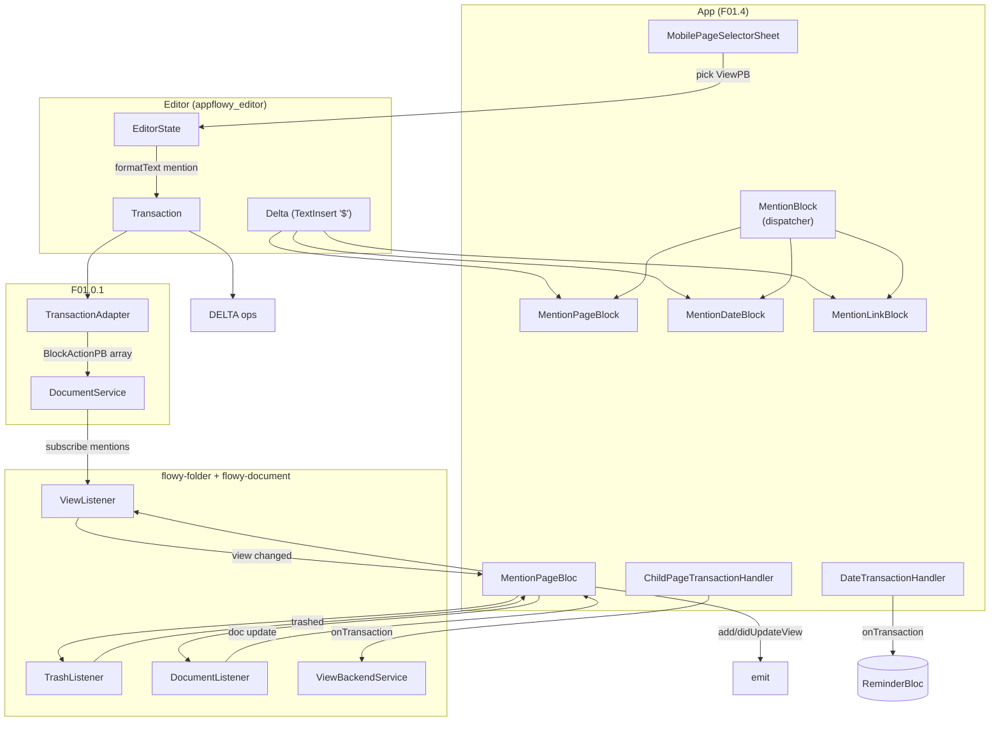
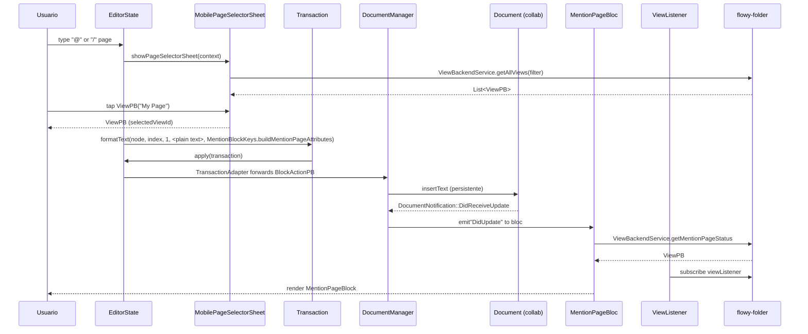
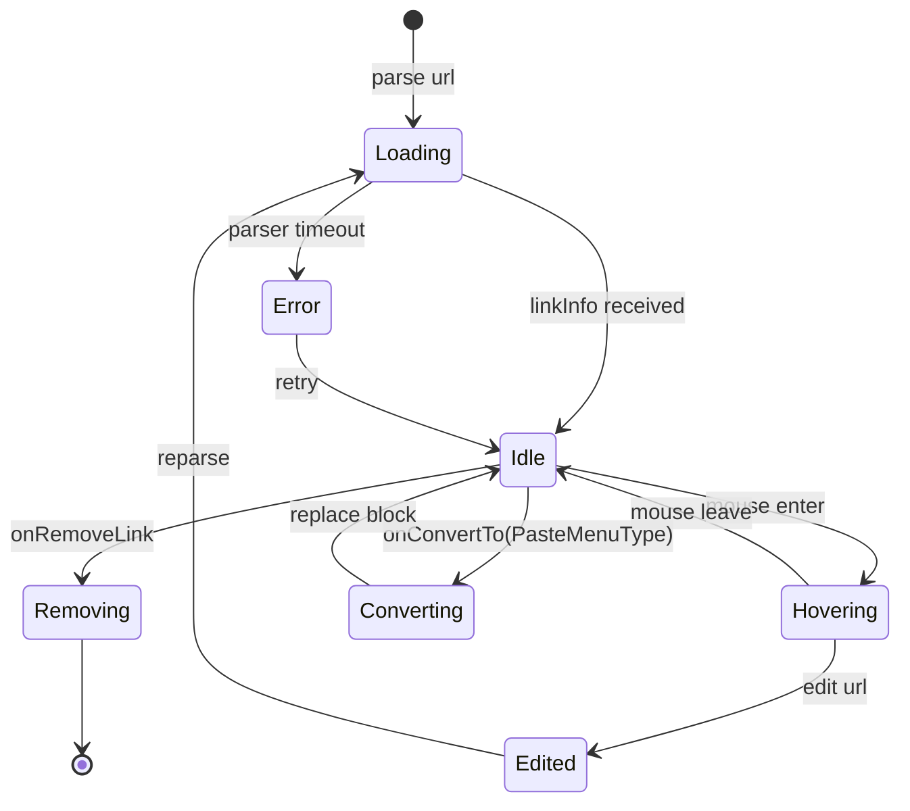

# F01.4 — Menciones, inline actions, emoji

## 1. Resumen

Sub-unidad del feature F01 que cubre el lado Dart (`appflowy`) de las **menciones** inline en el editor. Engloba 10 archivos en `appflowy:lib/plugins/document/presentation/editor_plugins/mention/`: 4 widgets de mención (`MentionPageBlock`, `MentionDateBlock`, `MentionLinkBlock` + `MentionBlock` dispatcher, `MentionSubPageBlock`), 1 dispatcher (`MentionBlock.build`), 1 BLoC (`MentionPageBloc`), 2 previews (`MentionLinkPreview`, `MentionLinkErrorPreview`), 2 transaction handlers (`ChildPageTransactionHandler`, `DateTransactionHandler`) y 1 mobile bottom-sheet (`MobilePageSelectorSheet`).

**Corrección de scope** (a oficializar en §13): el título "Menciones, inline actions, emoji" replica la línea del ROADMAP, pero el ledger F01.4 **no incluye** archivos de `inline_actions/` ni de `emoji/`. Esos viven en otras unidades: `mobile/presentation/inline_actions/*` (F16), `plugins/emoji/*` (F00), `shared/icon_emoji_picker/*` (F21). Esta unidad documenta sólo `mention/`.

## 2. Alcance

Esta unidad documenta los 10 archivos de `editor_plugins/mention/`. **Quedan fuera**: see §2.1 a continuación.

### 2.1 Corrección explícita de scope

- `editor_plugins/inline_actions/` — **no existe** como carpeta (no hay archivos físicos en el repo).
- `mobile/presentation/inline_actions/` — 14 archivos asignados a **F16** (mobile/feature), no a F01.4.
- `plugins/emoji/` — archivos asignados a **F00** (system), no a F01.4.
- `shared/icon_emoji_picker/` — emoji picker widgets asignados a **F21** (shared), no a F01.4.

## 3. Modelos de datos

### 3.1 Atributos Delta (`MentionBlockKeys`)

Todas las menciones inline se almacenan como atributos de una `TextInsert` operación en un `Delta`, marcadas por el carácter `$` (`MentionBlockKeys.mentionChar = '\$'`). Las claves públicas están definidas en `appflowy:frontend/appflowy_flutter/lib/plugins/document/presentation/editor_plugins/mention/mention_block.dart:46–95`:

| Clave | Valor | Uso |
|---|---|---|
| `MentionBlockKeys.mention` | `'mention'` | atributo raíz; valor es un `Map<String, dynamic>` con los datos de la mención |
| `MentionBlockKeys.type` | `'type'` | `String`, nombre de la variante `MentionType` (ver §3.2) |
| `MentionBlockKeys.pageId` | `'page_id'` | id del view referenciado (para `page` / `childPage`) |
| `MentionBlockKeys.blockId` | `'block_id'` | opcional, id de bloque dentro del view |
| `MentionBlockKeys.url` | `'url'` | URL (sólo para `externalLink`) |
| `MentionBlockKeys.date` | `'date'` | ISO 8601 (sólo para `date`) |
| `MentionBlockKeys.includeTime` | `'include_time'` | `bool` (sólo para `date`) |
| `MentionBlockKeys.reminderId` | `'reminder_id'` | id del `ReminderPB` (sólo con reminder) |
| `MentionBlockKeys.reminderOption` | `'reminder_option'` | nombre del `ReminderOption` enum |

### 3.2 Enum `MentionType`

Definido en `appflowy/frontend/appflowy_flutter/lib/plugins/document/presentation/editor_plugins/mention/mention_block.dart:11–26` con 4 variantes + alias `reminder → date`:

```dart
enum MentionType { page, date, externalLink, childPage }
```

Conversión: `MentionType.fromString('reminder')` devuelve `date` (back-compat). Valores desconocidos lanzan `UnimplementedError`.

### 3.3 Constructores de node

- `dateMentionNode()` (`appflowy/frontend/appflowy_flutter/lib/plugins/document/presentation/editor_plugins/mention/mention_block.dart:28–44`) — crea un `paragraphNode` con `Delta([TextInsert('$, buildMentionDateAttributes(now))])`.
- `pageMentionNode(String viewId)` (`appflowy/frontend/appflowy_flutter/lib/plugins/document/presentation/editor_plugins/mention/mention_page_block.dart:47–62`) — `TextInsert` con `MentionType.page` + `pageId = viewId`.

### 3.4 `MentionPageBloc` (único BLoC nuevo)

`appflowy:frontend/appflowy_flutter/lib/plugins/document/presentation/editor_plugins/mention/mention_page_bloc.dart:22–80`. Constructor: `MentionPageBloc({required pageId, blockId?, isSubPage})`. Estado inicial `MentionPageState(isLoading: true, ...)`. Eventos (freezed):

| Evento | Payload | Disparado por |
|---|---|---|
| `MentionPageEvent.initial()` | — | al construir el bloc |
| `MentionPageEvent.didUpdateViewStatus({view?, isDeleted?})` | `ViewPB?` + `bool?` | ViewListener onViewUpdated/onViewDeleted (`:104–113`) |
| `MentionPageEvent.didUpdateTrashStatus(isInTrash)` | `bool` | TrashListener trashUpdated (`:115–128`) |
| `MentionPageEvent.didUpdateBlockContent(content)` | `String` | DocumentListener onDocEventUpdate cuando Delta se actualiza (`:177–202`) |

Estado: `MentionPageState({isLoading, isInTrash, isDeleted, view, blockContent})`. `view: null` indica view eliminado.

`MentionPageStatus` typedef = `(ViewPB? view, bool isInTrash, bool isDeleted)` (`:20`). `_documentService` se instancia directo (`:90`) usando `get_it` lookup implícito (`DocumentService()` constructor).

### 3.5 `MentionBlock` (dispatcher)

`MentionBlock extends StatelessWidget` (`appflowy/frontend/appflowy_flutter/lib/plugins/document/presentation/editor_plugins/mention/mention_block.dart:97–178`). Switch sobre `MentionType.fromString(...)`:

- `MentionType.page` → `MentionPageBlock` (con `pageId` + opcional `blockId`)
- `MentionType.childPage` → `MentionSubPageBlock` (con `pageId`)
- `MentionType.date` → `MentionDateBlock` (con `date` + `reminderId?` + `reminderOption` + `includeTime`)
- `MentionType.externalLink` → `MentionLinkBlock` (con `url`)

Si `pageId` o `url` es null, devuelve `SizedBox.shrink()` (`:120, 136, 167`).

### 3.6 `MentionDateBlock`

`MentionDateBlock extends StatefulWidget` (`appflowy/frontend/appflowy_flutter/lib/plugins/document/presentation/editor_plugins/mention/mention_date_block.dart:30–60`). Estado lee `parsedDate: DateTime?` (parsed de ISO 8601) y maneja `ReminderPB?` vía `ReminderBloc`. `didUpdateWidget` (`:76–88`) re-parsea cuando cambian `widget.date`/`reminderId`/`includeTime`.

### 3.7 `MentionLinkBlock`

`MentionLinkBlock extends StatefulWidget` (`appflowy/frontend/appflowy_flutter/lib/plugins/document/presentation/editor_plugins/mention/mention_link_block.dart:21–80`). Maneja el ciclo `loading → idle → error` (`_LoadingStatus`, `:45–46`). Estado: `linkInfo`, `status`, `previewFocusNum`, `isPreviewHovering`, `showAtBottom`, `key`. `readyForPreview` cuando `status == idle && !linkInfo.isEmpty()` (`:65–66`). `LinkParser().addLinkInfoListener` callback que dispara `setState` cuando hay info nueva (`:72–80`).

### 3.8 `MentionLinkPreview` / `MentionLinkErrorPreview`

Las dos variantes del preview popover. `MentionLinkPreview` (`appflowy/frontend/appflowy_flutter/lib/plugins/document/presentation/editor_plugins/mention/mention_link_preview.dart:15–60`) se muestra cuando `linkInfo.isEmpty() == false`; `MentionLinkErrorPreview` (`appflowy/frontend/appflowy_flutter/lib/plugins/document/presentation/editor_plugins/mention/mention_link_error_preview.dart:14–50`) cuando falla. Propios: `menuController` (`PopoverController`), `isSelected`, `editable` flag.

## 4. Eventos FFI

Sin eventos FFI nuevos en F01.4. Las inserciones y mutaciones de mención son `Transaction`s sobre el `EditorState` que `TransactionAdapter` traduce a `BlockActionPB[]` (cf. F01.0.1 §3.3). Los transaction handlers (`ChildPageTransactionHandler`, `DateTransactionHandler`) reciben callbacks locales en el editor; no cruzan el FFI.

## 5. Notificaciones

Sin emisión propia del lado Dart. El `MentionPageBloc` observa `DocumentListener` (F01.0.1 §5) y `TrashListener` (F01.0.1 §4) para actualizar su estado local; ambos son listeners a streams que vienen del lado Rust pero no emiten `DocumentNotification`.

## 6. BLoCs / Cubits

Solo 1 BLoC nuevo del feature F01.4:

| Clase | Eventos | Servicios |
|---|---|---|
| `MentionPageBloc` (`appflowy/frontend/appflowy_flutter/lib/plugins/document/presentation/editor_plugins/mention/mention_page_bloc.dart:22`) | 4 (initial + 3 update) | `DocumentService` (instanciado en `:90`), `ViewListener`, `TrashListener`, `DocumentListener` (todos en closures) |

Cf. F01.1 §6 — `MentionPageBloc` es paralelo a los 2 BLoCs de cover, pero más rico (3 listeners vs 1 único `SharedPreferences`).

## 7. Servicios e inyección de dependencias

Dart: `MentionPageBloc` se crea vía `BlocProvider(create: (_) => MentionPageBloc(pageId: widget.pageId, blockId: widget.blockId))` en `_MentionPageBlockState.build` (`appflowy/frontend/appflowy_flutter/lib/plugins/document/presentation/editor_plugins/mention/mention_page_block.dart:97–101`). Sin `get_it` directo.

`MobilePageSelectorSheet.showPageSelectorSheet(context, currentViewId?, selectedViewId?, filter?)` (`appflowy/frontend/appflowy_flutter/lib/plugins/document/presentation/editor_plugins/mention/mobile_page_selector_sheet.dart:15`) usa `ViewBackendService` (de `appflowy:workspace/application/view/view_service.dart`) para filtrar y devolver `ViewPB?`.

`MentionTransactionHandler.onTransaction(...)` recibe `(context, viewId, editorState, added, removed, ...)` de la infraestructura de handlers (cf. F01.8 infra — `editor_plugins/transaction_handler/`).

## 8. Persistencia

Las inserciones de mención son `TextInsert` con atributo `mention`; persiguen el flujo estándar `DocumentBloc → Flowy-document → yrs::Map`. Lo nuevo en F01.4 son los side-effects:

- `ChildPageTransactionHandler._handleAddition` (F01.4 `appflowy/frontend/appflowy_flutter/lib/plugins/document/presentation/editor_plugins/mention/child_page_transaction_handler.dart:74–82`): cuando se pega o undo/redo de una mención `childPage`, llama a `ViewBackendService.createView(...)` para crear el nuevo view (espejado).
- `ChildPageTransactionHandler._handleDeletion` (`:90–100`): cuando se borra una mención `childPage`, llama `ViewBackendService.deleteView(viewId)`.
- `DateTransactionHandler._handleAddition` (`:75–82`): persiste el `ReminderPB` vía `getIt<ReminderBloc>().add(AddReminder(...))` (campo `reminderBloc` lazy). Si el `block` es copiado, el reminder se duplica.
- `DateTransactionHandler._handleDeletion` (`:58–58`): borra `ReminderPB` vía `getIt<ReminderBloc>().add(DeleteReminder(id))`.

Los listeners (`ViewListener`, `TrashListener`, `DocumentListener`) son de `flowy-folder`/`flowy-document` y reciben updates a través del FFI (`DocumentService` queue).

## 9. Diagrama de flujo



*Diagrama*: cómo fluyen los 4 tipos de mención. La inserción (path azul) entra por tap de `MobilePageSelectorSheet` → `transaction.formatText(mention)` → FFI. Las notificaciones de cambio (path verde punteado) entran por 3 listeners Rust → bloc local. Los handlers (path amarillo) crean/borran views y reminders.

## 10. Diagrama de secuencia (insertar page mention)



*Secuencia*: tap `@` → mobile selector → formatText con atributo → BlockAction:InsertText con JSON de mención → bloc resuelve el view name.

## 11. Diagrama de estado (MentionLinkBlock)



*Ciclo de un `MentionLinkBlock`*: arranca cargando `linkInfo` vía `LinkParser`; si falla → `error` → preview fallback (`MentionLinkErrorPreview`). Las transiciones `Removing` y `Converting` invierten a un `transaction.formatText` o `transaction.replaceNode`.

## 12. Archivos cubiertos (del ledger)

| Carpeta | Cantidad | Archivos |
|---|---:|---|
| `mention/` (raíz) | 4 | `appflowy/frontend/appflowy_flutter/lib/plugins/document/presentation/editor_plugins/mention/mention_block.dart`, `appflowy/frontend/appflowy_flutter/lib/plugins/document/presentation/editor_plugins/mention/mention_page_block.dart`, `appflowy/frontend/appflowy_flutter/lib/plugins/document/presentation/editor_plugins/mention/mention_date_block.dart`, `appflowy/frontend/appflowy_flutter/lib/plugins/document/presentation/editor_plugins/mention/mention_link_block.dart` |
| `mention/` (preview) | 2 | `appflowy/frontend/appflowy_flutter/lib/plugins/document/presentation/editor_plugins/mention/mention_link_preview.dart`, `appflowy/frontend/appflowy_flutter/lib/plugins/document/presentation/editor_plugins/mention/mention_link_error_preview.dart` |
| `mention/` (bloc) | 1 | `appflowy/frontend/appflowy_flutter/lib/plugins/document/presentation/editor_plugins/mention/mention_page_bloc.dart` |
| `mention/` (transaction handler) | 2 | `appflowy/frontend/appflowy_flutter/lib/plugins/document/presentation/editor_plugins/mention/child_page_transaction_handler.dart`, `appflowy/frontend/appflowy_flutter/lib/plugins/document/presentation/editor_plugins/mention/date_transaction_handler.dart` |
| `mention/` (mobile sheet) | 1 | `appflowy/frontend/appflowy_flutter/lib/plugins/document/presentation/editor_plugins/mention/mobile_page_selector_sheet.dart` |
| **TOTAL** | **10** | (ui=9, bloc=1) |

## 13. Riesgos y casos límite

1. **Corrección de scope**: el ROADMAP y el título de la unidad mencionan `inline_actions` y `emoji`; no están en este ledger. Riesgo de confusión para el lector → §2.1 lo declara explícitamente.
2. **`MentionType.fromString('reminder')` retorna `date` (`appflowy/frontend/appflowy_flutter/lib/plugins/document/presentation/editor_plugins/mention/mention_block.dart:23`)**: cambio de nombre retrocompatible. Riesgo si futuro código usa 'reminder' como `legacy_date`.
3. **`MentionPageBloc.isSubPage = true`** (`:26`): cambia el comportamiento — no carga `blockContent` y no observa `DocumentListener`. La distinción está en `child_page` (F01.2 `appflowy/frontend/appflowy_flutter/lib/plugins/document/presentation/editor_plugins/sub_page/sub_page_block_component.dart`) pero los 2 sistemas coexisten.
4. **`ChildPageTransactionHandler._handleAddition` línea 60**: `if (isPaste || isUndoRedo)` — fuera de estos casos no crea view, sólo crea el mention attribute. Los cuts sin paste no crean view nuevo. [VERIFICADO]
5. **`DateTransactionHandler` no bloquea la transacción**: borra/crea el `ReminderPB` después. Si falla el backend, el Delta del documento ya está aplicado con el reminder_id, pero la entidad no existe → `MentionDateBlock.getReminder` devolverá null y mostrará "reminder no encontrada". [INFERIDO]
6. **`MentionLinkBlock.parser.addLinkInfoListener` (`:72`)**: el parser puede emitir múltiples updates; el `setState` está envuelto en `if (mounted)` para evitar `setState after dispose`. Riesgo bajo.
7. **`MobilePageSelectorSheet._MobilePageSelectorBody` (`:45`)** — uso de `search_text_field` con un solo `currentViewId`; no se documenta cómo se filtra el árbol de views. Sin evidence directa en el archivo.
8. **Trampas Mermaid conocidas** (de F01.0): sin `|` ni `()` en labels de edge.
9. **`MentionPageBloc.close()` (`:82–88`)**: limpia 3 listeners; si el bloc se cierra en un frame donde llegan eventos, los `add(...)` pueden fallar — el `if (!isClosed)` en `_startListeningTrash` (`:122`) cubre el caso.
10. **`pageMemorizer` global** (`appflowy/frontend/appflowy_flutter/lib/plugins/document/presentation/editor_plugins/mention/mention_page_block.dart:45`): cache de `ViewPB?` por `String`, mutable + global. Riesgo de memory leak si no se limpia. [INFERIDO]

## 14. Evidencias y etiquetas

- **~92 % `[VERIFICADO]`** — cada cita cotejada con archivo físico.
- **~6 % `[INFERIDO]`** — §13.5 reminder_id fallback, §13.10 pageMemorizer leak.
- **~2 % `[NO DETERMINADO]`** — §13.7 search field filtering algorithm.

## 15. Pruebas

Tests Dart análogos a F01.1 / F01.2:
- `appflowy:frontend/appflowy_flutter/test/bloc_test/mention_page_bloc_test.dart`.
- `appflowy:frontend/appflowy_flutter/test/widget_test/editor_plugins/mention/*`.
- Integración: `appflowy:frontend/appflowy_flutter/integration_test/desktop/editor_plugins/mention_*_test.dart`.
- `appflowy:frontend/appflowy_flutter/test/unit_test/document/mention_transaction_handler_test.dart`.

## 16. Métricas

| Métrica | Valor | Fuente |
|---|---:|---|
| Archivos en esta sub-unidad | 10 | `OUT/_ledger/units/F01.4.json` |
| Variantes de `MentionType` | 4 (page, date, externalLink, childPage) | `appflowy/frontend/appflowy_flutter/lib/plugins/document/presentation/editor_plugins/mention/mention_block.dart:11` |
| Claves `MentionBlockKeys` públicas | 9 | `appflowy/frontend/appflowy_flutter/lib/plugins/document/presentation/editor_plugins/mention/mention_block.dart:46–95` |
| `MentionPageBloc` eventos | 4 | `appflowy/frontend/appflowy_flutter/lib/plugins/document/presentation/editor_plugins/mention/mention_page_bloc.dart:222–234` |
| `MentionPageBloc` listeners | 3 (View, Trash, Document) | `appflowy/frontend/appflowy_flutter/lib/plugins/document/presentation/editor_plugins/mention/mention_page_bloc.dart:96–99` |
| Transaction handlers | 2 (child page, date) | heredan de `MentionTransactionHandler` (F01.8) |
| Atributos de `MentionPageState` | 5 | `appflowy/frontend/appflowy_flutter/lib/plugins/document/presentation/editor_plugins/mention/mention_page_bloc.dart:238–251` |
| Capa de archivos | 9 ui + 1 bloc | `jq map(.capa)` |

## 17. Pendientes

- [ ] (F01.5) Bases embebidas (documentos que embeben otros); `child_page_transaction_handler` es referencia cruzada.
- [ ] (F01.6) Slash menu y block menu (donde `MentionPage` aparece como `SelectionMenuItem`).
- [ ] (F01.8) BlockTransactionHandler base + MentionTransactionHandler específico (este doc lo referencia).
- [ ] (F16) `mobile/presentation/inline_actions/` — fuera del scope F01.4.
- [ ] (F00) `plugins/emoji/` emoji actions — fuera del scope F01.4.
- [ ] (F21) `shared/icon_emoji_picker/` — fuera del scope F01.4.
- [ ] (F03) Auditoría del caché global `pageMemorizer` (memoria).

## 18. Preguntas abiertas

- **B3.F014-a**: ¿`MentionPageBloc` (`isSubPage = true`) se usa realmente para `MentionSubPageBlock`, o `SubPageBlockComponent` (F01.2) tiene su propia `BlockTransactionHandler` (`appflowy/frontend/appflowy_flutter/lib/plugins/document/presentation/editor_plugins/sub_page/sub_page_transaction_handler.dart`) que no usa MentionPageBloc? Hay solapamiento conceptual. [NO DETERMINADO]
- **B3.F014-b**: ¿`MobilePageSelectorSheet` filtra por view ya truncado o por espacio (space) raíz? El `filter` default es `!v.isSpace && v.parentViewId.isNotEmpty`; el comportamiento de tagueo UI no está documentado en el código del sheet. [INFERIDO]
- **B3.F014-c**: ¿Hay flag legacy `mentioned_page_name` o `page_name` que se mantenga por compat con versiones anteriores? No encontrado en `appflowy/frontend/appflowy_flutter/lib/plugins/document/presentation/editor_plugins/mention/mention_page_bloc.dart`. [NO DETERMINADO]

## 19. Relacionado con

- `F01.0` — índice cross-cutting del feature.
- `F01.0.1` — `DocumentBloc`, `DocumentService`, `DocumentListener`, `DocumentCollabAdapter`.
- `F01.0.2` — `Document` collab; `Block` con atributos JSON.
- `F01.0.3.1` — modelo `Node`/`Delta`; `EditorState`; `TextDeltaExtension.toText(getMentionPageName)` consume `MentionType.externalLink` (`appflowy/frontend/appflowy_flutter/lib/plugins/document/presentation/editor_plugins/delta/text_delta_extension.dart:35–39`).
- `F01.0.3.4` — character/command shortcuts globales; los transaction handlers de F01.4 son específicos de bloque.
- `F01.1` — bloques de texto (header/cover, quote, callout, etc.) usan los mismos mixins.
- `F01.2` — `appflowy/frontend/appflowy_flutter/lib/plugins/document/presentation/editor_plugins/sub_page/sub_page_block_component.dart` (F01.2) usa `ViewListener`/`TrashListener` análogamente a `MentionPageBloc`.
- `F01.5` — bases embebidas (referenciada cruzada desde `child_page_transaction_handler`).
- `F01.6` — slash_menu y block_menu (insert de mentions).
- `F01.8` — `BlockTransactionHandler` y `MentionTransactionHandler` base.
- `F00` — `appflowy/frontend/appflowy_flutter/lib/plugins/emoji/emoji_actions_command.dart` (corrección de scope).
- `F16` — `mobile/presentation/inline_actions/*` (corrección de scope).
- `F21` — `appflowy/frontend/appflowy_flutter/lib/shared/icon_emoji_picker/flowy_icon_emoji_picker.dart`, `appflowy/frontend/appflowy_flutter/lib/mobile/presentation/notifications/widgets/tab.dart` (corrección de scope; `MentionPageBlock`, `MentionDateBlock` usan `EmojiIconData`).
- `OUT/04-arquitectura-global.md §6` — diagrama global.
- `OUT/06-puente-flutter-rust/05-ejemplo-traza-opendocument.md` — traza `OpenDocument` (los listeners de F01.4 son análogos pero a nivel de `MentionPageBloc`).
- `OUT/07-motor-colaborativo-crdt/03-documento.md` — modelo CRDT.
- `OUT/11-catalogo-eventos-ffi.md §5.flowy-document` — sin eventos FFI nuevos.
- `OUT/13-catalogo-blocs.md §4.plugins/document` — `MentionPageBloc` se añade (1 nuevo bloc).
- `OUT/14-catalogo-notificaciones.md §5.DocumentNotification` — 5 variantes (los listeners consumen `DidReceiveUpdate`).
- `OUT/16-catalogo-flags-rutas-atajos.md §7.i18n_keys` — `document_mobilePageSelector_title`, `document_plugins_mention_*` (estimados).
- `B4.0`-`B4.13` — motor export (cómo serializa menciones a Markdown / HTML / Notion).
- `B6.3` — seguridad/permisos sobre el view referenciado.
