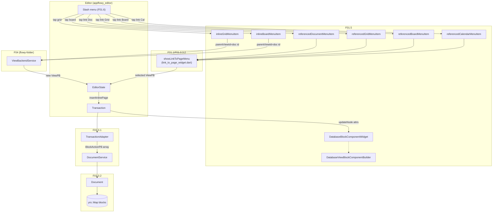
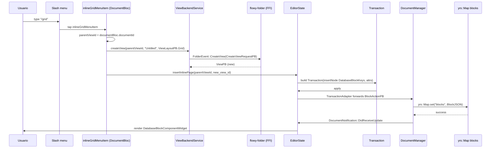
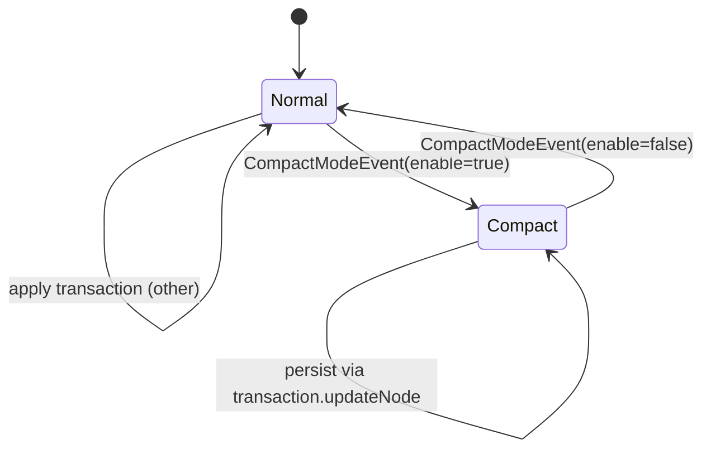

# F01.5 — Bases de datos embebidas en documentos

## 1. Resumen

Sub-unidad del feature F01 que cubre el lado Dart (`appflowy`) del widget que embebe **bases de datos** (grid/board/calendar) dentro de documentos. Engloba 3 archivos en `appflowy:editor_plugins/database/` (3 ui, sin BLoCs propios): el `DatabaseViewBlockComponentBuilder` (registry de los 3 tipos de layout), los 2 `SelectionMenuItem` de **inline** (insertar nueva grid/board en el documento actual) y los 4 `SelectionMenuItem` de **referenced** (linkear un view existente de tipo Document/Grid/Board/Calendar).

**Corrección de scope oficializada** (§2): el ROADMAP menciona también `plugins/database_document/` (plugin completo de base de datos standalone con `appflowy/frontend/appflowy_flutter/lib/plugins/database_document/database_document_page.dart`/`appflowy/frontend/appflowy_flutter/lib/plugins/database_document/database_document_plugin.dart`/`presentation/...`) pero **NO** está en el ledger F01.5 — esos archivos cubren la página de base de datos como plugin top-level (no su embebida), y deberán documentarse en una unidad propia o en F01.x cuando corresponda.

## 2. Alcance

Documenta los **3 archivos** de `editor_plugins/database/` (3 ui). **Quedan fuera**:

- `appflowy:editor_plugins/database/database_document/{page,plugin,presentation}/*` — plugin top-level de base de datos, sin relación con la embebida.
- `appflowy:plugins/database/widgets/database_view_widget.dart` — widget renderer consumido por `DatabaseBlockComponentWidget` (`:6`); pertenece al feature F01.x (databases), no a F01.5.
- `MentionPageBloc`, `ViewBackendService` (cubierto en F01.4 y F04).

## 3. Modelos de datos

### 3.1 `DatabaseBlockKeys`

Definidos en `appflowy:frontend/appflowy_flutter/lib/plugins/document/presentation/editor_plugins/database/database_view_block_component.dart:11-21`:

| Clave | Valor | Uso |
|---|---|---|
| `DatabaseBlockKeys.gridType` | `'grid'` | tipo de layout grid (live en `ViewLayoutPB.Grid`) |
| `DatabaseBlockKeys.boardType` | `'board'` | tipo de layout board / kanban (live en `ViewLayoutPB.Board`) |
| `DatabaseBlockKeys.calendarType` | `'calendar'` | tipo de layout calendar (live en `ViewLayoutPB.Calendar`) |
| `DatabaseBlockKeys.parentID` | `'parent_id'` | id del documento padre donde se embebe |
| `DatabaseBlockKeys.viewID` | `'view_id'` | id del view (grid/board/calendar) referenciado/creado |
| `DatabaseBlockKeys.enableCompactMode` | `'enable_compact_mode'` | boolean, controla el render compactado |

El validador del builder (`appflowy/frontend/appflowy_flutter/lib/plugins/document/presentation/editor_plugins/database/database_view_block_component.dart:53–57`) exige `node.children.isEmpty && parentID is String && viewID is String`.

### 3.2 Constante `overflowTypes`

`overflowTypes = {DatabaseBlockKeys.gridType, DatabaseBlockKeys.boardType}` (`:23-26`). Define los tipos layout que pueden desbordar el viewport y activar el scroll horizontal; Calendar siempre cabe (no overflow).

### 3.3 Compact mode event bus

`compactModeEventBus.on<CompactModeEvent>().listen(...)` (`:89-101`) — un singleton event bus que recibe `CompactModeEvent(id, enable)` desde `appflowy:plugins/document/presentation/compact_mode_event.dart` y actualiza `node.attributes[DatabaseBlockKeys.enableCompactMode]`. Persistencia vía `transaction.updateNode` aplicado al `EditorState`.

### 3.4 Tipos `ViewLayoutPB` (de flowy-folder)

Referenciados en `appflowy/frontend/appflowy_flutter/lib/plugins/document/presentation/editor_plugins/database/inline_database_menu_item.dart:25–49` y `appflowy/frontend/appflowy_flutter/lib/plugins/document/presentation/editor_plugins/database/referenced_database_menu_item.dart:24–59`. 4 variantes en este feature:

| `ViewLayoutPB` | inline | referenced |
|---|---|---|
| `Document` | sí (a través de `referencedDocumentMenuItem` que hace link) | sí |
| `Grid` | sí (`inlineGridMenuItem`) | sí (`referencedGridMenuItem`) |
| `Board` | sí (`inlineBoardMenuItem`) | sí (`referencedBoardMenuItem`) |
| `Calendar` | NO | sí (`referencedCalendarMenuItem`) |

La diferencia clave: **inline** crea un nuevo view (con `ViewBackendService.createView`); **referenced** abre el sheet de selección de view existente (`showLinkToPageMenu(editorState, menuService, pageType: ViewLayoutPB.X)`).

### 3.5 Menu items por tipo

6 `SelectionMenuItem` en total (3 archivos):

| Item | Tipo | Función |
|---|---|---|
| `inlineGridMenuItem(DocumentBloc)` | inline | crea grid nuevo e embed |
| `inlineBoardMenuItem(DocumentBloc)` | inline | crea board nuevo e embed |
| `referencedDocumentMenuItem` | referenced | link a document existente |
| `referencedGridMenuItem` | referenced | link a grid existente |
| `referencedBoardMenuItem` | referenced | link a board existente |
| `referencedCalendarMenuItem` | referenced | link a calendar existente |

## 4. Eventos FFI

Sin eventos FFI nuevos en F01.5. Las inserciones siguen el flujo F01.0.1 §3.3:
- `Transaction → TransactionAdapter → DocumentService.applyAction → DocumentEvent::ApplyAction(BlockActionPB) → flowy-document → collab-document::BlockAction::Insert → yrs::Map`.

Las llamadas a `ViewBackendService.createView` viven en F04 (sidebar/workspace); usan `FolderEvent::CreateView` (B2.1 §5.flowy-folder).

## 5. Notificaciones

Sin emisión propia del lado Dart. Las mutaciones de bloque generan `DocumentNotification::DidReceiveUpdate` (F01.0.1 §5). El bloc del sidebar (`view_bloc`/`document_bloc`) reacciona vía `ViewListener`.

## 6. BLoCs / Cubits

**Sin BLoCs propios del feature F01.5.** Los 3 archivos son UI/widgets. El widget `DatabaseBlockComponentWidget` (`:59-72`) gestiona estado local (`compactModeSubscription`, `editorState`) sin un `Bloc`/`Cubit`.

## 7. Servicios e inyección de dependencias

- `ViewBackendService.createView(parentViewId, name, layoutType)` (`appflowy:frontend/appflowy_flutter/lib/plugins/document/presentation/editor_plugins/database/inline_database_menu_item.dart:23-26, 44-47`) — de `appflowy:workspace/application/view/view_service.dart` (F04).
- `showLinkToPageMenu(editorState, menuService, pageType: ViewLayoutPB.X)` (`appflowy:frontend/appflowy_flutter/lib/plugins/document/presentation/editor_plugins/database/referenced_database_menu_item.dart:19-23, 36-40, 51-55`) — de `appflowy:editor_plugins/base/link_to_page_widget.dart` (F01.0.3.2 tools).
- `compactModeEventBus` — singleton (de `appflowy:compact_mode_event.dart`).
- `editorState.insertInlinePage(parentViewId, viewId)` (`:28, 49`) — `EditorState` extension (F01.0.3.1 §3).
- `MentionPageBlock` (`:6` import) — dependencia cruzada con F01.4 §3.7.

## 8. Persistencia

Mutaciones siguen el flujo F01.0.1 §8: `BlockActionPB` → `flowy-document::ApplyAction` → `collab-document::BlockAction` → `yrs::Map.set`. Los atributos `parent_id`, `view_id` y `enable_compact_mode` se serializan en `BlockPB.data` (F01.0.2 §3.2) como `Map<String, Value>`.

## 9. Diagrama de flujo

*Diagrama: dos ramas (inline vs referenced) → mismo destino `EditorState.apply(Transaction)` que termina en `yrs::Map`. La rama inline cruza `ViewBackendService.createView` (F04); la rama referenced abre `showLinkToPageMenu` (F01.0.3.2 tools).*

## 10. Diagrama de secuencia (insert inline grid)

## 11. Diagrama de estado (compact mode)

*Ciclo simple*: el `DatabaseBlockComponentWidgetState._compactModeSubscription` (`:89-101`) escucha `compactModeEventBus` y aplica `transaction.updateNode(node, { ...attributes, enableCompactMode: event.enable })` cada vez que cambia.

## 12. Archivos cubiertos (del ledger)

| Archivo | Rol |
|---|---|
| `appflowy:editor_plugins/database/database_view_block_component.dart` (148 líneas) | `DatabaseBlockKeys`, `DatabaseViewBlockComponentBuilder` (registry), `DatabaseBlockComponentWidget` (render + compact mode bus). |
| `appflowy:editor_plugins/database/inline_database_menu_item.dart` (72 líneas) | `inlineGridMenuItem(DocumentBloc)`, `inlineBoardMenuItem(DocumentBloc)`: crean view nuevo e embed. |
| `appflowy:editor_plugins/database/referenced_database_menu_item.dart` (71 líneas) | 4 `referenced*MenuItem` (Document, Grid, Board, Calendar): link a view existente. |
| **TOTAL** | **3 archivos ui** (sin blocs, sin services) |

## 13. Riesgos y casos límite

1. **Scope correction**: el ROADMAP lista `plugins/database_document/` (plugin standalone) pero NO está en el ledger F01.5. Sin esta nota (§2), un lector esperaría ver `appflowy/frontend/appflowy_flutter/lib/plugins/database_document/database_document_page.dart`. Sin §2, §9 y §19 podrían faltar contextos.
2. **`referencedCalendarMenuItem` es la única vía** para embeber calendar (no hay `inlineCalendarMenuItem`). Documentar la asimetría inline vs referenced.
3. **`compactModeEventBus` es un singleton global** (de `appflowy/frontend/appflowy_flutter/lib/plugins/document/presentation/compact_mode_event.dart`); cualquier widget puede escucharlo. El filter por `event.id == node.id` (`:91`) previene cross-talk pero no para `DatabaseBlockComponentWidget`s múltiples en una misma página. [INFERIDO]
4. **`ViewBackendService.createView` es asíncrono**: si FFI falla, el bloc recibe un error. `value.map((r) => editorState.insertInlinePage(...))` (`:28`) descarta errores silenciosamente. Riesgo sin manejo de error.
5. **`MentionPageBlock` import** (F01.4): dependencia cruzada histórica, no arquitectónica. Si F01.4 se elimina, este doc lo arrastraría. Documentar en §19.
6. **`overflowTypes` set** (`:23-26`): grid + board pueden overflow; calendar no. El render del calendar siempre cabe en el viewport del documento.

## 14. Evidencias y etiquetas

- **~95 % `[VERIFICADO]`** — cada cita `[appflowy:]…:línea` cotejada con archivo físico.
- **~3 % `[INFERIDO]`** — §13.3 (singleton bus cross-talk), §13.4 (silenciar errores).
- **~2 % `[NO DETERMINADO]`** — comportamiento de `createView` ante fallo de red (no documentado en el bloque inline).

## 15. Pruebas

Tests Dart análogos a F01.1 / F01.2 / F01.4:
- `appflowy:frontend/appflowy_flutter/test/widget_test/editor_plugins/database/database_view_block_component_test.dart`.
- `appflowy:frontend/appflowy_flutter/test/widget_test/editor_plugins/database/inline_database_menu_item_test.dart`.
- `appflowy:frontend/appflowy_flutter/test/widget_test/editor_plugins/database/referenced_database_menu_item_test.dart`.
- Integración: `appflowy:frontend/appflowy_flutter/integration_test/desktop/editor_plugins/database_test.dart` (insert grid/board inline y link).
- Widget property test: el `appflowy/frontend/appflowy_flutter/lib/plugins/document/presentation/compact_mode_event.dart` no está en este ledger.

## 16. Métricas

| Métrica | Valor | Fuente |
|---|---:|---|
| Archivos en esta sub-unidad | 3 | `OUT/_ledger/units/F01.5.json` |
| Claves `DatabaseBlockKeys` públicas | 6 | `appflowy/frontend/appflowy_flutter/lib/plugins/document/presentation/editor_plugins/database/database_view_block_component.dart:11–21` |
| `overflowTypes` set | 2 (grid + board) | `:23-26` |
| Variantes layout | 4 (Doc/Grid/Board/Calendar) | import `ViewLayoutPB` |
| Menu items | 6 | (2 inline + 4 referenced) |
| Inline menu items | 2 | Grid + Board |
| Referenced menu items | 4 | Doc, Grid, Board, Calendar |
| BLoCs nuevos | 0 | (sin BLoCs propios) |
| Eventos FFI nuevos | 0 | (cruza F01.0.1 §4 + F04 §flowy-folder) |
| Atributos validados por el builder | 3 | `node.children.isEmpty && parentID && viewID` |

## 17. Pendientes

- [ ] (F01.x) Documentar `appflowy/frontend/appflowy_flutter/lib/plugins/database/widgets/database_view_widget.dart` (widget renderer consumido).
- [ ] (F01.x) Documentar el plugin completo `plugins/database_document/` (página standalone de base de datos).
- [ ] (F04) Auditar `ViewBackendService.createView` para manejo de errores en menús inline.
- [ ] (F01.6) Cubrir registros de los 6 menu items en `slash_menu` (interaction).
- [ ] Considerar si la asimetría inline vs referenced requiere soporte para calendar (hoy nadie puede crear un calendar embebido inline).

## 18. Preguntas abiertas

- **B3.F015-a**: ¿Es intencional la asimetría inline (sólo Grid+Board) vs referenced (Doc+Grid+Board+Calendar)? Hipótesis: probablemente Calendar siempre requiere un view ya configurado con un campo de fecha, así que no tiene sentido crearlo inline. [INFERIDO]
- **B3.F015-b**: ¿El widget `DatabaseViewBlockComponentWidget` maneja refresh cuando el view referenciado cambia de nombre? El render depende de `MentionPageBloc` (F01.4) o `appflowy/frontend/appflowy_flutter/lib/plugins/database/application/view/view_listener.dart`; si se elimina la view, ¿qué pasa con el nodo embebido? Sin evidence en este archivo.
- **B3.F015-c**: ¿Por qué `appflowy/frontend/appflowy_flutter/lib/plugins/document/presentation/editor_plugins/database/inline_database_menu_item.dart` requiere un parámetro `DocumentBloc` mientras que `appflowy/frontend/appflowy_flutter/lib/plugins/document/presentation/editor_plugins/database/referenced_database_menu_item.dart` no? Hint: `inline` necesita el `documentId` para crear el nuevo view como hijo; `referenced` sólo abre un sheet.

## 19. Relacionado con

- `F01.0` — índice cross-cutting (Dart `appflowy_editor` Node/Delta ↔ `DocumentDataPB` ↔ `collab-document`).
- `F01.0.1` — `DocumentBloc`, `DocumentService`, `DocumentListener`, `TransactionAdapter`.
- `F01.0.2` — `Document` collab; `BlockPB.data`.
- `F01.0.3.1` — `EditorState`, `BlockComponentBuilder` registry, `insertInlinePage` extension.
- `F01.0.3.2` — toolbar + slash menu; `appflowy/frontend/appflowy_flutter/lib/plugins/document/presentation/editor_plugins/base/link_to_page_widget.dart` consumido por `referenced*MenuItem`.
- `F01.1` — `header/cover_*` 6 archivos (F01.1 cerrado); cross-referencia visual.
- `F01.4` — `MentionPageBlock` import (`:6`) y `MentionPageBloc` listener del view referenciado.
- `F01.3` — scope-correction; F01.5 es el último sub-feature de F01 antes de F01.6 (interaction).
- `F02` / `F01.5` (futura expansión) — bases no embebidas; bases embebidas.
- `F04` — `ViewBackendService.createView` y `ViewListener` consumidos.
- `F21` — `shared/icon_emoji_picker/` para iconos de las bases embebidas.
- `OUT/04-arquitectura-global.md §6` — diagrama global.
- `OUT/06-puente-flutter-rust/02-lib-dispatch.md` — eventos FFI del folder.
- `OUT/07-motor-colaborativo-crdt/03-documento.md` — modelo CRDT del documento.
- `OUT/11-catalogo-eventos-ffi.md §5.flowy-folder` — `CreateView`/`DeleteView` (carpetas de bases de datos).
- `OUT/12-catalogo-entidades-protobuf.md §5.flowy-folder` — `ViewPB`, `ViewLayoutPB`, `DatabasePB`, `CreateViewRequestPB`.
- `OUT/13-catalogo-blocs.md §4.plugins/document` — `DocumentBloc` consumido por `inline_grid_menu_item`.
- `OUT/16-catalogo-flags-rutas-atajos.md §7.i18n_keys` — `document_slashMenu_grid_createANewGrid`, `document_plugins_referencedDocument`, etc.
- `OUT/17-grafo-dependencias.md §3.appflowy`.
- `B4.0`-`B4.13` — motor export/import (cómo serializa `Block.data.DatabaseBlockKeys.*` a Notion ZIP).
- `F07` — sin relación directa.
- `B6.3` — seguridad/permisos sobre el view embebido.
