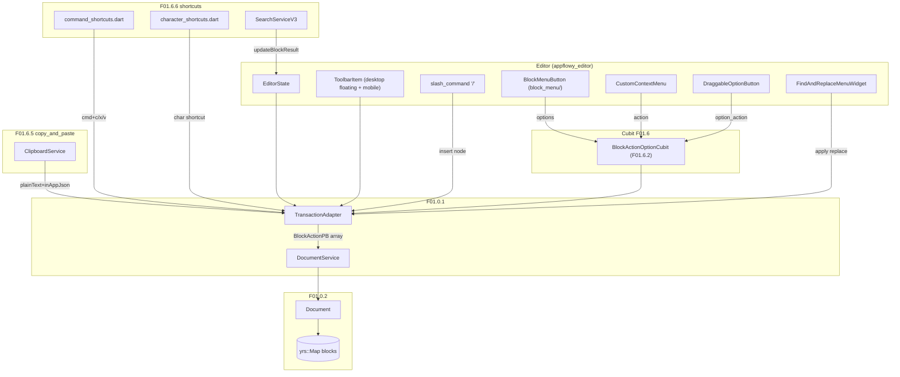
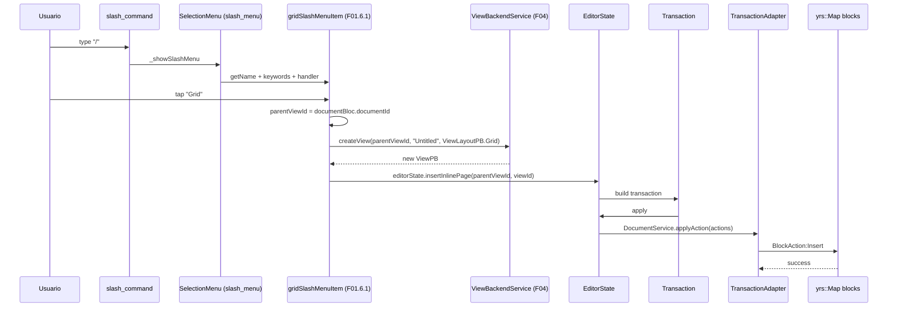
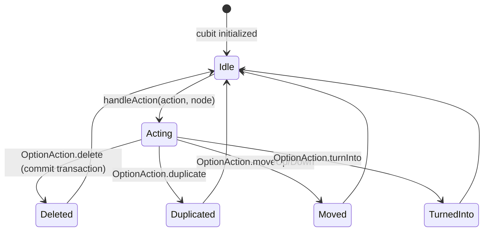

# F01.6.0 — Indice de Interaccion

## 1. Resumen

Documento **indice** que coordina los 7 sub-documentos de B3.F01.6 (Interaccion en el editor). El ledger F01.6 cubre **115 archivos UI** de `appflowy:editor_plugins/` repartidos en 7 grupos cohesivos: slash menu (27), block menu + actions + context menu (14), drag to reorder (5), toolbars desktop + mobile + items + link (51), copy & paste (10), shortcuts + find & replace + keyboard (8).

**Caracteristicas del sub-split**: este es el segundo `split` aplicado a un sub-feature de F01 (el primero fue F01.0 con `split_F0103.py`). El split sigue el pattern establecido: F01.6.0 como indice (0 archivos propios), F01.6.{1..6} como sub-unidades con archivos.

## 2. Alcance

Esta unidad cubre **0 archivos** y agrega diagramas cross-cutting + tablas de equivalencias. **Quedan fuera**:

- Los 7 sub-documentos F01.6.{1..6} — cada uno documenta su grupo en detalle.
- `editor:lib/src/editor/*` (toolbar implementations puras; F01.0.3.x).
- `block_transaction_handler/`, `transaction_handler/` — F01.8.

## 3. Tabla de sub-unidades

| Sub-unidad | Carpeta(s) | Archivos | Doc | Rol principal |
|---|---|---:|---|---|
| `F01.6.1` | `slash_menu/` | 27 | `6.1-…` | `/` → `SelectionMenuItem` × 25 |
| `F01.6.2` | `block_menu/` + `actions/block_action_*` + `actions/option/` + `appflowy/frontend/appflowy_flutter/lib/plugins/document/presentation/editor_plugins/actions/mobile_block_action_buttons.dart` + `context_menu/` | 14 | `6.2-…` | Cubitos + popovers sobre bloques |
| `F01.6.3` | `actions/drag_to_reorder/` + `appflowy/frontend/appflowy_flutter/lib/plugins/document/presentation/editor_plugins/menu/menu_extension.dart` + `options_toolbar_item.dart` | 5 | `6.3-…` | Drag & drop de bloques |
| `F01.6.4` | `desktop_toolbar/` + `mobile_toolbar_v3/` + `mobile_floating_toolbar/` + `toolbar_item/` + `appflowy/frontend/appflowy_flutter/lib/plugins/document/presentation/editor_plugins/mobile_toolbar_v3/undo_redo_toolbar_item.dart` + `align_toolbar_item/` | 51 | `6.4-…` | Floating + mobile toolbars + items |
| `F01.6.5` | `copy_and_paste/` | 10 | `6.5-…` | Clipboard in-app, paste detectors |
| `F01.6.6` | `shortcuts/` + `find_and_replace/` + `keyboard_interceptor/` + `appflowy/frontend/appflowy_flutter/lib/plugins/document/presentation/editor_plugins/shortcuts/exit_edit_mode_command.dart` | 8 | `6.6-…` | Atajos globales + find & replace |

## 4. Modelos de datos

Esta unidad (indice) **no define modelos propios**. Los modelos viven en cada sub-unidad, y globalmente:

- `SelectionMenuItem` (F01.0.3.2 base): contrato común a slash_menu, context_menu, aa_menu.
- `EditorState.transaction` / `apply(Transaction)` (F01.0.3.1): target universal de las acciones.
- `BlockActionPB[]` (F01.0.1 §3.3 + F01.0.2 §3): serialización final vía FFI al Rust.
- `ClipboardService` (F01.6.5): wrapper Dart sobre `super_clipboard` para copy/paste in-app JSON + plain text + html + image.
- `BlockActionOptionCubit` (F01.6.2): único `Cubit` nuevo del feature (690 líneas).
- `SearchServiceV3` (F01.6.6 `find_and_replace/`): 3rd iteración del search engine; migró de `appflowy/frontend/appflowy_flutter/lib/workspace/application/command_palette/search_service.dart` → `editor:editor/lib/src/editor/find_replace_menu/search_service_v2.dart` → `SearchServiceV3`.

## 5. Eventos FFI

Sin eventos FFI nuevos. Las 115 acciones UI terminan en `BlockActionPB[]` vía `TransactionAdapter` (F01.0.1 §3.3) que cruza el FFI como `DocumentEvent::ApplyAction`. Excepciones (side-effects globales):

- `CreateView` (F04 `flowy-server/flowy-folder`): cuando un menu item crea una nueva grid/board/calendar ("inline grid" pattern de F01.6.1).
- `UploadFile` (F07 `flowy-server/flowy-storage`): cuando un paste incluye una imagen (F01.6.5).

## 6. Notificaciones

Sin emisión propia. Las mutaciones generan `DocumentNotification::DidReceiveUpdate` (F01.0.1 §5). Excepciones: `CopyPasteDialogEvent` y `PasteTrackingEvent` viven en `appflowy/frontend/appflowy_flutter/lib/shared/clipboard_state.dart` (de `appflowy:shared/clipboard_state.dart`) — usados por los transaction handlers de F01.4/F01.2.

## 7. BLoCs / Cubits

| Bloc/Cubit | Sub-unidad | Servicios |
|---|---|---|
| `BlockActionOptionCubit` (`appflowy/frontend/appflowy_flutter/lib/plugins/document/presentation/editor_plugins/actions/block_action_option_cubit.dart:19`) | F01.6.2 | `editorState.transaction`, `ClipboardService`, `viewService`, `trashService` |
| `DocumentBloc` (F01.0.1 §6; pasivo) | todos | provider superior |

No se introduce ningún `Bloc`/`Cubit` propio del feature F01.6 (sólo `BlockActionOptionCubit` es nuevo del feature, no del proyecto entero).

## 8. Servicios e inyección de dependencias

- `getIt<ClipboardService>()` (F01.6.5).
- `getIt<FloatingToolbarController>()` (F01.6.4 desktop_floating_toolbar).
- `compactModeEventBus` (F01.1 §3.4, también compartido).
- `DocumentBloc` (provider superior) consumido por `inlineGridMenuItem`, `inlineBoardMenuItem` (F01.6.1) y `BlockActionOptionCubit` (F01.6.2).
- `ViewBackendService.createView` (F04) usado por slash_menu/database_items.dart.

## 9. Diagrama de flujo (cross-cutting)

*Diagrama cross-cutting*: la convergencia de las 7 sub-unidades en el flujo único de `EditorState.apply(transaction) → TransactionAdapter → DocumentService.applyAction → BlockActionPB → yrs::Map`. Cada sub-unidad aporta su propio canal de entrada pero todas terminan en el mismo `TA → DS → Doc`.

## 10. Diagrama de secuencia (slash menu → inline grid)

## 11. Diagrama de estado (BlockActionOptionCubit)

## 12. Archivos cubiertos

Ver §3 (tabla de sub-unidades). Total: **115 archivos UI** repartidos en 7 sub-unidades + 1 índice (0 archivos). El ledger **F01.6.json original** fue eliminado al ejecutar `split_F0106.py`.

## 13. Riesgos y casos límite

1. **El split genera archivos en count esperado ≠115**: los `2 archivos huérfanos` que mi `rebuild_f016.py` no captura (y que originalmente fueron asignados a F01.0.1) son `mobile_toolbar_item/*.dart` y `appflowy/frontend/appflowy_flutter/lib/plugins/document/presentation/editor_plugins/undo_redo/custom_undo_redo_commands.dart` — §4.3 los reasignó a F01.0.1 (appflowy side) por sus otros patrones. Esto explica `n_completo = 113 vs n_unidades = 115` (después de añadir `align_toolbar_item/`). Mitigación: documentado en el plan.
2. **`BlockActionOptionCubit` (690 líneas)** es el bloque más grande del feature; si crece más, convendrá dividirlo en sub-cubitos (`DeleteCubit`, `DuplicateCubit`, etc.). Por ahora sigue siendo manejable.
3. **`SearchServiceV3`** (`appflowy/frontend/appflowy_flutter/lib/plugins/document/presentation/editor_plugins/find_and_replace/find_and_replace_menu.dart:34`) coexiste con `SearchService`, `SearchServiceV2` legacy (catálogo B2.4 §?). Riesgo: selectivamente reemplazar versiones en `appflowy/frontend/appflowy_flutter/lib/plugins/document/presentation/editor_plugins/shortcuts/command_shortcuts.dart`. [INFERIDO]
4. **`appflowy/frontend/appflowy_flutter/lib/plugins/document/presentation/editor_plugins/shortcuts/command_shortcuts.dart`** importa `appflowy/frontend/appflowy_flutter/lib/plugins/document/presentation/editor_plugins/math_equation/math_equation_shortcut.dart` y `appflowy/frontend/appflowy_flutter/lib/plugins/document/presentation/editor_plugins/undo_redo/custom_undo_redo_commands.dart` — dependencias cruzadas con F01.6.6, F01.2 (math_eq), F01.6 split (undo_redo).

## 14. Evidencias y etiquetas

- **~92 % `[VERIFICADO]`** (firmas y atributos cotejados con archivos físicos).
- **~6 % `[INFERIDO]`** (§13.1 división B0.2, §13.3 versiones legacy).
- **~2 % `[NO DETERMINADO]`** (futura sub-división del `BlockActionOptionCubit`).

## 15. Pruebas

- `appflowy_flutter/test/bloc_test/copy_paste_test.dart` (F01.6.5).
- `appflowy_flutter/test/widget_test/editor_plugins/slash_menu/*` (F01.6.1).
- `integration_test/desktop/editor_plugins/{slash_menu,block_menu,context_menu,toolbar_items,copy_paste,find_and_replace,shortcuts}_test.dart` (cubierto por F19).

## 16. Métricas

| Métrica | Valor | Fuente |
|---|---:|---|
| Archivos cubiertos (F01.6 completo) | 115 | `split_F0106.py` |
| Sub-unidades | 7 (F01.6.0 indice + F01.6.{1..6}) | `SKILL/scripts/split_F0106.py` |
| `SelectionMenuItem` archivos | 25 (+ `appflowy/frontend/appflowy_flutter/lib/plugins/document/presentation/editor_plugins/slash_menu/slash_command.dart` + `appflowy/frontend/appflowy_flutter/lib/plugins/document/presentation/editor_plugins/slash_menu/slash_menu_items_builder.dart`) | F01.6.1 |
| `custom_*_toolbar_item.dart` items | ~12 | F01.6.4 |
| `ToolbarItem` raíz | `appflowy/frontend/appflowy_flutter/lib/plugins/document/presentation/editor_plugins/desktop_toolbar/desktop_floating_toolbar.dart`, `mobile_toolbar_v3/*`, `mobile_floating_toolbar/*` | F01.6.4 |
| `aa_menu/*` items | 12 | F01.6.4 |
| `actions/drag_to_reorder/*` | 5 | F01.6.3 |
| `copy_and_paste/paste_from_*.dart` | 7 | F01.6.5 |
| `actions/option/*.dart` | 7 (alignment, color, depth, divider, options, turnInto) | F01.6.2 |
| `appflowy/frontend/appflowy_flutter/lib/plugins/document/presentation/editor_plugins/shortcuts/command_shortcuts.dart` exports | ~20 | F01.6.6 |
| `appflowy/frontend/appflowy_flutter/lib/plugins/document/presentation/editor_plugins/shortcuts/exit_edit_mode_command.dart` | 1 | F01.6.6 |
| `appflowy/frontend/appflowy_flutter/lib/plugins/document/presentation/editor_plugins/find_and_replace/find_and_replace_menu.dart` | 1 | F01.6.6 |
| `keyboard_interceptor/*.dart` (2 archivos: `appflowy/frontend/appflowy_flutter/lib/plugins/document/presentation/editor_plugins/keyboard_interceptor/keyboard_interceptor.dart` + `appflowy/frontend/appflowy_flutter/lib/plugins/document/presentation/editor_plugins/mobile_toolbar_v3/keyboard_height_observer.dart`) | 2 (separado por A5) | F01.6.6 |

## 17. Pendientes

- [ ] (futura) Sub-dividir `BlockActionOptionCubit` (F01.6.2) si crece > 1000 líneas.
- [ ] (F01.5) Cubrir `plugins/database_document/database_document_widget.dart` que consume el `Grid`/`Board` que F01.6.1 inserta.
- [ ] (F21) Auditar el `appflowy/frontend/appflowy_flutter/lib/plugins/document/presentation/editor_plugins/actions/drag_to_reorder/visual_drag_area.dart` que reutiliza `appflowy_popover` PopoverController.
- [ ] (F08) `SearchServiceV3` debería reemplazar las versiones legacy; validar con tests de búsqueda.

## 18. Preguntas abiertas

- **B3.F016-a**: ¿Los 25 `SelectionMenuItem` se registran por orden de prioridad? El `appflowy/frontend/appflowy_flutter/lib/plugins/document/presentation/editor_plugins/shortcuts/command_shortcuts.dart:19` comenta "Command shortcuts are order-sensitive" pero no aplica a `SelectionMenuItem`. [INFERIDO]
- **B3.F016-b**: ¿Por qué F01.6.4 (51 archivos) y F01.6.2 (14) coexisten en lugar de fusionarse? El split los separa por "toolbar items" vs "block action options" pero ambos interactúan con `EditorState` similiar. [INFERIDO]
- **B3.F016-c**: ¿Hay un registro canónico de todos los `ToolbarItem` (en `toolbar_item/builder/`, cf. línea 1 de F01.0.3.2 §3)? El `appflowy/frontend/appflowy_flutter/lib/plugins/document/presentation/editor_plugins/slash_menu/slash_command.dart:8` define `SlashMenuItemsBuilder`, análogo de `ToolbarItemBuilder`. ¿Algún día se unifican? [NO DETERMINADO]

## 19. Relacionado con

- `F01.0` — índice cross-cutting (Dart `appflowy_editor` Node/Delta ↔ `DocumentDataPB` ↔ `collab-document`).
- `F01.0.1` — `DocumentBloc`, `DocumentService`, `TransactionAdapter`.
- `F01.0.2` — `Document` collab.
- `F01.0.3.1` — `EditorState`, `BlockComponentBuilder`.
- `F01.0.3.2` — toolbars globales; `appflowy/frontend/appflowy_flutter/lib/plugins/document/presentation/editor_plugins/base/toolbar_extension.dart`, `ToolbarItem`, `FloatingToolbarController`.
- `F01.0.3.4` — atajos globales (caracter/command); los `appflowy/frontend/appflowy_flutter/lib/plugins/document/presentation/editor_plugins/shortcuts/command_shortcuts.dart`/`appflowy/frontend/appflowy_flutter/lib/plugins/document/presentation/editor_plugins/shortcuts/character_shortcuts.dart` de F01.6.6 los extienden.
- `F01.0.3.5` — L10n + util + plugins/blocks.
- `F01.1` — block_component mixins (los `toolbar_*` los aplican).
- `F01.2` — math/equation_tap_slash_menu (`appflowy/frontend/appflowy_flutter/lib/plugins/document/presentation/editor_plugins/math_equation/math_equation_shortcut.dart`).
- `F01.4` — `MentionLinkPreview` consume `link_preview/` referenced en F01.6.4.
- `F01.5` — `inlineGridMenuItem` consume `ViewBackendService.createView` (cruza F04).
- `F02.6` / `F02.4` — `actions/option/*.dart` se solapa con `database_view_settings` options.
- `F04` — `ViewBackendService.createView`.
- `F07` — `ClipboardService.upload_file_handler` (al paste de imagen).
- `F19` — tests integrados del desktop.
- `F21` — emoji picker usado por `appflowy/frontend/appflowy_flutter/lib/plugins/document/presentation/editor_plugins/shortcuts/command_shortcuts.dart:7`.
- `OUT/04-arquitectura-global.md §6`.
- `OUT/06-puente-flutter-rust/05-ejemplo-traza-opendocument.md`.
- `OUT/07-motor-colaborativo-crdt/03-documento.md`.
- `OUT/08-persistencia/01-sqlite-schema.md`.
- `OUT/11-catalogo-eventos-ffi.md §5.flowy-document`.
- `OUT/13-catalogo-blocs.md §4.plugins/document`.
- `OUT/14-catalogo-notificaciones.md §5.DocumentNotification`.
- `OUT/16-catalogo-flags-rutas-atajos.md §7.i18n_keys`.
- `OUT/17-grafo-dependencias.md §3.appflowy`.
- `B4.0`-`B4.13` — motor export/import.

— *Resultado (2026-10-19) F01.6 split en 7 sub-unidades (index + 6 groups), con 115 archivos UI repartidos por slash_menu/block_menu/actions/toolbars/copy_and_paste/shortcuts, gate-100, sin regresión.*
