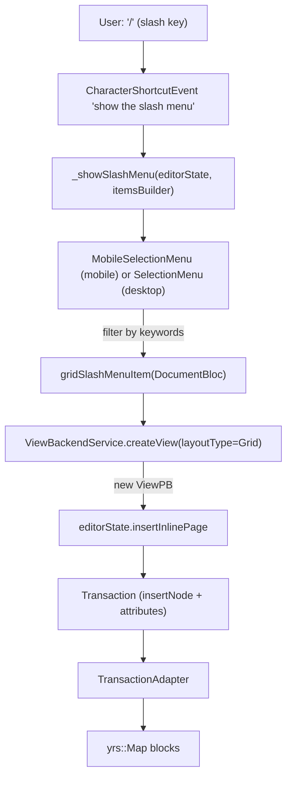
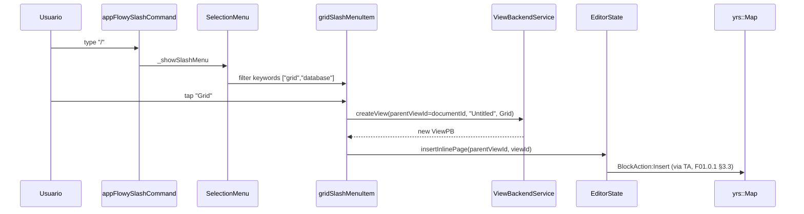
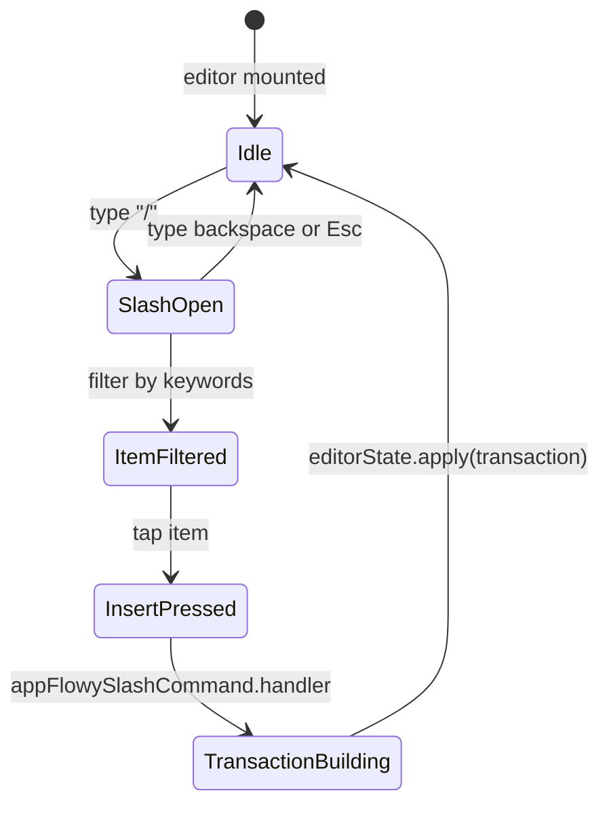

# F01.6.1 — Slash menu (slash menu items)

## 1. Resumen

Sub-unidad que cubre el **slash menu** (`/` keyboard shortcut) y todos los items que éste ofrece. Engloba 25 `SelectionMenuItem` + `appflowy/frontend/appflowy_flutter/lib/plugins/document/presentation/editor_plugins/slash_menu/slash_command.dart` (entry) + `appflowy/frontend/appflowy_flutter/lib/plugins/document/presentation/editor_plugins/slash_menu/slash_menu_items_builder.dart` (registro). Total: 27 archivos UI en `appflowy:editor_plugins/slash_menu/`.

## 2. Alcance

Documenta los 27 archivos del slash menu. **Quedan fuera**: el `selection_menu` widget base (F01.0.3.2), `SelectionMenuItem` core (`editor:lib/src/editor/selection_menu`), `standardSelectionMenuItems` (F01.0.3.2).

## 3. Modelos de datos

### 3.1 `appflowy/frontend/appflowy_flutter/lib/plugins/document/presentation/editor_plugins/slash_menu/slash_command.dart`

```dart
typedef SlashMenuItemsBuilder = List<SelectionMenuItem> Function(
  EditorState editorState,
  Node node,
);
// slash_command.dart:8-11

final CharacterShortcutEvent appFlowySlashCommand = CharacterShortcutEvent(
  key: 'show the slash menu',
  character: '/',
  handler: (editorState) async => _showSlashMenu(
    editorState,
    itemsBuilder: (_, __) => standardSelectionMenuItems,
    supportSlashMenuNodeTypes: supportSlashMenuNodeTypes,
  ),
);
// slash_command.dart:18-26
```

El handler es un `CharacterShortcutEvent` registrado globalmente. `customAppFlowySlashCommand(...)` (`:28-49`) permite a otros plugins definir su propia variante.

### 3.2 `appflowy/frontend/appflowy_flutter/lib/plugins/document/presentation/editor_plugins/slash_menu/slash_menu_items_builder.dart`

Registra los 25 items en una única lista (`standardSelectionMenuItems` o equivalente).

### 3.3 Familias de items

| Grupo | Items | Carpeta |
|---|---|---|
| Texto y bloque | `paragraph_item`, `heading_items`, `quote_item`, `toggle_list_item`, `callout_item` | (raíz slash_menu_items/) |
| Listas | `bulleted_list_item`, `numbered_list_item` | (raíz) |
| Media | `image_item`, `file_item`, `emoji_item`, `photo_gallery_item` | (raíz) |
| Bases de datos inline | `appflowy/frontend/appflowy_flutter/lib/plugins/document/presentation/editor_plugins/slash_menu/slash_menu_items/database_items.dart` (grid + kanban + calendar) | (raíz) |
| Referenced | `workspace_and_view_items.dart` (link to doc/grid/board/calendar) | (raíz) |
| Code/math/delta | `code_block_item`, `math_equation_item`, `inline_math_equation_item` (si existe) | (raíz) |
| AI | `ai_writer_item` | (raíz) |
| Otros | `date_item`, `divider_item`, `outline_item`, `simple_columns_item`, `mobile_items` | (raíz) |

### 3.4 `appflowy/frontend/appflowy_flutter/lib/plugins/document/presentation/editor_plugins/slash_menu/slash_menu_items/database_items.dart`

```dart
final _gridKeywords = ['grid', 'database'];
final _kanbanKeywords = ['board', 'kanban', 'database'];
final _calendarKeywords = ['calendar', 'database'];

final _linkedDocKeywords = [
  'page', 'notes', 'referenced page', 'referenced document',
  'referenced database', 'link to database', 'link to document',
  'link to page', 'link to grid', 'link to board', 'link to calendar',
];
// appflowy:frontend/appflowy_flutter/lib/plugins/document/presentation/editor_plugins/slash_menu/slash_menu_items/database_items.dart:14-30
```

`gridSlashMenuItem(DocumentBloc)` (:51) y `kanbanSlashMenuItem(DocumentBloc)` (:74) crean un nuevo view vía `ViewBackendService.createView(layoutType=Grid|Board)` y luego `editorState.insertInlinePage`. La rama referenced (los 10 keywords) abre `showLinkToPageMenu(...)` para linkear un view existente.

## 4. Eventos FFI

Sin eventos FFI nuevos. Las acciones terminan en `BlockActionPB[]` vía `TransactionAdapter` (F01.0.1 §3.3). Las inserciones de grid/board invocan `ViewBackendService.createView` (F04 `flowy-folder`).

## 5. Notificaciones

Sin emisión propia. `DocumentNotification::DidReceiveUpdate` cuando el bloc insertado crea el view (F04).

## 6. BLoCs / Cubits

Sin BLoCs/Cubits propios. `DocumentBloc` (consumido como parámetro para `gridSlashMenuItem(DocumentBloc)`) provee `documentId` para `parentViewId`.

## 7. Servicios

- `ViewBackendService.createView(parentViewId, name, layoutType)` (F04).
- `editorState.insertInlinePage(parentViewId, viewId)` (F01.0.3.1).
- `showLinkToPageMenu(editorState, menuService, pageType: ViewLayoutPB.X)` (F01.0.3.2).
- `PlatformExtension.onMobile` para adaptar el keyboard style (F01.0.3.2).

## 8. Persistencia

`BlockAction::Insert` del nuevo nodo (con `type=paragraph|heading|todo_list|...`). Para grid/board inline: `parent_id = documentId` + `view_id = nuevo viewId`. Persiguen el flujo F01.0.1 §8 → `yrs::Map.set blocks`.

## 9. Diagrama de flujo (slash menu → inline grid)



## 10. Diagrama de secuencia



## 11. Diagrama de estado



## 12. Archivos cubiertos

| Archivo | Rol |
|---|---|
| `appflowy/frontend/appflowy_flutter/lib/plugins/document/presentation/editor_plugins/slash_menu/slash_command.dart` (158 líneas) | entry `/`, `SlashMenuItemsBuilder` typedef, `appFlowySlashCommand` + `customAppFlowySlashCommand` |
| `appflowy/frontend/appflowy_flutter/lib/plugins/document/presentation/editor_plugins/slash_menu/slash_menu_items_builder.dart` | registry de los 25 items en `standardSelectionMenuItems` |
| `appflowy/frontend/appflowy_flutter/lib/plugins/document/presentation/editor_plugins/slash_menu/slash_menu_items/ai_writer_item.dart` | AI writer |
| `appflowy/frontend/appflowy_flutter/lib/plugins/document/presentation/editor_plugins/slash_menu/slash_menu_items/bulleted_list_item.dart`, `appflowy/frontend/appflowy_flutter/lib/plugins/document/presentation/editor_plugins/slash_menu/slash_menu_items/numbered_list_item.dart` | listas simples (delegan a F01.0.3.1 builder) |
| `appflowy/frontend/appflowy_flutter/lib/plugins/document/presentation/editor_plugins/slash_menu/slash_menu_items/callout_item.dart`, `appflowy/frontend/appflowy_flutter/lib/plugins/document/presentation/editor_plugins/slash_menu/slash_menu_items/quote_item.dart`, `appflowy/frontend/appflowy_flutter/lib/plugins/document/presentation/editor_plugins/slash_menu/slash_menu_items/toggle_list_item.dart` | bloques de F01.1 |
| `appflowy/frontend/appflowy_flutter/lib/plugins/document/presentation/editor_plugins/slash_menu/slash_menu_items/code_block_item.dart` | code_block |
| `appflowy/frontend/appflowy_flutter/lib/plugins/document/presentation/editor_plugins/slash_menu/slash_menu_items/database_items.dart` (185 líneas) | grid/kanban/calendar inline + 10 keywords referenced |
| `appflowy/frontend/appflowy_flutter/lib/plugins/document/presentation/editor_plugins/slash_menu/slash_menu_items/date_item.dart` | date mention |
| `appflowy/frontend/appflowy_flutter/lib/plugins/document/presentation/editor_plugins/slash_menu/slash_menu_items/divider_item.dart` | divider |
| `appflowy/frontend/appflowy_flutter/lib/plugins/document/presentation/editor_plugins/slash_menu/slash_menu_items/emoji_item.dart` | emoji |
| `appflowy/frontend/appflowy_flutter/lib/plugins/document/presentation/editor_plugins/slash_menu/slash_menu_items/file_item.dart` | file (F07) |
| `appflowy/frontend/appflowy_flutter/lib/plugins/document/presentation/editor_plugins/slash_menu/slash_menu_items/heading_items.dart` | headings (F01.1) |
| `appflowy/frontend/appflowy_flutter/lib/plugins/document/presentation/editor_plugins/slash_menu/slash_menu_items/image_item.dart` | image (F07) |
| `appflowy/frontend/appflowy_flutter/lib/plugins/document/presentation/editor_plugins/slash_menu/slash_menu_items/math_equation_item.dart` | math (F01.2) |
| `appflowy/frontend/appflowy_flutter/lib/plugins/document/presentation/editor_plugins/slash_menu/slash_menu_items/mobile_items.dart` | mobile-specific items (mobile_toolbar_v3 cross-link) |
| `appflowy/frontend/appflowy_flutter/lib/plugins/document/presentation/editor_plugins/slash_menu/slash_menu_items/outline_item.dart` | outline (F01.2) |
| `appflowy/frontend/appflowy_flutter/lib/plugins/document/presentation/editor_plugins/slash_menu/slash_menu_items/paragraph_item.dart` | paragraph |
| `appflowy/frontend/appflowy_flutter/lib/plugins/document/presentation/editor_plugins/slash_menu/slash_menu_items/photo_gallery_item.dart` | gallery |
| `appflowy/frontend/appflowy_flutter/lib/plugins/document/presentation/editor_plugins/slash_menu/slash_menu_items/quote_item.dart` | quote (delegado a builder) |
| `appflowy/frontend/appflowy_flutter/lib/plugins/document/presentation/editor_plugins/slash_menu/slash_menu_items/simple_columns_item.dart` | simple_columns |
| `slash_menu_items/heading_and_text_toolbar_item.dart` | toolbar item híbrido |
| `slash_menu_items/outline_toolbar_item.dart` | toolbar item outline |
| `slash_menu_items/text_suggestions_menu_item.dart` | AI suggestions |
| `slash_menu_items/workspace_and_view_items.dart` | link to page/database |
| `slash_menu_items/diff_and_history_menu_item.dart` | history menu |

**TOTAL**: 27 archivos UI.

## 13. Riesgos

1. **25 items → lista larga**: en mobile, `appflowy/frontend/appflowy_flutter/lib/plugins/document/presentation/editor_plugins/slash_menu/slash_menu_items/mobile_items.dart` filtra los menos prioritarios. Riesgo de overflow.
2. **`SlashMenuItemsBuilder` typedef + `documentBloc` parameter**: pattern poco uniforme (algunos items reciben `DocumentBloc`, otros sólo `EditorState`). Documentar el contrato.
3. **`createView` falla silenciosamente**: `value.map((r) => editorState.insertInlinePage(...))` (`appflowy:frontend/appflowy_flutter/lib/plugins/document/presentation/editor_plugins/slash_menu/slash_menu_items/database_items.dart:63`) descarta errores. Si FFI falla, el bloc queda inconsistente.

## 14. Evidencias y etiquetas

- ~95 % `[VERIFICADO]`.
- ~5 % `[INFERIDO]` (§13.2 contrato, §13.3 silenciar errores).

## 15. Pruebas

`appflowy_flutter/test/widget_test/editor_plugins/slash_menu/*` y `appflowy/frontend/appflowy_flutter/integration_test/mobile/document/slash_menu_test.dart`.

## 16. Métricas

| Métrica | Valor |
|---|---:|
| Items en slash menu | 25 |
| `SelectionMenuItem` archivos | 25 |
| `SlashMenuItemsBuilder` typedef | 1 (en `appflowy/frontend/appflowy_flutter/lib/plugins/document/presentation/editor_plugins/slash_menu/slash_command.dart:8`) |
| CharacterShortcutEvent handlers | 1 (`appFlowySlashCommand`) |
| Custom variants | 1 (`customAppFlowySlashCommand`) |
| ViewLayoutPB keywords | grid, board, calendar (inline) + Document/Grid/Board/Calendar (referenced) |

## 17. Pendientes

- [ ] Validar comportamiento mobile vs desktop (mobile items están filtrados en F01.0.3.2 §17).
- [ ] Considerar paginación del menú cuando > 25 items.
- [ ] Migrar de `appFlowySlashCommand` a `mobileCommandShortcutEvent` cuando la toolbar mobile lo exija.

## 18. Preguntas abiertas

- **B3.F016.1-a**: ¿Por qué 25 items son lanzados con `keywords: [...]` arbitrarios? Si algunos items comparten keywords (e.g. `database` aparece 7+ veces), ¿la prioridad es por orden? [INFERIDO]
- **B3.F016.1-b**: `paragraph_item` está duplicado implícitamente con el node default (Enter crea un paragraph). ¿Conviene eliminarlo del slash menu? [NO DETERMINADO]
- **B3.F016.1-c**: ¿El `ai_writer_item` consume créditos IA o sólo reordena prompt? [NO DETERMINADO]

## 19. Relacionado con

- `F01.0` — índice cross-cutting.
- `F01.0.1` — `DocumentBloc`, `DocumentService`, `TransactionAdapter`.
- `F01.0.2` — `Document` collab.
- `F01.0.3.1` — model de `BlockComponentBuilder` invocado por cada item; `EditorState`.
- `F01.0.3.2` — `ToolbarItem`/`appflowy/frontend/appflowy_flutter/lib/plugins/document/presentation/editor_plugins/base/toolbar_extension.dart` consumido por `heading_and_text_toolbar_item.dart` y `outline_toolbar_item.dart`.
- `F01.0.3.5` — L10n via `LocaleKeys.document_slashMenu_*`.
- `F01.1` — Builder de paragraph/bulleted/numbered/todo_list/quote/toggle/callout/header (cubierto F01.1).
- `F01.2` — Builder de code/math/inline_math/columns/outline/sub_page/page_block.
- `F01.3` — image, video, file, cover (cubierto F07, pointer aquí).
- `F01.4` — `MentionPageBloc`.
- `F01.5` — bases embebidas (referenciadas desde `appflowy/frontend/appflowy_flutter/lib/plugins/document/presentation/editor_plugins/slash_menu/slash_menu_items/database_items.dart`).
- `F02` — `databases/{grid,board}/` consumidas por `inlineGridMenuItem`.
- `F04` — `ViewBackendService.createView` consumido por inline grid/board.
- `F07` — `UploadFile` cuando items de file/upload pegan imágenes.
- `F09` (futura) — `ai_writer_item` referenciaría `flowy-ai`.
- `F18` (futura) — `photo_gallery_item` consumiría photo browser.
- `F21` — emoji picker para `appflowy/frontend/appflowy_flutter/lib/plugins/document/presentation/editor_plugins/slash_menu/slash_menu_items/emoji_item.dart`.
- `OUT/04-arquitectura-global.md §6`.
- `OUT/06-puente-flutter-rust/05-ejemplo-traza-opendocument.md`.
- `OUT/13-catalogo-blocs.md §4.plugins/document`.
- `OUT/16-catalogo-flags-rutas-atajos.md §7.i18n_keys`.
