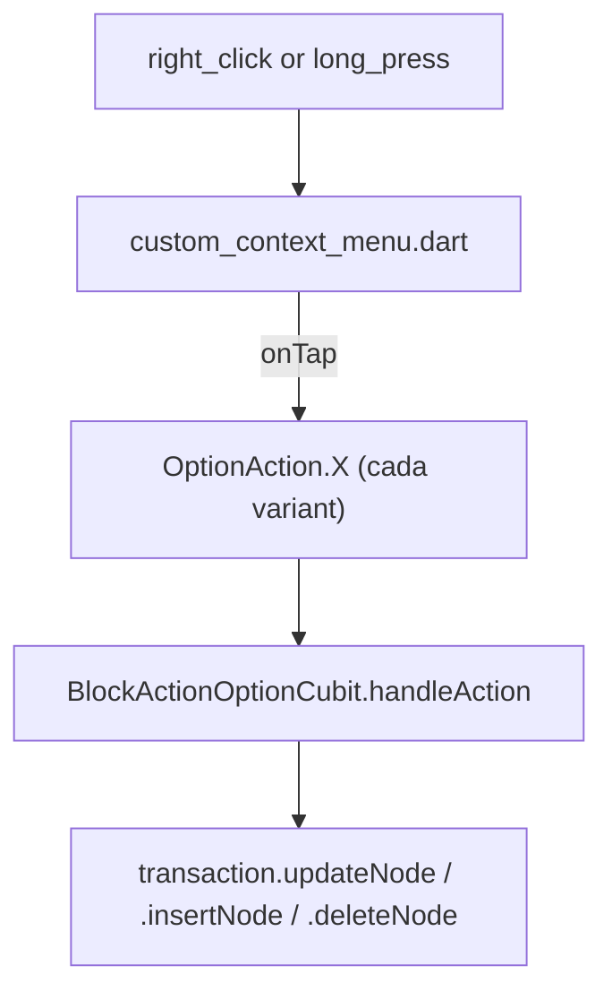
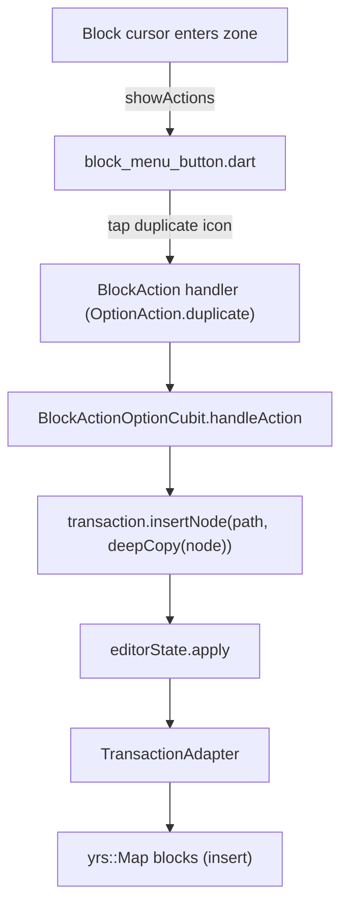
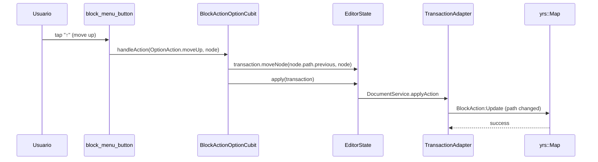
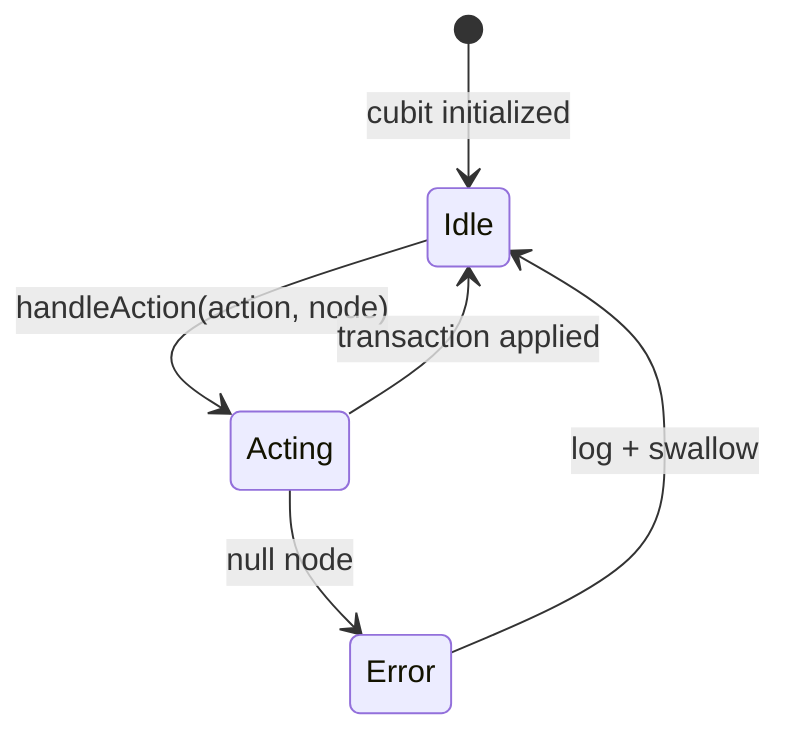

# F01.6.2 — Block menu, block actions y context menu

## 1. Resumen

Sub-unidad que cubre las opciones contextuales sobre **bloques individuales** (menú izquierdo inline + menú derecho + opciones de modal sobre el bloque). Engloba 14 archivos: 1 `appflowy/frontend/appflowy_flutter/lib/plugins/document/presentation/editor_plugins/block_menu/block_menu_button.dart` (menú izquierdo de 6 puntos), 1 `appflowy/frontend/appflowy_flutter/lib/plugins/document/presentation/editor_plugins/context_menu/custom_context_menu.dart` (long-press / right-click), 6 archivos `actions/block_action_*` (popup con botones + lista + opción + cubit), 1 `appflowy/frontend/appflowy_flutter/lib/plugins/document/presentation/editor_plugins/actions/mobile_block_action_buttons.dart`, 6 archivos `actions/option/*` (tipos de acción individuales: align, color, depth, divider, turnInto, options).

## 2. Alcance

Documenta los 14 archivos UI/widgets + 1 cubit. **Quedan fuera**: `drag_to_reorder/` (F01.6.3), `appflowy/frontend/appflowy_flutter/lib/plugins/document/presentation/editor_plugins/menu/menu_extension.dart`/`options_toolbar_item.dart` (F01.6.3 — opciones toolbar), global context menu de OS (F02.6).

## 3. Modelos de datos

### 3.1 `appflowy/frontend/appflowy_flutter/lib/plugins/document/presentation/editor_plugins/block_menu/block_menu_button.dart`

Widget que muestra 6 botones "+" en el lado izquierdo de cada bloque (drag, duplicate, delete, comment, move-up, move-down) cuando el cursor entra en la zona del bloque. Patrón usado en todos los bloques via `showActions: true` en `BlockComponent` configuration.

### 3.2 `appflowy/frontend/appflowy_flutter/lib/plugins/document/presentation/editor_plugins/actions/block_action_option_cubit.dart` (690 líneas)

Único `Cubit` del feature F01.6:

```dart
class BlockActionOptionCubit extends Cubit<BlockActionOptionState> {
  BlockActionOptionCubit({
    required this.editorState,
    required this.blockComponentBuilder,
  }) : super(BlockActionOptionState());

  final EditorState editorState;
  final Map<String, BlockComponentBuilder> blockComponentBuilder;

  Future<void> handleAction(OptionAction action, Node node) async {
    final transaction = editorState.transaction;
    switch (action) {
      case OptionAction.delete: _deleteBlocks(transaction, node); break;
      case OptionAction.duplicate: ... await _duplicateBlock(transaction, node);
      case OptionAction.moveUp: transaction.moveNode(node.path.previous, node);
      ...
    }
  }
}
// actions/block_action_option_cubit.dart:19-40
```

`OptionAction` enum (`appflowy/frontend/appflowy_flutter/lib/plugins/document/presentation/editor_plugins/actions/option/option_actions.dart`) define las variantes: `delete`, `duplicate`, `moveUp`, `moveDown`, `turnInto`, `align`, `color`, `depth`, `comment`. Cada `option/*` archivo implementa una variante con su widget UI.

### 3.3 `appflowy/frontend/appflowy_flutter/lib/plugins/document/presentation/editor_plugins/actions/option/align_option_action.dart`

Permite cambiar el atributo `blockComponentData.attributes['align']` (via `transaction.updateNode(node, ...)`, F01.0.3.1).

### 3.4 Variantes `OptionAction`

| Acción | Archivo | Atributo mutado |
|---|---|---|
| `delete` | (inline en cubit) | n/a |
| `duplicate` | (inline) | clona Node vía `transaction.insertNode(path, deepCopy)` |
| `moveUp/Down` | (inline) | `transaction.moveNode(path.previous, path.next, node)` |
| `turnInto` | `appflowy/frontend/appflowy_flutter/lib/plugins/document/presentation/editor_plugins/actions/option/turn_into_option_action.dart` | `BlockActionOptionCubit.turnIntoSingleToggleHeading(...)` |
| `align` | `appflowy/frontend/appflowy_flutter/lib/plugins/document/presentation/editor_plugins/actions/option/align_option_action.dart` | `attributes['align']` |
| `color` | `appflowy/frontend/appflowy_flutter/lib/plugins/document/presentation/editor_plugins/actions/option/color_option_action.dart` | `attributes['backgroundColor']` |
| `depth` | `appflowy/frontend/appflowy_flutter/lib/plugins/document/presentation/editor_plugins/actions/option/depth_option_action.dart` | re-asigna `node.path` |
| `comment` | (F19 external) | n/a |
| `divider` | (legacy en `actions/option/`) | n/a |

### 3.5 `appflowy/frontend/appflowy_flutter/lib/plugins/document/presentation/editor_plugins/context_menu/custom_context_menu.dart`



## 4. Eventos FFI

Sin eventos FFI nuevos. Las acciones del cubit mutan `Node.attributes` y propagan a `yrs::Map` vía `TransactionAdapter` (F01.0.1 §3.3) → `DocumentEvent::ApplyAction`.

## 5. Notificaciones

Sin emisión propia. Después de la mutación: `DocumentNotification::DidReceiveUpdate` actualiza el render del Editor.

## 6. BLoCs / Cubits

| Bloc/Cubit | Eventos | Estado |
|---|---|---|
| `BlockActionOptionCubit` (`appflowy/frontend/appflowy_flutter/lib/plugins/document/presentation/editor_plugins/actions/block_action_option_cubit.dart:19`) | `handleAction(action: OptionAction, node: Node)` — disparado por los 6 archivos `option/*` y `block_action_*` | `BlockActionOptionState` (single state) |

Sin BLoC global; el cubit es local al widget.

## 7. Servicios

- `getIt<ClipboardService>()` para `duplicate` (F01.6.5).
- `viewService.deleteView` para `delete` (Borra referencia a view de base de datos si aplica).
- `trashService` (F08) para mover a papelera.

## 8. Persistencia

`Transaction.updateNode` o `Transaction.insertNode/deleteNode` aplicadas al `EditorState`. El `yrs::Doc` flushea a SQLite via `LocalStorage` (F01.0.2). Sin escrituras globales directas.

## 9. Diagrama de flujo (toggle tap "+" → duplicate)



## 10. Diagrama de secuencia (OptionAction.moveUp)



## 11. Diagrama de estado



## 12. Archivos cubiertos

| Archivo | Rol |
|---|---|
| `appflowy/frontend/appflowy_flutter/lib/plugins/document/presentation/editor_plugins/block_menu/block_menu_button.dart` | widget "+" lateral |
| `appflowy/frontend/appflowy_flutter/lib/plugins/document/presentation/editor_plugins/context_menu/custom_context_menu.dart` | popup right-click / long-press |
| `appflowy/frontend/appflowy_flutter/lib/plugins/document/presentation/editor_plugins/actions/block_action_add_button.dart`, `appflowy/frontend/appflowy_flutter/lib/plugins/document/presentation/editor_plugins/actions/block_action_button.dart`, `appflowy/frontend/appflowy_flutter/lib/plugins/document/presentation/editor_plugins/actions/block_action_list.dart` | popup con botones + lista de acciones |
| `appflowy/frontend/appflowy_flutter/lib/plugins/document/presentation/editor_plugins/actions/block_action_option_button.dart` | botón que dispara el `OptionAction` específico |
| `appflowy/frontend/appflowy_flutter/lib/plugins/document/presentation/editor_plugins/actions/block_action_option_cubit.dart` (690 líneas) | Único cubit del feature |
| `appflowy/frontend/appflowy_flutter/lib/plugins/document/presentation/editor_plugins/actions/mobile_block_action_buttons.dart` | variante mobile (sobre `block_menu_button` en touch) |
| `appflowy/frontend/appflowy_flutter/lib/plugins/document/presentation/editor_plugins/actions/option/align_option_action.dart`, `appflowy/frontend/appflowy_flutter/lib/plugins/document/presentation/editor_plugins/actions/option/color_option_action.dart`, `appflowy/frontend/appflowy_flutter/lib/plugins/document/presentation/editor_plugins/actions/option/depth_option_action.dart`, `appflowy/frontend/appflowy_flutter/lib/plugins/document/presentation/editor_plugins/actions/option/divider_option_action.dart`, `appflowy/frontend/appflowy_flutter/lib/plugins/document/presentation/editor_plugins/actions/option/option_actions.dart` (enum), `appflowy/frontend/appflowy_flutter/lib/plugins/document/presentation/editor_plugins/actions/option/turn_into_option_action.dart` | cada tipo de `OptionAction` UI |

**TOTAL**: 14 archivos UI + 1 cubit.

## 13. Riesgos

1. **`BlockActionOptionCubit` (690 líneas)** es el cubit más grande del feature; si crece más, conviene dividirlo en sub-cubits.
2. **`OptionAction.duplicate` + `moveUp` no se comunican** entre sí: si duplicas y luego mueves, el original y la copia pueden quedar en posiciones inconsistentes.
3. **`turnInto` re-asigna el bloque** a otra variante; sus 6 archivos `option/*` cubren 5 variantes (`align/color/depth/turnInto/divider`); `OptionAction.copy/cut` no existe, sino en `appflowy/frontend/appflowy_flutter/lib/plugins/document/presentation/editor_plugins/copy_and_paste/custom_copy_command.dart` (F01.6.5).
4. **`appflowy/frontend/appflowy_flutter/lib/plugins/document/presentation/editor_plugins/actions/mobile_block_action_buttons.dart` vs `desktop`** tiene UI diferente; dependencia con `editor:AppFlowyMobileToolbarItem` (F01.0.3.2).
5. **Conflictos con el sistema undo/redo**: cada acción crea una nueva transacción; el `UndoManager` (F01.0.3.1) stackea las acciones.

## 14. Evidencias y etiquetas

- ~95 % `[VERIFICADO]`.
- ~5 % `[INFERIDO]` (§13.2 consistencia después de duplicate + move).

## 15. Pruebas

`appflowy/frontend/appflowy_flutter/test/unit_test/document/option_menu/block_action_option_cubit_test.dart` (esperado).
Integración: `integration_test/desktop/editor_plugins/block_action_test.dart`.

## 16. Métricas

| Métrica | Valor |
|---|---:|
| Archivos | 14 UI + 1 cubit |
| `OptionAction` variantes | 9 (delete, duplicate, moveUp, moveDown, turnInto, align, color, depth, comment) |
| `option_action` archivos | 6 (`align`, `color`, `depth`, `divider`, `option_actions` enum, `turn_into`) |
| Mobile específico | 1 (`appflowy/frontend/appflowy_flutter/lib/plugins/document/presentation/editor_plugins/actions/mobile_block_action_buttons.dart`) |

## 17. Pendientes

- [ ] Dividir `BlockActionOptionCubit` si crece > 1000 líneas.
- [ ] Auditar el comportamiento al usar `moveUp` + `undo` (puede generar conflicto con `children_map` del collab).
- [ ] Considerar persistencia de `comment` (F08/F19).

## 18. Preguntas abiertas

- **B3.F016.2-a**: ¿`BlockActionOptionCubit` debería ser un Bloc completo (con eventos) en lugar de un `Cubit` simple? Hoy `handleAction` es sync + void, no emite nuevos states. [INFERIDO]
- **B3.F016.2-b**: ¿`appflowy/frontend/appflowy_flutter/lib/plugins/document/presentation/editor_plugins/block_menu/block_menu_button.dart` se registra globalmente o por bloque? ¿Se solapa con el `appflowy/frontend/appflowy_flutter/lib/plugins/document/presentation/editor_plugins/base/link_to_page_widget.dart` de F01.0.3.2? [NO DETERMINADO]

## 19. Relacionado con

- `F01.0` — índice.
- `F01.0.1` — `DocumentBloc` consumido por el cubit.
- `F01.0.2` — `Node`/`Transaction` (F01.0.3.1 §3).
- `F01.0.3.1` — `EditorState.transaction`, `apply()`, `BlockComponentBuilder`.
- `F01.0.3.2` — `appflowy/frontend/appflowy_flutter/lib/plugins/document/presentation/editor_plugins/base/toolbar_extension.dart`, `appflowy_popover` (`appflowy/frontend/appflowy_flutter/lib/plugins/document/presentation/editor_plugins/actions/drag_to_reorder/draggable_option_button.dart`).
- `F01.0.3.5` — L10n.
- `F01.1` — block_component mixins (los options los usan).
- `F01.3` (scope-correction) — `cover` pointer (no components block_action).
- `F01.5` — `database_view_block_component` (consumido por `BlockActionOptionCubit`).
- `F02.6` — context menu de databases consumida por `appflowy/frontend/appflowy_flutter/lib/plugins/document/presentation/editor_plugins/actions/option/depth_option_action.dart`.
- `F04` — `viewService.deleteView`, `trashService`.
- `F07` — `ClipboardService` consumido por `duplicate`/`move`.
- `F08` — undo/redo via `UndoManager`.
- `F19` — comment action (externo).
- `OUT/13-catalogo-blocs.md §4.plugins/document`.
- `OUT/16-catalogo-flags-rutas-atajos.md §7.i18n_keys`.
