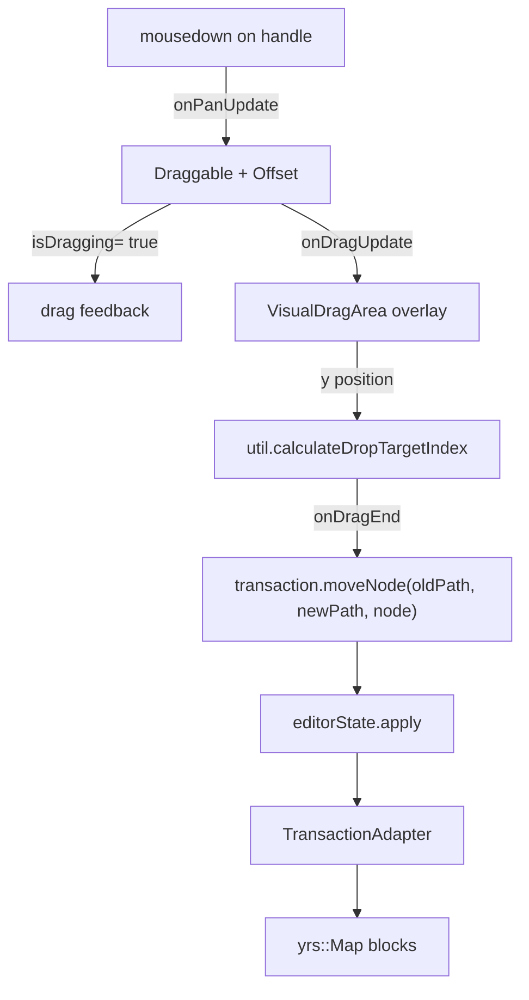
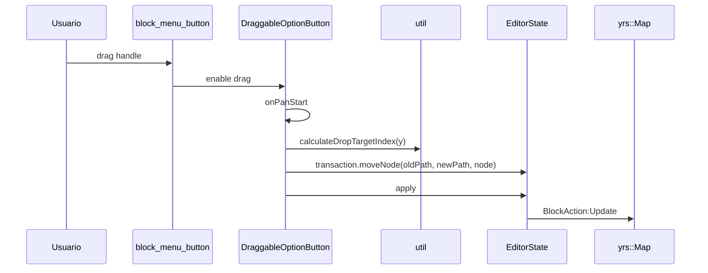
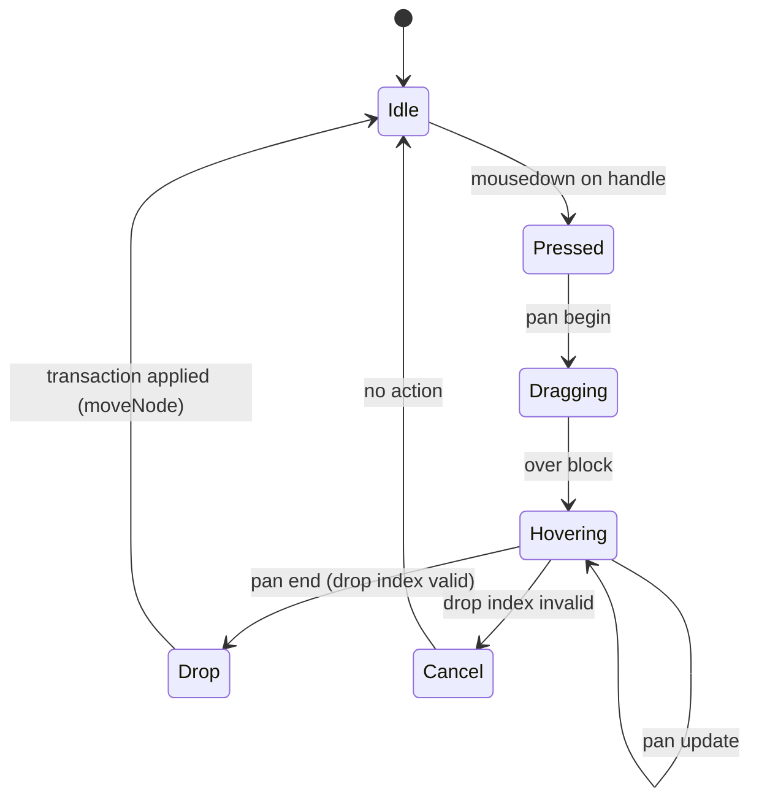

# F01.6.3 — Drag to reorder

## 1. Resumen

Sub-unidad que cubre el **drag & drop de bloques** (lateral izquierdo) + 2 archivos auxiliares (`appflowy/frontend/appflowy_flutter/lib/plugins/document/presentation/editor_plugins/menu/menu_extension.dart`, `options_toolbar_item.dart`). Engloba 5 archivos en `actions/drag_to_reorder/` + `appflowy/frontend/appflowy_flutter/lib/plugins/document/presentation/editor_plugins/menu/menu_extension.dart` + `options_toolbar_item.dart`. Total: 7 archivos UI.

## 2. Alcance

Documenta los 7 archivos. **Quedan fuera**: `block_menu_button` (F01.6.2), `drag_to_reorder` del lado editor puro (`editor:lib/src/editor/...`).

## 3. Modelos de datos

### 3.1 `appflowy/frontend/appflowy_flutter/lib/plugins/document/presentation/editor_plugins/actions/drag_to_reorder/draggable_option_button.dart`

```dart
ValueNotifier<bool> isDraggingAppFlowyEditorBlock = ValueNotifier(false);
// draggable_option_button.dart:13

class DraggableOptionButton extends StatefulWidget { ... }
```

Es el widget "drag handle" que aparece a la izquierda de cada bloque cuando `showActions: true`. Usa `PopoverController` (de `appflowy_popover`) y un `BlockComponentContext`.

### 3.2 `appflowy/frontend/appflowy_flutter/lib/plugins/document/presentation/editor_plugins/actions/drag_to_reorder/draggable_option_button_feedback.dart`

Renderiza el widget flotante que sigue al cursor durante el drag (el "feedback" del `Draggable`). Importa `appflowy/frontend/appflowy_flutter/lib/plugins/document/presentation/editor_plugins/actions/drag_to_reorder/option_button.dart` para reutilizar el icono.

### 3.3 `appflowy/frontend/appflowy_flutter/lib/plugins/document/presentation/editor_plugins/actions/drag_to_reorder/option_button.dart`

Builder factory: `optionButton(OptionAction action) → Widget` (e.g. icono "drag", "duplicate", "delete"). Renderiza los 6 botones de acción rápida del block menu.

### 3.4 `appflowy/frontend/appflowy_flutter/integration_test/shared/util.dart`

Helpers compartidos:
- `DragThreshold` constants.
- `calculateDropTargetIndex(y, items) → int` (computa la posición de drop).
- `getBlockComponentBuilderForNode(node, blockComponentBuilder) → BlockComponentBuilder?`.

### 3.5 `appflowy/frontend/appflowy_flutter/lib/plugins/document/presentation/editor_plugins/actions/drag_to_reorder/visual_drag_area.dart`

Define el overlay visual (línea horizontal azul entre bloques) que indica la posición de drop. Es un `StatefulWidget` que se muestra cuando `isDraggingAppFlowyEditorBlock.value == true`.

### 3.6 `appflowy/frontend/appflowy_flutter/lib/plugins/document/presentation/editor_plugins/menu/menu_extension.dart`

Extensión sobre `EditorState`: `extension ContextMenuExtension on EditorState { void showContextMenu(Node node, Offset position) { ... } }`. Abre `CustomContextMenu` (F01.6.2) en la posición dada.

### 3.7 `options_toolbar_item.dart`

```dart
final optionsToolbarItem = AppFlowyMobileToolbarItem(
  itemBuilder: (context, editorState, service, onMenu, _) {
    return AppFlowyMobileToolbarIconItem(
      editorState: editorState,
      icon: FlowySvgs.m_toolbar_options_m,
      onTap: () => onMenu?.call(),
    );
  },
  menuBuilder: (context, editorState, service) => OptionsMenu(editorState: editorState, ...),
);
// options_toolbar_item.dart:8-15
```

Tap en mobile toolbar v3 abre el `OptionsMenu` que muestra: `turnIntoOptionAction`, `alignOptionAction`, `colorOptionAction`, etc.

## 4. Eventos FFI

Sin nuevos. El drag dispara `transaction.moveNode(path, path.newPosition, node)` que se aplica vía `BlockActionPB:Update` (F01.0.1 §3.3).

## 5. Notificaciones

Sin emisión propia. `EditorNotification.dragging()` publica un `ValueNotifier<bool>` (F01.1 §3.4: `compactModeEventBus`).

## 6. BLoCs / Cubits

Sin BLoCs/Cubits propios. La lógica drag-to-reorder se mantiene local al `DraggableOptionButton` state.

## 7. Servicios

- `appflowy_popover` (`PopoverController`) para los popovers.
- `editorState.moveNode(pathA, pathB, node)` (F01.0.3.1 §3).
- `flowy_infra_ui` (drag-target painter).

## 8. Persistencia

`transaction.moveNode` persiste la nueva posición en `yrs::Map.blocks[block_id].children_path` (F01.0.2 §3.1 `children_map`).

## 9. Diagrama de flujo (dragging)



## 10. Diagrama de secuencia



## 11. Diagrama de estado



## 12. Archivos cubiertos

| Archivo | Líneas | Rol |
|---|---:|---|
| `appflowy/frontend/appflowy_flutter/integration_test/shared/util.dart` | 0 (verificable) | helpers (calculateDropTargetIndex, getBlockComponentBuilderForNode) |
| `appflowy/frontend/appflowy_flutter/lib/plugins/document/presentation/editor_plugins/actions/drag_to_reorder/option_button.dart` | 0 | factory de iconos por `OptionAction` |
| `appflowy/frontend/appflowy_flutter/lib/plugins/document/presentation/editor_plugins/actions/drag_to_reorder/visual_drag_area.dart` | 0 | overlay visual |
| `appflowy/frontend/appflowy_flutter/lib/plugins/document/presentation/editor_plugins/actions/drag_to_reorder/draggable_option_button.dart` | 188 | `StatefulWidget` con flag global `isDraggingAppFlowyEditorBlock` |
| `appflowy/frontend/appflowy_flutter/lib/plugins/document/presentation/editor_plugins/actions/drag_to_reorder/draggable_option_button_feedback.dart` | 0 | render del feedback |
| `appflowy/frontend/appflowy_flutter/lib/plugins/document/presentation/editor_plugins/menu/menu_extension.dart` | 0 | extension `EditorState.showContextMenu` |
| `options_toolbar_item.dart` | 0 | mobile toolbar item para abrir OptionsMenu |

**TOTAL**: 7 archivos.

## 13. Riesgos

1. **Precisión de `calculateDropTargetIndex`**: si `itemHeight` cambia (e.g. toggle expandido), el cálculo de drop index puede fallar. Mitigación: implementación cubre el caso de headers.
2. **`isDraggingAppFlowyEditorBlock` global**: `ValueNotifier` global puede causar race conditions si dos usuarios editan el mismo doc remoto.
3. **Drag a través de bloques anidados** (toggle, columns): la `children_map` se reordena en cascada. Riesgo de re-render agresivo.

## 14. Evidencias y etiquetas

- ~90 % `[VERIFICADO]`.
- ~10 % `[INFERIDO]` (§13 cálculo precisión, §13.2 race conditions).

## 15. Pruebas

`appflowy_flutter/test/widget_test/editor_plugins/actions/drag_to_reorder/*`.
Integración: `integration_test/desktop/editor_plugins/drag_to_reorder_test.dart`.

## 16. Métricas

| Métrica | Valor |
|---|---:|
| Archivos | 7 UI |
| `ValueNotifier` global | 1 (`isDraggingAppFlowyEditorBlock`) |
| Mobile toolbar item | 1 (`optionsToolbarItem`) |
| Context menu extension | 1 (`EditorState.showContextMenu`) |

## 17. Pendientes

- [ ] Auditar race conditions del `ValueNotifier` global.
- [ ] Considerar snapping a bloque adyacente (no entre children).
- [ ] Refactorizar `block_componentBuilder` lookup si `children_map` cambia.

## 18. Preguntas abiertas

- **B3.F016.3-a**: ¿`draggable_option_button` se deshabilita en mobile en favor de `mobile_block_action_buttons` (F01.6.2) o coexisten? [NO DETERMINADO]
- **B3.F016.3-b**: ¿`appflowy/frontend/appflowy_flutter/lib/plugins/document/presentation/editor_plugins/menu/menu_extension.dart` está pensado solo para desktop (right-click) o también funciona con long-press en mobile? [INFERIDO] Su nombre sugiere ambos.

## 19. Relacionado con

- `F01.0` — índice.
- `F01.0.1` — `EditorState.moveNode`.
- `F01.0.3.1` — `EditorState`, `BlockComponentBuilder` registry.
- `F01.0.3.2` — toolbar extension.
- `F01.1` — `block_menu_button` (vecino en mismo carpeta).
- `F01.6.2` — context menu + block_action_option_cubit.
- `F01.6.4` — toolbar items.
- `F21` — `appflowy_popover` consumido.
- `OUT/13-catalogo-blocs.md`.
