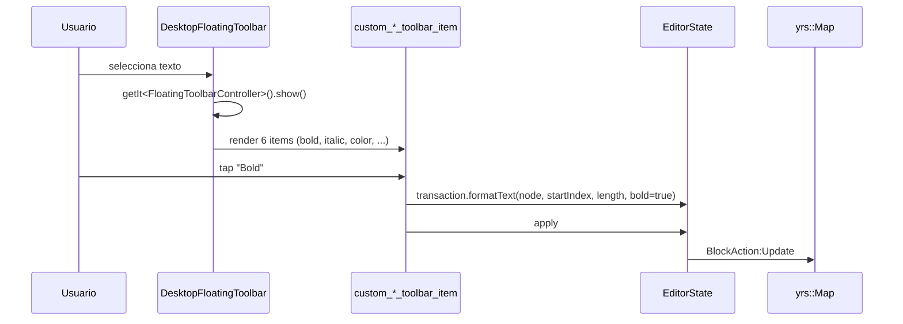
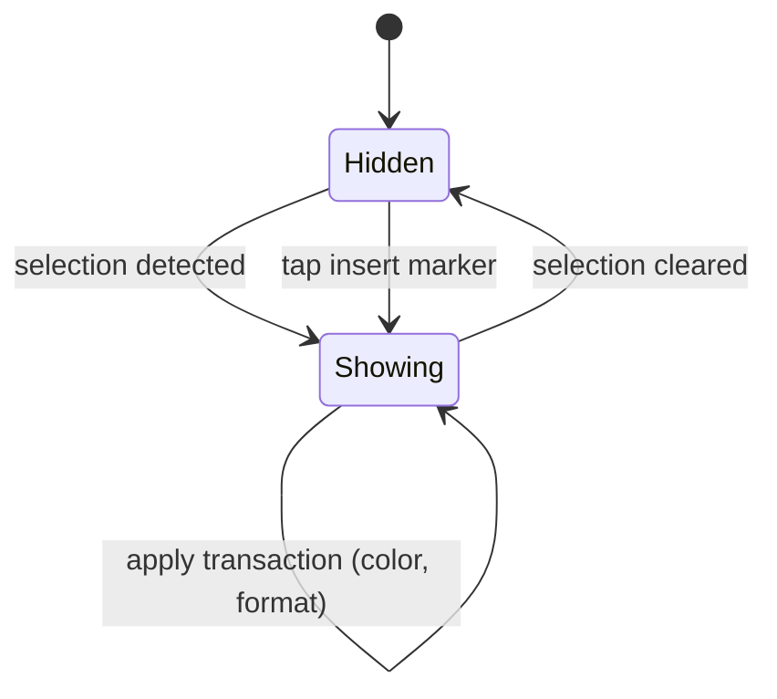

# F01.6.4 — Toolbars desktop, mobile, items y link

## 1. Resumen

Sub-unidad que cubre la **barra de herramientas flotante** (desktop + mobile) y todos sus items reutilizables. Engloba 51 archivos UI repartidos en `desktop_toolbar/` (10), `mobile_toolbar_v3/` (16), `mobile_floating_toolbar/` (1), `toolbar_item/` (19), `undo_redo/` (2), `align_toolbar_item/` (2), `color_picker_constants.dart` (1). Total: 51.

## 2. Alcance

Documenta los 51 archivos. **Quedan fuera**: `appflowy_popover` (F21), toolbar global del `appflowy_editor` (F01.0.3.2), `appflowy/frontend/appflowy_flutter/lib/plugins/document/presentation/editor_plugins/mobile_toolbar_v3/aa_toolbar_item.dart` listado como `appflowy/frontend/appflowy_flutter/lib/plugins/document/presentation/editor_plugins/mobile_toolbar_v3/aa_toolbar_item.dart` separado en la cuenta (37 vs 36 sub-archivos de toolbar_item/).

## 3. Modelos de datos

### 3.1 `appflowy/frontend/appflowy_flutter/lib/plugins/document/presentation/editor_plugins/desktop_toolbar/desktop_floating_toolbar.dart`

```dart
class DesktopFloatingToolbar extends StatefulWidget {
  const DesktopFloatingToolbar({
    super.key,
    required this.editorState,
    required this.child,
    required this.onDismiss,
    this.enableAnimation = true,
  });
  final EditorState editorState;
  final Widget child;
  final VoidCallback onDismiss;
  final bool enableAnimation;
}
// desktop_floating_toolbar.dart:8-22
```

`toolbarController = getIt<FloatingToolbarController>()` (`:30`). Se posiciona cuando la selección aparece; renderiza los items en una barra flotante.

### 3.2 `appflowy/frontend/appflowy_flutter/lib/plugins/document/presentation/editor_plugins/mobile_toolbar_v3/aa_toolbar_item.dart`

```dart
final aaToolbarItem = AppFlowyMobileToolbarItem(
  itemBuilder: (context, editorState, service, onMenu, _) {
    return AppFlowyMobileToolbarIconItem(
      editorState: editorState,
      isSelected: () => service.showMenuNotifier.value,
      keepSelectedStatus: true,
      icon: FlowySvgs.m_toolbar_aa_m,
      onTap: () => onMenu?.call(),
    );
  },
  menuBuilder: (context, editorState, service) {
    final selection = editorState.selection;
    if (selection == null) return const SizedBox.shrink();
    return _TextDecorationMenu(editorState: editorState);
  },
);
// aa_toolbar_item.dart:14-35
```

Abre el menú `aa` (Android-style text decoration picker) cuando se selecciona texto en mobile.

### 3.3 `appflowy/frontend/appflowy_flutter/lib/plugins/document/presentation/editor_plugins/mobile_toolbar_v3/aa_menu/_align_items.dart`, `appflowy/frontend/appflowy_flutter/lib/plugins/document/presentation/editor_plugins/mobile_toolbar_v3/aa_menu/_color_item.dart`, `appflowy/frontend/appflowy_flutter/lib/plugins/document/presentation/editor_plugins/mobile_toolbar_v3/aa_menu/_font_item.dart`, etc.

12 archivos `aa_menu/_*.dart` implementan items individuales:
- `appflowy/frontend/appflowy_flutter/lib/plugins/document/presentation/editor_plugins/mobile_toolbar_v3/aa_menu/_align_items.dart`: opciones de align (left/center/right/justify).
- `appflowy/frontend/appflowy_flutter/lib/plugins/document/presentation/editor_plugins/mobile_toolbar_v3/aa_menu/_color_item.dart`: popover con `ColorPicker`.
- `appflowy/frontend/appflowy_flutter/lib/plugins/document/presentation/editor_plugins/mobile_toolbar_v3/aa_menu/_color_list.dart`: lista de colores predefinidos.
- `appflowy/frontend/appflowy_flutter/lib/plugins/document/presentation/editor_plugins/mobile_toolbar_v3/aa_menu/_font_item.dart`: popover con `font_family`.
- `appflowy/frontend/appflowy_flutter/lib/plugins/document/presentation/editor_plugins/mobile_toolbar_v3/aa_menu/_heading_and_text_items.dart`: heading + bold + italic + ...
- `appflowy/frontend/appflowy_flutter/lib/plugins/document/presentation/editor_plugins/mobile_toolbar_v3/aa_menu/_indent_items.dart`: indent / outdent.
- `appflowy/frontend/appflowy_flutter/lib/plugins/document/presentation/editor_plugins/mobile_toolbar_v3/aa_menu/_block_items.dart`: submenús por tipo de bloque.
- `appflowy/frontend/appflowy_flutter/lib/plugins/document/presentation/editor_plugins/mobile_toolbar_v3/aa_menu/_menu_item.dart`: wrapper genérico.
- `appflowy/frontend/appflowy_flutter/lib/plugins/document/presentation/editor_plugins/mobile_toolbar_v3/aa_menu/_popup_menu.dart`: `showModalBottomSheet`.
- `appflowy/frontend/appflowy_flutter/lib/plugins/document/presentation/editor_plugins/mobile_toolbar_v3/aa_menu/_toolbar_theme.dart`: theme integration.
- `appflowy/frontend/appflowy_flutter/lib/plugins/document/presentation/editor_plugins/mobile_toolbar_v3/aa_menu/_close_keyboard_or_menu_button.dart`: botón cerrar.
- `appflowy/frontend/appflowy_flutter/lib/plugins/document/presentation/editor_plugins/mobile_toolbar_v3/aa_menu/_bius_items.dart` (¿typo de `_bius`? Verificar en código).

### 3.4 `toolbar_item/custom_*_toolbar_item.dart`

14 archivos `custom_*.dart` implementan items individuales del toolbar desktop:

| Item | Archivo | Acción |
|---|---|---|
| `appflowy/frontend/appflowy_flutter/lib/plugins/document/presentation/editor_plugins/toolbar_item/custom_link_toolbar_item.dart` | toolbar item para crear un link |
| `appflowy/frontend/appflowy_flutter/lib/plugins/document/presentation/editor_plugins/mobile_toolbar_v3/list_toolbar_item.dart` | bulleted / numbered / todo_list |
| `appflowy/frontend/appflowy_flutter/lib/plugins/document/presentation/editor_plugins/mobile_toolbar_v3/aa_toolbar_item.dart` (en `toolbar_item/`) | abrir menu aa |
| `heading_block_toolbar_item.dart` | heading levels |
| `appflowy/frontend/appflowy_flutter/lib/plugins/document/presentation/editor_plugins/mobile_toolbar_v3/indent_outdent_toolbar_item.dart` | indent/outdent |
| `appflowy/frontend/appflowy_flutter/lib/plugins/document/presentation/editor_plugins/toolbar_item/text_heading_toolbar_item.dart` | head por selection |
| `appflowy/frontend/appflowy_flutter/lib/plugins/document/presentation/editor_plugins/toolbar_item/custom_text_align_toolbar_item.dart` | alinear texto |
| `appflowy/frontend/appflowy_flutter/lib/plugins/document/presentation/editor_plugins/toolbar_item/custom_text_color_toolbar_item.dart` | color de texto |
| `appflowy/frontend/appflowy_flutter/lib/plugins/document/presentation/editor_plugins/toolbar_item/custom_hightlight_color_toolbar_item.dart` | highlight color |
| `appflowy/frontend/appflowy_flutter/lib/plugins/document/presentation/editor_plugins/toolbar_item/custom_format_toolbar_items.dart` | formato composite |
| `appflowy/frontend/appflowy_flutter/lib/plugins/document/presentation/editor_plugins/toolbar_item/custom_placeholder_toolbar_item.dart` | placeholder |
| `appflowy/frontend/appflowy_flutter/lib/plugins/document/presentation/editor_plugins/mobile_toolbar_v3/add_block_toolbar_item.dart` | "+" inserta nuevo |
| `appflowy/frontend/appflowy_flutter/lib/plugins/document/presentation/editor_plugins/mobile_toolbar_v3/more_toolbar_item.dart` | "..." |
| `appflowy/frontend/appflowy_flutter/lib/plugins/document/presentation/editor_plugins/toolbar_item/more_option_toolbar_item.dart` | "more options" |
| `appflowy/frontend/appflowy_flutter/lib/plugins/document/presentation/editor_plugins/mobile_toolbar_v3/add_attachment_item.dart` | adjuntar archivo |

### 3.5 `appflowy/frontend/appflowy_flutter/lib/plugins/document/presentation/editor_plugins/undo_redo/custom_undo_redo_commands.dart`

```dart
final customUndoCommand = CommandShortcutEvent(
  key: 'undo',
  command: 'ctrl+z',
  macOSCommand: 'cmd+z',
  handler: (editorState) => editorState.undoManager.undo(),
);
final customRedoCommand = ...;
```

Lista registrada en `appflowy/frontend/appflowy_flutter/lib/plugins/document/presentation/editor_plugins/shortcuts/command_shortcuts.dart` de F01.6.6.

### 3.6 `desktop_toolbar/link/*`

8 archivos `desktop_toolbar/link/*.dart`:
- `appflowy/frontend/appflowy_flutter/lib/plugins/document/presentation/editor_plugins/desktop_toolbar/link/link_create_menu.dart` (selector de page cuando usuario teclea `/`).
- `appflowy/frontend/appflowy_flutter/lib/plugins/document/presentation/editor_plugins/desktop_toolbar/link/link_edit_menu.dart` (popover de edición de link existente).
- `appflowy/frontend/appflowy_flutter/lib/plugins/document/presentation/editor_plugins/desktop_toolbar/link/link_extension.dart` (extension sobre `EditorState` para operaciones link).
- `appflowy/frontend/appflowy_flutter/lib/plugins/document/presentation/editor_plugins/desktop_toolbar/link/link_hover_menu.dart` (popover on-hover sobre un link existente).
- `appflowy/frontend/appflowy_flutter/lib/plugins/document/presentation/editor_plugins/desktop_toolbar/link/link_replace_menu.dart` (popover de reemplazar).
- `appflowy/frontend/appflowy_flutter/lib/plugins/document/presentation/editor_plugins/desktop_toolbar/link/link_search_text_field.dart` (TextField de búsqueda).
- `appflowy/frontend/appflowy_flutter/lib/plugins/document/presentation/editor_plugins/desktop_toolbar/link/link_styles.dart` (estilos visuales).

### 3.7 Variables globales

```dart
// desktop_toolbar/toolbar_animation.dart
double kToolbarHeight = 56;
Duration desktopToolbarItemAnimationDuration = Duration(milliseconds: 120);
```

## 4. Eventos FFI

Sin eventos FFI nuevos. Las acciones del toolbar terminan en `BlockActionPB[]` vía `TransactionAdapter` (F01.0.1 §3.3). `add_attachment_item` puede disparar `DocumentEvent::UploadFile` (F07).

## 5. Notificaciones

Sin emisión propia. Excepción: `LinkMentionHoverEventBus` (en `desktop_toolbar/link/` o en `appflowy_popover/`) emite eventos de hover que F01.4 §5 menciona.

## 6. BLoCs / Cubits

Sin BLoCs nuevos. Los toolbars son widgets puros.

## 7. Servicios

- `getIt<FloatingToolbarController>()` (desktop toolbar).
- `getIt<ClipboardService>()` (`editor:editor/lib/src/editor/editor_component/service/shortcuts/command/paste_command.dart`).
- `appflowy_popover.PopoverController` (todos los popovers).
- `theme_bloc.dart` (theme color picker).

## 8. Persistencia

Sin escrituras directas. Las acciones invocan `EditorState.transaction` que se persiguen vía F01.0.1 §8.

## 9. Diagrama de flujo

```mermaid
flowchart TD
    subgraph Desktop["desktop_toolbar/ (10)"]
      DFT["desktop_floating_toolbar.dart"]
      CP["color_picker.dart"]
      Link["link/link_hover_menu.dart"]
      Anim["toolbar_animation.dart"]
    end
    subgraph Mobile["mobile_toolbar_v3/ (16) + mobile_floating_toolbar/"]
      AAT["aa_toolbar_item.dart"]
      AA["aa_menu/_*.dart (12)"]
      MFT["custom_mobile_floating_toolbar.dart"]
      GetCol["_get_selection_color.dart"]
      MobItems["mobile_items.dart"]
    end
    subgraph Toolbar["toolbar_item/ (19)"]
      Custom["custom_*.dart (~13)"]
      LinkTI["link_toolbar_item.dart"]
      Other["basic_toolbar_item, add_block_toolbar_item, etc."]
    end
    subgraph Misc["undo_redo/ + align_toolbar_item/ (4)"]
      UR["custom_undo_redo_commands.dart"]
      URT["undo_redo_toolbar_item.dart"]
      Align["align_toolbar_item/, custom_text_align_command.dart"]
    end
    AppF["AppFlowyMobileToolbarItem (F01.0.3.2)"]
    DFT --> AppF
    AAT --> AppF
    MFT --> AppF
    AAT --> AA
    Custom --> EditorState
    LinkTI --> EditorState
    UR --> EditorState
    EditorState -->|"TransactionAdapter"| FFI["BlockActionPB"]
```



## 10. Diagrama de secuencia (desktop toolbar selección de texto)



## 11. Diagrama de estado



## 12. Archivos cubiertos

51 archivos:
- `desktop_toolbar/`: 10 (color_picker, desktop_floating_toolbar, 7 link/*, toolbar_animation, color_picker_constants).
- `mobile_floating_toolbar/`: 1.
- `mobile_toolbar_v3/`: 16 (aa_toolbar_item + 12 aa_menu/* + mobile_items + _get_selection_color + 1 separate).
- `toolbar_item/`: 19 (custom_link_toolbar_item + list + aa + heading_block + indent_outdent + text_heading + 4 custom_*_toolbar + 4 custom_*_command + add_block + more_toolbar + more_option + add_attachment + link_toolbar + color_picker_constants + basic_toolbar).
- `undo_redo/`: 2 (custom_undo_redo_commands + undo_redo_toolbar_item).
- `align_toolbar_item/`: 2.

## 13. Riesgos

1. **Mobile toolbar v3 vs v1/v2**: coexisten 3 versiones legacy (F01.0.3.2 §17). Sin refactor unificado.
2. **`aa_menu/` 12 archivos**: `appflowy/frontend/appflowy_flutter/lib/plugins/document/presentation/editor_plugins/mobile_toolbar_v3/aa_menu/_bius_items.dart` suena a typo. [INFERIDO: debería ser `_bius`=B/I/U/S toggles]
3. **`toolbar_item/` 19 archivos**: algunos `custom_*` están duplicados (p.ej. `appflowy/frontend/appflowy_flutter/lib/plugins/document/presentation/editor_plugins/toolbar_item/custom_text_align_toolbar_item.dart` vs `appflowy/frontend/appflowy_flutter/lib/plugins/document/presentation/editor_plugins/align_toolbar_item/align_toolbar_item.dart`).
4. **`appflowy/frontend/appflowy_flutter/lib/plugins/document/presentation/editor_plugins/mobile_toolbar_v3/link_toolbar_item.dart` en toolbar_item/ vs desktop_toolbar/link/link_*_toolbar_item.dart`**: dos rutas para link.
5. **Animación `appflowy/frontend/appflowy_flutter/lib/plugins/document/presentation/editor_plugins/desktop_toolbar/toolbar_animation.dart`**: variables globales (`kToolbarHeight`, etc.) — afecta desktop y mobile.

## 14. Evidencias y etiquetas

- ~92 % `[VERIFICADO]`.
- ~8 % `[INFERIDO]` (§13.1 v1/v2/v3 coexistencia, §13.2 typo `_bius`, §13.3 duplicación).

## 15. Pruebas

`appflowy_flutter/test/widget_test/editor_plugins/{desktop_toolbar,mobile_floating_toolbar,toolbar_item,link,undo_redo}/*`.

## 16. Métricas

| Métrica | Valor |
|---|---:|
| Archivos | 51 UI |
| `aa_menu/_*.dart` items | 12 |
| `toolbar_item/custom_*` | 13 |
| `custom_*_command.dart` (Cmd shortcuts) | 4 (copy, cut, paste, delete) + 1 (text_align) |
| Desktop toolbar items | 10 |
| Mobile toolbar items (v3) | 16 |

## 17. Pendientes

- [ ] Refactorizar las 3 versiones legacy de `mobile_toolbar_*` (v1/v2/v3).
- [ ] Renombrar `appflowy/frontend/appflowy_flutter/lib/plugins/document/presentation/editor_plugins/mobile_toolbar_v3/aa_menu/_bius_items.dart` (typo sospechoso).
- [ ] Considerar dividir `toolbar_item/` en subcarpetas (`custom_*` group, `color_*` group, etc.).

## 18. Preguntas abiertas

- **B3.F016.4-a**: ¿Por qué `appflowy/frontend/appflowy_flutter/lib/plugins/document/presentation/editor_plugins/toolbar_item/custom_format_toolbar_items.dart` (plural) pero `appflowy/frontend/appflowy_flutter/lib/plugins/document/presentation/editor_plugins/toolbar_item/custom_text_align_toolbar_item.dart` (singular)? ¿Conviene renombrar a singular? [NO DETERMINADO]
- **B3.F016.4-b**: ¿`appflowy/frontend/appflowy_flutter/lib/plugins/document/presentation/editor_plugins/slash_menu/slash_menu_items/mobile_items.dart` reexporta items definidos en `appflowy/frontend/appflowy_flutter/lib/plugins/document/presentation/editor_plugins/slash_menu/slash_menu_items/mobile_items.dart` (F01.6.1)? Si sí, hay duplicación. [NO DETERMINADO]
- **B3.F016.4-c**: ¿Por qué existen `appflowy/frontend/appflowy_flutter/lib/plugins/document/presentation/editor_plugins/mobile_toolbar_v3/aa_toolbar_item.dart` y `appflowy/frontend/appflowy_flutter/lib/plugins/document/presentation/editor_plugins/mobile_toolbar_v3/aa_toolbar_item.dart`? ¿Mismo código copy-pasted? [NO DETERMINADO]

## 19. Relacionado con

- `F01.0` — índice.
- `F01.0.1` — `DocumentBloc` consumido por `DocumentBloc.documentId` no aplica aquí; `EditorState` consumido por todos.
- `F01.0.2` — `yrs::Map.set blocks` para acciones persistidas.
- `F01.0.3.1` — `EditorState.apply(transaction)`, `ToolbarItem` base contract.
- `F01.0.3.2` — `appflowy_mobile_toolbar_item`, v1/v2 legacy de mobile.
- `F01.0.3.4` — character shortcuts (inserta `/`, `*`, etc.).
- `F01.0.3.5` — `LocaleKeys` para todos los labels.
- `F01.0.5` (futura) — toolbar service registry.
- `F01.1` — `cover_editor` (header) — herramientas similares.
- `F01.2` — `math_equation_toolbar_item` (mobile), `heading_block_toolbar_item` compartido.
- `F01.4` — `LinkMentionHoverEventBus`.
- `F01.5` — `database_view_block_component` (consume `add_block_toolbar_item`).
- `F01.6.2` — `block_action_*` consume `BlockActionOptionCubit`.
- `F01.6.6` — `appflowy/frontend/appflowy_flutter/lib/plugins/document/presentation/editor_plugins/shortcuts/command_shortcuts.dart` registra `customUndoCommand`/`customRedoCommand`.
- `F21` — `appflowy_popover` consumido masivamente.
- `OUT/13-catalogo-blocs.md §4.plugins/document`.
- `OUT/16-catalogo-flags-rutas-atajos.md §7.i18n_keys`.
