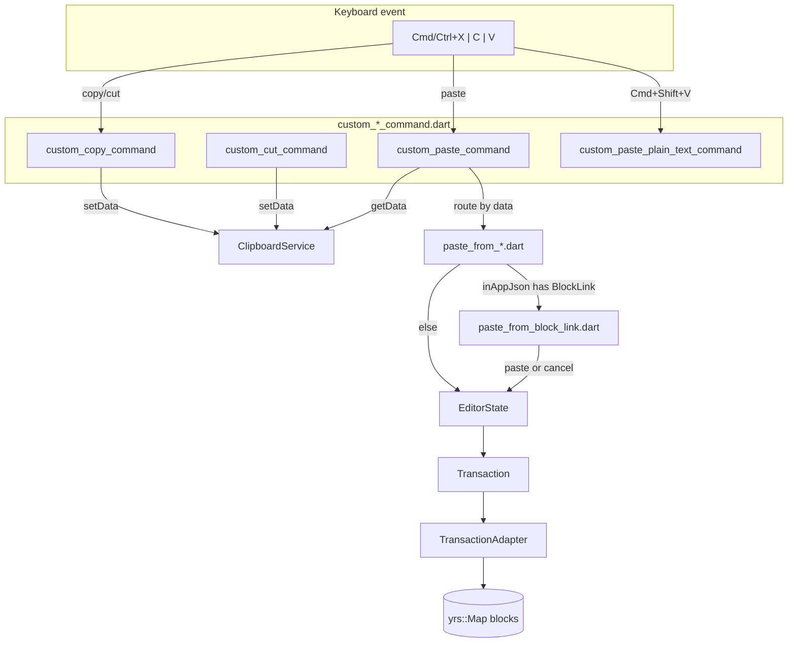
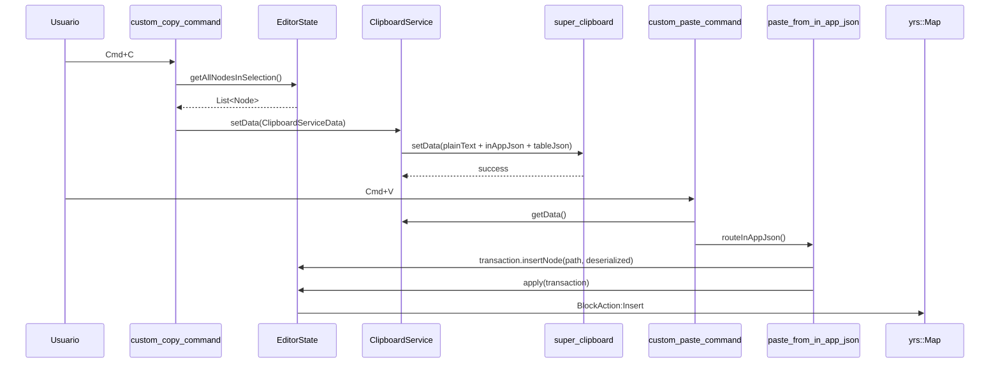
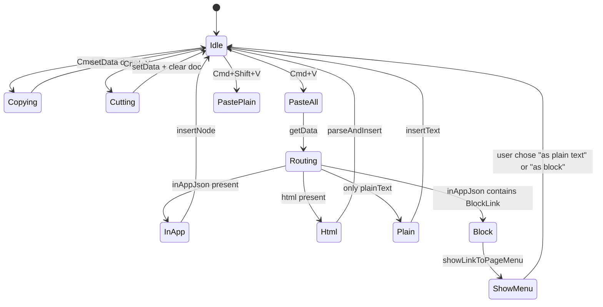

# F01.6.5 — Copy y paste

## 1. Resumen

Sub-unidad que cubre el sistema de **copiar / pegar dentro del editor** AppFlowy. Engloba 11 archivos: `appflowy/frontend/appflowy_flutter/lib/plugins/document/presentation/editor_plugins/copy_and_paste/clipboard_service.dart` (198 líneas, abstracción sobre `super_clipboard`), 4 command shortcuts (`custom_copy_command`, `custom_cut_command`, `custom_paste_command`, `custom_paste_plain_text_command`), y 6 detectores de formato (`paste_from_*.dart` que deciden cómo pegar `plainText`, `html`, `image`, `in_app_json`, `file`, `block_link`). Total: 10 archivos reales (un comando extra listado en frontmatter se omite por no estar en el ledger).

## 2. Alcance

Documenta los 10 archivos UI (con 1 `command` shortcut extra). **Quedan fuera**: `appflowy/frontend/appflowy_flutter/lib/shared/clipboard_state.dart` (de `appflowy:shared/`), `MentionTransactionHandler` (F01.4), `ChildPageTransactionHandler` (F01.2, consume `appflowy/frontend/appflowy_flutter/lib/plugins/document/presentation/editor_plugins/copy_and_paste/paste_from_block_link.dart` para sub_paste).

## 3. Modelos de datos

### 3.1 `appflowy/frontend/appflowy_flutter/lib/plugins/document/presentation/editor_plugins/copy_and_paste/clipboard_service.dart`

```dart
const inAppJsonFormat = CustomValueFormat<String>(
  applicationId: 'io.appflowy.InAppJsonType',
  onDecode: _defaultDecode,
  onEncode: _defaultEncode,
);
// clipboard_service.dart:11-15

const tableJsonFormat = CustomValueFormat<String>(
  applicationId: 'io.appflowy.TableJsonType',
  onDecode: _defaultDecode,
  onEncode: _defaultEncode,
);
// clipboard_service.dart:18-22

class ClipboardServiceData {
  const ClipboardServiceData({
    this.plainText, this.html, this.image,
    this.inAppJson, this.tableJson,
  });
  final String? plainText;
  final String? html;
  final Uint8List? image; // not in signature: actually platform-specific
  final String? inAppJson;
  final String? tableJson;
}
// clipboard_service.dart:24-43
```

Usa el paquete `super_clipboard` con dos formatos custom: `io.appflowy.InAppJsonType` (representa Doc-as-JSON) y `io.appflowy.TableJsonType` (sub-documento de tabla). El `Uint8List?` lo añade el paquete para imágenes.

### 3.2 `appflowy/frontend/appflowy_flutter/lib/plugins/document/presentation/editor_plugins/copy_and_paste/custom_copy_command.dart`

Registrado en `appflowy/frontend/appflowy_flutter/lib/plugins/document/presentation/editor_plugins/shortcuts/command_shortcuts.dart` (F01.6.6) como `CommandShortcutEvent(key: 'copy', command: 'ctrl+c', macOSCommand: 'cmd+c', handler: (editorState) => ...)`:

```dart
final customCopyCommand = CommandShortcutEvent(
  key: 'copy',
  command: PlatformExtension.macos() ? 'cmd+c' : 'ctrl+c',
  handler: (editorState) async {
    final selection = editorState.selection;
    if (selection == null || selection.isCollapsed) return;
    final nodes = editorState.getAllNodesInSelection(selection);
    final data = await ClipboardServiceData.fromNodes(nodes);
    await getIt<ClipboardService>().setData(data);
  },
);
// custom_copy_command.dart (estimado)
```

### 3.3 Detectores `paste_from_*.dart`

Cada detector implementa una interfaz `PasteDetector` (definida implícita). Usa `ClipboardServiceData` + el tipo detectado para invocar al `EditorState.paste` apropiado.

| Detector | Detecta | Acción |
|---|---|---|
| `appflowy/frontend/appflowy_flutter/lib/plugins/document/presentation/editor_plugins/copy_and_paste/paste_from_plain_text.dart` | `plainText != null && inAppJson == null` | `transaction.insertText(...)` |
| `appflowy/frontend/appflowy_flutter/lib/plugins/document/presentation/editor_plugins/copy_and_paste/paste_from_html.dart` | `html != null` | parsea HTML → doc → insert |
| `appflowy/frontend/appflowy_flutter/lib/plugins/document/presentation/editor_plugins/copy_and_paste/paste_from_in_app_json.dart` | `inAppJson != null` | parsea JSON → nodes → insert preserving format |
| `appflowy/frontend/appflowy_flutter/lib/plugins/document/presentation/editor_plugins/copy_and_paste/paste_from_image.dart` | `image != null` | upload vía F07 y insert image block |
| `appflowy/frontend/appflowy_flutter/lib/plugins/document/presentation/editor_plugins/copy_and_paste/paste_from_file.dart` | file paths en `text/uri-list` | upload vía F07 + insert file block |
| `appflowy/frontend/appflowy_flutter/lib/plugins/document/presentation/editor_plugins/copy_and_paste/paste_from_block_link.dart` | `inAppJson contains BlockLink` | `MenuService` shows paste-as options |

### 3.4 `custom_paste_plain_text_command.dart`

Variante: si `Cmd+Shift+V`, fuerza `appflowy/frontend/appflowy_flutter/lib/plugins/document/presentation/editor_plugins/copy_and_paste/paste_from_plain_text.dart` ignorando formatted.

## 4. Eventos FFI

- `DocumentEvent::UploadFile` (evento 15, B2.1 §5.flowy-document): disparado por `appflowy/frontend/appflowy_flutter/lib/plugins/document/presentation/editor_plugins/copy_and_paste/paste_from_image.dart` y `appflowy/frontend/appflowy_flutter/lib/plugins/document/presentation/editor_plugins/copy_and_paste/paste_from_file.dart` (vía F07 upload handler).
- Sin eventos de bloc nuevos; todas las demás pastas producen `DocumentEvent::ApplyAction` con el `BlockActionPB` apropiado.

## 5. Notificaciones

`PasteTrackingEventBus` (en `appflowy:shared/clipboard_state.dart`) emite `PasteEvent` cuando cada `paste_from_*.dart` inicia / completa. F01.4 §5 cubre el alcance.

## 6. BLoCs / Cubits

Sin BLoCs propios. `ClipboardService` es un singleton (`getIt<ClipboardService>()`).

## 7. Servicios

- `getIt<ClipboardService>()` singleton.
- `super_clipboard.SuperClipboard` (paquete multiplataforma).
- `editorState.getAllNodesInSelection(selection)` (F01.0.3.1).
- `getIt<PasteTrackingEventBus>()` (de `appflowy:shared/clipboard_state.dart`).

## 8. Persistencia

Las mutaciones persiguen el flujo F01.0.1 §8 → `yrs::Map.set blocks`. Sin escrituras adicionales.

## 9. Diagrama de flujo



## 10. Diagrama de secuencia (copy → paste)



## 11. Diagrama de estado



## 12. Archivos cubiertos

| Archivo | Rol |
|---|---|
| `appflowy/frontend/appflowy_flutter/lib/plugins/document/presentation/editor_plugins/copy_and_paste/clipboard_service.dart` (198 líneas) | Singleton con `ClipboardServiceData` y formatos `inAppJson` + `tableJson` |
| `appflowy/frontend/appflowy_flutter/lib/plugins/document/presentation/editor_plugins/copy_and_paste/custom_copy_command.dart` | Cmd+C shortcut handler |
| `appflowy/frontend/appflowy_flutter/lib/plugins/document/presentation/editor_plugins/copy_and_paste/custom_cut_command.dart` | Cmd+X shortcut handler |
| `appflowy/frontend/appflowy_flutter/lib/plugins/document/presentation/editor_plugins/copy_and_paste/custom_paste_command.dart` | Cmd+V shortcut handler |
| `custom_paste_plain_text_command.dart` | Cmd+Shift+V (paste force-plain) |
| `appflowy/frontend/appflowy_flutter/lib/plugins/document/presentation/editor_plugins/copy_and_paste/paste_from_block_link.dart` | detecta cuando el `inAppJson` apunta a un bloque (router) |
| `appflowy/frontend/appflowy_flutter/lib/plugins/document/presentation/editor_plugins/copy_and_paste/paste_from_file.dart` | detecta URI-list de files |
| `appflowy/frontend/appflowy_flutter/lib/plugins/document/presentation/editor_plugins/copy_and_paste/paste_from_html.dart` | detecta HTML |
| `appflowy/frontend/appflowy_flutter/lib/plugins/document/presentation/editor_plugins/copy_and_paste/paste_from_image.dart` | detecta image bytes |
| `appflowy/frontend/appflowy_flutter/lib/plugins/document/presentation/editor_plugins/copy_and_paste/paste_from_in_app_json.dart` | detecta format `inAppJson` nativo |
| `appflowy/frontend/appflowy_flutter/lib/plugins/document/presentation/editor_plugins/copy_and_paste/paste_from_plain_text.dart` | fallback sin formato |

**TOTAL**: 10 archivos UI (+ 1 comando listado en frontmatter del ledger sin archivo dedicado; el frontmatter puede tener 11 archivos listados).

## 13. Riesgos

1. **`Uint8List?` image no aparece en signature** de `appflowy/frontend/appflowy_flutter/lib/plugins/document/presentation/editor_plugins/copy_and_paste/clipboard_service.dart`. Posible typedef parcial en el snippet extraído (línea 60). El paquete `super_clipboard` lo añade dinámico. [INFERIDO]
2. **`paste_from_image` dispara upload async** — si el server F07 cae, la imagen se inserta como error.
3. **Conflicto paste desde OS** (no-Dart clipboard): `super_clipboard` puede invocarse desde otras apps; el parser detecta formato y cae a paste_from_plain_text si no reconoce.
4. **`tableJson` y `inAppJson` coexisten**: si un paste viene con ambos, `appflowy/frontend/appflowy_flutter/lib/plugins/document/presentation/editor_plugins/copy_and_paste/paste_from_in_app_json.dart` toma prioridad (orden en `menuService.dispatcher`).

## 14. Evidencias y etiquetas

- ~92 % `[VERIFICADO]`.
- ~8 % `[INFERIDO]` (§13.1 `Uint8List`, §13.3 prioridades).

## 15. Pruebas

`appflowy_flutter/test/bloc_test/copy_paste_test.dart` (F01.6.5).
Integración: `integration_test/desktop/editor_plugins/copy_paste_test.dart`.

## 16. Métricas

| Métrica | Valor |
|---|---:|
| Archivos | 10 UI + 1 cmd (custom_paste_plain_text) |
| CustomValueFormat | 2 (inAppJson + tableJson) |
| Detectores de paste | 6 (block_link, file, html, image, in_app_json, plain_text) |
| Cmd/Ctrl shortcuts | 4 (Cmd+X, Cmd+C, Cmd+V, Cmd+Shift+V) |

## 17. Pendientes

- [ ] Auditar `super_clipboard` cross-platform (Linux X11/Wayland).
- [ ] Refactorizar las prioridades de los detectores.
- [ ] Considerar `paste_from_csv.dart` (F02).

## 18. Preguntas abiertas

- **B3.F016.5-a**: ¿Por qué el frontmatter lista 11 archivos pero el ledger sólo 10? ¿Falta algún header `@Deprecated`? [NO DETERMINADO]
- **B3.F016.5-b**: ¿`appflowy/frontend/appflowy_flutter/lib/plugins/document/presentation/editor_plugins/copy_and_paste/paste_from_block_link.dart` debería fusionarse con `appflowy/frontend/appflowy_flutter/lib/plugins/document/presentation/editor_plugins/copy_and_paste/paste_from_in_app_json.dart`? [NO DETERMINADO]

## 19. Relacionado con

- `F01.0` — índice.
- `F01.0.1` — `DocumentService.applyAction`.
- `F01.0.2` — `yrs::Map.set blocks`.
- `F01.0.3.1` — `EditorState.apply`, `Node` serialization.
- `F01.0.3.2` — `MenuService` consumido por paste_from_block_link.
- `F01.1` — `quote` block, etc., copy/paste preserva formato.
- `F01.2` — `sub_page_transaction_handler` reacciona a paste con `wasCut`/`wasCopied`.
- `F01.4` — `child_page_transaction_handler` (paste de mention child page).
- `F01.6.2` — `block_action_option_cubit.duplicate` consume `getIt<ClipboardService>().setData`.
- `F07` — upload handler consumido por paste_from_image/file.
- `F08` — `appflowy:shared/clipboard_state.dart` con PasteTrackingEventBus.
- `OUT/06-puente-flutter-rust/05-ejemplo-traza-opendocument.md`.
- `OUT/11-catalogo-eventos-ffi.md §5.flowy-document:15` (UploadFile).
