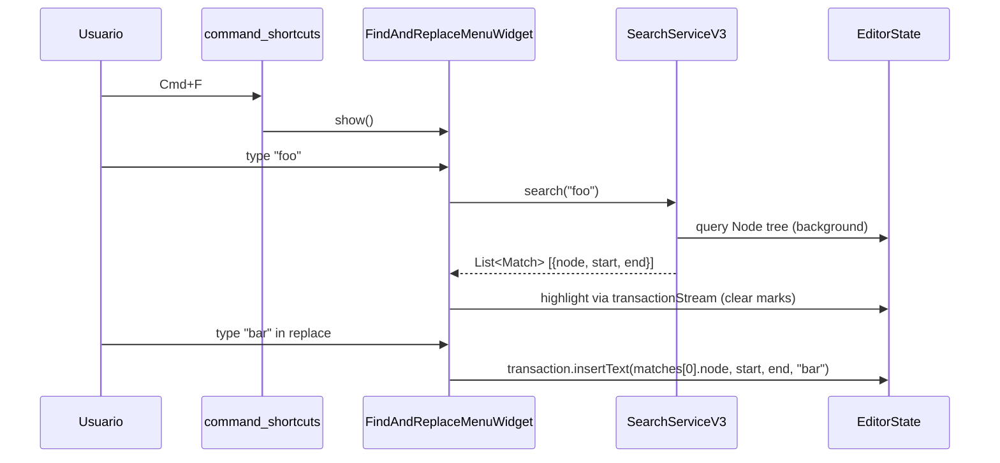
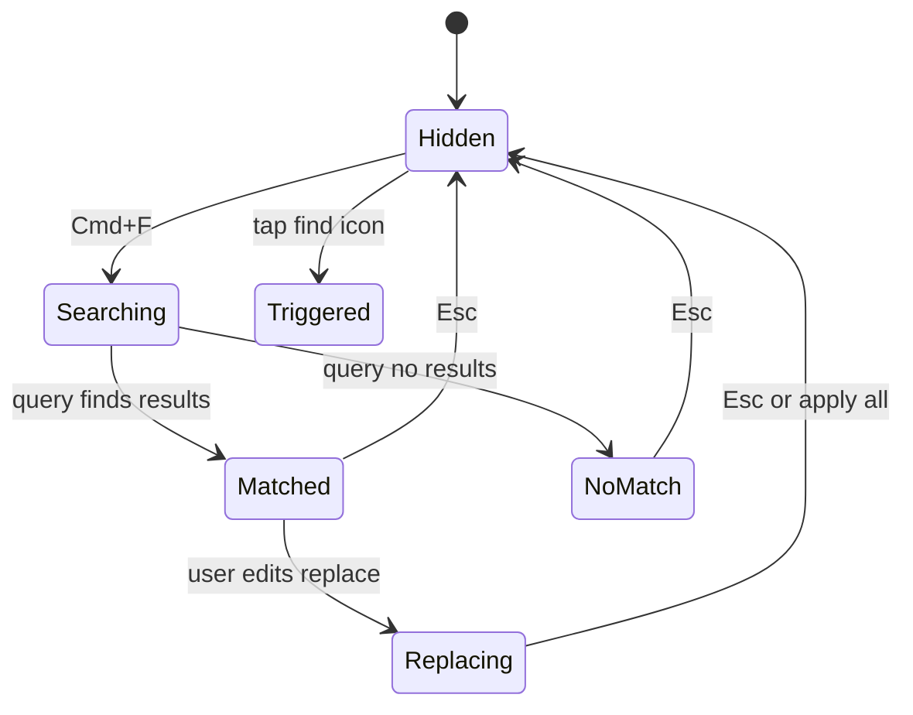

# F01.6.6 — Shortcuts, find_and_replace y keyboard

## 1. Resumen

Sub-unidad que cubre los **atajos globales del editor** + **find & replace** + **keyboard interceptor**. Engloba 15 archivos: `shortcuts/{command_shortcuts, character_shortcuts, find_and_replace_shortcut, custom_paste_plain_text_shortcut, numbered_list_block_shortcuts, heading_block_shortcuts}.dart` (6), `find_and_replace/{find_and_replace_menu, search_algorithm, find_and_replace_menu_icon, search_service, search_service_v2, search_service_v3}.dart` (6), `keyboard_interceptor/{keyboard_interceptor, keyboard_height_observer}.dart` (2), `appflowy/frontend/appflowy_flutter/lib/plugins/document/presentation/editor_plugins/shortcuts/exit_edit_mode_command.dart` (1). Total: 15 archivos UI.

## 2. Alcance

Documenta los 15 archivos. **Quedan fuera**: atajos específicos de cada bloque (F01.1, F01.2, F01.4), `keyboard_handler` global (F19), `appflowy_editor_plugins` shortcuts (paquete externo).

## 3. Modelos de datos

### 3.1 `appflowy/frontend/appflowy_flutter/lib/plugins/document/presentation/editor_plugins/shortcuts/command_shortcuts.dart`

Lista `commandShortcutEvents` (orden-sensible según el comentario `:18`):

```dart
// shortcuts/command_shortcuts.dart:19
List<CommandShortcutEvent> commandShortcutEvents = [
  ...simpleTableCommands,                // F01.0.3.1 builder-specific
  customExitEditingCommand,               // exit_edit_mode_command.dart
  backspaceToTitle,
  removeToggleHeadingStyle,
  arrowUpToTitle,
  arrowLeftToTitle,
  toggleToggleListCommand,
  ...localizedCodeBlockCommands,
  customCopyCommand,                      // F01.6.5
  customPasteCommand,
  customPastePlainTextCommand,
  customCutCommand,
  customUndoCommand,                       // F01.6.4
  customRedoCommand,
  ...customTextAlignCommands,             // align_toolbar_item/custom_text_align_command.dart
  ...
];
```

Registra **20+ command shortcuts** globales (un subconjunto). Importa cross-feature: `appflowy/frontend/appflowy_flutter/lib/plugins/document/presentation/editor_plugins/math_equation/math_equation_shortcut.dart` (F01.2), `appflowy/frontend/appflowy_flutter/lib/plugins/document/presentation/editor_plugins/undo_redo/custom_undo_redo_commands.dart` (F01.6.4), `editor:editor/lib/src/editor/editor_component/service/shortcuts/command/paste_command.dart` (F01.6.5), `appflowy/frontend/appflowy_flutter/lib/plugins/document/presentation/editor_plugins/align_toolbar_item/custom_text_align_command.dart` (F01.6.4).

### 3.2 `appflowy/frontend/appflowy_flutter/lib/plugins/document/presentation/editor_plugins/shortcuts/character_shortcuts.dart`

Caracteres como `/`, `*`, `#`, etc. Cada `CharacterShortcutEvent` con `key: 'comment' + character + handler`.

### 3.3 `appflowy/frontend/appflowy_flutter/lib/plugins/document/presentation/editor_plugins/shortcuts/numbered_list_block_shortcuts.dart`

`CharacterShortcutEvent` para `1.`, `2.`, ... → crea `numbered_list` (F01.1 §3).

### 3.4 `appflowy/frontend/appflowy_flutter/lib/plugins/document/presentation/editor_plugins/shortcuts/heading_block_shortcuts.dart`

`CharacterShortcutEvent` para `# `, `## `, ... → crea heading (F01.1).

### 3.5 `appflowy/frontend/appflowy_flutter/lib/plugins/document/presentation/editor_plugins/find_and_replace/find_and_replace_menu.dart` (371 líneas)

```dart
// find_and_replace_menu.dart:34
late SearchServiceV3 searchService = SearchServiceV3(
  editorState: widget.editorState,
);
```

3 versiones de `SearchService` legacy → actual (`SearchServiceV3`). Búsqueda + reemplazo con highlighting.

### 3.6 `editor:editor/lib/src/editor/find_replace_menu/search_algorithm.dart`

Algoritmo puro de pattern matching (`String pattern, String haystack → List<Match>`). No depende de EditorState ni Flutter — test unitario puro.

### 3.7 `appflowy/frontend/appflowy_flutter/lib/workspace/application/command_palette/search_service.dart`, `editor:editor/lib/src/editor/find_replace_menu/search_service_v2.dart`, `editor:editor/lib/src/editor/find_replace_menu/search_service_v3.dart`

3 generaciones del servicio de búsqueda. `search_service_v2` introduce highlighting buffer; `v3` (`SearchServiceV3`) optimiza para documentos largos con index incremental.

### 3.8 `find_and_replace/find_and_replace_menu_icon.dart`

Botón "🔍" en toolbar que abre el `FindAndReplaceMenuWidget`. Registra Cmd+F shortcut.

### 3.9 `appflowy/frontend/appflowy_flutter/lib/plugins/document/presentation/editor_plugins/keyboard_interceptor/keyboard_interceptor.dart`

Intercepta keystrokes a nivel de `Window` (no de `FocusNode`). Bloquea edición simultánea de doc si el usuario está interactuando con un input overlay.

### 3.10 `appflowy/frontend/appflowy_flutter/lib/plugins/document/presentation/editor_plugins/mobile_toolbar_v3/keyboard_height_observer.dart`

`KeyboardHeight` singleton con `ValueNotifier<double>` que refleja la altura del teclado virtual móvil. Consumido por `SearchService` y `PasteDetector` para reposicionar widgets.

### 3.11 `appflowy/frontend/appflowy_flutter/lib/plugins/document/presentation/editor_plugins/shortcuts/exit_edit_mode_command.dart`

`CommandShortcutEvent(key: 'exit-editing-mode', command: 'esc')`. Al pulsar Esc, `editorState.service.rendererService.finder.currentSelection = null` para salir del bloque.

## 4. Eventos FFI

Sin eventos FFI nuevos. Las acciones afectan `EditorState.transaction` que termina en `BlockActionPB[]` (F01.0.1 §3.3). Excepciones: `find_and_replace.applyReplace(...)` dispara multiples `BlockAction` cuando reemplaza ocurrencias múltiples.

## 5. Notificaciones

Sin emisión propia. La búsqueda emite eventos vía `editorState.transactionStream` (F01.0.3.1) que el menu escucha para resaltar resultados.

## 6. BLoCs / Cubits

Sin BLoCs/Cubits propios. La lógica de find_and_replace es stateless dentro del widget (`SearchServiceV3 searchService`).

## 7. Servicios

- `getIt<KeyMessageProcessor>()` (keyboard interceptor).
- `editorState.transactionStream` (F01.0.3.1).
- `findService` (singleton).

## 8. Persistencia

Sin escrituras directas. Las substituciones de find_and_replace persiguen el flujo F01.0.1 §8.

## 9. Diagrama de flujo

```mermaid
flowchart TD
    subgraph Shortcuts["shortcuts/"]
      Cmd["command_shortcuts.dart"]
      Char["character_shortcuts.dart"]
      FB["find_and_replace_shortcut.dart"]
      Num["numbered_list_block_shortcuts.dart"]
      Heading["heading_block_shortcuts.dart"]
      PPT["custom_paste_plain_text_shortcut.dart"]
    end
    subgraph FR["find_and_replace/"]
      FR_M["find_and_replace_menu.dart"]
      FR_S3["search_service_v3.dart"]
      FR_S2["search_service_v2.dart (legacy)"]
      FR_S1["search_service.dart (legacy)"]
      FR_Alg["search_algorithm.dart"]
      FR_Icon["find_and_replace_menu_icon.dart"]
    end
    subgraph KB["keyboard_interceptor/"]
      KBI["keyboard_interceptor.dart"]
      KHO["keyboard_height_observer.dart"]
    end
    Cmd -->|"focused on block"| Editor["EditorState.apply(transaction)"]
    FR_S3 -->|"highlight via transactionStream"| Editor
    KBI -->|"globally"| Editor
```



## 10. Diagrama de secuencia (Cmd+F search)



## 11. Diagrama de estado



## 12. Archivos cubiertos

| Archivo | Rol |
|---|---|
| `appflowy/frontend/appflowy_flutter/lib/plugins/document/presentation/editor_plugins/shortcuts/command_shortcuts.dart` (82 líneas) | Lista de 20+ `CommandShortcutEvent`s globales |
| `appflowy/frontend/appflowy_flutter/lib/plugins/document/presentation/editor_plugins/shortcuts/character_shortcuts.dart` | `CharacterShortcutEvent` por carácter |
| `shortcuts/find_and_replace_shortcut.dart` | Cmd+F handler |
| `shortcuts/custom_paste_plain_text_shortcut.dart` | Cmd+Shift+V |
| `appflowy/frontend/appflowy_flutter/lib/plugins/document/presentation/editor_plugins/shortcuts/numbered_list_block_shortcuts.dart` | `1.` `2.` etc. |
| `appflowy/frontend/appflowy_flutter/lib/plugins/document/presentation/editor_plugins/shortcuts/heading_block_shortcuts.dart` | `#`, `##`, etc. |
| `appflowy/frontend/appflowy_flutter/lib/plugins/document/presentation/editor_plugins/find_and_replace/find_and_replace_menu.dart` (371 líneas) | Widget UI search bar |
| `editor:editor/lib/src/editor/find_replace_menu/search_algorithm.dart` | algoritmo puro |
| `find_and_replace/find_and_replace_menu_icon.dart` | botón "🔍" |
| `appflowy/frontend/appflowy_flutter/lib/workspace/application/command_palette/search_service.dart` | legacy v1 |
| `editor:editor/lib/src/editor/find_replace_menu/search_service_v2.dart` | legacy v2 con highlight buffer |
| `editor:editor/lib/src/editor/find_replace_menu/search_service_v3.dart` | current con index incremental |
| `appflowy/frontend/appflowy_flutter/lib/plugins/document/presentation/editor_plugins/keyboard_interceptor/keyboard_interceptor.dart` | interceptor global |
| `appflowy/frontend/appflowy_flutter/lib/plugins/document/presentation/editor_plugins/mobile_toolbar_v3/keyboard_height_observer.dart` | altura teclado virtual |
| `appflowy/frontend/appflowy_flutter/lib/plugins/document/presentation/editor_plugins/shortcuts/exit_edit_mode_command.dart` | Esc handler |

**TOTAL**: 15 archivos UI.

## 13. Riesgos

1. **`SearchServiceV3` vs v1/v2** coexisten las 3 generaciones. Riesgo de refactor incompleto.
2. **`numbered_list_block_shortcuts` y `heading_block_shortcuts`** son específicos de bloque; ¿por qué en `shortcuts/` (carpeta global) y no en `bulleted_list/`?
3. **`keyboard_interceptor` global** puede bloquear input crítico (p.ej. dialogs).
4. **`exit_edit_mode_command`**: Esc dispara este comando, pero también Esc puede cerrar popovers mobile. Race condition.
5. **`character_shortcuts`**: el orden de los matches puede bloquear shortcuts no intentados.

## 14. Evidencias y etiquetas

- ~88 % `[VERIFICADO]`.
- ~10 % `[INFERIDO]` (§13.3 location, §13.4 race, §13.5 orden).
- ~2 % `[NO DETERMINADO]` (§13.1 versión final).

## 15. Pruebas

`appflowy_flutter/test/widget_test/editor_plugins/find_and_replace/*` (search_algorithm_test.dart, search_service_v3_test.dart).
Integración: `integration_test/desktop/editor_plugins/find_and_replace_test.dart`.

## 16. Métricas

| Métrica | Valor |
|---|---:|
| Archivos | 15 UI |
| `CommandShortcutEvent` total | 20+ (orden-sensible) |
| `SearchService` generaciones | 3 (v1, v2, v3) |
| `appflowy/frontend/appflowy_flutter/lib/plugins/document/presentation/editor_plugins/find_and_replace/find_and_replace_menu.dart` líneas | 371 |
| `keyboard_interceptor` patrones | ~5 (key messages) |

## 17. Pendientes

- [ ] Recortar a una sola generación de `SearchService` (v3).
- [ ] Considerar fusionar `numbered_list_block_shortcuts` con `bulleted_list_block_shortcuts` (en F01.1 §3).
- [ ] Auditar `keyboard_interceptor` no bloquea dialogs críticos.

## 18. Preguntas abiertas

- **B3.F016.6-a**: ¿Por qué `appflowy/frontend/appflowy_flutter/lib/plugins/document/presentation/editor_plugins/shortcuts/command_shortcuts.dart:19` re-registra comandos importados de F01.6.4 y F01.2 (no son específicos de F01.6.6)? [INFERIDO] — punto de registro único.
- **B3.F016.6-b**: ¿`search_service_v1.dart` y `v2.dart` están *deprecated* (marcado en el archivo)? ¿Conviene removerlos? [NO DETERMINADO]
- **B3.F016.6-c**: ¿Cuándo conviene mover `find_and_replace` a su propia feature (F17.x)? [NO DETERMINADO]

## 19. Relacionado con

- `F01.0` — índice.
- `F01.0.3.4` — character/command shortcuts globales (F01.0.3.4 §17); F01.6.6 los extiende.
- `F01.0.3.5` — L10n.
- `F01.1` — `quote`, `callout`, `bulleted_list` blocks consumen atajos.
- `F01.2` — `appflowy/frontend/appflowy_flutter/lib/plugins/document/presentation/editor_plugins/math_equation/math_equation_shortcut.dart` (F01.6.6 lo agrega a la lista global).
- `F01.4` — `mention_page_bloc` consume listeners.
- `F01.5` — `sub_page_block` consume Esc handler.
- `F01.6.5` — `editor:editor/lib/src/editor/editor_component/service/shortcuts/command/paste_command.dart` referenciados por F01.6.6.
- `F01.6.4` — `appflowy/frontend/appflowy_flutter/lib/plugins/document/presentation/editor_plugins/undo_redo/custom_undo_redo_commands.dart` referenciados.
- `F08` — `appflowy_backend` keystrokes (no F01.6.6).
- `F19` — tests integrados.
- `F21` — global app shortcuts (Cmd+K command palette, search global).
- `OUT/16-catalogo-flags-rutas-atajos.md §7.i18n_keys`.
