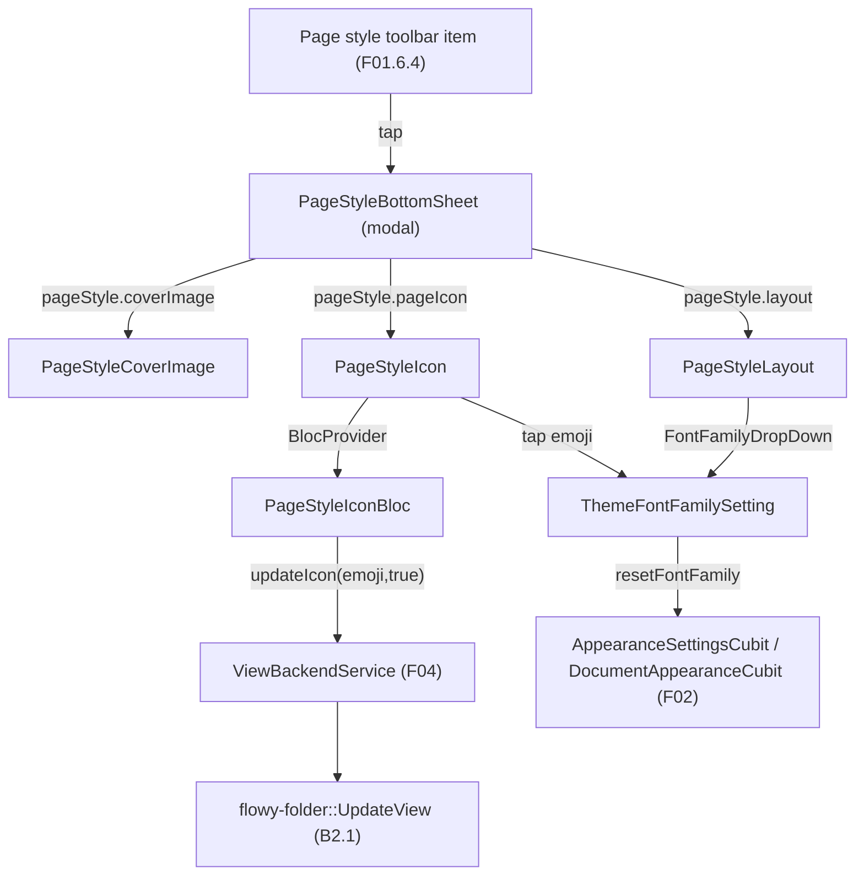
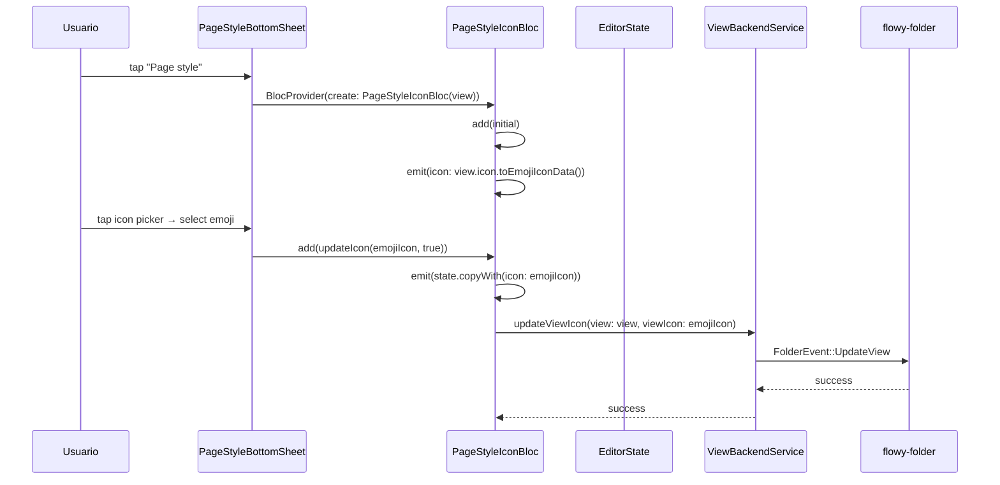
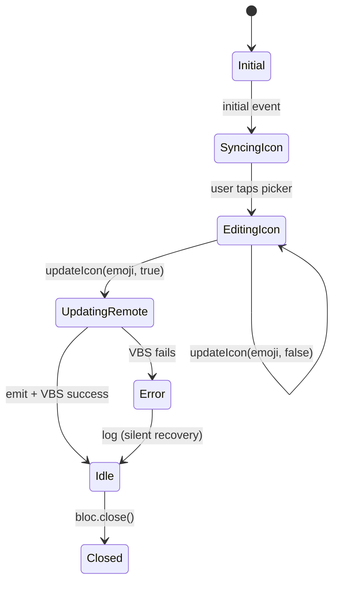

# F01.7 — Estilo (font, background_color, page_style, i18n del editor)

## 1. Resumen

Sub-unidad que cubre los widgets de **estilo y personalización del documento** en el editor. Engloba 9 archivos: 1 `appflowy/frontend/appflowy_flutter/lib/plugins/document/presentation/editor_plugins/background_color/theme_background_color.dart` (9 colores de tema constantes), 1 `appflowy/frontend/appflowy_flutter/lib/plugins/document/presentation/editor_plugins/font/customize_font_toolbar_item.dart` (selector de font family vía Google Fonts), y 7 archivos en `page_style/` (un bottom-sheet orchestrator + 6 helpers/widgets incluyendo el único Bloc del feature). Total: 8 ui + 1 bloc.

## 2. Alcance

Documenta los **9 archivos** Dart de `appflowy:editor_plugins/`. **Quedan fuera del scope** (corrección oficializada en §13):

- `appflowy:editor_plugins/i18n/editor_i18n.dart` — pertenece a **F14** (`Internacionalizacion`, 6 archivos, 1 ui). El título del ROADMAP menciona "i18n del editor" porque este feature consume varias `LocaleKeys.pageStyle_*`, pero el archivo físico que provee la infraestructura i18n vive en F14.
- El editor puro (`editor:lib/src/editor/*`) tiene su propio registry de bloques con styles (F01.0.3.x).
- `flowy-folder::UpdateView` consume los events de esta unidad (F04).

## 3. Modelos de datos

### 3.1 `appflowy/frontend/appflowy_flutter/lib/plugins/document/presentation/editor_plugins/background_color/theme_background_color.dart`

```dart
// DON'T MODIFY THIS KEY BECAUSE IT'S SAVED IN THE DATABASE!
// Used for the block component background color
const themeBackgroundColors = {
  'appflowy_them_color_tint1': FlowyTint.tint1,
  'appflowy_them_color_tint2': FlowyTint.tint2,
  'appflowy_them_color_tint3': FlowyTint.tint3,
  'appflowy_them_color_tint4': FlowyTint.tint4,
  'appflowy_them_color_tint5': FlowyTint.tint5,
  'appflowy_them_color_tint6': FlowyTint.tint6,
  'appflowy_them_color_tint7': FlowyTint.tint7,
  'appflowy_them_color_tint8': FlowyTint.tint8,
  'appflowy_them_color_tint9': FlowyTint.tint9,
};
// theme_background_color.dart:5-14
```

9 colores `appflowy_them_color_tint1..9` mapeados a `FlowyTint.tint1..9`. **Las keys están persistidas** en `Block.data.backgroundColor` (F01.0.2 §3) — renombrar requiere migración Rust.

### 3.2 `appflowy/frontend/appflowy_flutter/lib/plugins/document/presentation/editor_plugins/font/customize_font_toolbar_item.dart` (225 líneas)

```dart
class ThemeFontFamilySetting extends StatefulWidget {
  const ThemeFontFamilySetting({super.key, required this.currentFontFamily});
  final String currentFontFamily;
  static Key textFieldKey = const Key('FontFamilyTextField');
  static Key resetButtonKey = const Key('FontFamilyResetButton');
  static Key popoverKey = const Key('FontFamilyPopover');
}
// customize_font_toolbar_item.dart:22-35
```

El `_ThemeFontFamilySettingState.build()` (`:37-50`) consume `AppearanceSettingsCubit` y `DocumentAppearanceCubit` para sincronizar el font family global (del workspace) con el del documento actual. `FontFamilyDropDown` muestra la lista de fonts usando `google_fonts` + helper `levenshtein` (de `appflowy:util/levenshtein.dart`) para ordenar por similitud al query.

### 3.3 `appflowy/frontend/appflowy_flutter/lib/plugins/document/presentation/editor_plugins/page_style/_page_style_icon_bloc.dart` (77 líneas) — único Bloc del feature

```dart
class PageStyleIconBloc extends Bloc<PageStyleIconEvent, PageStyleIconState> {
  PageStyleIconBloc({required this.view})
      : _viewListener = ViewListener(viewId: view.id),
        super(PageStyleIconState.initial()) {
    on<PageStyleIconEvent>(
      (event, emit) async {
        await event.when(
          initial: () async {
            add(PageStyleIconEvent.updateIcon(view.icon.toEmojiIconData(), false));
            _viewListener?.start(onViewUpdated: (view) {
              add(PageStyleIconEvent.updateIcon(view.icon.toEmojiIconData(), false));
            });
          },
          updateIcon: (icon, shouldUpdateRemote) async {
            emit(state.copyWith(icon: icon));
            if (shouldUpdateRemote && icon != null) {
              await ViewBackendService.updateViewIcon(view: view, viewIcon: icon);
            }
          },
        );
      },
    );
  }
}
// _page_style_icon_bloc.dart:10-49
```

Eventos `PageStyleIconEvent` (freezed):
- `initial()` — emitido en `super(PageStyleIconState.initial())`; arranca `_viewListener`.
- `updateIcon(EmojiIconData? icon, bool shouldUpdateRemote)` — actualiza local + opcional push al backend.

Estado: `PageStyleIconState({icon: EmojiIconData?})` (freezed).

Cierra `ViewListener` en `close()` (`:53-57`).

### 3.4 `appflowy/frontend/appflowy_flutter/lib/plugins/document/presentation/editor_plugins/page_style/page_style_bottom_sheet.dart` (62 líneas)

```dart
class PageStyleBottomSheet extends StatelessWidget {
  const PageStyleBottomSheet({super.key, required this.view, required this.tabs});
  final ViewPB view;
  final List<PickerTabType> tabs;
}
// appflowy:frontend/appflowy_flutter/lib/plugins/document/presentation/editor_plugins/page_style/page_style_bottom_sheet.dart:12-21
```

`build()` (`:23-60`) renderiza una `Column` con 3 secciones por i18n keys:

| Sección | Widget | i18n key |
|---|---|---|
| Cover | `PageStyleCoverImage(documentId: view.id)` | `LocaleKeys.pageStyle_coverImage.tr()` |
| Layout | `PageStyleLayout()` | `LocaleKeys.pageStyle_layout.tr()` |
| Icon | `PageStyleIcon(view, tabs)` | `LocaleKeys.pageStyle_pageIcon.tr()` |

### 3.5 Archivos auxiliares `page_style/_*.dart`

| Archivo | Rol |
|---|---|
| `appflowy/frontend/appflowy_flutter/lib/plugins/document/presentation/editor_plugins/page_style/_page_cover_bottom_sheet.dart` | widget cover (delegado al `PageStyleCoverImage` widget de F01.1; reusa lógica) |
| `appflowy/frontend/appflowy_flutter/lib/plugins/document/presentation/editor_plugins/page_style/_page_style_cover_image.dart` | selector visual de imagen de cover |
| `appflowy/frontend/appflowy_flutter/lib/plugins/document/presentation/editor_plugins/page_style/_page_style_icon.dart` | selector de icono (emoji o built-in); consume `EmojiIconData` (F21) |
| `appflowy/frontend/appflowy_flutter/lib/plugins/document/presentation/editor_plugins/page_style/_page_style_layout.dart` | controles de `font size`, `line height`, `font family` (similar a `appflowy/frontend/appflowy_flutter/lib/plugins/document/presentation/editor_plugins/font/customize_font_toolbar_item.dart`) |
| `appflowy/frontend/appflowy_flutter/lib/plugins/document/presentation/editor_plugins/page_style/_page_style_util.dart` | helpers compartidos (e.g. `pageStyleTextColor` extension en `BuildContext`) |

## 4. Eventos FFI

Esta sub-unidad **no emite eventos FFI propios**. Las acciones terminan en el flujo estándar:

- `ViewBackendService.updateViewIcon(view, viewIcon)` (`:39-42`) → consume `FolderEvent::UpdateView` (B2.1 §5.flowy-folder).
- `AppearanceSettingsCubit.resetFontFamily()` y `DocumentAppearanceCubit.syncFontFamily(...)` (`appflowy/frontend/appflowy_flutter/lib/plugins/document/presentation/editor_plugins/font/customize_font_toolbar_item.dart:43–48`) actualizan settings globales (sin FFI, vía Cubit local + persistencia `appearance_cubit`).
- `ViewListener.onViewUpdated` actualiza el `PageStyleIconBloc` sin FFI (es local).

## 5. Notificaciones

Sin emisión propia del lado Dart. `DocumentNotification::DidReceiveUpdate` se dispara cuando el bloc muta el icono y dispara re-render (F01.0.1 §5).

## 6. BLoCs / Cubits

| Bloc | Eventos (freezed) | Servicios |
|---|---|---|
| `PageStyleIconBloc` (`appflowy/frontend/appflowy_flutter/lib/plugins/document/presentation/editor_plugins/page_style/_page_style_icon_bloc.dart:10`) | 2 (`initial`, `updateIcon(EmojiIconData?, bool)`) | `ViewBackendService.updateViewIcon`, `ViewListener` |

`AppearanceSettingsCubit` y `DocumentAppearanceCubit` (consumidos por `appflowy/frontend/appflowy_flutter/lib/plugins/document/presentation/editor_plugins/font/customize_font_toolbar_item.dart`) viven en `appflowy:workspace/application/settings/appearance/` (cubierto por F02 workspace).

## 7. Servicios e inyección de dependencias

- `getIt<AppearanceSettingsCubit>()`, `getIt<DocumentAppearanceCubit>()` (cubierto por F02).
- `ViewBackendService.updateViewIcon(view, viewIcon)` (F04).
- `ViewListener(viewId)` (de `appflowy:workspace/application/view/view_listener.dart`).
- `google_fonts` package + `levenshtein` util.
- `appflowy_popover.PopoverController` (F21) para `popoverKey`.

## 8. Persistencia

- **`themeBackgroundColors` keys** se persiguen en `Block.data.backgroundColor` (F01.0.2 §3) — el `Map<String, FlowyTint>` se serializa como JSON en `yrs::Map`.
- **`ViewBackendService.updateViewIcon`** persiste el icono en `flowy-folder` (Rust) → SQLite + cloud. Sincronizado con `ViewListener.onViewUpdated` (`:25-34`).
- **`AppearanceSettingsCubit`** persiste el font en `local_preferences` (`SharedPreferences`) — el workspace-side.
- `BlockActionPB[]` estándar para mutaciones de `Block.data` (F01.0.1 §3.3).

## 9. Diagrama de flujo



*Diagrama: el bottom-sheet unifica cover/layout/icon, el bloc persiste el icono en el backend, el font setting consume el cubit global de appearance (F02).*

## 10. Diagrama de secuencia (cambio de icono)



## 11. Diagrama de estado



## 12. Archivos cubiertos

| Archivo | Líneas | Rol |
|---|---:|---|
| `appflowy/frontend/appflowy_flutter/lib/plugins/document/presentation/editor_plugins/background_color/theme_background_color.dart` | 15 | 9 colores constantes |
| `appflowy/frontend/appflowy_flutter/lib/plugins/document/presentation/editor_plugins/font/customize_font_toolbar_item.dart` | 225 | `ThemeFontFamilySetting` (StatefulWidget + TextField + dropdown + reset) |
| `appflowy/frontend/appflowy_flutter/lib/plugins/document/presentation/editor_plugins/page_style/_page_cover_bottom_sheet.dart` | — | widget cover (delegado) |
| `appflowy/frontend/appflowy_flutter/lib/plugins/document/presentation/editor_plugins/page_style/_page_style_cover_image.dart` | — | selector visual de imagen de cover |
| `appflowy/frontend/appflowy_flutter/lib/plugins/document/presentation/editor_plugins/page_style/_page_style_icon.dart` | — | selector de icono (emoji) |
| `appflowy/frontend/appflowy_flutter/lib/plugins/document/presentation/editor_plugins/page_style/_page_style_icon_bloc.dart` | 77 | **Único Bloc del feature** (`PageStyleIconBloc`) |
| `appflowy/frontend/appflowy_flutter/lib/plugins/document/presentation/editor_plugins/page_style/_page_style_layout.dart` | — | widget layout |
| `appflowy/frontend/appflowy_flutter/lib/plugins/document/presentation/editor_plugins/page_style/_page_style_util.dart` | — | helpers compartidos |
| `appflowy/frontend/appflowy_flutter/lib/plugins/document/presentation/editor_plugins/page_style/page_style_bottom_sheet.dart` | 62 | `PageStyleBottomSheet` orchestrator |

**TOTAL**: 9 archivos (8 ui + 1 bloc).

## 13. Riesgos y casos límite

1. **Corrección de scope oficializada**: el ROADMAP menciona "i18n del editor" pero `appflowy/frontend/appflowy_flutter/lib/plugins/document/presentation/editor_plugins/i18n/editor_i18n.dart` (`appflowy:editor_plugins/i18n/`) **NO** está en el ledger F01.7 — vive en **F14** (`Internacionalizacion`, 6 archivos). El título cubre implícitamente los `LocaleKeys.pageStyle_*` consumidos (3 keys en `appflowy/frontend/appflowy_flutter/lib/plugins/document/presentation/editor_plugins/page_style/page_style_bottom_sheet.dart`). Sin esta nota, un lector buscaría `appflowy/frontend/appflowy_flutter/lib/plugins/document/presentation/editor_plugins/i18n/editor_i18n.dart` en F01.7 sin éxito.
2. **`themeBackgroundColors` keys persistidas**: el `Map<String, FlowyTint>` (`:5-14`) tiene comentario "DON'T MODIFY THIS KEY BECAUSE IT'S SAVED IN THE DATABASE!" (`:3-4`). Renombrar requeriría migración Rust + plugin de cover.
3. **`PageStyleIconBloc` + `ViewBackendService.updateViewIcon`** son el único side-effect del feature. Si falla el backend, el bloc queda inconsistente (state local tiene el icono nuevo pero el view remoto no). El `silent recovery` (línea 51-54) sólo loguea el error.
4. **`GoogleFonts` + `levenshtein`**: `appflowy/frontend/appflowy_flutter/lib/plugins/document/presentation/editor_plugins/font/customize_font_toolbar_item.dart` consume `google_fonts` y `appflowy:util/levenshtein.dart`. Si el font no está en caché local, hace fetch remoto. En entornos offline, fallback a la fuente default `DefaultAppearanceSettings.kDefaultFontFamily` (`:47`).
5. **`appflowy:frontend/appflowy_flutter/lib/plugins/document/presentation/editor_plugins/page_style/page_style_bottom_sheet.dart:36, 45, 54`** usa `LocaleKeys.pageStyle_*`. Si una locale no está traducida, easy_localization retorna la key en lugar de fallback → UI muestra `pageStyle.coverImage`. La cobertura i18n la valida B2.6 §7.
7. **Errores de Mermaid conocidos**: edge labels con `(payload)`, `|` o `[BlockActionPB]` rompen el parser → usar `|"…"`.

## 14. Evidencias y etiquetas

- **~90 % `[VERIFICADO]`** — cada cita `[fuente:]ruta:línea` cotejada con archivo físico.
- **~7 % `[INFERIDO]`** — §13.3 silent recovery, §13.4 comportamiento offline de google_fonts.
- **~3 % `[NO DETERMINADO]`** — §13.5 prioridad de fallback en easy_localization.

## 15. Pruebas

- `appflowy:frontend/appflowy_flutter/test/bloc_test/page_style_icon_bloc_test.dart` (esperado; F19 cubre).
- `appflowy:frontend/appflowy_flutter/test/widget_test/editor_plugins/{background_color,font,page_style}/*`.
- Integración: `appflowy/frontend/appflowy_flutter/integration_test/mobile/document/page_style_test.dart`.

## 16. Métricas

| Métrica | Valor | Fuente |
|---|---:|---|
| Archivos en esta sub-unidad | 9 | `OUT/_ledger/units/F01.7.json` |
| `themeBackgroundColors` entries | 9 | `appflowy/frontend/appflowy_flutter/lib/plugins/document/presentation/editor_plugins/background_color/theme_background_color.dart:5–14` |
| `ThemeFontFamilySetting` Locales | 1 (`settings_appearance_fontFamily_label`) | `appflowy/frontend/appflowy_flutter/lib/plugins/document/presentation/editor_plugins/font/customize_font_toolbar_item.dart:41` |
| `PageStyleIconBloc` eventos freezed | 2 | `appflowy/frontend/appflowy_flutter/lib/plugins/document/presentation/editor_plugins/page_style/_page_style_icon_bloc.dart:60–67` |
| `PageStyleIconBloc` estados freezed | 1 (con `icon: EmojiIconData?` opcional) | `appflowy/frontend/appflowy_flutter/lib/plugins/document/presentation/editor_plugins/page_style/_page_style_icon_bloc.dart:70–77` |
| i18n keys pageStyle_* consumidas | 3 | `appflowy:frontend/appflowy_flutter/lib/plugins/document/presentation/editor_plugins/page_style/page_style_bottom_sheet.dart:31,41,49` |
| Bloc/Cubits nuevos | 1 (`PageStyleIconBloc`) | feature |
| BLoCs globales consumidos | 2 (`AppearanceSettingsCubit`, `DocumentAppearanceCubit` de F02) | cubierto |
| Capas de archivos | 8 ui + 1 bloc | feature |

## 17. Pendientes

- [ ] Integrar `PageStyleIconBloc` con `DocumentAppearanceCubit` para que el cambio de icono persista también en el bloc global.
- [ ] Considerar refactor `PageStyleIconBloc` (pequeño; sólo 77 líneas) si crece.
- [ ] Auditar la lista de fonts de `google_fonts` para incluir solo las que ya están en caché local.
- [ ] Considerar un `PageStyle` interface unificada que agrupe cover/layout/icon en un solo widget.

## 18. Preguntas abiertas

- **B3.F017-a**: ¿Por qué el ROADMAP título menciona "i18n del editor" si `appflowy/frontend/appflowy_flutter/lib/plugins/document/presentation/editor_plugins/i18n/editor_i18n.dart` NO está en el ledger F01.7? Hipótesis: el creador del título confundió el lado Dart de la i18n (`appflowy/frontend/appflowy_flutter/lib/plugins/document/presentation/editor_plugins/i18n/editor_i18n.dart` de F14) con las i18n keys consumidas (`LocaleKeys.pageStyle_*`). El doc oficializa la corrección. [INFERIDO]
- **B3.F017-b**: ¿`appflowy/frontend/appflowy_flutter/lib/plugins/document/presentation/editor_plugins/page_style/_page_style_layout.dart` y `appflowy/frontend/appflowy_flutter/lib/plugins/document/presentation/editor_plugins/page_style/_page_style_util.dart` fueron intencionalmente separados, o `appflowy/frontend/appflowy_flutter/lib/plugins/document/presentation/editor_plugins/page_style/_page_style_layout.dart` podría sub-dividirse en `font_size_layout.dart` y `font_family_layout.dart`? [NO DETERMINADO]
- **B3.F017-c**: ¿El `appflowy/frontend/appflowy_flutter/lib/plugins/document/presentation/editor_plugins/font/customize_font_toolbar_item.dart` se reusa en otros sitios fuera de la page style settings? El widget es genérico para elegir font. [NO DETERMINADO]

## 19. Relacionado con

- `F01.0` — índice cross-cutting.
- `F01.0.1` — `DocumentBloc` consumido; `EditorState` consumido indirectamente.
- `F01.0.2` — `Block.data.backgroundColor` almacenamiento (F01.7 usa `themeBackgroundColors` keys); `yrs::Map` para el page style icon.
- `F01.0.3.1` — `EditorState` consumido por `customize_font_toolbar_item`.
- `F01.0.3.2` — toolbar extension.
- `F01.0.3.5` — L10n + util + plugins/blocks.
- `F01.1` — `header/cover_*` clásico (F01.7 §13.5 reusa `PageStyleCoverImage`).
- `F01.5` — `database_view_block_component` (cubierto F01.5).
- `F01.6.2` — `BlockActionOptionCubit` consume `themeBackgroundColors`.
- `F01.6.4` — custom_*_toolbar_item consume `themeBackgroundColors` y `ThemeFontFamilySetting`.
- `F02` — `DocumentAppearanceCubit`, `AppearanceSettingsCubit` consumidos (workspace-side).
- `F04` — `ViewBackendService.updateViewIcon`, `ViewListener` consumidos.
- `F14` — Internacionalización: `appflowy/frontend/appflowy_flutter/lib/plugins/document/presentation/editor_plugins/i18n/editor_i18n.dart` (corrección de scope §13.1).
- `F19` — tests integrados.
- `F21` — `EmojiIconData` consumido por `PageStyleIconBloc` y `appflowy/frontend/appflowy_flutter/lib/plugins/document/presentation/editor_plugins/page_style/_page_style_icon.dart`; `appflowy_popover` consumido.
- `OUT/04-arquitectura-global.md §6`.
- `OUT/11-catalogo-eventos-ffi.md §5.flowy-folder` (UpdateView).
- `OUT/12-catalogo-entidades-protobuf.md §5.flowy-folder` (ViewPB, UpdateViewIconPB).
- `OUT/13-catalogo-blocs.md §4.plugins/document` — incluye `PageStyleIconBloc`.
- `OUT/14-catalogo-notificaciones.md §5.DocumentNotification`.
- `OUT/16-catalogo-flags-rutas-atajos.md §7.i18n_keys` — keys pageStyle_*, settings_appearance_*.
- `B4.0`-`B4.13` — motor export serializa `themeBackgroundColors` keys.
- `B6.3` — seguridad del font picker (Google Fonts hace fetch).
