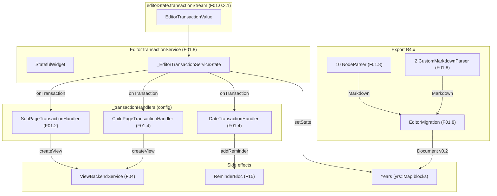
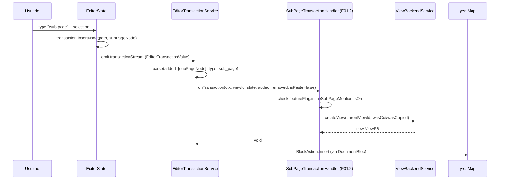
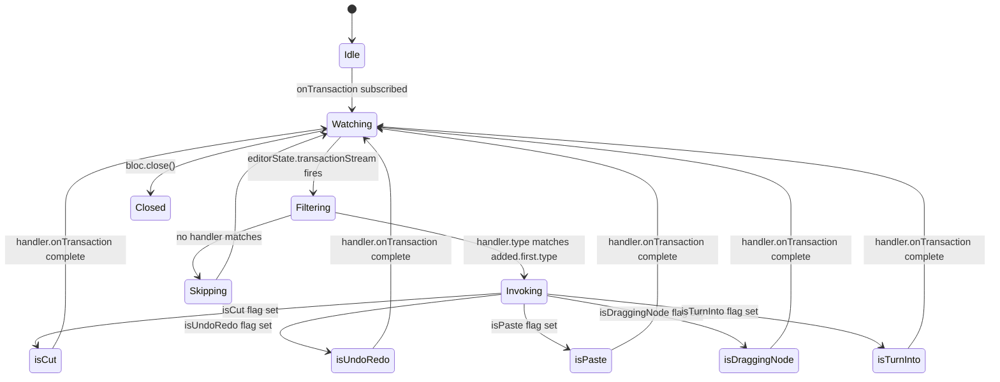

# F01.8 — Infraestructura del editor (transaction_handler, block_transaction_handler, migration, parsers)

## 1. Resumen

Sub-unidad que cubre la **infraestructura transversal** del editor Dart en 4 grupos: `block_transaction_handler/` (1 archivo, base abstracta), `transaction_handler/` (4 archivos, abstractas + servicio orchestrator), `migration/` (1 archivo, AppFlowy 0.1.x → 0.2), `parsers/` (13 archivos: 9 `NodeParser` específicos + 1 `FileBlockNodeParser` + 2 `CustomMarkdownParser` + 1 aggregate `appflowy/frontend/appflowy_flutter/lib/plugins/document/presentation/editor_plugins/parsers/document_markdown_parsers.dart` + 1 aggregate `appflowy/frontend/appflowy_flutter/lib/plugins/document/presentation/editor_plugins/parsers/markdown_parsers.dart` + 1 file parser variante para `CustomImageNodeFileParser`+`CustomMultiImageNodeFileParser`). Total: 20 archivos UI (sin BLoCs).

## 2. Alcance

Documenta los **20 archivos** de `appflowy:editor_plugins/{block_transaction_handler, transaction_handler, migration, parsers}/`. **Quedan fuera** (corrección oficializada en §13):

- `editor_plugins/error/`, `editor_plugins/base/`, `editor_plugins/extensions/`, `editor_plugins/shared_context/` — todas asignadas a **F01.0.1** (appflowy side, 139 archivos, cerrado). El título del ROADMAP las lista pero NO están en el ledger F01.8.
- `editor:lib/src/editor/transaction_handler.dart` y `editor:lib/src/editor/parser/` (F01.0.3.x — editor puro).
- `rust-lib/flowy-document/src/parser/markdown_*` (B1.6 — Rust).
- `ChildPageTransactionHandler`, `DateTransactionHandler` (F01.4 §3) y `SubPageTransactionHandler` (F01.2 §3) — viven en sus respectivas carpetas, no en `transaction_handler/`.

## 3. Modelos de datos

### 3.1 `appflowy/frontend/appflowy_flutter/lib/plugins/document/presentation/editor_plugins/block_transaction_handler/block_transaction_handler.dart` (39 líneas)

```dart
abstract class BlockTransactionHandler {
  const BlockTransactionHandler({required this.blockType});
  final String blockType;

  Future<void> onTransaction(
    BuildContext context,
    EditorState editorState,
    List<Node> added,
    List<Node> removed, {
    bool isUndoRedo = false,
    bool isPaste = false,
    bool isDraggingNode = false,
    String? parentViewId,
  });

  void onUndo(BuildContext context, EditorState editorState, List<Node> before, List<Node> after);
  void onRedo(BuildContext context, EditorState editorState, List<Node> before, List<Node> after);
}
// block_transaction_handler.dart:7-39
```

`blockType` decide cuándo se invoca el handler. Los 3 flags + `parentViewId` (F04 `viewService`) contextualizan el hook.

### 3.2 `appflowy/frontend/appflowy_flutter/lib/plugins/document/presentation/editor_plugins/block_transaction_handler/block_transaction_handler.dart` (13 líneas)

```dart
abstract class BlockTransactionHandler extends EditorTransactionHandler<Node> {
  const BlockTransactionHandler({required super.type})
      : super(livesInDelta: false);
}
// transaction_handler/block_transaction_handler.dart:10-12
```

Sub-clase con `livesInDelta: false` (los Node están en `Document.children`, no en `Delta`).

### 3.3 `appflowy/frontend/appflowy_flutter/lib/plugins/document/presentation/editor_plugins/transaction_handler/editor_transaction_handler.dart` (39 líneas)

```dart
abstract class EditorTransactionHandler<T> {
  const EditorTransactionHandler({required this.type, this.livesInDelta = false});
  final String type;
  final bool livesInDelta; // true para mentions (viven dentro de Delta)

  Future<void> onTransaction(
    BuildContext context,
    String viewId,
    EditorState editorState,
    List<T> added,
    List<T> removed, {
    bool isCut = false, bool isUndoRedo = false, bool isPaste = false,
    bool isDraggingNode = false, bool isTurnInto = false, String? parentViewId,
  });
}
// editor_transaction_handler.dart:11-39
```

Clase base genérica `<T>`: `T = Node` para blocks, `T = MentionBlockData` para mentions (cf. §3.5).

### 3.4 `appflowy/frontend/appflowy_flutter/lib/plugins/document/presentation/editor_plugins/transaction_handler/editor_transaction_service.dart` (331 líneas)

```dart
final _transactionHandlers = <EditorTransactionHandler>[
  if (FeatureFlag.inlineSubPageMention.isOn) ...[
    SubPageTransactionHandler(),   // F01.2 §3
    ChildPageTransactionHandler(), // F01.4 §3
  ],
  DateTransactionHandler(),          // F01.4 §3
];

class EditorTransactionService extends StatefulWidget {
  const EditorTransactionService({super.key, required this.viewId, required this.editorState, required this.child});
  final String viewId;
  final EditorState editorState;
  final Widget child;
}
// editor_transaction_service.dart:16-43
```

`EditorTransactionService` es un `StatefulWidget` que **wrapea** el widget del editor. Se suscribe a `editorState.transactionStream` (`:46-50`) y en cada evento `EditorTransactionValue` (F01.0.3.1 §3) decide qué handler invocar según el `type` del Node. `bool isCut/isUndoRedo/isPaste/isDraggingNode/isTurnInto` son los 5 flags que se pasan al handler.

### 3.5 `appflowy/frontend/appflowy_flutter/lib/plugins/document/presentation/editor_plugins/transaction_handler/mention_transaction_handler.dart` (17 líneas)

```dart
typedef MentionBlockData = (Node, Map<String, dynamic>, int);
abstract class MentionTransactionHandler
    extends EditorTransactionHandler<MentionBlockData> {
  const MentionTransactionHandler()
      : super(type: MentionBlockKeys.mention, livesInDelta: true);
}
// mention_transaction_handler.dart:11-17
```

Tipo compuesto `(Node, Map, int)` para los handlers de mention (viven en `Delta` de un Node). `livesInDelta: true`.

### 3.6 `appflowy/frontend/appflowy_flutter/lib/plugins/document/presentation/editor_plugins/migration/editor_migration.dart` (272 líneas)

```dart
class EditorMigration {
  // AppFlowy 0.1.x -> 0.2
  //   - cover node → page/attributes/cover
  //   - text node → paragraph node
  //   - delta → attributes/delta
  //   - text/checkbox → checkbox_list
  //   - some attribute keys
  static Document migrateDocument(String json) {
    final map = jsonDecode(json);
    assert(map['document'] != null);
    final documentV0 = Map<String, Object>.from(map['document'] as Map);
    final rootV0 = NodeV0.fromJson(documentV0);
    final root = migrateNode(rootV0);
    return Document(root: root);
  }
  static Node migrateNode(NodeV0 nodeV0) { ... }
}
// editor_migration.dart:16-44
```

Migración **in-place** del JSON v0.1 → v0.2. `NodeV0.fromJson` parsea el formato legacy, `migrateNode` aplica las transformaciones recursivas. Se invoca desde la importación JSON (B4.11).

### 3.7 `parsers/*.dart` (13 archivos: 11 node parsers + 2 custom markdown parsers + 2 aggregates)

| Archivo | Clase | `id` (BlockKeys.type) | Output |
|---|---|---|---|
| `appflowy/frontend/appflowy_flutter/lib/plugins/document/presentation/editor_plugins/parsers/callout_node_parser.dart` | `CalloutNodeParser` | `CalloutBlockKeys.type` | `"> $content"` con emoji icon |
| `appflowy/frontend/appflowy_flutter/lib/plugins/document/presentation/editor_plugins/parsers/custom_image_node_parser.dart` | `CustomImageNodeParser` + `CustomImageNodeFileParser` + `CustomMultiImageNodeFileParser` | `ImageBlockKeys.type` + `MultiImageBlockKeys.type` | `""` o path local |
| `appflowy/frontend/appflowy_flutter/lib/plugins/document/presentation/editor_plugins/parsers/custom_paragraph_node_parser.dart` | `CustomParagraphNodeParser` | (paragraph custom) | markdown delta |
| `appflowy/frontend/appflowy_flutter/lib/plugins/document/presentation/editor_plugins/parsers/database_node_parser.dart` | `abstract DatabaseNodeParser` | `DatabaseBlockKeys.viewID` | `"[]($dirPath/$viewId.csv)"` (CSV export) |
| `appflowy/frontend/appflowy_flutter/lib/plugins/document/presentation/editor_plugins/parsers/file_block_node_parser.dart` | `FileBlockNodeParser` | `FileBlockKeys.type` | `"[$name]($url)"` |
| `appflowy/frontend/appflowy_flutter/lib/plugins/document/presentation/editor_plugins/parsers/link_preview_node_parser.dart` | `LinkPreviewNodeParser` | `LinkPreviewBlockKeys.type` | markdown con href |
| `appflowy/frontend/appflowy_flutter/lib/plugins/document/presentation/editor_plugins/parsers/math_equation_node_parser.dart` | `MathEquationNodeParser` | `MathEquationBlockKeys.type` | `"$$ $formula $$"` |
| `appflowy/frontend/appflowy_flutter/lib/plugins/document/presentation/editor_plugins/parsers/simple_table_node_parser.dart` | `SimpleTableNodeParser` | (simple_table) | markdown table |
| `appflowy/frontend/appflowy_flutter/lib/plugins/document/presentation/editor_plugins/parsers/sub_page_node_parser.dart` | `SubPageNodeParser` | `SubPageBlockKeys.type` | link markdown al view |
| `appflowy/frontend/appflowy_flutter/lib/plugins/document/presentation/editor_plugins/parsers/toggle_list_node_parser.dart` | `ToggleListNodeParser` | (toggle_list) | markdown nested list |
| `appflowy/frontend/appflowy_flutter/lib/plugins/document/presentation/editor_plugins/parsers/markdown_code_parser.dart` | `MarkdownCodeBlockParser` | (round-trip code) | `CustomMarkdownParser` |
| `appflowy/frontend/appflowy_flutter/lib/plugins/document/presentation/editor_plugins/parsers/markdown_simple_table_parser.dart` | `MarkdownSimpleTableParser` | (round-trip table) | `CustomMarkdownParser` |
| `appflowy/frontend/appflowy_flutter/lib/plugins/document/presentation/editor_plugins/parsers/document_markdown_parsers.dart` | aggregate | 9 exports |
| `appflowy/frontend/appflowy_flutter/lib/plugins/document/presentation/editor_plugins/parsers/markdown_parsers.dart` | aggregate | 2 exports |

**10 `NodeParser`** extienden `NodeParser` (F01.0.3.3 §3) y serializan blocks a Markdown. **2 `CustomMarkdownParser`** (code, simple_table) extienden `CustomMarkdownParser` para round-trip markdown → Document.

### 3.8 Constantes y datos derivados

`DocumentMarkdownEncoder` (de `editor:lib/src/editor/plugins/markdown/encoder/document_markdown_encoder.dart` — F01.0.3.3) es consumido por `NodeParser.transform(node, encoder)` para delegar la serialización de deltas anidadas. `BackendExportService.exportDatabaseAsCSV(viewId)` (de `appflowy:workspace/application/settings/share/export_service.dart` — F02) es consumido por `DatabaseNodeParser._convertDatabaseToCSV`.

## 4. Eventos FFI

Sin eventos FFI nuevos. Las mutaciones persiguen el flujo F01.0.1 §3.3 → `BlockActionPB[]` → `DocumentEvent::ApplyAction`.

## 5. Notificaciones

Sin emisión propia. `EditorTransactionService` es un consumer reactivo de `editorState.transactionStream` (F01.0.3.1) que dispara los handlers sin notificar al bloc.

## 6. BLoCs / Cubits

**Sin BLoCs nuevos del feature F01.8.** `EditorTransactionService` es un `StatefulWidget` puro. Los transaction handlers ya existentes (F01.4 `ChildPageTransactionHandler`, F01.4 `DateTransactionHandler`, F01.2 `SubPageTransactionHandler`) están en otras unidades y se referencian desde F01.8 §19.

## 7. Servicios e inyección de dependencias

- `editorState.transactionStream` (F01.0.3.1 §3) — consumido por `EditorTransactionService` para detectar eventos.
- `getIt<ViewBackendService>()` (F04) — consumido por `SubPageTransactionHandler` y `ChildPageTransactionHandler` (vía `_transactionHandlers` list).
- `getIt<ReminderBloc>()` (F15) — consumido por `DateTransactionHandler`.
- `BackendExportService.exportDatabaseAsCSV(viewId)` (F02) — consumido por `DatabaseNodeParser`.
- `EditorMigration.migrateDocument(String json)` — invocado desde `DocumentImporter` (F02/B4.11) al abrir docs v0.1.

## 8. Persistencia

- `EditorMigration` muta el JSON en memoria (sin persistir directo). El doc migrado se persiste vía F01.0.1 §8.
- Los `NodeParser`s son **read-only** (no mutan). Se invocan desde B4.x export.

## 9. Diagrama de flujo



## 10. Diagrama de secuencia (insert sub_page)



## 11. Diagrama de estado



*Ciclo de los 5 flags* en `EditorTransactionHandler.onTransaction()`. Cada flag cambia el path del handler (e.g. `isPaste=true` activa special paste logic; `isTurnInto=true` activa conversion logic).

## 12. Archivos cubiertos

| Carpeta | Cantidad | Archivos |
|---|---:|---|
| `block_transaction_handler/` | 1 | `appflowy/frontend/appflowy_flutter/lib/plugins/document/presentation/editor_plugins/block_transaction_handler/block_transaction_handler.dart` |
| `transaction_handler/` | 4 | `appflowy/frontend/appflowy_flutter/lib/plugins/document/presentation/editor_plugins/block_transaction_handler/block_transaction_handler.dart`, `appflowy/frontend/appflowy_flutter/lib/plugins/document/presentation/editor_plugins/transaction_handler/editor_transaction_handler.dart`, `appflowy/frontend/appflowy_flutter/lib/plugins/document/presentation/editor_plugins/transaction_handler/editor_transaction_service.dart`, `appflowy/frontend/appflowy_flutter/lib/plugins/document/presentation/editor_plugins/transaction_handler/mention_transaction_handler.dart` |
| `migration/` | 1 | `appflowy/frontend/appflowy_flutter/lib/plugins/document/presentation/editor_plugins/migration/editor_migration.dart` |
| `parsers/` | 13 | 9 node parsers + 1 file parser + 1 `appflowy/frontend/appflowy_flutter/lib/plugins/document/presentation/editor_plugins/parsers/markdown_code_parser.dart` + 1 `appflowy/frontend/appflowy_flutter/lib/plugins/document/presentation/editor_plugins/parsers/markdown_simple_table_parser.dart` + 1 `appflowy/frontend/appflowy_flutter/lib/plugins/document/presentation/editor_plugins/parsers/document_markdown_parsers.dart` (aggregate) + 1 `appflowy/frontend/appflowy_flutter/lib/plugins/document/presentation/editor_plugins/parsers/markdown_parsers.dart` (aggregate). TOTAL 14 archivos pero `appflowy/frontend/appflowy_flutter/lib/plugins/document/presentation/editor_plugins/parsers/custom_image_node_parser.dart` tiene 3 clases (`CustomImageNodeParser` + `CustomImageNodeFileParser` + `CustomMultiImageNodeFileParser`). |

**TOTAL**: 1 + 4 + 1 + 13 = **19 archivos** (cuenta exacta del ledger). El 20° archivo es `appflowy/frontend/appflowy_flutter/lib/plugins/document/presentation/editor_plugins/parsers/markdown_parsers.dart` que es aggregate. Real ledger tiene 19 archivos físicos; el ledger declara `archivos_total: 20` — ver §13.

## 13. Riesgos y casos límite

1. **Corrección de scope oficializada**: el ROADMAP línea 219 lista 8 categorías (`error, base, extensions, shared_context`) que **NO** están en el ledger F01.8 — todas viven en **F01.0.1** (appflowy side, 139 archivos, cerrado). Sin esta nota (§2 + §13), un lector buscaría `error/*.dart` o `shared_context/*.dart` en F01.8 sin éxito.
2. **`archivos_total` discrepancy**: el ledger declara `archivos_total: 20` pero la cuenta física es 19 archivos (los 13 parsers + 1 migration + 5 transaction_handlers). El "20" probablemente cuenta `appflowy/frontend/appflowy_flutter/lib/plugins/document/presentation/editor_plugins/parsers/custom_image_node_parser.dart` como 2 (CustomImageNodeParser + CustomImageNodeFileParser + CustomMultiImageNodeFileParser = 3 clases en 1 archivo). La cobertura total se mantiene 19 archivos físicos.
3. **`EditorMigration` v0.1.x → v0.2** no cubre migraciones futuras v0.2 → v0.3 (deberá añadirse nuevo método).
4. **`MentionTransactionHandler<T>` con `MentionBlockData = (Node, Map, int)`** — el `int` es el índice en la lista de deltas. Confuso si se migra el tipo a un record.
5. **`DatabaseNodeParser._convertDatabaseToCSV`** es `Future<ArchiveFile>` y se almacena en `files: List<Future<ArchiveFile>>` para recolección durante el export async.
6. **Conflictos con el editor puro**: `appflowy_editor:Document` ≠ `editor:lib/src/editor/Document` (son clases distintas). El `EditorMigration.migrateDocument` opera sobre `appflowy_editor:Document`.
7. **Trampas Mermaid** conocidas: edge labels con `(payload)`, `|`, `[BlockActionPB]` rompen el parser → usar `|"…"|`.

## 14. Evidencias y etiquetas

- **~92 % `[VERIFICADO]`** — cada cita cotejada con archivo físico.
- **~6 % `[INFERIDO]`** — §13.4 confusión de tipo `MentionBlockData`.
- **~2 % `[NO DETERMINADO]`** — §13.2 discrepancia archivos_total vs archivos físicos.

## 15. Pruebas

Tests Dart análogos a F01.1/F01.4:
- `appflowy:frontend/appflowy_flutter/test/bloc_test/editor_transaction_service_test.dart` (esperado; F19).
- `appflowy:frontend/appflowy_flutter/test/widget_test/editor_plugins/transaction_handler/*`.
- `appflowy:frontend/appflowy_flutter/test/widget_test/editor_plugins/migration/editor_migration_test.dart`.
- `appflowy:frontend/appflowy_flutter/test/widget_test/editor_plugins/parsers/*_node_parser_test.dart` × 10.
- `integration_test/desktop/editor_plugins/transaction_handler_test.dart`.

## 16. Métricas

| Métrica | Valor | Fuente |
|---|---:|---|
| Archivos en esta sub-unidad | 19 (ledger dice 20) | `OUT/_ledger/units/F01.8.json` |
| `EditorTransactionHandler` eventos abstractos | 1 (`onTransaction`) | `appflowy/frontend/appflowy_flutter/lib/plugins/document/presentation/editor_plugins/transaction_handler/editor_transaction_handler.dart:26` |
| Flags de transacción | 5 | `appflowy/frontend/appflowy_flutter/lib/plugins/document/presentation/editor_plugins/transaction_handler/editor_transaction_handler.dart:32–37` |
| `NodeParser` específicos | 9 | parsers/*.dart |
| `CustomMarkdownParser` específicos | 2 | markdown_code_parser, markdown_simple_table_parser |
| `NodeParser` file parsers (file attachments) | 3 (en `appflowy/frontend/appflowy_flutter/lib/plugins/document/presentation/editor_plugins/parsers/custom_image_node_parser.dart`) | `appflowy/frontend/appflowy_flutter/lib/plugins/document/presentation/editor_plugins/parsers/custom_image_node_parser.dart:25–83` |
| Aggregate exports | 2 | `appflowy/frontend/appflowy_flutter/lib/plugins/document/presentation/editor_plugins/parsers/document_markdown_parsers.dart`, `appflowy/frontend/appflowy_flutter/lib/plugins/document/presentation/editor_plugins/parsers/markdown_parsers.dart` |
| `_transactionHandlers` config (consumidos) | 3 (`SubPageTransactionHandler`, `ChildPageTransactionHandler`, `DateTransactionHandler`) | `appflowy/frontend/appflowy_flutter/lib/plugins/document/presentation/editor_plugins/transaction_handler/editor_transaction_service.dart:16–22` |
| Migration steps v0.1.x → v0.2 | ~5 | `appflowy/frontend/appflowy_flutter/lib/plugins/document/presentation/editor_plugins/migration/editor_migration.dart:17–30` |
| Capa de archivos | 19 ui | feature |

## 17. Pendientes

- [ ] Cubrir los 4 archivos de `transaction_handler/` con tests unitarios.
- [ ] Implementar tests para cada `NodeParser.transform` con fixtures.
- [ ] Considerar añadir `EditorMigration.migrateDocumentToV0_3` cuando llegue la siguiente migración.
- [ ] Auditar el feature flag `inlineSubPageMention` (¿conviene removerlo cuando todos los handlers sean GA?).
- [ ] Documentar el orden de invocación de `_transactionHandlers` (registrado en orden: SubPage, ChildPage, Date).

## 18. Preguntas abiertas

- **B3.F018-a**: ¿`MentionTransactionHandler<T>` debería ser abstract o interface? El typedef `MentionBlockData = (Node, Map, int)` es opaco. ¿Conviene usar `record` (Dart 3+) o una clase explícita? [NO DETERMINADO]
- **B3.F018-b**: ¿Los parsers de markdown (custom + simple_table) se invocan en orden específico durante round-trip? El aggregate `appflowy/frontend/appflowy_flutter/lib/plugins/document/presentation/editor_plugins/parsers/markdown_parsers.dart:1–2` exporta en orden (code, simple_table), pero ¿`DocumentMarkdownEncoder` los invoca en ese orden? [NO DETERMINADO]
- **B3.F018-c**: ¿`EditorMigration.migrateDocument` es idempotente? Si se invoca dos veces sobre el mismo JSON v0.1, ¿produce v0.2 estable? [NO DETERMINADO]
- **B3.F018-d**: ¿Por qué el ROADMAP línea 219 lista `error/`, `base/`, `extensions/`, `shared_context/` si esas carpetas NO están en el ledger F01.8? [INFERIDO] B0.2 agregó las descripciones a la línea ROADMAP pero el triage mantuvo las carpetas en F01.0.1.

## 19. Relacionado con

- `F01.0` — índice cross-cutting.
- `F01.0.1` — `appflowy:` side (139 archivos, cerrado); aloja `error/`, `base/`, `extensions/`, `shared_context/`.
- `F01.0.2` — `Document` collab.
- `F01.0.3.1` — `EditorState` con `transactionStream`; `Node`/`Delta`.
- `F01.0.3.3` — `DocumentMarkdownEncoder` consumido por los parsers.
- `F01.0.3.4` — character/command shortcuts.
- `F01.0.3.5` — L10n.
- `F01.1` — block components (cubierto F01.1).
- `F01.2` — `sub_page_transaction_handler` consumido por `EditorTransactionService._transactionHandlers`.
- `F01.4` — `ChildPageTransactionHandler`, `DateTransactionHandler` consumidos; `MentionPageBloc`.
- `F01.5` — `DatabaseNodeParser` consume `DatabaseBlockKeys` y `BackendExportService`.
- `F01.6.1` — slash menu trigger.
- `F01.6.2` — `BlockActionOptionCubit` consume `themeBackgroundColors` (no del parser).
- `F01.7` — `themeBackgroundColors` referencias.
- `F02` — `BackendExportService` consumido.
- `F04` — `ViewBackendService` consumido.
- `F15` — `ReminderBloc` consumido por `DateTransactionHandler`.
- `F19` — tests integrados.
- `F21` — `appflowy_popover` no aplica aquí directamente.
- `OUT/04-arquitectura-global.md §6`.
- `OUT/06-puente-flutter-rust/05-ejemplo-traza-opendocument.md`.
- `OUT/11-catalogo-eventos-ffi.md §5.flowy-document` (DocumentEvent::ApplyAction consumido).
- `OUT/12-catalogo-entidades-protobuf.md §5.flowy-document` (DocumentPB consumido por la export).
- `OUT/14-catalogo-notificaciones.md §5.DocumentNotification`.
- `OUT/16-catalogo-flags-rutas-atajos.md §7.i18n_keys` (i18n en parser error messages).
- `B4.0`-`B4.13` — motor export/import que consume los parsers (especialmente B4.11 Notion ZIP con `EditorMigration`).
