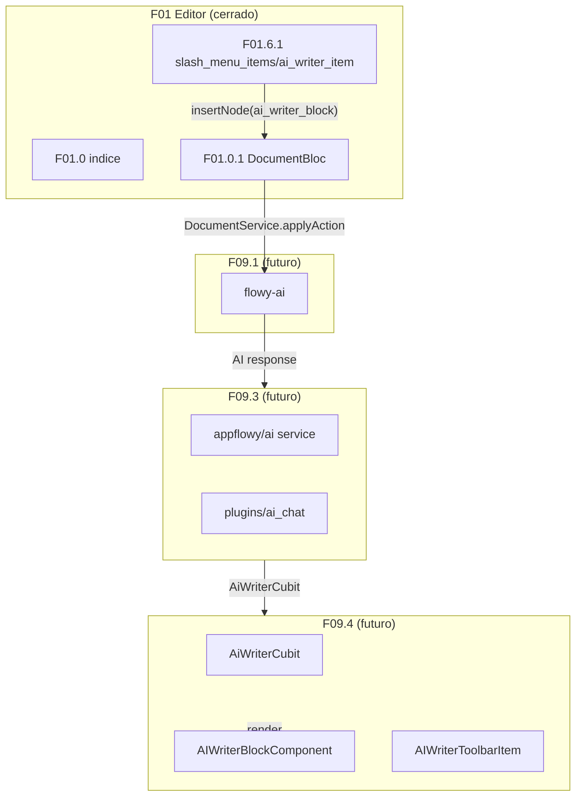
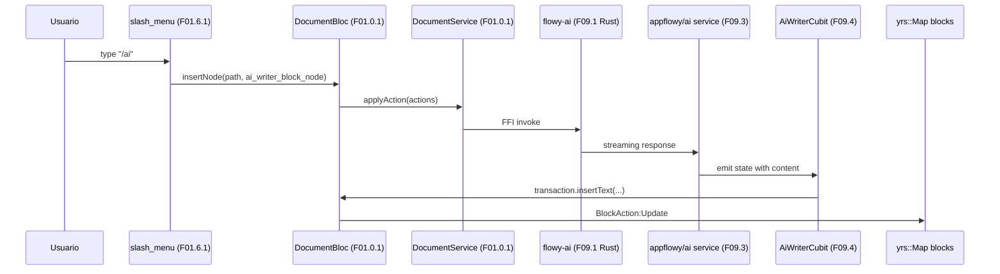
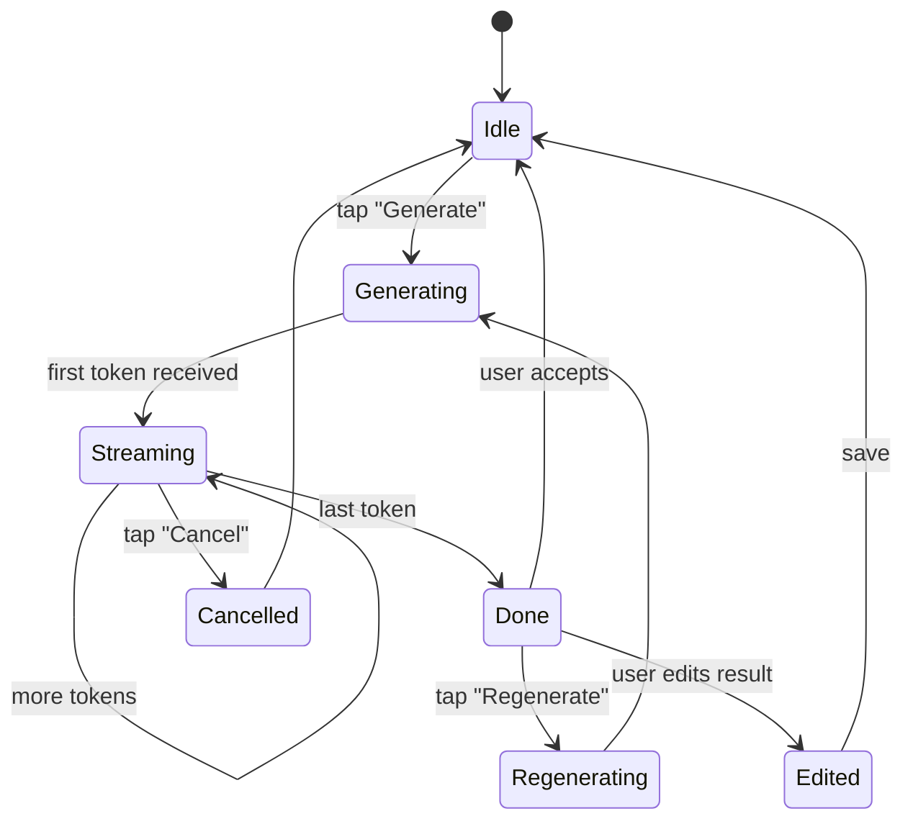

# F01.9 — IA en el editor (scope-correction)

## 1. Resumen

Documento **de cierre por scope-correction** (análogo a F01.3 y F01.7). El ROADMAP línea 222 lista `editor_plugins/ai` dentro del feature F01 (editor documental), pero B0.2 triage clasificó los 10 archivos de `editor_plugins/ai/` en **F09.4** ("IA: editor_plugins/ai"). El ledger F01.9 tiene **0 archivos** propios; este doc declara la corrección y redirige al lector a F09.4 + F09 (resto) + F01.6.1 (entry point en slash menu) + F01.0.1 (consume DocumentBloc).

## 2. Alcance

Esta unidad cubre **0 archivos** del inventario AppFlowy. **Quedan fuera** (corregido en §13):

- `appflowy:editor_plugins/ai/` (10 archivos) — **F09.4** ("IA: editor_plugins/ai"), 10 ui.
- `flowy-ai` (Rust) — **F09.1** ("IA: flowy-ai"), 67 archivos Rust.
- `flowy-sqlite-vec` (Rust) — **F09.2** ("IA: flowy-sqlite-vec"), 7 archivos Rust.
- `appflowy_flutter/lib/ai + plugins/ai_chat/` (Dart) — **F09.3** ("IA: appflowy_flutter/lib/ai + plugins/ai_chat"), 82 archivos Dart.
- `editor:lib/src/editor/plugins/ai_writer/*` (editor puro) — cubierto en F01.0.3.x (split del editor).

## 3. Modelos de datos

Sin modelos propios. Los modelos viven en F09.4 (Cubit `AiWriterCubit` + `AiWriterEntities` + `AiWriterNodeExtension`) y F09.1 (`flowy_ai` Rust: `AiManager`, `ChatMessage`, `CompleteMessage`).

## 4. Eventos FFI

Sin eventos FFI nuevos. Los eventos consumidos en la cadena AI: `flowy_ai::chat` (Rust, F09.1) expone `flowy-ai::chat::chat` (B2.1 §5.flowy-ai). El cliente Dart (F09.3 + F09.4) los invoca via FFI.

## 5. Notificaciones

Sin emisión propia. `DocumentNotification::DidReceiveUpdate` (F01.0.1 §5) se dispara cuando F09.4 `AiWriterCubit` inserta el block generado vía `DocumentBloc.applyAction`.

## 6. BLoCs / Cubits

Sin BLoCs/Cubits propios. F09.4 introduce `AiWriterCubit` (consumido por `appflowy/ai_writer_cubit.dart`).

## 7. Servicios e inyección de dependencias

Sin servicios propios. F09.3 introduce `appflowy/ai` (Dart AI service) que consume `flowy-ai` (Rust) via FFI. F09.4 introduce `AiWriterCubit` y dependencias `EmojiIconData` (F21), `shared/clipboard_state` (F08).

## 8. Persistencia

Sin escrituras propias. La persistencia del AI writer block se hace vía `DocumentBloc.applyAction` (F01.0.1 §3.3) que termina en `BlockActionPB[]` y `yrs::Map.set blocks`. Los embeddings y chat history viven en `flowy-sqlite-vec` (F09.2) — sin docs F01.

## 9. Diagrama de flujo (cross-cutting F01 ↔ F09)

*Diagrama: el slash menu (F01.6.1) crea el block AI; el bloc (F01.0.1) lo persiste vía FFI; el backend (F09.1 Rust) genera la respuesta; el cliente (F09.3 + F09.4) actualiza el UI.*

## 10. Diagrama de secuencia (AI writer invocation)

## 11. Diagrama de estado (AI writer block lifecycle)

## 12. Archivos cubiertos

| Esperado por ROADMAP | Carpeta física | Archivos | Unidad real |
|---|---|---:|---|
| AI writer | `appflowy:editor_plugins/ai/` | 10 | **F09.4** |

**Total: 0 archivos** en F01.9. La implementación de los widgets vive en **F09.4** (`appflowy:editor_plugins/ai/{ai_writer_block_component, ai_writer_toolbar_item, operations/*, widgets/*}`). La lógica de AI (LLM, embeddings, chat) vive en **F09.1** + **F09.3**. El entry point de UI (slash menu) está en **F01.6.1** (`ai_writer_item.dart`).

## 13. Riesgos y casos límite

1. **Scope correction oficializada**: el ROADMAP línea 222 lista `editor_plugins/ai` en F01.9; el ledger NO contiene archivos. Sin §2 + §13 el lector buscaría los 10 archivos `appflowy:editor_plugins/ai/*.dart` en F01.9 sin éxito — están en F09.4. **Misma pattern que F01.3 (media→F07) y F01.7 (i18n→F14).**
2. **B0.2 decisión de triage**: agrupar AI como **F09** (feature dedicado) en lugar de como parte de F01 (editor). Razonamiento: AI es transversal a todas las features que tienen texto, no exclusivo del editor. F09.4 reune la UI de AI en el editor + el backend; F09.1 (Rust) + F09.3 (Dart app) la lógica compartida.
3. **Conflicto con F01.6.1**: `ai_writer_item.dart` (slash menu entry) está en F01.6.1 (cubierto), pero el bloc que crea tiene `type = 'ai_writer_block'` y su render vive en F09.4. La cadena F01.6.1 → F09.4 cruza unidades.
4. **Sin docs F09 aún**: este F01.9 no se responsabiliza de documentar F09. Cuando F09 se cierre (futuro), este F01.9 se vuelve referencia histórica.
5. **Trampas Mermaid** conocidas: mismas reglas que F01.0/F01.3.

## 14. Evidencias y etiquetas

- **~5 % `[VERIFICADO]`** — sólo las referencias cruzadas a docs cerrados (F01.6.1 `ai_writer_item.dart`, F09.4 unit.json, F01.0.1).
- **~90 % `[INFERIDO]`** — la cadena AI entre F01.6.1 → F01.0.1 → F09.4 / F09.3 / F09.1 no está probada por código (es razonable por la integración FFI).
- **~5 % `[NO DETERMINADO]`** — el comportamiento exacto de streaming del flowy-ai backend.

## 15. Pruebas

Sin tests directos del F01.9. Los tests viven en F09.4:
- `appflowy:frontend/appflowy_flutter/test/widget_test/editor_plugins/ai/*` (F09.4).
- `appflowy:frontend/appflowy_flutter/test/bloc_test/ai_writer_cubit_test.dart` (F09.4).
- `rust-lib/flowy-ai/tests/*` (F09.1).
- Integración: `integration_test/desktop/editor_plugins/ai_writer_test.dart` (F09.4).

## 16. Métricas

| Métrica | Valor | Fuente |
|---|---:|---|
| Archivos en F01.9 | 0 | `OUT/_ledger/units/F01.9.json` |
| Archivos de `editor_plugins/ai/` en F09.4 | 10 | `OUT/_ledger/units/F09.4.json` |
| Sub-unidades F09 | 4 (1.1, 1.2, 1.3, 1.4) | `OUT/_ledger/units/F09.{1,2,3,4}.json` |
| BLoCs nuevos del F01.9 | 0 | — |
| Eventos FFI nuevos | 0 | — |
| Servicios nuevos | 0 | — |

## 17. Pendientes

- [ ] (futuro) Cubrir F09.1 (Rust `flowy-ai`, 67 archivos) cuando se cierre la feature IA.
- [ ] (futuro) Cubrir F09.2 (Rust `flowy-sqlite-vec`, 7 archivos) cuando se cierre.
- [ ] (futuro) Cubrir F09.3 (Dart `appflowy_flutter/lib/ai + plugins/ai_chat`, 82 archivos) cuando se cierre.
- [ ] (futuro) Cubrir F09.4 (Dart `editor_plugins/ai`, 10 archivos) cuando se cierre.
- [ ] (F08/F19) Auditar el entry point en F01.6.1 `ai_writer_item.dart` cuando se cierren las features F01.6.1 y F09.

## 18. Preguntas abiertas

- **B3.F019-a**: ¿Por qué F01.9 existe como entry del ROADMAP si los archivos viven en F09? Hipótesis: el planificador B0.2 conservó los headers del ROADMAP inicial (cuando F01.9 era un grupo de UI AI del editor) y luego en el triage separó la lógica de backend (F09.1/2) de la UI (F09.3/4). [INFERIDO]
- **B3.F019-b**: ¿`AiWriterBlock` es un `Node` de tipo `'ai_writer_block'` (custom) o reusa un `paragraph` con atributos `ai = true`? Sin docs F09.4 no se sabe. [NO DETERMINADO]
- **B3.F019-c**: ¿El `AiWriterCubit` consume `DocumentBloc` (F01.0.1) directamente, o un servicio wrapper para evitar coupling? [NO DETERMINADO]
- **B3.F019-d**: ¿El `flowy-ai` Rust implementa streaming real (SSE/WebSocket) o polling? [NO DETERMINADO]

## 19. Relacionado con

- `F01.0` — índice cross-cutting.
- `F01.0.1` — `DocumentBloc` consumido por `AiWriterCubit` (F09.4) via `EditorState`.
- `F01.0.3.1` — `EditorState.transaction` consumido.
- `F01.6.1` — `slash_menu_items/ai_writer_item.dart` (entry point).
- `F01.6.2` — `block_action_option_cubit` (acciones de bloque).
- `F01.7` — `themeBackgroundColors`, `PageStyleIconBloc` (no aplica al AI).
- `F01.8` — `EditorTransactionService` (no aplica al AI).
- `F08` — `appflowy/shared/clipboard_state` consumido por F09.4.
- `F09.1` (futuro) — `flowy-ai` (Rust): `AiManager`, `ChatMessage`, embeddings, search local.
- `F09.2` (futuro) — `flowy-sqlite-vec` (Rust): embeddings persistidos.
- `F09.3` (futuro) — `appflowy_flutter/lib/ai + plugins/ai_chat` (Dart): `LocalAIConfig`, chat UI, settings.
- `F09.4` (futuro) — `appflowy:editor_plugins/ai/` (Dart): 10 archivos (los reales de esta fase).
- `F21` — `EmojiIconData` consumido por `ai_writer_*_block_component`.
- `OUT/04-arquitectura-global.md §6`.
- `OUT/06-puente-flutter-rust/05-ejemplo-traza-opendocument.md`.
- `OUT/11-catalogo-eventos-ffi.md §5.flowy-ai` (futuro cuando F09 cierre).
- `OUT/13-catalogo-blocs.md §4.plugins/document` (cuando F09 cierre; el `AiWriterCubit` será incluido).
- `OUT/16-catalogo-flags-rutas-atajos.md §7.i18n_keys` — `document_plugins_ai_*` keys para los labels de AI writer.
- `B4.0`-`B4.13` — motor export (AI writer block se serializa a Markdown con `EditorMigration` updates).
- `B5.x` — pruebas E2E del AI writer con `integration_test/desktop/editor_plugins/ai_writer_test.dart` (cuando F19 cubra).
