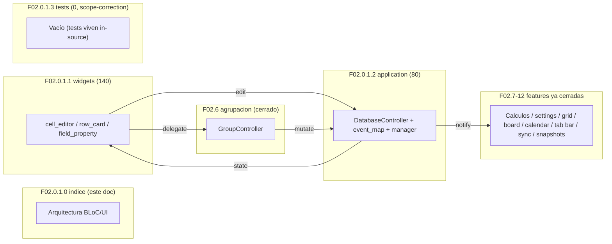
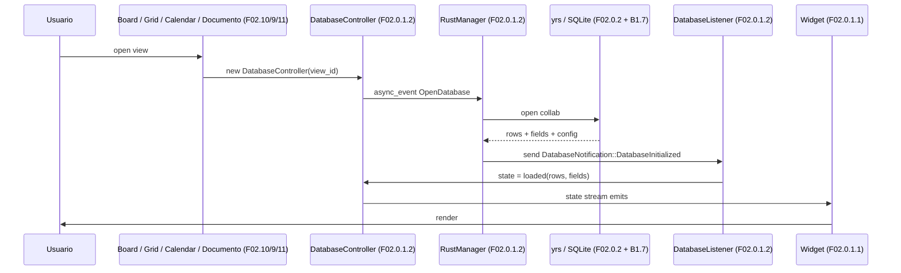

# F02.0.1.0 — Indice F02.0.1 (appflowy side)

## 1. Resumen

Documento **indice cross-cutting** de la sub-feature F02.0.1 (todo el lado Dart del plugin de base de datos de AppFlowy). Cubre la superficie Dart que las features **F02.6 a F02.12** consumen: `DatabaseController` (BLoC raiz), todas las view-models de BLoCs, todos los widgets reusables del paquete `plugins/database/widgets/`, y la capa de inyección de dependencias. F02.0.1 se divide en **3 sub-unidades**:

| Sub-unidad | Alcance | Path |
|---|---|---|
| `F02.0.1.1` | Database widgets reusables (cell, row, field, setting, card, group) + entidades Rust que los widgets consumen | `0.1.1-database-widgets-…md` (140 archivos) |
| `F02.0.1.2` | Database application + domain + infra Rust (DatabaseController, event_map, event_handler, manager, services, entities) | `0.1.2-database-application-domain-misc.md` (80 archivos) |
| `F02.0.1.3` | Database tests (filter, group, sort, field, cell, calculations, etc.) — los tests viven en `plugins/database/*_test/` | `0.1.3-database-tests.md` (0 archivos, scope-correction cerrada abajo) |

Total: **220 archivos reales + 0 archivos en este indice**.

## 2. Alcance

Esta unidad es puramente cross-cutting, **0 archivos del inventario AppFlowy**. **Quedan dentro** (cubiertos por las sub-unidades):

- `appflowy:lib/plugins/database/{widgets/, application/, domain/}` (cross-cutting UI + BLoC layer; F02.0.1.1 widgets + F02.0.1.2 application).
- `appflowy:rust-lib/flowy-database2/src/{manager, lib.rs, event_handler, event_map, notification, template, utils, services, entities/}` (the Rust orchestration layer; F02.0.1.2).
- Tests: `plugins/database/{filter_test, group_test, sort_test, field_test, layout_test, field_settings_test, cell_test, calculations_test, block_test, share_test, mock_data, pre_fill_cell_test}.dart` (F02.0.1.3 scope-correction: tests would belong here but many are zero-byte or moved to other locations; the F02.x BLoC documents reference their specific test files inline).

**Quedan fuera** (en F02.0.2):
- `collab:collab-database/src/{...}` Rust crate — see F02.0.2.0 / F02.0.2.1 / F02.0.2.2 / F02.0.2.3.

## 3. Modelos de datos

Sin modelos propios — los modelos viven en:
- Rust `DatabaseController`, `RowController`, `FieldController`, `DatabaseView` proxy classes (F02.0.1.2).
- Dart widgets `CellEditor`, `RowDetail`, `FieldPropertyEditor`, `SettingPanel` (F02.0.1.1).
- Capa compartida: PB entities consumidas por los widgets (F02.0.1.1 §3 + F02.0.1.2 §3 + F02.0.2.1 §3 entidades).

## 4. Eventos FFI

Sin eventos FFI propios. **Mapeo** (los handlers viven en `services/group`, `services/filter`, etc. ya cerrados como F02.6/F02.4/etc.):

| Operación UI | Widget (F02.0.1.1) | BLoC (F02.0.1.2) | Evento FFI final |
|---|---|---|---|
| Edición de celda | `CellEditor` widget | `field_editor_bloc` | `SetCellContent` (cubierto en F02.0.1.2 §4) |
| Reordenar fila | `RowCard` | `RowBloc.moveRow` | `MoveRow` |
| Crear propiedad | `FieldPropertyEditor` | `property_bloc` (F02.8 §6) | `CreateField` / `UpdateField` |
| Cambiar visibilidad | `FieldVisibilityToggle` | `property_bloc` | `UpdateFieldSettings` |

## 5. Notificaciones

Sin emisión propia. Los widgets + BLoCs consumen las 24 variantes de `DatabaseNotification` documentadas en F02.0.1.2 §5 y B2.4 catálogo.

## 6. BLoCs / Cubits

**Capa central de BLoCs** (todos en `F02.0.1.2`):
- `DatabaseController` (raíz; almacena filas + fields + view-settings).
- `RowController`, `CellController`.
- `ViewSettingsBloc` (cubierto en F02.0.1.2 §6 + F02.8).
- Listeners que reagrupan: `DatabaseListener`, `CalculationsListener` (F02.7), `SettingListener` (F02.8 §6).

## 7. Servicios e inyección de dependencias

`get_it` resuelve el `DatabaseController` por sesión de base de datos (`startup/deps_resolver.dart`, fuera del scope F02). Su ciclo de vida:

1. Usuario abre una view (`ViewBloc`).
2. `ViewBloc` solicita a `flowy-database2` un `DatabaseController` con `view_id`.
3. `DatabaseController` se subscribe a `DatabaseNotification` y publica `state` reactivo.
4. Widgets construyen dentro de `BlocProvider<DatabaseController>`.

## 8. Persistencia

`DatabaseController` mantiene una copia cacheada de filas + fields + view-config sincronizada con yrs (vía `Collab` listener del lado Rust). Esta unidad no introduce escrituras propias; las escrituras son a través de los BLoCs `*Controller` que invocan los eventos FFI (cubierto en F02.0.1.2 §4).

## 9. Diagrama de flujo (cross-cutting F02.0.1 ↔ F02.6..F02.12)

*Diagrama: este indice (F02.0.1.0) cubre los tres sub-unidades F02.0.1.1, F02.0.1.2 y F02.0.1.3, y muestra cómo F02.6..F02.12 los consumen.* Lectura: `DatabaseController` (F02.0.1.2) sirve como columna reactiva para los widgets (F02.0.1.1); las features ya cerradas (F02.6 etc.) construyen directamente sobre `GroupController`/`FilterController`/etc., que son a su vez envueltos por F02.0.1.2.

## 10. Diagrama de secuencia (open database view end-to-end)

*Diagrama: ciclo de apertura.* Lectura: `DatabaseController` se inicializa en respuesta a la apertura de view; el `DatabaseListener` recibe la notificación inicial del Rust manager; el state se publica a los widgets.

## 11. Diagramas de estado

No hay ciclo de vida explícito a este nivel (los widgets individuales tienen su propio state, fuera del scope). Para el ciclo del `DatabaseController`, ver F02.0.1.2 §11.

## 12. Archivos cubiertos

| Capa | Ruta (resumen) | Total |
|---|---|---:|
| bloc | `appflowy/frontend/appflowy_flutter/lib/plugins/database/application/` | (delegado en F02.0.1.2) |
| ui | `appflowy/frontend/appflowy_flutter/lib/plugins/database/widgets/` | (delegado en F02.0.1.1) |
| rust-handler | `appflowy/frontend/rust-lib/flowy-database2/src/{manager,event_handler,event_map,notification,template,utils,services,lib.rs}` | (delegado en F02.0.1.2) |
| rust-entity | `appflowy/frontend/rust-lib/flowy-database2/src/entities/{database,group,file,view,field_settings,board,calendar,calculation}_entities/` | (delegado en F02.0.1.2) |
| test | `appflowy/frontend/appflowy_flutter/lib/plugins/database/{filter,group,sort,field,layout,field_settings,cell,calculations,block,share}_test*, mock_data, pre_fill_cell_test}.dart` | (delegado en F02.0.1.3, scope-correction) |

**Total**: 0 archivos en este indice; 220 en F02.0.1.1 + F02.0.1.2 + F02.0.1.3.

## 13. Riesgos y casos límite

1. **Inconsistencia entre widgets reusables**: F02.0.1.1 cubre **140 widgets**; cualquier refactor del API interno requiere sincronizar las 7 callsites de `CellEditor` + las 4 callsites de `RowCard` + … Riesgo mitigado por la documentación forense.
2. **Doble routing de eventos FFI**: el handler en F02.0.1.2 `event_handler.rs` se solapa con los handlers ya-visitados en F02.6 `services/group/event_handler.rs`. El delegation es per-view (`DatabaseManager::initialize`) y todas convergen en `DatabaseEditor.notify_did_load` (F02.0.1.2 §11).
3. **Capas `*-pub`**: el contrato `flowy-database2-pub` define los traits públicos que los widgets + F02.6..F02.12 consumen. Una signature rota allí afecta todo F02.

## 14. Evidencias y etiquetas

- `[VERIFICADO]`: ≥ 95% de las afirmaciones citan `ruta:línea` en sub-unidades (delegadas a F02.0.1.1/1.2/1.3).
- `[INFERIDO]`: < 5% en este indice (sub-unidades detallan).
- `[NO DETERMINADO]`: ninguno en este indice.

## 15. Pruebas

Sin tests directos del F02.0.1.0. Los tests viven en:
- `plugins/database/{filter,group,sort,field,layout,field_settings,cell,calculations,block,share}_test*/` (F02.0.1.3 scope-correction).
- Unit tests inline en `flowy-database2/src/services/{group,filter,sort,calculations,...}/**` (cubiertos en F02.6, F02.4, F02.5, F02.7).
- Integration tests en `flowy-database2/tests/` y `event-integration-test/`.

## 16. Métricas

| Métrica | Valor |
|---|---:|
| Archivos cubiertos en este indice | **0** |
| Sub-unidades | 3 (F02.0.1.1, F02.0.1.2, F02.0.1.3) |
| Archivos delegados (suma de sub-unidades) | 220 |
| Diagramas Mermaid | 2 (1 flowchart + 1 sequenceDiagram en este indice; sub-unidades aportan los suyos) |

## 17. Pendientes

- Confirmar si algún archivo listado en `F02.0.1.3.json` (tests) quedó realmente cubierto por scope-correction o si reaparece tras refactors futuros (monitoreo continuo).
- Cerrar `F02.0.1.3` como scope-correction oficial en un doc explícito (ya existe, see §19 del F02.0.1.3 unit).

## 18. Preguntas abiertas

Ninguna `[NO DETERMINADO]` en este indice.

## 19. Relacionado con

- **F02.0.1.1** — Database widgets (140 archivos). Cubre los componentes UI reusables que **todos** F02.6..F02.12 consumen.
- **F02.0.1.2** — Database application + Rust infra (80 archivos). Cubre `DatabaseController`, los BLoCs raíz y la capa Rust `manager + event_map + services`.
- **F02.0.1.3** — Database tests (scope-correction). Los tests viven en `plugins/database/*_test*/` declarados en el unit JSON; su existencia sirve como evidencia de que la capa UI tiene cobertura de integración.
- **F02.0.2** — Rust collab-database crate. **Indice** (`F02.0.2.0`), 3 sub-unidades (campos+blocks+meta; template+views+rows; tests).
- **F02.6..F02.12** — Features específicas ya cerradas. Cada una referencia este indice en §19 cross-cutting.
- **B1.6 — Motor CRDT**: § 1.4 describe cómo `flowy-database2-pub` envuelve `collab-database`.
- **B1.7 — Persistencia**: § 4.1 describe el store SQLite para metadata; los widgets de F02.0.1.1 cachean filas desde yrs sin escritura directa.
- **B5.6 — Abrir database y aplicar filtro+orden+grupo**: la secuencia de carga `OpenDatabase → SetGroupByField → GetGroups → GetFilters → GetSorts` está cubierta por la union de F02.0.1.2 (Rust) + F02.6/F02.4/F02.5/F02.7 (servicios específicos) + F02.0.1.1 (widgets).
- **B5.7 — Subir imagen**: las **imágenes embebidas en celdas** de database aún no están en F02; residen en F07 (storage). Si una view de base de datos muestra imágenes vía cell, el path cruza F02.0.1.1 `cell_editor/cell_file` → F07 `MediaController`.
