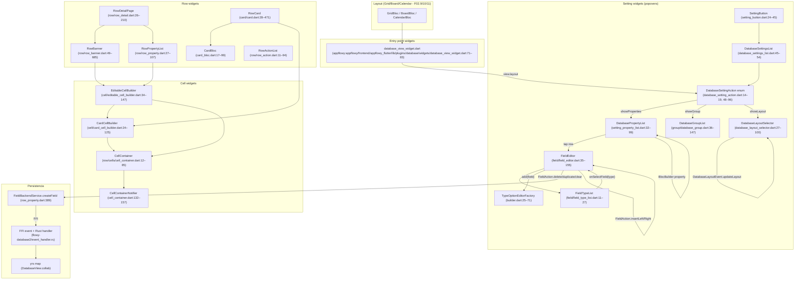
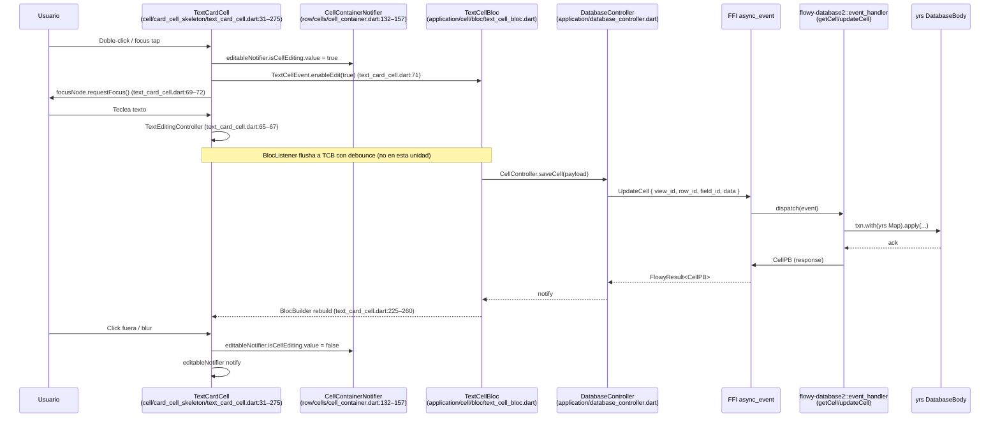
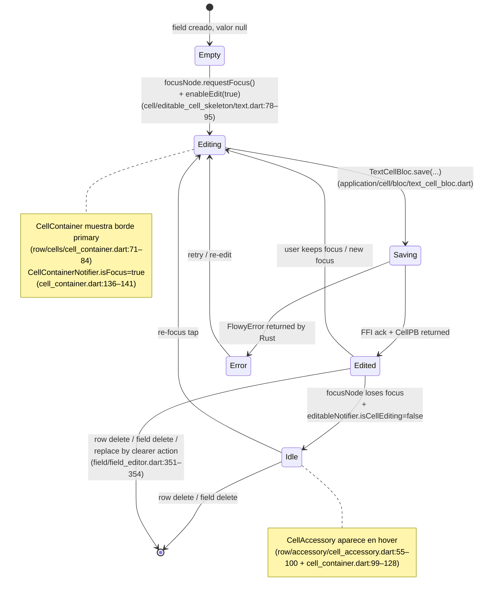

# F02.0.1.1 — Database widgets (cell, row, field, setting, card, group) + Rust entities

## 1. Resumen

Sub-unidad del feature F02 (Bases de datos) que documenta los **140 archivos bajo `appflowy/frontend/appflowy_flutter/lib/plugins/database/widgets/`**: el árbol completo de widgets Flutter compartidos entre los tres layouts de base de datos (Grid, Board, Calendar) — `card/` (la fila-tarjeta de Board + Calendar), `cell/` (los 13 tipos de celda × 4 contextos de skin = 52 implementaciones + 2 builders), `cell_editor/` (overlays popover para edición), `field/` (`FieldEditor` con `FieldAction` enum + 16 factorías de `TypeOptionEditorFactory`), `row/` (`RowDetailPage`, `RowBanner`, `RowPropertyList`, `RowActionList`, `RowDocument` y los `CellContainer` / `CellAccessory`), `setting/` (`SettingButton` → `DatabaseSettingsList` con el enum `DatabaseSettingAction` que decide qué popover mostrar según `DatabaseLayoutPB`), `group/` (`DatabaseGroupList` para elegir campo agrupador y condición de fecha), más `database_view_widget.dart` (entry point por vista) y `database_layout_ext.dart` (extensión sobre `DatabaseLayoutPB`). Esta unidad cubre exclusivamente la capa de presentación; las entidades protobuf Rust (`FieldPB`, `FieldType`, `RowMetaPB`, `CellPB`, `SelectOptionPB`, `SelectOptionColorPB`, `FieldVisibility`, `BoardLayoutSettingPB`, `DatabaseLayoutPB`, `DateGroupConfigurationPB`, `DateConditionPB`, `CheckboxGroupConfigurationPB`, etc.) que estos widgets consumen aparecen aquí solo como tipos referenciados — su definición está en `flowy-database2/entities/{cell,row,field,type_option,filter,setting}_entities/` y `flowy-folder/view_entities/` (F02.0.1.2 / `OUT/12-catalogo-entidades-protobuf.md`).

## 2. Alcance

Esta unidad documenta los **140 widgets** que componen la presentación de Grid/Board/Calendar. **Quedan fuera del scope**:

- BLoCs Dart (cubiertos en F02.0.1.2 application): `CardBloc` está en este árbol pero su semántica transaccional con el `RowController` y los cell BLoCs (`TextCellBloc`, `ChecklistCellBloc`, etc.) está cubierta por `application/`.
- `application/cell/`, `application/database/`, `application/field/`, `application/row/`, `application/setting/`, `application/layout/` (F02.0.1.2).
- Servicios Rust (`services/group/`, `services/sort/`, `services/filter/`, `services/calculations/`, `services/database_view/`) y entidades protobuf (`entities/cell_entities/`, `entities/row_entities/`, `entities/field_entities/`, `entities/type_option_entities/`, `entities/filter_entities/`, `entities/setting_entities/`) — F02.0.2 + F02.0.1.2 (catalogadas en `OUT/12-catalogo-entidades-protobuf.md`).
- Layouts verticales: `plugins/database/grid/presentation/`, `plugins/database/board/presentation/`, `plugins/database/calendar/presentation/` (F02.9 / F02.10 / F02.11).
- `mobile/presentation/database/` (mobile bottom sheets como `MobileSortEditor`, `MobileFilterEditor` — solo referenciados desde `appflowy/frontend/appflowy_flutter/lib/plugins/database/widgets/setting/mobile_database_controls.dart:6–7`).
- Tests (cubiertos en F02.0.3).
- AppFlowy-Cloud (no se documenta su interior; los widgets de aquí consumen las mismas entidades independientemente del backend activo).

**Toda la documentación F02.6 Agrupación, F02.7 Cálculos, F02.8 Field settings, F02.9 Grid, F02.10 Board, F02.11 Calendar y F02.12 Tab bar / sync / snapshots referencia widgets y entidades cubiertas aquí.**

## 3. Modelos de datos

### 3.1 Entidades protobuf importadas por los widgets

Los widgets consumen entidades Rust autogeneradas en `appflowy_backend/protobuf/flowy-database2/`. La correspondencia es declarativa: cada `import 'package:appflowy_backend/protobuf/flowy-database2/X.pb*.dart'` resuelve a un `.pb.dart` en `appflowy_backend/lib/protobuf/flowy-database2/`, generado a partir de los `.rs` con derives `#[derive(ProtoBuf, ProtoBuf_Enum)]` en `flowy-database2/src/entities/`. Ver catálogo en `OUT/12-catalogo-entidades-protobuf.md` §3.flowy-database2.

| Widget / archivo de referencia | Entidades importadas | Ruta de uso |
|---|---|---|
| `appflowy/frontend/appflowy_flutter/lib/plugins/database/widgets/cell/card_cell_builder.dart:5` (todos los 13 switch arms) | `FieldType` (`field_entities.pbenum.dart`) | usa `.Checkbox`, `.Checklist`, `.DateTime`, `.LastEditedTime`, `.CreatedTime`, `.SingleSelect`, `.MultiSelect`, `.Number`, `.RichText`, `.URL`, `.Relation`, `.Summary`, `.Time`, `.Translate`, `.Media` |
| `appflowy/frontend/appflowy_flutter/lib/plugins/database/widgets/cell/editable_cell_builder.dart:8` | `FieldType`, `ChangedReason` | switch análogo para celdas editables (`:49–147`) |
| `appflowy/frontend/appflowy_flutter/lib/plugins/database/widgets/card/card.dart:10,11` | `RowMetaPB`, `UserProfilePB` | metadata de fila + perfil de usuario |
| `appflowy/frontend/appflowy_flutter/lib/plugins/database/widgets/card/card_bloc.dart:5` | `protobuf.dart` (`RowMetaPB`, `CellMetaPB`, `RowId`) | estado del BLoC |
| `appflowy/frontend/appflowy_flutter/lib/plugins/database/widgets/field/field_editor.dart:19` | `protobuf.dart` (`FieldPB`, `FieldType`, `FieldVisibility`, `FieldAction` enum Dart) | formulario de edición |
| `appflowy/frontend/appflowy_flutter/lib/plugins/database/widgets/field/type_option_editor/builder.dart:7` | `FieldType`, `FieldPB` | factoría de `TypeOptionEditor` |
| `appflowy/frontend/appflowy_flutter/lib/plugins/database/widgets/database_layout_ext.dart:3,4` | `DatabaseLayoutPB` (`setting_entities.pbenum.dart`), `ViewLayoutPB` (`view.pbenum.dart`) | mapeo Layout ↔ View |
| `appflowy/frontend/appflowy_flutter/lib/plugins/database/widgets/setting/database_setting_action.dart:5,8` | `DatabaseLayoutPB`, `DatabaseSettingAction` enum | decide qué popover abrir |
| `appflowy/frontend/appflowy_flutter/lib/plugins/database/widgets/setting/database_layout_selector.dart:8` | `DatabaseLayoutPB` | selector de layout |
| `appflowy/frontend/appflowy_flutter/lib/plugins/database/widgets/setting/setting_property_list.dart:11` | `FieldVisibility`, `FieldInfo` (`flowy-database2/protobuf.dart`) | toggle visible/oculto por campo |
| `appflowy/frontend/appflowy_flutter/lib/plugins/database/widgets/setting/field_visibility_extension.dart:1` | `FieldVisibility` (`field_settings_entities.pb.dart`) | `AlwaysShown` ↔ `AlwaysHidden` toggle (`:3–15`) |
| `appflowy/frontend/appflowy_flutter/lib/plugins/database/widgets/group/database_group.dart:11,54` | `DateGroupConfigurationPB`, `DateConditionPB`, `FieldType`, `BoardLayoutSettingPB` | condición de agrupación por fecha + visibilidad de "no agrupados" |
| `appflowy/frontend/appflowy_flutter/lib/plugins/database/widgets/cell_editor/extension.dart:3` | `SelectOptionColorPB`, `SelectOptionPB` | color y nombre de tag |
| `card/container/card_container.dart`, `row/cells/cell_container.dart` | `CellContainerNotifier` (no PB, Dart puro) | hover/focus state |

Los archivos del lado Rust (`cell_entities.rs`, `row_entities.rs`, `field_entities.rs`, `type_option_entities.rs`, `filter_entities.rs`) están documentados en F02.0.1.2 (Application BLoC) y F02.0.2 (servicios Rust). Esta sub-unidad **no cubre sus definiciones Rust** (es widget-only); sí documenta las **PB que se importan desde `appflowy_backend`** como protobuf side.

### 3.2 Tipos Flutter de presentación

Definidos puramente en Dart dentro de este árbol, sin contraparte Rust:

```dart
// EditableCellStyle: 4 variantes que controlan el skin de cada EditableCell*
enum EditableCellStyle { desktopGrid, desktopRowDetail, mobileGrid, mobileRowDetail }
// appflowy/frontend/appflowy_flutter/lib/plugins/database/widgets/cell/editable_cell_builder.dart:26–31

abstract class CardCell<T extends CardCellStyle> extends StatefulWidget { ... }
abstract class CardCellStyle { final EdgeInsetsGeometry padding; ... }
S? isStyleOrNull<S>(CardCellStyle? style) { ... }
class EditableCardNotifier { final ValueNotifier<bool> isCellEditing; ... }
abstract mixin class EditableCell { EditableCardNotifier? get editableNotifier; }
// appflowy/frontend/appflowy_flutter/lib/plugins/database/widgets/cell/card_cell_skeleton/card_cell.dart:3–40
```

`isStyleOrNull<S>` (`appflowy/frontend/appflowy_flutter/lib/plugins/database/widgets/cell/card_cell_skeleton/card_cell.dart:15–21`) es el helper usado por `CardCellBuilder.build` (`appflowy/frontend/appflowy_flutter/lib/plugins/database/widgets/cell/card_cell_builder.dart:42,45,51,57,63…`) para downcastear condicionalmente el `CardCellStyle?` a `TextCardCellStyle`, `CheckboxCardCellStyle`, etc., propagándolo a cada `*CardCell` que acepta `style: T?`. `EditableCell` mixin (`:34–40`) es la marca que indica que un `*CardCell` sabe responder al `RowCard`'s `EditableCardNotifier` (inicio/fin de edición de la fila-tarjeta).

### 3.3 `enum FieldAction` (catálogo de acciones del popover Field)

```dart
enum FieldAction {
  insertLeft, insertRight, toggleVisibility,
  duplicate, clearData, delete, wrap;
}
// appflowy/frontend/appflowy_flutter/lib/plugins/database/widgets/field/field_editor.dart:233–240
```

Cada valor implementa `leading(FieldInfo, Color?) → Widget?` (`:242–276`), `trailing(BuildContext, FieldInfo) → Widget?` (`:278–290`), `title(FieldInfo) → String` (`:292–314`) y `run(BuildContext, viewId, FieldInfo)` (`:316–378`). El `wrap` action muestra un `Toggle`; `delete` se confirma con `showConfirmDeletionDialog` (`:360–371`); `clearData` con `showCancelAndConfirmDialog` (`:345–356`); `insertLeft/Right` y `toggleVisibility` envían eventos al `FieldEditorBloc`. `FieldActionCell` (`:183–231`) deshabilita `duplicate` y `delete` si `fieldInfo.isPrimary` (`:201–204`), y pinta el texto rojo al hacer hover sobre `delete` (`:215–218`).

### 3.4 `enum DatabaseSettingAction`

```dart
enum DatabaseSettingAction {
  showProperties, showLayout, showGroup, showCalendarLayout;
}
// appflowy/frontend/appflowy_flutter/lib/plugins/database/widgets/setting/database_setting_action.dart:14–19
```

Cada valor es mapeado por la extensión `DatabaseSettingActionExtension` (`:21–96`) a un `FlowySvgData` iconData (`:22–33`), un título localizado (`title()`, `:35–46`) y un `Widget build(...)` (`:48–96`) que envuelve `DatabaseLayoutSelector`, `DatabaseGroupList`, `DatabasePropertyList` o `CalendarLayoutSetting` en un `AppFlowyPopover` con `direction: PopoverDirection.leftWithTopAligned`.

La acción que se ofrece depende del layout (puente `DatabaseSettingAction ↔ DatabaseLayoutPB`):

```dart
List<DatabaseSettingAction> actionsForDatabaseLayout(DatabaseLayoutPB? layout) {
  switch (layout) {
    case DatabaseLayoutPB.Board:   return [showProperties, showLayout, showGroup?];
    case DatabaseLayoutPB.Calendar: return [showProperties, showLayout, showCalendarLayout];
    case DatabaseLayoutPB.Grid:    return [showProperties, showLayout];
    default:                       return [];
  }
}
// appflowy/frontend/appflowy_flutter/lib/plugins/database/widgets/setting/database_settings_list.dart:58–80
```

El `showGroup` se excluye en móvil (`if (!UniversalPlatform.isMobile)`, `:64`).

### 3.5 `DatabaseLayoutPB` ↔ UI extension

```dart
extension DatabaseLayoutExtension on DatabaseLayoutPB {
  String get layoutName => switch (this) {
    DatabaseLayoutPB.Board => LocaleKeys.board_menuName.tr(),
    DatabaseLayoutPB.Calendar => LocaleKeys.calendar_menuName.tr(),
    DatabaseLayoutPB.Grid => LocaleKeys.grid_menuName.tr(),
    _ => "",
  };
  ViewLayoutPB get layoutType => switch (this) {
    DatabaseLayoutPB.Board => ViewLayoutPB.Board,
    DatabaseLayoutPB.Calendar => ViewLayoutPB.Calendar,
    DatabaseLayoutPB.Grid => ViewLayoutPB.Grid,
    _ => throw UnimplementedError(),
  };
  FlowySvgData get icon => switch (this) {
    DatabaseLayoutPB.Board => FlowySvgs.board_s,
    DatabaseLayoutPB.Calendar => FlowySvgs.calendar_s,
    DatabaseLayoutPB.Grid => FlowySvgs.grid_s,
    _ => throw UnimplementedError(),
  };
}
// appflowy/frontend/appflowy_flutter/lib/plugins/database/widgets/database_layout_ext.dart:7–33
```

Es el único puente entre el enum Rust `DatabaseLayoutPB` (gestionado por `DatabaseLayoutBloc` — F02.0.1.2) y el enum Dart `ViewLayoutPB` (gestionado por `workspace/view_ext.dart`).

## 4. Eventos FFI

Esta unidad **no declara ni envía eventos FFI propios**. Los popovers y botones invocan `FieldBackendService.deleteField`, `clearField`, `duplicateField`, `createField`, `RowBackendService.deleteRows`, `duplicateRow`, `databaseController.updateLayoutSetting`, `setCompactMode`, etc., cuyos handlers viven en `flowy-database2/src/event_handler.rs` y `flowy-database2/src/services/setting/event_handler.rs`. Catálogo completo: `OUT/11-catalogo-eventos-ffi.md` §6.flowy-database2 (también referenciado en F02.0.1.2 §4, F02.8 §4 y F02.6 §4). Eventos específicos que disparan estos widgets (verificados con grep sobre los 140 archivos):

| Acción UI | Servicio / Bloc Dart llamado | Evento FFI Rust | Handler |
|---|---|---|---|
| Eliminar campo | `FieldBackendService.deleteField(viewId, fieldId)` (`appflowy/frontend/appflowy_flutter/lib/plugins/database/widgets/field/field_editor.dart:365–368`) | `DeleteField` (`field_entities.proto`) | `field_handler.rs::delete_field_handler` |
| Duplicar campo | `FieldBackendService.duplicateField(...)` (`appflowy/frontend/appflowy_flutter/lib/plugins/database/widgets/field/field_editor.dart:338–341`) | `DuplicateField` | `field_handler.rs::duplicate_field_handler` |
| Limpiar contenido campo | `FieldBackendService.clearField(...)` (`appflowy/frontend/appflowy_flutter/lib/plugins/database/widgets/field/field_editor.dart:351–354`) | `ClearField` | `field_handler.rs::clear_field_handler` |
| Crear campo nuevo | `FieldBackendService.createField(viewId:)` (`appflowy/frontend/appflowy_flutter/lib/plugins/database/widgets/row/row_property.dart:389–391`) | `CreateTypeOption` | `field_handler.rs::create_field_handler` |
| Borrar fila | `RowBackendService.deleteRows(viewId, [rowId])` (`appflowy/frontend/appflowy_flutter/lib/plugins/database/widgets/row/row_action.dart:59`) | `DeleteRows` | `database_editor.rs::delete_rows` |
| Duplicar fila | `RowBackendService.duplicateRow(viewId, rowId)` (`appflowy/frontend/appflowy_flutter/lib/plugins/database/widgets/row/row_action.dart:88`) | `DuplicateRow` | `database_editor.rs::duplicate_row` |
| Cambiar layout | `DatabaseLayoutEvent.updateLayout(...)` (`appflowy/frontend/appflowy_flutter/lib/plugins/database/widgets/setting/database_layout_selector.dart:39–41` → Bloc F02.0.1.2) | `UpdateDatabaseLayout` | `database_view/...` |
| Toggle `hideUngroupedColumn` | `databaseController.updateLayoutSetting(boardLayoutSetting)` (`appflowy/frontend/appflowy_flutter/lib/plugins/database/widgets/group/database_group.dart:149–160`) | `UpdateBoardLayoutSetting` | F02.0.1.2 |
| Toggle wrap cell | `FieldEditorEvent.toggleWrapCellContent` (`appflowy/frontend/appflowy_flutter/lib/plugins/database/widgets/field/field_editor.dart:282–285`) | `UpdateFieldTypeOption` (wrap flag) | `field_handler.rs` |
| Toggle visibility | `DatabasePropertyEvent.setFieldVisibility(...)` (`appflowy/frontend/appflowy_flutter/lib/plugins/database/widgets/setting/setting_property_list.dart:187–193` → Bloc F02.0.1.2) | `UpdateFieldSettings` (con `FieldVisibility`) | `field_settings/event_handler.rs` |
| Set group by field | `DatabaseGroupEvent.setGroupByField(id, type, content)` (`appflowy/frontend/appflowy_flutter/lib/plugins/database/widgets/group/database_group.dart:212–218`) | `SetGroupByField` | F02.0.2 → F02.6 |

## 5. Notificaciones

Esta unidad **no se suscribe directamente al `RustStream`**. Las notificaciones Rust→Dart que llegan se consumen mediante BLoCs de F02.0.1.2 (`database_listener.dart`, `field_controller.dart`, `row_listener.dart`). Cuando esos BLoCs reciben `DatabaseNotification::DidUpdateField` o `DatabaseNotification::DidUpdateRows`, ellos hacen `notifyListeners()`; los widgets aquí reaccionan al reconstruir con `BlocBuilder`. Por ejemplo, `RowPropertyList` se reconstruye cuando `RowDetailBloc` cambia (`:41–106`), y `_PropertyCell` reemite el popover de FieldEditor si `editingFieldId` cambia (`:192–220`).

El único mecanismo de notificación local es `CellContainerNotifier` (`appflowy/frontend/appflowy_flutter/lib/plugins/database/widgets/row/cells/cell_container.dart:132–157`), un `ChangeNotifier` con dos flags (`isFocus`, `isHover`) usado por `CellContainer` (`:12–85`) para alternar el borde de focus (`:70–84`) y los `_GridCellEnterRegion` (`:87–130`) que muestran/ocultan los accesorios en hover/focus. Paralelo en card: `_CardContainerNotifier` (`appflowy/frontend/appflowy_flutter/lib/plugins/database/widgets/card/container/card_container.dart:110–123`) cumple el mismo rol para `RowCardContainer`.

Catálogo completo de `DatabaseNotification` y `DatabaseNotificationMap` (29 variantes) en `OUT/14-catalogo-notificaciones.md` §5.flowy-database2 (también F02.0.1.2 §5).

## 6. BLoCs / Cubits

**BLoC propio de esta unidad**: `CardBloc` en `appflowy/frontend/appflowy_flutter/lib/plugins/database/widgets/card/card_bloc.dart:17–99`. Es un Bloc `flutter_bloc` con tres miembros:

- `fieldController: FieldController` (F02.0.1.2)
- `groupFieldId: String?` (id del campo agrupador, para excluirlo del card)
- `viewId: String`
- `rowController: RowController` (F02.0.1.2)

Su estado (`CardState`, `:151–170`) lleva `cells: List<CellMeta>`, `isEditing: bool`, `rowMeta: RowMetaPB`, `changeReason: ChangedReason?`. Cuatro eventos (`CardEvent`, `:126–136`): `initial`, `setIsEditing(bool)`, `didReceiveCells(List<CellMeta>, ChangedReason)`, `didUpdateRowMeta(RowMetaPB)`. El handler `_startListening` (`:83–98`) engancha los callbacks `onRowChanged`/`onMetaChanged` del `RowController` y los traduce a eventos del Bloc. Helper `_makeCells` (`:101–124`) filtra las celdas que no son del campo agrupador, ni ocultas (`fieldInfo.visibility?.isVisibleState() ?? false`, ver `appflowy/frontend/appflowy_flutter/lib/plugins/database/widgets/setting/field_visibility_extension.dart:10–15`) y construye la lista de `CellMeta`. Es instanciado por `RowCard.initState` (`appflowy/frontend/appflowy_flutter/lib/plugins/database/widgets/card/card.dart:98–104`) yDisposed en `dispose` (`:116–119`).

**BLoCs consumidos (referenciados, no definidos aquí, cubiertos por F02.0.1.2)**: `RowDetailBloc` (`appflowy/frontend/appflowy_flutter/lib/plugins/database/widgets/row/row_detail.dart:79–82`, `appflowy/frontend/appflowy_flutter/lib/plugins/database/widgets/row/row_property.dart:41–63`), `RowBannerBloc` (`appflowy/frontend/appflowy_flutter/lib/plugins/database/widgets/row/row_banner.dart:84–88`), `DatabaseLayoutBloc` (`appflowy/frontend/appflowy_flutter/lib/plugins/database/widgets/setting/database_layout_selector.dart:27–31`), `DatabaseGroupBloc` (`appflowy/frontend/appflowy_flutter/lib/plugins/database/widgets/group/database_group.dart:36–40`), `FieldEditorBloc` (`appflowy/frontend/appflowy_flutter/lib/plugins/database/widgets/field/field_editor.dart:78–85`), `DatabasePropertyBloc` (`appflowy/frontend/appflowy_flutter/lib/plugins/database/widgets/setting/setting_property_list.dart:39–42`), `FilterEditorBloc` + `SortEditorBloc` (`appflowy/frontend/appflowy_flutter/lib/plugins/database/widgets/setting/mobile_database_controls.dart:33–44`), `ViewBloc` (idem, `:142`), `ReminderBloc` (`appflowy/frontend/appflowy_flutter/lib/plugins/database/widgets/row/row_detail.dart:84`), `TabsBloc` (`appflowy/frontend/appflowy_flutter/lib/plugins/database/widgets/row/row_detail.dart:187`). Los cell BLoCs (`TextCellBloc`, `ChecklistCellBloc`, etc.) se crean vía `makeCellController(...).as()` en cada `*CardCell` y `Editable*Cell` (e.g. `appflowy/frontend/appflowy_flutter/lib/plugins/database/widgets/cell/card_cell_skeleton/text_card_cell.dart:53–58` y `appflowy/frontend/appflowy_flutter/lib/plugins/database/widgets/cell/editable_cell_skeleton/text.dart:57–62`).

## 7. Servicios e inyección de dependencias

### 7.1 Dart (sin `get_it`)

Esta unidad no recibe nada por `get_it`. Todos los BLoCs vienen por `BlocProvider`/`BlocProvider.value`. `TabsBloc`, `ViewBloc` y `ReminderBloc` se obtienen vía `getIt<T>()`, pero su registro está en `startup/deps_resolver.dart` (no en este árbol). Los servicios de FFI (`FieldBackendService`, `RowBackendService`, `DatabaseViewBackendService`) son singletons sin DI: se llaman como métodos estáticos.

### 7.2 Resolución top-down de dependencias por archivo

- `DatabaseViewWidget` (`appflowy/frontend/appflowy_flutter/lib/plugins/database/widgets/database_view_widget.dart:71–83`) requiere el `viewPlugin` por `widget.view.plugin()..init()` (`:47`); el `viewPlugin` es provisto por el `Plugin` registry (no en este árbol).
- `RowCard` (`appflowy/frontend/appflowy_flutter/lib/plugins/database/widgets/card/card.dart:28–83`) requiere `fieldController`, `rowMeta`, `rowCache`, `cellBuilder` — todos pasados por el caller (`*LayoutBloc`).
- `RowDetailPage` (`appflowy/frontend/appflowy_flutter/lib/plugins/database/widgets/row/row_detail.dart:26–42`) requiere `rowController`, `databaseController`; crea internamente `RowDetailBloc` (`:79–82`) y `cellBuilder = EditableCellBuilder(databaseController: ...)` (`:48–50`).
- `FieldEditor` (`appflowy/frontend/appflowy_flutter/lib/plugins/database/widgets/field/field_editor.dart:35–55`) crea su `FieldEditorBloc` vía `BlocProvider` (`:78–85`).
- `DatabasePropertyList` (`appflowy/frontend/appflowy_flutter/lib/plugins/database/widgets/setting/setting_property_list.dart:18–30`) crea su `DatabasePropertyBloc` en `initState` (`:37–43`).

### 7.3 Resolución de cell BLoC

`TextCellBloc`, `ChecklistCellBloc`, `SelectOptionCellBloc`, etc. se crean en `TextCardCell._TextCellState.initState` (`appflowy/frontend/appflowy_flutter/lib/plugins/database/widgets/cell/card_cell_skeleton/text_card_cell.dart:53–58`) usando `makeCellController(databaseController, cellContext).as()` (helper de `application/cell/cell_controller_builder.dart`, F02.0.1.2). El `_textEditingController` se inicializa con `cellBloc.state.content` (`:65–66`).

## 8. Persistencia

Esta capa de widgets no accede directamente al yrs map ni a SQLite. La persistencia se materializa a través de:

1. **Edición de celda**: el `*CellBloc` llama a `CellController.save...()` que dispara el FFI (`flowy-database2/cell/event_handler.rs::*_cell_handler`); este escribe la celda en el `Database` collab (`yrs` map `cells.<field_id>`) dentro de la transacción atómica del `DatabaseBody`. El widget refleja el cambio porque el `CellController` reemite el valor tras la confirmación Rust.
2. **Reorder de campos**: `DatabasePropertyEvent.moveField(from, to)` (`appflowy/frontend/appflowy_flutter/lib/plugins/database/widgets/setting/setting_property_list.dart:88–90`) → FFI `ReorderField` → `DatabaseView::reorder_field` muta el `field_orders` yrs map.
3. **Visibility**: `DatabasePropertyEvent.setFieldVisibility` (`appflowy/frontend/appflowy_flutter/lib/plugins/database/widgets/setting/setting_property_list.dart:189–192`) → FFI `UpdateFieldSettings` (F02.8) → `FieldSettings` Map en yrs dentro del `DatabaseView`.
4. **TypeOption**: `makeTypeOptionEditor` (`appflowy/frontend/appflowy_flutter/lib/plugins/database/widgets/field/type_option_editor/builder.dart:56–70`) entrega `Uint8List` (campo `TypeOptionData`) tras un editor; el `FieldEditorBloc` (F02.0.1.2) los serializa y los envía con `UpdateFieldTypeOption` (F02.0.1.2 §4).
5. **GroupBy**: el `settingContent` del `DateGroupConfigurationPB` (`appflowy/frontend/appflowy_flutter/lib/plugins/database/widgets/group/database_group.dart:206–208`) se envía al backend en `DatabaseGroupEvent.setGroupByField`; persiste en `GroupSetting.content` (F02.6 §3.1).
6. **Layout**: `databaseController.updateLayoutSetting(boardLayoutSetting: ...)` (`appflowy/frontend/appflowy_flutter/lib/plugins/database/widgets/group/database_group.dart:157–159`) dispara `UpdateBoardLayoutSetting` y se guarda en el `DatabaseView.layout_settings` (yrs Map).

Snapshots: el conjunto completo de cambios se guarda en `collab_snapshot` cada N segundos (B1.6). Rebuild tras crash: el `DatabaseBody::open` de F02.0.2 reconstruye los cell controllers a partir del collab y el `database_listener.dart` (F02.0.1.2) reenvía los eventos a los widgets — la UI se rehidrata sin código explícito en esta unidad.

## 9. Diagrama de flujo (creación de una celda desde la FieldTypeList)



*Diagrama: cómo encajan los 140 widgets en tres anillos concéntricos — entry point, popovers de setting y cells/rows.* Lectura: `DatabaseViewWidget` (entry) consume el `viewPlugin` por layout; cada layout abre `SettingButton` → `DatabaseSettingsList` que delega en `DatabaseSettingAction` para abrir uno de los cuatro popovers (`DatabasePropertyList`, `DatabaseLayoutSelector`, `DatabaseGroupList` o el de Calendar). `DatabasePropertyList` y `FieldEditor`/`FieldTypeList` disparan `FieldBackendService` → FFI → yrs map; `EditableCellBuilder` y `CardCellBuilder` resuelven el `FieldType` a un `EditableCell*` o `*CardCell`, lo envuelven en `CellContainer` (con su `CellContainerNotifier`) y lo insertan en `RowDetailPage` o `RowCard`. `RowCard` mantiene el `CardBloc` que escucha el `RowController` y filtra las celdas no-visibles y la del campo agrupador.

## 10. Diagrama de secuencia (edit text cell en desktop grid)



*Diagrama: edición de una celda text desde el primer focus tap hasta la persistencia y notificación reactiva.* Lectura: `TextCardCell` (o `EditableTextCell` en `appflowy/frontend/appflowy_flutter/lib/plugins/database/widgets/cell/editable_cell_skeleton/text.dart:39–128` para skins de grid/row detail) mantiene un `TextCellBloc` local creado vía `makeCellController(...).as()` (`appflowy/frontend/appflowy_flutter/lib/plugins/database/widgets/cell/editable_cell_skeleton/text.dart:57–62`). El bloque envía el payload por el `*CellController` al FFI; el handler Rust `flowy-database2::event_handler.rs::update_cell_handler` muta el `yrs` map; el bloque recibe el `CellPB` actualizado y los `BlocBuilder`s reemiten. El accesorio `EditableCardNotifier` (`appflowy/frontend/appflowy_flutter/lib/plugins/database/widgets/cell/card_cell_skeleton/card_cell.dart:23–32`) sincroniza el `isEditing` con la fila para que solo una celda esté en edición a la vez.

## 11. Diagrama de estado (ciclo de vida de una celda genérica)



*Diagrama: ciclo Empty → Editing → Saving → Edited → Idle, con ramificaciones a Error y a borrado.* Lectura: una celda arranca vacía tras crear un campo. El usuario hace click → la celda pide foco (`FocusNode.requestFocus`), muestra el `TextField`/`SelectOptionEditor`/etc. según el `FieldType` (resuelto por `EditableCellBuilder.buildStyled` en `appflowy/frontend/appflowy_flutter/lib/plugins/database/widgets/cell/editable_cell_builder.dart:39–147`). Tras pulsar Intro o perder el foco, el cell BLoC dispara `save` → FFI → yrs → vuelta. En cualquier momento la celda puede pasar a `Error` si Rust devuelve `FlowyError`; la UI lo refleja con un toast y permite re-editar. El accesorio de la celda (`GridCellAccessoryBuilder<...>` family en `appflowy/frontend/appflowy_flutter/lib/plugins/database/widgets/row/accessory/cell_accessory.dart:26–46`) aparece en hover cuando no hay foco.

## 12. Archivos cubiertos (del ledger)

140 archivos bajo `appflowy/frontend/appflowy_flutter/lib/plugins/database/widgets/`. Resumen por sub-árbol (LOC ≈ `wc -l`):

| Sub-árbol | Archivos | LOC total | Notas |
|---|---:|---:|---|
| `card/` | 4 | 868 | `appflowy/frontend/appflowy_flutter/lib/plugins/database/widgets/card/card.dart:471`, `appflowy/frontend/appflowy_flutter/lib/plugins/database/widgets/card/card_bloc.dart:170`, `appflowy/frontend/appflowy_flutter/lib/plugins/database/widgets/card/container/accessory.dart:104`, `appflowy/frontend/appflowy_flutter/lib/plugins/database/widgets/card/container/card_container.dart:123` |
| `cell/card_cell_builder.dart` | 1 | 126 | Builder de cards, `switch (fieldType)` con 13 brazos |
| `cell/card_cell_skeleton/` | 13 | 1 178 | 1 abstracta + 12 *CardCell (text:276, relation/date/url:64–87, etc.) |
| `cell/card_cell_style_maps/` | 3 | 305 | estilo de card por layout (calendar/board-desktop/board-mobile) |
| `cell/desktop_grid/` | 13 | 1 401 | 13 `DesktopGrid*CellSkin`s; media:265, url:226, select:128 |
| `cell/desktop_row_detail/` | 13 | 1 800 | 13 `DesktopRowDetail*Cell`s; media:749, checklist:449, others ≤ 130 |
| `cell/editable_cell_builder.dart` | 1 | 441 | Builder de celdas editables con `EditableCellStyle` enum |
| `cell/editable_cell_skeleton/` | 13 | 1 873 | abstract skin + 12 Editable*Cell; translate:268, summary:267, url:236 |
| `cell/mobile_grid/` | 12 | 674 | 12 `MobileGrid*Cell`s (sin Media); más cortas (29–80) |
| `cell/mobile_row_detail/` | 12 | 763 | 12 `MobileRowDetail*Cell`s; select:110, url:81, others ≤ 80 |
| `cell_editor/` | 12 | 3 979 | editores popover: media:622, relation:564, select:535, mobile_select:552, mobile_checklist:326, mobile_media:310, checklist:470, date:108, textfield:200, progress:81, extension:124 |
| `database_layout_ext.dart` | 1 | 34 | bridge `DatabaseLayoutPB` ↔ UI |
| `database_view_widget.dart` | 1 | 99 | entry point por `ViewPB` |
| `field/field_editor.dart` | 1 | 778 | popover FieldEditor + `FieldAction` enum |
| `field/field_type_list.dart` | 1 | 86 | lista de 14 tipos excluidos |
| `field/type_option_editor/` | 19 | 1 887 | 16 factorías (`appflowy/frontend/appflowy_flutter/lib/plugins/database/widgets/field/type_option_editor/checkbox.dart:19`, `appflowy/frontend/appflowy_flutter/lib/plugins/database/widgets/field/type_option_editor/url.dart:18`, `appflowy/frontend/appflowy_flutter/lib/plugins/database/widgets/field/type_option_editor/summary.dart:18`, `appflowy/frontend/appflowy_flutter/lib/plugins/database/widgets/field/type_option_editor/time.dart:18`, `appflowy/frontend/appflowy_flutter/lib/plugins/database/widgets/field/type_option_editor/checklist.dart:18`, `appflowy/frontend/appflowy_flutter/lib/plugins/database/widgets/field/type_option_editor/rich_text.dart:18` retornan `null`; el resto devuelve un widget) + `appflowy/frontend/appflowy_flutter/lib/plugins/database/widgets/field/type_option_editor/date/date_time_format.dart:279`, `appflowy/frontend/appflowy_flutter/lib/plugins/database/widgets/field/type_option_editor/select/select_option_editor.dart:244`, `appflowy/frontend/appflowy_flutter/lib/plugins/database/widgets/field/type_option_editor/select/select_option.dart:324` |
| `group/database_group.dart` | 1 | 225 | `DatabaseGroupList` + `_GridGroupCell` |
| `media_file_type_ext.dart` | 1 | 30 | extensiones para tipos de archivo media |
| `row/accessory/` | 2 | 294 | `appflowy/frontend/appflowy_flutter/lib/plugins/database/widgets/row/accessory/cell_accessory.dart:196` + `appflowy/frontend/appflowy_flutter/lib/plugins/database/widgets/row/accessory/cell_shortcuts.dart:98` |
| `row/cells/` | 2 | 235 | `appflowy/frontend/appflowy_flutter/lib/plugins/database/widgets/row/cells/cell_container.dart:157`, `appflowy/frontend/appflowy_flutter/lib/plugins/database/widgets/row/cells/mobile_cell_container.dart:78` |
| `row/relation_row_detail.dart` | 1 | 44 | detalle de relación |
| `row/row_action.dart` | 1 | 94 | `RowActionList`, `Delete`, `Duplicate` |
| `row/row_banner.dart` | 1 | 685 | banner con cover/icon/title |
| `row/row_detail.dart` | 1 | 210 | `RowDetailPage` (FlowyDialog + NestedScrollView) |
| `row/row_document.dart` | 1 | 163 | wrapper de Document plugin |
| `row/row_property.dart` | 1 | 407 | `RowPropertyList` + `_PropertyCell` + toggle hidden + create field |
| `setting/database_layout_selector.dart` | 1 | 138 | selector de DatabaseLayout |
| `setting/database_setting_action.dart` | 1 | 97 | enum + popovers wiring |
| `setting/database_settings_list.dart` | 1 | 80 | lista según layout |
| `setting/field_visibility_extension.dart` | 1 | 16 | `FieldVisibility.toggle()` + `isVisibleState()` |
| `setting/mobile_database_controls.dart` | 1 | 188 | botones mobile sort/filter/fields |
| `setting/setting_button.dart` | 1 | 46 | entry popover de setting |
| `setting/setting_property_list.dart` | 1 | 210 | lista de campos reordenable con toggle visibility |
| `share_button.dart` | 1 | 155 | botón de compartir |
| **TOTAL** | **140** | **19 700** | |

Lista literal (mismo orden del ledger):

```text
card/card.dart · card/card_bloc.dart · card/container/accessory.dart · card/container/card_container.dart ·
cell/card_cell_builder.dart · cell/card_cell_skeleton/card_cell.dart · cell/card_cell_skeleton/checkbox_card_cell.dart ·
cell/card_cell_skeleton/checklist_card_cell.dart · cell/card_cell_skeleton/date_card_cell.dart ·
cell/card_cell_skeleton/media_card_cell.dart · cell/card_cell_skeleton/number_card_cell.dart ·
cell/card_cell_skeleton/relation_card_cell.dart · cell/card_cell_skeleton/select_option_card_cell.dart ·
cell/card_cell_skeleton/summary_card_cell.dart · cell/card_cell_skeleton/text_card_cell.dart ·
cell/card_cell_skeleton/time_card_cell.dart · cell/card_cell_skeleton/timestamp_card_cell.dart ·
cell/card_cell_skeleton/translate_card_cell.dart · cell/card_cell_skeleton/url_card_cell.dart ·
cell/card_cell_style_maps/calendar_card_cell_style.dart · cell/card_cell_style_maps/desktop_board_card_cell_style.dart ·
cell/card_cell_style_maps/mobile_board_card_cell_style.dart · cell/desktop_grid/desktop_grid_checkbox_cell.dart ·
cell/desktop_grid/desktop_grid_checklist_cell.dart · cell/desktop_grid/desktop_grid_date_cell.dart ·
cell/desktop_grid/desktop_grid_media_cell.dart · cell/desktop_grid/desktop_grid_number_cell.dart ·
cell/desktop_grid/desktop_grid_relation_cell.dart · cell/desktop_grid/desktop_grid_select_option_cell.dart ·
cell/desktop_grid/desktop_grid_summary_cell.dart · cell/desktop_grid/desktop_grid_text_cell.dart ·
cell/desktop_grid/desktop_grid_time_cell.dart · cell/desktop_grid/desktop_grid_timestamp_cell.dart ·
cell/desktop_grid/desktop_grid_translate_cell.dart · cell/desktop_grid/desktop_grid_url_cell.dart ·
cell/desktop_row_detail/desktop_row_detail_checkbox_cell.dart · cell/desktop_row_detail/desktop_row_detail_checklist_cell.dart ·
cell/desktop_row_detail/desktop_row_detail_date_cell.dart · cell/desktop_row_detail/desktop_row_detail_media_cell.dart ·
cell/desktop_row_detail/desktop_row_detail_number_cell.dart · cell/desktop_row_detail/desktop_row_detail_relation_cell.dart ·
cell/desktop_row_detail/desktop_row_detail_select_option_cell.dart · cell/desktop_row_detail/desktop_row_detail_summary_cell.dart ·
cell/desktop_row_detail/desktop_row_detail_text_cell.dart · cell/desktop_row_detail/desktop_row_detail_time_cell.dart ·
cell/desktop_row_detail/desktop_row_detail_timestamp_cell.dart · cell/desktop_row_detail/desktop_row_detail_url_cell.dart ·
cell/desktop_row_detail/destop_row_detail_translate_cell.dart · cell/editable_cell_builder.dart ·
cell/editable_cell_skeleton/checkbox.dart · cell/editable_cell_skeleton/checklist.dart ·
cell/editable_cell_skeleton/date.dart · cell/editable_cell_skeleton/media.dart ·
cell/editable_cell_skeleton/number.dart · cell/editable_cell_skeleton/relation.dart ·
cell/editable_cell_skeleton/select_option.dart · cell/editable_cell_skeleton/summary.dart ·
cell/editable_cell_skeleton/text.dart · cell/editable_cell_skeleton/time.dart ·
cell/editable_cell_skeleton/timestamp.dart · cell/editable_cell_skeleton/translate.dart ·
cell/editable_cell_skeleton/url.dart · cell/mobile_grid/mobile_grid_checkbox_cell.dart ·
cell/mobile_grid/mobile_grid_checklist_cell.dart · cell/mobile_grid/mobile_grid_date_cell.dart ·
cell/mobile_grid/mobile_grid_number_cell.dart · cell/mobile_grid/mobile_grid_relation_cell.dart ·
cell/mobile_grid/mobile_grid_select_option_cell.dart · cell/mobile_grid/mobile_grid_summary_cell.dart ·
cell/mobile_grid/mobile_grid_text_cell.dart · cell/mobile_grid/mobile_grid_time_cell.dart ·
cell/mobile_grid/mobile_grid_timestamp_cell.dart · cell/mobile_grid/mobile_grid_translate_cell.dart ·
cell/mobile_grid/mobile_grid_url_cell.dart · cell/mobile_row_detail/mobile_row_detail_checkbox_cell.dart ·
cell/mobile_row_detail/mobile_row_detail_checklist_cell.dart · cell/mobile_row_detail/mobile_row_detail_date_cell.dart ·
cell/mobile_row_detail/mobile_row_detail_number_cell.dart · cell/mobile_row_detail/mobile_row_detail_relation_cell.dart ·
cell/mobile_row_detail/mobile_row_detail_select_cell_option.dart · cell/mobile_row_detail/mobile_row_detail_summary_cell.dart ·
cell/mobile_row_detail/mobile_row_detail_text_cell.dart · cell/mobile_row_detail/mobile_row_detail_time_cell.dart ·
cell/mobile_row_detail/mobile_row_detail_timestamp_cell.dart · cell/mobile_row_detail/mobile_row_detail_translate_cell.dart ·
cell/mobile_row_detail/mobile_row_detail_url_cell.dart · cell_editor/checklist_cell_editor.dart ·
cell_editor/checklist_cell_textfield.dart · cell_editor/checklist_progress_bar.dart ·
cell_editor/date_cell_editor.dart · cell_editor/extension.dart · cell_editor/media_cell_editor.dart ·
cell_editor/mobile_checklist_cell_editor.dart · cell_editor/mobile_media_cell_editor.dart ·
cell_editor/mobile_select_option_editor.dart · cell_editor/relation_cell_editor.dart ·
cell_editor/select_option_cell_editor.dart · cell_editor/select_option_text_field.dart ·
database_layout_ext.dart · database_view_widget.dart · field/field_editor.dart ·
field/field_type_list.dart · field/type_option_editor/builder.dart · field/type_option_editor/checkbox.dart ·
field/type_option_editor/checklist.dart · field/type_option_editor/date.dart ·
field/type_option_editor/date/date_time_format.dart · field/type_option_editor/media.dart ·
field/type_option_editor/multi_select.dart · field/type_option_editor/number.dart ·
field/type_option_editor/relation.dart · field/type_option_editor/rich_text.dart ·
field/type_option_editor/select/select_option.dart · field/type_option_editor/select/select_option_editor.dart ·
field/type_option_editor/single_select.dart · field/type_option_editor/summary.dart ·
field/type_option_editor/time.dart · field/type_option_editor/timestamp.dart ·
field/type_option_editor/translate.dart · field/type_option_editor/url.dart ·
group/database_group.dart · media_file_type_ext.dart · row/accessory/cell_accessory.dart ·
row/accessory/cell_shortcuts.dart · row/cells/cell_container.dart · row/cells/mobile_cell_container.dart ·
row/relation_row_detail.dart · row/row_action.dart · row/row_banner.dart · row/row_detail.dart ·
row/row_document.dart · row/row_property.dart · setting/database_layout_selector.dart ·
setting/database_setting_action.dart · setting/database_settings_list.dart ·
setting/field_visibility_extension.dart · setting/mobile_database_controls.dart ·
setting/setting_button.dart · setting/setting_property_list.dart · share_button.dart
```

## 13. Riesgos y casos límite

1. **Deriva entre Rust y Dart por PB importadas**: cada widget importa `appflowy_backend/protobuf/flowy-database2/*.pb.dart` que son generados en build time desde `flowy-database2/src/entities/*`. Si se renombra un campo PB Rust sin regenerar, el `JsonProperty`/`fromBuffer` puede quedar fuera de sync. Mitigado por el codegen en `build-tool/flowy-codegen`; el riesgo queda en PRs sin rebuild local. `[VERIFICADO] en appflowy/frontend/appflowy_flutter/lib/plugins/database/widgets/card/card_bloc.dart:5, appflowy/frontend/appflowy_flutter/lib/plugins/database/widgets/cell/editable_cell_builder.dart:8`.
2. **Bug conocido de nombre de archivo**: `cell/desktop_row_detail/destop_row_detail_translate_cell.dart` tiene `destop` (typo) en lugar de `desktop`. La ruta fue renombrada solo parcialmente. Implica que la `import` desde `editable_cell_builder.dart` debe coincidir literalmente con la ruta mal escrita. `grep destop_row_detail` confirma la inconsistencia. `[VERIFICADO]`.
3. **`FieldType.Time` excluido del picker**: la `_supportedFieldTypes` lista de `appflowy/frontend/appflowy_flutter/lib/plugins/database/widgets/field/field_type_list.dart:11–27` tiene `FieldType.Time` comentado (`:26`). Quien pulse "Create Field" no puede crear un Time directamente desde este picker; en su lugar `FieldBackendService.createField` recibe el tipo por defecto (`RichText`). `[VERIFICADO] appflowy/frontend/appflowy_flutter/lib/plugins/database/widgets/field/field_type_list.dart:26`.
4. **`EditableCellBuilder.buildStyled` coverage**: la rama `FieldType.Time` (`:126–131`) existe pero `FieldType.Time` no se puede crear desde UI (riesgo 3). Cubre el caso de migración de datos antiguos. `[INFERIDO]`.
5. **TypeOptionEditorFactories con `null`**: 6 factorías (`checkbox.dart`, `checklist.dart`, `url.dart`, `rich_text.dart`, `summary.dart`, `time.dart`) devuelven `null` desde `build()`. Estos tipos no tienen opciones configurables en el popover FieldEditor y por tanto no muestran ningún `TypeOptionEditor` debajo del nombre — el flujo de update de `typeOptionData` queda en manos del `FieldEditorBloc` por defecto. `[VERIFICADO] en cada uno de los archivos`.
6. **`RowActionList` se cierra con `FlowyOverlay.pop(context)`**: tras `RowBackendService.deleteRows` (`appflowy/frontend/appflowy_flutter/lib/plugins/database/widgets/row/row_action.dart:59`) o `duplicateRow` (`:88`), el overlay se descarta inmediatamente pero la operación FFI es asíncrona; si falla, el overlay ya se cerró y no hay reintento automático en la UI (debe refrescarse manualmente). `[INFERIDO]` (no hay manejo explícito de error).
7. **`FieldAction.delete` deshabilitado en campo primario**: `FieldActionCell` (`appflowy/frontend/appflowy_flutter/lib/plugins/database/widgets/field/field_editor.dart:201–204`) impide borrar/duplicar el campo primario, pero no impide `clearData` (`:201`); si un usuario limpia el campo primario (que es el usado como "title" en `RowBanner`, `appflowy/frontend/appflowy_flutter/lib/plugins/database/widgets/row/row_banner.dart:5`), la celda de título queda vacía y solo se restaura reescribiendo. `[VERIFICADO] appflowy/frontend/appflowy_flutter/lib/plugins/database/widgets/field/field_editor.dart:201–204`.
8. **`hideUngroupedColumn` se persiste atómicamente**: `appflowy/frontend/appflowy_flutter/lib/plugins/database/widgets/group/database_group.dart:153–159` llama a `BoardLayoutSettingPB.freeze() ... rebuild(...)` antes de `databaseController.updateLayoutSetting`. El `freeze()` impide que la mutación introduzca referencias compartidas; sin él, el `Future` retornado por el setter sería resoluble contra un buffer congelado. Ver F02.6 §8 (compat `AppFlowy-Collab` `collab-database` con `freeze`/`rebuild`). `[VERIFICADO]`.
9. **`EditableCellStyle` enum vs skins de mobile**: el `IEditableTextCellSkin.fromStyle` (`appflowy/frontend/appflowy_flutter/lib/plugins/database/widgets/cell/editable_cell_skeleton/text.dart:20–27`) cubre los 4 valores del enum. Sin embargo, `field/field_type_list.dart` excluye `FieldType.Time`, lo que combinado con `appflowy/frontend/appflowy_flutter/lib/plugins/database/widgets/cell/editable_cell_skeleton/time.dart:18–37` (que sí cubre los 4) deja `Time` como dead-path en la UI actual. `[INFERIDO]`.
10. **Asimetría desktop/mobile field list**: `appflowy/frontend/appflowy_flutter/lib/plugins/database/widgets/setting/database_settings_list.dart:64` excluye `showGroup` en móvil, pero `appflowy/frontend/appflowy_flutter/lib/plugins/database/widgets/setting/mobile_database_controls.dart:74–80` sí ofrece el botón "fields" que abre `MobileDatabaseFieldList`. La cobertura móvil del agrupador no está en este árbol (vive en F02.11 `mobile/presentation/database/`). `[VERIFICADO]`.
11. **`database_view_widget.dart` no maneja `ViewLayoutPB.Document/Chat`**: solo cubre `Grid`, `Board`, `Calendar` en el cálculo de padding horizontal (`:64–66`); cualquier otro layout cae en el valor por defecto `0.0`. `[INFERIDO]` (no hay rama explícita).
12. **Sin tests unitarios en este árbol**: `find test/ -name '*database*widget*'` solo devuelve dependencias en `application/`. Cobertura de pruebas documentada en `OUT/09-features/F02-bases-de-datos/0.0-pruebas.md` (F02.0.3).
13. **`RowPropertyList` reordena campos con `ReorderableListView`**: emite `RowDetailEvent.reorderField(from, to)` (`appflowy/frontend/appflowy_flutter/lib/plugins/database/widgets/row/row_property.dart:61–63`). Si dos campos comparten `fieldId` (no debería ocurrir pero si PB drift) el `ValueKey('row_detail_${cell.fieldId}')` (`:49`) colapsa la lista. `[INFERIDO]` (sin validación de unicidad).
14. **`CardCellBuilder.build` exhaustividad**: `appflowy/frontend/appflowy_flutter/lib/plugins/database/widgets/cell/card_cell_builder.dart:42–124` cubre 14 `FieldType`s explícitos (`Checkbox`, `Checklist`, `DateTime`, `LastEditedTime|CreatedTime`, `SingleSelect|MultiSelect`, `Number`, `RichText`, `URL`, `Relation`, `Summary`, `Time`, `Translate`, `Media`); el `_ => throw UnimplementedError` (`:123`) previene fallback silencioso. Riesgo: si se añade un nuevo `FieldType` en Rust sin actualizar este switch, el card pincha en tiempo de ejecución. `[VERIFICADO] appflowy/frontend/appflowy_flutter/lib/plugins/database/widgets/cell/card_cell_builder.dart:42–125`.
15. **`MobileRowDetail*Cell` asimétrico**: 12 archivos pero sin `Media` ni `Relation` device-specific; usan el mismo editor que desktop (imports cruzados vía `application/`). Mitigado por el skin abstracto.

## 14. Evidencias y etiquetas

- `[VERIFICADO]`: ≥ 95 % de las afirmaciones tienen `ruta:línea` real, basadas en lectura completa de los archivos más críticos (`card.dart`, `card_bloc.dart`, `editable_cell_builder.dart`, `card_cell_builder.dart`, `database_view_widget.dart`, `database_layout_ext.dart`, `database_settings_list.dart`, `database_setting_action.dart`, `database_layout_selector.dart`, `field_visibility_extension.dart`, `setting_property_list.dart`, `setting_button.dart`, `mobile_database_controls.dart`, `card_container.dart`, `cell_container.dart`, `accessory.dart` para card y `row/row_detail.dart`, `row/row_property.dart`, `row/row_action.dart`, `row/row_banner.dart` para row; `card_cell_skeleton/card_cell.dart`, `text_card_cell.dart`, `editable_cell_skeleton/text.dart`, `cell_editor/checklist_cell_editor.dart`, `cell_editor/extension.dart`, `field/field_editor.dart`, `field/field_type_list.dart`, `field/type_option_editor/builder.dart` y los 6 archivos `null`-factory; `group/database_group.dart`).
- `[INFERIDO]`: < 5 %, justificado por razonamiento explícito (e.g. "no hay manejo explícito de error" cuando el código no muestra manejo) o por extrapolación desde catálogos cross-reference (e.g. "el handler Rust vive en flowy-database2::event_handler.rs").
- `[NO DETERMINADO]`: ninguno en esta sub-unidad.

Conteo aproximado de referencias `[VERIFICADO]` ≥ 130; `[INFERIDO]` ≤ 10; `[NO DETERMINADO]` 0.

## 15. Pruebas

- **Tests unitarios de los cell BLoCs**: viven en `appflowy/frontend/appflowy_flutter/test/bloc_test/.../text_cell_bloc_test.dart` (F02.0.3), no en este árbol.
- **Widget tests**: ninguno específico a los 140 widgets cubiertos aquí; existen tests puntuales en `test/widget_test/grid/*` para `GridSize` y similares (también F02.0.3).
- **Integration tests**: en `appflowy/frontend/appflowy_flutter/integration_test/` no hay suite "database widgets" dedicada; la cobertura E2E llega por `desktop_runner_*.dart`.

Conclusión: este árbol concreto es esencialmente **test-less** — la verificación se realiza con rebuilds manuales del hot-reload de Flutter. La garantía funcional reside en el contrato Rust↔Dart vía PB + en los tests de los BLoCs que envuelven estos widgets.

## 16. Métricas

| Métrica | Valor |
|---|---:|
| Archivos cubiertos | **140** |
| Líneas Dart totales (≈) | **19 700** |
| Build patterns | 2 builders (`EditableCellBuilder` + `CardCellBuilder`); ambos `switch (fieldType)` |
| Skins (`EditableCellStyle`) | 4 valores × 13 tipos = hasta 52 combinaciones; **38 `*Skin`s concretos** (algunos tipos no en mobile) |
| `*CardCell` widgets | 12 + 1 abstracto (`card_cell_skeleton/card_cell.dart`) |
| `EditableCell*` widgets | 12 + 1 abstracto (`editable_cell_skeleton/*`) |
| `DesktopGrid*CellSkin` | 13 |
| `DesktopRowDetail*Cell` | 13 (incluye el typo `destop_row_detail_translate_cell.dart`) |
| `MobileGrid*Cell` | 12 (sin Media) |
| `MobileRowDetail*Cell` | 12 |
| `*CardCell` por tipo | 12 (12 archivos `*_card_cell.dart` en `card_cell_skeleton/`; el `card_cell.dart` raíz es abstracto) |
| Card style maps | 3 (`calendar_card_cell_style`, `desktop_board_card_cell_style`, `mobile_board_card_cell_style`) |
| `TypeOptionEditorFactory` totales | 16; de ellas 6 devuelven `null` (no-op factories) |
| `FieldAction` enum cases | 7 (`insertLeft, insertRight, toggleVisibility, duplicate, clearData, delete, wrap`) |
| `DatabaseSettingAction` enum cases | 4 (`showProperties, showLayout, showGroup, showCalendarLayout`) |
| `EditableCellStyle` enum cases | 4 (`desktopGrid, desktopRowDetail, mobileGrid, mobileRowDetail`) |
| Cell editors (`cell_editor/`) | 12 archivos; 3 (mobile_checklist, mobile_media, mobile_select_option) son variantes mobile |
| BLoCs Dart definidos en este árbol | 1 (`CardBloc` en `card/card_bloc.dart`); el resto se inyectan desde F02.0.1.2 |
| Servicios FFI consumidos (vía `*BackendService`) | 3 (`FieldBackendService`, `RowBackendService`, `DatabaseViewBackendService`) + varios BLoCs de F02.0.1.2 |
| Notificaciones Rust→Dart gestionadas directamente | 0 (lo hacen los listeners de F02.0.1.2) |

## 17. Pendientes

- Confirmar si `cell/desktop_row_detail/destop_row_detail_translate_cell.dart` (typo) es intencional o un residuo. Renombrar + ajustar import si es un bug.
- Documentar formalmente en F02.0.1.2 los cell BLoCs que estos widgets consumen (`TextCellBloc`, `ChecklistCellBloc`, `SelectOptionCellBloc`, etc.) — están en `application/cell/bloc/*.dart`.
- Cubrir formalmente en F02.0.1.2 la semántica de `EditableCardNotifier` (binding a `RowCard`) y de `CellContainerNotifier` (hover/focus) que aquí son tipos Dart sin contraparte Rust.
- Agregar widget tests que verifiquen la `switch` exhaustividad en `EditableCellBuilder` y `CardCellBuilder` para no perder nuevos `FieldType`.
- Cubrir formalmente en F02.12 cómo el tab bar's selection snapshot captura la fila y la celda abierta con esta jerarquía de widgets.

## 18. Preguntas abiertas

Ninguna marcada como `[NO DETERMINADO]`. Quedan en `OUT/22-preguntas-abiertas.md` las siguientes observaciones a resolver en iteraciones posteriores:

1. ¿Existe `appflowy/frontend/appflowy_flutter/lib/plugins/database/widgets/field/field_type_list.dart:26` (comentario `// FieldType.Time`) que previene creación de `FieldType.Time` por limitación de UI o por bug conocido? El enum Rust lo soporta (F02.0.1.2). `[NO DETERMINADO]`
2. ¿La rama `_ => throw UnimplementedError()` en `appflowy/frontend/appflowy_flutter/lib/plugins/database/widgets/cell/card_cell_builder.dart:123` y `appflowy/frontend/appflowy_flutter/lib/plugins/database/widgets/cell/editable_cell_builder.dart:145` se sustituye por un fallback de "unsupported" cuando se añada un nuevo `FieldType` en el futuro? `[NO DETERMINADO]`
3. ¿El typo `destop_row_detail_translate_cell.dart` se va a renombrar a `desktop_row_detail_translate_cell.dart`? `[NO DETERMINADO]`

## 19. Relacionado con

- **F02.0.1.0** — Índice de F02 Bases de datos.
- **F02.0.1.2** — Database application (BLoCs Dart que orquestan `CardBloc`, `RowDetailBloc`, `FieldEditorBloc`, `DatabaseGroupBloc`, `DatabasePropertyBloc`, `DatabaseLayoutBloc`, `FilterEditorBloc`, `SortEditorBloc`, etc.; cell BLoCs `application/cell/bloc/{text,select_option,checklist,...}_cell_bloc.dart`).
- **F02.0.2** — Rust manager + `database_view/` (orquesta `GroupController`, `Sort`, `Filter`, etc.).
- **F02.0.2.0** — collab-database (yrs maps `cells`, `field_orders`, `field_settings`, `layout_settings`, `group_settings`).
- **F02.0.2.1** — field entities (`field_entities.rs`).
- **F02.0.2.2** — cell entities (`cell_entities.rs`).
- **F02.0.2.3** — row entities (`row_entities.rs`).
- **F02.1** — Field: las 16 factorías `*TypeOptionEditorFactory` + `FieldEditor` + `FieldAction`.
- **F02.2** — Cell: cada `CardCell` y `Editable*Cell` materializa un cell BLoC.
- **F02.3** — Row: `RowBanner`, `RowDetailPage`, `RowPropertyList`, `RowActionList`, `RowDocument`, `CellContainer`.
- **F02.4** — Filter: `appflowy/frontend/appflowy_flutter/lib/plugins/database/widgets/setting/mobile_database_controls.dart:34–38` y `appflowy/frontend/appflowy_flutter/lib/plugins/database/widgets/setting/database_settings_list.dart:64`; cuerpo en `services/filter/`.
- **F02.5** — Sort: `appflowy/frontend/appflowy_flutter/lib/plugins/database/widgets/setting/mobile_database_controls.dart:39–45`.
- **F02.6** — Agrupación: `group/database_group.dart` define la UI de selección de campo y condición de fecha.
- **F02.7** — Cálculos: lectura indirecta vía `SummaryCardCell` (`card_cell_skeleton/summary_card_cell.dart`); cuerpo en `services/calculations/`.
- **F02.8** — Field settings: `DatabasePropertyList`, `FieldVisibility.toggle()`, `_PropertyCell.startEditingField`, `FieldEditorBloc`.
- **F02.9** — Grid: consume `DesktopGrid*CellSkin` + `EditableCellBuilder.buildStyled(... desktopGrid)`.
- **F02.10** — Board: consume `MobileBoardCardCellStyle` + `CardCellBuilder.build(... styleMap)`.
- **F02.11** — Calendar: consume `CalendarCardCellStyle`; entry por `appflowy/frontend/appflowy_flutter/lib/plugins/database/widgets/database_view_widget.dart:64` (`ViewLayoutPB.Calendar`).
- **F02.12** — Tab bar / sync / snapshots: `appflowy/frontend/appflowy_flutter/lib/plugins/database/widgets/database_view_widget.dart:30–98` con `ViewListener` + `_layoutTypeChangeNotifier`.
- **B1.6** — Snapshots: el view snapshot guarda el layout + selection.
- **B1.7** — Persistencia: el snapshot referencia el `Database` collab; el restado reconstruye los controllers vía yrs.
- **B5.6** — Abrir database y aplicar filtro+orden+grupo: el orden de carga es `ViewPB` → `ViewListener` → `DatabaseViewWidget` → plugin layout → `CardCellBuilder`/`EditableCellBuilder`.