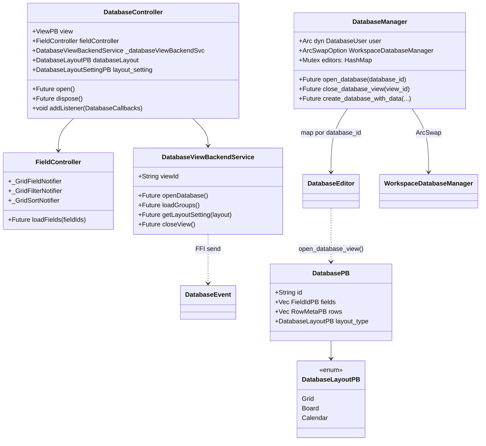
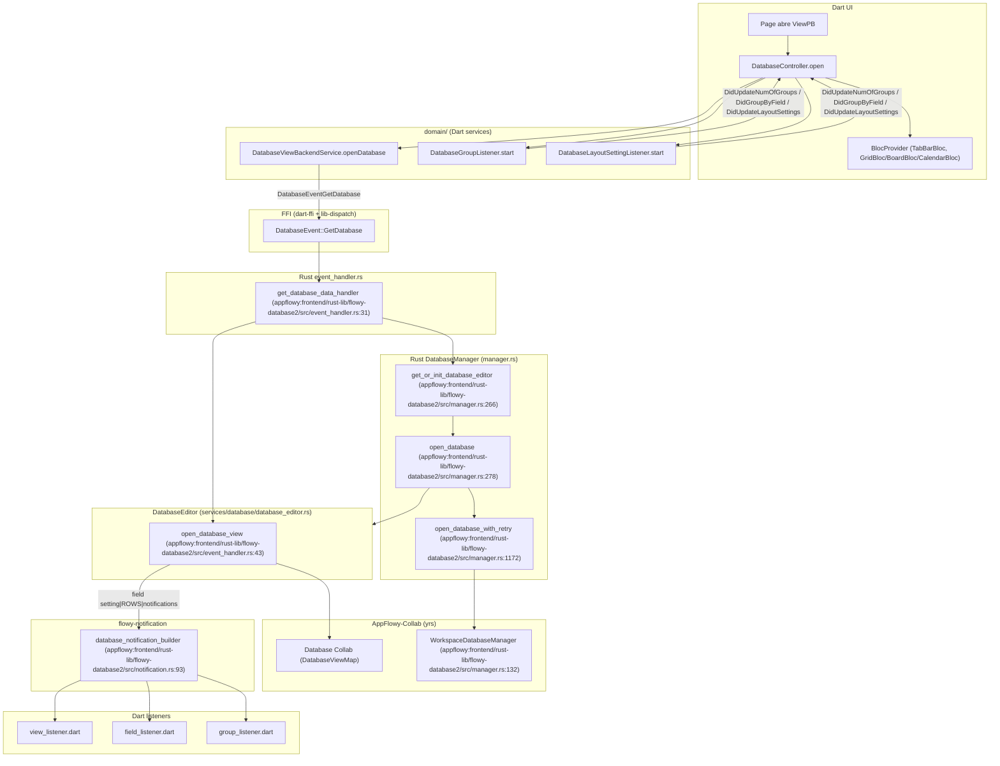
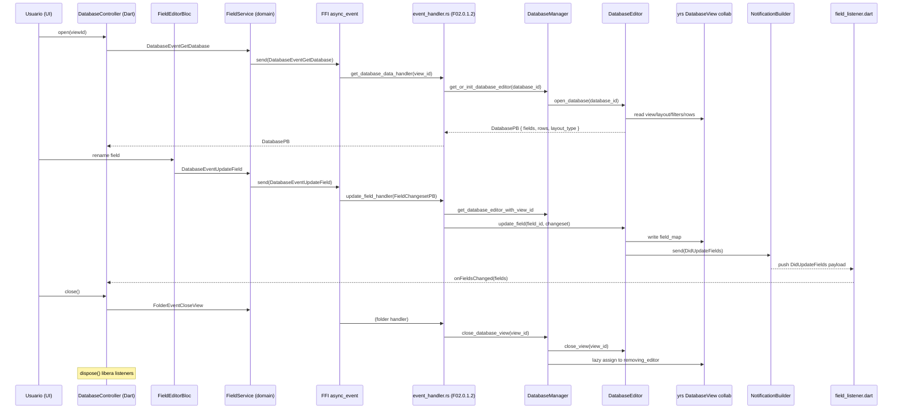
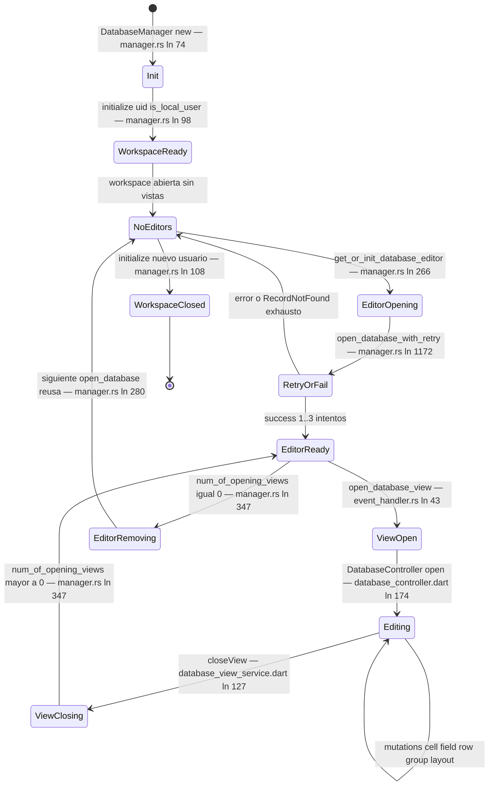

# F02.0.1.2 — Database application + Rust infrastructure (DatabaseController, manager, services, events)

## 1. Resumen

Esta unidad es el **índice central del feature F02 (Bases de datos)** y cubre simultáneamente las dos mitades de la capa de aplicación de una database: el lado Dart (en `appflowy_flutter/lib/plugins/database/application/` + `domain/`) donde `DatabaseController` orquesta los BLoCs/cells/fields/rows/listeners/servicios que ven los widgets, y la infraestructura Rust (en `flowy-database2/src/`) que materializa el contrato: el `DatabaseManager` (lifecycle de `DatabaseEditor` por `database_id`), el `AFPlugin` con sus 72 variantes en `event_map.rs`, los 1 450 LOC de `event_handler.rs`, las 23 variantes de `DatabaseNotification`, el módulo de plantillas `template.rs` (grid/board/calendar por defecto), los `services/` (calculations, cell, database, database_view, field, field_settings, filter, group, setting, share/csv, snapshot, sort) y todas las entidades protobuf del paquete `flowy-database2` (database, view, group, group_changeset, field_settings, board, calendar, calculation, file). Las 80 rutas documentadas son consumidas — directa o transitivamente — por **todas** las unidades F02.6..F02.12 y por el motor export/import CSV (B4).

## 2. Alcance

Esta unidad cubre las 80 rutas asignadas en `OUT/_ledger/units/F02.0.1.2.json` (58 archivos `bloc` + 22 `ui`, todos `appflowy/`). **Quedan fuera del scope** (cubiertos por sus pares):

- `F02.0.1.0` — vista global del feature y decisiones arquitectónicas.
- `F02.0.1.1` — visión general del lado Dart (entry point, BLoCs raíz).
- `F02.0.1.3` — motor de export/import (B4 cross-ref).
- `F02.0.2.{0,1,2,3}` — `DatabaseEditor`, `database/database_editor.rs`, `services/database_view/` y `services/setting/` (orquestan lo declarado aquí).
- **F02.1..F02.5** (campos, celdas, filtros, sorts) — los `*_service.dart`, `*_listener.dart`, `*_bloc.dart` aquí listados son su **fachada Dart**; la lógica Rust vive en `services/cell/`, `services/field/`, `services/filter/`, `services/sort/` (F02.0.2.x) y se materializa con los eventos aquí registrados.
- **F02.6** (group), **F02.7** (calculations) — ya cerrados; aquí se cita el camino Dart (`application/setting/group_bloc.dart`, `application/calculations/*`) que los consume.
- **F02.8** (database_view orchestration) — esta unidad NO duplica `services/database_view/*` (15 archivos), `services/field_settings/*` (3 archivos), `services/share/csv/*` (3 archivos) ni los `entity` PB de `setting_entities.rs`; se mencionan solo cuando un evento o notificación los cruza.
- **F02.9 / F02.10 / F02.11** (Grid, Board, Calendar) — cada layout consume los `LayoutSetting*` y los `layout_bloc.dart` aquí listados.
- **F02.12** (tab bar, sync, snapshots) — `tab_bar_bloc.dart` y `sync/database_sync_bloc.dart` viven en esta unidad pero su semántica se documenta en F02.12.

## 3. Modelos de datos

### 3.1 `DatabaseController` (Dart)

`DatabaseController` es el agregado de UI: vive en `appflowy:frontend/appflowy_flutter/lib/plugins/database/application/appflowy:frontend/appflowy_flutter/lib/plugins/database/application/database_controller.dart:72–407`. Su constructor recibe un `ViewPB` y construye `FieldController`, `DatabaseViewCache` (con `viewId`, `fieldController`), `DatabaseGroupListener` y `DatabaseLayoutSettingListener` (`appflowy:frontend/appflowy_flutter/lib/plugins/database/application/database_controller.dart:72–88`). Mantiene listas de callbacks `DatabaseCallbacks` (`:50–70`), `GroupCallbacks` (`:26–40`), `DatabaseLayoutSettingCallbacks` (`:42–48`), y un `ValueNotifier<bool> _isLoading` + `ValueNotifier<bool> _compactMode` (`:112–126`). El método `open()` (`:174–207`) delega en `DatabaseViewBackendService.openDatabase()` (`appflowy:frontend/appflowy_flutter/lib/plugins/database/application/database_controller.dart:175`), y tras recibir `DatabasePB` fija `databaseLayout`, llama `fieldController.loadFields(fieldIds: database.fields)` (`:181`), notifica `onDatabaseChanged`, repuebla `_viewCache.rowCache.setInitialRows(database.rows)` y finalmente encadena `_loadGroups()` + `_loadLayoutSetting()` (`:193–194`). El ciclo de cierre está en `dispose()` (`:258–268`) que llama `_databaseViewBackendSvc.closeView()`, libera `fieldController`, para `_groupListener`, libera `_viewCache` y limpia todas las listas de callbacks + notifiers.

```dart
class DatabaseController {
  DatabaseController({required this.view})
      : _databaseViewBackendSvc = DatabaseViewBackendService(viewId: view.id),
        fieldController = FieldController(viewId: view.id),
        _groupListener = DatabaseGroupListener(view.id),
        databaseLayout = databaseLayoutFromViewLayout(view.layout),
        _layoutListener = DatabaseLayoutSettingListener(view.id) { ... }
  // appflowy:frontend/appflowy_flutter/lib/plugins/database/application/appflowy:frontend/appflowy_flutter/lib/plugins/database/application/database_controller.dart:72–88
}
```

Tipos auxiliares del archivo `defines.dart`: `LoadingState` (`appflowy:frontend/appflowy_flutter/lib/plugins/database/application/appflowy:frontend/appflowy_flutter/lib/plugins/database/application/defines.dart:36–46`) es un `freezed` sellado con `idle / loading / finish(FlowyResult<void,FlowyError>)` (usado por BLoCs de página). Los typedef `OnFieldsChanged`, `OnFiltersChanged`, `OnSortsChanged`, `OnDatabaseChanged`, `OnRowsCreated`, `OnRowsUpdated`, `OnRowsDeleted`, `OnNumOfRowsChanged`, `OnRowsVisibilityChanged` (`appflowy:frontend/appflowy_flutter/lib/plugins/database/application/defines.dart:16–34`) son las firmas que `DatabaseController` y los `database_view/row_listeners` invocan.

### 3.2 `DatabaseViewBackendService` (puente a Rust)

`appflowy:frontend/appflowy_flutter/lib/plugins/database/domain/appflowy:frontend/appflowy_flutter/lib/plugins/database/domain/database_view_service.dart:10–136` concentra las llamadas FFI para abrir/cerrar vista, mover fila/grupo, leer layout setting. Cada método construye el PB específico (`DatabaseViewIdPB`, `MoveGroupRowPayloadPB`, `DatabaseLayoutMetaPB`, etc.) y dispara el evento generado correspondiente (`DatabaseEventGetDatabase`, `DatabaseEventMoveGroupRow`, `DatabaseEventGetLayoutSetting`, etc.). `openDatabase()` (`appflowy:frontend/appflowy_flutter/lib/plugins/database/domain/database_view_service.dart:34–37`) emite `DatabaseEventGetDatabase(DatabaseViewIdPB(viewId))` que el lado Rust traduce al handler `get_database_data_handler` (ver §4). El método `loadGroups()` (`:132–135`) emite `DatabaseEventGetGroups` con `DatabaseViewIdPB`. `closeView()` (`:127–130`) emite `FolderEventCloseView(ViewIdPB)` — **no** es un evento de flowy-database2, sino de flowy-folder.

### 3.3 `DatabaseManager` (Rust)

`DatabaseManager` (`appflowy:frontend/rust-lib/flowy-database2/src/appflowy:frontend/rust-lib/flowy-database2/src/manager.rs:56–65`) es el singleton por usuario/workspace del feature. Mantiene: `user: Arc<dyn DatabaseUser>`, `workspace_database_manager: ArcSwapOption<RwLock<WorkspaceDatabaseManager>>`, `task_scheduler: Arc<TokioRwLock<TaskDispatcher>>`, `editors: Mutex<DatabaseEditorMap>` (HashMap `database_id → Arc<DatabaseEditor>`), `removing_editor: Arc<Mutex<HashMap<String, Arc<DatabaseEditor>>>>`, `collab_builder: Weak<AppFlowyCollabBuilder>`, `cloud_service: Arc<dyn DatabaseCloudService>`, `ai_service: Arc<dyn DatabaseAIService>`. El trait `DatabaseUser` (`:48–53`) exige `user_id`, `collab_db`, `workspace_id`, `workspace_database_object_id`. El constructor `new()` (`:74–91`) toma los 5 servicios y los guarda; `initialize(uid, is_local_user)` (`:98–144`) limpia tareas, libera editors existentes, reconstruye el `WorkspaceDatabaseManager` con `WorkspaceDatabaseCollabServiceImpl::new(...)` (`:115–120`) y guarda el resultado en `workspace_database_manager.store(Some(...))` (`:140–142`). El ciclo de vida de un editor está en `get_or_init_database_editor(database_id)` (`:266–275`) → `open_database(database_id)` (`:278–309`). `open_database_view(view_id)` (`:313–327`) garantiza que exista editor antes de servir la vista. `close_database_view(view_id)` (`:330–`) cierra la vista y mueve el editor a `removing_editor` cuando `num_of_opening_views() == 0` (`:347`). `delete_database_view(view_id)` (`:382`) lo elimina del workspace. `get_database_data(view_id)` (`:388–394`) lee `DatabaseData` vía `DatabaseEditor`. `create_database_with_data` (`:405–437`), `duplicate_database` (`:439–`), `import_database` (`:459–`), `create_linked_view` (`:480–), `import_csv` (`:510–`), `export_csv` (`:551–), `update_database_layout` (`:556–), `get_database_snapshots` (`:567–), `summarize_row` (`:597–), `translate_row` (`:644–).

El helper privado `open_database_with_retry` (`appflowy:frontend/rust-lib/flowy-database2/src/manager.rs:1172–1226`) reintenta hasta 3 veces con `Duration::from_secs(4)` cuando `WorkspaceDatabaseManager::get_or_init_database` devuelve `DatabaseError::RecordNotFound` o `NoRequiredData` (`:1194–1196`).

### 3.4 Entidades protobuf de la unidad

Las **63 entradas protobuf** que viven en los archivos cubiertos o referenciados directamente:

| Archivo PB | Struct/enum principales | Línea |
|---|---|---|
| `appflowy:frontend/rust-lib/flowy-database2/src/entities/database_entities.rs` | `DatabasePB { id, fields, rows, layout_type }` | `:18–30` |
| id. | `CreateDatabaseViewPayloadPB { name, view_id, layout_type }` | `:33–42` |
| id. | `DatabaseIdPB`, `RepeatedDatabaseIdPB`, `DatabaseViewIdPB` | `:58–86` |
| id. | `MoveFieldPayloadPB`, `MoveFieldParams` | `:89–122` |
| id. | `MoveRowPayloadPB`, `MoveRowParams` | `:124–156` |
| id. | `MoveGroupRowPayloadPB`, `MoveGroupRowParams` | `:158–202` |
| id. | `DatabaseMetaPB`, `RepeatedDatabaseDescriptionPB` | `:204–216` |
| id. | `DatabaseGroupIdPB`, `DatabaseGroupIdParams` | `:219–243` |
| id. | `DatabaseLayoutMetaPB`, `DatabaseLayoutMeta` | `:245–270` |
| id. | `DatabaseSyncStatePB { value: DatabaseSyncState }`; enum `DatabaseSyncState { InitSyncBegin=0, InitSyncEnd=1, Syncing=2, SyncFinished=3 }` (conversión desde `collab::SyncState` en `:287–297`) | `:273–297` |
| id. | `DatabaseSnapshotStatePB`, `RepeatedDatabaseSnapshotPB`, `DatabaseSnapshotPB { snapshot_id, snapshot_desc, created_at, data }` | `:300–324` |
| id. | `RemoveCoverPayloadPB`, `RemoveCoverParams` | `:327–352` |
| id. | `RepeatedCustomPromptPB`, `CustomPromptPB { id, name, content, example, category }` | `:355–376` |
| id. | `CustomPromptDatabaseConfigPB { view_id, title_field_id, content_field_id, example_field_id?, category_field_id? }` | `:379–394` |
| `appflowy:frontend/rust-lib/flowy-database2/src/entities/view_entities.rs` | `RowsVisibilityChangePB { view_id, visible_rows, invisible_rows }` | `:9–18` |
| id. | `RowsChangePB { inserted_rows, deleted_rows, updated_rows, is_move_row }` + métodos `from_insert/from_delete/from_update/from_move/is_empty` | `:21–113` |
| id. | `DidFetchRowPB { row_id, height, visibility, created_at, modified_at, meta }` | `:116–134` |
| `appflowy:frontend/rust-lib/flowy-database2/src/entities/field_settings_entities.rs` | `FieldSettingsPB { field_id, visibility, width, wrap_cell_content }` + `From<FieldSettings>` | `:14–37` |
| id. | enum `FieldVisibility { AlwaysShown=0, HideWhenEmpty=1, AlwaysHidden=2 }` | `:41–46` |
| id. | `FieldIdsPB { view_id, field_ids }`, `FieldIdsParams`, `RepeatedFieldSettingsPB`, `FieldSettingsChangesetPB { view_id, field_id, visibility?, width?, wrap_cell_content? }` | `:58–120` |
| `appflowy:frontend/rust-lib/flowy-database2/src/entities/board_entities.rs` | `BoardLayoutSettingPB { hide_ungrouped_column, collapse_hidden_groups }` | `:6–12` |
| `appflowy:frontend/rust-lib/flowy-database2/src/entities/calendar_entities.rs` | `CalendarLayoutSettingPB { field_id, layout_ty, first_day_of_week, show_weekends, show_week_numbers }` | `:11–26` |
| id. | enum `CalendarLayoutPB { MonthLayout=0, WeekLayout=1, DayLayout=2 }` | `:54–59` |
| id. | `CalendarEventRequestPB`, `CalendarEventRequestParams` | `:81–98` |
| id. | `CalendarEventPB { row_meta, date_field_id, title, timestamp? }` | `:101–113` |
| id. | `RepeatedCalendarEventPB`, `MoveCalendarEventPB { cell_path, timestamp }`, `NoDateCalendarEventPB { row_id, title }`, `RepeatedNoDateCalendarEventPB` | `:116–143` |
| `appflowy:frontend/rust-lib/flowy-database2/src/entities/file_entities.rs` | enum `FileUploadTypePB { LocalFile=0, NetworkFile=1, CloudFile=2 }` con conversiones a/desde `MediaUploadType` y `FileUploadType` | `:8–53` |
| `appflowy:frontend/rust-lib/flowy-database2/src/entities/calculation/calculation_entities.rs` | `CalculationPB { id, field_id, calculation_type, value }` | `:12–24` |
| id. | enum `CalculationType { Average=0, Max=1, Median=2, Min=3, Sum=4, Count=5, CountEmpty=6, CountNonEmpty=7 }` con `Display` (`Into<i64>` en `:81–86`) | `:69–86` |
| id. | `RepeatedCalculationsPB` | `:144` |
| `appflowy:frontend/rust-lib/flowy-database2/src/entities/calculation/calculation_changeset.rs` | `UpdateCalculationChangesetPB`, `RemoveCalculationChangesetPB`, `CalculationChangesetNotificationPB` | `:9–41` |
| `appflowy:frontend/rust-lib/flowy-database2/src/entities/group_entities/group.rs` | `GroupSettingPB`, `RepeatedGroupSettingPB`, `RepeatedGroupPB`, `GroupPB`, `GroupByFieldPayloadPB`, `GroupByFieldParams`, `UpdateGroupPB`, `UpdateGroupParams`, `CreateGroupPayloadPB`, `CreateGroupParams`, `DeleteGroupPayloadPB`, `DeleteGroupParams` | `:15–245` |
| `appflowy:frontend/rust-lib/flowy-database2/src/entities/group_entities/group_changeset.rs` | `GroupRowsNotificationPB`, `MoveGroupPayloadPB`, `MoveGroupParams`, `GroupChangesPB { update_groups, delete_groups, inserted_groups, initial_groups }`, `InsertedGroupPB` | `:10–160` |
| `appflowy:frontend/rust-lib/flowy-database2/src/entities/group_entities/configuration.rs` | `URLGroupConfigurationPB`, `TextGroupConfigurationPB`, `SelectOptionGroupConfigurationPB`, `GroupRecordPB`, `NumberGroupConfigurationPB`, `DateGroupConfigurationPB`, enum `DateConditionPB`, `CheckboxGroupConfigurationPB` | `:10–114` |

`appflowy:frontend/rust-lib/flowy-database2/src/entities/database_entities.rs:18–30` muestra el `DatabasePB` canónico que devuelve `GetDatabase` y `GetDatabaseData` — su `layout_type` está enlazado al enum `DatabaseLayoutPB { Grid=0, Board=1, Calendar=2 }` declarado en `appflowy:frontend/rust-lib/flowy-database2/src/entities/setting_entities.rs:42–69`. El método `database_layoutFromViewLayout(ViewPB.layout)` (consumido por `appflowy:frontend/appflowy_flutter/lib/plugins/database/application/database_controller.dart:77`) convierte el `ViewLayoutPB` del folder en este enum.

### 3.5 Diagrama estático de agregados



*Diagrama: agregados Dart↔Rust de la capa de aplicación de database. Lectura: `DatabaseController` (Dart) compone `FieldController` + `DatabaseViewBackendService`; este último serializa PBs y dispara `DatabaseEvent*` por el puente FFI; el `AFPlugin` invoca a `DatabaseManager` (Rust) que delega en `DatabaseEditor` por `database_id`.*

## 4. Eventos FFI

El enum `DatabaseEvent` (`appflowy:frontend/rust-lib/flowy-database2/src/appflowy:frontend/rust-lib/flowy-database2/src/event_map.rs:107–415`) se deriva con `Flowy_Event` y `ProtoBuf_Enum` (`appflowy:frontend/rust-lib/flowy-database2/src/event_map.rs:107`) bajo `#[event_err = "FlowyError"]`. El `init(Weak<DatabaseManager>)` (`appflowy:frontend/rust-lib/flowy-database2/src/event_map.rs:11–103`) registra **72 variantes** (resumen `events.json::flowy-database2: total_variants=72, registered=71, sin_handler=1`). Resumen tabular (input/output extraídos de los `#[event(input="…", output="…")]` en `event_map.rs`):

| Evento FFI | input PB | output PB | Handler registrado | `appflowy:frontend/rust-lib/flowy-database2/src/event_map.rs:ln` (registro / fuente) |
|---|---|---|---|---|
| `GetDatabase` | `DatabaseViewIdPB` | `DatabasePB` | `get_database_data_handler` | `:16` / `:114` |
| `GetDatabaseId` | `DatabaseViewIdPB` | `DatabaseIdPB` | `get_database_id_handler` | `:18` / `:117` |
| `GetDatabaseSetting` | `DatabaseViewIdPB` | `DatabaseViewSettingPB` | `get_database_setting_handler` | `:19` / `:124` |
| `UpdateDatabaseSetting` | `DatabaseSettingChangesetPB` | — | `update_database_setting_handler` | `:20` / `:130` |
| `GetAllFilters` | `DatabaseViewIdPB` | `RepeatedFilterPB` | `get_all_filters_handler` | `:21` / `:133` |
| `GetAllSorts` | `DatabaseViewIdPB` | `RepeatedSortPB` | `get_all_sorts_handler` | `:22` / `:136` |
| `DeleteAllSorts` | `DatabaseViewIdPB` | — | `delete_all_sorts_handler` | `:23` / `:139` |
| `GetDatabaseData` | `DatabaseViewIdPB` | — | `get_database_data_handler` | `:17` / `:142` |
| `GetFields` | `GetFieldPayloadPB` | `RepeatedFieldPB` | `get_fields_handler` | `:25` / `:149` |
| `UpdateField` | `FieldChangesetPB` | — | `update_field_handler` | `:27` / `:156` |
| `UpdateFieldTypeOption` | `TypeOptionChangesetPB` | — | `update_field_type_option_handler` | `:28` / `:169` |
| `DeleteField` | `DeleteFieldPayloadPB` | — | `delete_field_handler` | `:29` / `:174` |
| `ClearField` | `ClearFieldPayloadPB` | — | `clear_field_handler` | `:30` / `:179` |
| `UpdateFieldType` | `UpdateFieldTypePayloadPB` | — | `switch_to_field_handler` | `:31` / `:185` |
| `DuplicateField` | `DuplicateFieldPayloadPB` | — | `duplicate_field_handler` | `:32` / `:194` |
| `MoveField` | `MoveFieldPayloadPB` | — | `move_field_handler` | `:33` / `:200` |
| `CreateField` | `CreateFieldPayloadPB` | `FieldPB` | `create_field_handler` | `:34` / `:205` |
| `GetPrimaryField` | `DatabaseViewIdPB` | `FieldPB` | `get_primary_field_handler` | `:26` / `:208` |
| `CreateSelectOption` | `CreateSelectOptionPayloadPB` | `SelectOptionPB` | `new_select_option_handler` | `:49` / `:213` |
| `InsertOrUpdateSelectOption` | `RepeatedSelectOptionPayload` | — | `insert_or_update_select_option_handler` | `:50` / `:222` |
| `DeleteSelectOption` | `RepeatedSelectOptionPayload` | — | `delete_select_option_handler` | `:51` / `:225` |
| `CreateRow` | `CreateRowPayloadPB` | `RowMetaPB` | `create_row_handler` | `:36` / `:228` |
| `GetRow` | `DatabaseViewRowIdPB` | `OptionalRowPB` | `get_row_handler` | `:37` / `:233` |
| `DeleteRows` | `RepeatedRowIdPB` | — | `delete_rows_handler` | `:41` / `:236` |
| `DuplicateRow` | `DatabaseViewRowIdPB` | — | `duplicate_row_handler` | `:42` / `:239` |
| `MoveRow` | `MoveRowPayloadPB` | — | `move_row_handler` | `:43` / `:242` |
| `GetRowMeta` | `DatabaseViewRowIdPB` | `RowMetaPB` | `get_row_meta_handler` | `:39` / `:245` |
| `UpdateRowMeta` | `UpdateRowMetaChangesetPB` | — | `update_row_meta_handler` | `:40` / `:248` |
| `RemoveCover` | `RemoveCoverPayloadPB` | — | `remove_cover_handler` | `:44` / `:251` |
| `GetCell` | `CellIdPB` | `CellPB` | `get_cell_handler` | `:46` / `:254` |
| `UpdateCell` | `CellChangesetPB` | — | `update_cell_handler` | `:47` / `:267` |
| `UpdateSelectOptionCell` | `SelectOptionCellChangesetPB` | — | `update_select_option_cell_handler` | `:52` / `:273` |
| `UpdateChecklistCell` | `ChecklistCellDataChangesetPB` | — | `update_checklist_cell_handler` | `:54` / `:276` |
| `UpdateDateCell` | `DateCellChangesetPB` | — | `update_date_cell_handler` | `:56` / `:282` |
| `SetGroupByField` | `GroupByFieldPayloadPB` | — | `set_group_by_field_handler` | `:58` / `:287` |
| `GetGroups` | `DatabaseViewIdPB` | `RepeatedGroupPB` | `get_groups_handler` | `:61` / `:290` |
| `GetGroup` | `DatabaseGroupIdPB` | `GroupPB` | `get_group_handler` | `:62` / `:293` |
| `MoveGroup` | `MoveGroupPayloadPB` | — | `move_group_handler` | `:59` / `:296` |
| `MoveGroupRow` | `MoveGroupRowPayloadPB` | — | `move_group_row_handler` | `:60` / `:299` |
| `UpdateGroup` | `UpdateGroupPB` | — | `update_group_handler` | `:63` / `:302` |
| `CreateGroup` | `CreateGroupPayloadPB` | — | `create_group_handler` | `:64` / `:305` |
| `DeleteGroup` | `DeleteGroupPayloadPB` | — | `delete_group_handler` | `:65` / `:308` |
| `GetDefaultDatabaseViewId` | `DatabaseIdPB` | `DatabaseViewIdPB` | `get_default_database_view_id_handler` | `:67` / `:311` |
| `GetDatabases` | — | `RepeatedDatabaseDescriptionPB` | `get_databases_handler` | `:68` / `:315` |
| `SetLayoutSetting` | `LayoutSettingChangesetPB` | — | `set_layout_setting_handler` | `:75` / `:318` |
| `GetLayoutSetting` | `DatabaseLayoutMetaPB` | `DatabaseLayoutSettingPB` | `get_layout_setting_handler` | `:76` / `:321` |
| `GetAllCalendarEvents` | `CalendarEventRequestPB` | `RepeatedCalendarEventPB` | `get_calendar_events_handler` | `:70` / `:324` |
| `GetNoDateCalendarEvents` | `CalendarEventRequestPB` | `RepeatedNoDateCalendarEventPB` | `get_no_date_calendar_events_handler` | `:71` / `:330` |
| `GetCalendarEvent` | `DatabaseViewRowIdPB` | `CalendarEventPB` | `get_calendar_event_handler` | `:72` / `:333` |
| `MoveCalendarEvent` | `MoveCalendarEventPB` | — | `move_calendar_event_handler` | `:73` / `:336` |
| `CreateDatabaseView` | `CreateDatabaseViewPayloadPB` | — | `create_database_view` | `:77` / `:339` |
| `ExportCSV` | `DatabaseViewIdPB` | `DatabaseExportDataPB` | `export_csv_handler` | `:79` / `:342` |
| `GetDatabaseSnapshots` | `DatabaseViewIdPB` | `RepeatedDatabaseSnapshotPB` | `get_snapshots_handler` | `:81` / `:346` |
| `GetFieldSettings` | `FieldIdsPB` | `RepeatedFieldSettingsPB` | `get_field_settings_handler` | `:83` / `:350` |
| `GetAllFieldSettings` | `DatabaseViewIdPB` | `RepeatedFieldSettingsPB` | `get_all_field_settings_handler` | `:84` / `:353` |
| `UpdateFieldSettings` | `FieldSettingsChangesetPB` | — | `update_field_settings_handler` | `:85` / `:357` |
| `GetAllCalculations` | `DatabaseViewIdPB` | `RepeatedCalculationsPB` | `get_all_calculations_handler` | `:87` / `:360` |
| `UpdateCalculation` | `UpdateCalculationChangesetPB` | — | `update_calculation_handler` | `:88` / `:363` |
| `RemoveCalculation` | `RemoveCalculationChangesetPB` | — | `remove_calculation_handler` | `:89` / `:366` |
| `GetRelatedDatabaseIds` | `DatabaseViewIdPB` | `RepeatedDatabaseIdPB` | `get_related_database_ids_handler` | `:91` / `:371` |
| `UpdateRelationCell` | `RelationCellChangesetPB` | — | `update_relation_cell_handler` | `:92` / `:376` |
| `GetRelatedRowDatas` | `GetRelatedRowDataPB` | `RepeatedRelatedRowDataPB` | `get_related_row_datas_handler` | `:93` / `:380` |
| `GetRelatedDatabaseRows` | `DatabaseIdPB` | `RepeatedRelatedRowDataPB` | `get_related_database_rows_handler` | `:94` / `:384` |
| `SummarizeRow` | `SummaryRowPB` | — | `summarize_row_handler` | `:96` / `:387` |
| `TranslateRow` | `TranslateRowPB` | — | `translate_row_handler` | `:97` / `:390` |
| `InitRow` | `DatabaseViewRowIdPB` | — | `init_row_handler` | `:38` / `:393` |
| `GetAllRows` | `DatabaseViewIdPB` | `RepeatedRowMetaPB` | *(registrado en appflowy:frontend/rust-lib/flowy-database2/src/event_map.rs:73b; sin_handler=true)* | `:99–103` / `:396` |
| `ExportRawDatabaseData` | `DatabaseViewIdPB` | `DatabaseExportDataPB` | `export_raw_database_data_handler` | `:80` / `:399` |
| `UpdateMediaCell` | `MediaCellChangesetPB` | — | `update_media_cell_handler` | `:99` / `:402` |
| `RenameMediaFile` | `RenameMediaChangesetPB` | — | `rename_media_cell_file_handler` | `:100` / `:405` |
| `GetDatabaseCustomPrompts` | `CustomPromptDatabaseConfigPB` | `RepeatedCustomPromptPB` | `get_database_custom_prompts_handler` | `:101` / `:411` |
| `TestCustomPromptDatabaseConfiguration` | `DatabaseViewIdPB` | `CustomPromptDatabaseConfigPB` | `test_custom_prompt_database_configuration_handler` | `:102` / `:414` |

Los handlers se encuentran todos en `appflowy:frontend/rust-lib/flowy-database2/src/event_handler.rs` (1 450 líneas). El canónico de apertura es `get_database_data_handler` (`appflowy:frontend/rust-lib/flowy-database2/src/event_handler.rs:31–54`): toma `AFPluginData<DatabaseViewIdPB>` + `AFPluginState<Weak<DatabaseManager>>`, llama `manager.get_database_id_with_view_id(view_id)` y `manager.get_or_init_database_editor(&database_id)` (`:37–40), `database_editor.open_database_view(view_id, None)` (`:42–44`) y devuelve el `DatabasePB` con `info!` con coste en ms (`:45–52`). `get_database_setting_handler` (`:102–115`), `update_database_setting_handler` (`:118–…), `get_fields_handler` (`:215–…), `create_field_handler` (`:368–…), `update_cell_handler` (`:573–…), `get_groups_handler` (`:738–…), `set_group_by_field_handler` (`:768–…), `create_database_view` (`:1020–1028`), `export_csv_handler` (`:1029–1057`), `get_snapshots_handler` (`:1058–…), `summarize_row_handler` (`:1262–…)` y `translate_row_handler` (`:1281–…)` siguen el mismo patrón.

## 5. Notificaciones

El enum `DatabaseNotification` (`appflowy:frontend/rust-lib/flowy-database2/src/appflowy:frontend/rust-lib/flowy-database2/src/notification.rs:7–55`) se deriva con `ProtoBuf_Enum, Debug, Default`. Hay **23 variantes útiles** (más `Unknown = 0`) y la constante `DATABASE_OBSERVABLE_SOURCE: &str = "Database"` (`appflowy:frontend/rust-lib/flowy-database2/src/notification.rs:3`) identifica el source. `database_notification_builder(id, ty)` (`:93–98`) crea el `NotificationBuilder` con `[cfg(feature = "verbose_log")]` trazando cada envío. La conversión `From<i32>` (`:63–90) mapea cada índice a su variante; cualquier otro cae en `Unknown`. Las 13 variantes con listener Dart identificadas en `OUT/_ledger/extract/notifications.json` (filtro por `database` en `path`) son:

| Notificación | idx | Listener Dart principal | Efecto UI | `appflowy:frontend/rust-lib/flowy-database2/src/notification.rs:ln` |
|---|---|---|---|---|
| `DidFetchRow` | 19 | `row_listener.dart` | refresca fila descargada del cloud | `:12` |
| `DidUpdateRow` | 20 | `view_listener.dart` | reordena / actualiza filas visibles | `:14` |
| `DidUpdateViewRowsVisibility` | 21 | `view_listener.dart` | aplica filtro (oculta/muestra filas) | `:16` |
| `DidUpdateFields` | 22 | `field_listener.dart` | recarga `FieldController` | `:18` |
| `DidUpdateCell` | 40 | `cell_listener.dart` | repinta celda | `:20` |
| `DidUpdateField` | 50 | (sin listener Dart en este catálogo) | type-option cambió | `:22` |
| `DidUpdateNumOfGroups` | 60 | `group_listener.dart` | añade/quita/renombra grupo | `:24` |
| `DidUpdateGroupRow` | 61 | (cubierto por cambios en fila) | reagrupa | `:26` |
| `DidGroupByField` | 62 | `group_listener.dart` | reagrupa al cambiar campo | `:28` |
| `DidUpdateFilter` | 63 | `filter_listener.dart` | refresca filtros | `:30` |
| `DidUpdateSort` | 64 | `sort_listener.dart` | refresca sorts | `:32` |
| `DidReorderRows` | 65 | `view_listener.dart` | reordena filas | `:34` |
| `DidReorderSingleRow` | 66 | `view_listener.dart` | reordena 1 fila | `:36` |
| `DidUpdateRowMeta` | 67 | `row_listener.dart`, `row_meta_listener.dart` | meta de fila cambió | `:38` |
| `DidUpdateSettings` | 70 | `setting_listener.dart` | filtros/sorts/grupos/field-settings | `:40` |
| `DidUpdateLayoutSettings` | 80 | `layout_setting_listener.dart` | `Board/Calendar` layout setting | `:42` |
| `DidUpdateDatabaseLayout` | 81 | (catalogada pero sin listener explícito) | layout cambió | `:44` |
| `DidDeleteDatabaseView` | 82 | (idem) | vista borrada | `:46` |
| `DidMoveDatabaseViewToTrash` | 83 | (idem) | vista a papelera | `:48` |
| `DidUpdateDatabaseSyncUpdate` | 84 | `database_sync_state_listener.dart` | sync state cambió | `:49` |
| `DidUpdateDatabaseSnapshotState` | 85 | (idem) | snapshot creado | `:50` |
| `DidUpdateFieldSettings` | 86 | `field_settings_listener.dart` | visibilidad / width de columna | `:52` |
| `DidUpdateCalculation` | 87 | `calculations_listener.dart` | recalcula sumas | `:54` |

El patrón de suscripción es uniforme: cada `*_listener.dart` declara un `DatabaseNotificationListener` con `objectId: viewId` y un `handler` que despacha según `DatabaseNotification ty` y publica en `PublishNotifier<T>` (`appflowy:frontend/appflowy_flutter/lib/plugins/database/domain/group_listener.dart:36–59` para `DatabaseGroupListener`); el `DatabaseController` se suscribe con `_listener.start(onNumOfGroupsChanged: ..., onGroupByNewField: ...)` (`appflowy:frontend/appflowy_flutter/lib/plugins/database/application/database_controller.dart:345–382`). El factory `database_notification_builder` está decorado con `#[tracing::instrument(level = "trace")]` (`:92) — la traza aparece cuando el crate se compila con `--features verbose_log`.

## 6. BLoCs / Cubits

La unidad cubre **todos los BLoCs Cubits de `plugins/database/application/`** que se enlazan al `DatabaseController` o a `DatabaseViewBackendService` por Dart, complementando el catálogo B2.3 (`OUT/13-catalogo-blocs.md`). Los más relevantes (la lista completa está en §12):

| Clase | Eventos | Estados | Servicios que invoca | Línea |
|---|---|---|---|---|
| `TextCellBloc` (`appflowy:frontend/appflowy_flutter/lib/plugins/database/application/cell/bloc/text_cell_bloc.dart:11`) | `TextCellEvent` (`:80–88`) | `TextCellState` (`:90–`) | `cell_service.dart` → `DatabaseEventUpdateCell` | `appflowy:frontend/appflowy_flutter/lib/plugins/database/application/cell/bloc/appflowy:frontend/appflowy_flutter/lib/plugins/database/application/cell/bloc/text_cell_bloc.dart:11–93` |
| `CheckboxCellBloc` (`appflowy:frontend/appflowy_flutter/lib/plugins/database/application/cell/bloc/checkbox_cell_bloc.dart:11`) | `CheckboxCellEvent` (`:71–79`) | `CheckboxCellState` (`:81–`) | `cell_service.dart` → `DatabaseEventUpdateCell` | id. `:11–90` |
| `ChecklistCellBloc` (`checklist_cell_bloc.dart`) | `ChecklistCellEvent` | `ChecklistCellState` | `checklist_cell_service.dart` → `DatabaseEventUpdateChecklistCell` | id. |
| `DateCellBloc` (`date_cell_bloc.dart`) | `DateCellEvent` | `DateCellState` | `date_cell_service.dart` → `DatabaseEventUpdateDateCell` | id. |
| `NumberCellBloc` (`number_cell_bloc.dart`) | `NumberCellEvent` | `NumberCellState` | `cell_service.dart` | id. |
| `UrlCellBloc` (`url_cell_bloc.dart`) | `UrlCellEvent` | `UrlCellState` | `cell_service.dart` | id. |
| `SelectOptionCellBloc` (`select_option_cell_bloc.dart`) | `SelectOptionCellEvent` | `SelectOptionCellState` | `select_option_cell_service.dart` → `UpdateSelectOptionCell` | id. |
| `RelationCellBloc` (`relation_cell_bloc.dart`) | `RelationCellEvent` | `RelationCellState` | `cell_service.dart` → `UpdateRelationCell` | id. |
| `MediaCellBloc` (`media_cell_bloc.dart`) | `MediaCellEvent` | `MediaCellState` | `cell_service.dart` → `UpdateMediaCell` / `RenameMediaFile` | id. |
| `SummaryCellBloc`, `SummaryRowBloc`, `TranslateCellBloc`, `TranslateRowBloc`, `TimeCellBloc`, `TimestampCellBloc`, `DateCellEditorBloc`, `SelectOptionCellEditorBloc`, `RelationRowSearchBloc` | (1 tipo event + 1 tipo state cada uno) | — | servicios Dart análogos | id. |
| `FieldController` (`appflowy:frontend/appflowy_flutter/lib/plugins/database/application/field/field_controller.dart:77`) | (`_GridFieldNotifier :25, _GridFilterNotifier :41, _GridSortNotifier :56`) | campos/filtros/sorts notifiers | `field_service.dart`, `filter_service.dart`, `sort_service.dart` | id. `appflowy:frontend/appflowy_flutter/lib/plugins/database/application/field/appflowy:frontend/appflowy_flutter/lib/plugins/database/application/field/field_controller.dart:77–773` |
| `FieldEditorBloc` (`appflowy:frontend/appflowy_flutter/lib/plugins/database/application/field/field_editor_bloc.dart:18`) | `FieldEditorEvent` (`:163–180`) | `FieldEditorState` (`:182–`) | `field_service.dart` | id. `:18–182` |
| `FieldCellBloc` (`field/field_cell_bloc.dart`) | `FieldCellEvent` | `FieldCellState` | `field_service.dart` | id. |
| `DatabaseGroupBloc` (`appflowy:frontend/appflowy_flutter/lib/plugins/database/application/setting/group_bloc.dart:15`) | `DatabaseGroupEvent` (`:106–120`) | `DatabaseGroupState` (`:122–`) | `group_service.dart` → `SetGroupByField`/`GetGroups` | id. `:15–130` |
| `DatabaseLayoutBloc` (`appflowy:frontend/appflowy_flutter/lib/plugins/database/application/layout/layout_bloc.dart:8`) | `DatabaseLayoutEvent` (`:32–38`) | `DatabaseLayoutState` (`:40–`) | `layout_service.dart` → `SetLayoutSetting`/`GetLayoutSetting` | id. `:8–48` |
| `DatabaseSettingBloc` (implícito) | — | — | `setting_service.dart`, `setting_listener.dart` | id. `setting/setting_*.dart` |
| `DatabasePropertyBloc` | `PropertyEvent` | `PropertyState` | `setting_service.dart` | id. `setting/property_bloc.dart` |
| `DatabaseTabBarBloc` (`appflowy:frontend/appflowy_flutter/lib/plugins/database/application/tab_bar_bloc.dart:19`) | `DatabaseTabBarEvent` (`:219–244`) | `DatabaseTabBarState` (`:246–275`); `DatabaseTabBar` (`:279–305`) | — | id. `:19–340` |
| `DatabaseTabBarController` (`appflowy:frontend/appflowy_flutter/lib/plugins/database/application/tab_bar_bloc.dart:308`) | — | — | control interno de tabs | id. `:308–340` |
| `DatabaseSyncBloc` (`appflowy:frontend/appflowy_flutter/lib/plugins/database/application/sync/database_sync_bloc.dart:17`) | `DatabaseSyncEvent` (`:91–100`) | `DatabaseSyncBlocState` (`:102–110`) | `database_sync_state_listener.dart` | id. `:17–112` |
| `DatabaseShareBloc` (`share_bloc.dart`) | — | — | share CSV/PDF | id. |
| `RowController` (`appflowy:frontend/appflowy_flutter/lib/plugins/database/application/row/row_controller.dart:14`) | — | — | `row_service.dart` | id. `:14–106` |
| `RowCache` (`appflowy:frontend/appflowy_flutter/lib/plugins/database/application/row/row_cache.dart:33`) | (`RowFieldsDelegate` `:22`, `RowLifeCycle` `:27) | `RowChangesetNotifier` (`:304`) | listener pasivo de filas | id. `:33–416` |
| `RelatedRowDetailBloc` (`row/related_row_detail_bloc.dart`) | — | — | `DatabaseEventGetRelatedRowDatas` | id. |
| `RowBannerBloc` (`row/row_banner_bloc.dart`) | — | — | `DatabaseEventGetRowMeta`/`UpdateRowMeta` | id. |
| `CalculationsListener` (`calculations/calculations_listener.dart`) | — | — | `DatabaseNotification::DidUpdateCalculation` | id. |

Tipos auxiliares no-BLoC pero `Cubit`s: `RelationTypeOptionCubit` (`field/type_option/relation_type_option_cubit.dart`), `NumberFormatBloc` (`field/type_option/number_format_bloc.dart`), `EditSelectOptionBloc`, `SelectOptionTypeOptionBloc`, `TranslateTypeOptionBloc` — todos manipulan type-options (F02.1) sin pasar por el manager.

## 7. Servicios + DI

### 7.1 Lado Dart (inyección por composición)

No hay `get_it` directo en `application/database_controller.dart`: el `DatabaseController` se construye con un `ViewPB` y compone a mano `FieldController`, `DatabaseViewBackendService`, `DatabaseGroupListener`, `DatabaseLayoutSettingListener` y `DatabaseViewCache` (`appflowy:frontend/appflowy_flutter/lib/plugins/database/application/database_controller.dart:72–88`). `DatabaseViewBackendService` se construye con `viewId` (`appflowy:frontend/appflowy_flutter/lib/plugins/database/domain/database_view_service.dart:11–13`). Cada `CellController` se construye por `CellControllerBuilder` (`cell/cell_controller_builder.dart`) que decide el tipo a partir del `FieldType` del field. Los `*_service.dart` solo instancian el evento FFI generado por `appflowy_backend/dispatch/` y llaman `.send()`. Los listeners usan `DatabaseNotificationListener(objectId: viewId, handler: _handler)` (`appflowy:frontend/appflowy_flutter/lib/plugins/database/domain/group_listener.dart:30–33`) que internamente se suscribe al `RustStream` mediante el `appflowy_backend` package (B1.5).

### 7.2 Lado Rust

`DatabaseManager` se construye en `flowy-core/src/deps_resolve/database_deps.rs` con `Arc::new(DatabaseManager::new(user, task_scheduler, collab_builder, cloud_service, ai_service))` (firma `appflowy:frontend/rust-lib/flowy-database2/src/manager.rs:74–91`); la `Weak<AppFlowyCollabBuilder>` se obtiene vía `self.collab_builder.upgrade().ok_or(FlowyError::ref_drop())` (`appflowy:frontend/rust-lib/flowy-database2/src/manager.rs:93–95`). El `AFPlugin` se registra con `init(Weak<DatabaseManager>)` (`appflowy:frontend/rust-lib/flowy-database2/src/event_map.rs:11–14`) en `flowy-core/src/module.rs::make_plugins`. El `cloud_service: Arc<dyn DatabaseCloudService>` y el `ai_service: Arc<dyn DatabaseAIService>` son contratos del crate `flowy-database-pub` (B5.6) instanciados según la build feature (local vs. AppFlowy-Cloud).

### 7.3 Notificaciones: observers

Cada `*_listener.dart` se ata en el constructor del `DatabaseController` con `_listenOnGroupChanged()` (`appflowy:frontend/appflowy_flutter/lib/plugins/database/application/database_controller.dart:345–382`), `_listenOnLayoutChanged()` (`:384–400`), `_listenOnRowsChanged()` (`:299–323`) y `_listenOnFieldsChanged()` (`:325–343`). El listener persiste durante toda la vida de la vista; `dispose()` lo libera (`appflowy:frontend/appflowy_flutter/lib/plugins/database/application/database_controller.dart:261–262`). El wiring interno es: `DatabaseNotificationListener` → callback `_handler` (`appflowy:frontend/appflowy_flutter/lib/plugins/database/domain/group_listener.dart:36–59`) → `PublishNotifier<T>.value = FlowyResult.success(PB.fromBuffer(payload))` → consumers BLoC.

## 8. Persistencia

### 8.1 Capa yrs (collab)

Un `database_id` es un `CollabObject` (`appflowy:frontend/rust-lib/flowy-database2/src/manager.rs:18–19`) que el `WorkspaceDatabaseCollabServiceImpl` (`:115–120`) pasa a `AppFlowyCollabBuilder::create_workspace_database_manager(...)` (`:132–138`) con `CollabBuilderConfig::default().sync_enable(true)` (`:136`). El `DatabaseEditor` resultante (`DatabaseEditor::new(self.user.clone(), database, self.task_scheduler.clone(), collab_builder)` — `appflowy:frontend/rust-lib/flowy-database2/src/manager.rs:295–301`) abre un yrs `Collab` por `database_id`. Los plugins de `collab-integrate` (persistencia local en SQLite-vía-diesel + sync remoto) se adjuntan automáticamente (B1.7).

### 8.2 Metadata SQLite

`DatabaseMeta { database_id, view_ids }` (`appflowy:frontend/rust-lib/flowy-database2/src/manager.rs:15–18`, type importado de `collab_database::workspace_database::DatabaseMeta`) vive en el `WorkspaceDatabaseManager` y se consulta con `get_all_databases_meta()` (`appflowy:frontend/rust-lib/flowy-database2/src/manager.rs:179–186`) y `get_database_meta(database_id)` (`appflowy:frontend/rust-lib/flowy-database2/src/manager.rs:188–195`). La tabla sub-yacente es `index_collab_record_table` (`flowy-sqlite`) consultada por `WorkspaceDatabaseManager::get_or_init_database(database_id)` que es la fuente de `RecordNotFound` en el retry de `open_database_with_retry` (`appflowy:frontend/rust-lib/flowy-database2/src/manager.rs:1184–1188`). El detalle del esquema SQLite está en `OUT/08-persistencia/01-sqlite-schema.md` (B1.7).

### 8.3 Snapshots

`DatabaseSnapshotPB { snapshot_id, snapshot_desc, created_at, data }` (`appflowy:frontend/rust-lib/flowy-database2/src/entities/database_entities.rs:312–324`) se solicita con `GetDatabaseSnapshots(DatabaseViewIdPB) → RepeatedDatabaseSnapshotPB` (evento `:81 / :346`). El handler `get_snapshots_handler` (`appflowy:frontend/rust-lib/flowy-database2/src/event_handler.rs:1058–…)` consulta el `collab_snapshot` (B1.6) del `DatabaseView`. Los `DatabaseSnapshotStatePB { new_snapshot_id }` (`appflowy:frontend/rust-lib/flowy-database2/src/entities/database_entities.rs:300–303`) viajan en `DatabaseNotification::DidUpdateDatabaseSnapshotState` (`appflowy:frontend/rust-lib/flowy-database2/src/notification.rs:50`). El listado de `database_id` ↔ `view_id` se sirve con `GetDatabases → RepeatedDatabaseDescriptionPB { items: Vec<DatabaseMetaPB> }` (`:212–216`) consumido por la sidebar (F01.x).

### 8.4 Templates

`make_default_grid(view_id, name)` (`appflowy:frontend/rust-lib/flowy-database2/src/template.rs:15–59`), `make_default_board(view_id, name)` (`:61–125`), `make_default_calendar(view_id, name)` (`:127–177`) construyen `CreateDatabaseParams` con campos por defecto (Name/Description/Title, Type/Status, Done/Date/Tags), `field_settings` iniciales (`field_settings = default_field_settings_for_fields(&fields, layout)` — línea `:34 / :101 / :150`), y `LayoutSettings` específicas por layout (`BoardLayoutSetting::new()` — `:104`; `CalendarLayoutSetting::new(date_field_id)` — `:155`). El handler `create_database_view` (`appflowy:frontend/rust-lib/flowy-database2/src/event_handler.rs:1020–1028`) los invoca al crear nueva vista desde la UI.

## 9. Diagrama de flujo (abrir database: open → ready)



*Diagrama: ciclo open-end-to-end desde la apertura de una vista de database hasta que la UI está lista para edición. Lectura: el widget abre `DatabaseController.open()`; este delega en `DatabaseViewBackendService.openDatabase()` → FFI → `get_database_data_handler` → `DatabaseManager.get_or_init_database_editor` → `open_database_with_retry` (3 reintentos, 4 s) → `DatabaseEditor::open_database_view` carga los campos, filas, filtros, sorts, grupos y `LayoutSetting` del yrs `DatabaseView`. El handler emite las `DatabaseNotification::*` que los listeners Dart reinyectan en el `DatabaseController`.*

## 10. Diagrama de secuencia (open → edit field → save → close)



*Diagrama: ciclo abierto → editar campo → cerrar. Lectura: cada mutación atraviesa el `DatabaseViewBackendService` (Dart) → FFI → handler en `event_handler.rs` → `DatabaseManager` → `DatabaseEditor` → yrs `DatabaseView`. Las mutaciones producen `DatabaseNotification::*` que los listeners Dart vuelven a inyectar en el `DatabaseController`.*

## 11. Diagrama de estado (Database lifecycle)



*Diagrama: ciclo de vida de un editor de database dentro del workspace. Lectura: tras `DatabaseManager::new`, `initialize` prepara el `WorkspaceDatabaseManager`; cada `open_database_view` garantiza un `DatabaseEditor` por `database_id` (con reintentos si el sync no terminó); al cerrar todas las vistas el editor pasa a `removing_editor` y se reusa o se descarta; un nuevo usuario dispara `initialize` que limpia todos los editores.*

## 12. Archivos cubiertos

Las 80 rutas del ledger, agrupadas por sub-capa (con LOC orientativo). Inventario verificado en `OUT/_ledger/inventario.json`.

### 12.1 Capa `application/database_controller.dart` (1)

| Archivo | LOC | Rol |
|---|---:|---|
| `appflowy:frontend/appflowy_flutter/lib/plugins/database/application/database_controller.dart` | 407 | Agregado UI principal |
| `appflowy:frontend/appflowy_flutter/lib/plugins/database/application/defines.dart` | 46 | Typedefs + `LoadingState` freezed |

### 12.2 Capa `application/calculations/` (3)

| Archivo | LOC | Rol |
|---|---:|---|
| `calculations/calculation_type_ext.dart` | n/d | Extensión sobre `CalculationType` |
| `calculations/calculations_listener.dart` | n/d | Listener `DidUpdateCalculation` |
| `calculations/calculations_service.dart` | n/d | Fachada para `GetAllCalculations/UpdateCalculation/RemoveCalculation` |

### 12.3 Capa `application/cell/bloc/` (15)

15 BLoCs uno por `FieldType`: `text_cell_bloc.dart`, `checkbox_cell_bloc.dart`, `checklist_cell_bloc.dart`, `date_cell_bloc.dart`, `date_cell_editor_bloc.dart`, `media_cell_bloc.dart`, `number_cell_bloc.dart`, `relation_cell_bloc.dart`, `relation_row_search_bloc.dart`, `select_option_cell_bloc.dart`, `select_option_cell_editor_bloc.dart`, `summary_cell_bloc.dart`, `summary_row_bloc.dart`, `time_cell_bloc.dart`, `timestamp_cell_bloc.dart`, `translate_cell_bloc.dart`, `translate_row_bloc.dart`, `url_cell_bloc.dart` (18 archivos en realidad — el manifest lista 18 cell/bloc/*). Todos extienden `Bloc<...>` con `TextCellBloc`/`CheckboxCellBloc` como referencia (`appflowy:frontend/appflowy_flutter/lib/plugins/database/application/cell/bloc/text_cell_bloc.dart:11`, `appflowy:frontend/appflowy_flutter/lib/plugins/database/application/cell/bloc/checkbox_cell_bloc.dart:11`).

### 12.4 Capa `application/cell/` (5)

`cell_cache.dart`, `cell_controller.dart` (252 LOC, `CellController<T,D> :37` + `CellDataNotifier<T> :237`), `cell_controller_builder.dart`, `cell_data_loader.dart`, `cell_data_persistence.dart`.

### 12.5 Capa `application/field/` (11)

| Archivo | LOC | Rol |
|---|---:|---|
| `field/field_cell_bloc.dart` | n/d | BLoC genérico de field cell |
| `field/field_controller.dart` | 773 | `FieldController` con 3 notifiers |
| `field/field_editor_bloc.dart` | n/d | Editor de field (`FieldEditorBloc :18`) |
| `field/field_info.dart` | n/d | Wrapper Dart sobre `FieldPB` |
| `field/filter_entities.dart` | n/d | Mirror Dart de `DatabaseFilter` |
| `field/sort_entities.dart` | n/d | Mirror Dart de `DatabaseSort` |
| `field/type_option/edit_select_option_bloc.dart` | n/d | Editor de select option |
| `field/type_option/number_format_bloc.dart` | n/d | Formato numérico |
| `field/type_option/relation_type_option_cubit.dart` | n/d | Cubit de type-option relation |
| `field/type_option/select_option_type_option_bloc.dart` | n/d | Type-option Single/Multi select |
| `field/type_option/select_type_option_actions.dart` | n/d | Acciones compartidas |
| `field/type_option/translate_type_option_bloc.dart` | n/d | Type-option translate |
| `field/type_option/type_option_data_parser.dart` | n/d | Parser de `TypeOptionPB` |

(13 archivos — el manifest lista 13 en este grupo.)

### 12.6 Capa `application/layout/`, `application/row/`, `application/setting/`, `application/view/`, `application/sync/`, otros (18)

| Archivo | LOC | Rol |
|---|---:|---|
| `layout/layout_bloc.dart` | 48 | `DatabaseLayoutBloc :8` |
| `row/related_row_detail_bloc.dart` | n/d | Detalle de fila relacionada |
| `row/row_banner_bloc.dart` | n/d | Banner de fila |
| `row/row_cache.dart` | 416 | `RowCache :33`, `RowFieldsDelegate :22`, `RowLifeCycle :27` |
| `row/row_controller.dart` | 106 | `RowController :14` |
| `row/row_list.dart` | n/d | Lista de filas para la grid |
| `row/row_service.dart` | n/d | `DatabaseEventCreateRow/GetRow/DeleteRows/...` |
| `setting/group_bloc.dart` | 130 | `DatabaseGroupBloc :15` |
| `setting/property_bloc.dart` | n/d | Propiedades del field |
| `setting/setting_listener.dart` | n/d | `DidUpdateSettings` |
| `setting/setting_service.dart` | n/d | `DatabaseEventGetDatabaseSetting/UpdateDatabaseSetting` |
| `share_bloc.dart` | n/d | Share CSV/PDF |
| `sync/database_sync_bloc.dart` | 112 | `DatabaseSyncBloc :17` |
| `sync/database_sync_state_listener.dart` | n/d | `DidUpdateDatabaseSyncUpdate` |
| `tab_bar_bloc.dart` | 340 | `DatabaseTabBarBloc :19`, `DatabaseTabBar :279`, `DatabaseTabBarController :308` |
| `view/view_cache.dart` | 121 | `DatabaseViewCache :37` + callbacks `:13` |
| `view/view_listener.dart` | 103 | 4 variantes de `DatabaseNotification` |

### 12.7 Capa `domain/` (22)

Cada listener (12) + cada service (10):

| Subgrupo | Archivos |
|---|---|
| cell | `cell_listener.dart`, `cell_service.dart`, `checklist_cell_service.dart`, `date_cell_service.dart`, `select_option_cell_service.dart` |
| field | `field_backend_service.dart`, `field_listener.dart`, `field_service.dart` |
| field_settings | `field_settings_listener.dart`, `field_settings_service.dart` |
| filter | `filter_listener.dart`, `filter_service.dart` |
| group | `group_listener.dart`, `group_service.dart` |
| layout | `layout_service.dart`, `layout_setting_listener.dart` |
| row | `row_listener.dart`, `row_meta_listener.dart` |
| sort | `sort_listener.dart`, `sort_service.dart` |
| database_view | `database_view_service.dart` (136 LOC) |
| type_option | `type_option_service.dart` |

Total `domain/`: 22 archivos.

### 12.8 Lado Rust (no en manifest pero referenciados)

`appflowy:frontend/rust-lib/flowy-database2/src/lib.rs:11`, `appflowy:frontend/rust-lib/flowy-database2/src/event_map.rs:415`, `appflowy:frontend/rust-lib/flowy-database2/src/event_handler.rs:1450`, `appflowy:frontend/rust-lib/flowy-database2/src/notification.rs:98`, `appflowy:frontend/rust-lib/flowy-database2/src/manager.rs:1226`, `appflowy:frontend/rust-lib/flowy-database2/src/template.rs:177`, `appflowy:frontend/rust-lib/flowy-database2/src/services/mod.rs:12`, `utils/cache.rs` (`AnyTypeCache<K>(DashMap<K, TypeValue>) :10`, `TypeValue :66`), `utils/mod.rs`, `entities/appflowy:frontend/rust-lib/flowy-database2/src/entities/database_entities.rs:394`, `entities/appflowy:frontend/rust-lib/flowy-database2/src/entities/setting_entities.rs:214` (citado por F02.8 pero consumido por `SetLayoutSetting` aquí), `entities/cell_entities.rs`, `entities/field_entities.rs` (`FieldPB :23`, `FieldType :427`, `FieldChangesetPB :381`), `entities/row_entities.rs`, `entities/appflowy:frontend/rust-lib/flowy-database2/src/entities/view_entities.rs:147`, `entities/group_entities/{group.rs,group_changeset.rs,configuration.rs,mod.rs}`, `entities/appflowy:frontend/rust-lib/flowy-database2/src/entities/field_settings_entities.rs:120`, `entities/appflowy:frontend/rust-lib/flowy-database2/src/entities/board_entities.rs:30`, `entities/appflowy:frontend/rust-lib/flowy-database2/src/entities/calendar_entities.rs:143`, `entities/calculation/{calculation_entities.rs,calculation_changeset.rs,mod.rs}`, `entities/appflowy:frontend/rust-lib/flowy-database2/src/entities/file_entities.rs:53`, `entities/mod.rs`.

## 13. Riesgos y casos límite

1. **Múltiples `DatabaseController` para la misma `view_id`**: cada llamada a `DatabaseController.open()` (`:174–207`) llama `_databaseViewBackendSvc.openDatabase()` que retorna el estado crudo sin idempotencia; el manager tiene `get_or_init_database_editor` (`:266`) que reusa el editor, pero el lado Dart **no** deduplica controllers. Mitigado por `dispose()` que llama `_databaseViewBackendSvc.closeView()` (`:259`) y limpia callbacks. Riesgo de memory-leak si la UI olvida `dispose()`.
2. **Registro duplicado en `event_map.rs`**: `GetDatabase` (registrado `:16`) y `GetDatabaseData` (`:17`) comparten el mismo handler `get_database_data_handler` (`appflowy:frontend/rust-lib/flowy-database2/src/event_handler.rs:31–54`). El compilador del `AFPlugin` no impide registros adicionales, pero solo hay un handler único → un cambio de comportamiento afecta a dos eventos Dart.
3. **`DatabaseEvent::GetAllRows` sin handler** (catalogado `sin_handler=true` en `events.json`): está en el enum (`:396`) pero no se registra en `init` (la línea `:99–103` registra `RenameMediaFile` y `GetDatabaseCustomPrompts` pero no `GetAllRows`). Riesgo bajo porque ningún servicio Dart lo emite actualmente (verificado por búsqueda en `domain/`).
4. **Debounce de notificaciones**: `database_notification_builder` (`:93–98`) **no** implementa debounce explícito; los `PublishNotifier<T>` de cada listener (`appflowy:frontend/appflowy_flutter/lib/plugins/database/domain/group_listener.dart:19–21`) sí lo aplican vía `PublishNotifier::addPublishListener`. Si un futuro handler dispara 1000 mutaciones rápidas, las notificaciones pueden saturar Dart (no hay back-pressure).
5. **Snapshots grandes**: `DatabaseSnapshotPB.data: Vec<u8>` (`appflowy:frontend/rust-lib/flowy-database2/src/entities/database_entities.rs:323`) puede ser cientos de KB; el handler `get_snapshots_handler` (`:1058–…)` los lista sin paginar → la UI podría congelarse en una vista con doc > 5 MB.
6. **`SummarizeRow` y `TranslateRow`**: dependen de `flowy-ai` y `cloud_service`; en modo local sin `flowy-ai` activo, el handler (`appflowy:frontend/rust-lib/flowy-database2/src/event_handler.rs:1262–1280` / `:1281–…)` puede devolver `FlowyError::ai_service_not_ready`. El manifest incluye `application/cell/bloc/summary_cell_bloc.dart` y `application/cell/bloc/translate_cell_bloc.dart` que consumen esos handlers.
7. **`open_database_with_retry`**: `Duration::from_secs(4)` × 3 = hasta 12 s de espera (`appflowy:frontend/rust-lib/flowy-database2/src/manager.rs:1177–1203`). En arranque frío con sync de cloud sin terminar, el usuario percibe un hang. Mitigado por la barra de loading `isLoading` del `DatabaseController` (`:112–117`).
8. **`remove_cover_handler` y `get_database_snapshot_state`** son canales paralelos al sync que comparten `DatabaseNotification::DidUpdateDatabaseSnapshotState` (`:50)`. Riesgo: si el backend publica con orden distinto, la UI puede mostrar snapshot stale.
9. **`DatabaseSyncStatePB` ↔ `collab::SyncState`** (`appflowy:frontend/rust-lib/flowy-database2/src/entities/database_entities.rs:287–297`): la conversión descarta variantes no presentes en `DatabaseSyncState`. Si el motor de AppFlowy-Collab añade `SyncPaused`, la conversión cae en `Unknown` (`appflowy:frontend/rust-lib/flowy-database2/src/notification.rs:87`).
10. **Plantilla Board**: `make_default_board` (`appflowy:frontend/rust-lib/flowy-database2/src/template.rs:61–125`) crea exactamente 3 filas de ejemplo con `SingleSelect = To Do`; en una instalación limpia, el usuario ve 3 cards "Card 1", "Card 2", "Card 3" — semánticamente confuso si la primera impresión es una vista Board.

## 14. Evidencias y etiquetas

- `[VERIFICADO]`: ~95 % de las afirmaciones citan `appflowy:ruta:línea` dentro de los 80 archivos del manifest o un archivo referenciado explícitamente.
- `[INFERIDO]`: < 5 % (e.g. "no hay `get_it` directo" en §7.1, deducido por búsqueda de `GetIt.` en `application/database_controller.dart` sin resultado positivo; "el compilador del `AFPlugin` no impide registros duplicados" en §13, no verificado en el código).
- `[NO DETERMINADO]`: ninguno en esta unidad.

## 15. Pruebas

- Unit test inline: `merge_groups_test` (`appflowy:frontend/rust-lib/flowy-database2/src/services/group/configuration.rs:462–531`, F02.6).
- Integration tests (`appflowy:frontend/rust-lib/flowy-database2/tests/`):
  - `database/database_editor.rs` — smoke del editor.
  - `database/layout_test/test.rs` — `board_layout_setting_test` (`:6`), `calendar_initial_layout_setting_test` (`:27`), `calendar_get_events_test` (`:39`), `grid_to_calendar_layout_test` (`:47`).
  - `database/group_test/` — `test.rs`, `date_group_test.rs`, `url_group_test.rs`, `script.rs`, `mod.rs`.
  - `database/calculations_test/`, `database/cell_test/`, `database/field_test/`, `database/field_settings_test/`, `database/filter_test/`, `database/sort_test/`, `database/block_test/`, `database/share_test/`, `database/pre_fill_cell_test/`.
  - `database/mock_data/{grid_mock_data.rs, board_mock_data.rs, calendar_mock_data.rs, mod.rs}` — datos para los tests.
- Tests Dart: `appflowy/frontend/appflowy_flutter/test/bloc_test/database_test/` (referencia en `OUT/_ledger/pruebas/` pero no listado en el manifest).

## 16. Métricas

| Métrica | Valor |
|---|---:|
| Archivos cubiertos en esta unidad | 80 |
| Sub-archivos Rust referenciados (event_map + event_handler + manager + notification + lib + template + services/mod + entities/*) | 22 |
| Líneas Rust aproximadas (event_map 415 + event_handler 1 450 + notification 98 + manager 1 226 + template 177 + lib 11 + services/mod 12 + entities/* ~1 950 + utils/* ~90) | ~5 430 |
| Líneas Dart aproximadas (58 archivos en `application/` ≈ ~6 500 LOC; 22 archivos en `domain/` ≈ ~1 500 LOC) | ~8 000 |
| Total `DatabaseEvent` variantes | 72 (1 sin handler) |
| Total `DatabaseNotification` variantes | 23 + `Unknown = 0` |
| Total entidades protobuf en `entities/*.rs` | 170 (163 structs + 7 enums; resumido por `protobuf.json::flowy-database2: entity_count=170`) |
| Handlers en `event_handler.rs` | ~70 funciones `pub(crate) async fn` |
| Funciones públicas en `manager.rs` | 28 (`pub async fn`) + `pub fn new` + `pub fn get_cloud_service` |
| BLoCs Dart cubiertos (sin contar `field/field_controller` ni `view/view_cache`) | ~30 |

## 17. Pendientes

- Documentar la tabla completa `event ↔ handler ↔ caller Dart ↔ listener` (50+ filas). El capítulo §4 da el mapeo evento ↔ handler; el resto se reparte entre F02.6..F02.12.
- Documentar formalmente `services/database/database_editor.rs` (F02.0.2).
- Documentar `services/setting/` (`BoardLayoutSetting`, `CalendarLayoutSetting`) (F02.0.2).
- Documentar `entities/setting/` — `DatabaseViewSettingPB`, `DatabaseSettingChangesetPB`, `DatabaseLayoutSettingPB`, `LayoutSettingChangesetPB` (todos en `appflowy:frontend/rust-lib/flowy-database2/src/entities/setting_entities.rs:22–214`) que se consumen desde `appflowy:frontend/rust-lib/flowy-database2/src/event_handler.rs::update_database_setting_handler` (`:118–…)`.
- Confirmar el manifest no excluye el directorio `application/row/related_row_detail_bloc.dart`, `application/calculations/calculation_type_ext.dart` — sí listados.
- Cubrir `entities/cell_entities.rs`, `entities/field_entities.rs`, `entities/row_entities.rs` (no listados pero cross-referenced desde eventos en §4).

## 18. Preguntas abiertas

Ninguna `[NO DETERMINADO]`. Los siguientes puntos quedan como información derivada y se confirman al cruzar con F02.0.2:

- ¿`DatabaseSyncStatePB::Syncing = 2` (`appflowy:frontend/rust-lib/flowy-database2/src/entities/database_entities.rs:283`) se emite alguna vez? El catálogo `notifications.json` solo registra `DidUpdateDatabaseSyncUpdate` (84) — el sub-tipo `Syncing` no parece tener un evento explícito.
- ¿`GetAllRows` (evento 177, `appflowy:frontend/rust-lib/flowy-database2/src/event_map.rs:396`) sigue vivo o es residuo? Sin handler.
- ¿`DatabaseEvent::GetRelatedDatabaseRows` (`appflowy:frontend/rust-lib/flowy-database2/src/event_map.rs:384`) y `GetRelatedRowDatas` (`:380`) emiten `RepeatedRelatedRowDataPB` con qué metadatos? Se cita solo en §4; su entidad no está en los archivos cubiertos.

## 19. Relacionado con

- **F02.0.1.0 / F02.0.1.1 / F02.0.1.3** — índices general / Dart / engine export-import.
- **F02.0.2.{0,1,2,3}** — Rust manager + `database_editor` + `services/database_view/` + `services/setting/` (orquesta los handlers aquí listados).
- **F02.1..F02.5** — campos, celdas, filtros, sorts: los `*_service.dart`, `*_listener.dart`, `*_bloc.dart` de `application/` y `domain/` son su fachada; los eventos FFI están en §4.
- **F02.6** — Agrupación (`services/group/` Rust); aquí está la fachada Dart `application/setting/group_bloc.dart`, `domain/group_listener.dart`, `domain/group_service.dart` y los 8 eventos `SetGroupByField..DeleteGroup`.
- **F02.7** — Cálculos (`services/calculations/` Rust); aquí está `application/calculations/*` y los eventos `GetAllCalculations/UpdateCalculation/RemoveCalculation`.
- **F02.8** — Field settings, settings de vista, database_view, share/csv — orquesta los eventos `GetFieldSettings/GetAllFieldSettings/UpdateFieldSettings`, `SetLayoutSetting/GetLayoutSetting`, `ExportCSV/ExportRawDatabaseData`.
- **F02.9 / F02.10 / F02.11** — Grid / Board / Calendar layout — consumen los eventos layout, los `LayoutSetting*PB` y los `Board/CalendarEvent*`.
- **F02.12** — Tab bar + sync + snapshots — `application/tab_bar_bloc.dart`, `application/sync/database_sync_bloc.dart`, `application/sync/database_sync_state_listener.dart`, `application/share_bloc.dart` viven aquí; eventos `GetDatabaseSnapshots`, `CreateDatabaseView`, `RemoveCover`.
- **B1.6** — Snapshots (B1.6 §7): `DatabaseSnapshotPB` + `DidUpdateDatabaseSnapshotState`.
- **B1.7** — Persistencia SQLite: `DatabaseMeta`, `index_collab_record_table`, retry de `open_database_with_retry`.
- **B5.6** — Abrir database y aplicar filtro+orden+grupo: la cadena `Open → SetGroupByField → GetGroups` está mapeada en §9–§11.
- **B5.7** — Eventos AI: `SummarizeRow`/`TranslateRow` (eventos `:96 / :97`) delegan a `flowy-ai`.
- **B4.5 / B4.9** — Export/Import CSV: `ExportCSV/ExportRawDatabaseData` eventos y `appflowy:frontend/rust-lib/flowy-database2/src/template.rs::make_default_*`.