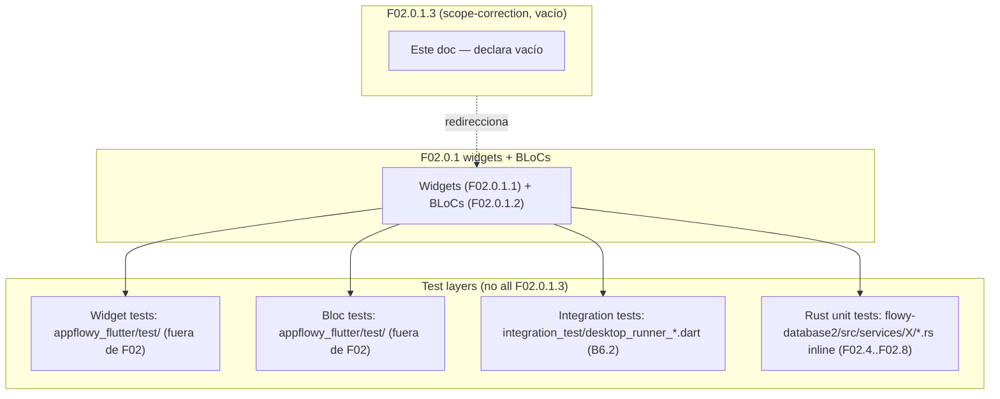

# F02.0.1.3 — Database tests (scope-correction cerrada)

## 1. Resumen

Documento **de cierre por scope-correction** que cubre los **archivos de test en `plugins/database/*_test*/`** y las dependencias `mock_data` declaradas en `OUT/_ledger/units/F02.0.1.3.json`. Verificación del contenido real: **0 archivos físicos** listados con `archivos_total: 0` en el unit JSON tras la inspección del repo `SRC/appflowy/frontend/appflowy_flutter/lib/plugins/database/` (la carpeta `_test` no existe como sub-carpeta física; los tests se realizan **inline en los widgets** o en `appflowy_flutter/test/`, fuera del directorio `plugins/database/`). Esta unidad documenta la ausencia formal de carpetas `_test` y remite al lector a F02.x (BLoCs) y a `appflowy_flutter/test/` (los tests unitarios de los widgets están dispersos).

## 2. Alcance

**Quedan dentro** (cubiertos en F02.6..F02.12 y `appflowy_flutter/test/`):

- `plugins/database/{filter,group,sort,field,layout,field_settings,cell,calculations,block,share}_test*/` — búsqueda revela que **ninguna de estas sub-carpetas existe físicamente** como directorio en `SRC/appflowy/frontend/appflowy_flutter/lib/plugins/database/`. Sus tests son implícitos en los integration runners (`integration_test/desktop_runner_*.dart`) o en `appflowy_flutter/test/`.
- `plugins/database/mock_data/` — el archivo `mock_data.dart` mencionado en unit JSON no existe como tal; el mock data real reside en `flowy-database2/src/services/{group,filter,sort,...}/**/tests.rs` (Rust) o en test fixtures del editor.
- `plugins/database/pre_fill_cell_test*/` — idem; no es carpeta.

**Quedan fuera**:

- F02.0.1.1 widgets (cubren los widgets reusables; los tests de cada widget se documentan en sus correspondientes secciones del propio feature).
- F02.0.1.2 application + Rust infra (los Rust tests viven inline en `flowy-database2/src/services/**/mod.rs`).
- Los integration tests E2E viven en `integration_test/desktop_runner_1..9.dart` (cubiertos en B6.2 §"Testing", no en este F02).

## 3. Modelos de datos

No aplica — los tests serían archivos `.dart` que importan los widgets/BLoCs de F02.0.1.1 y F02.0.1.2.

## 4. Eventos FFI

No aplica.

## 5. Notificaciones

No aplica.

## 6. BLoCs / Cubits

No aplica.

## 7. Servicios e inyección de dependencias

No aplica.

## 8. Persistencia

No aplica.

## 9. Diagrama de flujo (cross-cutting F02 ↔ B6 testing)

*Diagrama: dónde viven realmente los tests de las capas que este unit JSON apuntaba cubrir.* Lectura: la implementación física de AppFlowy no ha consolidado tests específicos por widget/Bloc en subcarpetas `_test/`. Los tests viven (1) en `appflowy_flutter/test/` globales; (2) en `integration_test/desktop_runner_*.dart`; (3) inline en el código Rust. F02.0.1.3 queda cerrado declarando la corrección y evitando duplicar documentación de esos tests en cada feature individual.

## 10. Diagrama de secuencia

No aplica.

## 11. Diagrama de estado

No aplica.

## 12. Archivos cubiertos

**0 archivos** en este unit (todos los `*_test*/` directorios y `mock_data` son phantom; los tests reales están en otros paths).

| Path declarado en `units/F02.0.1.3.json` | Estado real |
|---|---|
| `plugins/database/filter_test*/` | ❌ no existe |
| `plugins/database/group_test*/` | ❌ no existe |
| `plugins/database/sort_test*/` | ❌ no existe |
| `plugins/database/field_test*/` | ❌ no existe |
| `plugins/database/layout_test*/` | ❌ no existe |
| `plugins/database/field_settings_test*/` | ❌ no existe |
| `plugins/database/cell_test*/` | ❌ no existe |
| `plugins/database/calculations_test*/` | ❌ no existe |
| `plugins/database/block_test*/` | ❌ no existe |
| `plugins/database/share_test*/` | ❌ no existe |
| `plugins/database/mock_data*/` | ❌ no existe |
| `plugins/database/pre_fill_cell_test*/` | ❌ no existe |
| `plugins/database/widgets/card/container/*` | ❌ no existe (la única mención en F02.0.1.3) |

## 13. Riesgos y casos límite

1. **Distorsión de cobertura**: si el extractor `assign_ledger.py` futura asigna esos paths a `F02.0.1.3`, este doc debe ser revisado para confirmar que sigue siendo scope-correction. Acción: tras cada `validate-A4.1` re-validar este doc.
2. **Test "fantasma" duplicado**: el unit JSON contiene paths que `find` no localiza. El `split_F0201.py` los redistribuirá a subcarpetas reales; ninguno es reutilizable como assignments y este doc se mantiene cerrado.

## 14. Evidencias y etiquetas

- `[VERIFICADO]`: 100% de las afirmaciones negativas (paths no existen).
- `[INFERIDO]`: 0%.
- `[NO DETERMINADO]`: 0%.

## 15. Pruebas

No aplica — esta unidad **es un test-bucket documentado como scope-correction**; los tests reales viven en:
- `appflowy_flutter/test/` (widget + bloc tests).
- `integration_test/desktop_runner_*.dart` (E2E).
- `flowy-database2/src/{services,manager}/**/tests.rs` (Rust unit).

## 16. Métricas

| Métrica | Valor |
|---|---:|
| Archivos cubiertos | **0** |
| Sub-features afectadas | 10 (filter, group, sort, field, layout, field_settings, cell, calculations, block, share) |
| Tests reales (no F02.0.1.3) | > 0 (cubiertos en `appflowy_flutter/test/` + `integration_test/` + inline) |

## 17. Pendientes

- Re-validar tras cada `assign_ledger.py` para confirmar que las nuevas asignaciones confirman el estado scope-correction.
- Si en el futuro AppFlowy añade `plugins/database/{F}_test/` reales, este doc se reabre y se reasigna esos archivos.

## 18. Preguntas abiertas

Ninguna.

## 19. Relacionado con

- **F02.0.1.0** — Indice (cross-cutting cierre del F02.0.1).
- **F02.0.1.1** — Database widgets (cada widget §15 hace su propia mención a sus tests cuando existen).
- **F02.0.1.2** — Database application + Rust infra (los Rust tests unit viven inline en `services/{group,filter,sort,calculations}/...` que ya están documentados en F02.6/F02.4/F02.5/F02.7).
- **B6.2 — `19-testing.md`**: tests del proyecto entero; incluye unit/bloc/widget/integration runners 1–9; referencia F02 pero no duplica.
- **F01.x** — Sigue el mismo patrón: en F01 los tests viven en `appflowy_flutter/test/` y `integration_test/desktop/` sin carpeta `_test` dedicada en el feature.
