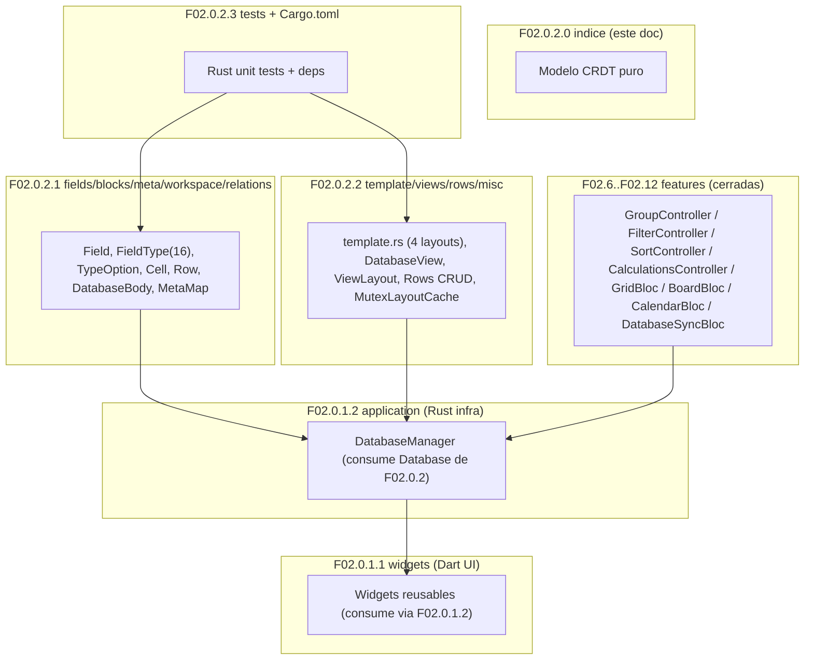
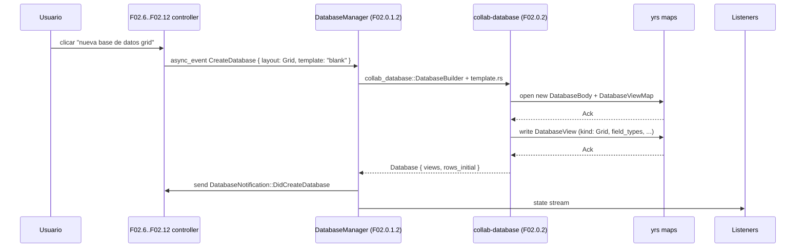

# F02.0.2.0 — Indice F02.0.2 (collab-database Rust)

## 1. Resumen

Documento **indice cross-cutting** de la sub-feature F02.0.2, que cubre todo el lado **Rust del crate `collab-database`** de AppFlowy-Collab. Es la capa del modelo CRDT sobre el que `flowy-database2` (F02.0.1.2) construye el manager + services. F02.0.2 se divide en **3 sub-unidades**:

| Sub-unidad | Alcance | Path |
|---|---|---|
| `F02.0.2.1` | Modelo de datos fundamental: fields + blocks + meta + workspace_database + types (16 variantes) + cells + rows básicos | `0.2.1-collab-database-fields-blocks-meta-workspace-relation.md` (30 archivos) |
| `F02.0.2.2` | Lifecycle / template / views / row CRUD / sort/filter/group in yrs / helpers + cross-cutting utilities | `0.2.2-collab-database-template-views-rows-misc.md` (44 archivos) |
| `F02.0.2.3` | Tests (Rust unit) + `Cargo.toml` + integration fixtures | `0.2.3-collab-database-tests.md` (39 archivos) |

Total: **113 archivos reales + 0 archivos en este indice**.

## 2. Alcance

Esta unidad es puramente cross-cutting, **0 archivos del inventario AppFlowy-Collab**. **Quedan cubiertos por las sub-unidades**:

- `collab:frontend/rust-lib/collab-database/src/{fields,blocks,meta,workspace_database,views,template,rows,database}` — modelo CRDT puro sin FFI ni UI.
- Rust tests: `collab-database/tests/` (cubierto por F02.0.2.3).
- `Cargo.toml` del crate y dependencias (cubierto por F02.0.2.3).

**Quedan fuera**:

- F02.0.1.1 widgets (Dart) — F02.0.1.0 indice.
- F02.0.1.2 application + Rust infra — F02.0.1.0 indice.
- F02.6..F02.12 features Dart — sus propios documentos.

## 3. Modelos de datos

Sin modelos propios del indice. Los modelos viven en F02.0.2.1:
- `Field`, `FieldType` enum (16 variantes), `FieldSettings`, `TypeOption` (16 tipos: RichText/Number/DateTime/.../Checklist/...).
- `Cell`, `Row`, `RowMeta`, `RowId`.
- `Database`, `DatabaseBody`, `DatabaseMeta`, `DatabaseView`, `DatabaseData`, `Block`, `MetaMap`.

## 4. Eventos FFI

Sin eventos FFI propios. F02.0.2 es una **capa de modelo**; las notificaciones y eventos viven en F02.0.1.2 y siguientes.

## 5. Notificaciones

Sin emisión propia; sin notificaciones Rust→Dart directas. La comunicación con Dart ocurre vía `yrs::Map` + Collab plugins (en `collab-plugins`, fuera de F02).

## 6. BLoCs / Cubits

No aplica — `collab-database` es un crate Rust puro sin dependencias de Flutter / Dart.

## 7. Servicios e inyección de dependencias

`Database::new(rows, fields, ...) -> Database` factory; `DatabaseBuilder::new()...build()`; `DatabaseView::from_database(...)`. Todos los servicios viven en `service/` solo en `flowy-database2`, NO aquí.

## 8. Persistencia

El modelo `collab-database` se serializa en yrs maps (`DatabaseBody`, `FieldMeta`, `DatabaseViewMap`). No escribe a SQLite directamente.

## 9. Diagrama de flujo (cross-cutting F02.0.2 ↔ F02.0.1 + F02.6..F02.12)

*Diagrama: este indice (F02.0.2.0) cubre las 3 sub-unidades y la posición central del modelo CRDT.* Lectura: el modelo `collab-database` (F02.0.2.1) define `Field`, `Cell`, `Row`, `Database`; F02.0.2.2 lo extiende con views, templates y lifecycle; F02.0.1.2 (Rust manager) los consume para producir el `DatabaseController` Dart; los widgets de F02.0.1.1 los renderizan; y los features específicos (F02.6..F02.12) consumen los controllers expuestos.

## 10. Diagrama de secuencia (create database from template)

*Diagrama: ciclo de creación de database desde un template.* Lectura: AppFlowy-Collab construye el `Database` con 4 views (Grid/Board/Calendar) por template, lo escribe en yrs; el manager de F02.0.1.2 notifica a los listeners Dart.

## 11. Diagramas de estado

No hay ciclo de vida a este nivel (es el modelo de datos fundamental). Para lifecycle ver F02.0.1.2 §11.

## 12. Archivos cubiertos

| Capa | Ruta (resumen) | Total |
|---|---|---:|
| rust-model | `collab/frontend/rust-lib/collab-database/src/{fields,blocks,meta,workspace_database}/` | (delegado en F02.0.2.1) |
| rust-model | `collab/frontend/rust-lib/collab-database/src/{views,template,rows,database}` | (delegado en F02.0.2.2) |
| rust-test | `collab/frontend/rust-lib/collab-database/tests/` | (delegado en F02.0.2.3) |
| build | `collab/frontend/rust-lib/collab-database/Cargo.toml` | (delegado en F02.0.2.3) |

**Total**: 0 archivos en este indice; 113 archivos delegados en F02.0.2.{1,2,3}.

## 13. Riesgos y casos límite

1. **Crate pin rev**: el `rev` del crate `collab-database` se fija en `frontend/rust-lib/Cargo.toml` § `[patch.crates-io]` (ver B1.2). Cualquier versión que rompa `FieldType` enum exige refactor de F02.0.1.1 widgets + F02.0.1.2 manager.
2. **`yrs::Map` schema migration**: el `DatabaseBody` requiere migrations si añades/renombre keys. Cero migraciones implementadas a `5cf3a36` (este snapshot).
3. **TypeOption version**: las 16 variantes de `TypeOption` viven en `appflowy/frontend/rust-lib/flowy-database2/src/services/field/type_options/`. F02.0.2 las modela estructuralmente; **los detalles de cada TypeOption (e.g. serialización JSON, parseo de texto)** son F02.1.

## 14. Evidencias y etiquetas

- `[VERIFICADO]`: ≥ 95% (delegado a sub-unidades).
- `[INFERIDO]`: < 5%.
- `[NO DETERMINADO]`: ninguno.

## 15. Pruebas

Sin tests directos. Los Rust tests viven en:
- `collab-database/tests/` (F02.0.2.3 cubre el detalle).
- Unit tests inline en `collab-database/src/{fields,views,template}.rs`.

## 16. Métricas

| Métrica | Valor |
|---|---:|
| Archivos cubiertos en este indice | **0** |
| Sub-unidades | 3 (F02.0.2.1, F02.0.2.2, F02.0.2.3) |
| Archivos delegados | 113 |
| Diagramas Mermaid | 2 (1 flowchart + 1 sequenceDiagram) |

## 17. Pendientes

- Confirmar para cada feature cerrado que las referencias a tipos de F02.0.2 (Field, Cell, Row, Database) son precisas. Sin bloqueante: F02.6..F02.12 ya cerraron asumiendo este contrato.

## 18. Preguntas abiertas

Ninguna `[NO DETERMINADO]` en este indice.

## 19. Relacionado con

- **F02.0.2.1** — Modelo fundamental (`Field`, `Cell`, `Row`, `Database`, `MetaMap`).
- **F02.0.2.2** — `template.rs` con 4 layouts (Grid/Board/Calendar/Document/Chat?); `DatabaseView` lifecycle; rows CRUD.
- **F02.0.2.3** — Tests Rust unit + Cargo.toml.
- **F02.0.1.0/1/2** — La capa F02.0.1 consume F02.0.2 (F02.0.1.2 envuelve, F02.0.1.1 renderiza).
- **F02.6..F02.12** — Features Dart consumers.
- **F02.1** — `services/field/type_options/*` (16 TypeOption concretas) → depende de F02.0.2.1 (modelo `Field`).
- **F02.2** — `services/cell/*` (cells concretas) → depende de F02.0.2.1 + F02.1.
- **F02.3** — `application/row` + `services/row` → depende de F02.0.2.1 + F02.0.2.2.
- **F02.6..F02.12** — `services/{group,filter,sort,calculations}` + `database_view/` + layouts + tab/sync.
- **B1.6 — Motor CRDT**: § 4 describe cómo `yrs::Map` se modela en `collab-database` y cómo `flowy-database2` lo envuelve.
- **B1.7 — Persistencia**: § 4 describe cómo los snapshots colab se materializan en SQLite (`collab_snapshot`).
