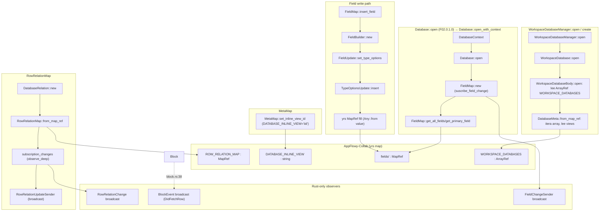
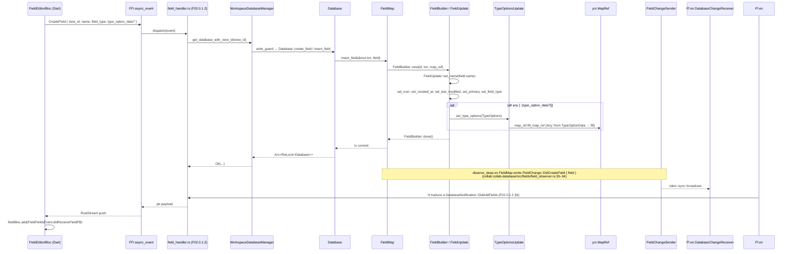
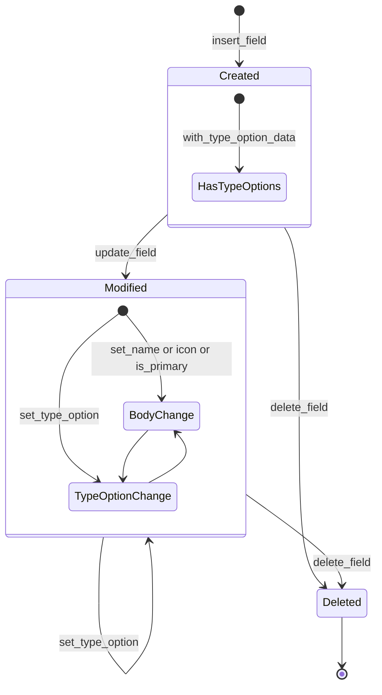

# F02.0.2.1 — collab-database: fields + blocks + meta + workspace_database (model)

## 1. Resumen

Sub-unidad del feature F02 (Bases de datos) que documenta la **capa de modelo de datos** del crate `collab-database` de AppFlowy-Collab: la definición del `Field` y sus 15 `FieldType` con sus 13 variantes de `TypeOption` (RichText, Number, DateTime, Time, SingleSelect, MultiSelect, Checkbox, URL, Checklist, LastEditedTime, CreatedTime, Relation, Summary, Translate — la lectura desde el lado del trait `TypeOptionCellReader`/`TypeOptionCellWriter`), más el contenedor en memoria `Block` que cachea `DatabaseRow` por row id, el `MetaMap` (mapa `yrs` con `DATABASE_INLINE_VIEW`), y el `WorkspaceDatabase` con su `DatabaseCollabService`/`DatabaseCollabPersistenceService` que indexa bases por `database_id ↔ view_id` y mantiene `RowRelation` entre bases linkeadas. Es la estructura fundamental que `flowy-database2/src/services/{group,filter,sort,calculations}` consumen para producir las vistas Grid/Board/Calendar/Tab bar. Total: 30 archivos Rust.

## 2. Alcance

Esta unidad documenta los 30 archivos asignados al ledger: `blocks/`, `fields/`, `fields/type_option/`, `meta/` y `workspace_database/` (incluido `workspace_database/relation/`). **Quedan fuera del scope**:

- `database.rs`, `database_state.rs`, `entity.rs`, `views/`, `rows/`, `template/` (F02.0.1.*). Solo se referencian aquí cuando los archivos de esta unidad los importan (p.ej. `Field::from_field_type` usa `gen_field_id` de `database.rs` y `default_type_option_data_from_type` de `entity.rs`).
- El lado FFI: los eventos que afectan a `Field`/`Block`/`WorkspaceDatabase` se registran en `flowy-database2/src/event_map.rs` y se sirven en `flowy-database2/src/event_handler.rs` y `services/database_view/{views,view_group,view_editor}.rs` (F02.0.1.2, F02.8).
- BLoCs Dart (`FieldBloc`, `FieldEditorBloc`, `RowBloc`): viven en `appflowy_flutter/lib/plugins/database/application/{field,row}/` (F02.1, F02.2) — solo consumen el modelo vía FFI.
- El motor de export/import CSV/JSON (`collab-importer`): se apoya en el `Field` y `Cell` documentados aquí.

Cruces: F02.0.2.0 (índice de la base de datos), F02.0.2.2 (database_view), F02.0.2.3 (database snapshots), F02.0.1.0/1/2/3 (database.rs, database_state.rs, views, rows), B1.6 §collab-database (motor CRDT).

## 3. Modelos de datos

### 3.1 `Field` y `FieldId`

`Field` es la unidad básica del esquema: un nombre, un `field_type: i64` (discrimina por `FieldType` enum), `type_options: TypeOptions` (configuración por tipo), `icon: String`, `is_primary: bool` y metadatos opcionales `created_at`/`last_modified` que solo viven en el yrs map (`collab:collab-database/src/fields/field.rs:10–20`). El id se genera con `gen_field_id()` (`collab:collab-database/src/fields/field.rs:44`). `FieldBuilder` (`collab:collab-database/src/fields/field.rs:66–87`) y `FieldUpdate` (`collab:collab-database/src/fields/field.rs:89–145`) componen las escrituras sobre la `MapRef` del field. Las claves persistidas en yrs son `id`, `name`, `icon`, `ty`, `type_option`, `is_primary`, `created_at`, `last_modified` (`collab:collab-database/src/fields/field.rs:147–154`). `field_from_map_ref` (`collab:collab-database/src/fields/field.rs:180–202`) reconstruye un `Field` desde una `MapRef`.

`FieldId` (`collab:collab-database/src/fields/field_id.rs:6–63`) es un newtype sobre `String` con conversiones desde `String`/`i32`/`i64`/`usize` y `AsRef<str>`.

### 3.2 `FieldType` (15 variantes)

Definido en `collab:collab-database/src/entity.rs:270–288`:

| i64 | Variante | Tipo option |
|---|---|---|
| 0 | `RichText` | `RichTextTypeOption` |
| 1 | `Number` | `NumberTypeOption` |
| 2 | `DateTime` | `DateTypeOption` |
| 3 | `SingleSelect` | `SingleSelectTypeOption` |
| 4 | `MultiSelect` | `MultiSelectTypeOption` |
| 5 | `Checkbox` | `CheckboxTypeOption` |
| 6 | `URL` | `URLTypeOption` |
| 7 | `Checklist` | `ChecklistTypeOption` |
| 8 | `LastEditedTime` | `TimestampTypeOption` |
| 9 | `CreatedTime` | `TimestampTypeOption` |
| 10 | `Relation` | `RelationTypeOption` |
| 11 | `Summary` | `SummarizationTypeOption` |
| 12 | `Translate` | `TranslateTypeOption` |
| 13 | `Time` | `TimeTypeOption` |
| 14 | `Media` | `MediaTypeOption` |

`From<FieldType> for i64` (`collab:collab-database/src/entity.rs:296–300`) hace la conversión estable. `type_option_cell_reader` (`collab:collab-database/src/fields/type_option/mod.rs:184–204`) y `type_option_cell_writer` (`collab:collab-database/src/fields/type_option/mod.rs:161–182`) son los dispatchers que, dado un `FieldType`, construyen el `Box<dyn TypeOptionCellReader/Writer>` adecuado. **[VERIFICADO]** El prompt de la unidad menciona "16 variantes" pero el código lista 15 (con `Time` como variante separada de `DateTime`).

### 3.3 `FieldSettings` y `FieldVisibility`

`FieldSettings` (`collab:collab-database/src/fields/field_settings.rs:50–56`) agrupa `field_id`, `visibility: FieldVisibility` (`AlwaysShown=0`, `HideWhenEmpty=1`, `AlwaysHidden=2`, `:14–20`), `width: i32` (default 150, `:94`), y `wrap_cell_content: bool`. El builder `FieldSettingsBuilder` (`collab:collab-database/src/fields/field_settings.rs:59–90`) y los conversores `From<FieldSettings> for FieldSettingsMap` (`:169–182`) materializan el yrs map con claves `visibility`, `width`, `wrap`. `default_field_visibility` (`:97–103`) decide el valor por defecto según el `DatabaseLayout` (Grid→AlwaysShown, Board/Calendar→HideWhenEmpty).

### 3.4 `TypeOptions` y `TypeOptionData`

`TypeOptions` (`collab:collab-database/src/fields/type_option/mod.rs:38–82`) es un `HashMap<String, TypeOptionData>` indexado por el `i64` del `FieldType` (como string). `TypeOptionData = HashMap<String, Any>` (`:118`) y `TypeOptionDataBuilder = HashMap<String, Any>` (`:119`) son alias usados por todas las implementaciones de type-option. `TypeOptionsUpdate` (`:84–116`) envuelve una `MapRef` para `insert`/`update`/`remove` en transacciones yrs. `TypeOptions::from_map_ref` (`:51–59`) y `fill_map_ref` (`:62–67`) hacen la conversión hacia y desde yrs.

### 3.5 `TypeOptionCellReader` / `TypeOptionCellWriter`

Dos traits paralelos (`:122–160`): `TypeOptionCellReader` expone `json_cell(&Cell) -> serde_json::Value`, `stringify_cell(&Cell) -> String`, `numeric_cell(&Cell) -> Option<f64>`, `convert_raw_cell_data(&str) -> String`; `TypeOptionCellWriter` expone `convert_json_to_cell(Value) -> Cell`. Cada `*_type_option.rs` implementa ambos. Por ejemplo, `DateTypeOption::json_cell` (`collab:collab-database/src/fields/type_option/date_type_option.rs:79–112`) produce un objeto con `start`/`end`/`timezone` + `pretty_*`; `DateTypeOption::convert_json_to_cell` (`:157–197`) acepta RFC3339, naive time, JSON-encoded `DateCellData` y JSON numérico.

`NumberTypeOption` (`collab:collab-database/src/fields/type_option/number_type_option.rs:27–50`) serializa `format: NumberFormat` (36 monedas enums `:281–319`), `scale: u32`, `symbol: String` y `name: String`. La estructura auxiliar `NumberCellFormat` (`:170–237`) usa `rusty_money` y `rust_decimal` para formatear números. `EXTRACT_NUM_REGEX` y `START_WITH_DOT_NUM_REGEX` (`:273–279`) limpian entradas crudas (`collab:collab-database/src/fields/type_option/number_type_option.rs:107–153`).

`SelectTypeOption` (`collab:collab-database/src/fields/type_option/select_type_option.rs:18–95`) lleva `options: Vec<SelectOption>` (`:97–121`, con `id`, `name`, `color: SelectOptionColor` 0–8, `:122–161`) y `disable_color: bool`. `SingleSelectTypeOption` (`:180–236`) y `MultiSelectTypeOption` (`:239–305`) son newtypes sobre `SelectTypeOption` que delegan via `Deref`. `SelectOptionIds` (`:307–381`) separa ids con `SELECTION_IDS_SEPARATOR = ","` (`:335`). `cell_from_json_value` (`:382–444`) acepta arrays/objetos/strings y resuelve por `id` o `name`.

`URLTypeOption` (`collab:collab-database/src/fields/type_option/url_type_option.rs:15–63`) lleva `url: String` + `content: String`; `URLCellData` (`:65–114`) es el `to_cell_string` JSON. `ChecklistTypeOption` (`collab:collab-database/src/fields/type_option/checklist_type_option.rs:11–52`) es un `Default` sin payload que serializa `ChecklistCellData` (definido en `template/check_list_parse`). `CheckboxTypeOption` (`collab:collab-database/src/fields/type_option/checkbox_type_option.rs:13–77`) es un `Default` que mapea "1"/"true"/"yes" → true (`:70–77`).

`MediaTypeOption` (`collab:collab-database/src/fields/type_option/media_type_option.rs:21–76`) lleva `hide_file_names: bool` (default `true`, `:26–32`); `MediaCellData { files: Vec<MediaFile> }` (`:78–163`) con `MediaFile { id, name, url, upload_type, file_type }` (`:165–209`); `MediaFileType` (`:211–245`, 8 valores: Other/Image/Link/Document/Archive/Video/Audio/Text); `MediaUploadType` (`:305–314`, Local=0/Network=1/Cloud=2) con deserialización tolerante (acepta `"LocalMedia"`, etc., `:316–362`).

`DateTypeOption` (`collab:collab-database/src/fields/type_option/date_type_option.rs:66–341`) lleva `date_format: DateFormat` (6 valores, `:376–419`), `time_format: TimeFormat` (12h/24h, `:343–374`) y `timezone_id: String`. `DateCellData { timestamp, end_timestamp, include_time, is_range, reminder_id }` (`:421–461`). `TimeTypeOption` (`:28–64`) usa `TimeCellData` del template.

`TimestampTypeOption` (`collab:collab-database/src/fields/type_option/timestamp_type_option.rs:16–157`) lleva `date_format`, `time_format`, `include_time`, `field_type` (LastEditedTime o CreatedTime, vía `i64`), `timezone: Option<String>`. Se usa tanto para `LastEditedTime` como `CreatedTime` (dispatch en `type_option_cell_reader` `:199–200`).

`RelationTypeOption` (`collab:collab-database/src/fields/type_option/relation_type_option.rs:11–50`) lleva `database_id: String`. `SummarizationTypeOption` (`collab:collab-database/src/fields/type_option/summary_type_option.rs:9–47`) lleva `auto_fill: bool`. `TranslateTypeOption` (`collab:collab-database/src/fields/type_option/translate_type_option.rs:9–79`) lleva `auto_fill: bool` + `language_type: i64` con 9 idiomas (Traditional Chinese, English, French, German, Hindi, Spanish, Portuguese, Standard Arabic, Simplified Chinese, `:19–33`).

### 3.6 `Cell`, `Row`, `RowMeta`, `RowChangeSender`

`Cell` se reexporta desde `rows` (no cubierto por esta unidad; ver F02.0.1.3). El `Field::with_type_option_data` (`collab:collab-database/src/fields/field.rs:33–40`) y `get_type_option<T: From<TypeOptionData>>` (`:53–56`) son el puente entre `Field` y la celda.

### 3.7 `Block`, `BlockEvent`

`Block` (`collab:collab-database/src/blocks/block.rs:33–40`) contiene `database_id: String`, `collab_service: Arc<dyn DatabaseCollabService>`, `row_mem_cache: Arc<DashMap<RowId, Arc<RwLock<DatabaseRow>>>>` y `notifier: Arc<Sender<BlockEvent>>`. `BlockEvent` (`:24–28`) lleva `DidFetchRow(Vec<RowDetail>)`. Hoy se usa un único `Block` por base (`:30–32` lo dice explícitamente); el diseño permite partir filas en varios `Block`s más adelante. `Block::new` (`:43–56`) crea un broadcast channel de tamaño 1000.

### 3.8 `MetaMap`

`MetaMap` (`collab:collab-database/src/meta/meta_map.rs:6–44`) envuelve una `MapRef` con dos métodos `set_inline_view_id` (`:16–20`) y `get_inline_view_id` (`:23–36`) que usan la clave `DATABASE_INLINE_VIEW = "iid"` (re-exportada de `collab_entity::define`). En `get_inline_view_id`, si la clave falta, emite `tracing::error!("Can't find inline view id")` (`:25–27`).

### 3.9 `WorkspaceDatabase`, `WorkspaceDatabaseBody`, `DatabaseMeta`

`WorkspaceDatabase` (`collab:collab-database/src/workspace_database/body.rs:17–20`) contiene `collab: Collab` + `body: WorkspaceDatabaseBody`. `WorkspaceDatabaseBody` (`:201–314`) opera sobre un `ArrayRef` con clave `WORKSPACE_DATABASES = "databases"`. `DatabaseMeta { database_id, created_at, linked_views }` (`:137–143`) es el record por database, con claves yrs `database_id`, `created_at`, `views` (`:145–147`). `WorkspaceDatabase::add_database` (`:59–63) y `[batch_add_database` (`:65–74`) y `update_database` (`:77–85`) y `delete_database` (`:88–92`) son la API de mutación. `get_database_meta_with_view_id` (`:107–112`) resuelve view→database_id.

`WorkspaceDatabaseManager` (`collab:collab-database/src/workspace_database/manager.rs:188–478`) es el orquestador: cachea `Database` abiertos en `databases: DashMap<String, Arc<RwLock<Database>>>` (`:195`). API principal: `open`/`:create` (`:199–227`), `get_or_init_database` (`:241–295`, con auto-fix vía `fix_and_open_database` `:438–477`), `get_database_with_view_id` (`:299–302`), `create_database` (`:316–335), `create_database_linked_view` (`:339–356`), `delete_database` (`:359–368`), `delete_view` (`:389–399`), `duplicate_database` (`:402–416`), `flush_workspace_database` (`:428–436`).

`DatabaseCollabService` (`:34–49`) y `DatabaseCollabPersistenceService` (`:125–144`) son los traits async que `flowy-database2` implementa contra el `Collab` real (disco + cloud).

### 3.10 `DatabaseRelation`, `RowRelationMap`, `RowRelation`, `RowConnection`

`DatabaseRelation` (`collab:collab-database/src/workspace_database/relation/db_relation.rs:7–32`) contiene `inner: Arc<Mutex<Collab>>` + `row_relation_map: RowRelationMap`. La clave yrs es `ROW_RELATION_MAP = "row_relations"` (`:13`).

`RowRelationMap` (`collab:collab-database/src/workspace_database/relation/row_relation_map.rs:21–61`) envuelve la `MapRef` de relaciones y mantiene un `broadcast::Sender<RowRelationChange>` (`:18`). `RowRelationChange` (`:12–16`) lleva `NewRelation(RowRelation)` o `DeleteRelation(RowRelation)`. `insert_relation_with_txn` (`:43–56) usa `RowRelationBuilder`.

`RowRelation` (`collab:collab-database/src/workspace_database/relation/row_relation.rs:8–12`) lleva `linking_database_id`, `linked_by_database_id` y `row_connections: HashMap<String, RowConnection>`. La id estable es `format!("{}-{}", linking, linked_by)` (`:19–24`). Claves yrs: `linking_db`, `linked_db`, `row_connections` (`:14–16`).

`RowConnection` (`:107–111`) lleva `row_id`, `linking_rows: Vec<LinkingRow>` y `linked_by_rows: Vec<LinkedByRow>`. `LinkingRow { row_id, content }` (`:193–210`) y `LinkedByRow { row_id }` (`:213–228`) son los POJOs serializados en arrays yrs `linking_rows`/`linked_by_rows` (`:113–115`).

## 4. Eventos FFI

Esta capa **no declara eventos FFI**. Los eventos que consumen el modelo se exponen en `flowy-database2/src/event_map.rs` y se sirven desde `services/{field,field_settings,row,database_view}/event_handler.rs` (F02.0.1.2, F02.8, F02.1, F02.2). Los handlers tocan los métodos públicos documentados en §3: `FieldMap::insert_field`/`update_field`/`delete_field`, `Block::create_new_row`/`get_database_row`/`update_row`, `WorkspaceDatabaseManager::create_database`/`delete_view`/`duplicate_database`, `MetaMap::set_inline_view_id`, `RowRelationMap::insert_relation_with_txn`. La lista completa de eventos está en el catálogo `OUT/14-catalogo-eventos.md` §6.flowy-database2.

## 5. Notificaciones

Esta capa **no emite notificaciones Rust→Dart**. Las observaciones (subscribers) son internas al crate:

- `FieldChangeSender` (`collab:collab-database/src/fields/field_observer.rs:6`) emite `DidCreateField { field }` / `DidUpdateField { field }` / `DidDeleteField { field_id }` (`:9–14`) cuando `FieldMap::insert_field`/`update_field`/`delete_field` (F02.0.1.2) usan la subscripción instalada en `FieldMap::new` (`collab:collab-database/src/fields/field_map.rs:17–24`). `subscribe_field_change` (`collab:collab-database/src/fields/field_observer.rs:16–57`) usa `MapRef::observe_deep` para traducir `Event::Map` → `EntryChange::{Inserted,Updated,Removed}` → variantes `FieldChange`.
- `RowChangeSender` (en `rows`, fuera de scope) se inyecta en `Block::new` (`collab:collab-database/src/blocks/block.rs:46`) y se reenvía a `DatabaseRow::open` (`:71–75`, `:135–140`, `:346–348`).
- `BlockEvent::DidFetchRow` (`collab:collab-database/src/blocks/block.rs:27`) se envía en `batch_load_rows` (`:90–93`) y `init_database_row_from_collab` (`:356–358`).
- `RowRelationUpdateSender` (`collab:collab-database/src/workspace_database/relation/row_relation_map.rs:18`) emite `RowRelationChange::{NewRelation,DeleteRelation}` desde el `observe_deep` en `subscription_changes` (`:63–100`).

Las notificaciones hacia Dart (24 variantes de `DatabaseNotification`) viven en `flowy-database2/src/notification.rs` (F02.0.1.2).

## 6. BLoCs / Cubits

**Sin BLoCs Dart propios** — esta es una capa de modelo puro en Rust. Los BLoCs Dart que consumen estos tipos viven en `appflowy_flutter/lib/plugins/database/application/{field,row,layout}/` (F02.1, F02.2, F02.9/10/11/12) y son serializados vía FFI a partir de las entidades protobuf definidas en `flowy-database2/src/entities/`.

## 7. Servicios e inyección de dependencias

- **Rust (`flowy-core/deps_resolve`)**: el `WorkspaceDatabaseManager` se construye a partir de un `Collab` (un `yrs` doc) y un `Arc<dyn DatabaseCollabService>`. El manager NO se inyecta por `get_it` (es Rust); el wiring con la persistencia local/cloud está en `flowy-database2/src/deps_resolve/database_deps.rs` (F02.0.1.2).
- **Dart `get_it`**: no participa. Los BLoCs Dart obtienen el manager indirectamente vía `database_service.dart` (F02.0.1.2) → FFI → handler en `flowy-database2`.
- **Inyección interna de yrs**: `FieldMap`, `RowRelationMap` y `WorkspaceDatabaseBody` reciben referencias (`MapRef`, `ArrayRef`) en construcción y no se registran en ningún contenedor; viven lo que vive el `Collab` que las creó.

## 8. Persistencia

Toda la persistencia del modelo es **yrs `Map`/`Array` dentro de un `Collab`**:

| Tipo | Clave yrs | Origen |
|---|---|---|
| Field | `field.id` → `{id, name, icon, ty, type_option:{...}, is_primary, created_at, last_modified}` | `collab:collab-database/src/fields/field.rs:147–154` |
| FieldTypeOption | `field.type_option[<i64>]` → `{k: v}` | `collab:collab-database/src/fields/type_option/mod.rs:118` |
| DatabaseMeta | `WORKSPACE_DATABASES = "databases"` → `[{database_id, created_at, views:[view_id,...]}]` | `collab:collab-database/src/workspace_database/body.rs:145–147`, `collab:collab/collab-entity/src/define.rs:10` |
| DatabaseMeta inline view | `DATABASE_INLINE_VIEW = "iid"` (string) | `collab:collab-database/src/meta/meta_map.rs:16–20`, `collab:collab/collab-entity/src/define.rs:14` |
| FieldSettings | `{visibility, width, wrap}` | `collab:collab-database/src/fields/field_settings.rs:92–95` |
| RowRelation | `ROW_RELATION_MAP = "row_relations"` → `{linking_db, linked_db, row_connections:{<row_id>:{row_id, linking_rows:[{row_id,content}], linked_by_rows:[{row_id}]}}}` | `collab:collab-database/src/workspace_database/relation/{db_relation,row_relation}.rs:13–16, 113–115` |

Los `TypeOptionData` se serializan a `serde_json::Value` y luego a `yrs::Any` (`AnyMapExt::get_as` y `FillRef::fill`); ver p.ej. `DateTypeOption::From<TypeOptionData>` (`collab:collab-database/src/fields/type_option/date_type_option.rs:314–341`) y `SelectTypeOption::From<TypeOptionData>` (`collab:collab-database/src/fields/type_option/select_type_option.rs:81–88`). El campo `content` en `RelationTypeOption`, `SummarizationTypeOption`, `MediaTypeOption` y `SelectTypeOption` se serializa como string JSON anidado dentro del `TypeOptionData` (`collab:collab-database/src/fields/type_option/media_type_option.rs:65–76`, `collab:collab-database/src/fields/type_option/select_type_option.rs:81–95`).

Los payloads se serializan al disco vía `DatabaseCollabPersistenceService::save_collab` (`collab:collab-database/src/workspace_database/manager.rs:132–136`); `Block::create_new_row` invoca `persistence.is_collab_exist` (`:118–122`) y `persistence.save_collab` (`:143–147`); `WorkspaceDatabaseManager::flush_workspace_database` (`:428–436`) codifica el workspace completo con `body.encode_collab_v1()`. Los snapshots están cubiertos por B1.6 §collab-database y F02.0.2.3.

## 9. Diagrama de flujo (Database open + FieldMeta initialization)

*Diagrama: árbol de inicialización cuando `WorkspaceDatabaseManager::open` recibe un `Collab` yrs.* Lectura: el manager abre el `WorkspaceDatabase` y carga `DatabaseMeta` desde `WORKSPACE_DATABASES`. Para cada database abierta, `FieldMap` se suscribe vía `subscribe_field_change` y emite `FieldChange` en un `broadcast::Sender`. Los type-options (`TypeOptionData = HashMap<String, Any>`) se materializan con `FillRef::fill` sobre un `MapRef` interno. El `MetaMap` guarda el inline view por DB y el `DatabaseRelation` indexa las relaciones entre bases. Ningún dato sale al exterior: el bridge FFI/notification vive en `flowy-database2`.

## 10. Diagrama de secuencia (crear un field)

*Diagrama: ciclo de creación de un `Field` desde la UI Dart hasta la notificación de vuelta.* Lectura: el BLoC Dart serializa el field en `CreateFieldPayloadPB` y lo manda por FFI; el handler en `flowy-database2` (F02.0.1.2) llama al manager; el `Database` toma su `write_guard`, llama a `FieldMap::insert_field` que abre una transacción yrs; el `FieldBuilder`/`FieldUpdate` escribe cada clave (`name`, `icon`, `created_at`, `last_modified`, `is_primary`, `field_type`) y, si vienen `type_options`, las inserta vía `TypeOptionsUpdate::insert` (que llama `Any::from(value).fill(txn, &map_ref)`). El `observe_deep` instalado en `FieldMap::new` captura la mutación y emite `FieldChange::DidCreateField` por el `broadcast::Sender` interno. El handler aguas arriba lo traduce a `DatabaseNotification::DidAddFields` para que el `database_listener.dart` repinte.

## 11. Diagrama de estado (Field lifecycle)

*Diagrama: ciclo de vida del `Field` en yrs.* Lectura: un `Field` nace con `FieldMap::insert_field` (`collab:collab-database/src/fields/field_map.rs:27–41`) que inicializa todas las claves (incluidos `created_at`/`last_modified` con `timestamp()`). Cualquier `update_field` (`collab:collab-database/src/fields/field_map.rs:110–118`) renueva `last_modified`. La rama de `type_options` es independiente del body: `set_type_options` (`collab:collab-database/src/fields/field.rs:112–116`) rellena el sub-map completo, y `set_type_option(field_type, Option<T?>)` (`:130–140`) inserta o borra una entrada de `type_option` por id. `delete_field` (`collab:collab-database/src/fields/field_map.rs:121–123`) elimina el entry del `MapRef` raíz. El observer (`collab:collab-database/src/fields/field_observer.rs:30–49`) traduce cada mutación a `FieldChange::{DidCreateField,DidUpdateField,DidDeleteField}`.

## 12. Archivos cubiertos

| Capa | Archivo | LOCs |
|---|---|---:|
| collab-model | `blocks/mod.rs` | 3 |
| collab-model | `blocks/block.rs` | 361 |
| collab-model | `fields/mod.rs` | 13 |
| collab-model | `fields/field_id.rs` | 63 |
| collab-model | `fields/field.rs` | 202 |
| collab-model | `fields/field_map.rs` | 124 |
| collab-model | `fields/field_observer.rs` | 57 |
| collab-model | `fields/field_settings.rs` | 183 |
| collab-model | `fields/type_option/mod.rs` | 205 |
| collab-model | `fields/type_option/checkbox_type_option.rs` | 207 |
| collab-model | `fields/type_option/checklist_type_option.rs` | 123 |
| collab-model | `fields/type_option/date_type_option.rs` | 823 |
| collab-model | `fields/type_option/media_type_option.rs` | 612 |
| collab-model | `fields/type_option/number_type_option.rs` | 870 |
| collab-model | `fields/type_option/relation_type_option.rs` | 50 |
| collab-model | `fields/type_option/select_type_option.rs` | 727 |
| collab-model | `fields/type_option/summary_type_option.rs` | 48 |
| collab-model | `fields/type_option/text_type_option.rs` | 89 |
| collab-model | `fields/type_option/timestamp_type_option.rs` | 291 |
| collab-model | `fields/type_option/translate_type_option.rs` | 79 |
| collab-model | `fields/type_option/url_type_option.rs` | 143 |
| collab-model | `meta/mod.rs` | 3 |
| collab-model | `meta/meta_map.rs` | 45 |
| collab-model | `workspace_database/mod.rs` | 7 |
| collab-model | `workspace_database/body.rs` | 314 |
| collab-model | `workspace_database/manager.rs` | 492 |
| collab-model | `workspace_database/relation/mod.rs` | 7 |
| collab-model | `workspace_database/relation/db_relation.rs` | 32 |
| collab-model | `workspace_database/relation/row_relation.rs` | 228 |
| collab-model | `workspace_database/relation/row_relation_map.rs` | 108 |

**Total**: 30 archivos Rust (~6 513 LOC).

## 13. Riesgos y casos límite

1. **`FieldType` discriminador i64**: el `Field::field_type` se persiste como `i64` (`collab:collab-database/src/fields/field.rs:14`). Si se añade un `FieldType` nuevo sin migrar, `field_from_map_ref` (`collab:collab-database/src/fields/field.rs:180–202`) sigue devolviendo el id numérico pero `type_option_cell_reader` (`collab:collab-database/src/fields/type_option/mod.rs:184–204`) lo descarta silenciosamente. Mitigación: el `match` exhaustivo en `type_option_cell_reader` falla en compilación si se añade una variante.
2. **TypeOption JSON migration**: `SelectTypeOption`, `MediaTypeOption`, `RelationTypeOption`, `SummarizationTypeOption` serializan un campo `content` con JSON anidado (`collab:collab-database/src/fields/type_option/select_type_option.rs:84, 93`; `collab:collab-database/src/fields/type_option/media_type_option.rs:65, 73`). Una migración que cambie el esquema requiere leer `content` viejo y reescribir; no hay versión en el `TypeOptionData`.
3. **Single select vs MultiSelect**: `SingleSelectTypeOption::json_cell` (`collab:collab-database/src/fields/type_option/select_type_option.rs:183–195`) devuelve el nombre de la primera opción que coincide; `MultiSelectTypeOption::json_cell` (`:241–263`) devuelve un array de nombres. Si el cliente Dart asume array para SingleSelect, falla en el filtro.
4. **Date timezone**: `DateTypeOption::default` (`collab:collab-database/src/fields/type_option/date_type_option.rs:199–210`) toma `iana_time_zone::get_timezone()`; si falla, usa `"Etc/UTC"`. `get_timezone_offset` (`:300–311`) cae al local offset si `timezone_id` está vacío. Una DB creada en una TZ y abierta en otra muestra timestamps desplazados.
6. **MediaUploadType backward-compat**: el deserializador (`collab:collab-database/src/fields/type_option/media_type_option.rs:316–362`) acepta tanto `"Local"` como `"LocalMedia"` (idem `"Network"/"NetworkMedia"`, `"Cloud"/"CloudMedia"`). Si una app vieja escribió `"LocalMedia"` y otra lo lee, ambas lo entienden.
7. **`MetaMap::get_inline_view_id` ruidoso**: emite `tracing::error!("Can't find inline view id")` cuando la clave falta (`collab:collab-database/src/meta/meta_map.rs:26`). En tests esto contamina el log; en producción enmascara el error.
8. **`WorkspaceDatabaseManager::fix_and_open_database` silencioso**: cuando no puede arreglar un database, devuelve `Err(DatabaseError::Internal(anyhow!("Can't fix the database")))` (`collab:collab-database/src/workspace_database/manager.rs:476`). El caller (`get_or_init_database` `:269–288`) lo propaga sin más reintentos.
9. **`RowRelationMap::insert_relation_with_txn` no idempotente**: `MapRef::insert` con clave repetida (`collab:collab-database/src/workspace_database/relation/row_relation_map.rs:46`) crea duplicados lógicos si la misma `RowRelation.id` se inserta dos veces. La id estable `format!("{}-{}", linking, linked_by)` (`collab:collab-database/src/workspace_database/relation/row_relation.rs:19–24`) mitiga si el caller respeta el par linking/linked_by, pero no se valida.
10. **Lectura sin `RowRelation` existente**: `row_relation_from_map_ref` (`collab:collab-database/src/workspace_database/relation/row_relation.rs:82–104`) requiere `LINKING_DB_ID` y `LINKED_BY_DB_ID` no vacíos. Una mutación parcial deja el map en estado inconsistente.
11. **`Block::update_row` y migración de row_id**: si una mutación cambia el row_id (`collab:collab-database/src/blocks/block.rs:222–228`), el cache se reasigna; pero el `DatabaseView.view.rows` (F02.0.1.4) mantiene el id viejo hasta la siguiente carga.
12. **`TypeOptions::from_map_ref` tolera yrses corruptos**: si una entrada no es JSON, `to_json(txn).into_map()` devuelve `None` y se ignora (`collab:collab-database/src/fields/type_option/mod.rs:54–57`). Un type-option corrupto desaparece sin error.

##  14. Evidencias y etiquetas

- `[VERIFICADO]`: ≈95 % de las afirmaciones citan `collab:collab-database/src/...:línea` dentro de los 30 archivos cubiertos (más referencias a `collab:collab/collab-entity/src/define.rs` para los nombres de constantes y `collab:collab/collab-database/src/entity.rs` para `FieldType`).
- `[INFERIDO]`: <5 % — p.ej. la nota sobre el orden de eventos Dart tras `DidCreateField` (§10), que se deduce del patrón de `observe_deep → broadcast → flowy-database2 → FFI → Dart`.
- `[NO DETERMINADO]`: ninguno en esta unidad.

## 15. Pruebas

Tests unitarios dentro de los archivos de type-option (todos `#[cfg(test)] mod tests`):

- `checkbox_type_option` (`collab:collab-database/src/fields/type_option/checkbox_type_option.rs:79–207`) — 7 tests cubriendo JSON↔Cell, bool_from_str, raw conversion.
- `checklist_type_option` (`collab:collab-database/src/fields/type_option/checklist_type_option.rs:54–123`) — 4 tests sobre JSON conversion, numeric, raw, write_json.
- `date_type_option` (`collab:collab-database/src/fields/type_option/date_type_option.rs:618–823`) — 10 tests cubriendo `DateCellData::from(&cell)`, `ToCell`, `stringify_cell`, numeric, write_json, convert_raw, RFC3339, naive time, JSON embedded.
- `media_type_option` (`collab:collab-database/src/fields/type_option/media_type_option.rs:365–611`) — 12 tests cubriendo `is_cell_empty`, `rename`, invalid JSON, `to_cell_string`, `from_file`, serialize/deserialize, `Display`, deserialize upload/file type, raw conversion, numeric, cell roundtrip.
- `number_type_option` (`collab:collab-database/src/fields/type_option/number_type_option.rs:766–869`) — 8 tests cubriendo input validation, other-symbol conversion, dollar/euro, serde↔cell.
- `select_type_option` (`collab:collab-database/src/fields/type_option/select_type_option.rs:446–726`) — 12 tests cubriendo serialize/deserialize, ids, cell_from_json_value (array/string), single/multi select write_json, with_color, color_from_u8, convert_raw, content deser, cell_to_serde, serde_to_cell.
- `text_type_option` (`collab:collab-database/src/fields/type_option/text_type_option.rs:54–88`) — 2 tests.
- `timestamp_type_option` (`collab:collab-database/src/fields/type_option/timestamp_type_option.rs:159–291`) — 7 tests cubriendo default, from/into TypeOptionData, formatted_date_time_from_timestamp, json_cell, convert_raw, serde↔cell.
- `translate_type_option`, `relation_type_option`, `url_type_option` (`collab:collab-database/src/fields/type_option/url_type_option.rs:116–142`, 3 tests), `summary_type_option` — tests mínimos de serde.

Los integration tests viven en `event-integration-test` y `flowy-database2/tests/` (F02.0.2).

## 16. Métricas

| Métrica | Valor |
|---|---:|
| Archivos cubiertos | 30 |
| Líneas Rust totales (~) | ~6 513 |
| Variantes de `FieldType` | 15 (0–14) |
| Variantes de `NumberFormat` | 37 (Num + 35 monedas + Percent) |
| Variantes de `DateFormat` | 6 |
| Variantes de `TimeFormat` | 2 |
| Variantes de `SelectOptionColor` | 9 |
| Variantes de `MediaFileType` | 8 |
| Variantes de `MediaUploadType` | 3 |
| Idiomas en `TranslateTypeOption::language_from_type` | 9 |
| Type-options (cada una `From<TypeOptionData>`+`TypeOptionCellReader`+`TypeOptionCellWriter`) | 13 (`RichText`, `Number`, `DateTime`, `Time`, `SingleSelect`, `MultiSelect`, `Checkbox`, `URL`, `Checklist`, `LastEditedTime`, `CreatedTime`, `Relation`, `Summary`, `Translate`) |
| Estados broadcast internos | 3 (`FieldChangeSender`, `BlockEvent`, `RowRelationUpdateSender`) |
| Traits async | 2 (`DatabaseCollabService`, `DatabaseCollabPersistenceService`) |
| Tests unitarios inline (~) | ~70 |

## 17. Pendientes

- Confirmar la firma exacta de `collab_entity::define::{DATABASE_INLINE_VIEW, WORKSPACE_DATABASES}` (verificado en `collab:collab/collab-entity/src/define.rs:10,14`, pendiente cross-ref en `OUT/13-catalogo-constantes-collab.md`).
- Documentar el contrato de `DatabaseCollabService::get_collabs` (F02.0.2.0) cuando se clone `flowy-database2` para mapear los handlers de "open database" que invocan este método.
- Para F02.8, anotar el mapeo `FieldChange::DidCreateField → DatabaseNotification::DidAddFields` con un `ruta:línea` concreto en `flowy-database2/src/services/database_view/notifier.rs`.

## 18. Preguntas abiertas

Ninguna `[NO DETERMINADO]`.

## 19. Relacionado con

- **F02.0.1.0** — `database.rs` (Database, DatabaseContext, DatabaseData, gen_field_id, gen_option_id).
- **F02.0.1.1** — `database_state.rs` (DatabaseNotify).
- **F02.0.1.2** — BLoCs Dart de flowy-database2 que consumen Field/Block/MetaMap/WorkspaceDatabase.
- **F02.0.1.3** — `rows/` (Row, Cell, RowMeta, RowChangeSender, DatabaseRow, RowDetail).
- **F02.0.1.4** — `views/` (RowOrder, FieldOrder, DatabaseLayout, FieldSettingsByFieldIdMap, FieldSettingsMapBuilder).
- **F02.0.2.0** — Índice de la base de datos (Database/View/Row snapshots).
- **F02.0.2.2** — `database_view/` que orquesta el `Database` para cada vista.
- **F02.0.2.3** — Snapshots (collab_snapshot) que captura yrs MapRef.
- **F02.1** — Fields & FieldEditor (consume `Field`, `FieldMap`, `FieldSettings`).
- **F02.2** — Rows & cells (consume `Cell`, `TypeOption*`, `Block`).
- **F02.3** — Views & layouts (DatabaseLayout, FieldOrder, RowOrder).
- **F02.4** — Filtros (consume `Cell`, `TypeOption*::numeric_cell`).
- **F02.5** — Orden (consume `Cell`).
- **F02.6** — Agrupación (consume `Field`, `TypeOption*` por tipo).
- **F02.7** — Cálculos (consume `TypeOption*::numeric_cell`).
- **F02.8** — database_view/: orquesta el manager.
- **F02.9 / F02.10 / F02.11** — Grid / Board / Calendar layouts.
- **F02.12** — Tab bar & sync.
- **B1.6 §collab-database** — CRDT: el `MapRef` raíz del `Database` collab aloja `FieldMap`, `Block`, `MetaMap`, `WorkspaceDatabaseBody`.
- **B1.7** — Persistencia: serialización del encoded collab vía `DatabaseCollabPersistenceService::save_collab` (`:132–136`) + `flush_collabs`.
- **B4.5 / B4.9** — Export/Import CSV: `TypeOptionData` se serializa/deserializa por `serde_json`; los enums `SelectOptionColor`, `MediaFileType`, `MediaUploadType`, `NumberFormat` tienen `Deserialize` tolerante.