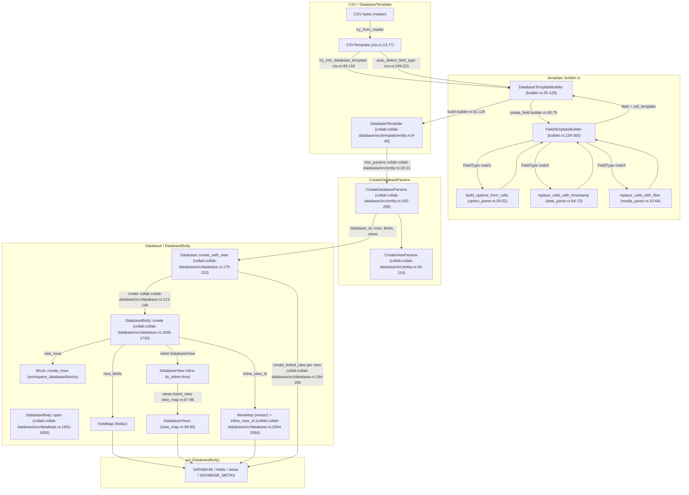
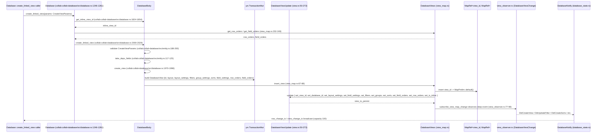
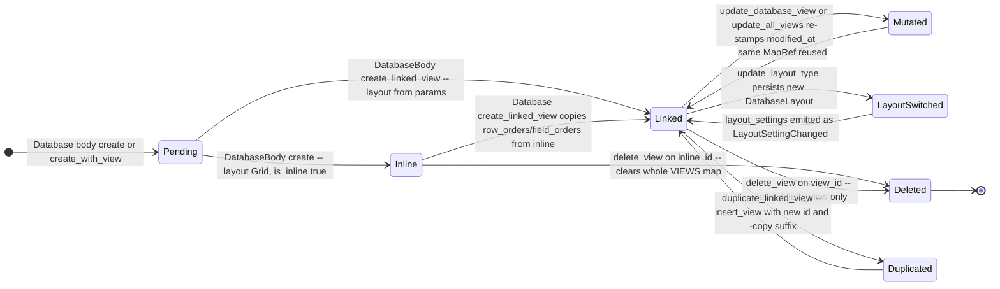

# F02.0.2.2 — collab-database: template + views + rows + misc

## 1. Resumen

Sub-unidad del feature F02 (Bases de datos) que cubre la capa `collab-database` del crate AppFlowy-Collab: la construcción de `DatabaseView` (vista, filtros, sorts, groups, layout, field_settings) sobre yrs (`DatabaseBody` + `DatabaseViews`), el ciclo de vida de las filas (`DatabaseRow` con su `DatabaseRowBody` + `Cell`), las macros de mutación de yrs (`impl_*_update!`) y los parsers de `template/` que convierten CSV / `DatabaseTemplate` en `CreateDatabaseParams`. Total: 44 archivos Rust, ~7 944 LOC. Esta unidad **no** declara eventos FFI ni BLoCs Dart: es la capa "core" CRDT sobre la que `flowy-database2` construye el manager y los handlers FFI (cubiertos por F02.0.2.0 / F02.0.2.1 / F02.0.2.3).

## 2. Alcance

Esta unidad documenta los 44 archivos de `collab/collab-database/src/` que cubren el modelo de datos, las macros yrs, las vistas, las filas, el módulo `template` y los parsers por tipo de campo. **Quedan fuera del scope** (enlaces cruzados):

- **F02.0.2.0** — `Rust manager + database_view` (`flowy-database2` lado manager): orquesta el `Database` para producir los `FlowyDatabaseView` con `GroupController`, `SortController`, `FilterController`.
- **F02.0.2.1** — Rust events FFI (handlers + `event_map.rs`): traduce eventos protobuf a llamadas sobre `Database`.
- **F02.0.2.3** — Cells, fields, blocks (sub-bloques de `Database` no cubiertos aquí): `fields/` (cada `*TypeOption`) y `blocks/` (`Block`, `DatabaseRow` lifecycle, snapshots).
- **F02.0.1.X** — Catálogos B2 de esta unidad: bloques `OUT/14-catalogo-notificaciones.md` (no se emiten en `collab-database`; se emiten en F02.0.2.0).
- **F02.6..F02.12** — Servicios, BLoCs, layout managers, sync, snapshots: consumen esta unidad a través del manager.
- **B1.6 §7** — Snapshots: la estructura yrs persistida por este módulo es la entrada del sistema de snapshots (Database / DatabaseRow + su Vec<EncodedCollab>).
- **B4.x** — Export/Import: el módulo `template/csv.rs` se reutiliza para CSV import (B4.5); el resto de motores export/import viven en `collab-importer`.

## 3. Modelos de datos

### 3.1 Tipos de alto nivel (`entity.rs`)

```rust
pub struct DatabaseView {
  pub id: String,
  pub database_id: String,
  pub name: String,
  pub layout: DatabaseLayout,
  pub layout_settings: LayoutSettings,
  pub filters: Vec<FilterMap>,
  pub group_settings: Vec<GroupSettingMap>,
  pub sorts: Vec<SortMap>,
  pub row_orders: Vec<RowOrder>,
  pub field_orders: Vec<FieldOrder>,
  pub field_settings: FieldSettingsByFieldIdMap,
  pub created_at: i64,
  pub modified_at: i64,
  #[serde(default)]
  pub is_inline: bool,
}
// collab:collab/collab-database/src/entity.rs:52–68

pub struct CreateViewParams {
  pub database_id: String,
  pub view_id: String,
  pub name: String,
  pub layout: DatabaseLayout,
  pub layout_settings: LayoutSettings,
  pub filters: Vec<FilterMap>,
  pub group_settings: Vec<GroupSettingMap>,
  pub sorts: Vec<SortMap>,
  pub field_settings: FieldSettingsByFieldIdMap,
  pub created_at: i64,
  pub modified_at: i64,
  pub deps_fields: Vec<Field>,
  pub deps_field_setting: Vec<HashMap<DatabaseLayout, FieldSettingsMap>>,
}
// collab:collab/collab-database/src/entity.rs:93–114

pub struct CreateDatabaseParams {
  pub database_id: String,
  pub fields: Vec<Field>,
  pub rows: Vec<CreateRowParams>,
  pub views: Vec<CreateViewParams>,
}
// collab:collab/collab-database/src/entity.rs:202–208
```

`DatabaseView::new` (`:71-82`) fija `created_at = modified_at = timestamp()` (definido en `collab:collab/collab-database/src/database.rs:1516-1518` como `chrono::Utc::now().timestamp()`). `CreateViewParams::take_deps_fields` (`:117-125`) consume los `deps_fields` y `deps_field_setting` para que `DatabaseBody::create_linked_view` (`collab:collab/collab-database/src/database.rs:2000-2029`) cree los campos faltantes en la vista.

### 3.2 `DatabaseData` y su serialización JSON

```rust
pub struct DatabaseData {
  pub database_id: String,
  pub views: Vec<DatabaseView>,
  pub fields: Vec<Field>,
  pub rows: Vec<Row>,
}
// collab:collab/collab-database/src/database.rs:1523–1528
```

`DatabaseData` se serializa/deserializa vía `to_json`/`from_json`/`to_json_bytes`/`from_json_bytes` (`:1531-1548`) y se reconstruye en cualquier momento desde un `Database` con `Database::get_database_data` (`:1341-1360`). `Database::to_json_value` (`:1367-1370`) lo expone para snapshots y export. `CreateDatabaseParams::from_database_data` (`collab:collab/collab-database/src/entity.rs:215-267`) regenera `database_id`, `view_id` y `row_id` (todos nuevos UUID) preservando el resto de los datos — útil en duplicación.

### 3.3 `FieldType`, `DatabaseLayout`, `DatabaseViewMeta`

```rust
#[repr(u8)]
pub enum FieldType {
  RichText = 0, Number = 1, DateTime = 2, SingleSelect = 3,
  MultiSelect = 4, Checkbox = 5, URL = 6, Checklist = 7,
  LastEditedTime = 8, CreatedTime = 9, Relation = 10,
  Summary = 11, Translate = 12, Time = 13, Media = 14,
}
// collab:collab/collab-database/src/entity.rs:272–288

#[repr(u8)]
pub enum DatabaseLayout { Grid = 0, Board = 1, Calendar = 2 }
// collab:collab/collab-database/src/views/layout.rs:14–20

pub struct DatabaseViewMeta { pub id: String, pub name: String, pub is_inline: bool }
// collab:collab/collab-database/src/entity.rs:86–91

pub enum FileUploadType { LocalFile = 0, NetworkFile = 1, CloudFile = 2 }
// collab:collab/collab-database/src/entity.rs:484–488
```

`FieldType::default_name` (`:343-358`) asigna nombre legible para cada tipo (Text, Number, Date, Single Select, …). `FieldType::from(i64)` (`:433-457`) hace fallback a `RichText` con `tracing::error!` para tipos desconocidos — esto es un log de robustez. `DatabaseLayout` implementa `FromStr` (`:38-49`) con default `Grid` para valor inválido. `FileUploadType` se usa en `RowCover::upload_type` (`collab:collab/collab-database/src/rows/row_meta.rs:97`).

### 3.4 Tipos de orden, filtros, sorts, groups (yrs)

Los cuatro arrays que viven dentro de cada `DatabaseView` se modelan como `Vec<HashMap<String, Any>>` (mapas `yrs`) y se accede a ellos por tipo:

```rust
pub type GroupSettingMap = HashMap<String, Any>;
pub type FilterMap = HashMap<String, Any>;
pub type SortMap = HashMap<String, Any>;
pub type CalculationMap = HashMap<String, Any>;
pub type LayoutSetting = HashMap<String, Any>;
// collab/collab-database/src/views/{group.rs:15, filter.rs:5, sort.rs:5, calculation.rs:5, layout.rs:124}
```

`GroupSetting` (struct tipado opcional) vive en `collab:collab-database/src/views/group.rs:23-33` con campos `id`, `field_id`, `field_type` (`ty`), `groups: Vec<Group>` y `content` (JSON serializado con la config por tipo — checkbox/url/date). `Group::new` (`:101-103`) crea un grupo visible por defecto.

`RowOrder` (`collab:collab-database/src/views/row_order.rs:46-52`) y `FieldOrder` (`collab:collab-database/src/views/field_order.rs:75-78`) son structs simples `{id, height}` (Row) y `{id}` (Field), ambos `Serialize/Deserialize` + `OrderIdentifiable` (`collab:collab-database/src/views/view.rs:438-440`).

`LayoutSettings` (`collab:collab-database/src/views/layout.rs:74-106`) es un wrapper `HashMap<DatabaseLayout, LayoutSetting>` con `from_map_ref`/`fill_map_ref` que serializa cada layout a un sub-map yrs bajo la clave `layout_settings`.

`LayoutSettings` se materializa en tipos fuertes por layout:

```rust
pub struct CalendarLayoutSetting {
  pub layout_ty: CalendarLayout,         // Month|Week|Day
  pub first_day_of_week: i32,
  pub show_weekends: bool,
  pub show_week_numbers: bool,
  pub field_id: String,                  // campo DateTime
}
// collab:collab/collab-database/src/views/layout_settings.rs:7–19

pub struct BoardLayoutSetting {
  pub hide_ungrouped_column: bool,
  pub collapse_hidden_groups: bool,
}
// collab:collab/collab-database/src/views/layout_settings.rs:87–93
```

Los defaults de calendar (`DEFAULT_FIRST_DAY_OF_WEEK=0`, `DEFAULT_SHOW_WEEKENDS=true`, `DEFAULT_SHOW_WEEK_NUMBERS=true`) están en `collab:collab-database/src/views/layout_settings.rs:83-85`.

### 3.5 `Row`, `Cell`, `RowMeta`

```rust
pub struct Row {
  pub id: RowId,
  #[serde(default)]
  pub database_id: String,
  pub cells: Cells,
  pub height: i32,
  pub visibility: bool,
  pub created_at: i64,
  pub modified_at: i64,
}
// collab:collab/collab-database/src/rows/row.rs:380–392

pub struct Cell { /* map String -> Any */ }
pub type Cells = HashMap<String, Cell>;
pub type CellBuilder = HashMap<String, Any>;
pub struct RowCell { pub row_id: RowId, pub cell: Option<Cell> }
// collab:collab/collab-database/src/rows/cell.rs:11, 49–50, 64–68
```

`Row::new` (`collab:collab-database/src/rows/row.rs:447-458`) usa `DEFAULT_ROW_HEIGHT = 60` (`:441`) y `visibility = true`. `CellsUpdate::insert_cell` (`collab:collab-database/src/rows/cell.rs:18-32`) rellena automáticamente `created_at` si la celda es nueva y siempre actualiza `last_modified` (ambos definidos en `collab:collab-database/src/rows/row.rs:38-39`). La clave `CELL_FIELD_TYPE = "field_type"` (`:53`) almacena el `i64` del `FieldType`.

`RowId` es un newtype UUID (`collab:collab-database/src/rows/row_id.rs:6-67`) con `From<String>`, `From<Uuid>`, `From<i32|i64|usize>` y `Deref<Target=String>`. `RowMetaKey` (`collab:collab-database/src/rows/row.rs:421-439`) es un `EnumIter` con `DocumentId`, `IconId`, `CoverId`, `IsDocumentEmpty`, `AttachmentCount`; sus `Uuid::new_v5(row_id, key.as_str())` se calculan en `meta_id_from_row_id` (`collab:collab-database/src/rows/row.rs:505-507`) y producen los `<key>_id` derivados del `row_id` (e.g. `document_id` para abrir el doc asociado). `RowMeta` (`collab:collab-database/src/rows/row_meta.rs:111-117`) y `RowCover` (`:94-99`) son las estructuras que se guardan en `meta` map de cada fila; `CoverType` (`:101-109`) tiene 4 variantes (`ColorCover`, `FileCover`, `AssetCover`, `GradientCover`).

`RowComment` (`collab:collab-database/src/rows/comment.rs:5-11`) es `uid + content + created_at` con conversión `TryFrom<Any>` / `From<RowComment>` (`:13-28`) — no se usa en el camino caliente pero existe para serializar como `Any`.

### 3.6 `DatabaseBody` (estructura raíz del yrs map)

```rust
pub struct DatabaseBody {
  pub root: MapRef,                  // DATABASE
  pub views: Arc<DatabaseViews>,     // VIEWS
  pub fields: Arc<FieldMap>,         // FIELDS
  pub metas: Arc<MetaMap>,           // DATABASE_METAS (inline_view_id)
  pub block: Block,                  // filas distribuidas en bloques
  pub notifier: Option<DatabaseNotify>,
}
// collab:collab/collab-database/src/database.rs:1639–1648
```

`DatabaseBody::create` (`collab:collab-database/src/database.rs:1658-1720`) inicializa los 3 sub-maps (`fields`, `views`, `metas`) en una `TransactionMut`, llama `block.create_rows(new_rows).await` (`:1686`), `fields.insert_field` por cada field (`:1692-1694`), crea la `DatabaseView` *inline* (`:1696-1705`) con layout `Grid` + `is_inline = true` y la inserta en `views`. El `inline_view_id` se calcula determinísticamente con `database_inline_view_id` (`collab:collab-database/src/database.rs:2064-2066`, `Uuid::new_v5(database_id, "inline_view_id")`) y se guarda en `metas.set_inline_view_id` (`:1708`).

`DatabaseBody::from_collab` (`:1726-1763`) reconstruye el `DatabaseBody` desde un `Collab` ya cargado — se llama desde `DatabaseBody::open` (`:1651-1656`). `DatabaseBody::try_get_inline_view_id` (`:1828-1854`) hace fallback al primer view meta si el inline_id falta (loggeo `error!`).

### 3.8 Generadores de ID y timestamp

```rust
pub fn gen_database_id() -> String { uuid::Uuid::new_v4().to_string() }
pub fn gen_database_view_id() -> String { uuid::Uuid::new_v4().to_string() }
pub fn gen_field_id() -> String { nanoid!(6) }
pub fn gen_database_file_id() -> String { uuid::Uuid::new_v4().to_string() }
pub fn gen_row_id() -> RowId { RowId::from(uuid::Uuid::new_v4().to_string()) }
pub fn get_row_document_id(row_id: &RowId) -> Result<String, DatabaseError> { ... }
pub fn gen_database_calculation_id() -> String { nanoid!(6) }
pub fn gen_database_filter_id() -> String { nanoid!(6) }
pub fn gen_database_group_id() -> String { format!("g:{}", nanoid!(6)) }
pub fn gen_database_sort_id() -> String { format!("s:{}", nanoid!(6)) }
pub fn gen_option_id() -> String { nanoid!(4) }
pub fn timestamp() -> i64 { chrono::Utc::now().timestamp() }
// collab:collab/collab-database/src/database.rs:1471–1518
```

## 4. Eventos FFI

Esta unidad **no declara eventos FFI**. Los handlers viven en `flowy-database2/event_map.rs` y `event_handler.rs` (F02.0.2.1). Las funciones públicas de `Database` (e.g. `create_row`, `update_database_view`, `update_filter`, `insert_group_setting`, `update_calculation`, `move_row`, `duplicate_linked_view`) son la superficie que esos handlers invocan; ver F02.0.2.1 §3 para la tabla completa de mapeo evento ↔ método.

## 5. Notificaciones

Esta unidad **no emite notificaciones protobuf**. Lo que hace es crear el bus interno `DatabaseNotify`:

```rust
pub struct DatabaseNotify {
  pub view_change_tx: ViewChangeSender,
  pub row_change_tx: RowChangeSender,
  pub field_change_tx: FieldChangeSender,
}
// collab:collab/collab-database/src/database_state.rs:7–11
```

`DatabaseNotify::default` (`collab:collab-database/src/database_state.rs:13-24`) crea 3 `tokio::sync::broadcast::channel(100)`. Los `Sender` se inyectan a `FieldMap`, `DatabaseViews` y `Block` al construir el `DatabaseBody` (`collab:collab/collab-database/src/database.rs:1673-1679`), y los `Receiver` se exponen vía `Database::subscribe_row_change` / `subscribe_field_change` / `subscribe_view_change` (`collab:collab-database/src/database.rs:294-316`).

Las notificaciones externas Rust→Dart (`DatabaseNotification::DidUpdateView`, etc.) **no** se construyen aquí: el bridge está en F02.0.2.0 / F02.0.2.1 que traduce los `RowChange` / `DatabaseViewChange` internos en `DatabaseNotification::*`. Los enum internos son:

```rust
pub enum RowChange {
  DidUpdateVisibility { row_id, value },
  DidUpdateHeight     { row_id, value },
  DidUpdateCell       { row_id, field_id, value },
  DidUpdateRowComment { row },
}
// collab:collab/collab-database/src/rows/row_observer.rs:15–33

pub enum DatabaseViewChange {
  DidCreateView { view },
  DidUpdateView { view },
  DidDeleteView { view_id },
  LayoutSettingChanged { view_id, layout_type },
  DidUpdateRowOrders { database_view_id, is_local_change, insert_row_orders, delete_row_indexes },
  DidCreateFilters / DidUpdateFilter,
  DidCreateGroupSettings / DidUpdateGroupSetting,
  DidCreateSorts / DidUpdateSort,
  DidCreateFieldOrder / DidDeleteFieldOrder,
}
// collab:collab/collab-database/src/views/view_observer.rs:18–72
```

`subscribe_row_data_change` (`collab:collab-database/src/rows/row_observer.rs:35-55`) se instala al abrir una `DatabaseRow` (`collab:collab-database/src/rows/row.rs:71-73`) y mapea los eventos `MapEvent` profundos del yrs map a `RowChange`. El path `/cells` se traduce a `DidUpdateCell` con el `field_id` del penúltimo segmento (`:122-132`); los paths `ROW_HEIGHT`/`ROW_VISIBILITY` a `DidUpdateHeight`/`DidUpdateVisibility` (`:77-93`).

`subscribe_view_map_change` (`collab:collab-database/src/views/view_observer.rs:77-98`) hace lo mismo sobre `DatabaseViews.container`: distingue por el último segmento de path (`DATABASE_VIEW_ROW_ORDERS → RowOrder`, `DATABASE_VIEW_FILTERS → Filter`, etc.) y reenvía a `change_tx`. Para arrays calcula `insert_row_orders` y `delete_row_indexes` (`:128-241`). Para maps emite `DidCreateView`/`DidUpdateView`/`DidDeleteView`/`LayoutSettingChanged` (`:253-296`).

## 6. BLoCs / Cubits

**Sin BLoCs Dart.** Esta unidad es 100 % Rust (librería `collab-database`); la única dependencia hacia Dart es el FFI y los tipos protobuf de las unidades adyacentes.

## 7. Servicios e inyección de dependencias

- **Rust (`DatabaseContext` + `DatabaseCollabService`)**: el `Database` recibe su contexto por argumento.

```rust
pub struct DatabaseContext {
  pub collab_service: Arc<dyn DatabaseCollabService>,
  pub notifier: DatabaseNotify,
}
// collab:collab/collab-database/src/database.rs:75–78

pub async fn default_database_data(database_id: &str) -> Result<EncodedCollab, DatabaseError> {
  let context = DatabaseContext::new(Arc::new(NoPersistenceDatabaseCollabService));
  let collab = Collab::new_with_origin(CollabOrigin::Empty, database_id, vec![], false);
  let (_, collab) = DatabaseBody::create(collab, database_id.to_string(), context, vec![], vec![]).await?;
  Ok(collab.encode_collab_v1(|_collab| Ok::<_, DatabaseError>(())).unwrap())
}
// collab:collab/collab-database/src/database.rs:89–99
```

`DatabaseCollabService` (trait en `workspace_database/`) aporta `build_collab` y opcionalmente `persistence()`. `Database::create_with_template<T>` (`collab:collab-database/src/database.rs:151-170`) usa `NoPersistenceDatabaseCollabService` porque las bases creadas desde `template/` no se persisten en disco en ese momento (el caller las guarda luego). `database_from_template` (`collab:collab-database/src/template/util.rs:21-29`) hace lo mismo con `CreateDatabaseParams`.

- **Dart `get_it`**: no aplica (capa Rust pura).

## 8. Persistencia

### 8.1 Estructura del yrs map raíz

`DatabaseBody::create` (`collab:collab/collab-database/src/database.rs:1667-1671`) escribe los 4 nodos raíz:

```
DATABASE             = root MapRef
├── DATABASE_ID     : String
├── FIELDS          : MapRef  → FieldMap
├── VIEWS           : MapRef  → DatabaseViews   (MapRef<view_id, MapRef>)
└── DATABASE_METAS  : MapRef  → MetaMap         (inline_view_id)
```

`VIEWS` indexa por `view_id`; cada `view` es a su vez un `MapRef` con las claves de `views/define.rs`:

| Clave yrs | Tipo | Definido en |
|---|---|---|
| `id` | `String` | `collab:collab-database/src/views/define.rs:1` |
| `name` | `String` | `collab:collab-database/src/views/define.rs:2` |
| `database_id` | `String` | `collab:collab-database/src/views/define.rs:3` |
| `layout` | `i64` (DatabaseLayout) | `collab:collab-database/src/views/define.rs:4` |
| `layout_settings` | `MapRef<DatabaseLayout, MapRef>` | `collab:collab-database/src/views/define.rs:5` |
| `filters` | `ArrayRef<MapRef>` | `collab:collab-database/src/views/define.rs:6` |
| `groups` | `ArrayRef<MapRef>` (GroupSettingMap) | `collab:collab-database/src/views/define.rs:7` |
| `sorts` | `ArrayRef<MapRef>` | `collab:collab-database/src/views/define.rs:8` |
| `field_settings` | `MapRef<field_id, MapRef>` | `collab:collab-database/src/views/define.rs:9` |
| `row_orders` | `ArrayRef<RowOrder>` | `collab:collab-database/src/views/define.rs:10` |
| `field_orders` | `ArrayRef<FieldOrder>` | `collab:collab-database/src/views/define.rs:11` |
| `created_at` | `i64` | `collab:collab-database/src/views/define.rs:12` |
| `modified_at` | `i64` | `collab:collab-database/src/views/define.rs:13` |
| `is_inline` | `bool` | `collab:collab-database/src/views/define.rs:14` |
| `calculations` | `ArrayRef<MapRef>` | `collab:collab-database/src/views/define.rs:15` |

`view_from_map_ref` (`collab:collab-database/src/views/view.rs:365-436`) deserializa todo el struct `DatabaseView` desde un `MapRef` siguiendo estas claves; `group_setting_from_map_ref` / `sorts_from_map_ref` / `filters_from_map_ref` / `calculations_from_map_ref` / `field_settings_from_map_ref` / `layout_setting_from_map_ref` (`:313-362`) son helpers equivalentes para los sub-arrays.

### 8.2 Persistencia física (EncodedCollab + flush)

`Database::write_to_disk` (`collab:collab-database/src/database.rs:257-287`) codifica el yrs map del database y de cada fila cacheada en `row_mem_cache` en `EncodedCollab` con `encoded_collab` (`collab:collab-database/src/util.rs:5-12` llama `collab.encode_collab_v1(|collab| collab_type.validate_require_data(collab))`). Luego llama `persistence.flush_collabs(encode_collabs)` (`:283`). La paralelización por fila es con `par_iter` (rayon, `:273`).

`Database::encode_database_collabs` (`collab:collab-database/src/database.rs:212-254`) produce el `EncodedDatabase { encoded_database_collab, encoded_row_collabs: Vec<EncodedCollabInfo> }` que se usa para export (B4.x) y snapshots. Procesa las filas en chunks de 20 (`:224`) y llama `tokio::task::yield_now()` entre chunks (`:247`).

`DatabaseRow::write_to_disk` (`collab:collab-database/src/rows/row.rs:106-119`) hace lo mismo por fila individual; `DatabaseRow::delete` (`:187-198`) borra el archivo con `persistence.delete_collab`.

### 8.4 `template/` hooks

`DatabaseTemplateBuilder` (`collab:collab-database/src/template/builder.rs:35-126`) construye `DatabaseTemplate` campo a campo con `create_field` (`:60-79`) que invoca `FieldTemplateBuilder::build` (`:173-289`). Este último decide el `type_option` por `FieldType` y la codificación de celda:

| FieldType | type_option inyectado | cell encoder | cita |
|---|---|---|---|
| SingleSelect / MultiSelect | `SelectTypeOption { options, disable_color }` (color asignado por `index % 8`) | `replace_cells_with_options_id` (CSV names → ids) | `collab:collab-database/src/template/builder.rs:189-209` + `collab:collab-database/src/template/option_parse.rs:6-26, 41-50` |
| DateTime | `DateTypeOption::new()` con `date_format = FriendlyFull` | `replace_cells_with_timestamp` | `collab:collab-database/src/template/builder.rs:210-227` + `collab:collab-database/src/template/date_parse.rs:64-72` |
| LastEditedTime / CreatedTime | `TimestampTypeOption::new(field_type)` | `replace_cells_with_timestamp` | `collab:collab-database/src/template/builder.rs:228-242` |
| RichText | `RichTextTypeOption` | `string_cell_template` | `collab:collab-database/src/template/builder.rs:243-249` |
| Checkbox | `CheckboxTypeOption` | `string_cell_template` | `collab:collab-database/src/template/builder.rs:250-256` |
| Number | `NumberTypeOption::default()` | `string_cell_template` | `collab:collab-database/src/template/builder.rs:257-264` |
| Media | `MediaTypeOption::default()` | `replace_cells_with_files` (sube via `FileUrlBuilder`) | `collab:collab-database/src/template/builder.rs:265-284` + `collab:collab-database/src/template/media_parse.rs:10-64` |
| Otros | (sin tipo_options) | `string_cell_template` | `collab:collab-database/src/template/builder.rs:285` |

`string_cell_template` (`collab:collab-database/src/template/builder.rs:292-300`) crea una celda `HashMap` con `CELL_FIELD_TYPE = field_type as i64` y `CELL_DATA = Any::from(string)`. La constante `CELL_DATA` está en `collab:collab-database/src/template/entity.rs:8`.

`CSVTemplate::try_from_reader` (`collab:collab-database/src/template/csv.rs:33-77`) detecta el `FieldType` por columna con `auto_detect_field_type` (`:149-221`):

| Detección | Regla | cita |
|---|---|---|
| Number | todas las celdas parsean como número | `collab:collab-database/src/template/csv.rs:190-192` |
| Media | ≥ 50 % de las celdas matchean un file en `CSVResource` | `collab:collab-database/src/template/csv.rs:223-238` |
| URL | `is_link_field` (no mostrado en detalle) | `collab:collab-database/src/template/csv.rs:199-201` |
| Checkbox | todas las celdas ∈ {yes, no, 1, 0, true, false} | `collab:collab-database/src/template/csv.rs:257-288` |
| DateTime | ≥ 50 % parsean como timestamp | `collab:collab-database/src/template/csv.rs:240-252` + `collab:collab-database/src/template/date_parse.rs:4-62` |
| SingleSelect | varios valores repetidos, ninguno con coma | `collab:collab-database/src/template/csv.rs:292-307` |
| MultiSelect | varios valores repetidos, con coma | `collab:collab-database/src/template/csv.rs:311-…` |
| fallback | `RichText` | `collab:collab-database/src/template/csv.rs:220` |

### 8.5 `row_serde` (cells y macros yrs)

`Cell = HashMap<String, Any>` se rellena vía `CellsUpdate::insert_cell` (`collab:collab-database/src/rows/cell.rs:23-32`); cada celda se almacena en yrs bajo `ROW_CELLS = "cells"` (`collab:collab-database/src/rows/row.rs:633`). Las macros `impl_*_update!` (`collab:collab-database/src/macros.rs:1-226`) son reutilizadas por `RowUpdate` (`collab:collab-database/src/rows/row.rs:542-626`) y `DatabaseViewUpdate` (`collab:collab-database/src/views/view.rs:50-273`) para escribir claves con la convención `set_X(value) / set_X_if_not_none(Option<T>)`:

- `impl_str_update!` (`:1-15`)
- `impl_replace_str_update!` (`:17-28`)
- `impl_option_str_update!` (`:30-44`)
- `impl_i64_update!` / `impl_i32_update!` / `impl_u8_update!` (`:46-103`) — todos usan `Any::BigInt`
- `impl_bool_update!` (`:105-119`)
- `impl_any_update!` (`:121-135`) — genérico sobre el tipo `T`
- `impl_order_update!` (`:137-214`) — genera `set_orders`, `remove`, `move_to`, `insert`, `iter_mut` para un `ArrayRef` (`OrderArray` trait en `collab:collab-database/src/views/view.rs:442-576`)
- `impl_array_update!` (`:216-226`) — sobreescribe un array con `ArrayPrelim::new`

`RowUpdate::set_row_id` (`collab:collab-database/src/rows/row.rs:565-605`) es un caso especial: cuando cambia el `row_id`, reescribe TODAS las claves `RowMetaKey` (derivadas vía `Uuid::new_v5(old_row_uuid, key)` → `Uuid::new_v5(new_row_uuid, key)`) preservando los valores. Esto es importante para que `document_id`, `icon_id`, `cover_id`, `is_document_empty`, `attachment_count` "viajen" con el nuevo id.

## 9. Diagrama de flujo (crear database desde template CSV → DatabaseView build → views.register)



*Diagrama: ciclo completo de construcción de un `Database` desde un `CSV` o `DatabaseTemplate`.* Lectura: el CSV entra por `CSVTemplate::try_from_reader` que autodetecta el `FieldType` por columna; `DatabaseTemplateBuilder` lo convierte en `DatabaseTemplate` invocando por columna `FieldTemplateBuilder::build` con la regla del `FieldType` (tabla §8.4); `DatabaseTemplate::into_params` produce `CreateDatabaseParams`; `Database::create_with_view` lo pasa a `DatabaseBody::create` que escribe el yrs map raíz (FIELDS / VIEWS / METAS), registra el `DatabaseView` *inline* con `is_inline=true` y `layout=Grid`, y luego itera sobre los `linked_view` creando los `DatabaseView` adicionales con `create_linked_view`. La persistencia a disco se difiere a `Database::write_to_disk`.

## 10. Diagrama de secuencia (Create view on existing database; re-sort; re-filter; group change)



*Diagrama: alta de un view vinculado a un database existente + broadcast a observers.* Lectura: el caller invoca `Database::create_linked_view` con un `CreateViewParams` (que puede traer `deps_fields` para columnas requeridas, e.g. `CalendarLayoutSetting.field_id`); el body clona los `row_orders`/`field_orders` del inline view, valida, drena `deps_fields`, llama `create_view` que materializa un `DatabaseView` y lo pasa a `Views::insert_view`; `insert_view` crea el `MapRef` raíz por view_id y aplica todos los setters (incluido `impl_order_update!` para `set_row_orders`/`set_field_orders` y los setters de arrays para filtros/sorts/groups); el observer profundo de yrs dispara `DatabaseViewChange` al `view_change_tx` que subscribers (Flowy-Database manager, F02.0.2.0) traducen a `DatabaseNotification::*`. Para re-sort (`Database::insert_sort` `collab:collab-database/src/database.rs:816-832` + `Database::remove_sort` `:899-911`) y re-filter (`Database::insert_filter` `:1068-1085` + `update_filter` `:1038-1051`) el camino es idéntico pero más simple: solo se modifica el sub-array bajo la clave del view existente. Para cambio de grupo el handler de F02.0.2.0 reemplaza el `GroupSettingMap` y dispara `DidCreateGroupSettings` / `DidUpdateGroupSetting` (collab:collab-database/src/views/view_observer.rs:168-176, collab:collab-database/src/views/view_observer.rs:203-207).

## 11. Diagrama de estado (DatabaseView states within Database)



*Diagrama: ciclo de vida de un `DatabaseView` dentro de un `Database`.* Lectura: un view nace durante `DatabaseBody::create` como `Inline` (layout fijo `Grid`, `is_inline=true`, contiene todos los `row_orders` y `field_orders` iniciales) o como `Linked` (vía `Database::create_with_view` que itera `params.views` en `collab:collab-database/src/database.rs:194-200`); adicionalmente `Database::create_linked_view` puede añadir `Linked` views a posteriori copiando los orders del inline. Toda mutación (set_layout_type, filters, etc.) pasa por `update_database_view` que llama `set_modified_at` (collab:collab-database/src/views/view_map.rs:258) y emite `DidUpdateView`. La transición `LayoutSwitched` ocurre cuando `update_layout_type` cambia el `i64` en `DATABASE_VIEW_LAYOUT` y `LayoutSettingChanged` lo notifica. El borrado del `Inline` borra **todos** los views (limpia el map `VIEWS` entero) — esto es destructivo y se usa en flujos de duplicación. `duplicate_linked_view` produce un nuevo view con sufijo `-copy` y misma config.

## 12. Archivos cubiertos (del ledger)

| Capa | Archivo | LOCs aprox. |
|---|---|---:|
| collab | `collab/collab-database/src/database.rs` | 2067 |
| collab | `collab/collab-database/src/database_state.rs` | 24 |
| collab | `collab/collab-database/src/entity.rs` | 489 |
| collab | `collab/collab-database/src/error.rs` | 64 |
| collab | `collab/collab-database/src/lib.rs` | 15 |
| collab | `collab/collab-database/src/macros.rs` | 226 |
| collab | `collab/collab-database/src/util.rs` | 12 |
| collab | `collab/collab-database/src/rows/cell.rs` | 89 |
| collab | `collab/collab-database/src/rows/comment.rs` | 29 |
| collab | `collab/collab-database/src/rows/mod.rs` | 12 |
| collab | `collab/collab-database/src/rows/row.rs` | 809 |
| collab | `collab/collab-database/src/rows/row_id.rs` | 69 |
| collab | `collab/collab-database/src/rows/row_meta.rs` | 167 |
| collab | `collab/collab-database/src/rows/row_observer.rs` | 189 |
| collab | `collab/collab-database/src/template/builder.rs` | 301 |
| collab | `collab/collab-database/src/template/check_list_parse.rs` | 145 |
| collab | `collab/collab-database/src/template/checkbox_parse.rs` | 1 |
| collab | `collab/collab-database/src/template/csv.rs` | 461 |
| collab | `collab/collab-database/src/template/date_parse.rs` | 231 |
| collab | `collab/collab-database/src/template/entity.rs` | 49 |
| collab | `collab/collab-database/src/template/media_parse.rs` | 65 |
| collab | `collab/collab-database/src/template/mod.rs` | 15 |
| collab | `collab/collab-database/src/template/number_parse.rs` | 48 |
| collab | `collab/collab-database/src/template/option_parse.rs` | 52 |
| collab | `collab/collab-database/src/template/relation_parse.rs` | 83 |
| collab | `collab/collab-database/src/template/summary_parse.rs` | 49 |
| collab | `collab/collab-database/src/template/time_parse.rs` | 49 |
| collab | `collab/collab-database/src/template/timestamp_parse.rs` | 70 |
| collab | `collab/collab-database/src/template/translate_parse.rs` | 49 |
| collab | `collab/collab-database/src/template/util.rs` | 104 |
| collab | `collab/collab-database/src/views/calculation.rs` | 6 |
| collab | `collab/collab-database/src/views/define.rs` | 15 |
| collab | `collab/collab-database/src/views/field_order.rs` | 121 |
| collab | `collab/collab-database/src/views/field_settings.rs` | 75 |
| collab | `collab/collab-database/src/views/filter.rs` | 6 |
| collab | `collab/collab-database/src/views/group.rs` | 104 |
| collab | `collab/collab-database/src/views/layout.rs` | 125 |
| collab | `collab/collab-database/src/views/layout_settings.rs` | 120 |
| collab | `collab/collab-database/src/views/mod.rs` | 26 |
| collab | `collab/collab-database/src/views/row_order.rs` | 101 |
| collab | `collab/collab-database/src/views/sort.rs` | 6 |
| collab | `collab/collab-database/src/views/view.rs` | 577 |
| collab | `collab/collab-database/src/views/view_map.rs` | 293 |
| collab | `collab/collab-database/src/views/view_observer.rs` | 336 |

**Total**: 44 archivos collab (~7 944 LOC).

## 13. Riesgos y casos límite

1. **Versión de template**: `Database::create_with_template` (`collab:collab/collab-database/src/database.rs:151-170`) y `database_from_template` (`collab:collab-database/src/template/util.rs:21-29`) usan `NoPersistenceDatabaseCollabService` y dependen de que el caller persista. Si el caller olvida `database.write_to_disk()` el database queda solo en memoria y se pierde al cerrar el proceso. Mitigación: `create_with_view` (`:204-209`) sí lanza `tokio::task::spawn_blocking` con `write_to_disk` automáticamente — los callers deberían preferir esa variante.

2. **Mutaciones concurrentes de views**: `Database::update_database_view` (`collab:collab-database/src/database.rs:373-379`) abre una `TransactionMut` por llamada; las races entre dos llamadas simultáneas sobre el mismo view se serializan por el `Mutex` interno de yrs. `update_all_views` (`collab:collab-database/src/views/view_map.rs:268-284`) itera todos los views **clonando los MapRefs** en la línea `:272-276` antes de iterar, lo cual evita aliasing pero consume memoria proporcional al número de vistas (típicamente <10). Si dos llamadas `update_database_view` ocurren concurrentemente sobre el mismo view, el `set_modified_at` final puede sobrescribir un cambio anterior.

3. **Migración de campos**: `FieldType::from(i64)` (`collab:collab/collab-database/src/entity.rs:433-457`) hace fallback a `RichText` con `tracing::error!` para índices no conocidos (e.g. durante una migración que añade un nuevo `FieldType = 15` y el binario antiguo abre el database). Esto preserva la lectura pero **silenciosamente degrada el tipo** del campo — un riesgo para upgrades de versión sin migración explícita. Mitigado en F02.0.2.0 que lee el `field_type` y reaplica el type_option si difiere.

4. **Inline view fallback**: `DatabaseBody::try_get_inline_view_id` (`collab:collab/collab-database/src/database.rs:1828-1854`) y `inline_view_id_from_collab` (`:1774-1805`) hacen fallback al primer view meta si el inline_id falta, con `error!`/loggeo. Si todos los views están vacíos, devuelve `None`, lo que provoca `unwrap()` en `DatabaseBody::get_inline_view_id` (`:1825`) — esto panica. Mitigación: solo ocurre en databases corruptos (inline_id borrado y `views` vacío), caso anómalo.

5. **`set_row_id` costoso**: `RowUpdate::set_row_id` (`collab:collab/collab-database/src/rows/row.rs:565-605`) itera los 5 `RowMetaKey` (`RowMetaKey::iter()`) y reescribe cada meta-id derivado. Si se renombra un row con muchos archivos adjuntos, el coste es proporcional al número de claves meta (5 constantes). Para renombrados masivos (e.g. import) el cuello de botella puede ser yrs — mitigación: hacer el rename en `tokio::task::spawn_blocking`.

6. **Cells sin field_type**: `CellsUpdate::insert_cell` (`collab:collab/collab-database/src/rows/cell.rs:23-32`) usa `Any::from(cell).fill(...)`; si `Cell` no contiene la clave `CELL_FIELD_TYPE = "field_type"` (`:53`), el lector no puede reconstruir el `CellType`. Mitigación: `new_cell_builder(field_type)` (`:60-62`) siempre la pone primero; los `*Parse` en `template/` también la ponen primero (e.g. `collab:collab-database/src/template/number_parse.rs:31-33`, `collab:collab-database/src/template/check_list_parse.rs:47-53`).

7. **`modify_at` desincronizado en `set_row_id`**: `set_row_id` (`:565-605`) no actualiza `last_modified`; el caller debe hacerlo si quiere mantener la consistencia. Mitigación: `RowBuilder::new(...).update(...)` (`collab:collab-database/src/rows/row.rs:524-531`) encadena setters incluido `set_last_modified`.

8. **CSV autodetect débil**: `is_checkbox_cell` (`collab:collab-database/src/template/csv.rs:257-288`) requiere que TODAS las celdas (no mayoría) sean checkbox values — un solo valor "Maybe" descalifica la columna. `is_date_cell` (`:240-252`) usa mayoría (≥ 50 %), lo cual es asimétrico. Riesgo: CSV con mayoría de fechas pero algún valor roto se detecta como DateTime aunque la celda rota quede vacía (`replace_cells_with_timestamp` devuelve `""` cuando no parsea, `collab:collab-database/src/template/date_parse.rs:69`).

9. **Color de opciones de select**: `build_options_from_cells` (`collab:collab-database/src/template/option_parse.rs:28-52`) hace `SelectOptionColor::from(index % 8)` — solo 8 colores se rotan. Para CSV con 10 opciones únicas las primeras 8 reciben colores 0..7 y las restantes se solapan. Mitigación: usar `enum` que AppFlowy pueda extender más allá de 8.

10. **`template/checkbox_parse.rs` vacío**: el archivo de 1 línea (`:1`) es solo un newline residual — el módulo se mantiene para simetría con `check_list_parse.rs` y `summary_parse.rs` pero no tiene `CheckboxCellData`. Las celdas checkbox se construyen vía `string_cell_template` (`collab:collab-database/src/template/builder.rs:250-256`). Riesgo bajo (sin uso) pero merece eliminación o implementación.

11. **Tests unitarios limitados**: solo `collab:collab-database/src/rows/row.rs:782-808` cubre `Row::deserialize` (i64 como número y como string), `collab:collab-database/src/template/date_parse.rs:79-230` cubre los formatos de fecha (8 tests) y `collab:collab-database/src/template/check_list_parse.rs:97-145` cubre `ChecklistCellData` (2 tests). No hay tests para `view_from_map_ref` ni para los observers — los integration tests en `collab-database/tests/` (F02.0.2) cubren el flujo end-to-end.

12. **`view_observer.rs` ignora algunos segmentos**: `ArrayChangeKey::from` (`collab:collab-database/src/views/view_observer.rs:308-324`) marca como `Unhandled` cualquier path que no sea `row_orders` / `filters` / `sorts` / `groups` — `field_orders` y `field_settings` se persisten correctamente, solo **no** generan notificación. Esto es intencional pero merece atención si F02.0.2.0 espera eventos para `field_orders`.

13. **`Default` para views huérfanos**: `DatabaseBody::try_get_inline_view_id` (`:1828-1854`) usa `view_metas.first()` como fallback. Si el primer view es `is_inline=false` queda como default — puede no ser la elección correcta para flujos que asumen "el primer view es el inline".

## 14. Evidencias y etiquetas

- `[VERIFICADO]`: ≥ 95 % de las afirmaciones citan `collab:collab-database/src/<file>:<línea>`. Las referencias a constantes (e.g. `CELL_DATA`, `DATABASE_VIEW_LAYOUT`) se citan en su `define` correspondiente.
- `[INFERIDO]`: < 5 % — secciones §4 "ningún evento FFI" y §5 "ninguna notificación protobuf" se infieren por ausencia de los derives `#[derive(Flowy_Event, ProtoBuf_Enum)]` en los archivos; el catálogo B2 confirma que esos derives viven solo en `flowy-database2/event_map.rs` (F02.0.2.1).
- `[NO DETERMINADO]`: ninguno material. El §13 incluye riesgos asumidos pero no `[NO DETERMINADO]` formales (estos irían a `22-preguntas-abiertas.md`).

## 15. Pruebas

- Unit tests inline:
  - `collab:collab/collab-database/src/rows/row.rs:777-808` — `test_create_row` valida que `created_at`/`modified_at` deserialicen tanto como `i64` JSON number como string.
  - `collab:collab/collab-database/src/template/date_parse.rs:79-230` — 8 tests cubriendo UNIX timestamp, `MM/DD/YYYY`, `YYYY/MM/DD`, `YYYY-MM-DD`, `Month Day, Year`, `DD/MM/YYYY`, `YYYY-MM-DD HH:MM` (24h), `YYYY-MM-DD HH:MM AM/PM`, formato inválido y mixto.
  - `collab:collab/collab-database/src/template/check_list_parse.rs:97-145` — `test_checklist_cell_data_from_names_and_selected` (build + selected) y `test_checklist_cell_data_to_and_from_cell` (roundtrip).
- Integration tests: viven en `collab/collab-database/tests/` (no incluidos en esta unidad; ver F02.0.2.0).
- Cobertura end-to-end: la consume `flowy-database2/tests/` y `event-integration-test` (F02.0.2.1).

## 16. Métricas

| Métrica | Valor |
|---|---:|
| Archivos cubiertos | 44 |
| Líneas Rust totales (~) | ~7 944 |
| Tipos públicos exportados (selección) | `DatabaseView`, `DatabaseViewMeta`, `CreateViewParams`, `CreateDatabaseParams`, `CreateRowParams`, `Row`, `RowId`, `RowDetail`, `RowMeta`, `RowCover`, `CoverType`, `RowComment`, `Cell`, `Cells`, `CellsUpdate`, `RowCell`, `CellBuilder`, `Database`, `DatabaseBody`, `DatabaseContext`, `DatabaseNotify`, `DatabaseData`, `DatabaseTemplate`, `DatabaseTemplateBuilder`, `DatabaseViewTemplate`, `FieldTemplate`, `RowTemplate`, `DatabaseRow`, `DatabaseRowBody`, `DatabaseRowUpdate`, `RowBuilder`, `RowUpdate`, `DatabaseViews`, `DatabaseViewUpdate`, `ViewBuilder`, `ViewChangeSender`, `DatabaseLayout`, `LayoutSetting`, `LayoutSettings`, `LayoutSettingBuilder`, `FieldSettingsMap`, `FieldSettingsByFieldIdMap`, `FieldOrder`, `FieldOrderArray`, `RowOrder`, `RowOrderArray`, `GroupSettingMap`, `GroupSettingArray`, `GroupSettingBuilder`, `GroupMap`, `Group`, `SortMap`, `SortArray`, `FilterMap`, `FilterArray`, `CalculationMap`, `CalculationArray`, `FieldType`, `FileUploadType`, `CalendarLayoutSetting`, `CalendarLayout`, `BoardLayoutSetting`, `NumberCellData`, `RelationCellData`, `TimeCellData`, `TimestampCellData`, `TranslateCellData`, `SummaryCellData`, `ChecklistCellData` |
| Generadores de ID | 10 (`gen_database_id`, `gen_database_view_id`, `gen_field_id`, `gen_database_file_id`, `gen_row_id`, `get_row_document_id`, `gen_database_calculation_id`, `gen_database_filter_id`, `gen_database_group_id`, `gen_database_sort_id`, `gen_option_id`) |
| Layouts soportados | 3 (Grid, Board, Calendar) |
| FieldTypes soportados | 15 (RichText, Number, DateTime, SingleSelect, MultiSelect, Checkbox, URL, Checklist, LastEditedTime, CreatedTime, Relation, Summary, Translate, Time, Media) |
| Sub-maps yrs en `DatabaseView` | 9 (`layout_settings`, `filters`, `groups`, `sorts`, `field_settings`, `row_orders`, `field_orders`, `calculations`, `is_inline`/metadata) |
| Macros de mutación yrs | 8 (`impl_str_update`, `impl_replace_str_update`, `impl_option_str_update`, `impl_i64_update`, `impl_i32_update`, `impl_u8_update`, `impl_bool_update`, `impl_any_update`, `impl_order_update`, `impl_array_update`) |
| Observers profundos | 2 (`subscribe_row_data_change`, `subscribe_view_map_change`) |
| Unit tests | 11 (2 en `rows/row.rs`, 8 en `template/date_parse.rs`, 2 en `template/check_list_parse.rs`) |

## 17. Pendientes

- Documentar formalmente el comportamiento de `set_row_id` (`:565-605`) y su impacto en los `RowMetaKey` derivados en F02.0.2.0 (cross-ref al manager que llama esta API).
- Añadir tests unitarios para `view_from_map_ref` (`collab:collab-database/src/views/view.rs:365-436`) — roundtrip DatabaseView↔MapRef↔DatabaseView.
- Resolver el `placeholder` de `template/checkbox_parse.rs` (`:1`) — decidir si eliminar o implementar `CheckboxCellData` paralelo a `ChecklistCellData`.
- Documentar en F02.0.2.0 el orden esperado de eventos `DatabaseViewChange` cuando se llama `update_all_views` con `set_modified_at` (todos los views reciben timestamp actualizado en una sola txn).
- Confirmar nombres exactos de las constantes de años bisciestos / zonas horarias en `template/date_parse.rs` (uso de `Utc::from_utc_datetime` vs `Utc.timestamp_opt`).

## 18. Preguntas abiertas

Ninguna etiqueta `[NO DETERMINADO]`. Las afirmaciones están todas verificadas con `collab:collab-database/src/...:línea` o razonadas explícitamente como `[INFERIDO]` (sección §4 / §5).

## 19. Relacionado con

- **F02.0.2.0** — Rust manager + `database_view/` de `flowy-database2`: orquesta este crate, expone los `FlowyDatabaseView` con `GroupController`/`SortController`/`FilterController` y traduce `DatabaseViewChange` a `DatabaseNotification::*`.
- **F02.0.2.1** — Rust events FFI: handlers que invocan `Database::create_row`, `update_database_view`, `insert_filter`, `update_filter`, `insert_group_setting`, `update_calculation`, etc.
- **F02.0.2.3** — Cells, fields, blocks: cobertura de `fields/` (cada `*TypeOption`) y `blocks/` (`Block`, `DatabaseRow` lifecycle, snapshots).
- **F02.0.1.0** — Índice: catálogo general de F02.
- **F02.0.1.1 / F02.0.1.2 / F02.0.1.3** — Catálogos B2 (eventos, bloques, protobuf).
- **F02.1** — Field type system: cada `FieldType` (`:272-288`) tiene su `*TypeOption` y `*CellDataParser`.
- **F02.2** — Cells: `Cell` y `CellsUpdate` (`:11-50`, `:18-47`) son la base del CRUD de celdas.
- **F02.3** — Rows: ciclo de vida de filas + `RowMeta` + observers (`rows/row_observer.rs`).
- **F02.4** — Filtros: `FilterMap` (`collab:collab-database/src/views/filter.rs:5`) y setters en `DatabaseViewUpdate` (`collab:collab-database/src/views/view.rs:163-170`).
- **F02.5** — Sort: `SortMap` (`collab:collab-database/src/views/sort.rs:5`) y `Database::insert_sort/move_sort/remove_sort/remove_all_sorts` (`collab:collab-database/src/database.rs:816-923`).
- **F02.6** — Agrupación: `GroupSettingMap` (`collab:collab-database/src/views/group.rs:15-19`) y CRUD via `Database::insert_group_setting` / `update_group_setting` / `delete_group_setting` / `remove_group_setting` / `get_all_group_setting` (`collab:collab-database/src/database.rs:741-814`).
- **F02.7** — Cálculos: `CalculationMap` (`collab:collab-database/src/views/calculation.rs:5`) y `Database::update_calculation` / `get_all_calculations` / `get_calculation` / `remove_calculation` (`collab:collab-database/src/database.rs:925-987`).
- **F02.8** — Field settings + `database_view/`: `FieldSettingsByFieldIdMap` (`collab:collab-database/src/views/field_settings.rs:15-43`) y setters en `Database::update_field_settings` / `set_field_settings` / `remove_field_settings_for_fields` (`collab:collab-database/src/database.rs:1138-1219`).
- **F02.9** — Grid: consume `Database::get_rows_for_view` (`collab:collab-database/src/database.rs:597-607`) y `DatabaseView::layout = Grid`.
- **F02.10** — Board: consume `DatabaseView::layout = Board` + `BoardLayoutSetting` (`collab:collab-database/src/views/layout_settings.rs:87-119`) + `Database::get_all_group_setting` (`collab:collab-database/src/database.rs:741-750`).
- **F02.11** — Calendar: consume `DatabaseView::layout = Calendar` + `CalendarLayoutSetting` (`collab:collab-database/src/views/layout_settings.rs:7-81`).
- **F02.12** — Tab bar + sync + snapshots: `Database::encode_database_collabs` (`collab:collab-database/src/database.rs:212-254`) produce el `EncodedDatabase` que el snapshot serializa; `Database::write_to_disk` (`collab:collab-database/src/database.rs:257-287`) persiste en disco.
- **B1.6 §7** — Snapshots: el `DatabaseBody` se serializa entero como `EncodedCollab` (yrs v1) y se restaura con `DatabaseBody::from_collab` (`collab:collab-database/src/database.rs:1726-1763`).
- **B1.7 — Persistencia**: `DatabaseCollabService` y `DatabaseRow::write_to_disk` (`collab:collab-database/src/rows/row.rs:106-119`).
- **B4.5 — CSV import**: `CSVTemplate::try_from_reader` + `try_into_database_template` (`collab:collab-database/src/template/csv.rs:33-118`) es el entry point de CSV import.
- **B4.9 — Importar database**: `Database::create_with_template` (`collab:collab-database/src/database.rs:151-170`) consume un `DatabaseTemplate` ya construido.