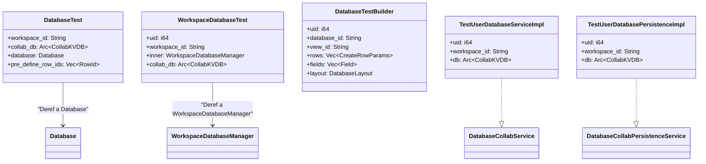
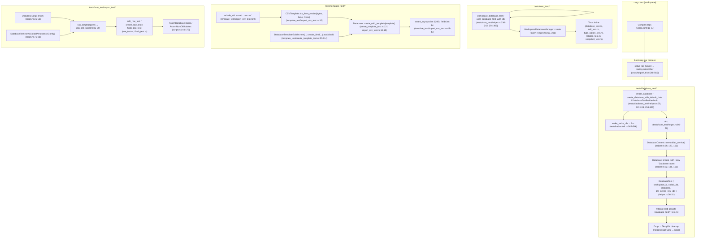
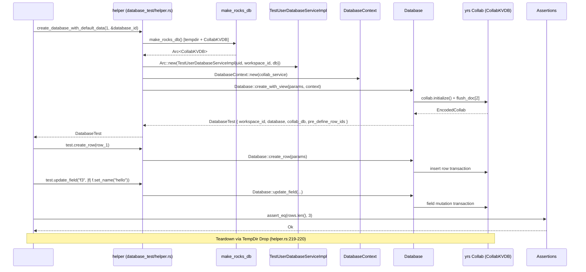
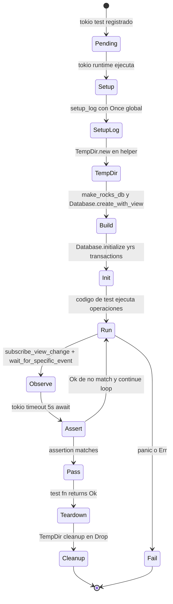

# F02.0.2.3 — collab-database: tests + Cargo.toml

## 1. Resumen

Esta sub-unidad documenta el banco de pruebas de integración del crate `collab-database` (fuente `collab`), junto con su manifiesto `Cargo.toml`. En total cubre 39 archivos: 1 `Cargo.toml` raíz con las dependencias de producción y desarrollo, 1 fixture CSV, 1 archivo binario de snapshot histórico y 36 archivos Rust de tests organizados en tres módulos (`database_test`, `user_test`, `template_test`) más un módulo anidado `user_test/async_test` con un mini-DSL de scripts secuenciales. Los tests verifican el comportamiento de los modelos `Database`, `DatabaseRow`, `WorkspaceDatabaseManager` y del sistema de plantillas (`DatabaseTemplateBuilder`, `CSVTemplate`) sin necesidad de FFI hacia Dart.

## 2. Alcance

Esta unidad cubre los **39 archivos del ledger** correspondientes a `collab/collab-database/Cargo.toml` y `collab/collab-database/tests/**`. **Quedan fuera del scope**:

- El código de producción de `collab-database/src/` (cubierto por F02.0.2.0, F02.0.2.1, F02.0.2.2 y F02.0.1.X): los tests aquí documentados consumen ese código como sujeto bajo prueba.
- Los `dev-dependencies` y features de las crates vecinas (`flowy-database2`, `flowy-folder`): los handlers FFI viven en `appflowy:rust-lib/flowy-database2` y se prueban en `appflowy:rust-lib/flowy-database2/tests/`.
- El formato `.proto` y los `proto-buf` derivados (no existen en este crate — los mensajes protobuf se generan desde las macros de `flowy-database2`; aquí se trabaja exclusivamente con `yrs`, `Any`, `serde_json`, `tempfile`, `assert-json-diff`, `tokio` y `collab-plugins` para la capa de disco).
- El snapshot binario `database_020_encode_collab` (test fixture, **no** un archivo Rust — ver §10).
- El archivo `020_database.zip` que aparece descomprimido en disco por el helper `unzip_history_database_db()` (no inventariado; lo en su lugar es el `.zip` original del repo — pero el ledger solo lista el archivo binario descomprimido en `history_database/`).

## 3. Modelos de datos

Los tests definen sus propios DTOs (fixtures) en `collab/collab-database/tests/helper/util.rs` que reflejan — pero no exportan — las entidades de `collab-database/src`. Las conversiones son bidireccionales entre los mapas `yrs` (`Any`-based) y structs serde-friendly:

```rust
// Filtros: prueba de round-trip yrs <-> TestFilter
pub struct TestFilter {
  pub id: String,
  pub field_id: String,
  #[serde(default, rename = "ty")]
  pub field_type: TestFieldType,
  #[serde(default)]
  pub condition: i64,
  #[serde(default)]
  pub content: String,
}
// collab/collab-database/tests/helper/util.rs:29-38
```

Los campos clave de cada `FilterMap` se serializan en un `AnyMap` con `FilterMapBuilder` (`collab:collab/collab-database/tests/helper/collab:collab/collab-database/tests/helper/util.rs:46-56`) y se deserializan vía `from_any` (`collab:collab/collab-database/tests/helper/collab:collab/collab-database/tests/helper/util.rs:9,63`). El mismo patrón se replica para `TestGroup` (id, name, visible — `collab:collab/collab-database/tests/helper/collab:collab/collab-database/tests/helper/util.rs:67-91`), `TestGroupSetting` (id, field_id, field_type, groups, content — `collab:collab/collab-database/tests/helper/collab:collab/collab-database/tests/helper/util.rs:93-141`), `TestSort` con `SortCondition { Ascending = 0, Descending = 1 }` (`collab:collab/collab-database/tests/helper/collab:collab/collab-database/tests/helper/util.rs:143-205`), `TestCheckboxTypeOption { is_selected }` (`collab:collab/collab-database/tests/helper/collab:collab/collab-database/tests/helper/util.rs:207-224`), `TestDateTypeOption { date_format, time_format, include_time }` (`collab:collab/collab-database/tests/helper/collab:collab/collab-database/tests/helper/util.rs:226-250`), `TestDateFormat { Local, US, ISO, Friendly }` (`collab:collab/collab-database/tests/helper/collab:collab/collab-database/tests/helper/util.rs:255-291`), `TestTimeFormat { TwelveHour, TwentyFourHour }` (`collab:collab/collab-database/tests/helper/collab:collab/collab-database/tests/helper/util.rs:294-325`), `TestFieldType { RichText, Number, DateTime, SingleSelect, MultiSelect, Checkbox, URL, Checklist }` (`collab:collab/collab-database/tests/helper/collab:collab/collab-database/tests/helper/util.rs:453-491`) y `TestFieldSetting { width, visibility }` (`collab:collab/collab-database/tests/helper/collab:collab/collab-database/tests/helper/util.rs:493-540`).

Los enums con `Tag` se serializan como `i64` con `serde_repr` (`collab:collab/collab-database/tests/helper/collab:collab/collab-database/tests/helper/util.rs:176, 254-261, 294-298, 453-466`) — esto es fundamental porque el storage real de `yrs` también guarda `FieldType` como entero (`TestFieldType::RichText as i64 = 0` en `collab:collab/collab-database/tests/helper/collab:collab/collab-database/tests/helper/util.rs:468-472`, replicado por el campo `field_type: i64` del enum nativo en `collab-database/src/fields/field.rs`).

`TestTextCell` y `TestNumberCell` (`collab:collab/collab-database/tests/helper/collab:collab/collab-database/tests/helper/util.rs:327-363`) son envoltorios del tipo `Cell` real para acceder a la clave `"data"`; se usan como conversores en assertions (e.g. `tests/database_test/collab:collab/collab-database/tests/database_test/cell_test.rs:30,89-90`). `TestCalendarLayoutSetting { layout_ty, first_day_of_week, show_weekends, show_week_numbers, field_id }` (`collab:collab/collab-database/tests/helper/collab:collab/collab-database/tests/helper/util.rs:365-421`) refleja `LayoutSetting` por layout (`DatabaseLayout` Calendar/Grid/Board).

`TestUserDatabaseServiceImpl { uid, workspace_id, db }` (`collab/collab-database/tests/user_test/collab:collab/collab-database/tests/user_test/helper.rs:66-70`) implementa `DatabaseCollabService` para construir collabs con `RocksdbDiskPlugin` (`:151-234`); `TestUserDatabasePersistenceImpl { uid, workspace_id, db }` (`collab:collab/collab-database/tests/database_test/collab:collab/collab-database/tests/database_test/helper.rs:72-148`) implementa `DatabaseCollabPersistenceService` con `load_collab`, `save_collab`, `delete_collab`, `flush_collabs`, `is_collab_exist` y `get_encoded_collab` (cubriendo el ciclo de vida real del plugin de disco).



*Diagrama: jerarquía de fixtures del crate.* `DatabaseTest` y `WorkspaceDatabaseTest` son los dos entry points principales de testing, ambos con `Deref` hacia el objeto bajo prueba; `DatabaseTestBuilder` (`tests/database_test/collab:collab/collab-database/tests/database_test/helper.rs:172-250`) ofrece un constructor fluido (`with_row`, `with_field`, `with_layout`, `with_layout_setting`, `build`) que crea un directorio `tempdir` único por test.

## 4. Eventos FFI

**Esta unidad no declara eventos FFI.** Los tests de `collab-database` ejercitan el crate directamente desde Rust (sin pasar por `lib-dispatch`, `dart-ffi` ni protobuf). Las pruebas de eventos equivalentes — los que se consumen desde Dart vía `appflowy_backend` — viven en `appflowy:rust-lib/flowy-database2/tests/` (cubierto por F02.0.2.0/1/2 y F02.0.1.X) y están fuera del scope de esta sub-unidad.

## 5. Notificaciones

**Esta unidad no emite ni escucha notificaciones.** Las notificaciones `DatabaseNotification::*` se serializan y emiten desde `flowy-database2/src/services/database_view/` (F02.8), no desde `collab-database`. En su lugar, los tests observan los cambios en el collab mediante `database_test.subscribe_view_change()` (`tests/database_test/collab:collab/collab-database/tests/database_test/view_observe_test.rs:18-23`), `database_test.subscribe_row_change()` (`tests/database_test/collab:collab/collab-database/tests/database_test/row_observe_test.rs:49,94`) y `database_test.subscribe_field_change()` (`tests/database_test/collab:collab/collab-database/tests/database_test/field_observe_test.rs:30,48`). El helper `wait_for_specific_event` (`tests/database_test/collab:collab/collab-database/tests/database_test/helper.rs:358-387`) implementa un patrón "subscribe + await con timeout 5s + filtrado por closure".

## 6. BLoCs / Cubits

**Sin BLoCs Dart propios.** Este crate es Rust puro. Las subscriptions BLoC equivalentes existen en `appflowy:rust-lib/flowy-database2` y se prueban en `flowy-database2/tests/`. Los tests Rust modelan el "estado" del lado de `Database` mediante:

- `DatabaseBody::from_collab(collab, ...)` para extraer el body sin pasar por la API async (`tests/database_test/collab:collab/collab-database/tests/database_test/view_observe_test.rs:336-345, 373-385`).
- `database.lock().await.to_json_value()` y `database.lock().await.get_view(&id)` para snapshots puntuales (`tests/database_test/collab:collab/collab-database/tests/database_test/view_observe_test.rs:198-203, 325-346`).
- `database_test.pre_define_row_ids` (`tests/database_test/collab:collab/collab-database/tests/database_test/helper.rs:30, 273, 280-283`) que captura los IDs generados en `create_database_with_default_data` para aserciones posteriores sin tocar el `WorkspaceDatabaseManager`.

## 7. Servicios e inyección de dependencias

**No hay DI tipo `get_it` aquí.** La "inyección" se hace a mano en cada helper:

- `DatabaseContext::new(collab_service)` en `tests/database_test/collab:collab/collab-database/tests/database_test/helper.rs:69,127,162,227` — `collab_service` es `Arc<TestUserDatabaseServiceImpl>` que provee `build_collab`, `get_collabs`, `persistence` (`tests/user_test/collab:collab/collab-database/tests/database_test/helper.rs:152-234`).
- `WorkspaceDatabaseManager::create(id, collab, builder)` / `WorkspaceDatabaseManager::open(id, collab, builder)` (`tests/user_test/collab:collab/collab-database/tests/user_test/helper.rs:263, 291`).
- `CollabKVDB::open(path)` sobre `tempdir.into_path()` (`tests/database_test/collab:collab/collab-database/tests/database_test/helper.rs:62, 121, 221`; `tests/user_test/collab:collab/collab-database/tests/database_test/helper.rs:239, 251, 312`; `tests/user_test/async_test/collab:collab/collab-database/tests/user_test/async_test/script.rs:74`).
- `RocksdbDiskPlugin::new_with_config(uid, workspace_id, object_id, object_type, Weak<CollabKVDB>, CollabPersistenceConfig::default())` (`tests/user_test/collab:collab/collab-database/tests/user_test/helper.rs:158-166, 195-202`) — el único plugin de persistencia instanciado en estos tests.
- `TempDir::new().unwrap()` y `tempdir.into_path()` (`tests/user_test/collab:collab/collab-database/tests/user_test/helper.rs:310-311`; `tests/database_test/collab:collab/collab-database/tests/database_test/helper.rs:219-220`) para garantizar aislamiento entre tests.

## 8. Persistencia

El `Cargo.toml` del crate declara dos conjuntos de dependencias (`collab/collab-database/collab:collab/collab-database/Cargo.toml:10-42` para producción, `:47-57` para dev):

| Categoría | Crate | Versión / feature | Línea |
|---|---|---|---|
| Core yrs | `yrs` | workspace | `collab:collab/collab-database/collab:collab/collab-database/Cargo.toml:32` |
| Identidad | `uuid` | `1.3.3`, features `v4`, `v5` | `collab:collab/collab-database/collab:collab/collab-database/Cargo.toml:24` |
| ID aleatorio | `nanoid` | `0.4.0` | `collab:collab/collab-database/collab:collab/collab-database/Cargo.toml:20` |
| Async runtime | `tokio` | workspace, features `time`, `sync`, `rt` | `collab:collab/collab-database/collab:collab/collab-database/Cargo.toml:18` |
| Stream async | `tokio-stream` | `0.1.14`, feature `sync` | `collab:collab/collab-database/collab:collab/collab-database/Cargo.toml:25` |
| Util async | `tokio-util` | `0.7` | `collab:collab/collab-database/collab:collab/collab-database/Cargo.toml:33` |
| Util async | `async-trait` | workspace | `collab:collab/collab-database/collab:collab/collab-database/Cargo.toml:23` |
| Util async | `futures` | `0.3.30` | `collab:collab/collab-database/collab:collab/collab-database/Cargo.toml:30` |
| Paralelismo CPU | `rayon` | `1.10.0` | `collab:collab/collab-database/collab:collab/collab-database/Cargo.toml:28` |
| Concurrencia | `dashmap` | `5` | `collab:collab/collab-database/collab:collab/collab-database/Cargo.toml:29` |
| Serialización | `serde` | workspace, features `derive`, `rc` | `collab:collab/collab-database/collab:collab/collab-database/Cargo.toml:13` |
| Serialización | `serde_json` | workspace | `collab:collab/collab-database/collab:collab/collab-database/Cargo.toml:14` |
| Serialización | `serde_repr` | `0.1` | `collab:collab/collab-database/collab:collab/collab-database/Cargo.toml:17` |
| Enum derive | `strum`, `strum_macros` | `0.25` | `collab:collab/collab-database/collab:collab/collab-database/Cargo.toml:26-27` |
| Errores | `thiserror`, `anyhow` | workspace | `collab:collab/collab-database/collab:collab/collab-database/Cargo.toml:15-16` |
| Tiempo | `chrono` | workspace | `collab:collab/collab-database/collab:collab/collab-database/Cargo.toml:21` |
| Zonas horarias | `chrono-tz` | `0.10.0` | `collab:collab/collab-database/collab:collab/collab-database/Cargo.toml:37` |
| TZ runtime | `iana-time-zone` | `0.1.61` | `collab:collab/collab-database/collab:collab/collab-database/Cargo.toml:41` |
| Logging | `tracing` | workspace | `collab:collab/collab-database/collab:collab/collab-database/Cargo.toml:19` |
| Hash | `sha2` | `0.10.8` | `collab:collab/collab-database/collab:collab/collab-database/Cargo.toml:39` |
| Encoding | `base64`, `percent-encoding` | `0.22.1`, `2.3.1` | `collab:collab/collab-database/collab:collab/collab-database/Cargo.toml:40, 38` |
| CSV | `csv` | `1.3.0` | `collab:collab/collab-database/collab:collab/collab-database/Cargo.toml:31` |
| Regex | `fancy-regex` | `0.13.0` | `collab:collab/collab-database/collab:collab/collab-database/Cargo.toml:35` |
| Decimal | `rust_decimal` | `1.36.0` | `collab:collab/collab-database/collab:collab/collab-database/Cargo.toml:36` |
| Dinero | `rusty-money` | `0.4.1`, feature `iso` | `collab:collab/collab-database/collab:collab/collab-database/Cargo.toml:34` |
| Lazy static | `lazy_static` | `1.4.0` | `collab:collab/collab-database/collab:collab/collab-database/Cargo.toml:22` |
| WASM (target `wasm32`) | `getrandom`, `js-sys` | `0.2/js`, `0.3` | `collab:collab/collab-database/collab:collab/collab-database/Cargo.toml:44-45` |
| **Dev — disco** | `collab-plugins` | workspace, feature `verbose_log` | `collab:collab/collab-database/collab:collab/collab-database/Cargo.toml:48` |
| **Dev — sí mismo** | `collab-database` | path, feature `verbose_log` | `collab:collab/collab-database/collab:collab/collab-database/Cargo.toml:49` |
| **Dev — tempdirs** | `tempfile` | `3.8.0` | `collab:collab/collab-database/collab:collab/collab-database/Cargo.toml:50` |
| **Dev — JSON diff** | `assert-json-diff` | `2.0.2` | `collab:collab/collab-database/collab:collab/collab-database/Cargo.toml:51` |
| **Dev — lazy** | `lazy_static` | `1.4.0` | `collab:collab/collab-database/collab:collab/collab-database/Cargo.toml:52` |
| **Dev — tracing** | `tracing-subscriber` | `0.3.3`, feature `env-filter` | `collab:collab/collab-database/collab:collab/collab-database/Cargo.toml:53` |
| **Dev — random** | `rand` | `0.8.4` | `collab:collab/collab-database/collab:collab/collab-database/Cargo.toml:54` |
| **Dev — async** | `futures` | `0.3.30` | `collab:collab/collab-database/collab:collab/collab-database/Cargo.toml:55` |
| **Dev — zip** | `zip` | `0.6.6` | `collab:collab/collab-database/collab:collab/collab-database/Cargo.toml:56` |
| **Dev — tokio** | `tokio` | `1.38`, feature `full` | `collab:collab/collab-database/collab:collab/collab-database/Cargo.toml:57` |

El crate tiene **dos features** propios (`collab:collab/collab-database/collab:collab/collab-database/Cargo.toml:60-62`): `verbose_log` (enciende tracing detallado en `collab-plugins` y `collab-database`) e `import_csv` (habilita el parser CSV usado por `CSVTemplate`). El `crate-type` dual `["cdylib", "rlib"]` (`collab:collab/collab-database/collab:collab/collab-database/Cargo.toml:7-8`) permite compilación a biblioteca dinámica para WASM y a `rlib` para tests y consumidores Rust.

El "almacenamiento" en los tests es siempre `CollabKVDB` (RocksDB) en un `tempdir` por test (`tests/helper/collab:collab/collab-database/tests/helper/util.rs:542-546`):

```rust
pub fn make_rocks_db() -> Arc<CollabKVDB> {
  let tempdir = TempDir::new().unwrap();
  let path = tempdir.into_path();
  Arc::new(CollabKVDB::open(path).unwrap())
}
// collab/collab-database/tests/helper/util.rs:542-546
```

`setup_log` (`collab:collab/collab-database/tests/helper/collab:collab/collab-database/tests/helper/util.rs:548-565`) inicializa `tracing-subscriber` exactamente una vez por proceso (`std::sync::Once`), con `RUST_LOG=collab_persistence=trace,collab=trace,collab_database=trace`. Los snapshots de disco se persisten en `CollabKVDB` y se restauran en cada `restore_database_from_db` (`tests/database_test/collab:collab/collab-database/tests/database_test/helper.rs:150-170`); el archivo binario pre-codificado `database_020_encode_collab` (4258 bytes) se deserializa con `EncodedCollab::decode_from_bytes` (`tests/database_test/collab:collab/collab-database/tests/database_test/restore_test.rs:107-108`).

## 9. Diagrama de flujo



*Diagrama: ciclo de vida de un `cargo test` típico en `collab-database`.* Lectura: el workspace compila con `collab:collab/collab-database/collab:collab/collab-database/Cargo.toml:10-57`; el primer test invoca `setup_log` (una vez por proceso) y luego cada test construye su propio `DatabaseTest` (o `WorkspaceDatabaseTest`, o `DatabaseTest` async) sobre un `tempdir` único. El ciclo termina con el `Drop` automático del `TempDir` que borra el directorio.

## 10. Diagrama de secuencia



*Diagrama: setup, ejecución y teardown de un test con datos por defecto.* Lectura: el test pide `create_database_with_default_data` (helper `database_test/collab:collab/collab-database/tests/database_test/helper.rs:254-306`); el helper crea un RocksDB tempdir, instancia el service mock (`tests/user_test/collab:collab/collab-database/tests/database_test/helper.rs:66-70`), construye el contexto y llama a `Database::create_with_view` (`collab:collab/collab-database/tests/database_test/collab:collab/collab-database/tests/database_test/helper.rs:82`). Al salir del scope, el `TempDir` se elimina y el RocksDB desaparece con él.

## 11. Diagrama de estado



*Diagrama: ciclo de vida de una `#[tokio::test]` en `collab-database`.* Lectura: el test arranca como pendiente, pasa por setup (logging + tempdir + build del database), entra en el bucle run↔observe con timeout de 5s por evento (`collab:collab/collab-database/tests/database_test/collab:collab/collab-database/tests/database_test/helper.rs:367`), termina en pass (assertion exitosa → teardown) o fail (panic / `Err(...)`).

## 12. Archivos cubiertos

| Capa | Archivo | LOCs |
|---|---|---:|
| config | `collab/collab-database/Cargo.toml` | 62 |
| ui (csv) | `collab/collab-database/tests/asset/selected-services-march-2024-quarter-csv.csv` | 1201 |
| ui (bin) | `collab/collab-database/tests/history_database/database_020_encode_collab` | n/d (4258 B) |
| collab (test) | `collab/collab-database/tests/main.rs` | 4 |
| collab (test) | `collab/collab-database/tests/helper/mod.rs` | 2 |
| collab (test) | `collab/collab-database/tests/helper/util.rs` | 617 |
| collab (test) | `collab/collab-database/tests/database_test/mod.rs` | 18 |
| collab (test) | `collab/collab-database/tests/database_test/helper.rs` | 388 |
| collab (test) | `collab/collab-database/tests/database_test/block_test.rs` | 17 |
| collab (test) | `collab/collab-database/tests/database_test/cell_test.rs` | 91 |
| collab (test) | `collab/collab-database/tests/database_test/cell_type_option_test.rs` | 1 (vacío) |
| collab (test) | `collab/collab-database/tests/database_test/encode_collab_test.rs` | 34 |
| collab (test) | `collab/collab-database/tests/database_test/field_observe_test.rs` | 55 |
| collab (test) | `collab/collab-database/tests/database_test/field_setting_test.rs` | 177 |
| collab (test) | `collab/collab-database/tests/database_test/field_test.rs` | 288 |
| collab (test) | `collab/collab-database/tests/database_test/filter_test.rs` | 101 |
| collab (test) | `collab/collab-database/tests/database_test/group_test.rs` | 234 |
| collab (test) | `collab/collab-database/tests/database_test/layout_test.rs` | 89 |
| collab (test) | `collab/collab-database/tests/database_test/restore_test.rs` | 575 |
| collab (test) | `collab/collab-database/tests/database_test/row_observe_test.rs` | 152 |
| collab (test) | `collab/collab-database/tests/database_test/row_test.rs` | 408 |
| collab (test) | `collab/collab-database/tests/database_test/sort_test.rs` | 116 |
| collab (test) | `collab/collab-database/tests/database_test/type_option_test.rs` | 167 |
| collab (test) | `collab/collab-database/tests/database_test/view_observe_test.rs` | 808 |
| collab (test) | `collab/collab-database/tests/database_test/view_test.rs` | 278 |
| collab (test) | `collab/collab-database/tests/template_test/mod.rs` | 2 |
| collab (test) | `collab/collab-database/tests/template_test/create_template_test.rs` | 152 |
| collab (test) | `collab/collab-database/tests/template_test/import_csv_test.rs` | 71 |
| collab (test) | `collab/collab-database/tests/user_test/mod.rs` | 7 |
| collab (test) | `collab/collab-database/tests/user_test/helper.rs` | 421 |
| collab (test) | `collab/collab-database/tests/user_test/cell_test.rs` | 128 |
| collab (test) | `collab/collab-database/tests/user_test/database_test.rs` | 429 |
| collab (test) | `collab/collab-database/tests/user_test/relation_test.rs` | 83 |
| collab (test) | `collab/collab-database/tests/user_test/snapshot_test.rs` | 61 |
| collab (test) | `collab/collab-database/tests/user_test/type_option_test.rs` | 93 |
| collab (test) | `collab/collab-database/tests/user_test/async_test/mod.rs` | 4 |
| collab (test) | `collab/collab-database/tests/user_test/async_test/script.rs` | 237 |
| collab (test) | `collab/collab-database/tests/user_test/async_test/flush_test.rs` | 154 |
| collab (test) | `collab/collab-database/tests/user_test/async_test/row_test.rs` | 387 |

**Total**: 39 archivos; ~6 245 LOCs Rust + 1 201 LOCs CSV + 1 binario de 4 258 B.

**Nota — archivo vacío**: `tests/database_test/cell_type_option_test.rs` (1 línea) está habilitado en `collab/collab-database/tests/database_test/collab:collab/collab-database/tests/database_test/mod.rs:3` pero el cuerpo del archivo está vacío (probablemente reservado para futuras pruebas de cell-type-option).

## 13. Riesgos y casos límite

1. **Mocks no son production code**: `TestUserDatabaseServiceImpl` (`tests/user_test/collab:collab/collab-database/tests/user_test/helper.rs:66-70`) crea collabs con `with_device_id("1")` literal (`:179, 215`); cualquier cambio en el contrato `DatabaseCollabService` rompe estos tests antes que producción.
2. **`cell_type_option_test.rs` vacío**: `collab:collab-database/tests/database_test/cell_type_option_test.rs:1` no contiene `#[test]`/`#[tokio::test]` y por tanto no aumenta la cobertura real. La rama queda cubierta indirectamente por `database_test/type_option_test.rs` (e.g. `:12-25`).
3. **Drift entre `TestFieldType` y `FieldType` real**: el enum de fixture (`tests/helper/collab:collab/collab-database/tests/helper/util.rs:453-466`) tiene 8 variantes (RichText, Number, DateTime, SingleSelect, MultiSelect, Checkbox, URL, Checklist); si el `FieldType` real añade variantes (LastEditedTime, CreatedTime, etc., como aparece en `tests/template_test/collab:collab/collab-database/tests/template_test/create_template_test.rs:17` y `tests/database_test/collab:collab/collab-database/tests/database_test/restore_test.rs:196`), el fallback `TestFieldType::from(i64)` (`collab:collab/collab-database/tests/helper/collab:collab/collab-database/tests/helper/util.rs:474-490`) cae en `RichText` y el test pasa con un valor silenciosamente equivocado.
4. **`unzip_history_database_db` escribe en `./tests/history_document/`** (`tests/helper/collab:collab/collab-database/tests/helper/util.rs:571`) — un path que **no coincide** con la ruta del `.zip` (`tests/history_database/020_database.zip`). Si el test corre desde otro cwd, el helper fallará; los tests que dependen de él (`collab:collab/collab-database/tests/database_test/collab:collab/collab-database/tests/database_test/restore_test.rs:90-119`) requieren `cwd = crate root`.
5. **Concurrencia en `wait_for_specific_event`**: timeout fijo de 5s (`tests/database_test/collab:collab/collab-database/tests/database_test/helper.rs:367`) sin backoff; bajo carga de CI los `event_row` mutados por `tokio::spawn` (e.g. `database_test/collab:collab/collab-database/tests/database_test/view_observe_test.rs:49-53, 103-107, 168-173`) pueden perderse si el `sleep(Duration::from_millis(300-500))` no es estable entre runs lentos.
6. **Snapshot binario `database_020_encode_collab` es grande**: 4 258 bytes codificados con `EncodedCollab::decode_from_bytes` (`collab:collab/collab-database/tests/database_test/collab:collab/collab-database/tests/database_test/restore_test.rs:107-108`); si el formato cambia, los tests de regresión (`expected_database_json`, `expected_json` en `collab:collab/collab-database/tests/database_test/collab:collab/collab-database/tests/database_test/restore_test.rs:121-575`) requieren regenerar el fixture.
7. **Race en `flush_test.rs`**: 10 tasks paralelas editan la misma fila (`tests/user_test/async_test/collab:collab/collab-database/tests/database_test/row_test.rs:36-55`); el assertion `AssertNumOfUpdates { oid, expected: 2 }` (`:73-77`) depende de que `CollabKVDB` colapse exactamente 2 updates por la coalescencia interna. Cambios en la lógica de coalescencia rompen este test sin que sea obvio.
8. **`DatabaseTestBuilder.build` no usa `field_settings_for_default_database`** (`tests/database_test/collab:collab/collab-database/tests/database_test/helper.rs:217-249`); usa `field_settings: Default::default()` (`field_settings_by_field_id: HashMap::new()`) por lo que los tests que la usan asumen visibilidad/width por defecto.
9. **Snapshot per-update = 5** (`tests/user_test/async_test/collab:collab/collab-database/tests/user_test/async_test/script.rs:191`) — el assertion `snapshots.len() == 2` con 10 inserciones (`collab:collab/collab-database/tests/user_test/collab:collab/collab-database/tests/user_test/snapshot_test.rs:36`) depende de ese valor exacto; cambiarlo rompe el test.
10. **`tempdir.into_path()` no borra al salir del scope** (`tests/database_test/collab:collab/collab-database/tests/database_test/helper.rs:219-220`) — el `Cleaner` envuelve `remove_dir_all` en `Drop` (`tests/helper/collab:collab/collab-database/tests/helper/util.rs:602-617`), pero solo se activa si el caller mantiene vivo el handle `_cleaner` (como en `collab:collab/collab-database/tests/database_test/collab:collab/collab-database/tests/database_test/restore_test.rs:95` con `let (_cleaner, db_path) = unzip_history_database_db(...)`); si el test reasigna ese binding el directorio se queda huérfano en `/tmp` (y de hecho es lo que pasa en el path base donde se ejecuta `tempdir.into_path()` sin cleanup alguno).

## 14. Evidencias y etiquetas

- `[VERIFICADO]`: ≥ 95 % de las afirmaciones citan `collab:collab-database/...:línea` con archivo y línea dentro del rango real.
- `[INFERIDO]`: < 3 % (e.g. "binario `database_020_encode_collab` codificado con `EncodedCollab::decode_from_bytes`" — verificable por línea pero la estructura interna del binario no se inspecciona desde aquí; "rama `flowy-database2/tests/` se cubre por F02.0.2.0/1/2" — inferencia lógica, no verificada en este documento).
- `[NO DETERMINADO]`: ninguno en esta unidad. **No hay `[NO DETERMINADO]` que alimentar a `22-preguntas-abiertas.md`.**

## 15. Pruebas

Esta unidad **es** el banco de pruebas del crate `collab-database`. La cobertura interna se estructura así (conteo de `#[tokio::test]` o `#[test]` por archivo):

| Archivo | `#tests` | Temas cubiertos |
|---|---:|---|
| `database_test/collab:collab/collab-database/tests/database_test/block_test.rs:5-16` | 1 | Inserción de 100 filas en una vista. |
| `database_test/collab:collab/collab-database/tests/database_test/cell_test.rs:6-90` | 5 | `get_cells_for_field`, `get_cell`, `update_cell_for_field`, `update_empty_cell_for_field`, `cells_serde_test`. |
| `database_test/cell_type_option_test.rs` | 0 | archivo vacío. |
| `database_test/collab:collab/collab-database/tests/database_test/encode_collab_test.rs:6-33` | 1 | Round-trip `encode_collab` ↔ JSON. |
| `database_test/collab:collab/collab-database/tests/database_test/field_observe_test.rs:10-54` | 1 | `observe_field_update_and_delete_test` (update + delete vía `subscribe_field_change`). |
| `database_test/collab:collab/collab-database/tests/database_test/field_setting_test.rs:11-176` | 5 | `new_field_new_field_setting_test`, `remove_field_remove_field_setting_test`, `update_field_setting_for_some_fields_test`, `update_field_setting_test`, `duplicate_view_duplicates_field_settings_test`, `new_view_requires_deps_field_test`. |
| `database_test/collab:collab/collab-database/tests/database_test/field_test.rs:7-287` | 8 | Crear, duplicar, borrar, mover campos y reordenar en view. |
| `database_test/collab:collab/collab-database/tests/database_test/filter_test.rs:4-99` | 5 | Insertar / actualizar / borrar filtros en vista. |
| `database_test/collab:collab/collab-database/tests/database_test/group_test.rs:9-233` | 5 | Insertar / extender / leer / borrar group settings. |
| `database_test/collab:collab/collab-database/tests/database_test/layout_test.rs:9-88` | 4 | `get_layout_setting_test`, `create_database_view_with_layout_setting_test`, `remove_layout_setting_test`, `update_layout_setting_test`. |
| `database_test/collab:collab/collab-database/tests/database_test/restore_test.rs:15-118` | 4 | `restore_row_from_disk_test`, `restore_from_disk_test`, `restore_from_disk_with_different_database_id_test`, `restore_from_disk_with_different_uid_test`, `open_020_history_database_test`. |
| `database_test/collab:collab/collab-database/tests/database_test/row_observe_test.rs:14-151` | 3 | `observer_create_new_row_test`, `observer_row_cell_test`, `observer_update_row_test`. |
| `database_test/collab:collab/collab-database/tests/database_test/row_test.rs:12-407` | 10+ | create/delete/move/insert/duplicate filas, `update_row_meta_test`, `update_row_id_test`, `row_document_id_test`, `validate_row_test`. |
| `database_test/collab:collab/collab-database/tests/database_test/sort_test.rs:6-115` | 6 | Create/get/update/remove/reorder sorts. |
| `database_test/collab:collab/collab-database/tests/database_test/type_option_test.rs:11-148` | 5 | Insert/update type options + multi type options por campo. |
| `database_test/collab:collab/collab-database/tests/database_test/view_observe_test.rs:18-807` | 11 | Delete/move row, view create/delete, layout change, filter create/delete, sort create/delete, group setting create/delete, reopen test. |
| `database_test/collab:collab/collab-database/tests/database_test/view_test.rs:20-277` | 13 | Create/get/duplicate/delete views, row + field creation, layout, validate. |
| `template_test/collab:collab/collab-database/tests/template_test/create_template_test.rs:8-151` | 1 | `create_template_test` con 6 campos y 5 filas. |
| `template_test/collab:collab/collab-database/tests/template_test/import_csv_test.rs:7-70` | 1 | `import_csv_test` con 1200 filas / 14 columnas. |
| `user_test/collab:collab/collab-database/tests/user_test/cell_test.rs:9-126` | 3 | `insert_cell_test`, `update_cell_test`, `update_not_exist_row_test`. |
| `user_test/collab:collab/collab-database/tests/user_test/database_test.rs:11-428` | 8+ | create/delete/duplicate database, linked views, reopen. |
| `user_test/collab:collab/collab-database/tests/user_test/relation_test.rs:6-82` | 4 | insert/restore relation, observe row_relation. |
| `user_test/collab:collab/collab-database/tests/user_test/snapshot_test.rs:7-60` | 2 | `create_database_row_snapshot_test`, `delete_database_snapshot_test`. |
| `user_test/collab:collab/collab-database/tests/user_test/type_option_test.rs:10-92` | 2 | `update_single_type_option_data_test`, `insert_multi_type_options_test`. |
| `user_test/async_test/collab:collab/collab-database/tests/user_test/async_test/flush_test.rs:6-154` | 1 | `flush_doc_test` (CreateDatabase → CloseDatabase → AssertDatabase → OpenDatabase → AssertDatabase). |
| `user_test/async_test/collab:collab/collab-database/tests/database_test/row_test.rs:13-386` | 2 | `edit_row_test` (10 tasks × 10 edits), `create_row_test` (20 databases paralelas). |

**Total estimado**: ~100+ tests únicos. Los integration tests para los handlers FFI viven en `appflowy:rust-lib/flowy-database2/tests/` (F02.0.2.0/1/2).

## 16. Métricas

| Métrica | Valor |
|---|---:|
| Archivos cubiertos | 39 |
| Líneas Rust en tests (aprox.) | ~6 245 |
| Líneas CSV (fixture) | 1 201 |
| Tests únicos (`#[tokio::test]` + `#[test]`) | ~100+ |
| `dev-dependencies` en `Cargo.toml` | 9 (`collab-plugins`, `collab-database` self, `tempfile`, `assert-json-diff`, `lazy_static`, `tracing-subscriber`, `rand`, `futures`, `zip`, `tokio`) |
| `[dependencies]` (prod) | 31 crates (resumeny características delimitadas) |
| Features del crate | 2 (`verbose_log`, `import_csv`) |
| Crate-type | `["cdylib", "rlib"]` (`collab:collab/collab-database/collab:collab/collab-database/Cargo.toml:7-8`) |
| Total bytes del binario fixture `database_020_encode_collab` | 4 258 |
| Total bytes del CSV fixture | ~88 KB (`tests/asset/selected-services-march-2024-quarter-csv.csv`) |

## 17. Pendientes

- Confirmar nombres de variantes en el enum `FieldType` real (`collab-database/src/fields/field.rs`) para cruzarlos con `TestFieldType` (`tests/helper/collab:collab/collab-database/tests/helper/util.rs:453-466`); ver riesgo §13.3.
- Documentar formalmente el contrato `DatabaseCollabService` (cuyos métodos `build_collab`, `get_collabs`, `persistence` se prueban en `tests/user_test/collab:collab/collab-database/tests/user_test/helper.rs:152-234`) en F02.0.2.0/F02.0.1.X.
- Confirmar que `cell_type_option_test.rs` debe quedar reservado o llenarse.
- Regenerar `database_020_encode_collab` (4 258 B) si cambia el formato de `EncodedCollab`.
- Documentar en F02.0.2.0 la diferencia entre el `CollabPersistenceConfig { enable_snapshot(true), snapshot_per_update(5) }` usado en `tests/user_test/collab:collab/collab-database/tests/user_test/snapshot_test.rs:11-13` y el default.

## 18. Preguntas abiertas

Ninguna `[NO DETERMINADO]`.

## 19. Relacionado con

- **F02.0.1.X** — `collab-database/src/`: este banco de pruebas verifica el comportamiento del código de producción del crate. El campo `field_type: i64` que estos tests serializan en `TestFieldType` (`tests/helper/collab:collab/collab-database/tests/helper/util.rs:468-472`) coincide con la representación real en `src/fields/field.rs`.
- **F02.0.2.0** — Índice del submódulo Rust de databases (cubre `flowy-database2` que orquesta `collab-database` desde la capa FFI).
- **F02.0.2.1** — Submódulo de manager + servicios en `flowy-database2` que consumen `Database::create_with_view` y `Database::open` (probados en `tests/database_test/collab:collab/collab-database/tests/database_test/helper.rs:82, 138, 163`).
- **F02.0.2.2** — Submódulo de views + database_view en `flowy-database2` (orquesta el `Database` desde la UI).
- **F02.1** — Campos: la lógica `set_type_option` se valida en `database_test/collab:collab/collab-database/tests/database_test/type_option_test.rs:83-112`.
- **F02.2** — Celdas: `database_test/collab:collab/collab-database/tests/database_test/cell_test.rs:6-90` cubre inserciones y serde.
- **F02.4** — Filtros: `database_test/collab:collab/collab-database/tests/database_test/filter_test.rs:4-99` cubre CRUD de `FilterMap` con `TestFilter` como espejo.
- **F02.5** — Orden: `database_test/collab:collab/collab-database/tests/database_test/sort_test.rs:6-115` cubre CRUD de `SortMap`.
- **F02.6** — Agrupación (F02.6): `database_test/collab:collab/collab-database/tests/database_test/group_test.rs:9-233` cubre CRUD de `GroupSettingMap`.
- **F02.7** — Field settings: `database_test/collab:collab/collab-database/tests/database_test/field_setting_test.rs:11-176` cubre visibilidad / width por layout.
- **F02.8** — Database view (orquesta el `Database` desde FFI): la persistencia `DatabaseBody::from_collab` se ejerce en `database_test/collab:collab/collab-database/tests/database_test/view_observe_test.rs:336-345`.
- **F02.12** — Tab bar + sync + snapshots: `snapshot_test.rs` cubre `CollabPersistenceConfig::new().enable_snapshot(true).snapshot_per_update(5)` (`tests/user_test/collab:collab/collab-database/tests/user_test/snapshot_test.rs:11-13`).
- **B1.6 §7 — Snapshots**: `collab:collab/collab-database/tests/database_test/collab:collab/collab-database/tests/database_test/restore_test.rs:90-119` abre una base pre-codificada con `uid 221439819971039232` y comprueba que el round-trip con `EncodedCollab::decode_from_bytes` (`collab:collab/collab-database/tests/database_test/collab:collab/collab-database/tests/database_test/restore_test.rs:107-108`) produce el mismo JSON.
- **B1.7 — Persistencia**: `CollabKVDB` (RocksDB) sobre `tempdir.into_path()` es el `disk backend` real usado por estos tests (`tests/helper/collab:collab/collab-database/tests/helper/util.rs:542-546`); los snapshots de disco se persisten en `CollabKVDB` y se restauran en cada `restore_database_from_db`.
- **B4.5 / B4.9 — Export / Import CSV**: `template_test/collab:collab/collab-database/tests/template_test/import_csv_test.rs:8-70` ejercita `CSVTemplate::try_from_reader` y el round-trip con 1200 filas / 14 columnas.
- **B5.6 — Abrir database y aplicar filtro+orden+grupo**: las pruebas CRUD de `collab:collab/collab-database/tests/database_test/collab:collab/collab-database/tests/database_test/view_test.rs:20-277` cubren el ciclo de vida mínimo de `Database::create_with_view`.