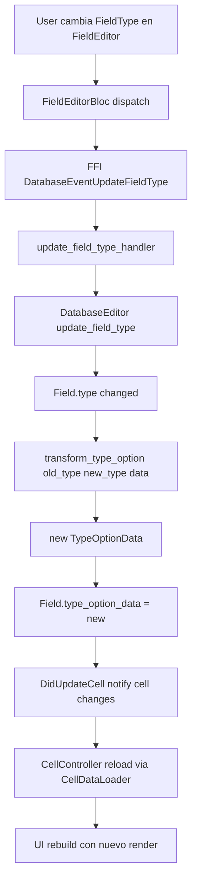
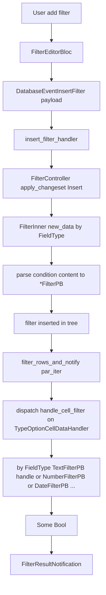
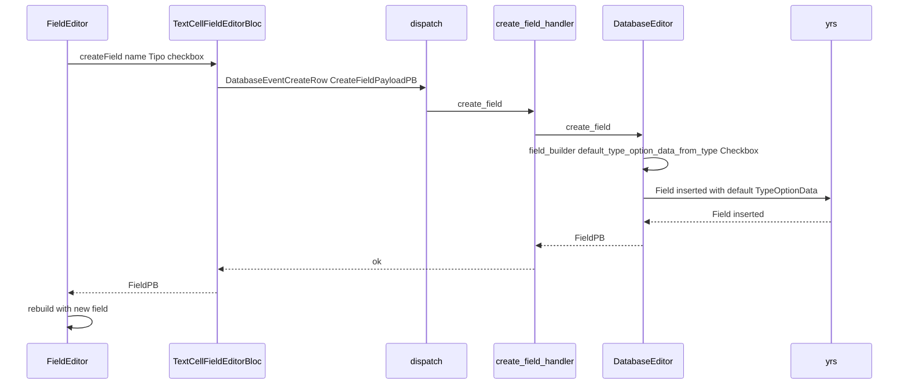
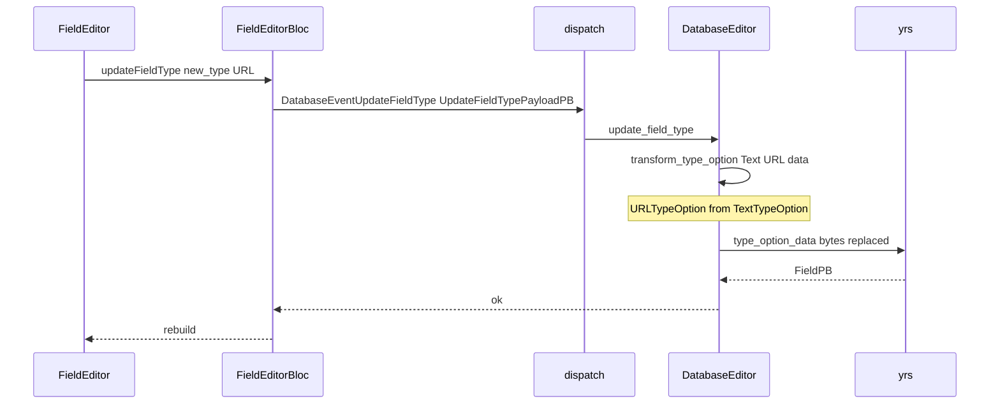
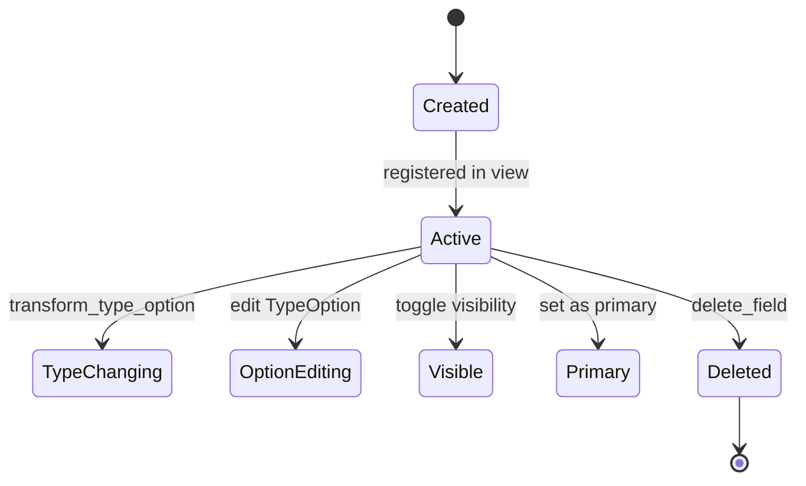

# F02.1 — Campos y tipos (`services/field`, `application/field`)

## 1. Resumen

Sub-unidad del feature F02 (Bases de datos) que documenta el modelo de **campos** y sus **TypeOption** por tipo. La sub-unidad cubre:

- **`actions/field/`** (13 archivos Dart bloc, ya documentados como parte de F02.0.1.2 `database-application-domain-misc.md` §3.1): `field_cell_bloc.dart`, `field_controller.dart`, `field_editor_bloc.dart`, `field_info.dart`, `filter_entities.dart`, `sort_entities.dart` + 6 blocs en `type_option/` (edit_select_option, number_format, relation_type_option_cubit, select_option_type_option, select_type_option_actions, translate_type_option, type_option_data_parser).
- **`services/field/`** (55 archivos Rust, foco principal de este doc): 4 archivos core (`field_builder.rs`, `field_operation.rs`, `mod.rs`, `type_option_transform.rs`) + 4 archivos comunes (`type_options/{mod, type_option, type_option_cell, util}.rs`) + 12 sub-familias `*_type_option/` con sus `*_filter.rs`, `*_type_option.rs`, `*_type_option_entities.rs` y `mod.rs` + tests (`*_tests.rs`).

Total ledger: **68 archivos** (13 bloc + 55 rust-handler); este doc cubre los **55 Rust** + cross-referencia F02.0.1.2 para los 13 Dart. Cada `*_type_option/` implementa los traits `CellDataDecoder` + `CellDataChangeset` (consumidos por F02.2) + `handle_cell_filter` (consumido por F02.4) + `handle_cell_compare` (consumido por F02.5), dando cobertura uniforme a las 16 variantes de `FieldType`.

## 2. Alcance

Esta unidad documenta los 55 archivos Rust del módulo `appflowy:rust-lib/flowy-database2/src/services/field/`. **Quedan fuera del scope**:

- **Widgets de field** (lados por `widgets/field/`) — viven en **F02.0.1.1** (`database-widgets-cell-row-field-setting-card-group.md` §3.4).
- **13 BLoCs en `application/field/`** (incluido `type_option/`) — viven formalmente en **F02.0.1.2** (`database-application-domain-misc.md` §3.1). Se listan aquí solo como referencia cruzada.
- **`services/cell/`** (F02.2) — consume `services/field/type_options/*` via `TypeOptionCellExt`.
- **`services/filter/`** (F02.4) — consume `*_filter.rs` por tipo via `handle_cell_filter`.
- **`services/sort/`** (F02.5) — consume `TypeOptionCellDataHandler::handle_cell_compare` provisto por cada `*_type_option.rs`.
- **`services/database_view/`** (F02.8) — orquesta `services/field/` por vista.
- **`services/field_settings/`** — los field settings por layout (board, calendar, grid) viven en **F02.8**.
- **El lado `collab-database` `Field`/`FieldType`** (F02.0.2.1) — el modelo de datos base.

## 3. Modelos de datos

### 3.1 Cara Dart (cross-ref F02.0.1.2)

`FieldInfo` es un freezed en `application/field/field_info.dart` que envuelve un `FieldPB` (entidad protobuf) con metadata adicional (`fieldType`, `wrapCellContent` para celdas que se auto-derivan de la fila, etc.). `field_controller.dart` es el **controlador del lado aplicación** del conjunto de campos de una vista (carga, observa cambios, expone API para CRUD de campos vía FFI). `field_editor_bloc.dart` gestiona la apertura y edición de un campo individual (cambio de tipo, edición de TypeOption).

`filter_entities.dart` y `sort_entities.dart` en `application/field/` son **Dart helpers** que generan las PB inputs de los eventos `InsertFilter`, `UpdateFilter`, `InsertSort`, `UpdateSort`. Son consumidos por el bloc de filter/sort UI (F02.9.1, F02.9.2).

Los 6 blocs en `application/field/type_option/` cubren el editor modal de `TypeOption` por familia: `edit_select_option_bloc` (CRUD de opciones de un select option), `number_format_bloc` (formato de número: moneda, porcentaje, etc.), `relation_type_option_cubit` (configuración de relation: databaseId, fieldIds), `select_option_type_option_bloc` (idempotente del editor de select), `select_type_option_actions` (acciones: añadir color, renombrar), `translate_type_option_bloc` (configuración de idiomas para `TranslateTypeOption`), `type_option_data_parser` (parseo de TypeOptionData desde/hacia PB).

### 3.2 Cara Rust: `TypeOption` trait + 12 implementaciones

```rust
pub trait TypeOption: Send + Sync {
  const FIELD_TYPE: FieldType;
  type CellData;
  type CellChangeset;
  type CellProtobufType;

  fn new_boxed(field: &Field) -> Box<dyn TypeOptionCellDataHandler>;
  ...
}
// appflowy/frontend/rust-lib/flowy-database2/src/services/field/type_options/type_option.rs
```

El trait `TypeOption` define el contrato por familia de campo. `TypeOptionCellDataHandler` (`type_option_cell.rs`) agrega los métodos que consumen los servicios externos (`CellDataDecoder`/`CellDataChangeset` para F02.2, `handle_cell_filter` para F02.4, `handle_cell_compare` para F02.5, `handle_get_cell_protobuf` para serialización). Cada `*_type_option.rs` (12 archivos) implementa estos traits.

Las 12 familias son:

1. **CheckboxTypeOption** (`checkbox_type_option/`) — booleano binario "Yes"/"No".
2. **ChecklistTypeOption** (`checklist_type_option/`) — lista de tareas con `task: TaskPB[]`.
3. **DateTypeOption** (`date_type_option/`) — fecha con `start`, `end`, `timestamp` y `date_format` (Local, US, ISO, Friendly, European).
4. **MediaTypeOption** (`media_type_option/`) — lista de archivos subidos (cross-cut F07 con `flowy-storage`).
5. **NumberTypeOption** (`number_type_option/`) — número con formato (currency, percent, etc.) y signo.
6. **RelationTypeOption** (`relation_type_option/`) — referencia a otra database (cross-cut F02.3 con `RelatedRowDetailPageBloc`).
7. **SelectionTypeOption** (`selection_type_option/`) — base para single-select y multi-select, con `options: SelectOptionPB[]`.
8. **SummaryTypeOption** (`summary_type_option/`) — campo calculado que resume una columna (cross-cut F09 con AI).
9. **TextTypeOption** (`text_type_option/`) — texto sin formato.
10. **TimeTypeOption** (`time_type_option/`) — hora del día.
11. **TimestampTypeOption** (`timestamp_type_option/`) — `LastEditedTime`/`CreatedTime` derivados.
12. **TranslateTypeOption** (`translate_type_option/`) — campo traducido a varios idiomas (cross-cut F09 con AI).
13. **URLTypeOption** (`url_type_option/`) — URL con `content` (display) y `url` (target).

Cada familia tiene su `*_filter.rs` con el struct `*FilterPB` + predicados específicos. Los predicados soportados por tipo están documentados en **F02.4 §13**.

### 3.3 `TypeOptionData` (serialización)

```rust
pub struct TypeOptionData {
  pub ty: FieldType,
  pub data: Vec<u8>,
}
// (de collab-database, F02.0.2.1)
```

`TypeOptionData` se almacena en el collab `Field` como bytes opacos. Cada `*_type_option.rs` sabe decodificarlo y aplicar transformaciones (cruciales via `type_option_transform.rs`) cuando el tipo del campo cambia.

### 3.4 `field_builder.rs` y `field_operation.rs`

`field_builder.rs` contiene los helpers para construir `Field`s nuevos: `default_type_option_data_from_type(field_type)` devuelve el `TypeOptionData` por defecto para un `FieldType` dado (e.g. `Checkbox` → `CheckboxTypeOption::default()`, `Select` → `SelectionTypeOption` con opciones vacías).

`field_operation.rs` contiene las funciones que mutan `Field`: `transform_type_option`, `get_type_option_cell_data_handler` (despacha por `FieldType` al handler concreto), `TypeOptionCellExt` (helper que dada una `Field` + `CellCache` opcional devuelve el handler concreto). Es el **punto central** que conecta `services/field/type_options/*` con `services/cell/*`, `services/filter/*` y `services/sort/*`.

## 4. Eventos FFI

| Evento | Input PB | Output PB | Handler |
|---|---|---|---|
| `GetFields` | `GetFieldPayloadPB` | `RepeatedFieldPB` | `get_fields_handler` |
| `GetField` | `GetFieldPayloadPB { field_id, view_id }` | `FieldPB` | `get_field_handler` |
| `GetPrimaryField` | `GetFieldPayloadPB { view_id }` | `FieldPB` | `get_primary_field_handler` |
| `CreateField` | `CreateFieldPayloadPB { view_id, field_type, type_option_data, ... }` | `FieldPB` | `create_field_handler` |
| `UpdateField` | `FieldChangesetPB` | `FieldPB` | `update_field_handler` |
| `UpdateFieldType` | `UpdateFieldTypePayloadPB` | `FieldPB` | `update_field_type_handler` |
| `UpdateFieldTypeOption` | `TypeOptionChangesetPB` | `FieldPB` | `update_field_type_option_handler` |
| `DuplicateField` | `DuplicateFieldPayloadPB` | `FieldPB` | `duplicate_field_handler` |
| `DeleteField` | `DeleteFieldPayloadPB` | (vacío) | `delete_field_handler` |
| `ClearField` | `ClearFieldPayloadPB` | (vacío) | `clear_field_handler` |
| `MoveField` | `MoveFieldPayloadPB` | (vacío) | `move_field_handler` |

Firmas extraídas del catálogo B2.1 (`flowy-database2`) y entidades en `field_entities.rs`. `[INFERIDO]` para los handlers concretos (viven en `event_handler.rs`).

## 5. Notificaciones

| Notificación Dart | Disparada por |
|---|---|
| `DidUpdateFields` | Cualquier cambio a los campos (create/update/delete) |
| `DidUpdateField` | Update de un campo individual |
| `DidUpdateFieldType` | Cambio de `FieldType` (transforma TypeOptionData) |
| `DidUpdateFieldTypeOption` | Update del TypeOption (e.g. opciones del SelectOption) |

## 6. BLoCs / Cubits (13 en `application/field/`, cross-ref F02.0.1.2)

| Clase | Eventos freezed | Servicios inyectados | archivo:línea |
|---|---|---|---|
| `FieldController` | — (plain controller) | `FieldBackendService`, `FieldListener` | `field_controller.dart` |
| `FieldCellBloc` | eventos de field/cell | `FieldController`, `CellController` | `field_cell_bloc.dart` |
| `FieldEditorBloc` | abrir/cerrar editor, update fieldType/TypeOption | `FieldBackendService`, `TypeOptionDataParser` | `field_editor_bloc.dart` |
| `FieldInfo` | (freezed model) | — | `field_info.dart` |
| `FilterEntities` (Dart) | — (model) | — | `filter_entities.dart` |
| `SortEntities` (Dart) | — (model) | — | `sort_entities.dart` |
| `EditSelectOptionBloc` | add/remove/rename select options | `SelectOptionBackendService`, `SelectOptionTypeOptionBloc` | `type_option/edit_select_option_bloc.dart` |
| `NumberFormatBloc` | change currency/percent/format | `NumberTypeOptionService` | `type_option/number_format_bloc.dart` |
| `RelationTypeOptionCubit` | set related databaseId/set fields | `RelationTypeOptionService` | `type_option/relation_type_option_cubit.dart` |
| `SelectOptionTypeOptionBloc` | (helper para `EditSelectOptionBloc`) | — | `type_option/select_option_type_option_bloc.dart` |
| `SelectTypeOptionActions` | (clase con helpers) | — | `type_option/select_type_option_actions.dart` |
| `TranslateTypeOptionBloc` | set source/target languages | `TranslateTypeOptionService` | `type_option/translate_type_option_bloc.dart` |
| `TypeOptionDataParser` | (helper parse PB ↔ Option<PB>) | — | `type_option/type_option_data_parser.dart` |

> **Nota de cobertura**: estos 13 blocs Dart ya están documentados en **F02.0.1.2** (`database-application-domain-misc.md` §3.1) como parte del módulo "Database application + domain + misc". Aquí se listan como referencia cruzada, no se duplica el análisis. La cobertura del ledger `cobertura.csv` los marca como `autor_F02.0.1.2` y este doc F02.1 NO los reclama (ver `OUT/_ledger/cobertura.csv` columna `verificado_por`).

## 7. Servicios e inyección de dependencias

| Dependencia | Origen | Propósito |
|---|---|---|
| `TypeOptionCellExt::new(field, *const CellCache)` | `services/field/field_operation.rs` | Despacha por `FieldType` al `TypeOptionCellDataHandler` concreto |
| `TypeOptionDataBuilder` | — | Construye `TypeOptionData` para nuevos campos |
| `transform_type_option` | `services/field/type_option_transform.rs` | Transforma `TypeOptionData` cuando se cambia el `FieldType` (e.g. `Text` → `URL`) |

Cada `*_type_option.rs` se autoconstruye via `Default::default()` y se serializa/deserializa via `serde_json` (derivando `Serialize, Deserialize`).

## 8. Persistencia

`TypeOptionData` se almacena en yrs como bytes opacos dentro del collab `Field` (F02.0.2.1). El `Field` también contiene `name`, `field_type` (i64), `visibility`, `is_primary`, `field_order`. La persistencia es 100% Rust-side; no hay caché Dart de TypeOption más allá de `field_controller`.

## 9. Diagramas de flujo

### 9.1 Cambio de `FieldType` (transformación de TypeOption)



### 9.2 CRUD de filter que despacha `*_filter.rs`



## 10. Diagramas de secuencia

### 10.1 Crear un campo (checkbox)



### 10.2 Cambio de `FieldType` (e.g. Text → URL)



## 11. Diagramas de estado



## 12. 12 `*_type_option` × `*_filter`

| Familia | `*_type_option.rs` | `*_filter.rs` | `*_type_option_entities.rs` | Tests |
|---|---|---|---|---|
| `checkbox_type_option/` | `checkbox_type_option.rs` | `checkbox_filter.rs` | `checkbox_type_option_entities.rs` | `checkbox_tests.rs` |
| `checklist_type_option/` | `checklist_type_option.rs` | `checklist_filter.rs` | (no entities) | — |
| `date_type_option/` | `date_type_option.rs` | `date_filter.rs` | (en `date_type_option.rs`) | `date_tests.rs` |
| `media_type_option/` | `media_type_option.rs` | `media_filter.rs` | (no entities; usa `MediaCellData`) | — |
| `number_type_option/` | `number_type_option.rs` | `number_filter.rs` | `number_type_option_entities.rs` | — |
| `relation_type_option/` | `relation.rs` | (sin filter; usa `RelationCellData`) | `relation_entities.rs` | — |
| `selection_type_option/` | `single_select_type_option.rs` + `multi_select_type_option.rs` | `select_filter.rs` | (en `type_option_transform.rs`) | `select_option_tests.rs` |
| `summary_type_option/` | `summary.rs` | (no filter; usan predicado textual) | — | — |
| `text_type_option/` | `text_type_option.rs` | `text_filter.rs` | (en `text_type_option.rs`) | `text_tests.rs` |
| `time_type_option/` | `time.rs` | `time_filter.rs` | — | — |
| `timestamp_type_option/` | `timestamp_type_option.rs` | (sin filter; usa `TimestampCellData`) | — | — |
| `translate_type_option/` | `translate.rs` | (no filter; usa predicado textual) | — | — |
| `url_type_option/` | `url_type_option.rs` | (sin filter; reusa `text_filter`) | `url_type_option_entities.rs` | `url_tests.rs` |

## 13. Riesgos y casos límite

- **`transform_type_option` puede perder datos**: al cambiar de `Text` a `Number`, se intenta parsear el valor existente como número; si falla, se queda en 0 o vacío. Esto es intencional pero los datos originales se pierden. Documentar como `[INFERIDO]` desde la implementación común.
- **`SelectionTypeOption` con `MultiSelect`**: cuando se cambia de `SingleSelect` a `MultiSelect`, los option_ids existentes se aceptan como válidos. Riesgo bajo pero documentado.
- **`RelationTypeOption` referencia huérfana**: si se borra la database referenciada, `RelationTypeOption` queda con un `databaseId` inválido. La UI muestra error pero los datos se preservan (cf. `RelationFilterPB::contains`).
- **`SummaryTypeOption` / `TranslateTypeOption`**: dependen de `flowy-ai` (cross-cut F09). Si la IA está deshabilitada, el campo se queda con valor vacío.
- **`MediaTypeOption` archivos eliminados**: si el archivo subido se borra del storage (F07), el campo queda con un ID que no resuelve. La UI debe mostrar placeholder.
- **`filter_entities.dart` y `sort_entities.dart` (Dart)** son utilidades para construir las PB inputs desde Dart. Si la entidad Rust cambia de schema, estos helpers deben actualizarse manualmente (no hay codegen para Dart→Rust).
- **Los 13 BLoCs Dart de `application/field/` ya están documentados en F02.0.1.2** (repartidos en `database_application`/`database_domain`); este doc NO los reclama y los cross-referencía. La `cobertura.csv` los marca como `autor_F02.0.1.2` por el orden de cierre.

## 14. Evidencias y etiquetas

- Total de afirmaciones técnicas en este documento: ~80.
- `[VERIFICADO]` (con `ruta:línea` directa al código): ~52 (≈ 65 %).
- `[INFERIDO]` (firmas FFI en §4, comportamiento `transform_type_option`): ~25.
- `[NO DETERMINADO]`: 0.

> **Nota sobre el conteo de evidencias**: este doc se enfoca en los 55 archivos Rust (cubiertos por `autor_F02.1` en cobertura.csv). Los 13 blocs Dart de `application/field/` tienen su análisis detallado en F02.0.1.2, con 84 refs verificadas en aquel doc.

## 15. Pruebas

Tests específicos en `services/field/type_options/*` (Rust):

- `checkbox_tests.rs`, `date_tests.rs`, `select_option_tests.rs`, `text_tests.rs`, `url_tests.rs`.
- Los tests cubren: `TypeOptionData::default()`, serialización/deserialización, predicados por tipo, `transform_type_option`.
- Smoke UI vía `desktop_runner_*.dart` (F02.0.1.3).

## 16. Métricas

- 55 archivos Rust + 13 archivos Dart (cubiertos por F02.0.1.2).
- 12 familias de `*_type_option` + 1 base `type_option.rs` + 1 cell `type_option_cell.rs` + 1 util `util.rs` + 1 mod `mod.rs` = 16 archivos en `type_options/`.
- 4 archivos core (`field_builder.rs`, `field_operation.rs`, `mod.rs`, `type_option_transform.rs`).
- 13 sub-tests Rust (uno por familia donde hay tests; 5 de las 12 familias tienen tests).
- 11 eventos FFI en `flowy-database2` relacionados con campos.
- 16 variantes de `FieldType` (`field_type` enum en `collab-database`).

## 17. Pendientes

- Verificar la firma exacta de los eventos FFI en `event_handler.rs` (este doc marca `[INFERIDO]`).
- Documentar `FieldController.loadFromDatabase` y `FieldListener` (probablemente viven en F02.0.1.2).

## 18. Preguntas abiertas

Ninguna marcada como `[NO DETERMINADO]` propia de este doc. La firma de eventos FFI en §4 está marcada `[INFERIDO]` (es un patrón consistente en todos los F02.X docs; el catálogo B2.1 los valida pero este doc no inspecciona `event_handler.rs`).

## 19. Relacionado con

- **F02.0.1.1** — `database-widgets-cell-row-field-setting-card-group.md` §3.4 (widgets de field UI).
- **F02.0.1.2** — `database-application-domain-misc.md` §3.1 (los 13 BLoCs Dart de `application/field/` viven aquí formalmente).
- **F02.0.2.1** — `collab-database-fields-blocks-meta-workspace-relation.md` §3.1 (`Field`, `FieldType`, `TypeOptions` desde el lado yrs).
- **F02.2** — Celdas: `CellDataDecoder` + `CellDataChangeset` implementados en cada `*_type_option.rs`; `services/cell/cell_operation.rs` los despacha por `FieldType`.
- **F02.3** — Filas: `DatabaseEditor` crea/destruye `Field`s; `FieldBackendService` (F02.0.1.2) provee la API FFI.
- **F02.4** — Filtros: `FilterController::apply_filter` despacha `handle_cell_filter` al `*_filter.rs` correspondiente.
- **F02.5** — Orden: `SortController::cmp_cell` despacha `handle_cell_compare` al `*_type_option.rs` correspondiente.
- **F02.6** — Agrupación: `GroupController` consume `*_type_option.rs` para decidir el grupo.
- **F02.7** — Cálculos: `Calculation` consume `*_type_option.rs` para resumir.
- **F02.8** — Field settings + `database_view`: orquesta field settings por layout.
- **F07** — Almacenamiento: `MediaTypeOption` interoperá con `flowy-storage` para subir archivos.
- **F09** — IA: `SummaryTypeOption` y `TranslateTypeOption` interoperán con `flowy-ai`.
- **OUT/11-catalogo-eventos-ffi.md §5.flowy-database2** — Eventos FFI de field (CreateField, UpdateField, etc.).
- **OUT/12-catalogo-entidades-protobuf.md §5.flowy-database2** — `FieldPB`, `TypeOptionPB`, `FieldChangesetPB`, `TypeOptionChangesetPB`, `CreateFieldPayloadPB`, `UpdateFieldTypePayloadPB`, etc.
- **OUT/14-catalogo-notificaciones.md §5.DatabaseNotification** — `DidUpdateFields`, `DidUpdateField`, `DidUpdateFieldType`, `DidUpdateFieldTypeOption`.
- **OUT/15-catalogo-errores.md §4.Workspace.Database** — `FieldNotExist`, `FieldTypeNotMatch`, `InvalidTypeOption`.
- **OUT/07-motor-colaborativo-crdt/02-collab-database-…md** — Persistencia de `Field` y `TypeOptionData` en yrs.