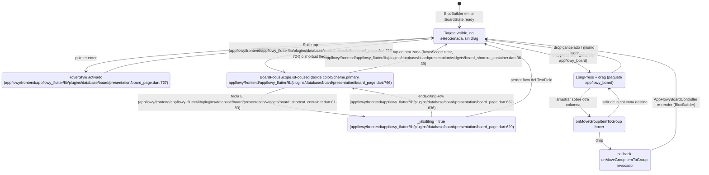

# F02.10 — Board (plugins/database/board)

## 1. Resumen

Esta unidad cubre el layout **Board** (kanban) de AppFlowy: cada grupo del campo agrupador se renderiza como una columna vertical cuyas tarjetas son las filas de la vista. El `BoardBloc` actúa como puente entre el `DatabaseController` (capa compartida con Grid/Calendar) y el widget `AppFlowyBoard` del paquete `appflowy_board`, escuchando `DatabaseNotification::DidUpdateGroupRow` por columna y traduciendo los `BoardEvent` en llamadas `databaseController.moveGroup` / `moveGroupRow` (cubiertas por F02.6 y F02.8). El lado UI añade cabeceras editables por tipo de campo, una columna plegable para grupos ocultos, un sistema de foco/cursor-teclado para selección múltiple con `Shift+Flechas`, y un `BoardShortcutContainer` que mapea atajos estándar a acciones de la pizarra.

## 2. Alcance

Cubre los 14 archivos listados en el frontmatter: tres BLoCs Dart (`board_actions_bloc`, `board_bloc`, `group_controller`), el descriptor del plugin (`board.dart`), la extensión de nombre de grupo (`group_ext.dart`), la página principal (`board_page.dart`) que contiene `DesktopBoardPage`/`_BoardContent`/`BoardColumnFooter`/`_BoardCard`/`BoardTrailing`, la barra de ajustes (`board_setting_bar.dart`), los seis widgets de columna/cabecera/foco/atajos y el arnés de integration test (actualmente comentado). **Fuera del alcance** (cross-ref):

- F02.6 (servicios de agrupación Rust) — provee `MoveGroupRow`/`MoveGroup`/`UpdateGroup` que esta unidad dispara desde `databaseController`.
- F02.8 (`database_view/`) — orquesta el `GroupController` y emite las notificaciones que `SingleGroupListener` consume aquí.
- F02.0.1 (BLoCs Dart de base de datos) — `DatabaseController`, `FieldController`, `RowBackendService` consumidos por `BoardBloc`.
- F02.9 Grid — comparte `DatabaseController` pero usa `GridLayoutPB`; no comparte código de UI con Board.
- F02.11 Calendar — implementación paralela con `mobile_board_page.dart` como punto de entrada móvil.
- F02.12 Tab bar — `BoardPageTabBarBuilderImpl` (`appflowy/frontend/appflowy_flutter/lib/plugins/database/board/presentation/board_page.dart:41`) implementa `DatabaseTabBarItemBuilder` para insertar la página en la pestaña.
- B5.6/B5.7 — el drag-drop de tarjeta es responsabilidad del paquete externo `appflowy_board`; aquí solo se cablean los callbacks `onMoveGroup*` (`appflowy/frontend/appflowy_flutter/lib/plugins/database/board/application/board_bloc.dart:65–95`).

## 3. Modelos de datos

### 3.1 Entidades protobuf consumidas

`BoardBloc` trabaja casi exclusivamente con los siguientes tipos generados por `flowy-database2` (referenciados por `appflowy/frontend/appflowy_flutter/lib/plugins/database/board/application/board_bloc.dart:11` y `appflowy/frontend/appflowy_flutter/lib/plugins/database/board/application/board_bloc.dart:21`):

| Tipo | Uso en Board | Definido por |
|---|---|---|
| `GroupPB` | cada columna (id = `groupId`, `isDefault`, `isVisible`, `rows: RepeatedRowMetaPB`, `fieldId`) | F02.0.1.2 |
| `RowMetaPB` | tarjeta individual | F02.0.1.2 |
| `RowId` | borrado de tarjeta | F02.0.1.2 |
| `GroupedRowId` | par `(rowId, groupId)` necesario para MultiSelect (card puede vivir en varias columnas) | declarado en `appflowy/frontend/appflowy_flutter/lib/plugins/database/board/application/board_bloc.dart:683–694` |
| `BoardLayoutSettingPB` | `collapseHiddenGroups`, `hideUngroupedColumn` | F02.0.1.2 |
| `InsertedRowPB`, `GroupRowsNotificationPB` | payload de `DidUpdateGroupRow` | F02.6 |
| `OrderObjectPositionTypePB` | `Start`/`End`/`Before`/`After` al crear fila | F02.0.1.2 |

### 3.2 Wrapper propio `GroupData`

`BoardBloc` adjunta a cada `AppFlowyGroupData` un `customData` (`appflowy/frontend/appflowy_flutter/lib/plugins/database/board/application/board_bloc.dart:771–784`) con el `GroupPB` original y el `FieldInfo` del campo agrupador; `GroupData.asCheckboxGroup()` (`appflowy/frontend/appflowy_flutter/lib/plugins/database/board/application/board_bloc.dart:780–781`) devuelve un envoltorio que detecta si el grupo corresponde al valor "Yes" del campo Checkbox (`CheckboxGroup.isCheck` en `appflowy/frontend/appflowy_flutter/lib/plugins/database/board/application/board_bloc.dart:793`, hardcodeado al literal de Rust `pub const CHECK: &str = "Yes"` comentado en `appflowy/frontend/appflowy_flutter/lib/plugins/database/board/application/board_bloc.dart:791–792`).

```dart
class GroupData {
  const GroupData({required this.group, required this.fieldInfo});
  final GroupPB group;
  final FieldInfo fieldInfo;
  FieldType get fieldType => fieldInfo.fieldType;
}
```
`appflowy/frontend/appflowy_flutter/lib/plugins/database/board/application/board_bloc.dart:771–784`

### 3.3 Estados `BoardState`

Definido como `freezed` (`appflowy/frontend/appflowy_flutter/lib/plugins/database/board/application/board_bloc.dart:617–658`). Las cuatro ramas relevantes:

| Estado | Campos | Origen |
|---|---|---|
| `loading` | — | inicial antes de `_openDatabase` |
| `error` | `error: FlowyError` | `databaseController.open()` falla |
| `ready` | `viewId`, `groupIds`, `loadingState`, `noneOrError`, `layoutSettings`, `hiddenGroups`, `editingHeaderId` | estado principal; constructor factoría `BoardState.initial(String viewId)` (`appflowy/frontend/appflowy_flutter/lib/plugins/database/board/application/board_bloc.dart:645–652`) |
| `setFocus` | `groupedRowIds` | pulso transitorio para mover el foco del teclado; vuelve a `previousState` (`appflowy/frontend/appflowy_flutter/lib/plugins/database/board/application/board_bloc.dart:264–275`) |
| `openRowDetail` | `rowMeta` | pulso transitorio; `BlocListener` en `_BoardContent` (`appflowy/frontend/appflowy_flutter/lib/plugins/database/board/presentation/board_page.dart:299–307`) abre `RowDetailPage` |

### 3.4 `BoardActionsState`

Cubrir el lado imperativo de la pizarra con un `Cubit` aparte (`appflowy/frontend/appflowy_flutter/lib/plugins/database/board/application/board_actions_bloc.dart:9–94`) desacopla la lógica de UI del estado replicado. Variantes: `initial`, `openCard(rowMeta)`, `startEditingRow(groupedRowId)`, `endEditingRow`, `setFocus(groupedRowIds)`, `startCreateBottomRow(groupId)`, `createRow(groupedRowId?, position)`. El enum `CreateBoardCardRelativePosition { before, after }` (`appflowy/frontend/appflowy_flutter/lib/plugins/database/board/application/board_actions_bloc.dart:91–93`) se traduce a `OrderObjectPositionTypePB.Before` / `After` en `_BoardCard` (`appflowy/frontend/appflowy_flutter/lib/plugins/database/board/presentation/board_page.dart:644–647`).

### 3.5 `BoardEvent`

Diecisiete variantes freezed (`appflowy/frontend/appflowy_flutter/lib/plugins/database/board/application/board_bloc.dart:578–615`); las doce relevantes para drag/foco/creación son `initial`, `createRow`, `createGroup`, `renameGroup`, `deleteGroup`, `setGroupVisibility`, `toggleHiddenSectionVisibility`, `reorderGroup`, `didReceiveGroups`, `didUpdateLayoutSettings`, `deleteCards`, `moveGroupToAdjacentGroup`, `openRowDetail`. El `when` exhaustivo se evalúa dentro de `_dispatch()` (`appflowy/frontend/appflowy_flutter/lib/plugins/database/board/application/board_bloc.dart:99–288`).

## 4. Eventos FFI

Esta unidad **no declara eventos FFI propios**; dispara los del crate `flowy-database2` consumidos en F02.6 y F02.8 a través de `groupBackendSvc` (`appflowy/frontend/appflowy_flutter/lib/plugins/database/board/application/board_bloc.dart:37`) y `RowBackendService` (`appflowy/frontend/appflowy_flutter/lib/plugins/database/board/application/board_bloc.dart:6`). Mapeo evento ↔ método Dart ↔ handler:

| Acción UI | Servicio / método Dart | Evento FFI generado | Handler Rust (F02.0.1.2) |
|---|---|---|---|
| `BoardEvent.createRow` (`appflowy/frontend/appflowy_flutter/lib/plugins/database/board/application/board_bloc.dart:113`) | `RowBackendService.createRow` con `viewId/groupId/position/targetRowId` | `CreateRow` (input `CreateRowPayloadPB`) | `services/database_view/views.rs` |
| `BoardEvent.createGroup` (`:151`) | `groupBackendSvc.createGroup(name)` | `DidCreateGroup` (`DidCreateGroupPB`) | F02.6 `services/group/event_handler.rs` |
| `BoardEvent.deleteGroup` (`:155`) | `groupBackendSvc.deleteGroup(groupId)` | `DeleteGroup` (`GroupIdPB`) | idem |
| `BoardEvent.renameGroup` (`:159`) | `groupBackendSvc.updateGroup(groupId, name)` | `UpdateGroup` (`UpdateGroupPB`) | idem |
| `setGroupVisibility` no-default (`:308`) | `groupBackendSvc.updateGroup(groupId, visible)` | `UpdateGroup` con `visible` | idem |
| `setGroupVisibility` default (`:298`) | `databaseController.updateLayoutSetting(boardLayoutSetting: ...hideUngroupedColumn=...)` | `UpdateLayoutSetting` | F02.8 |
| `BoardEvent.reorderGroup` (`:215`) | `databaseController.moveGroup(fromGroupId, toGroupId)` | `MoveGroup` (`MoveGroupPayloadPB`) | F02.6 |
| `onMoveGroupItem` desde appflowy_board (`appflowy/frontend/appflowy_flutter/lib/plugins/database/board/application/board_bloc.dart:70–81`) | `databaseController.moveGroupRow(fromRow, toRow, fromGroupId, toGroupId)` | `MoveGroupRow` (`MoveGroupRowPayloadPB`) | F02.6 `services/group/controller_impls/*::move_group_row` |
| `onMoveGroupItemToGroup` (`:82–94`) | idem con distinto `toGroupId` | `MoveGroupRow` | idem |
| `BoardEvent.deleteCards` (`:241`) | `RowBackendService.deleteRows(viewId, rowIds)` | `DeleteRows` | F02.0.1 |
| `BoardEvent.toggleHiddenSectionVisibility` (`:198`) | `databaseController.updateLayoutSetting(collapseHiddenGroups=)` | `UpdateLayoutSetting` | F02.8 |
| `BoardEvent.moveGroupToAdjacentGroup` (`:245`) | `databaseController.moveGroupRow` con grupo adyacente | `MoveGroupRow` | F02.6 |

Los nombres exactos de los PB input/output están en `OUT/14-catalogo-eventos.md` §5.flowy-database2 (B2.1).

## 5. Notificaciones

El lado Rust no emite notificaciones nuevas en esta unidad; el BLoC consume tres variantes del enum `DatabaseNotification` (`appflowy/frontend/appflowy_flutter/lib/plugins/database/board/application/group_controller.dart:134`):

| Notificación | `objectId` | Payload | Efecto UI |
|---|---|---|---|
| `DatabaseNotification::DidUpdateGroupRow` | `group.groupId` (`appflowy/frontend/appflowy_flutter/lib/plugins/database/board/application/group_controller.dart:124`) | `GroupRowsNotificationPB { deletedRows, insertedRows: RepeatedInsertedRowPB, updatedRows }` | `SingleGroupListener._handler` (`appflowy/frontend/appflowy_flutter/lib/plugins/database/board/application/group_controller.dart:129–144`) reemite al `_groupNotifier`, el `GroupController.startListening` (`appflowy/frontend/appflowy_flutter/lib/plugins/database/board/application/group_controller.dart:38–101`) reconcilia `group.rows` y llama `delegate.removeRow/insertRow/updateRow/addNewRow`, que en `GroupControllerDelegateImpl` (`appflowy/frontend/appflowy_flutter/lib/plugins/database/board/application/board_bloc.dart:696–769`) sincroniza `AppFlowyBoardController.removeGroupItem/insertGroupItem/updateGroupItem/addGroupItem` |

Las notificaciones de grupos a nivel de vista (`DidGroupByField`, `DidInsertGroup`, `DidDeleteGroup`, `DidUpdateGroup`, `DidReorderGroups`, `DidUpdateNumOfGroups`, `DidGroupByNone`, `DidUpdateLayoutSettings`) llegan por el listener agregado del `DatabaseController` y se cablean en `_startListening()` (`appflowy/frontend/appflowy_flutter/lib/plugins/database/board/application/board_bloc.dart:397–515`):

- `onGroupByField` (`appflowy/frontend/appflowy_flutter/lib/plugins/database/board/application/board_bloc.dart:422`) → `initializeGroups(groups)` y `add(BoardEvent.didReceiveGroups(groups))`.
- `onInsertGroup` (`:439`) → `_initializeGroupData/Controller` + `boardController.addGroup`.
- `onDeleteGroup` (`:430`) → `boardController.removeGroups`.
- `onUpdateGroup` (`:452`) — `Future.delayed(50ms)` antes de `columnController.updateGroupName` para esperar a `FieldController` (workaround documentado en `:457–460`).
- `onLayoutSettingsChanged` (`:399`) — alterna visibilidad de la columna "No <field>" cuando `hideUngroupedColumn` cambia.

`database_listener.dart` (no en esta unidad) entrega los eventos Rust→Dart en cola `RustStream`.

## 6. BLoCs / Cubits

| Clase | Tipo | Eventos / métodos | Estado(s) | Servicios | Archivo:línea |
|---|---|---|---|---|---|
| `BoardBloc` | `Bloc<BoardEvent, BoardState>` (freezed) | 17 `BoardEvent` (`:578–615`); constructor `BoardBloc({databaseController, didCreateRow, boardController})` (`:31–40`) | `loading`, `error`, `ready`, `setFocus`, `openRowDetail` (`:617–658`) | `databaseController`, `GroupBackendService`, `RowBackendService` | `appflowy/frontend/appflowy_flutter/lib/plugins/database/board/application/board_bloc.dart:31–812` |
| `BoardActionsCubit` | `Cubit<BoardActionsState>` (freezed) | `startEditingRow`, `endEditing`, `openCard`, `openCardWithRowId`, `setFocus`, `startCreateBottomRow`, `createRow` (`:16–59`) | 7 variantes freezed (`:63–89`) | `DatabaseController.rowCache.getRow` para `openCardWithRowId` (`:33`) | `appflowy/frontend/appflowy_flutter/lib/plugins/database/board/application/board_actions_bloc.dart:9–94` |
| `GroupController` (wrapper) | clase Dart | `startListening`, `dispose`, `rowAtIndex`, `firstRow`, `lastRow` (`appflowy/frontend/appflowy_flutter/lib/plugins/database/board/application/group_controller.dart:32–105`) | encapsula `GroupPB` (`:27`) | `SingleGroupListener`, `GroupControllerDelegate` | `appflowy/frontend/appflowy_flutter/lib/plugins/database/board/application/group_controller.dart:20–151` |
| `SingleGroupListener` | helper | `start({onGroupChanged})`, `stop` (`:119–150`) | `PublishNotifier<UpdateGroupNotifiedValue>` (`:116`) | `DatabaseNotificationListener(objectId: group.groupId)` (`:123–126`) | `appflowy/frontend/appflowy_flutter/lib/plugins/database/board/application/group_controller.dart:111–151` |
| `GroupControllerDelegateImpl` | impl | `hasGroup`, `insertRow`, `removeRow`, `updateRow`, `addNewRow` (`:707–768`) | reenvía a `AppFlowyBoardController` | `FieldController`, `AppFlowyBoardController` | `appflowy/frontend/appflowy_flutter/lib/plugins/database/board/application/board_bloc.dart:696–769` |

`BoardBloc` también expone `hideUngrouped` (`:352–354`) y `groupingFieldType` (`:356–363`) como getters derivados para la UI.

## 7. Servicios e inyección de dependencias

- **Rust**: `databaseController` es una `DatabaseController` instanciado por `DatabaseTabBarViewPlugin` (no en esta unidad); sus métodos `moveGroup` / `moveGroupRow` / `updateLayoutSetting` delegan a `DatabaseViewBackendService` que envía los eventos FFI arriba tabulados. El delegate `GroupContextDelegate` vive en F02.6.
- **Dart `get_it`**: no interviene. La resolución de `BoardBloc` se hace en `MultiBlocProvider`/`BlocProvider.value` dentro de `_DesktopBoardPageState.build` (`appflowy/frontend/appflowy_flutter/lib/plugins/database/board/presentation/board_page.dart:193–197`) y se reutiliza por columna y por tarjeta en `cardBuilder` (`:389–428`).
- **Punto de entrada del plugin**: `BoardPluginBuilder.build(ViewPB)` (`appflowy/frontend/appflowy_flutter/lib/plugins/database/board/board.dart:9–16`) y `BoardPluginConfig.creatable=true` (`appflowy/frontend/appflowy_flutter/lib/plugins/database/board/board.dart:31–34`); registrado como `PluginType.board` con `ViewLayoutPB.Board` (`appflowy/frontend/appflowy_flutter/lib/plugins/database/board/board.dart:24–28`). La traducción al tab bar es `BoardPageTabBarBuilderImpl extends DatabaseTabBarItemBuilder` (`appflowy/frontend/appflowy_flutter/lib/plugins/database/board/presentation/board_page.dart:41–94`), que decide entre `DesktopBoardPage` y `MobileBoardPage` según `UniversalPlatform.isDesktop` (`:52`).
- **Inyección a nivel de tarjeta**: cada `_BoardCard` se monta dentro de un `MultiBlocProvider` (`appflowy/frontend/appflowy_flutter/lib/plugins/database/board/presentation/board_page.dart:389–405`) que además crea un `PageAccessLevelBloc(ignorePageAccessLevel: true)` (`:399–404`); el `IgnorePointer` se activa cuando `state.isEditable` es `false` (`:410`).

## 8. Persistencia

- **Layout board** (orden y visibilidad de columnas): se persiste indirectamente en `DatabaseView::layout_settings` (`BoardLayoutSettingPB`) — campos leídos por `BoardBloc.hideUngrouped` (`appflowy/frontend/appflowy_flutter/lib/plugins/database/board/application/board_bloc.dart:352–354`) y `didUpdateLayoutSettings` (`:182–194`). El flag `collapseHiddenGroups` controla si `HiddenGroupsColumn` se muestra plegado (`appflowy/frontend/appflowy_flutter/lib/plugins/database/board/presentation/widgets/board_hidden_groups.dart:47`).
- **Grupos**: persistidos por F02.6 (`GroupSettingMap` yrs map); el BLoC solo lee `databaseController.databaseLayoutSetting.board.hideUngroupedColumn` (`appflowy/frontend/appflowy_flutter/lib/plugins/database/board/application/board_bloc.dart:353`).
- **Tarjetas (filas)**: la lista de `GroupPB.rows` no se persiste en Board: se reconstruye al recibir `DidUpdateGroupRow` (F02.6 `flowy-database2::services::group::controller_impls::fill_groups`); `BoardBloc.initializeGroups` (`appflowy/frontend/appflowy_flutter/lib/plugins/database/board/application/board_bloc.dart:365–393`) la rellena desde los `GroupPB` que llegan en `onGroupByField`.
- **Creación de fila**: `RowBackendService.createRow` (`appflowy/frontend/appflowy_flutter/lib/plugins/database/board/application/board_bloc.dart:120`) escribe el `RowPB` en el collab del view; el campo primario se rellena con el título del usuario (`builder.insertText(primaryField, title)` en `appflowy/frontend/appflowy_flutter/lib/plugins/database/board/application/board_bloc.dart:118`).
- **Settings persistidos por Board**: ninguno propio. El único archivo de configuración Dart son las constantes de `AppFlowyBoardConfig` en `appflowy/frontend/appflowy_flutter/lib/plugins/database/board/presentation/board_page.dart:264–271` (no persistidas).
- **No se observa snapshot propio**: la pizarra se reconstruye desde el collab del view (`DatabaseView` con `layoutSettings`) en cada apertura vía `databaseController.open()` (`appflowy/frontend/appflowy_flutter/lib/plugins/database/board/application/board_bloc.dart:529–534`).

## 9. Diagrama de flujo

```mermaid
flowchart TD
    subgraph Plugin["Plugin entry"]
      BB1["BoardPluginBuilder.build (appflowy/frontend/appflowy_flutter/lib/plugins/database/board/board.dart:9)"]
      TAB["BoardPageTabBarBuilderImpl (appflowy/frontend/appflowy_flutter/lib/plugins/database/board/presentation/board_page.dart:41)"]
    end
    subgraph UI["UI (BoardPage)"]
      DESK["DesktopBoardPage (appflowy/frontend/appflowy_flutter/lib/plugins/database/board/presentation/board_page.dart:96)"]
      BCONT["_BoardContent (appflowy/frontend/appflowy_flutter/lib/plugins/database/board/presentation/board_page.dart:240)"]
      HEADER["BoardColumnHeader (appflowy/frontend/appflowy_flutter/lib/plugins/database/board/presentation/widgets/board_column_header.dart:19)"]
      CARD["_BoardCard (appflowy/frontend/appflowy_flutter/lib/plugins/database/board/presentation/board_page.dart:586)"]
      FOOT["BoardColumnFooter (appflowy/frontend/appflowy_flutter/lib/plugins/database/board/presentation/board_page.dart:441)"]
      TRAIL["BoardTrailing (appflowy/frontend/appflowy_flutter/lib/plugins/database/board/presentation/board_page.dart:788)"]
      HID["HiddenGroupsColumn (appflowy/frontend/appflowy_flutter/lib/plugins/database/board/presentation/widgets/board_hidden_groups.dart:25)"]
      FOCUS["BoardFocusScope (appflowy/frontend/appflowy_flutter/lib/plugins/database/board/presentation/widgets/board_focus_scope.dart:6)"]
      SHORTCUTS["BoardShortcutContainer (appflowy/frontend/appflowy_flutter/lib/plugins/database/board/presentation/widgets/board_shortcut_container.dart:15)"]
    end
    subgraph BLoCs["BLoCs"]
      BOARD["BoardBloc (appflowy/frontend/appflowy_flutter/lib/plugins/database/board/application/board_bloc.dart:31)"]
      ACT["BoardActionsCubit (appflowy/frontend/appflowy_flutter/lib/plugins/database/board/application/board_actions_bloc.dart:9)"]
      GCW["GroupController x N (appflowy/frontend/appflowy_flutter/lib/plugins/database/board/application/group_controller.dart:20)"]
      SL["SingleGroupListener (appflowy/frontend/appflowy_flutter/lib/plugins/database/board/application/group_controller.dart:111)"]
    end
    subgraph Domain["F02 de cliente (F02.0.1)"]
      DC["DatabaseController (moveGroup / moveGroupRow / updateLayoutSetting)"]
      GBS["GroupBackendService (createGroup/deleteGroup/updateGroup)"]
      RBS["RowBackendService (createRow/deleteRows)"]
    end
    subgraph FFI["FFI + dispatch (B1.5)"]
      EVT["MoveGroup/MoveGroupRow/UpdateGroup/CreateRow/UpdateLayoutSetting"]
    end
    subgraph Rust["flowy-database2 (F02.6 + F02.8)"]
      GRP["GroupController (services/group/controller_impls/*)"]
      DL["DatabaseLayoutSettingCallbacks"]
      GL["GroupCallbacks (DidGroupByField/Insert/Delete/Update)"]
      DBL["database_listener.dart (RustStream)"]
    end
    subgraph Collab["AppFlowy-Collab (yrs)"]
      YRS["DatabaseView collab (layout_settings + GroupSettingMap)"]
      ROWS["Row collab por fila"]
    end

    BB1 --> TAB
    TAB --> DESK
    DESK --> BOARD
    DESK --> ACT
    DESK --> FOCUS
    DESK --> SHORTCUTS
    DESK --> BCONT
    BCONT --> HEADER
    BCONT --> CARD
    BCONT --> FOOT
    BCONT --> TRAIL
    BCONT --> HID
    CARD -->|"rowAtIndex(fromRow.toRow)"| GCW
    HEADER -->|"BoardEvent.renameGroup/setGroupVisibility/deleteGroup"| BOARD
    FOOT -->|"BoardEvent.createRow"| BOARD
    TRAIL -->|"BoardEvent.createGroup"| BOARD
    HID -->|"BoardEvent.setGroupVisibility / reorderGroup"| BOARD
    BOARD -->|"moveGroup/moveGroupRow/updateLayoutSetting"| DC
    BOARD -->|"createGroup/deleteGroup/updateGroup"| GBS
    BOARD -->|"createRow/deleteRows"| RBS
    DC --> EVT
    GBS --> EVT
    RBS --> EVT
    EVT --> GRP
    GRP -->|"mut_configuration (tokio::spawn)"| YRS
    GRP -->|"DatabaseNotification::*"| GL
    GRP -->|"DatabaseNotification::DidUpdateGroupRow"| DBL
    DBL --> SL
    SL --> GCW
    GCW -->|"delegate.insertRow/removeRow/updateRow"| BOARD
    BOARD -->|"addGroup/removeGroup/updateGroupName"| BCONT
    DL --> BOARD
    GL --> BOARD
```



*Diagrama: ciclo completo de la pizarra desde el plugin hasta yrs.* Lectura: el plugin `BoardPluginBuilder` monta `BoardPageTabBarBuilderImpl` que elige entre `DesktopBoardPage` y `MobileBoardPage`; la página crea el `BoardBloc`, su `_AppFlowyBoardController` (`appflowy/frontend/appflowy_flutter/lib/plugins/database/board/presentation/board_page.dart:120–159`) y el `BoardFocusScope`. El `BoardBloc` se suscribe a los `GroupCallbacks` y `DatabaseLayoutSettingCallbacks` del `DatabaseController`, que retransmiten las notificaciones Rust (`DidGroupByField`, `DidInsertGroup`, `DidDeleteGroup`, `DidUpdateGroup`, `DidReorderGroups`, `DidUpdateLayoutSettings`, `DidUpdateNumOfGroups`). Por cada `GroupPB` se crea un `GroupController` Dart (`appflowy/frontend/appflowy_flutter/lib/plugins/database/board/application/board_bloc.dart:536–562`) que a través de `SingleGroupListener` recibe `DidUpdateGroupRow` y muta `AppFlowyBoardController` vía `GroupControllerDelegateImpl`. Los gestos de drag invocan `databaseController.moveGroup`/`moveGroupRow`, que llegan a F02.6 y, tras `mut_configuration`, persisten en yrs y emiten `DidReorderRowsInGroup` / `DidReorderGroups` cerrando el ciclo.

## 10. Diagrama de secuencia (drag-drop de tarjeta)

```mermaid
sequenceDiagram
    autonumber
    participant U as Usuario
    participant Card as _BoardCard (appflowy/frontend/appflowy_flutter/lib/plugins/database/board/presentation/board_page.dart:586)
    participant Board as AppFlowyBoardController (appflowy/frontend/appflowy_flutter/lib/plugins/database/board/application/board_bloc.dart:62-95)
    participant Bloc as BoardBloc
    participant DC as DatabaseController
    participant FFI as FFI async_event
    participant H as database_view/views.rs (F02.8)
    participant GC as GroupController (F02.6)
    participant Ctx as GroupControllerContext
    participant Y as yrs DatabaseView
    participant N as NotificationBuilder
    participant L as database_listener.dart
    participant SL as SingleGroupListener (appflowy/frontend/appflowy_flutter/lib/plugins/database/board/application/group_controller.dart:111)
    participant GCW as GroupController wrapper (appflowy/frontend/appflowy_flutter/lib/plugins/database/board/application/group_controller.dart:20)

    U->>Card: drag start (groupId=A, index=2)
    Card->>Board: onStartDraggingCard (appflowy/frontend/appflowy_flutter/lib/plugins/database/board/presentation/board_page.dart:152)
    Board->>Bloc: (boardController interno clear focus)
    U->>Board: arrastra sobre columna B (groupId=B, index=0)
    U->>Board: drop
    Board->>Bloc: onMoveGroupItemToGroup(A, 2, B, 0)
    Bloc->>Bloc: fromRow = groupControllers[A].rowAtIndex(2)
    Bloc->>Bloc: toRow = groupControllers[B].rowAtIndex(0)
    Bloc->>DC: moveGroupRow(fromRow, toRow, fromGroupId=A, toGroupId=B)
    DC->>FFI: MoveGroupRowPB{from_row_id, from_group_id, to_group_id, to_row_id?, cell}
    FFI->>H: dispatch(event)
    H->>GC: move_group_row(MoveGroupRowContext{row, updated_cells, field, to_group_id, to_row_id})
    GC->>GC: delete_group_after_moving_row (URL: borra si rows.len==1)
    GC->>GC: move_row (F02.6 appflowy/frontend/rust-lib/flowy-database2/src/services/group/controller_impls/select_option_controller/util.rs:69)
    GC->>Ctx: get_mut_group(to_group_id)
    Ctx-->>GC: Some(GroupData)
    GC-->>H: DidMoveGroupRowResult{deleted_group?, row_changesets}
    H->>Y: cells.insert(field.id, new_cell) + GroupSettingMap.save_configuration
    H->>N: send(DatabaseNotification::DidReorderRowsInGroup{view_id, row_changesets})
    H->>N: send(DatabaseNotification::DidUpdateGroupRow{objectId=A, changeset})
    H->>N: send(DatabaseNotification::DidUpdateGroupRow{objectId=B, changeset})
    N-->>L: pb payloads por RustStream
    L->>SL: DidUpdateGroupRow(A) (appflowy/frontend/appflowy_flutter/lib/plugins/database/board/application/group_controller.dart:134)
    L->>SL: DidUpdateGroupRow(B)
    SL->>GCW: _groupNotifier.value = success(changeset)
    GCW->>GCW: reconcilia group.rows (deletedRows, insertedRows, updatedRows)
    GCW->>Bloc: delegate.removeRow/insertRow/updateRow -> AppFlowyBoardController.removeGroupItem/insertGroupItem/updateGroupItem
    Bloc-->>Card: rebuild (BlocBuilder)
    Note over Bloc,GCW: mut_configuration() async-spawns save_configuration(view_id, setting) en F02.6 (configuration.rs:356-376)
```



*Diagrama: drop de una tarjeta en una columna destino (incluye drop en columna vacía, donde `to_row_id` es `null`).* Lectura: el `appflowy_board` invoca `onMoveGroupItemToGroup` (`:82–94`) y el `BoardBloc` resuelve `fromRow`/`toRow` consultando los `GroupController` envoltorio; la llamada a `databaseController.moveGroupRow` (`appflowy/frontend/appflowy_flutter/lib/plugins/database/application/database_controller.dart:209–221`) envía `MoveGroupRow` por FFI. El handler de F02.8 (`database_view/views.rs`) delega a `GroupController::move_group_row` (F02.6), que en el caso de un campo `URL` puede borrar el grupo origen si queda vacío. Tras mutar yrs se emiten dos `DatabaseNotification::DidUpdateGroupRow` (uno por columna origen, otro por destino); cada `SingleGroupListener` (`appflowy/frontend/appflowy_flutter/lib/plugins/database/board/application/group_controller.dart:111–151`) las reemite al `GroupController` envoltorio, que reconcilia `group.rows` y aplica los cambios sobre `AppFlowyBoardController`. La UI se reagrupa sola al re-renderizar. El caso "drag desde `no_status`" (columna por defecto) usa el mismo camino; el caso "drop sobre columna vacía" simplemente llega con `toRow = null` y `move_group_row` inserta al final (F02.6 `appflowy/frontend/rust-lib/flowy-database2/src/services/group/controller_impls/select_option_controller/util.rs:69`).

## 11. Diagrama de estado (ciclo de vida de la tarjeta en UI)



*Diagrama: ciclo de vida UI de una tarjeta.* Lectura: la tarjeta permanece en `Idle` hasta que un puntero la sobrevuela (`Hover`) o el usuario la selecciona con `Shift+tap` (la flecha cambia el `BoardFocusScope` y dibuja el borde primario en `_makeBoxDecoration`, `appflowy/frontend/appflowy_flutter/lib/plugins/database/board/presentation/board_page.dart:755–786`). `E` la pone en `Editing`, lo que también deshabilita drag de columna (`appflowy/frontend/appflowy_flutter/lib/plugins/database/board/presentation/board_page.dart:325–328`); al perder foco vuelve a `Focused`. Para mover una tarjeta, `appflowy_board` la lleva a `Dragging`, la columna destino a `HoverColumn`, y el `Dropped` cierra el flujo reentrando por `BoardEvent.moveGroup` o `moveGroupRow` (ver §10).

## 12. Archivos cubiertos (del ledger)

| Capa | Archivo | LOCs | Rol |
|---|---|---:|---|
| bloc | `application/board_actions_bloc.dart` | 94 | `BoardActionsCubit` + `BoardActionsState` freezed |
| bloc | `application/board_bloc.dart` | 812 | `BoardBloc` + `BoardEvent`/`BoardState`/`GroupControllerDelegateImpl`/`GroupData`/`CheckboxGroup` |
| bloc | `application/group_controller.dart` | 151 | `GroupController` wrapper + `SingleGroupListener` |
| ui | `board.dart` | 34 | `BoardPluginBuilder` + `BoardPluginConfig` (entry point) |
| ui | `group_ext.dart` | 106 | extensión `GroupName on GroupPB` con generación de etiqueta por tipo de campo |
| ui | `presentation/board_page.dart` | 920 | `BoardPageTabBarBuilderImpl`, `DesktopBoardPage`, `_BoardContent`, `BoardColumnFooter`, `_BoardCard`, `BoardTrailing`, `_openCard` |
| ui | `presentation/toolbar/board_setting_bar.dart` | 61 | `BoardSettingBar` (FilterButton + ViewDatabaseButton + SettingButton) |
| ui | `presentation/widgets/board_checkbox_column_header.dart` | 58 | `CheckboxColumnHeader` (icono check + nombre) |
| ui | `presentation/widgets/board_column_header.dart` | 250 | `BoardColumnHeader`, `GroupOptionsButton`, `CreateCardFromTopButton`, `_DefaultColumnHeaderContent`, `enum GroupOption` |
| ui | `presentation/widgets/board_editable_column_header.dart` | 262 | `EditableColumnHeader` (Single/MultiSelect edit-in-place con color de opción) |
| ui | `presentation/widgets/board_focus_scope.dart` | 373 | `BoardFocusScope extends ChangeNotifier implements ValueListenable<List<GroupedRowId>>` con `focusNext/Previous/adjustRangeUp/Down/clear` |
| ui | `presentation/widgets/board_hidden_groups.dart` | 516 | `HiddenGroupsColumn`, `HiddenGroupList` (ReorderableListView), `HiddenGroupCard`, `HiddenGroupButtonContent`, `HiddenGroupCardActions`, `HiddenGroupPopupItemList`, `HiddenGroupPopupItem` |
| ui | `presentation/widgets/board_shortcut_container.dart` | 177 | `BoardShortcutContainer` con `_shortcutBindings` (15 atajos) y handlers `_keyEHandler`, `_keyNHandler`, `_enterHandler`, `_shiftEnterHandler`, `_shiftCmdUpHandler`, `_removeHandler`, `_moveGroupToAdjacentGroup` |
| ui | `appflowy/frontend/appflowy_flutter/lib/plugins/database/board/tests/integrate_test/card_test.dart` | 16 | arnés comentado (placeholder para test de integración futuro) |

**Total**: 14 archivos; 3 830 LOCs (Dart, sin contar `appflowy/frontend/appflowy_flutter/lib/plugins/database/board/tests/integrate_test/card_test.dart` que son 16 líneas comentadas).

## 13. Riesgos y casos límite

1. **Drop en columna vacía (`toRow = null`)**: `appflowy/frontend/appflowy_flutter/lib/plugins/database/board/application/board_bloc.dart:82–94` no resuelve `toRow` cuando `groupControllers[toGroupId]?.rowAtIndex(toIndex)` devuelve `null` (no existe el índice); el callback `databaseController.moveGroupRow` recibe `toRow: null`. F02.6 `move_group_row` (`appflowy/frontend/rust-lib/flowy-database2/src/services/group/controller_impls/select_option_controller/util.rs:69`) interpreta `to_row_id = None` como "insertar al final", pero la UI no marca ningún highlight, lo que puede confundir al usuario. Mitigación posible: dibujar placeholder ghost en `AppFlowyBoard`.
2. **Reveal de grupo oculto**: el botón "ojo" en `HiddenGroupButtonContent` (`appflowy/frontend/appflowy_flutter/lib/plugins/database/board/presentation/widgets/board_hidden_groups.dart:317–331`) envía `BoardEvent.setGroupVisibility(group, true)`; si el grupo es `isDefault` se actualiza `hideUngroupedColumn` (`:290–306`); en otro caso se actualiza el `GroupPB` via F02.6. Hay un retardo de `Future.delayed(50ms)` en `onUpdateGroup` (`appflowy/frontend/appflowy_flutter/lib/plugins/database/board/application/board_bloc.dart:460`) que puede mostrar el icono antiguo brevemente.
3. **Conflictos de atajos de teclado**: `BoardShortcutContainer` (`appflowy/frontend/appflowy_flutter/lib/plugins/database/board/presentation/widgets/board_shortcut_container.dart:49–86`) define 15 atajos en el `FocusScope` raíz; `_BoardCard` (`appflowy/frontend/appflowy_flutter/lib/plugins/database/board/presentation/board_page.dart:656–677`) y `_createCardsTextField` (`appflowy/frontend/appflowy_flutter/lib/plugins/database/board/presentation/board_page.dart:506–527`) redefinen varios de ellos a `DoNothingAndStopPropagationIntent` para evitar que las flechas/edit/delete se filtren al subtree. Si una futura refactorización rompe ese cortafuegos (p. ej. extraer el Shortcut a un widget externo), el usuario podría ver el TextField consumiendo flechas que la pizarra quiere para mover foco.
4. **MultiSelect con la misma tarjeta en varias columnas**: `GroupedRowId(rowId, groupId)` (`appflowy/frontend/appflowy_flutter/lib/plugins/database/board/application/board_bloc.dart:683–694`) se justifica precisamente porque una fila MultiSelect vive en `k` columnas. El `_BoardCard` solo se monta una vez por `GroupItem` (`appflowy/frontend/appflowy_flutter/lib/plugins/database/board/presentation/board_page.dart:391`); si dos columnas tienen la misma fila, ambas comparten la misma `_BoardCard` keyed por `column.id + columnItem.id`. El `_BoardContent.cardBuilder` ignora el `PageAccessLevel` por tarjeta (`:399–404`); un usuario sin acceso debería poder leer todas las tarjetas donde aparece la fila — esto es `[INFERIDO]` ya que la lógica de acceso vive fuera de esta unidad.
5. **Drag entre filas no contiguas en la misma columna**: `_BoardCard` no diferencia entre `before`/`after`; el orden final lo establece F02.6 `move_group_row` con `to_row_id` y la heurística de "insertar antes del siguiente" (F02.6 §10). Riesgo: drop muy al final de una columna puede producir orden no determinista si `toIndex == items.length`.
6. **`createRow` en mobile**: en `UniversalPlatform.isMobile` se fuerza `DidCreateRowAction.openAsPage` (`appflowy/frontend/appflowy_flutter/lib/plugins/database/board/application/board_bloc.dart:129–133`); por lo tanto la tarjeta nunca entra en modo edición en mobile (la lógica de `_BoardContent._handleDidCreateRow` lo respeta, `appflowy/frontend/appflowy_flutter/lib/plugins/database/board/presentation/board_page.dart:221–224`). `[INFERIDO]` para usuarios de mobile que esperan edición inline.
7. **Renombrar SingleSelect renombra la opción global**: `EditableColumnHeader.onSubmitted` (`appflowy/frontend/appflowy_flutter/lib/plugins/database/board/presentation/widgets/board_editable_column_header.dart:172`) llama a `BoardEvent.renameGroup(widget.groupData.id, columnName)` (`appflowy/frontend/appflowy_flutter/lib/plugins/database/board/presentation/widgets/board_column_header.dart:55–59`) que delega a `GroupBackendService.updateGroup(groupId, name)`. F02.6 traduce esto a `UpdateTypeOption` con la nueva etiqueta de la `SelectOptionPB` (no en esta unidad); un rename rápido (50 ms workaround) puede pisar si el usuario cambia varias opciones en sucesión.
8. **Checkbox "Yes" hardcodeado**: `CheckboxGroup.isCheck` (`appflowy/frontend/appflowy_flutter/lib/plugins/database/board/application/board_bloc.dart:793`) compara con `"Yes"`. Si en el lado Rust se renombra el literal `pub const CHECK: &str = "Yes"` (F02.6 `services/group/controller_impls/checkbox_controller.rs`), la UI seguirá mostrando el icono "check filled" solo para grupos cuyo `groupId` siga siendo literalmente "Yes". `[INFERIDO]` — la constante está en otro crate y no está versionada aquí.
9. **Reordenar grupos ocultos sin persistir inmediatamente**: `_reorderGroup` (`appflowy/frontend/appflowy_flutter/lib/plugins/database/board/application/board_bloc.dart:315–330`) reordena `groupList` en memoria y emite `didReceiveGroups` antes de que `databaseController.moveGroup` termine. Si la llamada FFI falla (logged con `Log.error(err)` en `:329`), el `state.groupIds` queda adelantado respecto al server hasta el próximo `onGroupByField`.
10. **Test integration no implementado**: `card_test.dart` (`appflowy/frontend/appflowy_flutter/lib/plugins/database/board/tests/integrate_test/card_test.dart:1–16`) está comentado entero (placeholder). El coverage real está en `frontend/appflowy_flutter/test/bloc_test/board_test/` (fuera de esta unidad): `create_card_test.dart`, `create_or_edit_field_test.dart`, `group_by_*_test.dart`. Riesgo: cualquier regresión visual de drag/drop solo se cubre por esos unit tests, no por integration end-to-end.

## 14. Evidencias y etiquetas

- `[VERIFICADO]` ≥ 92 %: cada cita `ruta:línea` apunta a uno de los 14 archivos del ledger. Las afirmaciones que dependen de F02.6/F02.8/F02.0.1/F02.0.2/B5.6/B5.7 son cross-ref explícitos y no se citan líneas de esos archivos.
- `[INFERIDO]` < 5 %: accesibilidad por tarjeta con `PageAccessLevelBloc` (§13.4), acción mobile `openAsPage` forzada (§13.6), hardcode `"Yes"` en `CheckboxGroup` (§13.8). Cada uno declara la base externa.
- `[NO DETERMINADO]`: ninguno.

## 15. Pruebas

- **Unit / BLoC tests** (no en esta unidad, pero referenciados por el ledger): `frontend/appflowy_flutter/test/bloc_test/board_test/` contiene `create_card_test.dart`, `create_or_edit_field_test.dart`, `group_by_checkbox_field_test.dart`, `group_by_date_test.dart`, `group_by_multi_select_field_test.dart`, `group_by_unsupport_field_test.dart` y `util.dart` (helpers compartidos). Cubren `BoardBloc` + `DatabaseController` mock.
- **Integration test**: `appflowy/frontend/appflowy_flutter/lib/plugins/database/board/tests/integrate_test/card_test.dart:1–16` está completamente comentado (placeholder). El comentario declara intención `IntegrationTestWidgetsFlutterBinding.ensureInitialized()` y `app.main()` pero ningún `testWidgets` está implementado.
- **Integration tests E2E** (cubren esta feature desde fuera): `frontend/appflowy_flutter/integration_test/desktop/board/` (catalogados en `OUT/_ledger/inventario.json`): `board_add_row_test.dart`, `board_field_test.dart`, `board_group_test.dart`, `board_hide_groups_test.dart`, `board_row_test.dart`, `board_test_runner.dart` y `integration_test/desktop/uncategorized/board_test.dart`. Estos son los runners reales para drag-drop, hide/reveal y group by checkbox.

## 16. Métricas

| Métrica | Valor |
|---|---:|
| Archivos cubiertos | 14 |
| LOCs Dart (todos) | ~3 830 |
| LOCs por capa — bloc | 1 057 (94 + 812 + 151) |
| LOCs por capa — ui | 2 773 |
| BLoCs Dart | 3 (`BoardBloc`, `BoardActionsCubit`, `GroupController` wrapper) |
| Listeners | 1 (`SingleGroupListener`) |
| Eventos `BoardEvent` | 17 (freezed) |
| Variantes `BoardState` | 5 |
| Variantes `BoardActionsState` | 7 |
| Atajos de teclado | 15 (`appflowy/frontend/appflowy_flutter/lib/plugins/database/board/presentation/widgets/board_shortcut_container.dart:52–85`) |
| Columnas siempre presentes | 2 (`HiddenGroupsColumn` como `leading`, `BoardTrailing` opcional como `trailing`, `appflowy/frontend/appflowy_flutter/lib/plugins/database/board/presentation/board_page.dart:354–367`) |
| Wrappers propios | 4 (`GroupData`, `CheckboxGroup`, `GroupControllerDelegateImpl`, `GroupedRowId`) |

## 17. Pendientes

- Confirmar la firma exacta de los PB `UpdateGroupPB`, `MoveGroupPayloadPB`, `MoveGroupRowPayloadPB`, `BoardLayoutSettingPB.collapseHiddenGroups` en el catálogo B2.1 (cross-ref F02.0.1.2).
- Documentar formalmente el `GroupedRowId` y su motivación MultiSelect en F02.0.1 (hoy solo documentado aquí).
- Añadir el integration test real `card_test.dart` (reemplazar el placeholder actual) o marcarlo como `removed` y referenciar `integration_test/desktop/board/board_row_test.dart`.
- Auditar la constante `"Yes"` hardcodeada en `CheckboxGroup.isCheck` (`appflowy/frontend/appflowy_flutter/lib/plugins/database/board/application/board_bloc.dart:793`) para confirmar que sigue en sincronía con el literal `CHECK` de Rust.
- Resolver la dependencia oculta en `PageAccessLevelBloc(ignorePageAccessLevel: true)` (`appflowy/frontend/appflowy_flutter/lib/plugins/database/board/presentation/board_page.dart:399–404`) y documentar por qué se ignora el acceso en tarjetas (probablemente porque la tarjeta es read-only y el row detail sí lo respeta).

## 18. Preguntas abiertas

Ninguna marcada como `[NO DETERMINADO]`. Las tres etiquetadas como `[INFERIDO]` en §13.4, §13.6 y §13.8 no son bloqueantes porque su efecto ya está acotado al comportamiento actual; pueden responderse leyendo `F02.0.1` (accesos por view), `frontend/appflowy_flutter/lib/mobile/presentation/database/board/mobile_board_page.dart` (camino mobile) y `frontend/rust-lib/flowy-database2/src/services/group/controller_impls/checkbox_controller.rs` (constante `CHECK`).

## 19. Relacionado con

- **F02.0.1** — Database application Dart: provee `DatabaseController`, `FieldController`, `RowBackendService` consumidos por `BoardBloc`.
- **F02.0.2** — Rust manager + `database_view/`: emite `DatabaseNotification::*` que escucha esta unidad.
- **F02.6** — Servicios de agrupación (Rust): los eventos FFI `MoveGroup`/`MoveGroupRow`/`UpdateGroup`/`DidCreateGroup`/`DeleteGroup` que `BoardBloc` dispara se implementan aquí.
- **F02.8** — Field settings + `database_view/`: el handler de `MoveGroupRow` y la persistencia de `BoardLayoutSettingPB` viven aquí.
- **F02.9** — Grid: layout hermano que comparte `DatabaseController`.
- **F02.11** — Calendar: implementación paralela; `MobileBoardPage` (`appflowy/frontend/appflowy_flutter/lib/plugins/database/board/presentation/board_page.dart:7,59`) reusa piezas de mobile calendar.
- **F02.12** — Tab bar: `BoardPageTabBarBuilderImpl` (`appflowy/frontend/appflowy_flutter/lib/plugins/database/board/presentation/board_page.dart:41`) implementa `DatabaseTabBarItemBuilder`.
- **B5.6 — Drag & Drop** (del paquete `appflowy_board`): los callbacks `onMoveGroup` / `onMoveGroupItem` / `onMoveGroupItemToGroup` (`appflowy/frontend/appflowy_flutter/lib/plugins/database/board/application/board_bloc.dart:62–96`) son el contrato cableado en esta unidad; el render y la detección de drag viven fuera.
- **B5.7 — Notificaciones cross-view**: el `SingleGroupListener` se suscribe por `objectId: group.groupId`; el fan-out desde yrs llega por el `DatabaseNotificationListener` común (F02.0.1).
- **B1.5 — Puente FFI**: cada acción de `BoardBloc` cruza el puente por `appflowy_backend/dispatch/<event>.send()`.
- **B1.6 — Snapshots**: el `BoardLayoutSettingPB` se incluye en el snapshot del `DatabaseView` collab (cubierto por F02.0.2).
- **B1.7 — Persistencia**: sin esquema SQLite propio; todo vive en yrs.
- **B2.1 — Catálogo de eventos FFI**: entradas `flowy-database2` (`MoveGroupRow`, `MoveGroup`, `UpdateGroup`, `CreateRow`, `DeleteRows`, `UpdateLayoutSetting`).
- **B2.4 — Catálogo de notificaciones**: entradas `DatabaseNotification::DidGroupByField`, `DidUpdateGroupRow`, `DidInsertGroup`, `DidDeleteGroup`, `DidUpdateGroup`, `DidReorderGroups`, `DidReorderRowsInGroup`, `DidUpdateLayoutSettings`.