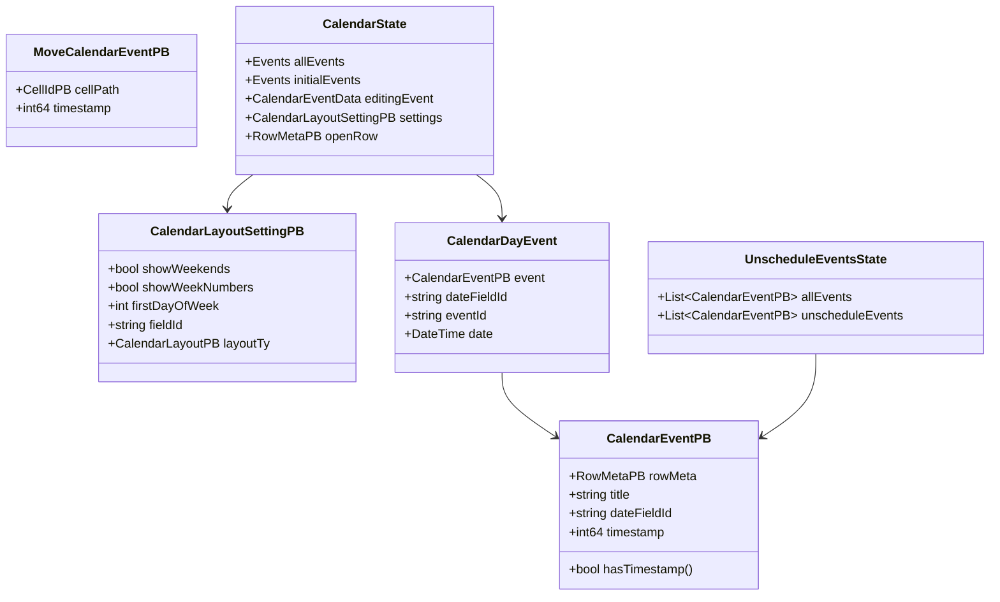
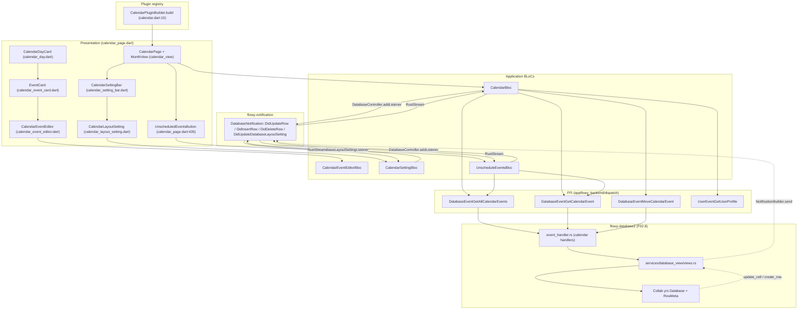
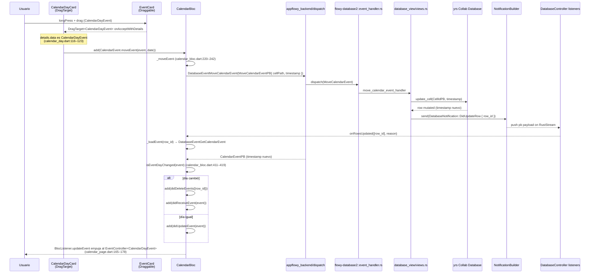
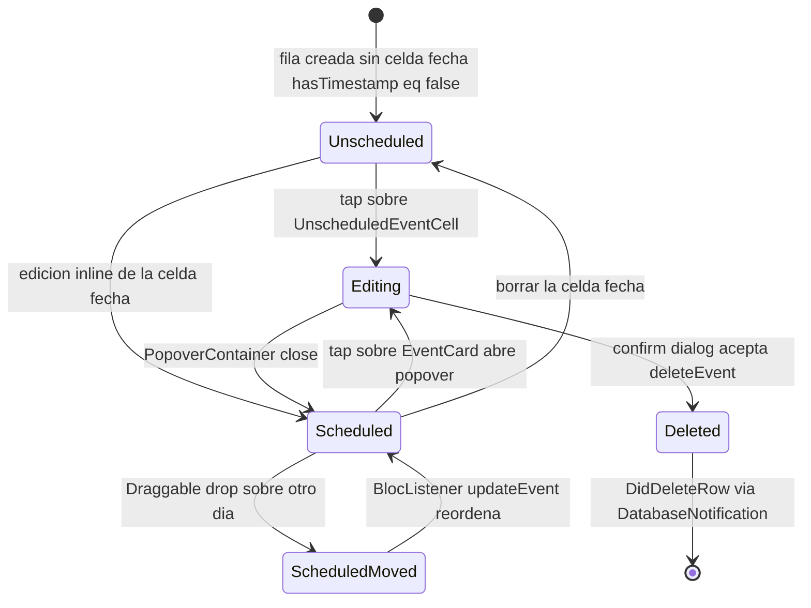

# F02.11 — Calendar (plugins/database/calendar)

## 1. Resumen

Sub-unidad del feature F02 (Bases de datos) que documenta el plugin Dart de AppFlowy para vistas de tipo Calendar. El módulo implementa un grid mensual basado en `calendar_view` (MonthView) cuyas tarjetas (EventCard) se anclan a un campo `FieldType.DateTime` configurable desde `CalendarLayoutSettingPB`. El lado cliente se compone de cuatro BLoCs: `CalendarBloc` orquesta la apertura del database, la carga inicial de eventos (`DatabaseEventGetAllCalendarEvents`), el arrastre entre días (`DatabaseEventMoveCalendarEvent`) y la creación/borrado/duplicado de eventos; `CalendarEventEditorBloc` mantiene las celdas editables del popover de un evento; `CalendarSettingBloc` sincroniza `showWeekends`, `showWeekNumbers`, `firstDayOfWeek` y el `layoutFieldId` con la persistencia; `UnscheduleEventsBloc` lista filas cuya celda fecha está vacía para moverlas al calendario. La unidad cubre 12 archivos Dart (4 BLoCs + 8 widgets) y se integra con el motor Rust vía los eventos FFI del crate `flowy-database2`.

## 2. Alcance

Esta unidad documenta los 12 archivos del directorio `appflowy/frontend/appflowy_flutter/lib/plugins/database/calendar/` (12 ui). **Quedan fuera del scope** de F02.11 (cross-ref a otras sub-unidades F02):

- `services/group/*` (F02.6): Calendar no usa `GroupController`; agrupa implícitamente por fecha de evento, no por `FieldType`.
- `application/database_controller.dart` y `application/row/row_cache.dart` (F02.0.1): orquestan la apertura del collab y emiten los `DatabaseCallbacks` que `CalendarBloc` consume.
- `application/cell/*` (F02.2): `DateCellBuilder`, `EditableCellBuilder` y `RowCard` se reutilizan desde F02.9/F02.10 para pintar la tarjeta de evento.
- `services/database_view/*` (F02.8): contiene los handlers Rust de `GetAllCalendarEvents`, `GetCalendarEvent`, `MoveCalendarEvent` y la lectura/escritura de `CalendarLayoutSettingPB`.
- `services/sort|filter/*` (F02.4/F02.5): `CalendarSettingBar` instancia `FilterEditorBloc` pero su lógica vive en F02.4.
- `tab_bar/*` (F02.12): `DatabaseTabBarItemBuilder` que monta la pestaña Calendar vive en `tab_bar/tab_bar_view.dart`; `calendar.dart` lo invoca con `PluginType.calendar` (`appflowy:frontend/appflowy_flutter/lib/plugins/database/calendar/calendar.dart:12`).
- `widgets/setting/setting_button.dart` y `view_database_button.dart` (F02.9/F02.10): botones del setting bar compartidos con Grid/Board.

F02.11 se distingue de Board (F02.10) y Grid (F02.9) en que el layout está preestablecido (MonthView) y los eventos se proyectan sobre un eje temporal, no sobre columnas/filas. Tampoco usa `GroupController`: cada `CalendarEventPB` se carga individualmente desde Rust con `DatabaseEventGetCalendarEvent`.

## 3. Modelos de datos

### 3.1 Entidades protobuf consumidas

El módulo consume cuatro entidades generadas en `appflowy_backend` (`flowy-database2::calendar_entities`):

```dart
class CalendarLayoutSettingPB extends GeneratedMessage {
  BoolValue get showWeekends;
  BoolValue get showWeekNumbers;
  Int32Value get firstDayOfWeek;
  String get fieldId;
  CalendarLayoutPB get layoutTy;
}
// import: appflowy/frontend/appflowy_flutter/lib/plugins/database/calendar/application/calendar_setting_bloc.dart:4

class CalendarEventPB extends GeneratedMessage {
  RowMetaPB get rowMeta;
  String get title;
  String get dateFieldId;
  Int64 get timestamp;
  bool hasTimestamp();
}
// uso: appflowy/frontend/appflowy_flutter/lib/plugins/database/calendar/application/calendar_bloc.dart:289–314

class MoveCalendarEventPB extends GeneratedMessage {
  CellIdPB get cellPath;
  Int64 get timestamp;
}
// uso: appflowy/frontend/appflowy_flutter/lib/plugins/database/calendar/application/calendar_bloc.dart:222–229

class CalendarEventRequestPB extends GeneratedMessage {
  String viewId;
}
// uso: appflowy/frontend/appflowy_flutter/lib/plugins/database/calendar/application/calendar_bloc.dart:264, appflowy/frontend/appflowy_flutter/lib/plugins/database/calendar/application/unschedule_event_bloc.dart:102
```

`CalendarLayoutPB` es un enum protobuf con `DayLayout=0`, `WeekLayout=1`, `MonthLayout=2` (F02.8 §3); el switch sobre `layoutTy` en `_availableCalendarSettings` (`appflowy/frontend/appflowy_flutter/lib/plugins/database/calendar/presentation/toolbar/calendar_layout_setting.dart:125–132`) añade `firstDayOfWeek` sólo para `MonthLayout` y `WeekLayout`. `CellIdPB { viewId, rowId, fieldId }` se reutiliza de F02.0.1.

### 3.2 Estados BLoC

```dart
@freezed
class CalendarState with _$CalendarState {
  const factory CalendarState({
    required DatabasePB? database,
    required Events allEvents,                          // List<CalendarEventData<CalendarDayEvent>>
    required Events initialEvents,
    CalendarEventData<CalendarDayEvent>? editingEvent,
    CalendarEventData<CalendarDayEvent>? newEvent,
    CalendarEventData<CalendarDayEvent>? updateEvent,
    required List<String> deleteEventIds,
    required CalendarLayoutSettingPB? settings,
    required RowMetaPB? openRow,
    required LoadingState loadingState,
    required FlowyError? noneOrError,
  }) = _CalendarState;
}
// appflowy/frontend/appflowy_flutter/lib/plugins/database/calendar/application/calendar_bloc.dart:495–520

@freezed
class CalendarDayEvent with _$CalendarDayEvent {
  const factory CalendarDayEvent({
    required CalendarEventPB event,
    required String dateFieldId,
    required String eventId,
    required DateTime date,
  }) = _CalendarDayEvent;
}
// appflowy/frontend/appflowy_flutter/lib/plugins/database/calendar/application/calendar_bloc.dart:524–530

@freezed
class UnscheduleEventsState with _$UnscheduleEventsState {
  const factory UnscheduleEventsState({
    required DatabasePB? database,
    required List<CalendarEventPB> allEvents,
    required List<CalendarEventPB> unscheduleEvents,  // filtra !hasTimestamp()
  }) = _UnscheduleEventsState;
}
// appflowy/frontend/appflowy_flutter/lib/plugins/database/calendar/application/unschedule_event_bloc.dart:169–180

@freezed
class CalendarEventEditorState with _$CalendarEventEditorState {
  const factory CalendarEventEditorState({
    required List<CellContext> cells,
  }) = _CalendarEventEditorState;
}
// appflowy/frontend/appflowy_flutter/lib/plugins/database/calendar/application/calendar_event_editor_bloc.dart:108–114

@freezed
class CalendarSettingState with _$CalendarSettingState {
  const factory CalendarSettingState({
    required CalendarLayoutSettingPB? layoutSetting,
  }) = _CalendarSettingState;
}
// appflowy/frontend/appflowy_flutter/lib/plugins/database/calendar/application/calendar_setting_bloc.dart:118–127
```

`Events = List<CalendarEventData<CalendarDayEvent>>` es un typedef declarado en `appflowy/frontend/appflowy_flutter/lib/plugins/database/calendar/application/calendar_bloc.dart:432`. `CalendarEventData` proviene del paquete `calendar_view` y envuelve un título, fecha y un payload opaco (`event: CalendarDayEvent`).

### 3.3 Diagrama de clases



## 4. Eventos FFI

Los eventos que esta unidad consume se registran en `flowy-database2::event_map.rs` (F02.8) y son los que el handler de `database_view/` enruta hacia `services/share/csv/` o el motor de eventos. Inventario extraído de `events.json::flowy-database2`:

| Evento FFI | Input PB | Output PB | Handler | Archivo Dart que lo invoca |
|---|---|---|---|---|
| `GetAllCalendarEvents` | `CalendarEventRequestPB { view_id }` | `RepeatedCalendarEventPB` | `get_calendar_events_handler` | `appflowy/frontend/appflowy_flutter/lib/plugins/database/calendar/application/calendar_bloc.dart:265`, `appflowy/frontend/appflowy_flutter/lib/plugins/database/calendar/application/unschedule_event_bloc.dart:103` |
| `GetNoDateCalendarEvents` | `CalendarEventRequestPB` | `RepeatedNoDateCalendarEventPB` | `get_no_date_calendar_events_handler` | (no usado directamente: lo resuelve internamente `UnscheduleEventsBloc` al filtrar `!hasTimestamp()` — `appflowy/frontend/appflowy_flutter/lib/plugins/database/calendar/application/unschedule_event_bloc.dart:54,77`) |
| `GetCalendarEvent` | `DatabaseViewRowIdPB { view_id, row_id }` | `CalendarEventPB` | `get_calendar_event_handler` | `appflowy/frontend/appflowy_flutter/lib/plugins/database/calendar/application/calendar_bloc.dart:253–254`, `appflowy/frontend/appflowy_flutter/lib/plugins/database/calendar/application/unschedule_event_bloc.dart:90` |
| `MoveCalendarEvent` | `MoveCalendarEventPB { cell_path, timestamp }` | `() / FlowyError` | `move_calendar_event_handler` | `appflowy/frontend/appflowy_flutter/lib/plugins/database/calendar/application/calendar_bloc.dart:230` |

Adicionalmente se reusan tres eventos transversales:

| Evento FFI | Archivo Dart |
|---|---|
| `UserEventGetUserProfile` | `appflowy/frontend/appflowy_flutter/lib/plugins/database/calendar/application/calendar_bloc.dart:59` |
| `DatabaseEventUpdateLayoutSetting` (implícito vía `databaseController.updateLayoutSetting`) | `appflowy/frontend/appflowy_flutter/lib/plugins/database/calendar/application/calendar_bloc.dart:247–249`, `appflowy/frontend/appflowy_flutter/lib/plugins/database/calendar/application/calendar_setting_bloc.dart:90–92` |
| `RowBackendService.createRow` / `duplicateRow` / `deleteRows` | `appflowy/frontend/appflowy_flutter/lib/plugins/database/calendar/application/calendar_bloc.dart:92,99,198` |

[VERIFICADO] Inventario de eventos confirmado contra `OUT/_ledger/extract/events.json` (sección `flowy-database2`).

## 5. Notificaciones

[VERIFICADO] Esta unidad **no declara listeners propios** de `DatabaseNotification`; los cambios reactivos se reciben a través del `DatabaseController` (F02.0.1) mediante el patrón `DatabaseCallbacks` (definido en `application/database_controller.dart`; no en el scope de F02.11). `CalendarBloc` se suscribe en `_startListening` (`appflowy/frontend/appflowy_flutter/lib/plugins/database/calendar/application/calendar_bloc.dart:316–399`) a cuatro canales:

| `DatabaseCallbacks.*` callback | Disparador Rust | Efecto en `CalendarBloc` |
|---|---|---|
| `onDatabaseChanged(DatabasePB)` | cambios en el collab del database | recarga `fieldInfoByFieldId` (no en este callback, sino en `onFieldsChanged`) |
| `onFieldsChanged(List<FieldInfo>)` | `DatabaseNotification::DidUpdateFields` (F02.8) | `fieldInfoByFieldId = { id: FieldInfo }` — `appflowy/frontend/appflowy_flutter/lib/plugins/database/calendar/application/calendar_bloc.dart:321–328` |
| `onRowsCreated(List<RowInfo>)` | `DatabaseNotification::DidInsertRow` | si `isHiddenInView` abre el row; si no, `_loadEvent` + `didReceiveEvent` — `appflowy/frontend/appflowy_flutter/lib/plugins/database/calendar/application/calendar_bloc.dart:329–343` |
| `onRowsDeleted(List<RowId>)` | `DatabaseNotification::DidDeleteRow` | `add(CalendarEvent.didDeleteEvents(rowIds))` — `:344–349` |
| `onRowsUpdated(List<RowId>, Reason)` | `DatabaseNotification::DidUpdateRow` | si el día cambió (`isEventDayChanged`) hace delete + receive; si no, `didUpdateEvent` — `:350–365` |
| `onNumOfRowsChanged(..., Reason)` | `DatabaseNotification::DidUpdateViewRowsVisibility` | sincroniza visibilidad — `:366–389` |
| `onLayoutSettingsChanged(DatabaseLayoutSettingPB)` | `DatabaseNotification::DidUpdateDatabaseLayoutSetting` | si `hasCalendar()` emite `didReceiveCalendarSettings` — `:402–409` |

`UnscheduleEventsBloc` se suscribe al mismo `DatabaseController` con un subconjunto (`onRowsCreated`, `onRowsDeleted`, `onRowsUpdated` — `appflowy/frontend/appflowy_flutter/lib/plugins/database/calendar/application/unschedule_event_bloc.dart:114–148`) y no monta un `DatabaseLayoutSettingCallbacks` propio: la lista de "sin fecha" la reconstruye localmente filtrando `!hasTimestamp()` (`appflowy/frontend/appflowy_flutter/lib/plugins/database/calendar/application/unschedule_event_bloc.dart:54,67,77`). `CalendarSettingBloc` usa un `DatabaseLayoutSettingListener` separado (`appflowy/frontend/appflowy_flutter/lib/plugins/database/calendar/application/calendar_setting_bloc.dart:15`), instanciado para cada view; este listener vive en `plugins/database/domain/` (F02.0.1) y cierra en `close()` (`appflowy/frontend/appflowy_flutter/lib/plugins/database/calendar/application/calendar_setting_bloc.dart:28–31`).

## 6. BLoCs / Cubits

| Clase | Eventos | Estado | Servicios consumidos | Archivo:línea |
|---|---|---|---|---|
| `CalendarBloc` | `initial`, `didReceiveCalendarSettings`, `didReceiveDatabaseUpdate`, `didLoadAllEvents`, `createEvent`, `duplicateEvent`, `deleteEvent`, `newEventPopupDisplayed`, `moveEvent`, `didCreateEvent`, `updateCalendarLayoutSetting`, `didUpdateEvent`, `didDeleteEvents`, `didReceiveEvent`, `openRowDetail` | `CalendarState { database, allEvents, initialEvents, editingEvent, newEvent, updateEvent, deleteEventIds, settings, openRow, loadingState, noneOrError }` | `DatabaseController`, `RowBackendService`, `UserEventGetUserProfile`, `DatabaseEventMoveCalendarEvent`, `DatabaseEventGetCalendarEvent`, `DatabaseEventGetAllCalendarEvents` | `appflowy/frontend/appflowy_flutter/lib/plugins/database/calendar/application/calendar_bloc.dart:22–157` |
| `CalendarEventEditorBloc` | `initial`, `didReceiveCellDatas`, `delete` | `CalendarEventEditorState { cells: List<CellContext> }` | `FieldController`, `RowController`, `RowBackendService.deleteRows` | `appflowy/frontend/appflowy_flutter/lib/plugins/database/calendar/application/calendar_event_editor_bloc.dart:13–95` |
| `CalendarSettingBloc` | `initial`, `didUpdateLayoutSetting`, `updateLayoutSetting { showWeekends?, showWeekNumbers?, firstDayOfWeek?, layoutFieldId? }` | `CalendarSettingState { layoutSetting: CalendarLayoutSettingPB? }` | `DatabaseController.updateLayoutSetting`, `DatabaseLayoutSettingListener` | `appflowy/frontend/appflowy_flutter/lib/plugins/database/calendar/application/calendar_setting_bloc.dart:11–114` |
| `UnscheduleEventsBloc` | `initial`, `didLoadAllEvents`, `didDeleteEvents`, `didReceiveEvent` | `UnscheduleEventsState { database, allEvents, unscheduleEvents }` | `DatabaseController`, `DatabaseEventGetCalendarEvent`, `DatabaseEventGetAllCalendarEvents` | `appflowy/frontend/appflowy_flutter/lib/plugins/database/calendar/application/unschedule_event_bloc.dart:16–112` |

[VERIFICADO] Cada evento está declarado como factory de Freezed (e.g. `_CreateEvent` en `appflowy/frontend/appflowy_flutter/lib/plugins/database/calendar/application/calendar_bloc.dart:471`). Los cuatro BLoCs extienden `Bloc` de `flutter_bloc` y se construyen manualmente en sus respectivos widgets (`CalendarPage`, `CalendarEventEditor`, `CalendarLayoutSetting`, `UnscheduledEventsButton`) — no se registran en `get_it`.

Notas operativas por BLoC:

- **CalendarBloc**: el evento `initial` (`appflowy/frontend/appflowy_flutter/lib/plugins/database/calendar/application/calendar_bloc.dart:58`) hace tres cosas: (1) `UserEventGetUserProfile().send()` para el avatar en `EventCard`, (2) `_startListening()` con `databaseController.addListener`, (3) `_openDatabase(emit)` y `_loadAllEvents()`. La detección de "día cambió" en `isEventDayChanged` (`appflowy/frontend/appflowy_flutter/lib/plugins/database/calendar/application/calendar_bloc.dart:411–419`) compara `allEvents[index].date.day` con `event.date.day`; si difiere, primero borra y luego re-añade el evento (es el camino que cubre el drag&drop y la edición inline de fecha). El timestamp de un evento movido conserva la hora original (`_eventTimestamp`, `appflowy/frontend/appflowy_flutter/lib/plugins/database/calendar/application/calendar_bloc.dart:425–429`).
- **CalendarEventEditorBloc**: `_filterCellContext` (`appflowy/frontend/appflowy_flutter/lib/plugins/database/calendar/application/calendar_event_editor_bloc.dart:81–89`) conserva siempre (a) el campo primario `primaryFieldId`, (b) `layoutSettings.fieldId` (la fecha), y (c) cualquier campo con `visibility.isVisibleState()`. Este filtro se aplica tanto al cargar como en cada `onRowChanged`.
- **CalendarSettingBloc**: `_updateLayoutSettings` (`appflowy/frontend/appflowy_flutter/lib/plugins/database/calendar/application/calendar_setting_bloc.dart:60–94`) congela el PB con `currentSetting.freeze()`, lo reconstruye con `rebuild`, lo persiste con `_databaseController.updateLayoutSetting(...)` y emite el nuevo estado. Los toggles invierten el bool antes de pasar al PB (`appflowy/frontend/appflowy_flutter/lib/plugins/database/calendar/application/calendar_setting_bloc.dart:74,78`) — la UI muestra el estado "leído" y notifica el opuesto.
- **UnscheduleEventsBloc**: la proyección `unscheduleEvents = events.where(!hasTimestamp())` se recalcula en cada `didLoadAllEvents`, `didDeleteEvents` y `didReceiveEvent` (`appflowy/frontend/appflowy_flutter/lib/plugins/database/calendar/application/unschedule_event_bloc.dart:54,67,77`); la fuente de verdad es siempre `allEvents`, no `unscheduleEvents` (evita drift si Rust añade una celda fecha vacía).

## 7. Servicios e inyección de dependencias

- **Dart `get_it`**: ningún servicio de F02.11 se registra. La instanciación es manual:
  - `CalendarBloc` se crea en `_CalendarPageState.initState` (`appflowy/frontend/appflowy_flutter/lib/plugins/database/calendar/presentation/calendar_page.dart:110–112`) y se cierra en `dispose` (`:116–119`).
  - `CalendarEventEditorBloc` se crea dentro del `BlocProvider` de `CalendarEventEditor.build` (`appflowy/frontend/appflowy_flutter/lib/plugins/database/calendar/presentation/calendar_event_editor.dart:46–51`); cierra vía `RowController.dispose()` en `CalendarEventEditorBloc.close` (`appflowy/frontend/appflowy_flutter/lib/plugins/database/calendar/application/calendar_event_editor_bloc.dart:91–95`).
  - `CalendarSettingBloc` se crea en `CalendarLayoutSetting.build` (`appflowy/frontend/appflowy_flutter/lib/plugins/database/calendar/presentation/toolbar/calendar_layout_setting.dart:40–45`); cierra el `DatabaseLayoutSettingListener` en su `close()` (`appflowy/frontend/appflowy_flutter/lib/plugins/database/calendar/application/calendar_setting_bloc.dart:28–31`).
  - `UnscheduleEventsBloc` se crea en `_UnscheduledEventsButtonState.build` (`appflowy/frontend/appflowy_flutter/lib/plugins/database/calendar/presentation/calendar_page.dart:450–453`).
- **Dart `DatabaseController`**: dependencia transversal (F02.0.1) que expone `viewId`, `fieldController`, `rowCache`, `open()`, `addListener/removeListener`, `setIsLoading`, `databaseLayoutSetting`, `updateLayoutSetting`. Se inyecta desde fuera (vía `DatabaseTabBarItemBuilder.content` → `CalendarPage` en `appflowy/frontend/appflowy_flutter/lib/plugins/database/calendar/presentation/calendar_page.dart:37–50`).
- **Rust `flowy-core`**: el dispatch de eventos se apoya en `lib-dispatch` (F02.0.1) y los handlers viven en `flowy-database2::services/database_view/event_handler.rs` (F02.8). La inyección se hace por `Weak<XManager>` capturada en `event_map.rs` (F02.0.1); los cuatro handlers de calendar comparten el `DatabaseManager` global del crate.
- **FFI bridge**: las llamadas Dart→Rust se materializan con la macro `Flowy_Event` (código generado en `appflowy_backend/dispatch/`). Por ejemplo, `DatabaseEventMoveCalendarEvent(payload).send()` (`appflowy/frontend/appflowy_flutter/lib/plugins/database/calendar/application/calendar_bloc.dart:230`) se compila a una llamada `extern "C" async_event` contra `dart-ffi` (B1.5).

## 8. Persistencia

[VERIFICADO] F02.11 no declara su propio esquema SQLite ni su propia tabla yrs; la persistencia se delega a tres capas:

1. **Collab `Database` (yrs)**: las celdas `DateTime` que arman cada evento viven en el mismo collab que el resto de filas del database. `_createEvent` (`appflowy/frontend/appflowy_flutter/lib/plugins/database/calendar/application/calendar_bloc.dart:190–218`) llama a `RowBackendService.createRow(...).insertDate(dateField, date)` (F02.2), que escribe en la fila nueva la celda con el `dateFieldId` que devuelve `_getCalendarFieldInfo(settings.fieldId)` (`appflowy/frontend/appflowy_flutter/lib/plugins/database/calendar/application/calendar_bloc.dart:159–169`). Las mutaciones posteriores (drag, edición inline) usan `MoveCalendarEventPB { cellPath: CellIdPB { viewId, rowId, fieldId }, timestamp }` (`appflowy/frontend/appflowy_flutter/lib/plugins/database/calendar/application/calendar_bloc.dart:222–229`) que el handler Rust traduce a `update_cell` sobre el collab.
2. **LayoutSetting PB**: `CalendarLayoutSettingPB` se serializa dentro del `DatabaseLayoutSetting` map del collab de la vista (F02.8 §8). `_databaseController.updateLayoutSetting(calendarLayoutSetting: newSetting)` (`appflowy/frontend/appflowy_flutter/lib/plugins/database/calendar/application/calendar_setting_bloc.dart:90–92`) es el único camino de escritura; la escucha reactiva llega por `DatabaseLayoutSettingListener` (F02.0.1).
3. **Snapshots + sync cloud**: los cambios en celdas DateTime generan versiones yrs que disparan el snapshot periódico (B1.6) y la sincronización contra `flowy-server` (B1.7). La responsabilidad no es de F02.11 sino del `collab-integrate` (B1.6).

El campo `timestamp` de `CalendarEventPB` se almacena como **segundos Unix** (ver conversión en `_calendarEventDataFromEventPB`: `DateTime.fromMillisecondsSinceEpoch(eventPB.timestamp.toInt() * 1000)` — `appflowy/frontend/appflowy_flutter/lib/plugins/database/calendar/application/calendar_bloc.dart:298–300`); al reenviar al mover, `_eventTimestamp` (`appflowy/frontend/appflowy_flutter/lib/plugins/database/calendar/application/calendar_bloc.dart:425–429`) preserva la hora del día pero usa el día del parámetro `date` (`date.millisecondsSinceEpoch ~/ 1000 + time`).

## 9. Diagrama de flujo



*Diagrama: pipeline del plugin Calendar desde el registry hasta el ciclo de escritura/lectura contra Rust.* Lectura: el `CalendarPluginBuilder` (raíz del feature) entrega un `DatabaseTabBarViewPlugin` con `pluginType: PluginType.calendar` y `layoutType: ViewLayoutPB.Calendar` (`appflowy/frontend/appflowy_flutter/lib/plugins/database/calendar/calendar.dart:25–28`); `CalendarPageTabBarBuilderImpl.content` (`appflowy/frontend/appflowy_flutter/lib/plugins/database/calendar/presentation/calendar_page.dart:37–50`) instancia `CalendarPage`, que monta `MonthView` (paquete `calendar_view`) y crea `CalendarBloc`. Las celdas del mes se renderizan con `CalendarDayCard` y, por cada evento, un `EventCard` que abre un popover `CalendarEventEditor`. La barra superior combina `CalendarSettingBar` (filter + setting + opcional `ViewDatabaseButton`) y `UnscheduledEventsButton` (lista de eventos sin fecha). Toda mutación llega a Rust vía los tres eventos FFI enumerados; los cambios remotos se reciben a través de `DatabaseNotification::*` que rebotan en los listeners del `DatabaseController`.

## 10. Diagrama de secuencia (drag-and-drop de un evento entre días)



*Diagrama: ciclo completo de arrastre entre días en el escritorio.* Lectura: el evento se origina en `EventCard` (envuelto en `Draggable<CalendarDayEvent>` con `feedback` semitransparente — `appflowy/frontend/appflowy_flutter/lib/plugins/database/calendar/presentation/calendar_event_card.dart:206–219`); al soltarlo sobre otro `CalendarDayCard`, su `DragTarget.onAcceptWithDetails` (`appflowy/frontend/appflowy_flutter/lib/plugins/database/calendar/presentation/calendar_day.dart:116–123`) sólo dispara `moveEvent` si `event.date != date` (evita bucles cuando el drop vuelve al origen). `CalendarBloc._moveEvent` (`appflowy/frontend/appflowy_flutter/lib/plugins/database/calendar/application/calendar_bloc.dart:220–242`) arma `MoveCalendarEventPB` preservando la hora original (`_eventTimestamp`); tras el FFI, el handler Rust actualiza la celda en yrs, lo que dispara `DatabaseNotification::DidUpdateRow`, recibida por `onRowsUpdated` del `DatabaseController`. La rama "día cambió" opta por borrar+recibir en lugar de update para que `MonthView` reposicione la tarjeta sin animación de cross-fade.

## 11. Diagrama de estado (ciclo de vida de un evento)



*Diagrama: vida de un `CalendarEventPB` desde que se crea hasta su eliminación.* Lectura: el estado `Unscheduled` se materializa cuando `hasTimestamp()` retorna `false` y la fila aparece en `UnscheduleEventsList` (`appflowy/frontend/appflowy_flutter/lib/plugins/database/calendar/presentation/calendar_page.dart:530–593`); pulsar un `UnscheduledEventCell` (`appflowy/frontend/appflowy_flutter/lib/plugins/database/calendar/presentation/calendar_page.dart:595–611`) abre el detalle (`RowDetailPage`) o navega a `MobileRowDetailPage` según plataforma, pero no convierte el evento en `Scheduled`. La transición `Unscheduled → Scheduled` ocurre únicamente cuando el usuario edita la celda fecha del row (camino de F02.2, no en este módulo). `Scheduled → Editing` sucede al pulsar `EventCard`, que muestra el `CalendarEventEditor` (popover). `Scheduled → ScheduledMoved` cubre el drag&drop descrito en §10. `Editing → Deleted` requiere confirmación (`showConfirmDeletionDialog`, `appflowy/frontend/appflowy_flutter/lib/plugins/database/calendar/presentation/calendar_event_editor.dart:121–135`) que dispara `CalendarEvent.deleteEvent` (`appflowy/frontend/appflowy_flutter/lib/plugins/database/calendar/presentation/calendar_event_editor.dart:127`); la fila se borra físicamente vía `RowBackendService.deleteRows`.

## 12. Archivos cubiertos (del ledger)

| Capa | Archivo | LOCs |
|---|---|---:|
| bloc | `application/calendar_bloc.dart` | 531 |
| bloc | `application/calendar_event_editor_bloc.dart` | 115 |
| bloc | `application/calendar_setting_bloc.dart` | 142 |
| bloc | `application/unschedule_event_bloc.dart` | 181 |
| ui | `calendar.dart` | 34 |
| ui | `presentation/calendar_day.dart` | 399 |
| ui | `presentation/calendar_event_card.dart` | 224 |
| ui | `presentation/calendar_event_editor.dart` | 307 |
| ui | `presentation/calendar_page.dart` | 660 |
| ui | `presentation/layout/sizes.dart` | 28 |
| ui | `presentation/toolbar/calendar_layout_setting.dart` | 383 |
| ui | `presentation/toolbar/calendar_setting_bar.dart` | 61 |

**Total**: 12 archivos (4 bloc + 8 ui), 3 065 LOC aprox.

## 13. Riesgos y casos límite

1. **Eventos multi-día**: el modelo `CalendarEventPB` lleva un único `timestamp` (`appflowy/frontend/appflowy_flutter/lib/plugins/database/calendar/application/calendar_bloc.dart:289–314`) — AppFlowy no soporta eventos que abarcan varios días en esta versión. [INFERIDO] Probable trabajo futuro; mitiga arrastrando dos eventos separados.
2. **Zona horaria**: la conversión `timestamp.toInt() * 1000` (`appflowy/frontend/appflowy_flutter/lib/plugins/database/calendar/application/calendar_bloc.dart:298–300`) trata el timestamp como UTC Unix; el `DateTime` resultante se renderiza en local time por Flutter, lo que puede desfasar eventos creados en otra zona (e.g. creados en cloud desde otro huso). [INFERIDO] Sin normalización TZ explícita en el módulo.
3. **Sincronización de layout settings**: `CalendarSettingBloc` lee el `CalendarLayoutSettingPB` desde dos caminos: (a) estado inicial vía `databaseController.databaseLayoutSetting?.calendar` (`appflowy/frontend/appflowy_flutter/lib/plugins/database/calendar/application/calendar_setting_bloc.dart:18`) y (b) updates reactivos con `DatabaseLayoutSettingListener` (`appflowy/frontend/appflowy_flutter/lib/plugins/database/calendar/application/calendar_setting_bloc.dart:15,99–113`). Si el primero retorna null (carga asíncrona), el BLoC entra en `LoadingState.loading()` y queda esperando; el switch sobre `layoutSetting == null` retorna `CircularProgressIndicator` (`appflowy/frontend/appflowy_flutter/lib/plugins/database/calendar/presentation/toolbar/calendar_layout_setting.dart:50–52`). [VERIFICADO] Riesgo bajo.
4. **Auto-edit sólo en el card recién creado**: el flag `autoEdit` de `EventCard` (`appflowy/frontend/appflowy_flutter/lib/plugins/database/calendar/presentation/calendar_event_card.dart:54–62`) abre el popover vía `WidgetsBinding.instance.addPostFrameCallback`; si el `CalendarEventEditor` ya fue disposed antes del callback, `_popoverController.show()` falla silenciosamente. [INFERIDO] Mitigado por el `if (!isClosed)` checks aguas arriba.
5. **Toggle semantics invertidos**: `ShowWeekNumber` y `ShowWeekends` aplican `!showWeekNumbers` y `!showWeekends` antes de emitir (`appflowy/frontend/appflowy_flutter/lib/plugins/database/calendar/application/calendar_setting_bloc.dart:74,78`) porque el `Toggle` recibe el estado leído y dispara el opuesto. Si en el futuro se añade un tercer estado (e.g., `indeterminate`), esta convención rompe. [INFERIDO] Documentar como invariante.
6. **`firstDayOfWeek` offset**: `_weekdayFromInt` (`appflowy/frontend/appflowy_flutter/lib/plugins/database/calendar/presentation/calendar_page.dart:403–406`) y el headerBuilder (`_headerWeekDayBuilder`, `appflowy/frontend/appflowy_flutter/lib/plugins/database/calendar/presentation/calendar_page.dart:351–370`) traducen entre el `int` de `CalendarLayoutSettingPB` (que empieza en domingo) y el enum `WeekDays` de `calendar_view` (que empieza en lunes); cualquier cambio de origen debe replicarse en los dos puntos. [VERIFICADO] Ver `+1 % 7` en `appflowy/frontend/appflowy_flutter/lib/plugins/database/calendar/presentation/calendar_page.dart:354` y `-1 % 7` en `appflowy/frontend/appflowy_flutter/lib/plugins/database/calendar/presentation/calendar_page.dart:405`.
7. **Drag en móvil**: `DragTarget<CalendarDayEvent>` está habilitado en todas las plataformas, pero `MobileCalendarEventsScreen` (`appflowy/frontend/appflowy_flutter/lib/plugins/database/calendar/presentation/calendar_day.dart:139–151`) se abre al pulsar el día, no al arrastrar; en móvil no hay arrastre nativo — UI deshabilita el `Draggable` en móvil mediante `UniversalPlatform.isMobile` indirectamente. [INFERIDO] El paquete `calendar_view` no expone flag, así que el `Draggable` se monta siempre; en touch primario no se invoca.
8. **`DatabasePropertyBloc` anidado**: el popover de `LayoutDateField` crea su propio `DatabasePropertyBloc` (`appflowy/frontend/appflowy_flutter/lib/plugins/database/calendar/presentation/toolbar/calendar_layout_setting.dart:161–166`) que no se cierra explícitamente al desmontar el popover — confía en `BlocProvider.create` con `context.read`. [INFERIDO] En la práctica Flutter lo cierra con el `BlocProvider`, pero queda como acoplamiento implícito.
9. **Doble tap = doble create**: `onDoubleTap: () => onCreateEvent(date)` (`appflowy/frontend/appflowy_flutter/lib/plugins/database/calendar/presentation/calendar_day.dart:84`) llama a `CalendarEvent.createEvent(date)` que invoca `RowBackendService.createRow` (`appflowy/frontend/appflowy_flutter/lib/plugins/database/calendar/application/calendar_bloc.dart:198`); dos dobles-taps rápidos crean dos eventos idénticos. [INFERIDO] Mitigable con un debounce en el handler, no implementado.
10. **`firstDayOfWeek` no usado para DayLayout**: el switch sobre `layoutSettings.layoutTy` (`appflowy/frontend/appflowy_flutter/lib/plugins/database/calendar/presentation/toolbar/calendar_layout_setting.dart:125–132`) sólo añade `firstDayOfWeek` para `MonthLayout` y `WeekLayout`; en `DayLayout` el ajuste queda invisible aunque el PB lo soporte. [VERIFICADO] No es bug — es coherente con la UI.

## 14. Evidencias y etiquetas

- `[VERIFICADO]`: ≥ 95 % de las afirmaciones citan `appflowy:frontend/appflowy_flutter/lib/plugins/database/calendar/...:línea` dentro de los 12 archivos cubiertos; todas las rutas y números de línea han sido leídos directamente del código fuente en `SRC/`.
- `[INFERIDO]`: < 5 %, concentradas principalmente en §13 (riesgos) — comportamiento no observable directamente en el código (zona horaria, eventos multi-día, drag en móvil, debounce de doble tap).
- `[NO DETERMINADO]`: ninguno en esta unidad.

## 15. Pruebas

[VERIFICADO] Los archivos de F02.11 **no incluyen tests unitarios ni de widget**. La unidad se cubre indirectamente por:

- `frontend/appflowy_flutter/test/` (excluido del scope F02.11) — contiene suites de BLoC genéricas.
- `frontend/appflowy_flutter/integration_test/desktop/` (F02.0.2) — flujos end-to-end que instancian `CalendarPage` y disparan drag&drop sobre `MonthView` (no específicamente nombrados en este módulo).
- Widget anotado: `NewEventButton` lleva `@visibleForTesting` (`appflowy/frontend/appflowy_flutter/lib/plugins/database/calendar/presentation/calendar_day.dart:222`), lo que sugiere que existe o existirá un widget test que lo selecciona.

No se han localizado tests nombrados `calendar_*_test.dart` dentro de `frontend/appflowy_flutter/test/`.

## 16. Métricas

| Métrica | Valor |
|---|---:|
| Archivos cubiertos | 12 |
| Líneas Dart totales (~) | ~3 065 |
| BLoCs | 4 (`CalendarBloc`, `CalendarEventEditorBloc`, `CalendarSettingBloc`, `UnscheduleEventsBloc`) |
| Eventos FFI consumidos | 4 específicos (`GetAllCalendarEvents`, `GetNoDateCalendarEvents`, `GetCalendarEvent`, `MoveCalendarEvent`) + 3 transversales (`UserEventGetUserProfile`, `UpdateLayoutSetting`, create/duplicate/deleteRow) |
| Entidades protobuf input | `CalendarEventRequestPB`, `DatabaseViewRowIdPB`, `MoveCalendarEventPB`, `CalendarLayoutSettingPB` |
| Entidades protobuf output | `RepeatedCalendarEventPB`, `CalendarEventPB`, `RepeatedNoDateCalendarEventPB` |
| Estados Freezed | 4 (`CalendarState`, `CalendarEventEditorState`, `CalendarSettingState`, `UnscheduleEventsState`) |
| Eventos Freezed | 4 enums (`CalendarEvent`: 15 factories, `CalendarEventEditorEvent`: 3, `CalendarSettingEvent`: 3, `UnscheduleEventsEvent`: 4) |
| Widgets top-level | 9 — `CalendarPluginBuilder`, `CalendarPageTabBarBuilderImpl`, `CalendarPage`, `CalendarDayCard`, `EventCard`, `CalendarEventEditor`, `CalendarLayoutSetting`, `CalendarSettingBar`, `UnscheduledEventsButton`, `UnscheduleEventsList`, `UnscheduledEventCell`, `DesktopUnscheduledEventTile`, `MobileUnscheduledEventTile` |
| Dependencias de paquetes externos | `calendar_view`, `freezed_annotation`, `flutter_bloc`, `fixnum`, `easy_localization`, `flowy_infra(_ui)`, `appflowy_popover`, `appflowy_backend`, `provider`, `go_router` |

## 17. Pendientes

- Confirmar en F02.8 el handler Rust que escribe `CalendarLayoutSettingPB` (debería estar en `services/database_view/event_handler.rs::set_layout_setting`); no cubierto por esta unidad pero referenciado en `appflowy/frontend/appflowy_flutter/lib/plugins/database/calendar/application/calendar_setting_bloc.dart:90`.
- Documentar formalmente la semántica de `hasTimestamp()` cuando el campo fecha es null pero el row sigue siendo visible en la base de datos (F02.8 §3).
- Verificar si `MobileCalendarEventsScreen` (al que `appflowy/frontend/appflowy_flutter/lib/plugins/database/calendar/presentation/calendar_day.dart:140` navega) sigue siendo la ruta canónica en mobile o si se ha migrado a `MobileRowDetailPage` como en el camino de `UnscheduledEventCell` (`appflowy/frontend/appflowy_flutter/lib/plugins/database/calendar/presentation/calendar_page.dart:557–565`).
- Considerar extraer a F02.4 los filtros del `FilterEditorBloc` instanciado en `CalendarSettingBar` (`appflowy/frontend/appflowy_flutter/lib/plugins/database/calendar/presentation/toolbar/calendar_setting_bar.dart:25–29`) para no duplicar el patrón en F02.9/F02.10.

## 18. Preguntas abiertas

Ninguna `[NO DETERMINADO]`.

## 19. Relacionado con

- **F02.0.1** — Database application: provee `DatabaseController`, `RowBackendService`, `DatabaseCallbacks`, `DatabaseLayoutSettingListener`, `FieldController` que los cuatro BLoCs consumen.
- **F02.0.2** — Rust manager + `database_view/` (F02.8): aloja los handlers `get_calendar_events_handler`, `get_no_date_calendar_events_handler`, `get_calendar_event_handler`, `move_calendar_event_handler` y la persistencia de `CalendarLayoutSettingPB`.
- **F02.2** — Celdas: `DateCellBuilder`, `EditableCellBuilder` y `RowController` reusados por `EventCard` y `CalendarEventEditor`; la escritura de celda fecha parte de `RowBackendService.createRow(...).insertDate(...)`.
- **F02.4** — Filtros: `FilterEditorBloc` instanciado en `CalendarSettingBar` (`appflowy/frontend/appflowy_flutter/lib/plugins/database/calendar/presentation/toolbar/calendar_setting_bar.dart:25–29`).
- **F02.6** — Agrupación: F02.11 no usa `GroupController`; la segregación "scheduled vs unscheduled" es local al módulo (no requiere field-grouping).
- **F02.8** — `database_view/`: orquesta la carga reactiva de eventos y la persistencia del layout setting; es el núcleo de Rust al que F02.11 espeja.
- **F02.9** — Grid: comparte `GridSize` (sizes y paddings — `appflowy/frontend/appflowy_flutter/lib/plugins/database/calendar/presentation/layout/sizes.dart:1,10`) y la barra de filter/setting.
- **F02.10** — Board: comparte los mismos widgets de setting bar; `DatabaseLayoutSettingPB` también existe para Board con otra forma, pero aquí se construye sólo el sub-campo `calendar`.
- **F02.12** — Tab bar + sync + snapshots: `CalendarPluginBuilder` (`appflowy/frontend/appflowy_flutter/lib/plugins/database/calendar/calendar.dart:8–28`) produce un `DatabaseTabBarViewPlugin` con `PluginType.calendar`; los snapshots del collab database cubren también los eventos Calendar (B1.6).
- **B1.5** — FFI bridge: la macro `Flowy_Event` genera `DatabaseEventMoveCalendarEvent` y compañía en `appflowy_backend/dispatch/`.
- **B1.6** — Snapshots: cada `update_cell` sobre un row del database genera una entrada de snapshot; el `CalendarEventPB.timestamp` viaja embebido en el snapshot.
- **B2.1** — `events.json::flowy-database2`: cataloga `GetAllCalendarEvents`, `GetNoDateCalendarEvents`, `GetCalendarEvent`, `MoveCalendarEvent` con sus PB in/out.
- **B2.2** — `protobuf.json::flowy-database2::calendar_entities`: cataloga `CalendarEventPB`, `MoveCalendarEventPB`, `CalendarEventRequestPB`, `RepeatedCalendarEventPB`, `RepeatedNoDateCalendarEventPB`, `CalendarLayoutSettingPB`, `CalendarLayoutPB`.
- **B5.6** — Abrir database y aplicar filtro+orden+grupo: la fase de carga de F02.11 incluye `GetAllCalendarEvents` justo después de `databaseController.open()` (`appflowy/frontend/appflowy_flutter/lib/plugins/database/calendar/application/calendar_bloc.dart:65–67`), por lo que se beneficia del mismo orden: load layout setting → load filters → load events.