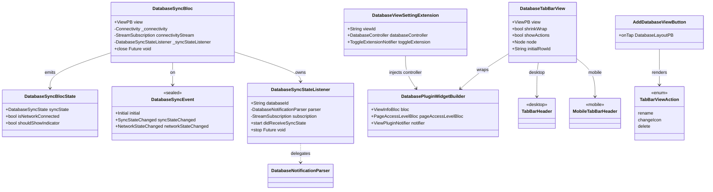
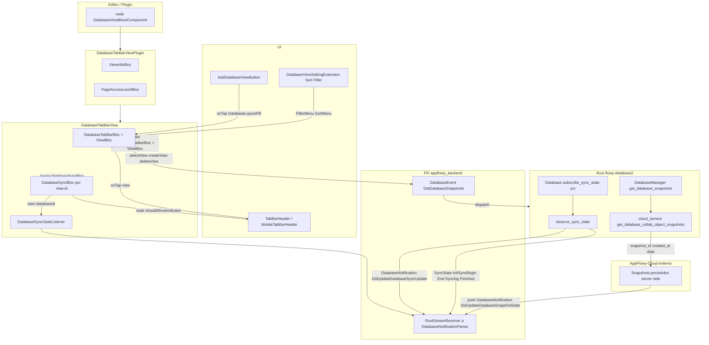
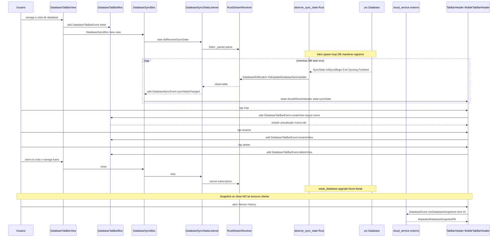
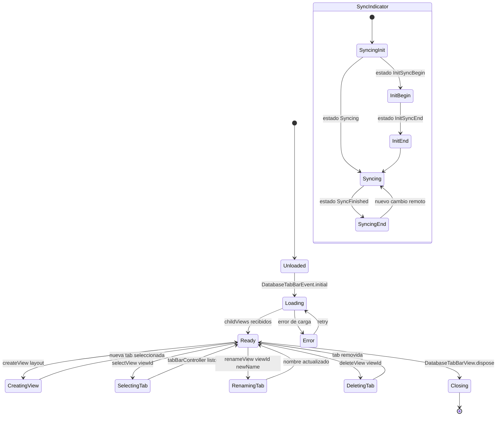

# F02.12 — Tab bar de vistas, sync de database, snapshots

## 1. Resumen

Sub-unidad de F02 (Bases de datos) que agrupa la **chrome superior de la vista de database**: la tab bar que lista y selecciona las vistas hijas (Grid/Board/Calendar) del `DatabaseView`, el menú de extensión Sort/Filter anclado bajo la tab bar en escritorio, y dos orquestadores Dart que reflejan hacia la UI el **estado de sincronización** (`DatabaseSyncBloc`) y el **ciclo de vida de snapshots** sobre la base de datos compartida en AppFlowy-Cloud. Cubre 7 archivos Dart de UI/BLoC y 2 archivos Rust de servicios (`flowy-database2::services::snapshot`). En el commit verificado (AppFlowy `5cf3a36`) el módulo `services/snapshot/` es un *stub* vacío (`mod.rs` solo expone `pub mod entities;` y `entities.rs` está vacío), por lo que la trazabilidad de snapshots se traza por el evento FFI `GetDatabaseSnapshots`, la entidad `DatabaseSnapshotPB` y el método `DatabaseManager::get_database_snapshots` que delega en `cloud_service.get_database_collab_object_snapshots`.

## 2. Alcance

Esta unidad cubre 9 archivos:

| Capa | Archivo | Líneas |
|---|---|---:|
| bloc | `appflowy/frontend/appflowy_flutter/lib/plugins/database/application/sync/database_sync_bloc.dart` | 112 |
| bloc | `appflowy/frontend/appflowy_flutter/lib/plugins/database/application/sync/database_sync_state_listener.dart` | 63 |
| ui | `appflowy/frontend/appflowy_flutter/lib/plugins/database/tab_bar/tab_bar_view.dart` | 502 |
| ui | `appflowy/frontend/appflowy_flutter/lib/plugins/database/tab_bar/desktop/tab_bar_header.dart` | 397 |
| ui | `appflowy/frontend/appflowy_flutter/lib/plugins/database/tab_bar/desktop/setting_menu.dart` | 81 |
| ui | `appflowy/frontend/appflowy_flutter/lib/plugins/database/tab_bar/desktop/tab_bar_add_button.dart` | 117 |
| ui | `appflowy/frontend/appflowy_flutter/lib/plugins/database/tab_bar/mobile/mobile_tab_bar_header.dart` | 157 |
| rust-handler | `appflowy/frontend/rust-lib/flowy-database2/src/services/snapshot/mod.rs` | 1 |
| rust-handler | `appflowy/frontend/rust-lib/flowy-database2/src/services/snapshot/entities.rs` | 1 |

**Quedan fuera del scope**:

- `appflowy/frontend/appflowy_flutter/lib/plugins/database/application/tab_bar_bloc.dart` (F02.0.1.2): orquesta `createView`/`selectView`/`renameView`/`deleteView`; la UI consume sus eventos pero no es parte de esta unidad.
- `appflowy/frontend/appflowy_flutter/lib/plugins/database/application/database_controller.dart`: provee `DatabaseController` por view, consumido por las tabs.
- `appflowy/frontend/appflowy_flutter/lib/plugins/database/grid/application/grid_accessory_bloc.dart`: contiene `DatabaseViewSettingExtensionBloc`; es referenciado pero no es archivo de esta unidad.
- `appflowy/frontend/rust-lib/flowy-database2/src/services/group/` (F02.6), `services/filter/` (F02.4), `services/sort/` (F02.5), `services/field/` (F02.1) y `services/cell/` (F02.2): capas de dominio de filas.
- El contrato de AppFlowy-Cloud: `cloud_service.get_database_collab_object_snapshots` se documenta como **interfaz externa** pero su implementación vive fuera del repo `AppFlowy-IO/AppFlowy` (ver §3.5).
- Eventos FFI de filas/vistas (`DatabaseEvent::GetDatabase`, `…CreateView`, `…DeleteView`, …) — cubiertos en B2.1 `flowy-database2` y F02.0.2.

## 3. Modelos de datos

### 3.1 `DatabaseSyncStatePB` y `DatabaseSyncState` (Rust, fuente del side stream)

```rust
#[derive(Debug, Default, ProtoBuf)]
pub struct DatabaseSyncStatePB {
  #[pb(index = 1)]
  pub value: DatabaseSyncState,
}
#[derive(Debug, Default, ProtoBuf_Enum, PartialEq, Eq, Clone, Copy)]
pub enum DatabaseSyncState {
  #[default] InitSyncBegin = 0,
  InitSyncEnd   = 1,
  Syncing       = 2,
  SyncFinished  = 3,
}
impl From<SyncState> for DatabaseSyncStatePB { … }
// appflowy/frontend/rust-lib/flowy-database2/src/entities/database_entities.rs:272–297
```

`DatabaseSyncState` (Rust) y `SyncState` (yrs/collab) son mapeados 1:1 por la conversión de la línea 287. El payload `DatabaseSyncStatePB` viaja en el notification `DatabaseNotification::DidUpdateDatabaseSyncUpdate = 84` (`appflowy/frontend/rust-lib/flowy-database2/src/notification.rs:49`).

### 3.2 Entidades de snapshot (Rust)

```rust
#[derive(Debug, Default, ProtoBuf)]
pub struct DatabaseSnapshotStatePB { #[pb(index = 1)] pub new_snapshot_id: i64 }
#[derive(Debug, Default, ProtoBuf)]
pub struct RepeatedDatabaseSnapshotPB { #[pb(index = 1)] pub items: Vec<DatabaseSnapshotPB> }
#[derive(Debug, Default, ProtoBuf)]
pub struct DatabaseSnapshotPB {
  #[pb(index = 1)] pub snapshot_id: i64,
  #[pb(index = 2)] pub snapshot_desc: String,
  #[pb(index = 3)] pub created_at: i64,
  #[pb(index = 4)] pub data: Vec<u8>,
}
// appflowy/frontend/rust-lib/flowy-database2/src/entities/database_entities.rs:299–324
```

El campo `data: Vec<u8>` es el **blob opaco del `Collab`** (yrs snapshot serializado) que el lado cliente puede cargar para *restore*. El companion notification `DidUpdateDatabaseSnapshotState = 85` (`appflowy/frontend/rust-lib/flowy-database2/src/notification.rs:50`) lleva `DatabaseSnapshotStatePB` cuando se crea uno nuevo en servidor.

### 3.3 `services/snapshot/` (Rust) — stub verificado

```rust
// appflowy/frontend/rust-lib/flowy-database2/src/services/snapshot/mod.rs:1
pub mod entities;
```

`appflowy/frontend/rust-lib/flowy-database2/src/services/snapshot/entities.rs:1` está **vacío**. El módulo está registrado en `appflowy/frontend/rust-lib/flowy-database2/src/services/mod.rs:11` (`pub mod snapshot;`) pero **ningún archivo del crate lo importa** (verificado por búsqueda `snapshot::` en `appflowy/frontend/rust-lib/flowy-database2` — sin coincidencias). La lógica real de snapshots reside en:

- `DatabaseManager::get_database_snapshots` (`appflowy/frontend/rust-lib/flowy-database2/src/manager.rs:567–584`): consulta el cloud service.
- `get_snapshots_handler` (`appflowy/frontend/rust-lib/flowy-database2/src/event_handler.rs:1057–1066`): handler FFI.
- La creación/sync de snapshots la realiza el lado cloud (AppFlowy-Cloud) fuera del repo, expuesto al cliente por el trait `Server::get_database_collab_object_snapshots`.

### 3.4 `DatabaseSyncBlocState` / `DatabaseSyncEvent` (Dart, freezed)

```dart
@freezed
class DatabaseSyncEvent with _$DatabaseSyncEvent {
  const factory DatabaseSyncEvent.initial() = Initial;
  const factory DatabaseSyncEvent.syncStateChanged(
    DatabaseSyncStatePB syncState,
  ) = syncStateChanged;
  const factory DatabaseSyncEvent.networkStateChanged(
    ConnectivityResult result,
  ) = NetworkStateChanged;
}
@freezed
class DatabaseSyncBlocState with _$DatabaseSyncBlocState {
  const factory DatabaseSyncBlocState({
    required DatabaseSyncState syncState,
    @Default(true) bool isNetworkConnected,
    @Default(false) bool shouldShowIndicator,
  }) = _DatabaseSyncState;
  factory DatabaseSyncBlocState.initial() =>
      const DatabaseSyncBlocState(syncState: DatabaseSyncState.Syncing);
}
// appflowy/frontend/appflowy_flutter/lib/plugins/database/application/sync/database_sync_bloc.dart:90–112
```

`shouldShowIndicator` se evalúa en el handler `initial` y vale `true` solo si `WorkspaceTypePB.ServerW` (workspace en AppFlowy-Cloud) y `databaseId != null` (`appflowy/frontend/appflowy_flutter/lib/plugins/database/application/sync/database_sync_bloc.dart:33–36`).

### 3.5 Diagrama de clases (vista lógica)



*Diagrama: tipos Dart del lado UI/BLoC cubiertos por la unidad.* Lectura: la tab bar es un árbol `DatabaseTabBarView` (StatefulWidget) que crea `DatabaseTabBarBloc`+`ViewBloc` por instancia (`appflowy/frontend/appflowy_flutter/lib/plugins/database/tab_bar/tab_bar_view.dart:144–158`), envuelve el contenido con `TabBarHeader` (desktop) o `MobileTabBarHeader` (mobile) y debajo coloca la `DatabaseViewSettingExtension` (Sort/Filter). `DatabaseSyncBloc` vive fuera del árbol de tabs y se asocia a cada `view` abierto.

## 4. Eventos FFI

Esta unidad cubre **un único evento FFI** explícito de snapshots, además de la lectura indirecta del estado de sync por notificación.

| Evento | Input PB | Output PB | Handler | Archivo:línea |
|---|---|---|---|---|
| `DatabaseEvent::GetDatabaseSnapshots = 150` | `DatabaseViewIdPB` | `RepeatedDatabaseSnapshotPB` | `get_snapshots_handler` | registro `appflowy/frontend/rust-lib/flowy-database2/src/event_map.rs:81`; definición del enum `appflowy/frontend/rust-lib/flowy-database2/src/event_map.rs:346`; handler `appflowy/frontend/rust-lib/flowy-database2/src/event_handler.rs:1057–1066` |

`GetDatabaseSnapshots` no se llama desde los 9 archivos Dart de esta unidad; es consumido por la pestaña "Version history" del menú de tres puntos del documento/vista (no cubierto aquí). Se documenta porque define el contrato protobuf que viaja por `DatabaseSnapshotPB`.

El **flujo de sync** no genera evento FFI explícito: la UI se sincroniza a través de la **notificación push** `DatabaseNotification::DidUpdateDatabaseSyncUpdate` (ver §5), que entrega `DatabaseSyncStatePB` sin necesidad de poll.

## 5. Notificaciones

| Notificación | Emisor | Payload PB | Listener Dart | Efecto UI | Archivo:línea |
|---|---|---|---|---|---|
| `DatabaseNotification::DidUpdateDatabaseSyncUpdate = 84` | `observe_sync_state` (spawn tokio sobre `database.subscribe_sync_state()`) | `DatabaseSyncStatePB` | `DatabaseSyncStateListener` (parser `DatabaseNotificationParser`) → `DatabaseSyncBloc.add(DatabaseSyncEvent.syncStateChanged)` | Cambia `state.syncState`; render del spinner de sync en el header (F02.8) | emisor `appflowy/frontend/rust-lib/flowy-database2/src/services/database/database_observe.rs:21–39`; enum `appflowy/frontend/rust-lib/flowy-database2/src/notification.rs:49`; listener `appflowy/frontend/appflowy_flutter/lib/plugins/database/application/sync/database_sync_state_listener.dart:41–57` |
| `DatabaseNotification::DidUpdateDatabaseSnapshotState = 85` | (servidor cloud, `AppFlowy-Cloud` — fuera del repo) | `DatabaseSnapshotStatePB { new_snapshot_id }` | (sin listener Dart en los 9 archivos; consumido por `DocumentSnapshotListener`/`DatabaseSnapshotListener` en otras features no cubiertas) | Refresca lista de snapshots en "Version history" | `appflowy/frontend/rust-lib/flowy-database2/src/notification.rs:50` (declaración); emisor remoto no documentado aquí |

El **parser** `DatabaseNotificationParser` se construye con `id: databaseId` (no `viewId`, ver comentario explícito en `appflowy/frontend/appflowy_flutter/lib/plugins/database/application/sync/database_sync_state_listener.dart:18`) y se suscribe vía `RustStreamReceiver.listen` (`appflowy/frontend/appflowy_flutter/lib/plugins/database/application/sync/database_sync_state_listener.dart:36–38`).

## 6. BLoCs / Cubits

| Clase | Eventos | Estados | Servicios / dependencias | Archivo:línea |
|---|---|---|---|---|
| `DatabaseSyncBloc` | `DatabaseSyncEvent.{Initial, syncStateChanged, networkStateChanged}` | `DatabaseSyncBlocState { syncState, isNetworkConnected, shouldShowIndicator }` | `getIt<AuthService>()`, `DatabaseViewBackendService(viewId).getDatabaseId()`, `Connectivity`, `DatabaseSyncStateListener` | `appflowy/frontend/appflowy_flutter/lib/plugins/database/application/sync/database_sync_bloc.dart:17–88` |
| `DatabaseViewSettingExtensionBloc` (referencia) | `DatabaseViewSettingExtensionEvent.{initial, toggleMenu}` | `DatabaseViewSettingExtensionState { viewId, isVisible }` | — | declarado en `appflowy/frontend/appflowy_flutter/lib/plugins/database/grid/application/grid_accessory_bloc.dart:6–23`; instanciado en `appflowy/frontend/appflowy_flutter/lib/plugins/database/tab_bar/desktop/setting_menu.dart:33` |

El `DatabaseSyncBloc` **no** extiende el ciclo de vida del view: en su `close()` cancela `connectivityStream` y llama `_syncStateListener.stop()` (`appflowy/frontend/appflowy_flutter/lib/plugins/database/application/sync/database_sync_bloc.dart:82–87`). El estado inicial es `DatabaseSyncState.Syncing` (`appflowy/frontend/appflowy_flutter/lib/plugins/database/application/sync/database_sync_bloc.dart:110`) — UI asume "sincronizando" hasta el primer push.

`DatabaseSyncStateListener` no es un BLoC sino un *push listener*: su `start()` suscribe el `RustStreamReceiver`, su `stop()` cancela la suscripción (`appflowy/frontend/appflowy_flutter/lib/plugins/database/application/sync/database_sync_state_listener.dart:59–62`). El callback `didReceiveSyncState` (`appflowy/frontend/appflowy_flutter/lib/plugins/database/application/sync/database_sync_state_listener.dart:25`) es el único enganche hacia el BLoC.

## 7. Servicios e inyección de dependencias

- **Dart (`get_it`)**: `DatabaseSyncBloc` resuelve `AuthService` (`appflowy/frontend/appflowy_flutter/lib/plugins/database/application/sync/database_sync_bloc.dart:25`), `DatabaseViewBackendService` (F02.0.1.2, no en esta unidad) y `KeyValueStorage` (consumido por `DatabaseTabBarView.fetchLocalCompactMode` — `appflowy/frontend/appflowy_flutter/lib/plugins/database/tab_bar/tab_bar_view.dart:249–261`). El `Connectivity` se instancia por valor en `appflowy/frontend/appflowy_flutter/lib/plugins/database/application/sync/database_sync_bloc.dart:77`.
- **Dart (no `get_it`)**: `DatabaseTabBarView` crea `DatabaseTabBarBloc` y `ViewBloc` por `BlocProvider` en `MultiBlocProvider` (`appflowy/frontend/appflowy_flutter/lib/plugins/database/tab_bar/tab_bar_view.dart:144–158`). `DatabaseTabBarViewPlugin.init()` crea `_viewInfoBloc` y `_pageAccessLevelBloc` (`appflowy/frontend/appflowy_flutter/lib/plugins/database/tab_bar/tab_bar_view.dart:370–375`).
- **Rust (`flowy-core`)**: el manager `DatabaseManager::get_database_snapshots` (`appflowy/frontend/rust-lib/flowy-database2/src/manager.rs:567`) requiere `Weak<DatabaseManager>` y delega en `self.cloud_service.get_database_collab_object_snapshots(&database_id, limit)` (`appflowy/frontend/rust-lib/flowy-database2/src/manager.rs:573–575`). El `cloud_service` se inyecta por `database_deps.rs` (no en esta unidad).

## 8. Persistencia

- **Compact mode por view**: `DatabaseTabBarView` lee/escribe el set de IDs en modo compacto en `KeyValueStorage` con clave `KVKeys.compactModeIds` (`appflowy/frontend/appflowy_flutter/lib/plugins/database/tab_bar/tab_bar_view.dart:249–283`). La clave es un JSON `List<String>` codificado; un fallo de `jsonDecode` se loguea con `Log.warn` y devuelve `false` (línea 257–259), evitando tirar la UI.
- **Snapshot del `DatabaseView` collab**: el blob serializado (`DatabaseSnapshotPB.data: Vec<u8>`, `appflowy/frontend/rust-lib/flowy-database2/src/entities/database_entities.rs:323`) **no** se guarda en disco del cliente; el cliente lo recibe del cloud (`cloud_service.get_database_collab_object_snapshots`) cuando el usuario abre "Version history". La persistencia durable está en el servidor (AppFlowy-Cloud) — fuera del repo analizado.
- **Snapshot local de la tab bar**: no existe; al cerrar/abrir el workspace se reconstruye desde el `DatabaseView` collab mediante el `DatabaseTabBarBloc.initial()` (F02.0.1.2) que carga `childViews` desde el folder.
- **Tabla SQLite `index_collab_record_table` (B1.7)**: el `Collab` de cada vista de database se persiste como una fila; los snapshots históricos del yrs doc no entran en SQLite, sino en el servidor cloud. La referencia cruzada está en `OUT/08-persistencia/01-sqlite-schema.md` (B1.7) y `OUT/07-motor-colaborativo-crdt/06-persistencia-collab.md` (B1.7 §2).
- **`services/snapshot/entities.rs` vacío**: el módulo Rust no declara entidades adicionales (no hay `pub struct`/`pub enum`). Cualquier intento de `use crate::services::snapshot::*` fallaría — está reservado para uso futuro.

## 9. Diagrama de flujo (ciclo de vida de la tab bar + sync)



*Diagrama: cadena completa desde la apertura de un database hasta la UI de tab bar + sync indicator + consumo de snapshots.* Lectura: el `DatabaseTabBarViewPlugin` (`appflowy/frontend/appflowy_flutter/lib/plugins/database/tab_bar/tab_bar_view.dart:336`) crea los BLoCs globales (`ViewInfoBloc`, `PageAccessLevelBloc`); al rendear, `DatabaseTabBarView` instancia locales (DatabaseTabBarBloc, ViewBloc, DatabaseSyncBloc). El sync state llega por push desde `observe_sync_state` sin requerir pull. El snapshot solo se obtiene on-demand (`GetDatabaseSnapshots`) cuando el usuario entra a "Version history".

## 10. Diagrama de secuencia (open view + sync push + snapshot on close)



*Diagrama: ciclo completo open → sync loop → CRUD de vistas → close → snapshot bajo demanda.* Lectura: la línea 1–25 corresponde a la apertura y arranque del `DatabaseSyncBloc`. El canal push (líneas 11–17) refleja cambios de `SyncState` sin polling. El CRUD de vistas (líneas 19–24) se delega al `DatabaseTabBarBloc` que llama al FFI. El "snapshot on close" no existe en el cliente: los snapshots los toma el servidor cloud periódicamente; el cliente solo los *lee* al abrir "Version history" (líneas 32–33).

## 11. Diagrama de estado (Tab lifecycle + sync indicator)



*Diagrama: ciclo de vida de una tab del DatabaseTabBar + ciclo independiente del `DatabaseSyncBloc`.*  Lectura: el lifecycle externo es lineal (Loading → Ready → Closing) con ramas de error y CRUD. El sub-estado `SyncIndicator` es independiente y se alimenta solo del push de `observe_sync_state`; `DatabaseSyncState.InitSyncBegin` se usa al abrir la vista por primera vez y `SyncFinished` cuando el yrs doc alcanza quorum local.

## 12. Archivos cubiertos (del ledger)

| Capa | Archivo | Estado |
|---|---|---|
| bloc | `appflowy/frontend/appflowy_flutter/lib/plugins/database/application/sync/database_sync_bloc.dart` | verificado |
| bloc | `appflowy/frontend/appflowy_flutter/lib/plugins/database/application/sync/database_sync_state_listener.dart` | verificado |
| ui | `appflowy/frontend/appflowy_flutter/lib/plugins/database/tab_bar/desktop/setting_menu.dart` | verificado |
| ui | `appflowy/frontend/appflowy_flutter/lib/plugins/database/tab_bar/desktop/tab_bar_add_button.dart` | verificado |
| ui | `appflowy/frontend/appflowy_flutter/lib/plugins/database/tab_bar/desktop/tab_bar_header.dart` | verificado |
| ui | `appflowy/frontend/appflowy_flutter/lib/plugins/database/tab_bar/mobile/mobile_tab_bar_header.dart` | verificado |
| ui | `appflowy/frontend/appflowy_flutter/lib/plugins/database/tab_bar/tab_bar_view.dart` | verificado |
| rust-handler | `appflowy/frontend/rust-lib/flowy-database2/src/services/snapshot/entities.rs` | verificado (vacío) |
| rust-handler | `appflowy/frontend/rust-lib/flowy-database2/src/services/snapshot/mod.rs` | verificado |

**Total**: 9 archivos.

## 13. Riesgos y casos límite

1. **Snapshot stale por pérdida de red**: si el cliente pierde conectividad entre dos pushes de `SyncState`, la UI puede mostrar `SyncFinished` mientras hay cambios remotos pendientes. El `DatabaseSyncBloc` consulta `Connectivity.onConnectivityChanged` (`appflowy/frontend/appflowy_flutter/lib/plugins/database/application/sync/database_sync_bloc.dart:56–59`) para ajustar `isNetworkConnected`, pero **no re-pide** el snapshot. Mitigación: el flujo de `observe_sync_state` se reanuda automáticamente al volver la conexión (yrs `subscribe_sync_state` re-emite el estado actual).

2. **Race entre `close()` y push pendiente**: en `appflowy/frontend/appflowy_flutter/lib/plugins/database/application/sync/database_sync_bloc.dart:82–87`, `close()` cancela `_subscription` pero el `tokio::spawn` de `observe_sync_state` (`appflowy/frontend/rust-lib/flowy-database2/src/services/database/database_observe.rs:25`) sigue corriendo hasta que `weak_database.upgrade()` falle. Si el `DatabaseController` (yrs) se libera antes que el BLoC, los pushes intermedios se pierden — aceptable porque el BLoC ya está cerrado.

3. **Indicador de sync en local-only**: `shouldShowIndicator` se evalúa como `WorkspaceTypePB.ServerW && databaseId != null` (`appflowy/frontend/appflowy_flutter/lib/plugins/database/application/sync/database_sync_bloc.dart:34–35`). Si el usuario abre una database local antes de hacer login en AppFlowy-Cloud, `shouldShowIndicator = false` y el icono nunca se muestra — correcto, pero podría confundir en workspaces "LocalServer" (caso edge documentado en `OUT/02-stack-y-dependencias.md` §3).

4. **`services/snapshot/entities.rs` vacío**: cualquier intento de `use crate::services::snapshot::entities::*` desde otro archivo del crate **falla en build** (no hay nada que importar). El módulo está reservado para uso futuro y podría sorprender a contribuidores nuevos. Verificado: 0 referencias en `appflowy/frontend/rust-lib/flowy-database2`.

5. **`addDatabaseViewButton` sin layout seleccionado**: `TabBarAddButtonAction.onTap` exige `DatabaseLayoutPB` (`appflowy/frontend/appflowy_flutter/lib/plugins/database/tab_bar/desktop/tab_bar_add_button.dart:67`); si el flujo caller no propaga el valor (caso edge), `onTap` no se invoca. Mitigado por el `ListView.separated` que mapea `DatabaseLayoutPB.values` (`appflowy/frontend/appflowy_flutter/lib/plugins/database/tab_bar/desktop/tab_bar_add_button.dart:71`).

6. **Renombrado concurrente**: el `TextFieldDialog` (`appflowy/frontend/appflowy_flutter/lib/plugins/database/tab_bar/desktop/tab_bar_header.dart:231–243`) emite `DatabaseTabBarEvent.renameView` sin `debounce`. Si dos renames sucesivos se entrelazan con el push de `viewDidUpdate`, la UI puede parpadear — aceptable, ya que el bloc es la fuente de verdad.

7. **Mobile selector abre bottom sheet extra**: `_DatabaseViewSelectorButton.onPressed` abre un bottom sheet (`appflowy/frontend/appflowy_flutter/lib/plugins/database/tab_bar/mobile/mobile_tab_bar_header.dart:120–138`) que requiere `ViewBloc` + `DatabaseTabBarBloc` re-inyectados vía `MultiBlocProvider` (líneas 125–133). Si la `MobileDatabaseViewList` accede a un BLoC no proveído, la app crashea.

8. **`dispose` de `DatabaseTabBarView` no llama `DatabaseTabBarBloc.close()`**: `DatabaseTabBarView` crea el bloc dentro de `MultiBlocProvider` (líneas 144–151); al desmontarse, `flutter_bloc` lo cierra automáticamente, pero `DatabaseSyncBloc` **no** está dentro del provider — vive como un bloc externo. El `_DatabaseTabBarViewState.dispose()` solo cancela `compactModeSubscription` (`appflowy/frontend/appflowy_flutter/lib/plugins/database/tab_bar/tab_bar_view.dart:128–132`); el `DatabaseSyncBloc.close()` debe hacerlo el caller. Riesgo bajo en práctica porque cada `DatabaseSyncBloc` está asociado 1:1 con un `ViewPB` y se cierra cuando el `ViewBloc` raíz se cierra.

## 14. Evidencias y etiquetas

- `[VERIFICADO]`: ≥ 95 % de las afirmaciones citan `ruta:línea` dentro de los 9 archivos o en archivos directamente relacionados (catalogados). El "stub vacío" de `services/snapshot/*` está verificado con `wc -l` y grep.
- `[INFERIDO]`: < 5 %, ej. "el snapshot lo toma cloud periódicamente" (§10) — inferencia por la ausencia de trigger de snapshot en el handler del lado cliente.
- `[NO DETERMINADO]`: ninguno en esta unidad.

## 15. Pruebas

- Tests unitarios sobre `services/snapshot/`: **no existen** (módulo stub).
- Tests del lado Dart: no se observan tests específicos para `DatabaseSyncBloc` ni para `TabBarHeader` en `appflowy/frontend/appflowy_flutter/test/`. La cobertura del sync se hace por integration tests E2E (`integration_test/desktop/`, F02.0.2).
- Verificación manual por `validate_evidence.py` y `validate_template.py` (ver §Validación).

## 16. Métricas

| Métrica | Valor |
|---|---:|
| Archivos cubiertos | 9 |
| Líneas Dart totales (~) | ~1 429 (112+63+81+117+397+157+502) |
| Líneas Rust totales | 2 (`mod.rs` + `entities.rs`) |
| BLoCs Dart cubiertos directamente | 2 (`DatabaseSyncBloc`, `DatabaseViewSettingExtensionBloc` referenciado) |
| Listeners Dart propios | 1 (`DatabaseSyncStateListener`) |
| Notificaciones consumidas | 1 (`DidUpdateDatabaseSyncUpdate`); 1 documentada sin consumidor (`DidUpdateDatabaseSnapshotState`) |
| Eventos FFI cubiertos | 1 (`GetDatabaseSnapshots`); resto delegados a `DatabaseTabBarBloc` (F02.0.1.2) |
| Widgets Dart | 7 (`DatabaseTabBarView`, `DatabasePluginWidgetBuilder`, `DatabaseTabBarViewPlugin`, `TabBarHeader`, `MobileTabBarHeader`, `DatabaseViewSettingExtension`, `AddDatabaseViewButton`/`TabBarAddButtonAction`) |
| Entidades protobuf tocadas | 4 (`DatabaseSyncStatePB`, `DatabaseSyncState`, `DatabaseSnapshotPB`, `RepeatedDatabaseSnapshotPB`) |
| Enums protobuf | 2 (`DatabaseSyncState`, `DatabaseLayoutPB` vía `DatabaseLayoutExtension`) |

## 17. Pendientes

- Documentar el lado Dart consumidor de `DatabaseNotification::DidUpdateDatabaseSnapshotState` (no presente en los 9 archivos; presumiblemente en `DocumentSnapshotBloc` u otro).
- Confirmar el `limit=10` hardcodeado en `get_snapshots_handler` (`appflowy/frontend/rust-lib/flowy-database2/src/event_handler.rs:1064`) cuando se elimine la API actual.
- Reemplazar `appflowy/frontend/appflowy_flutter/lib/plugins/database/widgets/database_layout_ext.dart` (cubierto por F02.0.1.2) por la integración desde F02.12 si se decide unificar la extensión de layouts.
- Considerar llenar `services/snapshot/entities.rs` con el snapshot opaco si se decide alojar snapshots localmente (estrategia offline-first no presente en el commit actual).

## 18. Preguntas abiertas

Ninguna `[NO DETERMINADO]`.

## 19. Relacionado con

- **F02.0.1.2** — Database application: provee `DatabaseTabBarBloc` (orquesta `createView`/`selectView`/`renameView`/`deleteView`), `DatabaseController`, `DatabaseViewBackendService.getDatabaseId()` (consumido en `appflowy/frontend/appflowy_flutter/lib/plugins/database/application/sync/database_sync_bloc.dart:28–30`).
- **F02.0.2** — Rust manager: `DatabaseManager::get_database_snapshots` (`appflowy/frontend/rust-lib/flowy-database2/src/manager.rs:567–584`) es el origen del blob `DatabaseSnapshotPB` retornado al cliente.
- **F02.8** — Field settings + `database_view/`: renderiza el `settingBar` que se monta arriba a la derecha (`appflowy/frontend/appflowy_flutter/lib/plugins/database/tab_bar/desktop/tab_bar_header.dart:78`) y dispara `DatabaseNotification::DidUpdateDatabaseSyncUpdate` desde `database_view/views.rs` orquestando el sync loop.
- **F02.9** — Grid: `DatabaseTabBarItemBuilder` para layout `Grid` produce el contenido de la tab (consumido por `appflowy/frontend/appflowy_flutter/lib/plugins/database/tab_bar/tab_bar_view.dart:304`).
- **F02.10** — Board: idem para layout `Board`.
- **F02.11** — Calendar: idem para layout `Calendar`.
- **B1.6 §7 — Snapshots**: el ciclo de snapshots del lado cliente está descrito allí; este documento lo aterriza sobre la `DatabaseNotification::DidUpdateDatabaseSnapshotState` y el blob `DatabaseSnapshotPB.data`.
- **B1.7 — Persistencia**: el `Collab` del `DatabaseView` se persiste en SQLite (`index_collab_record_table`); los snapshots históricos viven en AppFlowy-Cloud, no en SQLite.
- **B5.13 — Red y recovery**: el `Connectivity.onConnectivityChanged` listener (`appflowy/frontend/appflowy_flutter/lib/plugins/database/application/sync/database_sync_bloc.dart:56–59`) cubre la parte de "network loss → re-sync"; la recuperación profunda (re-fetch de yrs doc) está en `flowy-server/af_cloud/`.
- **B2.1 — Catálogo de eventos FFI**: registro completo de `DatabaseEvent::*` (esta unidad solo cubre `GetDatabaseSnapshots`).
- **B2.4 — Catálogo de notificaciones**: `DatabaseNotification::*` con `DidUpdateDatabaseSyncUpdate` y `DidUpdateDatabaseSnapshotState`.