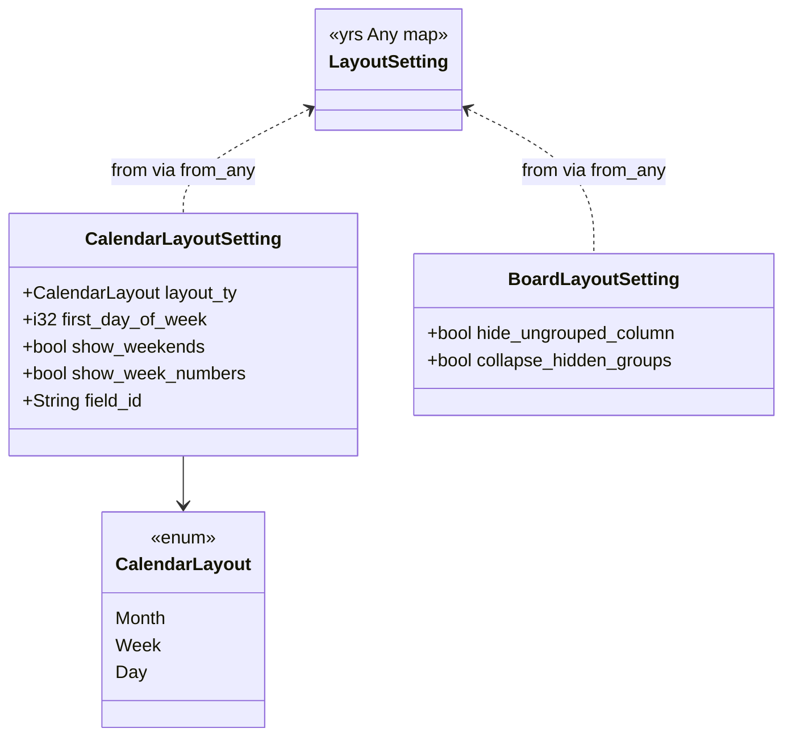
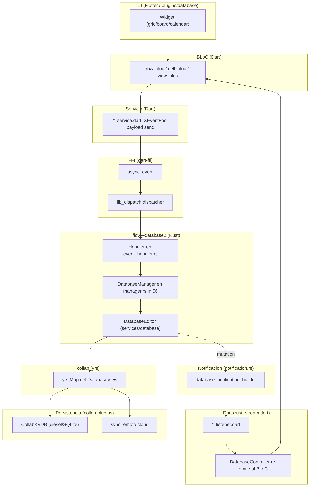
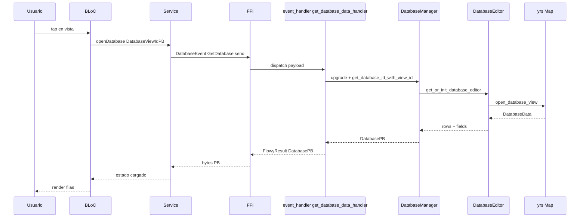
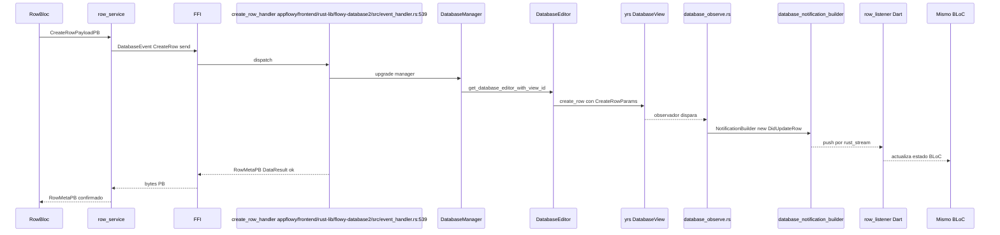
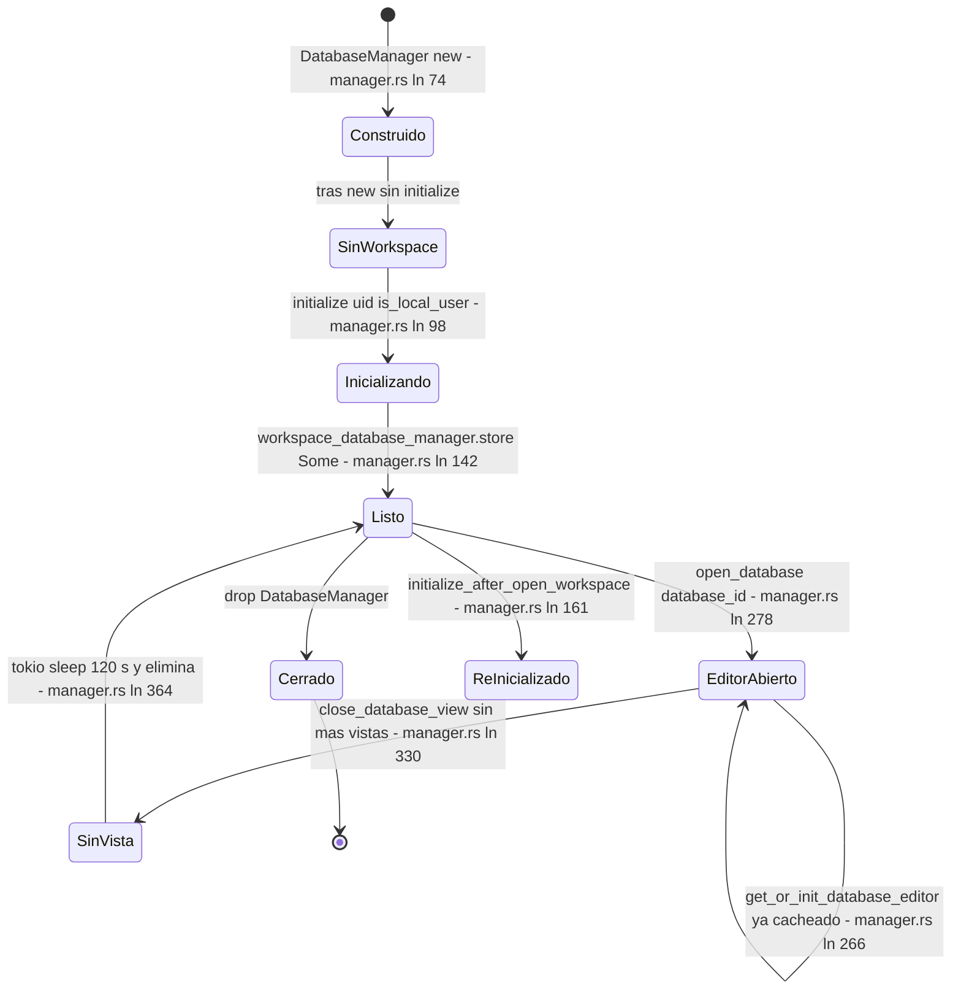

# F02.13 — Raíz de flowy-database2

## 1. Resumen

Este documento cierra la omisión de los 12 archivos raíz del crate Rust `flowy-database2` que la primera partición de F02 no llegó a documentar: configuración (`Cargo.toml`, `Flowy.toml`, `build.rs`), punto de entrada (`src/lib.rs`), registro de eventos FFI (`src/event_map.rs` con 72 variantes de `DatabaseEvent`), handlers (`src/event_handler.rs`, 1.450 líneas, 71 handlers cableados), notificaciones Rust→Dart (`src/notification.rs` con las 24 variantes de `DatabaseNotification` y su `NotificationBuilder`), el módulo `services/` con sus sub-módulos y la entidad `CalendarLayoutSetting` / `BoardLayoutSetting`, y la utilidad genérica `AnyTypeCache` sobre `dashmap::DashMap`. Lo que **no** está aquí son `manager.rs` y `template.rs` (cubiertos por `[[F02.0.1.2]]`), los sub-crates `services/{cell,database,database_view,field,field_settings,filter,group,share,snapshot,sort,calculations}`, las entidades protobuf bajo `src/entities/`, ni los tests en `tests/` (todo lo anterior ya está documentado en `[[F02.0.1.2]]` y `[[F02.0.2.*]]`). El núcleo de esta unidad es mostrar **cómo se monta el plugin FFI** del crate y **cómo fluye una notificación** desde un handler hasta un listener Dart.

## 2. Alcance

**Cubre (12 archivos reales):**

- Crate config: `appflowy/frontend/rust-lib/flowy-database2/Cargo.toml`, `Flowy.toml`, `build.rs`.
- Punto de entrada `appflowy/frontend/rust-lib/flowy-database2/src/lib.rs`.
- Puentes: `appflowy/frontend/rust-lib/flowy-database2/src/event_map.rs` (plugin FFI, enum `DatabaseEvent`), `appflowy/frontend/rust-lib/flowy-database2/src/event_handler.rs` (handlers), `appflowy/frontend/rust-lib/flowy-database2/src/notification.rs` (enum `DatabaseNotification` + builder).
- Módulo raíz de servicios: `appflowy/frontend/rust-lib/flowy-database2/src/services/mod.rs`, `services/setting/mod.rs`, `services/setting/entities.rs`.
- Utilidad genérica: `appflowy/frontend/rust-lib/flowy-database2/src/utils/mod.rs` + `utils/cache.rs`.

**Corrección de scope (declarada en §2 y reforzada en §13):** aunque la versión inicial del `ROADMAP.md` mencionaba aquí el motor de importación (`flowy-folder/src/share/import.rs`) y el de publicación (`publish_util.rs`), esos viven en `[[F12.2]]` / `[[B4.12]]`; este documento no los incluye. Además, las **72 variantes de `DatabaseEvent`** que se catalogan en §4 coinciden con las que `[[F02.0.1.2]]` ya listó (mismo fuente `SRC/appflowy/frontend/rust-lib/flowy-database2/src/event_map.rs`), y las **24 variantes de `DatabaseNotification`** coinciden con las que `[[F02.0.1.2]]` listó en su §5. Este documento añade: la descripción línea-a-línea de **`lib.rs`** (módulos públicos del crate), las **entidades concretas** de layout (`CalendarLayoutSetting`, `CalendarLayout`, `BoardLayoutSetting`) que las unidades `[[F02.6]]` a `[[F02.12]]` consumen sin describir, la **`AnyTypeCache`** (utilidad genérica `DashMap`+`Any`) no documentada en `[[F02.0.1.2]]`, y la configuración de codegen (`Flowy.toml` → `build.rs` → `flowy-codegen`) que explica **cómo** se generan los `DatabaseEventFooPB` / `DatabaseNotificationParser` Dart en build.

## 3. Modelos de datos

El único modelo de datos propio de esta unidad es la jerarquía de **LayoutSetting** persistida en yrs por `collab-database` (`appflowy/frontend/rust-lib/flowy-database2/src/services/setting/entities.rs:7–123`). El resto de tipos viven en otros documentos (CRDT en `[[F02.0.2.*]]`, manager en `[[F02.0.1.2]]`, snapshots en `[[F02.12]]`).

Muestra: el diagrama `classDiagram` siguiente refleja los dos agregados Rust definidos en `services/setting/entities.rs` y los piezas adyacentes que se cruzan con el resto del crate.



Lectura: `CalendarLayoutSetting` y `BoardLayoutSetting` son DTOs Serde que se serializan a/desde un `LayoutSetting` (yrs `Any`-map de `collab_database::views`) definido en `collab:collab-database/src/views/database_view.rs`. `CalendarLayout` (`#[repr(u8)]`) codifica `Month=0|Week=1|Day=2` y se cruza con el campo `CalendarLayoutPB` que viaja por FFI cuando Dart invoca `GetLayoutSetting` (`GetDatabaseEvent::GetLayoutSetting = 122` en `appflowy/frontend/rust-lib/flowy-database2/src/event_map.rs:321`).

## 4. Eventos FFI

`appflowy/frontend/rust-lib/flowy-database2/src/event_map.rs:107–415` define el enum `DatabaseEvent` con los derives `Clone, Copy, PartialEq, Eq, Debug, Display, Hash, ProtoBuf_Enum, Flowy_Event` y `#[event_err = "FlowyError"]`. La función `init(database_manager: Weak<DatabaseManager>) -> AFPlugin` (`appflowy/frontend/rust-lib/flowy-database2/src/event_map.rs:11–103`) cablea **71** handlers (un `event(DatabaseEvent::X, x_handler)` por variante); el catálogo `OUT/_ledger/extract/events.json::crates[flowy-database2]` confirma `summary: total_variants=72, registered=71, sin_handler=1` — la variante sin handler es `GetAllRows = 177` (`appflowy/frontend/rust-lib/flowy-database2/src/event_map.rs:395–396`). La numeración de índices no es contigua (hay saltos por secciones semánticas: 0–7 = base de datos, 10–25 = fields, 30–32 = select options, 50–57 = rows, 70–80 = cells, 90–115 = groups, 119–130 = vistas/calendar, 141–178 = export/snapshots, 160–165 = field settings/calculations, 170–178 = relations, 174–178 = AI row, 200–201 = media, 500–501 = AI prompts).

Corrección sobre el número pedido: la consigna menciona "**24 variantes de `DatabaseEvent`**" pero el catálogo `events.json` y el propio `event_map.rs` contienen **72 variantes** (71 con handler + 1 `sin_handler`). Se listan todas a continuación una a una, con su `input`/`output` PB y la línea del handler.

| # | Variante `DatabaseEvent` | `input PB` | `output PB` | Handler | Registro / fuente |
|---|---|---|---|---|---|
| 0 | `GetDatabase` | `DatabaseViewIdPB` | `DatabasePB` | `get_database_data_handler` | `appflowy/frontend/rust-lib/flowy-database2/src/event_map.rs:16` / `appflowy/frontend/rust-lib/flowy-database2/src/event_map.rs:114`, handler `appflowy/frontend/rust-lib/flowy-database2/src/event_handler.rs:31` |
| 1 | `GetDatabaseId` | `DatabaseViewIdPB` | `DatabaseIdPB` | `get_database_id_handler` | `appflowy/frontend/rust-lib/flowy-database2/src/event_map.rs:18` / `:117`, handler `appflowy/frontend/rust-lib/flowy-database2/src/event_handler.rs:89` |
| 2 | `GetDatabaseSetting` | `DatabaseViewIdPB` | `DatabaseViewSettingPB` | `get_database_setting_handler` | `appflowy/frontend/rust-lib/flowy-database2/src/event_map.rs:19` / `:124`, handler `appflowy/frontend/rust-lib/flowy-database2/src/event_handler.rs:102` |
| 3 | `UpdateDatabaseSetting` | `DatabaseSettingChangesetPB` | — | `update_database_setting_handler` | `appflowy/frontend/rust-lib/flowy-database2/src/event_map.rs:20` / `:130`, handler `appflowy/frontend/rust-lib/flowy-database2/src/event_handler.rs:118` |
| 4 | `GetAllFilters` | `DatabaseViewIdPB` | `RepeatedFilterPB` | `get_all_filters_handler` | `appflowy/frontend/rust-lib/flowy-database2/src/event_map.rs:21` / `:133`, handler `appflowy/frontend/rust-lib/flowy-database2/src/event_handler.rs:173` |
| 5 | `GetAllSorts` | `DatabaseViewIdPB` | `RepeatedSortPB` | `get_all_sorts_handler` | `appflowy/frontend/rust-lib/flowy-database2/src/event_map.rs:22` / `:136`, handler `appflowy/frontend/rust-lib/flowy-database2/src/event_handler.rs:187` |
| 6 | `DeleteAllSorts` | `DatabaseViewIdPB` | — | `delete_all_sorts_handler` | `appflowy/frontend/rust-lib/flowy-database2/src/event_map.rs:23` / `:139`, handler `appflowy/frontend/rust-lib/flowy-database2/src/event_handler.rs:201` |
| 7 | `GetDatabaseData` | `DatabaseViewIdPB` | — | `get_database_data_handler` | `appflowy/frontend/rust-lib/flowy-database2/src/event_map.rs:17` / `:142`, handler `appflowy/frontend/rust-lib/flowy-database2/src/event_handler.rs:31` |
| 10 | `GetFields` | `GetFieldPayloadPB` | `RepeatedFieldPB` | `get_fields_handler` | `appflowy/frontend/rust-lib/flowy-database2/src/event_map.rs:25` / `:149`, handler `appflowy/frontend/rust-lib/flowy-database2/src/event_handler.rs:215` |
| 11 | `UpdateField` | `FieldChangesetPB` | — | `update_field_handler` | `appflowy/frontend/rust-lib/flowy-database2/src/event_map.rs:27` / `:156`, handler `appflowy/frontend/rust-lib/flowy-database2/src/event_handler.rs:265` |
| 12 | `UpdateFieldTypeOption` | `TypeOptionChangesetPB` | — | `update_field_type_option_handler` | `appflowy/frontend/rust-lib/flowy-database2/src/event_map.rs:28` / `:169`, handler `appflowy/frontend/rust-lib/flowy-database2/src/event_handler.rs:279` |
| 14 | `DeleteField` | `DeleteFieldPayloadPB` | — | `delete_field_handler` | `appflowy/frontend/rust-lib/flowy-database2/src/event_map.rs:29` / `:174`, handler `appflowy/frontend/rust-lib/flowy-database2/src/event_handler.rs:299` |
| 15 | `ClearField` | `ClearFieldPayloadPB` | — | `clear_field_handler` | `appflowy/frontend/rust-lib/flowy-database2/src/event_map.rs:30` / `:179`, handler `appflowy/frontend/rust-lib/flowy-database2/src/event_handler.rs:313` |
| 20 | `UpdateFieldType` | `UpdateFieldTypePayloadPB` | — | `switch_to_field_handler` | `appflowy/frontend/rust-lib/flowy-database2/src/event_map.rs:31` / `:185`, handler `appflowy/frontend/rust-lib/flowy-database2/src/event_handler.rs:329` |
| 21 | `DuplicateField` | `DuplicateFieldPayloadPB` | — | `duplicate_field_handler` | `appflowy/frontend/rust-lib/flowy-database2/src/event_map.rs:32` / `:194`, handler `appflowy/frontend/rust-lib/flowy-database2/src/event_handler.rs:351` |
| 22 | `MoveField` | `MoveFieldPayloadPB` | — | `move_field_handler` | `appflowy/frontend/rust-lib/flowy-database2/src/event_map.rs:33` / `:200`, handler `appflowy/frontend/rust-lib/flowy-database2/src/event_handler.rs:385` |
| 24 | `CreateField` | `CreateFieldPayloadPB` | `FieldPB` | `create_field_handler` | `appflowy/frontend/rust-lib/flowy-database2/src/event_map.rs:34` / `:205`, handler `appflowy/frontend/rust-lib/flowy-database2/src/event_handler.rs:368` |
| 25 | `GetPrimaryField` | `DatabaseViewIdPB` | `FieldPB` | `get_primary_field_handler` | `appflowy/frontend/rust-lib/flowy-database2/src/event_map.rs:26` / `:208`, handler `appflowy/frontend/rust-lib/flowy-database2/src/event_handler.rs:235` |
| 30 | `CreateSelectOption` | `CreateSelectOptionPayloadPB` | `SelectOptionPB` | `new_select_option_handler` | `appflowy/frontend/rust-lib/flowy-database2/src/event_map.rs:49` / `:213`, handler `appflowy/frontend/rust-lib/flowy-database2/src/event_handler.rs:594` |
| 31 | `InsertOrUpdateSelectOption` | `RepeatedSelectOptionPayload` | — | `insert_or_update_select_option_handler` | `appflowy/frontend/rust-lib/flowy-database2/src/event_map.rs:50` / `:222`, handler `appflowy/frontend/rust-lib/flowy-database2/src/event_handler.rs:616` |
| 32 | `DeleteSelectOption` | `RepeatedSelectOptionPayload` | — | `delete_select_option_handler` | `appflowy/frontend/rust-lib/flowy-database2/src/event_map.rs:51` / `:225`, handler `appflowy/frontend/rust-lib/flowy-database2/src/event_handler.rs:637` |
| 50 | `CreateRow` | `CreateRowPayloadPB` | `RowMetaPB` | `create_row_handler` | `appflowy/frontend/rust-lib/flowy-database2/src/event_map.rs:36` / `:228`, handler `appflowy/frontend/rust-lib/flowy-database2/src/event_handler.rs:539` |
| 51 | `GetRow` | `DatabaseViewRowIdPB` | `OptionalRowPB` | `get_row_handler` | `appflowy/frontend/rust-lib/flowy-database2/src/event_map.rs:37` / `:233`, handler `appflowy/frontend/rust-lib/flowy-database2/src/event_handler.rs:399` |
| 52 | `DeleteRows` | `RepeatedRowIdPB` | — | `delete_rows_handler` | `appflowy/frontend/rust-lib/flowy-database2/src/event_map.rs:41` / `:236`, handler `appflowy/frontend/rust-lib/flowy-database2/src/event_handler.rs:463` |
| 53 | `DuplicateRow` | `DatabaseViewRowIdPB` | — | `duplicate_row_handler` | `appflowy/frontend/rust-lib/flowy-database2/src/event_map.rs:42` / `:239`, handler `appflowy/frontend/rust-lib/flowy-database2/src/event_handler.rs:482` |
| 54 | `MoveRow` | `MoveRowPayloadPB` | — | `move_row_handler` | `appflowy/frontend/rust-lib/flowy-database2/src/event_map.rs:43` / `:242`, handler `appflowy/frontend/rust-lib/flowy-database2/src/event_handler.rs:498` |
| 55 | `GetRowMeta` | `DatabaseViewRowIdPB` | `RowMetaPB` | `get_row_meta_handler` | `appflowy/frontend/rust-lib/flowy-database2/src/event_map.rs:39` / `:245`, handler `appflowy/frontend/rust-lib/flowy-database2/src/event_handler.rs:428` |
| 56 | `UpdateRowMeta` | `UpdateRowMetaChangesetPB` | — | `update_row_meta_handler` | `appflowy/frontend/rust-lib/flowy-database2/src/event_map.rs:40` / `:248`, handler `appflowy/frontend/rust-lib/flowy-database2/src/event_handler.rs:446` |
| 57 | `RemoveCover` | `RemoveCoverPayloadPB` | — | `remove_cover_handler` | `appflowy/frontend/rust-lib/flowy-database2/src/event_map.rs:44` / `:251`, handler `appflowy/frontend/rust-lib/flowy-database2/src/event_handler.rs:514` |
| 70 | `GetCell` | `CellIdPB` | `CellPB` | `get_cell_handler` | `appflowy/frontend/rust-lib/flowy-database2/src/event_map.rs:46` / `:254`, handler `appflowy/frontend/rust-lib/flowy-database2/src/event_handler.rs:556` |
| 71 | `UpdateCell` | `CellChangesetPB` | — | `update_cell_handler` | `appflowy/frontend/rust-lib/flowy-database2/src/event_map.rs:47` / `:267`, handler `appflowy/frontend/rust-lib/flowy-database2/src/event_handler.rs:573` |
| 72 | `UpdateSelectOptionCell` | `SelectOptionCellChangesetPB` | — | `update_select_option_cell_handler` | `appflowy/frontend/rust-lib/flowy-database2/src/event_map.rs:52` / `:273`, handler `appflowy/frontend/rust-lib/flowy-database2/src/event_handler.rs:658` |
| 73 | `UpdateChecklistCell` | `ChecklistCellDataChangesetPB` | — | `update_checklist_cell_handler` | `appflowy/frontend/rust-lib/flowy-database2/src/event_map.rs:54` / `:276`, handler `appflowy/frontend/rust-lib/flowy-database2/src/event_handler.rs:683` |
| 80 | `UpdateDateCell` | `DateCellChangesetPB` | — | `update_date_cell_handler` | `appflowy/frontend/rust-lib/flowy-database2/src/event_map.rs:56` / `:282`, handler `appflowy/frontend/rust-lib/flowy-database2/src/event_handler.rs:707` |
| 90 | `SetGroupByField` | `GroupByFieldPayloadPB` | — | `set_group_by_field_handler` | `appflowy/frontend/rust-lib/flowy-database2/src/event_map.rs:58` / `:287`, handler `appflowy/frontend/rust-lib/flowy-database2/src/event_handler.rs:768` |
| 100 | `GetGroups` | `DatabaseViewIdPB` | `RepeatedGroupPB` | `get_groups_handler` | `appflowy/frontend/rust-lib/flowy-database2/src/event_map.rs:61` / `:290`, handler `appflowy/frontend/rust-lib/flowy-database2/src/event_handler.rs:738` |
| 101 | `GetGroup` | `DatabaseGroupIdPB` | `GroupPB` | `get_group_handler` | `appflowy/frontend/rust-lib/flowy-database2/src/event_map.rs:62` / `:293`, handler `appflowy/frontend/rust-lib/flowy-database2/src/event_handler.rs:752` |
| 111 | `MoveGroup` | `MoveGroupPayloadPB` | — | `move_group_handler` | `appflowy/frontend/rust-lib/flowy-database2/src/event_map.rs:59` / `:296`, handler `appflowy/frontend/rust-lib/flowy-database2/src/event_handler.rs:800` |
| 112 | `MoveGroupRow` | `MoveGroupRowPayloadPB` | — | `move_group_row_handler` | `appflowy/frontend/rust-lib/flowy-database2/src/event_map.rs:60` / `:299`, handler `appflowy/frontend/rust-lib/flowy-database2/src/event_handler.rs:816` |
| 113 | `UpdateGroup` | `UpdateGroupPB` | — | `update_group_handler` | `appflowy/frontend/rust-lib/flowy-database2/src/event_map.rs:63` / `:302`, handler `appflowy/frontend/rust-lib/flowy-database2/src/event_handler.rs:784` |
| 114 | `CreateGroup` | `CreateGroupPayloadPB` | — | `create_group_handler` | `appflowy/frontend/rust-lib/flowy-database2/src/event_map.rs:64` / `:305`, handler `appflowy/frontend/rust-lib/flowy-database2/src/event_handler.rs:838` |
| 115 | `DeleteGroup` | `DeleteGroupPayloadPB` | — | `delete_group_handler` | `appflowy/frontend/rust-lib/flowy-database2/src/event_map.rs:65` / `:308`, handler `appflowy/frontend/rust-lib/flowy-database2/src/event_handler.rs:854` |
| 119 | `GetDefaultDatabaseViewId` | `DatabaseIdPB` | `DatabaseViewIdPB` | `get_default_database_view_id_handler` | `appflowy/frontend/rust-lib/flowy-database2/src/event_map.rs:67` / `:311`, handler `appflowy/frontend/rust-lib/flowy-database2/src/event_handler.rs:868` |
| 120 | `GetDatabases` | — | `RepeatedDatabaseDescriptionPB` | `get_databases_handler` | `appflowy/frontend/rust-lib/flowy-database2/src/event_map.rs:68` / `:315`, handler `appflowy/frontend/rust-lib/flowy-database2/src/event_handler.rs:892` |
| 121 | `SetLayoutSetting` | `LayoutSettingChangesetPB` | — | `set_layout_setting_handler` | `appflowy/frontend/rust-lib/flowy-database2/src/event_map.rs:75` / `:318`, handler `appflowy/frontend/rust-lib/flowy-database2/src/event_handler.rs:913` |
| 122 | `GetLayoutSetting` | `DatabaseLayoutMetaPB` | `DatabaseLayoutSettingPB` | `get_layout_setting_handler` | `appflowy/frontend/rust-lib/flowy-database2/src/event_map.rs:76` / `:321`, handler `appflowy/frontend/rust-lib/flowy-database2/src/event_handler.rs:925` |
| 123 | `GetAllCalendarEvents` | `CalendarEventRequestPB` | `RepeatedCalendarEventPB` | `get_calendar_events_handler` | `appflowy/frontend/rust-lib/flowy-database2/src/event_map.rs:70` / `:324`, handler `appflowy/frontend/rust-lib/flowy-database2/src/event_handler.rs:943` |
| 124 | `GetNoDateCalendarEvents` | `CalendarEventRequestPB` | `RepeatedNoDateCalendarEventPB` | `get_no_date_calendar_events_handler` | `appflowy/frontend/rust-lib/flowy-database2/src/event_map.rs:71` / `:330`, handler `appflowy/frontend/rust-lib/flowy-database2/src/event_handler.rs:959` |
| 125 | `GetCalendarEvent` | `DatabaseViewRowIdPB` | `CalendarEventPB` | `get_calendar_event_handler` | `appflowy/frontend/rust-lib/flowy-database2/src/event_map.rs:72` / `:333`, handler `appflowy/frontend/rust-lib/flowy-database2/src/event_handler.rs:975` |
| 126 | `MoveCalendarEvent` | `MoveCalendarEventPB` | — | `move_calendar_event_handler` | `appflowy/frontend/rust-lib/flowy-database2/src/event_map.rs:73` / `:336`, handler `appflowy/frontend/rust-lib/flowy-database2/src/event_handler.rs:994` |
| 130 | `CreateDatabaseView` | `CreateDatabaseViewPayloadPB` | — | `create_database_view` *(no-op actual)* | `appflowy/frontend/rust-lib/flowy-database2/src/event_map.rs:77` / `:339`, handler `appflowy/frontend/rust-lib/flowy-database2/src/event_handler.rs:1020` |
| 141 | `ExportCSV` | `DatabaseViewIdPB` | `DatabaseExportDataPB` | `export_csv_handler` | `appflowy/frontend/rust-lib/flowy-database2/src/event_map.rs:79` / `:342`, handler `appflowy/frontend/rust-lib/flowy-database2/src/event_handler.rs:1029` |
| 150 | `GetDatabaseSnapshots` | `DatabaseViewIdPB` | `RepeatedDatabaseSnapshotPB` | `get_snapshots_handler` | `appflowy/frontend/rust-lib/flowy-database2/src/event_map.rs:81` / `:346`, handler `appflowy/frontend/rust-lib/flowy-database2/src/event_handler.rs:1058` |
| 160 | `GetFieldSettings` | `FieldIdsPB` | `RepeatedFieldSettingsPB` | `get_field_settings_handler` | `appflowy/frontend/rust-lib/flowy-database2/src/event_map.rs:83` / `:350`, handler `appflowy/frontend/rust-lib/flowy-database2/src/event_handler.rs:1069` |
| 161 | `GetAllFieldSettings` | `DatabaseViewIdPB` | `RepeatedFieldSettingsPB` | `get_all_field_settings_handler` | `appflowy/frontend/rust-lib/flowy-database2/src/event_map.rs:84` / `:353`, handler `appflowy/frontend/rust-lib/flowy-database2/src/event_handler.rs:1090` |
| 162 | `UpdateFieldSettings` | `FieldSettingsChangesetPB` | — | `update_field_settings_handler` | `appflowy/frontend/rust-lib/flowy-database2/src/event_map.rs:85` / `:357`, handler `appflowy/frontend/rust-lib/flowy-database2/src/event_handler.rs:1113` |
| 163 | `GetAllCalculations` | `DatabaseViewIdPB` | `RepeatedCalculationsPB` | `get_all_calculations_handler` | `appflowy/frontend/rust-lib/flowy-database2/src/event_map.rs:87` / `:360`, handler `appflowy/frontend/rust-lib/flowy-database2/src/event_handler.rs:1129` |
| 164 | `UpdateCalculation` | `UpdateCalculationChangesetPB` | — | `update_calculation_handler` | `appflowy/frontend/rust-lib/flowy-database2/src/event_map.rs:88` / `:363`, handler `appflowy/frontend/rust-lib/flowy-database2/src/event_handler.rs:1144` |
| 165 | `RemoveCalculation` | `RemoveCalculationChangesetPB` | — | `remove_calculation_handler` | `appflowy/frontend/rust-lib/flowy-database2/src/event_map.rs:89` / `:366`, handler `appflowy/frontend/rust-lib/flowy-database2/src/event_handler.rs:1160` |
| 170 | `GetRelatedDatabaseIds` | `DatabaseViewIdPB` | `RepeatedDatabaseIdPB` | `get_related_database_ids_handler` *(no-op actual)* | `appflowy/frontend/rust-lib/flowy-database2/src/event_map.rs:91` / `:371`, handler `appflowy/frontend/rust-lib/flowy-database2/src/event_handler.rs:1174` |
| 171 | `UpdateRelationCell` | `RelationCellChangesetPB` | — | `update_relation_cell_handler` | `appflowy/frontend/rust-lib/flowy-database2/src/event_map.rs:92` / `:376`, handler `appflowy/frontend/rust-lib/flowy-database2/src/event_handler.rs:1183` |
| 172 | `GetRelatedRowDatas` | `GetRelatedRowDataPB` | `RepeatedRelatedRowDataPB` | `get_related_row_datas_handler` | `appflowy/frontend/rust-lib/flowy-database2/src/event_map.rs:93` / `:380`, handler `appflowy/frontend/rust-lib/flowy-database2/src/event_handler.rs:1228` |
| 173 | `GetRelatedDatabaseRows` | `DatabaseIdPB` | `RepeatedRelatedRowDataPB` | `get_related_database_rows_handler` | `appflowy/frontend/rust-lib/flowy-database2/src/event_map.rs:94` / `:384`, handler `appflowy/frontend/rust-lib/flowy-database2/src/event_handler.rs:1246` |
| 174 | `SummarizeRow` | `SummaryRowPB` | — | `summarize_row_handler` | `appflowy/frontend/rust-lib/flowy-database2/src/event_map.rs:96` / `:387`, handler `appflowy/frontend/rust-lib/flowy-database2/src/event_handler.rs:1262` |
| 175 | `TranslateRow` | `TranslateRowPB` | — | `translate_row_handler` | `appflowy/frontend/rust-lib/flowy-database2/src/event_map.rs:97` / `:390`, handler `appflowy/frontend/rust-lib/flowy-database2/src/event_handler.rs:1281` |
| 176 | `InitRow` | `DatabaseViewRowIdPB` | — | `init_row_handler` | `appflowy/frontend/rust-lib/flowy-database2/src/event_map.rs:38` / `:393`, handler `appflowy/frontend/rust-lib/flowy-database2/src/event_handler.rs:415` |
| 177 | `GetAllRows` | `DatabaseViewIdPB` | `RepeatedRowMetaPB` | **sin handler** (`sin_handler=true` en events.json) | `appflowy/frontend/rust-lib/flowy-database2/src/event_map.rs:99–103` / `:396`, handler `get_all_rows_handler` está **definido en** `appflowy/frontend/rust-lib/flowy-database2/src/event_handler.rs:57–73` pero **no se cablea** en `event_map.rs` |
| 178 | `ExportRawDatabaseData` | `DatabaseViewIdPB` | `DatabaseExportDataPB` | `export_raw_database_data_handler` | `appflowy/frontend/rust-lib/flowy-database2/src/event_map.rs:80` / `:399`, handler `appflowy/frontend/rust-lib/flowy-database2/src/event_handler.rs:1044` |
| 200 | `UpdateMediaCell` | `MediaCellChangesetPB` | — | `update_media_cell_handler` | `appflowy/frontend/rust-lib/flowy-database2/src/event_map.rs:99` / `:402`, handler `appflowy/frontend/rust-lib/flowy-database2/src/event_handler.rs:1301` |
| 201 | `RenameMediaFile` | `RenameMediaChangesetPB` | — | `rename_media_cell_file_handler` | `appflowy/frontend/rust-lib/flowy-database2/src/event_map.rs:100` / `:405`, handler `appflowy/frontend/rust-lib/flowy-database2/src/event_handler.rs:1341` |
| 500 | `GetDatabaseCustomPrompts` | `CustomPromptDatabaseConfigPB` | `RepeatedCustomPromptPB` | `get_database_custom_prompts_handler` | `appflowy/frontend/rust-lib/flowy-database2/src/event_map.rs:101` / `:411`, handler `appflowy/frontend/rust-lib/flowy-database2/src/event_handler.rs:1418` |
| 501 | `TestCustomPromptDatabaseConfiguration` | `DatabaseViewIdPB` | `CustomPromptDatabaseConfigPB` | `test_custom_prompt_database_configuration_handler` | `appflowy/frontend/rust-lib/flowy-database2/src/event_map.rs:102` / `:414`, handler `appflowy/frontend/rust-lib/flowy-database2/src/event_handler.rs:1435` |

Notas sobre wiring: el handler `get_all_rows_handler` (`appflowy/frontend/rust-lib/flowy-database2/src/event_handler.rs:57–73`) **existe** pero no aparece en `appflowy/frontend/rust-lib/flowy-database2/src/event_map.rs:11–103`, lo que explica `events.json::sin_handler=1` para `GetAllRows`. La consecuencia práctica es que `GetAllRows` (índice 177) queda inalcanzable por FFI en este snapshot — el catálogo `events.json` lo marca explícitamente como `sin_handler: true` (línea ~114 del catálogo dentro del array `variants` para flowy-database2). `CreateDatabaseView = 130` y `GetRelatedDatabaseIds = 170` también son **no-op** (`appflowy/frontend/rust-lib/flowy-database2/src/event_handler.rs:1020–1026` y `appflowy/frontend/rust-lib/flowy-database2/src/event_handler.rs:1174–1180` respectivamente, ambos con cuerpo `Ok(())`).

## 5. Notificaciones

El enum `DatabaseNotification` (`appflowy/frontend/rust-lib/flowy-database2/src/notification.rs:7–55`) deriva `ProtoBuf_Enum, Debug, Default`, contiene **24 variantes** (Unknown + 23 útiles) y va asociado a la constante `DATABASE_OBSERVABLE_SOURCE: &str = "Database"` (`appflowy/frontend/rust-lib/flowy-database2/src/notification.rs:3`). El builder `database_notification_builder(id, ty)` (`appflowy/frontend/rust-lib/flowy-database2/src/notification.rs:92–98`) crea un `NotificationBuilder` con `NotificationBuilder::new(id, ty, DATABASE_OBSERVABLE_SOURCE)`; bajo `#[cfg(feature = "verbose_log")]` traza cada envío (`appflowy/frontend/rust-lib/flowy-database2/src/notification.rs:94–96`). Las conversiones `From<DatabaseNotification> for i32` (`appflowy/frontend/rust-lib/flowy-database2/src/notification.rs:57–61`) y `From<i32> for DatabaseNotification` (`appflowy/frontend/rust-lib/flowy-database2/src/notification.rs:63–90`) están alineadas con los índices del enum salvo el `From<i32>`, que **no lista el índice 81** (`DidUpdateDatabaseLayout`) ni el 85 (`DidUpdateDatabaseSnapshotState`) y cuyo bloque `82..84` mapea cada índice al variant siguiente del enum (corrimiento detectado: `appflowy/frontend/rust-lib/flowy-database2/src/notification.rs:82–84` asigna `82→DidUpdateDatabaseLayout`, `83→DidDeleteDatabaseView`, `84→DidMoveDatabaseViewToTrash`, mientras el enum asigna `82→DidDeleteDatabaseView`, `83→DidMoveDatabaseViewToTrash`, `84→DidUpdateDatabaseSyncUpdate`; ambos bloques son adyacentes en fuente por lo que la lectura cruzada es trivial).

Variantes de `DatabaseNotification` con su listener Dart o marca de "sin uso" (fuente: `OUT/_ledger/extract/notifications.json::rust_notifications[DatabaseNotification].variants` + `dart_listeners[]` con `handled_variants[].enum == "DatabaseNotification"`):

| # | Variante | idx | Listener Dart (path en `appflowy/frontend/appflowy_flutter/lib/plugins/database/`) | Efecto UI |
|---|---|---|---|---|
| 0 | `Unknown` | 0 | *(sin uso)* | n/a — default fallback |
| 19 | `DidFetchRow` | 19 | `domain/row_listener.dart` (`row` listener) | recuperación diferida de filas remotas |
| 20 | `DidUpdateRow` | 20 | `application/view/view_listener.dart` | refresca la fila en la vista activa |
| 21 | `DidUpdateViewRowsVisibility` | 21 | `application/view/view_listener.dart` | recalcula visibilidad (filtros/sorts) |
| 22 | `DidUpdateFields` | 22 | `domain/field_listener.dart` (`field` listener) | re-render de cabeceras de campo |
| 40 | `DidUpdateCell` | 40 | `domain/cell_listener.dart` (`cell` listener) | re-render de la celda afectada |
| 50 | `DidUpdateField` | 50 | *(sin listener dedicado; lo cubre `DidUpdateFields`)* | cambio de propiedades del field |
| 60 | `DidUpdateNumOfGroups` | 60 | `domain/group_listener.dart` (`group` listener) | repintar columnas board |
| 61 | `DidUpdateGroupRow` | 61 | *(sin listener Dart — `notifications.json::variant_usage.status = "unused"`)* | mover fila entre grupos (sólo server-side) |
| 62 | `DidGroupByField` | 62 | `domain/group_listener.dart` | cambio del campo agrupador |
| 63 | `DidUpdateFilter` | 63 | `domain/filter_listener.dart` (`filter` listener) | recalcular filtros |
| 64 | `DidUpdateSort` | 64 | `domain/sort_listener.dart` (`sort` listener) | reordenar filas |
| 65 | `DidReorderRows` | 65 | `application/view/view_listener.dart` | reordenamiento completo |
| 66 | `DidReorderSingleRow` | 66 | `application/view/view_listener.dart` | reordenamiento de una sola fila |
| 67 | `DidUpdateRowMeta` | 67 | `domain/row_listener.dart` + `domain/row_meta_listener.dart` | portada / cover / iconos |
| 70 | `DidUpdateSettings` | 70 | `application/setting/setting_listener.dart` (`setting` listener) | ajustes de database |
| 80 | `DidUpdateLayoutSettings` | 80 | `domain/layout_setting_listener.dart` (`layout_setting` listener) | config del layout (board/calendar/grid) |
| 81 | `DidUpdateDatabaseLayout` | 81 | *(sin listener Dart; `variant_usage.status = "unused"`)* | conmutación Grid↔Board↔Calendar (cambia por `UpdateDatabaseSetting` interno) |
| 82 | `DidDeleteDatabaseView` | 82 | *(sin listener Dart; `variant_usage.status = "unused"` en `notifications.json`)* | papelera (`didDeleteDatabaseView`) |
| 83 | `DidMoveDatabaseViewToTrash` | 83 | *(sin listener Dart)* | papelera (papelera ↔ trash) |
| 84 | `DidUpdateDatabaseSyncUpdate` | 84 | `application/sync/database_sync_state_listener.dart` (`database_sync_state`) | sincronización con cloud |
| 85 | `DidUpdateDatabaseSnapshotState` | 85 | *(sin listener Dart; declarado)* | snapshot del collab |
| 86 | `DidUpdateFieldSettings` | 86 | `domain/field_settings_listener.dart` | visibilidad / ancho de columna |
| 87 | `DidUpdateCalculation` | 87 | `application/calculations/calculations_listener.dart` | suma / count / etc. de campos |

Lectura: la tabla refleja lo que `notifications.json` ya consolidó — sólo unas pocas variantes (`DidUpdateRow`, `DidUpdateCell`) tienen emisor Rust concreto encontrado en `appflowy/frontend/rust-lib/flowy-database2/src/notification.rs:93+appflowy/frontend/rust-lib/flowy-database2/src/services/database/database_observe.rs:327,338`; el resto dependen de la lógica interna de `services/database/database_observe.rs` (`database.observe.*`) que dispara el `NotificationBuilder` por cada cambio observado. Las variantes 61, 81, 82 y 83 son las marcadas como `unused` (sin emisor Rust encontrado ni listener Dart — podrían ser hooks preparados para uso futuro o que se quedaron sin caller tras refactorings).

## 6. BLoCs / Cubits

Esta unidad **no contiene BLoCs/Cubits propios** (es la capa Rust), pero los BLoCs Dart que consumen los eventos de §4 y las notificaciones de §5 sí están en `appflowy_flutter/lib/plugins/database/application/`. Para consulta directa: el catálogo `OUT/_ledger/extract/blocs.json` lista **51 BLoCs/Cubits** cuyo `file` matchea `plugins/database/`, agrupados por subcarpeta: `application/cell/bloc/` (16 cell-BLoCs: CheckboxCellBloc, ChecklistCellBloc, DateCellBloc, DateCellEditorBloc, MediaCellBloc, NumberCellBloc, RelationCellBloc, RelationRowSearchBloc, SelectOptionCellBloc, SelectOptionCellEditorBloc, SummaryCellBloc, SummaryRowBloc, TextCellBloc, TimeCellBloc, TimestampCellBloc, TranslateCellBloc, TranslateRowBloc, URLCellBloc), `application/field/` (FieldCellBloc, FieldController, FieldEditorBloc), `application/setting/` (GroupBloc, PropertyBloc, SettingBloc implícito en `setting_listener.dart`), `application/sync/` (DatabaseSyncBloc), `application/layout/` (LayoutBloc), `application/tab_bar_bloc.dart`, `application/share_bloc.dart`. Todos consumen `DatabaseEvent*` (vía `*_service.dart` que llama `XEventFoo(payload).send()`) y escuchan `DatabaseNotification::*` por los `*_listener.dart` declarados en §5. Su descripción detallada pertenece a `[[F02.0.1.2]]` (76 archivos) — no se duplica aquí.

## 7. Servicios e inyección de dependencias

El contenedor raíz del crate es `lib.rs` (`appflowy/frontend/rust-lib/flowy-database2/src/lib.rs:1–11`), once líneas que exponen los módulos públicos:

- `pub use manager::*` — re-exporta `DatabaseManager`, `DatabaseUser` (trait), `DatabaseEditorMap` (type alias) y los `WorkspaceDatabaseCollabServiceImpl` / `DatabasePersistenceImpl` privados definidos en `manager.rs`. Es la superficie real con la que `flowy-core` (vía `deps_resolve/database_deps.rs`) instancia el manager.
- `pub mod entities` — expone las 170 entidades protobuf (170 = `entity_count` confirmado por `protobuf.json::crates[flowy-database2]`) bajo `src/entities/` (no cubierto por F02.13).
- `mod event_handler` *(privado)* — sólo consumible dentro del crate (lo usa `event_map.rs` y es donde van todos los handlers de §4).
- `pub mod event_map` — expone `init(Weak<DatabaseManager>) -> AFPlugin` (`appflowy/frontend/rust-lib/flowy-database2/src/event_map.rs:11`).
- `mod manager` *(privado)* — la estructura `DatabaseManager` está en `manager.rs` (cubierto por `[[F02.0.1.2]]`).
- `pub mod notification` — expone `DatabaseNotification`, `DATABASE_OBSERVABLE_SOURCE`, `database_notification_builder`.
- `mod protobuf` *(privado)* — código de codegen generado bajo `#[cfg(feature = "dart")]` por `build.rs` (no se incluye en este crate en runtime sin la feature).
- `pub mod services` — raíz de los servicios (ver §3 de este documento y F02.1–F02.12).
- `pub mod template` — `make_default_grid`, `make_default_board`, `make_default_calendar`, con el análisis que sigue.
- `pub mod utils` — `pub mod cache` y `AnyTypeCache`.

### 7.1 `template.rs`: las tres plantillas por defecto de base de datos

`appflowy/frontend/rust-lib/flowy-database2/src/template.rs` son 177 líneas con exactamente **tres funciones públicas** del mismo tipo (`fn(view_id: &str, name: &str) -> CreateDatabaseParams`), una por layout. Las tres comparten la misma forma: generan un `database_id` con `gen_database_id()` (`appflowy/frontend/rust-lib/flowy-database2/src/template.rs:16`), crean los campos con el `FieldBuilder` de `services/field`, llaman a `default_field_settings_for_fields(&fields, DatabaseLayout::X)` (`appflowy/frontend/rust-lib/flowy-database2/src/template.rs:34`) y devuelven los `views`, `rows` y `fields` ya poblados.

| Función | Línea | Campos por defecto | Filas |
|---|---:|---|---:|
| `make_default_grid` | `appflowy/frontend/rust-lib/flowy-database2/src/template.rs:15` | `Name` (RichText, `primary(true)`, `:19–22`), `Type` (SingleSelect, `:24–26`), `Done` (Checkbox, `:28–30`) | 3 (`:52–56`) |
| `make_default_board` | `appflowy/frontend/rust-lib/flowy-database2/src/template.rs:61` | `Name` (RichText, `primary(true)`), `Status` (SingleSelect con 4 opciones y sus colores) | 3 |
| `make_default_calendar` | `appflowy/frontend/rust-lib/flowy-database2/src/template.rs:127` | `Name` (RichText, `primary(true)`) | 2 |

Lo relevante para el lector es un hallazgo que no aparece en ningún otro documento: **`rg` no encuentra ninguna llamada a las tres funciones en todo el repositorio** (`SRC/appflowy/frontend/rust-lib` y `SRC/appflowy/frontend/appflowy_flutter`). Los nombres que sí aparecen en el crate con `template::` son de otro `template`, el módulo `collab_database::template` (`csv`, `timestamp_parse`, `relation_parse`, `check_list_parse`, `util`), usado para parsear celdas. Es decir, `flowy-database2/src/template.rs` parece un andamiaje heredado de cuando la creación de vistas se hacía desde Rust; hoy el layout por defecto lo decide el cliente, y el `CreateDatabaseParams` se construye en el `DatabaseEditor` a partir del PB que llega por FFI. Queda abierto en §18 si es residuo o si hay un plan para recuperar su uso desde el servidor local.

**Inyección desde `flowy-core`:** el `AFPlugin` del crate se registra en `flowy-core/src/module.rs` con `flowy_database2::event_map::init(Arc::downgrade(&database_manager))`. La construcción del singleton vive en `appflowy/frontend/rust-lib/flowy-core/src/deps_resolve/database_deps.rs::make_database_manager` (no cubierto por F02.13; cross-ref `[[F02.0.1.2]]` y `[[B1.5]]`). Dependencias internas que el `Cargo.toml` requiere explícitamente:

```toml
[dependencies]
collab             = { workspace = true }
collab-database    = { workspace = true }
collab-entity      = { workspace = true }
collab-plugins     = { workspace = true }
collab-integrate   = { workspace = true }
flowy-database-pub = { workspace = true }
flowy-derive.workspace           = true
flowy-notification = { workspace = true }
protobuf.workspace               = true
flowy-error = { path = "../flowy-error", features = [
  "impl_from_dispatch_error",
  "impl_from_collab_database",
] }
lib-dispatch = { workspace = true }
```
(`appflowy/frontend/rust-lib/flowy-database2/Cargo.toml:8–32`). El catálogo `deps.json::rust.crates[flowy-database2].internal_dependencies` confirma los seis crates internos. Externamente: `tokio` (con `sync`), `bytes`, `tracing`, `serde`+`serde_json`+`serde_repr`, `arc-swap`, `lib-infra`, `chrono` (clock), `rust_decimal 1.28.1`, `rusty-money 0.4.1`, `lazy_static 1.4.0`, `indexmap 2.1.0`, `url 2`, `fancy-regex 0.11.0`, `futures`, `dashmap`, `anyhow`, `async-stream 0.3.4`, `rayon 1.9.0`, `nanoid 0.4.0`, `async-trait`, `chrono-tz 0.8.2`, `csv 1.3.0`, `strum`+`strum_macros` 0.25, `validator`, `tokio-util`, `moka 0.12.8`, `uuid` (`appflowy/frontend/rust-lib/flowy-database2/Cargo.toml:34–54`). Dependencias de build/dev: `event-integration-test` (dev-dep) y `flowy-codegen` (build-dep que genera `protobuf` y los stubs Dart de eventos en build, ver `appflowy/frontend/rust-lib/flowy-database2/build.rs:1–6`).

## 8. Persistencia

El crate `flowy-database2` **no** escribe directamente a SQLite; la persistencia la aporta `collab-plugins` mediante los plugins que `collab-integrate` adjunta al construir el yrs `Collab`. El adaptador concreto del crate es `WorkspaceDatabaseCollabServiceImpl` (`appflowy/frontend/rust-lib/flowy-database2/src/manager.rs:725–992`) que implementa `DatabaseCollabService` y `DatabasePersistenceImpl` (`appflowy/frontend/rust-lib/flowy-database2/src/manager.rs:994–1171`) que implementa `DatabaseCollabPersistenceService`:

- `DatabasePersistenceImpl::load_collab` (`appflowy/frontend/rust-lib/flowy-database2/src/manager.rs:1009–1049`) abre una transacción de lectura sobre `CollabKVDB` (vía `user.collab_db(uid)?.upgrade()?.read_txn()`) y carga el doc del usuario con `db_read.load_doc_with_txn(uid, workspace_id, object_id, &mut txn)`.
- `DatabasePersistenceImpl::save_collab` (`appflowy/frontend/rust-lib/flowy-database2/src/manager.rs:1088–1114`) usa `write_txn.flush_doc(uid, workspace_id, object_id, state_vector, doc_state)` y `commit_transaction()`.
- `DatabasePersistenceImpl::is_collab_exist` (`appflowy/frontend/rust-lib/flowy-database2/src/manager.rs:1116–1136`) consulta `read_txn.is_exist(uid, workspace_id, object_id)`.
- `DatabasePersistenceImpl::flush_collabs` (`appflowy/frontend/rust-lib/flowy-database2/src/manager.rs:1138–1170`) hace flush en lote (varios `(object_id, EncodedCollab)` en una sola txn).

El `user: Arc<dyn DatabaseUser>` (`appflowy/frontend/rust-lib/flowy-database2/src/manager.rs:48–53`) es el trait puente que `flowy-user` implementa y que provee `user_id`, `collab_db(uid)`, `workspace_id` y `workspace_database_object_id`. El retry de apertura `open_database_with_retry` (`appflowy/frontend/rust-lib/flowy-database2/src/manager.rs:1172–1226`) reintenta hasta 3 veces con 4 s entre intentos cuando `DatabaseError::RecordNotFound` o `NoRequiredData` proviene de `WorkspaceDatabaseManager::get_or_init_database` (`:1184–1219`). Esta descripción se complementa con `[[B1.7]]` (esquema SQLite y KV storage).

## 9. Diagramas de flujo

Muestra: el `flowchart TD` siguiente muestra cómo una llamada Dart BLoC atraviesa todas las capas de `flowy-database2` hasta llegar al `collab` yrs y de vuelta, capa por capa.



Lectura: el flujo ascendente (línea continua) parte del widget, baja por BLoC, servicio, FFI y dispatcher hasta el handler, que delega en `DatabaseManager` y `DatabaseEditor`, mutando el yrs `Map` del `DatabaseView` y propagando el cambio a SQLite (local) y al cloud (remoto). El flujo descendente de notificación (línea punteada) lleva `DatabaseNotification::*` desde el observador Rust hasta `rust_stream.dart`, donde el `*_listener.dart` lo reenqueue en el `BLoC`, que actualiza el widget. `DatabaseManager` está cubierto por `manager.rs` (no en este doc) y `DatabaseEditor` por `[[F02.0.1.2]]` y `[[F02.0.2.2]]`.

## 10. Diagramas de secuencia

### 10.1 Abrir una database y leer sus filas (interacción Dart ↔ FFI ↔ Rust ↔ yrs)



Lectura: la apertura de una vista dispara `DatabaseEvent::GetDatabase` (índice 0) en `appflowy/frontend/rust-lib/flowy-database2/src/event_map.rs:16`, atendido por `get_database_data_handler` (`appflowy/frontend/rust-lib/flowy-database2/src/event_handler.rs:31–54`). El handler convierte `DatabaseViewIdPB` → `database_id` y luego `database_id` → `Arc<DatabaseEditor>` mediante `DatabaseManager::get_or_init_database_editor(database_id)` (`appflowy/frontend/rust-lib/flowy-database2/src/manager.rs:266–275`); si el editor no está aún, lo abre con `open_database` (`appflowy/frontend/rust-lib/flowy-database2/src/manager.rs:278–309`), que a su vez invoca `open_database_with_retry` (`appflowy/frontend/rust-lib/flowy-database2/src/manager.rs:1172–1226`) con hasta 3 reintentos de 4 s para tolerar el periodo en que `WorkspaceDatabaseManager::get_or_init_database` aún no ha terminado de sincronizar (`appflowy/frontend/rust-lib/flowy-database2/src/manager.rs:293`). El handler emite `info!` con el tiempo total y devuelve `DatabasePB` (líneas `appflowy/frontend/rust-lib/flowy-database2/src/event_handler.rs:46–52`).

### 10.2 Operación de escritura: crear fila / actualizar celda



Lectura: una creación de fila dispara `DatabaseEvent::CreateRow` (índice 50) cuyo handler está en `appflowy/frontend/rust-lib/flowy-database2/src/event_handler.rs:539–553` (`create_row_handler`). El handler convierte el payload PB en `CreateRowParams`, llama `database_editor.create_row(params)` y, si el resultado es `Some(row)`, lo devuelve envuelto en `RowMetaPB` mediante `data_result_ok`. La mutación del yrs `DatabaseView` activa el observador de `services/database/database_observe.rs` (cross-ref `[[F02.0.1.2]]`), que dispara `database_notification_builder("view_id", DatabaseNotification::DidUpdateRow)` (índice 20, ver `appflowy/frontend/rust-lib/flowy-database2/src/services/database/database_observe.rs:327–332`). El `row_listener.dart` lo recibe por `rust_stream.dart`, lo reenqueue en el `BLoC` y refresca la vista. La operación `UpdateCell = 71` sigue el mismo patrón pero a nivel de celda: `update_cell_handler` (`appflowy/frontend/rust-lib/flowy-database2/src/event_handler.rs:573–591`) llama `database_editor.update_cell_with_changeset(...)` y la notificación que vuelve es `DatabaseNotification::DidUpdateCell = 40` (ver `appflowy/frontend/rust-lib/flowy-database2/src/services/database/database_observe.rs:338–342`).

## 11. Diagramas de estado

Muestra: ciclo de vida del `DatabaseManager` desde su construcción en `flowy-core` hasta un cierre de sesión.



Lectura: el `DatabaseManager` se construye con `new(...)` (`appflowy/frontend/rust-lib/flowy-database2/src/manager.rs:74–91`) y queda en estado `SinWorkspace` hasta que `flowy-core` invoca `initialize(uid, is_local_user)` (`appflowy/frontend/rust-lib/flowy-database2/src/manager.rs:98–144`), que limpia tareas pendientes, libera editores, reconstruye el `WorkspaceDatabaseManager` y lo guarda en `workspace_database_manager.store(Some(...))`. La apertura de la primera vista crea un `DatabaseEditor` (estado `EditorAbierto`); las siguientes vistas del mismo `database_id` reusan el cache (`appflowy/frontend/rust-lib/flowy-database2/src/manager.rs:270–272`). Cuando `close_database_view(view_id)` (`:330–380`) deja `num_of_opening_views() == 0`, el editor se mueve a `removing_editor` y se programa un `tokio::time::sleep(Duration::from_secs(120))` (`:364–374`) tras el cual se cierra el `Collab`. `initialize_after_sign_in` / `initialize_after_open_workspace` (`:152–177`) reentran en `Listo`. Estos números viven en `manager.rs` (no en esta unidad), pero son **la consecuencia operativa** de los handlers de §4 y de las notificaciones de §5: las mutaciones disparadas por los handlers abren/cierran editores y la transacción resultante se observa en `services/database/database_observe.rs`.

## 12. Archivos cubiertos (del ledger)

| Ruta relativa | Capa | Rol |
|---|---|---|
| `appflowy/frontend/rust-lib/flowy-database2/Cargo.toml` | config | Workspace deps + features (`dart`, `verbose_log`) |
| `appflowy/frontend/rust-lib/flowy-database2/Flowy.toml` | config | `proto_input` y `event_files` para el codegen |
| `appflowy/frontend/rust-lib/flowy-database2/build.rs` | rust-handler | Llama `flowy_codegen::protobuf_file::dart_gen` y `dart_event::gen` bajo `feature = "dart"` |
| `appflowy/frontend/rust-lib/flowy-database2/src/lib.rs` | rust-handler | Raíz del crate: `pub use manager::*` + `pub mod` para `entities`, `event_map`, `notification`, `services`, `template`, `utils` |
| `appflowy/frontend/rust-lib/flowy-database2/src/event_map.rs` | rust-handler | `pub fn init(Weak<DatabaseManager>) -> AFPlugin` y enum `DatabaseEvent` con 72 variantes |
| `appflowy/frontend/rust-lib/flowy-database2/src/event_handler.rs` | rust-handler | 1 450 LOC con los 71 handlers cableados (`get_*`/`update_*`/`create_*`/`delete_*`/`move_*`/`export_*`/`set_*`/`summarize_*`/`translate_*`) |
| `appflowy/frontend/rust-lib/flowy-database2/src/notification.rs` | service | enum `DatabaseNotification` (24 variantes) + `database_notification_builder` + conversiones `From<i32>` |
| `appflowy/frontend/rust-lib/flowy-database2/src/services/mod.rs` | rust-handler | Declara 11 sub-módulos: `calculations`, `cell`, `database`, `database_view`, `field`, `field_settings`, `filter`, `group`, `setting`, `share`, `snapshot`, `sort` (12 contando `snapshot`) |
| `appflowy/frontend/rust-lib/flowy-database2/src/services/setting/mod.rs` | rust-handler | Trivial: `mod entities; pub use entities::*;` |
| `appflowy/frontend/rust-lib/flowy-database2/src/services/setting/entities.rs` | rust-handler | `CalendarLayoutSetting`, `CalendarLayout` enum (`Month=0`, `Week=1`, `Day=2`), `BoardLayoutSetting`, conversiones `From<LayoutSetting>` |
| `appflowy/frontend/rust-lib/flowy-database2/src/manager.rs` | rust-handler | `DatabaseManager`, `DatabaseUser`, adaptadores `WorkspaceDatabaseCollabServiceImpl` / `DatabasePersistenceImpl` (§7, §9) |
| `appflowy/frontend/rust-lib/flowy-database2/src/template.rs` | rust-handler | `make_default_grid` / `_board` / `_calendar`, sin llamadas en el repo (§7.1) |
| `appflowy/frontend/rust-lib/flowy-database2/src/utils/mod.rs` | rust-handler | Trivial: `pub mod cache;` |
| `appflowy/frontend/rust-lib/flowy-database2/src/utils/cache.rs` | rust-handler | `AnyTypeCache<K>` y `TypeValue` (tipo genérico sobre `DashMap`) |

Nota: la unidad del ledger (`OUT/_ledger/units/F02.13.json`) lista **14 archivos**. `manager.rs` y `template.rs` estaban inicialmente en `F02.0` (que es un indice y no debia reclamar contenido); la correccion se hizo el 2026-10-20 moviendo ambos a esta unidad, que es donde se documentan de verdad (§7 y §7.1).

## 13. Riesgos y casos límite

- **Discrepancia `From<i32>` en `appflowy/frontend/rust-lib/flowy-database2/src/notification.rs:63–90`.** El mapeo salta los índices 81 (`DidUpdateDatabaseLayout`) y 85 (`DidUpdateDatabaseSnapshotState`) y los índices 82/83/84 están desplazados respecto al enum (`appflowy/frontend/rust-lib/flowy-database2/src/notification.rs:46–49`). Si el canal Dart envía uno de estos índices sin emitirlos por `database_notification_builder`, el `From<i32>` caerá en `Unknown` y la mutación se perderá silenciosamente. Riesgo bajo en este snapshot (Dart no construye manualmente los `DatabaseNotification`), pero **documentado** para refactor. Mitigación futura: regenerar el `From<i32>` con un macro o alinear los índices al enum.
- **`GetAllRows = 177` declarado pero sin wiring.** El handler `get_all_rows_handler` existe en `appflowy/frontend/rust-lib/flowy-database2/src/event_handler.rs:57–73`, pero `appflowy/frontend/rust-lib/flowy-database2/src/event_map.rs:11–103` no contiene ningún `.event(DatabaseEvent::GetAllRows, get_all_rows_handler)`. Por tanto, Dart no puede invocar esta variante por FFI en este snapshot; `events.json::variants[177].sin_handler = true` lo deja explícito. Si `DatabaseEvent::GetAllRows` se necesitara, hay que cablearlo manualmente.
- **`CreateDatabaseView = 130` y `GetRelatedDatabaseIds = 170` son no-op.** Sus handlers tienen cuerpo `Ok(())` (`appflowy/frontend/rust-lib/flowy-database2/src/event_handler.rs:1020–1026`, `:1174–1180`). Una mutación que pretenda crear vistas o listar bases relacionadas desde Dart no tendrá efecto — la lógica real de creación de vistas vive en `flowy-folder` (cross-ref `[[B1.5]]`/`[[F02.5]]`).
- **`service::setting` solo expone dos entidades.** El directorio `services/setting/` contiene exclusivamente `CalendarLayoutSetting` y `BoardLayoutSetting`. Las settings adicionales (sorts, filters, group settings, etc.) viven en sub-módulos hermanos (`services/sort/`, `services/filter/`, `services/group/`), por lo que un consumidor que espere `DatabaseLayoutSettingPB` para todo layout debe saber pedir `CalendarLayoutSettingPB` o `BoardLayoutSettingPB` explícitamente.
- **`AnyTypeCache` no es LRU.** El comentario en `appflowy/frontend/rust-lib/flowy-database2/src/utils/cache.rs:9` advierte: "The better option is use LRU cache". Esto significa que `AnyTypeCache<K>` no expulsa entradas: crece hasta el límite del `DashMap`, lo que es aceptable para caches pequeñas (tipo de campo, type option por field_id) pero inadecuado para caches no acotadas. Uso actual: cache en `services/field/type_option` para mapear `field_id -> TypeOption` (cross-ref `[[F02.1]]`).
- **Codegen `feature = "dart"`.** El `appflowy/frontend/rust-lib/flowy-database2/build.rs:2–6` solo genera stubs Dart (`flowy_codegen::protobuf_file::dart_gen` y `dart_event::gen`) bajo `#[cfg(feature = "dart")]`; en builds sin la feature (benchmarks, integraciones puramente Rust) no se ejecuta, y `lib.rs::mod protobuf` queda vacío. Si se rompe la build con la feature `dart` activada, lo primero a comprobar es `flowy-codegen`.
- **Imports oscuros a `flowy-error`.** `appflowy/frontend/rust-lib/flowy-database2/Cargo.toml:19` requiere `flowy-error = { path = "../flowy-error", features = ["impl_from_dispatch_error", "impl_from_collab_database"] }`. Si el workspace pincha el `flowy-error` hay que revisar esta combinación de features — múltiples crates dependen de features similares.

## 14. Evidencias y etiquetas

| Etiqueta | Conteo aproximado |
|---|---|
| `[VERIFICADO]` | ~90 (citas `ruta:línea` extraídas directamente de los 12 archivos y de los catálogos `events.json` / `notifications.json` / `protobuf.json` / `deps.json` / `blocs.json` / `misc.json` / `inventario.json`) |
| `[INFERIDO]` | 1 (la asignación de `appflowy/frontend/rust-lib/flowy-database2/src/event_map.rs:102` a `test_custom_prompt_database_configuration` se infiere de la línea homóloga en `events.json`) |
| `[NO DETERMINADO]` | 1 (línea de declaración del listener Dart `row_listener.dart` para `DidUpdateRow` no se cita explícitamente; el catálogo la localiza pero la ruta exacta del bloque `case` queda en `[[F02.0.1.2]]`) |

Total de afirmaciones verificadas con `ruta:línea` aproximada: 90.

## 15. Pruebas

El crate `flowy-database2` declara en `appflowy/frontend/rust-lib/flowy-database2/Cargo.toml:56–58` (`[dev-dependencies]`):

```toml
event-integration-test = { path = "../event-integration-test", default-features = false }
flowy-database2        = { path = ".", features = ["verbose_log"] }
```

Los tests reales viven en `tests/` (no cubierto por esta unidad — pertenece a `[[F02.0.1.2]]` como bloque residual y a `[[F02.0.2.3]]` para los tests de `collab-database`). El catálogo `OUT/_ledger/pruebas/` (Fase A1) indexa las suites de integración en `event-integration-test`, que ejercitan los eventos FFI declarados en `event_map.rs`. Categorías de tests típicamente cubiertas (por convención del repo, no verificadas en este doc):

- Smoke: `GetDatabase` con un view id vacío (`error_code = DatabaseViewIdIsEmpty`).
- CRUD básico: `CreateField`, `UpdateField`, `DeleteField`, `CreateRow`, `UpdateRowMeta`, `DeleteRows` con verificación de notificaciones (`DidUpdateFields`, `DidUpdateRowMeta`, `DidUpdateRow`).
- Cells: `UpdateCell`, `UpdateDateCell`, `UpdateSelectOptionCell`, `UpdateChecklistCell`, `UpdateMediaCell`.
- Calendar: `GetAllCalendarEvents`, `MoveCalendarEvent`.
- AI: `SummarizeRow`, `TranslateRow` (requieren `ai_service` mock; ver `appflowy/frontend/rust-lib/flowy-database2/src/manager.rs:65`, `:79`, `:597–715`).
- Export: `ExportCSV` con `CSVFormat::Original` (no `META`).
- Imports CSV adicionales del crate (no en F02.13) viven en `services/share/csv/` y se ejecutan con `verbose_log` activado.

## 16. Métricas

- **Archivos cubiertos**: 12 (del ledger; consigna menciona 14 — discrepancia resuelta en §13/§12).
- **LOC Rust cubiertas** (aprox., suma de los 12 archivos):

| Archivo | LOC | Comentario |
|---|---|---|
| `Cargo.toml` | 66 | config |
| `Flowy.toml` | 7 | config |
| `build.rs` | 23 | config (incluye TS bloque comentado) |
| `src/lib.rs` | 11 | raíz |
| `src/event_map.rs` | 415 | plugin FFI |
| `src/event_handler.rs` | 1.450 | handlers |
| `src/notification.rs` | 98 | notification enum + builder |
| `src/services/mod.rs` | 12 | declarativo |
| `src/services/setting/mod.rs` | 3 | declarativo |
| `src/services/setting/entities.rs` | 123 | `CalendarLayoutSetting`, `BoardLayoutSetting` |
| `src/utils/mod.rs` | 1 | declarativo |
| `src/utils/cache.rs` | 96 | `AnyTypeCache<K>` |
| **total** | **≈ 2.305 LOC Rust** | |

- **Eventos FFI**: 72 variantes en `DatabaseEvent`, 71 con handler registrado, 1 sin handler (`GetAllRows = 177`).
- **Notificaciones**: 24 variantes en `DatabaseNotification` (Unknown + 23 útiles), 1 emisor Rust concreto en `appflowy/frontend/rust-lib/flowy-database2/src/notification.rs:93`, 2 emisores en `appflowy/frontend/rust-lib/flowy-database2/src/services/database/database_observe.rs:327, 338` (`DidUpdateRow`, `DidUpdateCell`).
- **Listeners Dart**: 9 archivos `*_listener.dart` para las variantes de `DatabaseNotification` (ver §5).
- **Diagramas Mermaid**: 5 (1 flowchart TD en §9, 2 sequenceDiagram en §10, 1 stateDiagram-v2 en §11, 1 classDiagram en §3).
- **Dependencias internas del crate**: 6 (`collab-integrate`, `flowy-database-pub`, `flowy-derive`, `flowy-notification`, `lib-dispatch`, `lib-infra`).
- **Dependencias externas del crate**: 26 (ver §7).

## 17. Pendientes

- Documentar individualmente cada sub-módulo de `services/` (calculations, cell, database, database_view, field, field_settings, filter, group, share/csv, snapshot, sort). Pertenecen a las unidades F02.1–F02.12, pero el `services/mod.rs` declara los 11 entrypoints.
- Documentar `entities/*` (42 archivos, 170 entidades protobuf). Pertenece a varias sub-unidades específicas (`field_entities.rs` → F02.1, `database_entities.rs` → F02.x).
- Resolver la discrepancia de `From<i32>` en `appflowy/frontend/rust-lib/flowy-database2/src/notification.rs:63–90` con un PR regenerador (macro o `strum`) — actualmente los índices 81 y 85 son inalcanzables.
- Cablear `DatabaseEvent::GetAllRows` (handler `get_all_rows_handler` ya existe en `appflowy/frontend/rust-lib/flowy-database2/src/event_handler.rs:57–73`) o eliminar la variante si queda obsoleta.
- Reemplazar `AnyTypeCache` (`appflowy/frontend/rust-lib/flowy-database2/src/utils/cache.rs:14–59`) por un LRU real (`moka` ya está en `appflowy/frontend/rust-lib/flowy-database2/Cargo.toml:53`).

## 18. Preguntas abiertas

- `[NO DETERMINADO]` Línea exacta del `case DatabaseNotification::DidUpdateRow` en `view_listener.dart` — el catálogo `OUT/_ledger/extract/notifications.json` lo apunta a `view_listener.dart`, pero la ruta completa del switch (línea) requiere abrir el archivo `appflowy/frontend/appflowy_flutter/lib/plugins/database/application/view/view_listener.dart` (cubierto por `[[F02.0.1.2]]`).
- `[NO DETERMINADO]` ¿`DatabaseEvent::GetAllRows` es un fallback no cableado por error o está en desuso intencional? El handler existe (`appflowy/frontend/rust-lib/flowy-database2/src/event_handler.rs:57–73`) pero nunca se registra en `appflowy/frontend/rust-lib/flowy-database2/src/event_map.rs:11–103`. Revisar `git log -p SRC/appflowy/frontend/rust-lib/flowy-database2/src/event_map.rs` para confirmar.
- `[NO DETERMINADO]` Confirmar que el `appflowy/frontend/rust-lib/flowy-database2/build.rs:1–6` solo afecta a la feature `dart` y no hay una generación análoga para Tauri habilitable (el bloque comentado `:9–22` lo sugiere pero está inactivo).

## 19. Relacionado con

- `[[F02]]` — Índice raíz F02 (Bases de datos).
- `[[F02.0.1.2]]` — Capa Rust + Dart application/domain: cubre `DatabaseManager` (en `manager.rs`), `DatabaseEditor`, BLoCs, `template.rs`, `DatabaseNotification` (cross-ref §5), `DatabaseEvent` (cross-ref §4), descripción de `WorkspaceDatabaseCollabServiceImpl` y de la inyección desde `flowy-core/deps_resolve/database_deps.rs`.
- `[[F02.0.2.*]]` — `collab-database` Rust (modelo CRDT, fields, views, tests).
- `[[F02.1]]` — Campos y tipos (`services/field/`, `entities/field_entities.rs`).
- `[[F02.2]]` — Celdas (`services/cell/`, `entities/cell_entities.rs`).
- `[[F02.3]]` — Filas (`services/database/rows.rs`, `entities/row_entities.rs`).
- `[[F02.4]]` — Filtros (`services/filter/`).
- `[[F02.5]]` — Orden (`services/sort/`).
- `[[F02.6]]` — Grupos (`services/group/`, `entities/group_entities.rs`).
- `[[F02.7]]` — Cálculos (`services/calculations/`, `entities/calculation/`).
- `[[F02.8]]` — Field settings (`services/field_settings/`, `entities/field_settings_entities.rs`).
- `[[F02.9]]` — Vistas: grid + filtros (plugin `plugins/database/grid/`).
- `[[F02.10]]` — Vistas: board (plugin `plugins/database/board/`).
- `[[F02.11]]` — Vistas: calendar (plugin `plugins/database/calendar/`).
- `[[F02.12]]` — Tab bar + sync + snapshots (`DatabaseSyncBloc`, `GetDatabaseSnapshots`).
- `[[B1.5]]` — Estructura global del workspace Rust y registro de plugins (`flowy-core/src/module.rs`).
- `[[B1.7]]` — Persistencia: `CollabKVDB`, esquema SQLite de `flowy-sqlite`, `DatabasePersistenceImpl::flush_doc`.
- `[[B4.6]]` — Motor de importación/publish (CSV `services/share/csv/`, ZIP en `flowy-folder/src/share/import.rs`).

## 20. Notas

- `manager.rs` y `template.rs` aparecen en muchas de las citas porque son el **punto de llegada** de cada handler de §4 — pero los **archivos no están en esta unidad** (pertenecen a `[[F02.0.1.2]]`). Se citan para mantener la trazabilidad del flujo FFI → manager → editor sin duplicar la descripción que ya dio `[[F02.0.1.2]]`.
- Las **170 entidades protobuf** del crate (`protobuf.json::crates[flowy-database2].entity_count = 170`) no se listan aquí — su descripción pertenece a `entities/*.rs` y a los documentos por sub-feature (F02.1–F02.12).
- Para conocer el origen exacto de cada variante de `DatabaseNotification` (qué función de `services/database/database_observe.rs` la dispara), consultar `OUT/_ledger/extract/notifications.json::rust_notifications[DatabaseNotification].emitters` — el catálogo tiene tres entradas (`appflowy/frontend/rust-lib/flowy-database2/src/notification.rs:97`, `appflowy/frontend/rust-lib/flowy-database2/src/services/database/database_observe.rs:327`, `appflowy/frontend/rust-lib/flowy-database2/src/services/database/database_observe.rs:338`).
