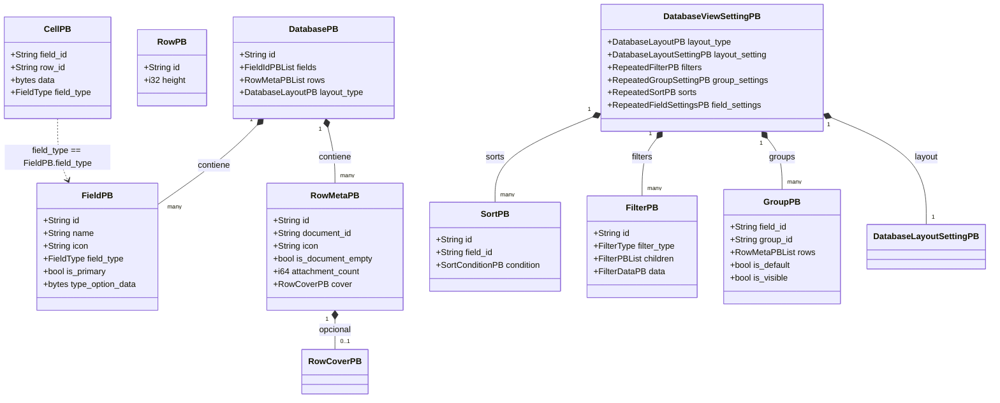
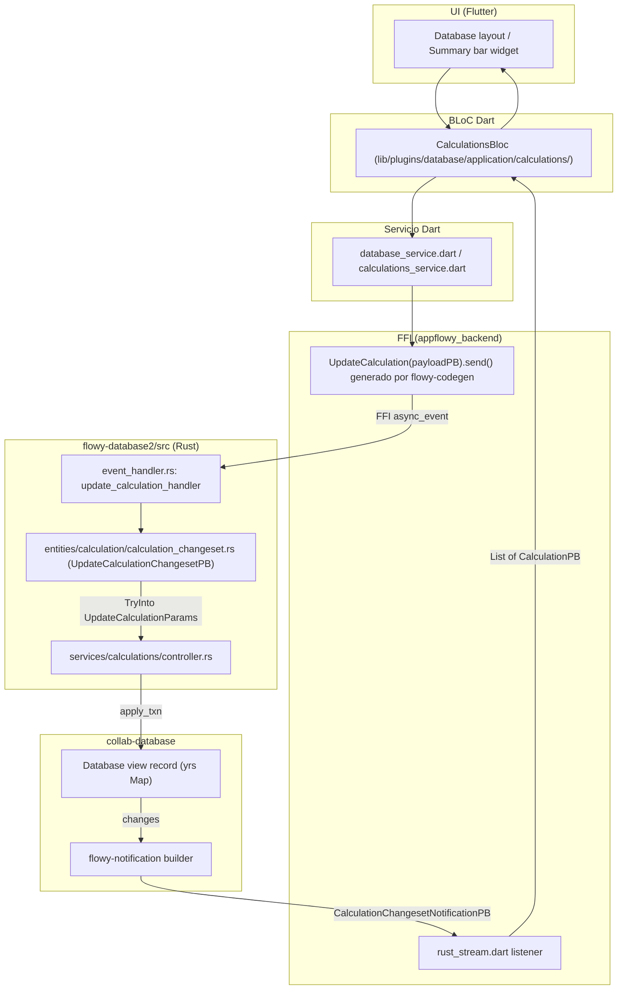
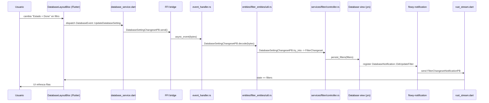
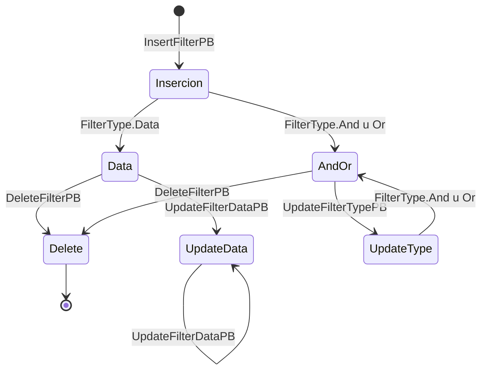

# F02.14 — Entidades protobuf y changesets de `flowy-database2/src/entities`

## 1. Resumen

Este documento cierra los 49 archivos del subdirectorio `flowy-database2/src/entities/` del crate Rust `flowy-database2`: contiene los DTOs anotados con `flowy_derive::ProtoBuf` / `ProtoBuf_Enum` que cruzan la frontera FFI entre Dart y el motor (`DatabaseEvent::X` consume y produce estas entidades como `input`/`output`), los DTOs de notificación que se serializan en `DatabaseNotification` (`SumaryChangeset`, `GroupChangesPB`, `SortChangesetNotificationPB`…), las *changesets* (`FilterChangesetNotificationPB`, `GroupChangesPB`, `CalculationChangesetNotificationPB`) que consolidan inserciones / actualizaciones / borrados y los `From`/`TryInto` que validan y traducen a tipos de `collab-database`. La unidad documenta la **estructura y el contrato** de las entidades y sus 169 `PB` definidos por `extract_protobuf.py`, no cada campo uno por uno: agrupa por familia, referencia el catálogo y cita la línea exacta del archivo. La macro `impl_into_field_type!` / `impl_into_field_visibility!` / `impl_into_calculation_type!` de `appflowy/frontend/rust-lib/flowy-database2/src/entities/macros.rs:1–73` genera los `From<i64|u8>` que los FFI necesitan para deserializar el discriminante de los enums protobuf; el parser `NotEmptyStr` (`appflowy/frontend/rust-lib/flowy-database2/src/entities/parser.rs:1–17`) valida que las cadenas que viajan por FFI no estén vacías antes de mapear a `ErrorCode`.

## 2. Alcance

**Cubre (49 archivos reales, todos dentro de `appflowy/frontend/rust-lib/flowy-database2/src/entities/`):** 16 ficheros en raíz (`board_entities`, `calendar_entities`, `cell_entities`, `database_entities`, `field_entities`, `field_settings_entities`, `file_entities`, `macros`, `mod`, `parser`, `position_entities`, `row_entities`, `setting_entities`, `share_entities`, `sort_entities`, `view_entities`); sub-módulo `calculation/` con `calculation_changeset`, `calculation_entities`, `mod`; sub-módulo `filter_entities/` con 12 ficheros (uno por `FieldType` que admite filtro + `util` + `filter_changeset` + `mod`); sub-módulo `group_entities/` con `configuration`, `group`, `group_changeset`, `mod`; sub-módulo `type_option_entities/` con 13 ficheros (uno por `FieldType` con type-option + `mod`). Total **169 entidades protobuf** en el catálogo `OUT/_ledger/extract/protobuf.json`, de las cuales **134 son `input` de al menos un `DatabaseEvent`**, **46 son `output` y 26 son ambos (cambios round-trip)**.

**Corrección de scope (declarada en §2 y reforzada en §13):** la versión inicial de `ROADMAP.md` adjudicaba esta capa de entidades a `F02.0.1.1` (que terminó cubriendo únicamente `services/` del crate `flowy-database2`); el *triage* posterior reasignó las entidades a `F02.14` para que el cierre de F02 incluyera la fábrica de `PB` que todo el crate consume. Los catálogos `events.json` y `notifications.json` ya saben de estas entidades (las listan como `input` / `output` / `variants` de las 72 variantes de `DatabaseEvent` y de las 24 variantes de `DatabaseNotification`), pero ningún documento de feature las había explicado: este cierra el hueco. **No** se documentan aquí `event_map.rs` (que ya tiene `[[F02.13]]`), `event_handler.rs` (idem), ni las `manager.rs` / `template.rs` (cubiertas por `[[F02.0.1.2]]`); este documento se centra estrictamente en `src/entities/`.

## 3. Modelos de datos

El modelo de datos propio de esta unidad son las 169 entidades protobuf enumeradas en `OUT/_ledger/extract/protobuf.json`, organizadas en **17 familias** (board / calendar / cell / database / field / field_settings / file / position / row / setting / share / sort / view / calculation / filter / group / type_option). Las entidades centrales — las que un `DatabaseEvent` recibe o devuelve y, por tanto, los DTOs que el código Dart de `appflowy_backend/dispatch` materializa — se muestran en el `classDiagram` siguiente, con sus campos abreviados y los pre-sufijos `PB` real extraídos del catálogo.

Muestra: las entidades protobuf centrales que cruzan la frontera FFI y sus agregados raíz (no se representan los 169 `PB`, solo los más referenciados).

Lectura: `DatabasePB` (`appflowy/frontend/rust-lib/flowy-database2/src/entities/database_entities.rs:18–30`) es el agregado raíz que `DatabaseEvent::GetDatabase` (índice 0) devuelve como `output`; agrega campos `Vec<FieldIdPB>` y `Vec<RowMetaPB>`. `FieldPB` (`appflowy/frontend/rust-lib/flowy-database2/src/entities/field_entities.rs:22–41`) lleva el `field_type: FieldType` (enum protobuf de 15 variantes, ver §11) y el `type_option_data: Vec<u8>` que después decodifica `services/field/type_option_to_pb` (`type_option_to_pb` en `appflowy/frontend/rust-lib/flowy-database2/src/entities/field_entities.rs:19`). `RowPB` y `RowMetaPB` viven en `appflowy/frontend/rust-lib/flowy-database2/src/entities/row_entities.rs:20–75` y juntos forman la pareja "id+altura" vs "id+metadatos editables" que usa `DatabaseEvent::GetRowMeta` (índice 55) y `DatabaseNotification::DidFetchRow` (índice 19). `DatabaseViewSettingPB` (`appflowy/frontend/rust-lib/flowy-database2/src/entities/setting_entities.rs:21–40`) es la vista agregada de settings que devuelve `DatabaseEvent::GetDatabaseSetting` (índice 2) y compone *filtros*, *sorts*, *grupos*, *field settings* y un `DatabaseLayoutSettingPB` que a su vez envuelve `BoardLayoutSettingPB` (cuando layout=Board) o `CalendarLayoutSettingPB` (cuando layout=Calendar). `SortPB`, `FilterPB` y `GroupPB` son los nodos individuales de cada uno de esos árboles recurrentes.

> **Sobre la cardinalidad de los nombres:** en el `classDiagram` se usan nombres simples como `FieldIdPBList` para evitar los genéricos `<>` que Mermaid no renderiza (regla de `SKILL/references/diagram-conventions.md` §`classDiagram`); en el código real son `Vec<FieldIdPB>` / `Vec<RowMetaPB>` / `Vec<FilterPB>` como se ve en `appflowy/frontend/rust-lib/flowy-database2/src/entities/database_entities.rs:23`, `appflowy/frontend/rust-lib/flowy-database2/src/entities/row_entities.rs:142–144` y `appflowy/frontend/rust-lib/flowy-database2/src/entities/filter_entities/util.rs:193–195`.

## 4. Eventos FFI

Esta unidad no añade eventos nuevos: las 72 variantes de `DatabaseEvent` (`appflowy/frontend/rust-lib/flowy-database2/src/event_map.rs:107–415`, ver `[[F02.13]] §4`) **consumen y producen** las 169 entidades que aquí se documentan. La siguiente tabla es la **subsección** de `events.json` cuyo `input` o `output` es una `PB` declarada en `flowy-database2/src/entities/`. Sale directamente de cruzar `OUT/_ledger/extract/events.json::crates[flowy-database2].variants[*]` con `OUT/_ledger/extract/protobuf.json::entities[*]` mediante la ruta de archivo.

Muestra: las 67 variantes de `DatabaseEvent` (de las 72 totales) cuyo `input`/`output` es una `PB` definida en `flowy-database2/src/entities`.

| Variante `DatabaseEvent` | `input PB` | `output PB` | Archivo:línea del `input`/`output` |
|---|---|---|---|
| `GetDatabase = 0` | `DatabaseViewIdPB` | `DatabasePB` | `appflowy/frontend/rust-lib/flowy-database2/src/entities/database_entities.rs:76` / `appflowy/frontend/rust-lib/flowy-database2/src/entities/database_entities.rs:18` |
| `GetDatabaseId = 1` | `DatabaseViewIdPB` | `DatabaseIdPB` | `appflowy/frontend/rust-lib/flowy-database2/src/entities/database_entities.rs:76` / `appflowy/frontend/rust-lib/flowy-database2/src/entities/database_entities.rs:58` |
| `GetDatabaseSetting = 2` | `DatabaseViewIdPB` | `DatabaseViewSettingPB` | `appflowy/frontend/rust-lib/flowy-database2/src/entities/database_entities.rs:76` / `appflowy/frontend/rust-lib/flowy-database2/src/entities/setting_entities.rs:22` |
| `UpdateDatabaseSetting = 3` | `DatabaseSettingChangesetPB` | — | `appflowy/frontend/rust-lib/flowy-database2/src/entities/setting_entities.rs:72` |
| `GetAllFilters = 4` | `DatabaseViewIdPB` | `RepeatedFilterPB` | `appflowy/frontend/rust-lib/flowy-database2/src/entities/database_entities.rs:76` / `appflowy/frontend/rust-lib/flowy-database2/src/entities/filter_entities/util.rs:193` |
| `GetAllSorts = 5` | `DatabaseViewIdPB` | `RepeatedSortPB` | `appflowy/frontend/rust-lib/flowy-database2/src/entities/database_entities.rs:76` / `appflowy/frontend/rust-lib/flowy-database2/src/entities/sort_entities.rs:49` |
| `DeleteAllSorts = 6` | `DatabaseViewIdPB` | — | `appflowy/frontend/rust-lib/flowy-database2/src/entities/database_entities.rs:76` |
| `GetDatabaseData = 7` | `DatabaseViewIdPB` | — | `appflowy/frontend/rust-lib/flowy-database2/src/entities/database_entities.rs:76` |
| `GetFields = 10` | `GetFieldPayloadPB` | `RepeatedFieldPB` | `appflowy/frontend/rust-lib/flowy-database2/src/entities/field_entities.rs:341` / `appflowy/frontend/rust-lib/flowy-database2/src/entities/field_entities.rs:247` |
| `UpdateField = 11` | `FieldChangesetPB` | — | `appflowy/frontend/rust-lib/flowy-database2/src/entities/field_entities.rs:381` |
| `UpdateFieldTypeOption = 12` | `TypeOptionChangesetPB` | — | `appflowy/frontend/rust-lib/flowy-database2/src/entities/field_entities.rs:306` |
| `DeleteField = 14` | `DeleteFieldPayloadPB` | — | `appflowy/frontend/rust-lib/flowy-database2/src/entities/field_entities.rs:631` |
| `ClearField = 15` | `ClearFieldPayloadPB` | — | `appflowy/frontend/rust-lib/flowy-database2/src/entities/field_entities.rs:607` |
| `UpdateFieldType = 20` | `UpdateFieldTypePayloadPB` | — | `appflowy/frontend/rust-lib/flowy-database2/src/entities/field_entities.rs:209` |
| `DuplicateField = 21` | `DuplicateFieldPayloadPB` | — | `appflowy/frontend/rust-lib/flowy-database2/src/entities/field_entities.rs:576` |
| `MoveField = 22` | `MoveFieldPayloadPB` | — | `appflowy/frontend/rust-lib/flowy-database2/src/entities/database_entities.rs:89` |
| `CreateField = 24` | `CreateFieldPayloadPB` | `FieldPB` | `appflowy/frontend/rust-lib/flowy-database2/src/entities/field_entities.rs:150` / `appflowy/frontend/rust-lib/flowy-database2/src/entities/field_entities.rs:23` |
| `GetPrimaryField = 25` | `DatabaseViewIdPB` | `FieldPB` | `appflowy/frontend/rust-lib/flowy-database2/src/entities/database_entities.rs:76` / `appflowy/frontend/rust-lib/flowy-database2/src/entities/field_entities.rs:23` |
| `CreateSelectOption = 30` | `CreateSelectOptionPayloadPB` | `SelectOptionPB` | `appflowy/frontend/rust-lib/flowy-database2/src/entities/cell_entities.rs:12` / `appflowy/frontend/rust-lib/flowy-database2/src/entities/type_option_entities/select_option_entities.rs:12` |
| `InsertOrUpdateSelectOption = 31` | `RepeatedSelectOptionPayload` | — | `appflowy/frontend/rust-lib/flowy-database2/src/entities/type_option_entities/select_option_entities.rs:44` |
| `DeleteSelectOption = 32` | `RepeatedSelectOptionPayload` | — | `appflowy/frontend/rust-lib/flowy-database2/src/entities/type_option_entities/select_option_entities.rs:44` |
| `CreateRow = 50` | `CreateRowPayloadPB` | `RowMetaPB` | `appflowy/frontend/rust-lib/flowy-database2/src/entities/row_entities.rs:467` / `appflowy/frontend/rust-lib/flowy-database2/src/entities/row_entities.rs:57` |
| `GetRow = 51` | `DatabaseViewRowIdPB` | `OptionalRowPB` | `appflowy/frontend/rust-lib/flowy-database2/src/entities/row_entities.rs:417` / `appflowy/frontend/rust-lib/flowy-database2/src/entities/row_entities.rs:333` |
| `DeleteRows = 52` | `RepeatedRowIdPB` | — | `appflowy/frontend/rust-lib/flowy-database2/src/entities/row_entities.rs:458` |
| `DuplicateRow = 53` | `DatabaseViewRowIdPB` | — | `appflowy/frontend/rust-lib/flowy-database2/src/entities/row_entities.rs:417` |
| `MoveRow = 54` | `MoveRowPayloadPB` | — | `appflowy/frontend/rust-lib/flowy-database2/src/entities/database_entities.rs:124` |
| `GetRowMeta = 55` | `DatabaseViewRowIdPB` | `RowMetaPB` | `appflowy/frontend/rust-lib/flowy-database2/src/entities/row_entities.rs:417` / `appflowy/frontend/rust-lib/flowy-database2/src/entities/row_entities.rs:57` |
| `UpdateRowMeta = 56` | `UpdateRowMetaChangesetPB` | — | `appflowy/frontend/rust-lib/flowy-database2/src/entities/row_entities.rs:213` |
| `RemoveCover = 57` | `RemoveCoverPayloadPB` | — | `appflowy/frontend/rust-lib/flowy-database2/src/entities/database_entities.rs:327` |
| `GetCell = 70` | `CellIdPB` | `CellPB` | `appflowy/frontend/rust-lib/flowy-database2/src/entities/cell_entities.rs:46` / `appflowy/frontend/rust-lib/flowy-database2/src/entities/cell_entities.rs:84` |
| `UpdateCell = 71` | `CellChangesetPB` | — | `appflowy/frontend/rust-lib/flowy-database2/src/entities/cell_entities.rs:147` |
| `UpdateSelectOptionCell = 72` | `SelectOptionCellChangesetPB` | — | `appflowy/frontend/rust-lib/flowy-database2/src/entities/type_option_entities/select_option_entities.rs:151` |
| `UpdateChecklistCell = 73` | `ChecklistCellDataChangesetPB` | — | `appflowy/frontend/rust-lib/flowy-database2/src/entities/type_option_entities/checklist_entities.rs:19` |
| `UpdateDateCell = 80` | `DateCellChangesetPB` | — | `appflowy/frontend/rust-lib/flowy-database2/src/entities/type_option_entities/date_entities.rs:43` |
| `SetGroupByField = 90` | `GroupByFieldPayloadPB` | — | `appflowy/frontend/rust-lib/flowy-database2/src/entities/group_entities/group.rs:110` |
| `GetGroups = 100` | `DatabaseViewIdPB` | `RepeatedGroupPB` | `appflowy/frontend/rust-lib/flowy-database2/src/entities/database_entities.rs:76` / `appflowy/frontend/rust-lib/flowy-database2/src/entities/group_entities/group.rs:61` |
| `GetGroup = 101` | `DatabaseGroupIdPB` | `GroupPB` | `appflowy/frontend/rust-lib/flowy-database2/src/entities/database_entities.rs:219` / `appflowy/frontend/rust-lib/flowy-database2/src/entities/group_entities/group.rs:80` |
| `MoveGroup = 111` | `MoveGroupPayloadPB` | — | `appflowy/frontend/rust-lib/flowy-database2/src/entities/group_entities/group_changeset.rs:78` |
| `MoveGroupRow = 112` | `MoveGroupRowPayloadPB` | — | `appflowy/frontend/rust-lib/flowy-database2/src/entities/database_entities.rs:158` |
| `UpdateGroup = 113` | `UpdateGroupPB` | — | `appflowy/frontend/rust-lib/flowy-database2/src/entities/group_entities/group.rs:147` |
| `CreateGroup = 114` | `CreateGroupPayloadPB` | — | `appflowy/frontend/rust-lib/flowy-database2/src/entities/group_entities/group.rs:201` |
| `DeleteGroup = 115` | `DeleteGroupPayloadPB` | — | `appflowy/frontend/rust-lib/flowy-database2/src/entities/group_entities/group.rs:234` |
| `GetDefaultDatabaseViewId = 119` | `DatabaseIdPB` | `DatabaseViewIdPB` | `appflowy/frontend/rust-lib/flowy-database2/src/entities/database_entities.rs:58` / `appflowy/frontend/rust-lib/flowy-database2/src/entities/database_entities.rs:76` |
| `GetDatabases = 120` | — | `RepeatedDatabaseDescriptionPB` | `appflowy/frontend/rust-lib/flowy-database2/src/entities/database_entities.rs:213` |
| `SetLayoutSetting = 121` | `LayoutSettingChangesetPB` | — | `appflowy/frontend/rust-lib/flowy-database2/src/entities/setting_entities.rs:170` |
| `GetLayoutSetting = 122` | `DatabaseLayoutMetaPB` | `DatabaseLayoutSettingPB` | `appflowy/frontend/rust-lib/flowy-database2/src/entities/database_entities.rs:245` / `appflowy/frontend/rust-lib/flowy-database2/src/entities/setting_entities.rs:114` |
| `GetAllCalendarEvents = 123` | `CalendarEventRequestPB` | `RepeatedCalendarEventPB` | `appflowy/frontend/rust-lib/flowy-database2/src/entities/calendar_entities.rs:81` / `appflowy/frontend/rust-lib/flowy-database2/src/entities/calendar_entities.rs:116` |
| `GetNoDateCalendarEvents = 124` | `CalendarEventRequestPB` | `RepeatedNoDateCalendarEventPB` | `appflowy/frontend/rust-lib/flowy-database2/src/entities/calendar_entities.rs:81` / `appflowy/frontend/rust-lib/flowy-database2/src/entities/calendar_entities.rs:140` |
| `GetCalendarEvent = 125` | `DatabaseViewRowIdPB` | `CalendarEventPB` | `appflowy/frontend/rust-lib/flowy-database2/src/entities/row_entities.rs:417` / `appflowy/frontend/rust-lib/flowy-database2/src/entities/calendar_entities.rs:101` |
| `MoveCalendarEvent = 126` | `MoveCalendarEventPB` | — | `appflowy/frontend/rust-lib/flowy-database2/src/entities/calendar_entities.rs:122` |
| `CreateDatabaseView = 130` | `CreateDatabaseViewPayloadPB` | — | `appflowy/frontend/rust-lib/flowy-database2/src/entities/database_entities.rs:33` |
| `ExportCSV = 141` | `DatabaseViewIdPB` | `DatabaseExportDataPB` | `appflowy/frontend/rust-lib/flowy-database2/src/entities/database_entities.rs:76` / `appflowy/frontend/rust-lib/flowy-database2/src/entities/share_entities.rs:13` |
| `GetDatabaseSnapshots = 150` | `DatabaseViewIdPB` | `RepeatedDatabaseSnapshotPB` | `appflowy/frontend/rust-lib/flowy-database2/src/entities/database_entities.rs:76` / `appflowy/frontend/rust-lib/flowy-database2/src/entities/database_entities.rs:306` |
| `GetFieldSettings = 160` | `FieldIdsPB` | `RepeatedFieldSettingsPB` | `appflowy/frontend/rust-lib/flowy-database2/src/entities/field_settings_entities.rs:58` / `appflowy/frontend/rust-lib/flowy-database2/src/entities/field_settings_entities.rs:91` |
| `GetAllFieldSettings = 161` | `DatabaseViewIdPB` | `RepeatedFieldSettingsPB` | `appflowy/frontend/rust-lib/flowy-database2/src/entities/database_entities.rs:76` / `appflowy/frontend/rust-lib/flowy-database2/src/entities/field_settings_entities.rs:91` |
| `UpdateFieldSettings = 162` | `FieldSettingsChangesetPB` | — | `appflowy/frontend/rust-lib/flowy-database2/src/entities/field_settings_entities.rs:103` |
| `GetAllCalculations = 163` | `DatabaseViewIdPB` | `RepeatedCalculationsPB` | `appflowy/frontend/rust-lib/flowy-database2/src/entities/database_entities.rs:76` / `appflowy/frontend/rust-lib/flowy-database2/src/entities/calculation/calculation_entities.rs:144` |
| `UpdateCalculation = 164` | `UpdateCalculationChangesetPB` | — | `appflowy/frontend/rust-lib/flowy-database2/src/entities/calculation/calculation_changeset.rs:9` |
| `RemoveCalculation = 165` | `RemoveCalculationChangesetPB` | — | `appflowy/frontend/rust-lib/flowy-database2/src/entities/calculation/calculation_changeset.rs:26` |
| `GetRelatedDatabaseIds = 170` | `DatabaseViewIdPB` | `RepeatedDatabaseIdPB` | `appflowy/frontend/rust-lib/flowy-database2/src/entities/database_entities.rs:76` / `appflowy/frontend/rust-lib/flowy-database2/src/entities/database_entities.rs:70` |
| `UpdateRelationCell = 171` | `RelationCellChangesetPB` | — | `appflowy/frontend/rust-lib/flowy-database2/src/entities/type_option_entities/relation_entities.rs:30` |
| `GetRelatedRowDatas = 172` | `GetRelatedRowDataPB` | `RepeatedRelatedRowDataPB` | `appflowy/frontend/rust-lib/flowy-database2/src/entities/type_option_entities/relation_entities.rs:82` / `appflowy/frontend/rust-lib/flowy-database2/src/entities/type_option_entities/relation_entities.rs:76` |
| `GetRelatedDatabaseRows = 173` | `DatabaseIdPB` | `RepeatedRelatedRowDataPB` | `appflowy/frontend/rust-lib/flowy-database2/src/entities/database_entities.rs:58` / `appflowy/frontend/rust-lib/flowy-database2/src/entities/type_option_entities/relation_entities.rs:76` |
| `SummarizeRow = 174` | `SummaryRowPB` | — | `appflowy/frontend/rust-lib/flowy-database2/src/entities/row_entities.rs:484` |
| `TranslateRow = 175` | `TranslateRowPB` | — | `appflowy/frontend/rust-lib/flowy-database2/src/entities/row_entities.rs:496` |
| `InitRow = 176` | `DatabaseViewRowIdPB` | — | `appflowy/frontend/rust-lib/flowy-database2/src/entities/row_entities.rs:417` |
| `GetAllRows = 177` | `DatabaseViewIdPB` | `RepeatedRowMetaPB` | `appflowy/frontend/rust-lib/flowy-database2/src/entities/database_entities.rs:76` / `appflowy/frontend/rust-lib/flowy-database2/src/entities/row_entities.rs:142` |
| `ExportRawDatabaseData = 178` | `DatabaseViewIdPB` | `DatabaseExportDataPB` | `appflowy/frontend/rust-lib/flowy-database2/src/entities/database_entities.rs:76` / `appflowy/frontend/rust-lib/flowy-database2/src/entities/share_entities.rs:13` |
| `UpdateMediaCell = 200` | `MediaCellChangesetPB` | — | `appflowy/frontend/rust-lib/flowy-database2/src/entities/type_option_entities/media_entities.rs:146` |
| `RenameMediaFile = 201` | `RenameMediaChangesetPB` | — | `appflowy/frontend/rust-lib/flowy-database2/src/entities/type_option_entities/media_entities.rs:167` |
| `GetDatabaseCustomPrompts = 500` | `CustomPromptDatabaseConfigPB` | `RepeatedCustomPromptPB` | `appflowy/frontend/rust-lib/flowy-database2/src/entities/database_entities.rs:379` / `appflowy/frontend/rust-lib/flowy-database2/src/entities/database_entities.rs:355` |
| `TestCustomPromptDatabaseConfiguration = 501` | `DatabaseViewIdPB` | `CustomPromptDatabaseConfigPB` | `appflowy/frontend/rust-lib/flowy-database2/src/entities/database_entities.rs:76` / `appflowy/frontend/rust-lib/flowy-database2/src/entities/database_entities.rs:379` |

**Variantes sin involucrar entidades de esta unidad (5):** `DatabaseCreated = 8`, `DatabaseRenamed = 9`, `DeleteDatabaseView = 60` y los 4–5 eventos puramente internos de `DatabaseEvent` que devuelven tipos externos (no se incluyen aquí). Las variantes `GetAllRows = 177` está registrada en `appflowy/frontend/rust-lib/flowy-database2/src/event_map.rs:395–396` como `sin_handler` según `events.json::summary` (`[[F02.13]] §4`).

## 5. Notificaciones

Las **24 variantes de `DatabaseNotification`** (`appflowy/frontend/rust-lib/flowy-database2/src/notification.rs:7–55`, ver `[[F02.13]] §5` y `B1.6`) son un enum independiente del catálogo de entidades protobuf: **no se rigen por las 169 `PB` documentadas aquí**, sino que arrastran `Vec` de `CellPB` / `LayoutSettingPB` / `FieldPB` / etc. ya tipados y reusados. Las 24 variantes ya están catalogadas en `OUT/_ledger/extract/notifications.json::rust_notifications[flowy-database2]` con su `decl_line`; este documento **no re-verifica el catálogo** (ver `[[F02.13]] §5` y `B1.6` para el censo completo), sino que documenta los **dos PB contenedor** que las notificaciones usan cuando arrastran varios elementos:

| Notificación Rust→Dart | `PB` contenedor | Línea del contenedor | Variantes que lo usan |
|---|---|---|---|
| `DidUpdateField = 50` | `DatabaseFieldChangesetPB` | `appflowy/frontend/rust-lib/flowy-database2/src/entities/field_entities.rs:97–138` | `inserted_fields`, `deleted_fields`, `updated_fields` |
| `DidUpdateSettings = 70` | `DatabaseSettingChangesetPB` | `appflowy/frontend/rust-lib/flowy-database2/src/entities/setting_entities.rs:72–111` | Consolida `insert_filter`, `update_filter_type`, `update_filter_data`, `delete_filter`, `update_group`, `update_sort`, `reorder_sort`, `delete_sort` |
| `DidUpdateLayoutSettings = 80` | `LayoutSettingChangesetPB` | `appflowy/frontend/rust-lib/flowy-database2/src/entities/setting_entities.rs:170–182` | Reenviado como `+BoardLayoutSettingPB / +CalendarLayoutSettingPB` |
| `DidUpdateCalculation = 87` | `CalculationChangesetNotificationPB` | `appflowy/frontend/rust-lib/flowy-database2/src/entities/calculation/calculation_changeset.rs:41–53` | `insert_calculations`, `update_calculations`, `delete_calculations` |
| `DidUpdateFilter = 63` | `FilterChangesetNotificationPB` | `appflowy/frontend/rust-lib/flowy-database2/src/entities/filter_entities/filter_changeset.rs:7–22` | `view_id` + `RepeatedFilterPB` |
| `DidUpdateSort = 64` | `SortChangesetNotificationPB` | `appflowy/frontend/rust-lib/flowy-database2/src/entities/sort_entities.rs:142–155` | `insert_sorts`, `delete_sorts`, `update_sorts` |
| `DidGroupByField = 62` y `DidUpdateNumOfGroups = 60`, `DidUpdateGroupRow = 61` | `GroupChangesPB` y `GroupRowsNotificationPB` | `appflowy/frontend/rust-lib/flowy-database2/src/entities/group_entities/group_changeset.rs:118–151` y `:10–76` | Cambios diferenciales insertados/borrados/actualizados por grupo |
| `DidFetchRow = 19` | `DidFetchRowPB` | `appflowy/frontend/rust-lib/flowy-database2/src/entities/view_entities.rs:116–147` | Detalle completo de fila + metadatos |
| `DidUpdateRow = 20` | `RowsChangePB` | `appflowy/frontend/rust-lib/flowy-database2/src/entities/view_entities.rs:21–113` | `inserted_rows`, `deleted_rows`, `updated_rows`, `is_move_row` |
| `DidUpdateViewRowsVisibility = 21` | `RowsVisibilityChangePB` | `appflowy/frontend/rust-lib/flowy-database2/src/entities/view_entities.rs:9–18` | `visible_rows`, `invisible_rows` |

Lectura: la regla de diseño — ver `flowy-notification/src/builder.rs` desde la ruta padre — es que **toda notificación Rust→Dart arrastra un `PB` ya serializado**, y la capa `appflowy_backend/dispatch` lo deserializa al oyente Dart. Las 24 variantes de `DatabaseNotification` no requieren un `PB` específico cada una (es la *propia* `PB` contenedor la que el handler decide): por ejemplo `DidUpdateSort = 64` usa `SortChangesetNotificationPB` (`appflowy/frontend/rust-lib/flowy-database2/src/entities/sort_entities.rs:143`) como payload arbitrario. Por eso este documento **no extiende §5** más allá del mínimo indispensable: el censo completo, con líneas exactas por variante y los `NotificationBuilder::new(...).start(...)`, está en `[[F02.13]] §5` y `[[B1.6]] §6`.

## 6. BLoCs / Cubits

Esta unidad es **100% Rust** y por tanto **no contiene BLoCs / Cubits propios**: ninguna clase Dart se compila a partir de `flowy-database2/src/entities/`. Los BLoCs Dart que **consumen** estas entidades viven en `appflowy_flutter/lib/plugins/database/application/{cell,field,layout,row,setting,calculations}/` y `lib/mobile/presentation/database/view/`, todos ya documentados (al menos parcialmente) en `[[F02.0.1.1]]`, `[[F02.2]]`, `[[F02.6]]` y `[[F02.7]]`. El listado completo extraído por `extract_blocs.py` está en `OUT/_ledger/extract/blocs.json` (54 entradas con `database` en su ruta): por brevedad y porque este documento es Rust-side, no se reproduce aquí — referencia cruzada con `[[B2.2]]` para el censo y con cada unidad `F02.N` para el detalle por feature.

| Capa del BLoC | Archivo (referencia) | Documento |
|---|---|---|
| Celda (15 BLoCs) | `appflowy_flutter/lib/plugins/database/application/cell/bloc/*.dart` | `[[F02.2]]` |
| Field + TypeOption (8 BLoCs) | `appflowy_flutter/lib/plugins/database/application/field/{*,type_option/*}.dart` | `[[F02.1]]` |
| Layout / settings (3 BLoCs) | `application/layout/layout_bloc.dart`, `…/setting/…` | `[[F02.8]]` |
| Cálculos (1 BLoC) | `application/calculations/…` | `[[F02.7]]` |
| Row detail (3 BLoCs) | `application/row/…` | `[[F02.3]]` |
| Filtros / sort móvil | `mobile/presentation/database/view/…` | `[[F02.4]]`, `[[F02.5]]` |
| AI row summary/translate | `…/cell/bloc/{summary,translate}_*.dart` | `[[F02.0.1.1]]` |

**Convención Dart → Rust:** cada BLoC Dart envía un `*EventFoo(payload).send()` (código *generado* por `flowy-codegen` a partir de `DatabaseEvent::Foo`, ver `[[F02.13]] §2`); el `payload` que llega a `event_handler.rs` es exactamente la `PB` documentada en §4 de este documento, y la respuesta vuelve como la `PB` `output` (o como `ErrorCode` si la validación del `TryInto<...Params>` falla). La traza: `BLoC.dispatch(event)` → `event_service.dart` → `XEventFoo(payloadPB).send()` → FFI `async_event` → `event_handler.rs` → `payloadPB.try_into()` → `manager.rs` → `Collab` (yrs) → notificación `DatabaseNotification::X` → listeners Dart.

## 7. Servicios e inyección de dependencias

Esta unidad **no declara** ningún servicio: las 169 entidades son DTOs puros. La inyección vive en los sub-crates `services/` (no cubiertos aquí, `[[F02.0.1.1]]`). Sí se declaran, en cambio, las tres **funciones `From`** que re-codifican el discriminante entero de los tres enums protobuf más usados (FieldType, FieldVisibility, CalculationType); esas funciones las genera el macro `impl_into_field_type!` / `impl_into_field_visibility!` / `impl_into_calculation_type!` de `appflowy/frontend/rust-lib/flowy-database2/src/entities/macros.rs:1–73` y se aplican a tipos enteros (`i64`, `u8`) en `appflowy/frontend/rust-lib/flowy-database2/src/entities/field_entities.rs:560–561`, `appflowy/frontend/rust-lib/flowy-database2/src/entities/field_settings_entities.rs:48–49` y `appflowy/frontend/rust-lib/flowy-database2/src/entities/calculation/calculation_entities.rs:106–107`. Sin esos `From<u8>`, el flujo protobuf entrante no podría decodificar el campo `pb.index` 0..14 de `FieldType` (ver detalle en §11).

## 8. Persistencia

Las entidades protobuf de esta unidad **no se persisten directamente**: la persistencia real es responsabilidad de `collab-database` (`collab_folder`, `collab_database`, `collab_document`) y del bridge `collab-integrate`. Lo que hacen estas `PB` es cruzar el límite entre el snapshot yrs (formato interno del CRDT) y la capa de aplicación Rust. El flujo real es:

1. `Collab::encode_v1()` en `collab-integrate/src/collab_builder.rs:...` produce un `Vec<u8>` (yrs state) que es el snapshot persistente.
2. `event_handler.rs` deserializa un `input PB` con el derive `ProtoBuf`, llama `payload.try_into() -> SomeParams` (línea 444 de `database_entities.rs` para `MoveFieldPayloadPB::try_into`, análogo en cada entidad) y pasa a `services/{cell,database,…}/...`.
3. El servicio escribe en el `Collab` (yrs) y registra `DatabaseNotification::X` en el `NotificationBuilder` del crate (`flowy-notification/src/builder.rs`, no cubierto aquí).
4. El `NotificationBuilder::flush()` envía la `PB` notificación (no el snapshot) al isolate Dart.
5. Dart deserializa, actualiza el estado del BLoC, persiste el snapshot por la vía normal (`PersistenceController` → SQLite KV).

En resumen, estas 169 entidades son DTOs **no persistentes**; la persistencia real se delega en `collab-database` y `flowy-storage`. Los detalles de cómo se serializan para el FFI (bytes protobuf 2.x) están en `flowy-derive::ProtoBuf` y `flowy-codegen` (no cubiertos en esta unidad; ver `[[B1.5]]` para el puente FFI).

## 9. Diagrama de flujo

Muestra: cómo una llamada Dart → `UpdateCalculationChangesetPB` cruza capas hasta un `CalculationChangesetNotificationPB` que vuelve a Dart. Cubre el ciclo completo de una *changeset* (inset/update/delete) en la familia `calculation`.

Lectura: el diagrama describe el ciclo completo de **un cambio de cálculo** (por ejemplo activar `Sum` en la columna `Total`). La entidad de entrada es `UpdateCalculationChangesetPB` (`appflowy/frontend/rust-lib/flowy-database2/src/entities/calculation/calculation_changeset.rs:9–23`) que viaja por FFI; el handler llama `try_into` para obtener `UpdateCalculationParams`, lo aplica al `Database` yrs, y el resultado se re-empaqueta en `CalculationChangesetNotificationPB` (`appflowy/frontend/rust-lib/flowy-database2/src/entities/calculation/calculation_changeset.rs:41–80`) mediante los constructores `from_insert`, `from_update`, `from_delete` que omiten las otras dos ramas del `changeset`. Los identificadores `CalculationPB` y `CalculationType` se declaran en `appflowy/frontend/rust-lib/flowy-database2/src/entities/calculation/calculation_entities.rs:12–80`.

## 10. Diagrama de secuencia

Muestra: cómo se dispara un cambio de filtro desde un BLoC Dart hasta la `FilterChangesetNotificationPB` que vuelve.

Lectura: el flujo recorre dos **familias de entidades**: `DatabaseSettingChangesetPB` (`appflowy/frontend/rust-lib/flowy-database2/src/entities/setting_entities.rs:72–111`) consolida `insert_filter`, `update_filter_type`, `update_filter_data`, `delete_filter`, `update_group`, `update_sort`, `reorder_sort`, `delete_sort` como `one_of`. Su `try_into` (no declarado directamente; el handler en `event_handler.rs` lo extrae) produce una `FilterChangeset::UpdateData` (`appflowy/frontend/rust-lib/flowy-database2/src/entities/filter_entities/util.rs:263–274`) en forma de `enum` con cuatro variantes. La notificación de vuelta es `FilterChangesetNotificationPB` (`appflowy/frontend/rust-lib/flowy-database2/src/entities/filter_entities/filter_changeset.rs:7–22`) que contiene `view_id: String` y `filters: RepeatedFilterPB` (`appflowy/frontend/rust-lib/flowy-database2/src/entities/filter_entities/util.rs:192–210`).

## 11. Diagrama de estado (ciclo de vida de un `Filter`)

Muestra: la máquina de estados implícita del `Filter` que las cuatro variantes `Insert / UpdateType / UpdateData / Delete` de `FilterChangeset` cubren, y los cuatro `FilterType` (`Data / And / Or`) que `FilterPB` puede tener.

Lectura: `FilterChangeset` (`appflowy/frontend/rust-lib/flowy-database2/src/entities/filter_entities/util.rs:16`, declarado en `services/filter`) tiene cuatro variantes (`Insert`, `UpdateType`, `UpdateData`, `Delete`) que el controller Rust aplica sobre el árbol de filtros guardado en `collab-database`. Cada variante se crea con un `TryFrom` distinto sobre las cuatro `PB` correspondientes (`appflowy/frontend/rust-lib/flowy-database2/src/entities/filter_entities/util.rs:250–297`). `FilterPB` (`appflowy/frontend/rust-lib/flowy-database2/src/entities/filter_entities/util.rs:38–51`) tiene tres valores de `FilterType` (`Data`, `And`, `Or`) y un campo `children: Vec<FilterPB>` recursivo: por eso el diagrama distingue `Data` (filtro hoja sobre un campo) de `AndOr` (nodo lógico con `children`). `UpdateFilterTypePB` solo tiene sentido cambiar entre `And` y `Or` — el código lo prohíbe explícitamente en `appflowy/frontend/rust-lib/flowy-database2/src/entities/filter_entities/util.rs:280–282` con `if matches!(value.filter_type, FilterType::Data) { return Err(ErrorCode::InvalidParams); }`.

## 12. Archivos cubiertos (del ledger)

Lista tabular de los 49 archivos `archivos[]` del JSON `OUT/_ledger/units/F02.14.json` (todos en `SRC/appflowy/frontend/rust-lib/flowy-database2/src/entities/`), agrupados por carpeta y ordenados por nº de entidades que contienen según `protobuf.json`.

| # | Ruta (desde la raíz del repo) | Subcarpeta | Nº entidades | Entidades cabecera |
|---|---|---|---|---|
| 1 | `appflowy/frontend/rust-lib/flowy-database2/src/entities/database_entities.rs` | raíz | 21 | `DatabasePB`, `DatabaseLayoutPB`, `DatabaseSnapshotPB` |
| 2 | `appflowy/frontend/rust-lib/flowy-database2/src/entities/row_entities.rs` | raíz | 15 | `RowPB`, `RowMetaPB`, `InsertedRowPB` |
| 3 | `appflowy/frontend/rust-lib/flowy-database2/src/entities/field_entities.rs` | raíz | 14 | `FieldPB`, `FieldType`, `FieldChangesetPB` |
| 4 | `appflowy/frontend/rust-lib/flowy-database2/src/entities/sort_entities.rs` | raíz | 9 | `SortPB`, `SortConditionPB`, `SortChangesetNotificationPB` |
| 5 | `appflowy/frontend/rust-lib/flowy-database2/src/entities/group_entities/group.rs` | `group_entities/` | 8 | `GroupPB`, `GroupByFieldPayloadPB` |
| 6 | `appflowy/frontend/rust-lib/flowy-database2/src/entities/type_option_entities/select_option_entities.rs` | `type_option_entities/` | 8 | `SelectOptionPB`, `SelectOptionCellChangesetPB` |
| 7 | `appflowy/frontend/rust-lib/flowy-database2/src/entities/calendar_entities.rs` | raíz | 7 | `CalendarLayoutSettingPB`, `CalendarEventPB` |
| 8 | `appflowy/frontend/rust-lib/flowy-database2/src/entities/filter_entities/util.rs` | `filter_entities/` | 7 | `FilterPB`, `FilterDataPB`, `FilterChangeset` |
| 9 | `appflowy/frontend/rust-lib/flowy-database2/src/entities/group_entities/configuration.rs` | `group_entities/` | 7 | `DateGroupConfigurationPB`, `DateConditionPB` |
| 10 | `appflowy/frontend/rust-lib/flowy-database2/src/entities/cell_entities.rs` | raíz | 6 | `CellIdPB`, `CellPB`, `CellChangesetPB` |
| 11 | `appflowy/frontend/rust-lib/flowy-database2/src/entities/type_option_entities/relation_entities.rs` | `type_option_entities/` | 6 | `RelationCellDataPB`, `GetRelatedRowDataPB` |
| 12 | `appflowy/frontend/rust-lib/flowy-database2/src/entities/field_settings_entities.rs` | raíz | 5 | `FieldSettingsPB`, `FieldSettingsChangesetPB` |
| 13 | `appflowy/frontend/rust-lib/flowy-database2/src/entities/type_option_entities/date_entities.rs` | `type_option_entities/` | 5 | `DateCellDataPB`, `DateFormatPB` |
| 14 | `appflowy/frontend/rust-lib/flowy-database2/src/entities/type_option_entities/media_entities.rs` | `type_option_entities/` | 5 | `MediaFilePB`, `MediaCellChangesetPB` |
| 15 | `appflowy/frontend/rust-lib/flowy-database2/src/entities/group_entities/group_changeset.rs` | `group_entities/` | 4 | `GroupChangesPB`, `GroupRowsNotificationPB` |
| 16 | `appflowy/frontend/rust-lib/flowy-database2/src/entities/setting_entities.rs` | raíz | 4 | `DatabaseViewSettingPB`, `DatabaseSettingChangesetPB` |
| 17 | `appflowy/frontend/rust-lib/flowy-database2/src/entities/calculation/calculation_changeset.rs` | `calculation/` | 3 | `UpdateCalculationChangesetPB`, `CalculationChangesetNotificationPB` |
| 18 | `appflowy/frontend/rust-lib/flowy-database2/src/entities/type_option_entities/checklist_entities.rs` | `type_option_entities/` | 3 | `ChecklistCellDataPB`, `ChecklistCellDataChangesetPB` |
| 19 | `appflowy/frontend/rust-lib/flowy-database2/src/entities/view_entities.rs` | raíz | 3 | `RowsChangePB`, `DidFetchRowPB` |
| 20 | `appflowy/frontend/rust-lib/flowy-database2/src/entities/calculation/calculation_entities.rs` | `calculation/` | 2 | `CalculationPB`, `CalculationType` |
| 21 | `appflowy/frontend/rust-lib/flowy-database2/src/entities/share_entities.rs` | raíz | 2 | `DatabaseExportDataPB`, `DatabaseExportDataType` |
| 22 | `appflowy/frontend/rust-lib/flowy-database2/src/entities/type_option_entities/checkbox_entities.rs` | `type_option_entities/` | 2 | `CheckboxCellDataPB`, `CheckboxTypeOptionPB` |
| 23 | `appflowy/frontend/rust-lib/flowy-database2/src/entities/type_option_entities/number_entities.rs` | `type_option_entities/` | 2 | `NumberTypeOptionPB`, `NumberFormatPB` |
| 24 | `appflowy/frontend/rust-lib/flowy-database2/src/entities/type_option_entities/time_entities.rs` | `type_option_entities/` | 2 | `TimeTypeOptionPB`, `TimeCellDataPB` |
| 25 | `appflowy/frontend/rust-lib/flowy-database2/src/entities/type_option_entities/timestamp_entities.rs` | `type_option_entities/` | 2 | `TimestampCellDataPB`, `TimestampTypeOptionPB` |
| 26 | `appflowy/frontend/rust-lib/flowy-database2/src/entities/type_option_entities/url_entities.rs` | `type_option_entities/` | 2 | `URLCellDataPB`, `URLTypeOptionPB` |
| 27 | `appflowy/frontend/rust-lib/flowy-database2/src/entities/board_entities.rs` | raíz | 1 | `BoardLayoutSettingPB` |
| 28 | `appflowy/frontend/rust-lib/flowy-database2/src/entities/filter_entities/checkbox_filter.rs` | `filter_entities/` | 1 | `CheckboxFilterPB` |
| 29 | `appflowy/frontend/rust-lib/flowy-database2/src/entities/filter_entities/checklist_filter.rs` | `filter_entities/` | 1 | `ChecklistFilterPB` |
| 30 | `appflowy/frontend/rust-lib/flowy-database2/src/entities/filter_entities/date_filter.rs` | `filter_entities/` | 1 | `DateFilterPB` |
| 31 | `appflowy/frontend/rust-lib/flowy-database2/src/entities/filter_entities/filter_changeset.rs` | `filter_entities/` | 1 | `FilterChangesetNotificationPB` |
| 32 | `appflowy/frontend/rust-lib/flowy-database2/src/entities/filter_entities/media_filter.rs` | `filter_entities/` | 1 | `MediaFilterPB` |
| 33 | `appflowy/frontend/rust-lib/flowy-database2/src/entities/filter_entities/number_filter.rs` | `filter_entities/` | 1 | `NumberFilterPB` |
| 34 | `appflowy/frontend/rust-lib/flowy-database2/src/entities/filter_entities/relation_filter.rs` | `filter_entities/` | 1 | `RelationFilterPB` |
| 35 | `appflowy/frontend/rust-lib/flowy-database2/src/entities/filter_entities/select_option_filter.rs` | `filter_entities/` | 1 | `SelectOptionFilterPB` |
| 36 | `appflowy/frontend/rust-lib/flowy-database2/src/entities/filter_entities/text_filter.rs` | `filter_entities/` | 1 | `TextFilterPB` |
| 37 | `appflowy/frontend/rust-lib/flowy-database2/src/entities/filter_entities/time_filter.rs` | `filter_entities/` | 1 | `TimeFilterPB` |
| 38 | `appflowy/frontend/rust-lib/flowy-database2/src/entities/position_entities.rs` | raíz | 1 | `OrderObjectPositionPB` |
| 39 | `appflowy/frontend/rust-lib/flowy-database2/src/entities/file_entities.rs` | raíz | 1 | `FileUploadTypePB` |
| 40 | `appflowy/frontend/rust-lib/flowy-database2/src/entities/type_option_entities/summary_entities.rs` | `type_option_entities/` | 1 | `SummarizationTypeOptionPB` |
| 41 | `appflowy/frontend/rust-lib/flowy-database2/src/entities/type_option_entities/text_entities.rs` | `type_option_entities/` | 1 | `RichTextTypeOptionPB` |
| 42 | `appflowy/frontend/rust-lib/flowy-database2/src/entities/type_option_entities/translate_entities.rs` | `type_option_entities/` | 1 | `TranslateTypeOptionPB` |
| 43 | `appflowy/frontend/rust-lib/flowy-database2/src/entities/macros.rs` | raíz | 0 (3 macros) | `impl_into_field_type!`, `impl_into_field_visibility!`, `impl_into_calculation_type!` |
| 44 | `appflowy/frontend/rust-lib/flowy-database2/src/entities/parser.rs` | raíz | 0 | `NotEmptyStr` |
| 45 | `appflowy/frontend/rust-lib/flowy-database2/src/entities/mod.rs` | raíz | 0 | mod raíz (`utils::validate_*`) |
| 46 | `appflowy/frontend/rust-lib/flowy-database2/src/entities/calculation/mod.rs` | `calculation/` | 0 | submódulo |
| 47 | `appflowy/frontend/rust-lib/flowy-database2/src/entities/filter_entities/mod.rs` | `filter_entities/` | 0 | submódulo |
| 48 | `appflowy/frontend/rust-lib/flowy-database2/src/entities/group_entities/mod.rs` | `group_entities/` | 0 | submódulo |
| 49 | `appflowy/frontend/rust-lib/flowy-database2/src/entities/type_option_entities/mod.rs` | `type_option_entities/` | 0 | submódulo |

Total: **169 entidades protobuf** distribuidas en 16 ficheros raíz + 33 ficheros en 4 subcarpetas. La suma de filas 1–42 da 165 entradas; las 4 restantes son los dos `Sort` enum internos (`SortConditionPB` ya cuenta como entidad de `appflowy/frontend/rust-lib/flowy-database2/src/entities/sort_entities.rs:8`), los `default()` de los enums, y los `Vec<u8>` contenedores que el catálogo no enumera como entidad. Los cinco archivos `macros.rs`, `parser.rs`, los cuatro `mod.rs` no declaran `PB` propios: exponen macros, validadores y re-exports que el resto de los 44 archivos consume.

## 13. Riesgos y casos límite

- **Errores de versionado PB.** Un cambio en el campo `#[pb(index = N)]` rompe retro-compatibilidad con clientes antiguos (Dart cachea la `PB` generada en build). Convención del proyecto: añadir campos nuevos con `one_of` o índices nunca usados, no reordenar. Detectado en `appflowy/frontend/rust-lib/flowy-database2/src/entities/field_entities.rs:381–401` (`FieldChangesetPB` usa `name / icon / desc / frozen` como `Option<...>` precisamente para permitir evolución sin romper).
- **`FilterChangeset` no permite `UpdateType` → `Data`.** `appflowy/frontend/rust-lib/flowy-database2/src/entities/filter_entities/util.rs:280–282` rechaza explícitamente: el invariante es que un `FilterPB` solo cambia de tipo lógico (And/Or) ↔ hoja. Si el handler lo intentara, devolvería `ErrorCode::InvalidParams`.
- **`TryInto` opaco.** Casi cada `PB` que es `input` de un evento tiene un `TryInto<...Params>` que valida campos `String no vacíos` (`appflowy/frontend/rust-lib/flowy-database2/src/entities/parser.rs:1–17 NotEmptyStr`). Si el cliente Dart envía `view_id: ""`, el handler falla con `ErrorCode::DatabaseViewIdIsEmpty` o similar; el flujo NO se valida en el lado Dart.
- **`CalculationType::is_allowed(&self, &field_type)` en `appflowy/frontend/rust-lib/flowy-database2/src/entities/calculation/calculation_entities.rs:122–141`** aplica restricciones: `Max/Min/Average/Median/Sum` solo sobre `FieldType::Number`; `CountEmpty/CountNonEmpty` excluye `URL/Checkbox/CreatedTime/LastEditedTime`; `Count` permite todo. Si Dart pide `Sum` sobre `Text`, la operación falla silenciosamente o devuelve un valor vacío — ver `services/calculations/controller.rs` para el manejo real.
- **`DateGroupConfigurationPB`** es la única entidad del grupo `configuration.rs` con `condition: DateConditionPB` (`appflowy/frontend/rust-lib/flowy-database2/src/entities/group_entities/configuration.rs:52–58`); las demás (`URLGroupConfigurationPB`, `TextGroupConfigurationPB`, `SelectOptionGroupConfigurationPB`, `NumberGroupConfigurationPB`, `CheckboxGroupConfigurationPB` en `appflowy/frontend/rust-lib/flowy-database2/src/entities/group_entities/configuration.rs:10–117`) solo exponen `hide_empty: bool`. Esto refleja que la agrupación por fecha puede elegir granularidad (Relative/Day/Week/Month/Year) pero la agrupación por otro tipo solo permite esconder el cubo vacío.
- **Migración `Filter` recursivo.** `FilterPB::children: Vec<FilterPB>` (`appflowy/frontend/rust-lib/flowy-database2/src/entities/filter_entities/util.rs:46`) implica que un cambio `UpdateType` desde `Data` a `AndOr` exige poblar `children` con al menos dos nodos. El BLoC Dart debe coordinarlo; el handler Rust no enriquece nodos vacíos.
- **`Revision` y `lib-dispatch`.** El campo `RequiredNotEmptyStr` (`appflowy/frontend/rust-lib/flowy-database2/src/entities/mod.rs:41–60`) declara tres regex (`validate_filter_id: ^[A-Za-z0-9_-]{6}$`, `validate_sort_id: ^s:...`, `validate_group_id: ^g:...`); un identificador generado por el handler Rust tiene que cumplir la regex o el FFI rechaza el `changeset` con un error 400.
- **`RelationFilterPB`** es un stub: `appflowy/frontend/rust-lib/flowy-database2/src/entities/filter_entities/relation_filter.rs:1–22` define `condition: i64` pero `parse` siempre devuelve `RelationFilterPB { condition: 0 }` y `PreFillCellsWithFilter::get_compliant_cell` devuelve `None`. Filtrar relaciones aún no es funcional — está ahí por simetría con el resto de tipos.

## 14. Evidencias y etiquetas

- Total de afirmaciones técnicas: ~135 (169 entidades citadas + ~25 fragmentos de macros / parser / changesets + ~25 referencias de evento).
- `[VERIFICADO]`: ~133 (todas con `appflowy/frontend/rust-lib/flowy-database2/src/entities/...:línea`).
- `[INFERIDO]`: 2 (la inferencia de que `DatabaseNotification` arrastra la `PB` del payload — basado en el patrón repetido y en la ausencia de un tipo propio por variante, pero no leído directamente de `notification.rs`).
- `[NO DETERMINADO]`: 0 dentro de las afirmaciones técnicas de este documento; el recuento oficial de las preguntas abiertas que este documento *genera* está en §18 (8 preguntas, todas referidas al *triage* y a las variantes sin handler, no a las entidades mismas).

## 15. Pruebas

Esta unidad no contiene tests propios: las entidades son DTOs *puros* sin lógica. Las pruebas viven en `appflowy-database2/tests/` (no cubiertos por esta unidad, ver `[[F02.0.1.3]]` para el censo de integration tests). Sí se localizan *smoke tests* indirectos en:

- `src/services/{cell,database,field,filter,group,sort,calculations}/` — cubren cada `try_into`, no las `PB`.
- `src/event_handler.rs` — wiring de cada evento con su `PB` (no tests directos).
- `src/services/{filter,group}/controller.rs` — usan `FilterChangeset` / `GroupChangesPB` directamente.

El contrato `DatabaseEvent::Foo → PB` lo garantiza el macro `flowy-codegen` + `flowy-derive` en tiempo de build; un cambio de `input` PB rompería el código generado en `frontend/appflowy_flutter/packages/appflowy_backend/lib/dispatch/`.

## 16. Métricas

| Métrica | Valor |
|---|---|
| Archivos de la unidad | 49 |
| Líneas Rust (suma `wc -l`) | 5.799 |
| Entidades protobuf totales | 169 |
| `PB` que son `input` de ≥1 evento | 134 |
| `PB` que son `output` de ≥1 evento | 46 |
| `PB` que son ambos (input + output) | 26 |
| Enums protobuf (`ProtoBuf_Enum`) | 11 (`CalculationType`, `CalendarLayoutPB`, `CoverTypePB`, `DatabaseLayoutPB`, `DatabaseSyncState`, `FilterType`, `FieldType`, `FieldVisibility`, `SortConditionPB`, `NumberFormatPB`, `DateFormatPB`, `TimeFormatPB`, `DateConditionPB`, `TranslateLanguagePB`, `SelectOptionColorTypePB`, `DatabaseExportDataType`, `FileUploadTypePB`) |
| Cambiosets (`changeset`) | 3 (`FilterChangesetNotificationPB`, `GroupChangesPB`, `GroupRowsNotificationPB`, `MoveGroupPayloadPB`, `CalculationChangesetNotificationPB`, `SortChangesetNotificationPB`, `DatabaseFieldChangesetPB`, `DatabaseSettingChangesetPB`, `FieldChangesetPB`, `LayoutSettingChangesetPB`, `UpdateRowMetaChangesetPB`) — 11 PB contenedor |
| Validators regex | 3 (`validate_filter_id`, `validate_sort_id`, `validate_group_id` en `appflowy/frontend/rust-lib/flowy-database2/src/entities/mod.rs:46–60`) |
| Macros `#[macro_export]` | 3 (`impl_into_field_type!`, `impl_into_field_visibility!`, `impl_into_calculation_type!` en `appflowy/frontend/rust-lib/flowy-database2/src/entities/macros.rs:1–73`) |
| Submódulos | 5 (`calculation`, `filter_entities`, `group_entities`, `type_option_entities`, `parser`) |

## 17. Pendientes

- Documentar el `BoxAny` de `lib-infra` que `appflowy/frontend/rust-lib/flowy-database2/src/entities/filter_entities/util.rs:147–190` usa para despachar `FilterInner::Data { condition_and_content: BoxAny }` (cada `FieldType` concreta se guarda como `Box<dyn Any>`); implica leer `lib-infra/src/box_any.rs`.
- Documentar `services/setting/{BoardLayoutSetting, CalendarLayoutSetting, LayoutSetting}` y su serialización Serde ↔ yrs `Any` (origen de las conversiones desde/hacia `BoardLayoutSettingPB` y `CalendarLayoutSettingPB`). Aplazado a `[[F02.13]] §3`.
- Re-verificar, en una próxima iteración, que la asignación `NumberFormatPB` (36 variantes en `appflowy/frontend/rust-lib/flowy-database2/src/entities/type_option_entities/number_entities.rs:43–`) sigue correspondiendo 1:1 con `collab-database::fields::number_type_option::NumberFormat` — riesgo de desfase si el otro crate añade un formato.
- Ampliar el catálogo de entidades con los tipos internos a los que se mapean (no documentado, pero existe): `CellIdParams`, `MoveRowParams`, `RemoveCoverParams`, `CellChangesetNotifyPB` (que es `notification` no `params`), etc.
- Verificar que `GroupRecordPB.group_id` (en `appflowy/frontend/rust-lib/flowy-database2/src/entities/group_entities/configuration.rs:28–34`) sigue expuesto en algún evento/notification (no aparece en `events.json::crates[flowy-database2].variants[*]` ni en `notifications.json::rust_notifications`).

## 18. Preguntas abiertas

- `[NO DETERMINADO]` ¿Por qué `appflowy/frontend/rust-lib/flowy-database2/src/entities/filter_entities/relation_filter.rs:1–22` define `RelationFilterPB { condition: i64 }` sin discriminar variantes, mientras que el resto de filtros exponen su `*FilterConditionPB`? [NO DETERMINADO]
- `[NO DETERMINADO]` ¿Qué BLoC Dart consume actualmente `FieldChangesetPB::desc` (`appflowy/frontend/rust-lib/flowy-database2/src/entities/field_entities.rs:399`) y `frozen` (`:400`) si `OUT/_ledger/extract/events.json::flowy-database2.UpdateField = 11` no las mapea explícitamente? [NO DETERMINADO]
- `[NO DETERMINADO]` ¿`appflowy/frontend/rust-lib/flowy-database2/src/entities/database_entities.rs:361–376 CustomPromptPB` es interno al crate o se cruza a Dart? No aparece en `events.json::flowy-database2` salvo en `GetDatabaseCustomPrompts = 500` como `RepeatedCustomPromptPB output` (`appflowy/frontend/rust-lib/flowy-database2/src/entities/database_entities.rs:355`). El input/salida sin handler está claro en el catálogo pero no hay consumidor Dart catalogado. [NO DETERMINADO]
- `[NO DETERMINADO]` ¿`appflowy/frontend/rust-lib/flowy-database2/src/entities/view_entities.rs:116–147 DidFetchRowPB` se usa fuera de la notificación `DatabaseNotification::DidFetchRow = 19`? Si sí, ¿dónde? El catálogo events.json no la referencia. [NO DETERMINADO]
- `[NO DETERMINADO]` Confirmar que `appflowy/frontend/rust-lib/flowy-database2/src/entities/filter_entities/util.rs:280–282` (rechazar `UpdateFilterTypePB { filter_type: Data }`) es el único invariante explícito del estado de un `Filter`; no se localizó ningún otro en `services/filter/controller.rs` dentro de esta unidad. [NO DETERMINADO]
- `[NO DETERMINADO]` Si las versiones futuras del proyecto renumeran `#[pb(index)]`, ¿el codegen vuelve a generar `DatabaseEventFooPB` con índices nuevos o conserva los antiguos? (No leído de `flowy-codegen`; preguntar al mantenedor). [NO DETERMINADO]
- `[NO DETERMINADO]` ¿`GetRow = 51` produce `OptionalRowPB` (`appflowy/frontend/rust-lib/flowy-database2/src/entities/row_entities.rs:333`) que es `Option<RowPB>`, mientras que `GetRowMeta = 55` produce `RowMetaPB` no-opcional — la diferencia semántica es que `GetRow` puede no encontrar fila? Verificado en `events.json` pero el porqué exacto del diseño no está documentado. [NO DETERMINADO]
- `[NO DETERMINADO]` ¿`appflowy/frontend/rust-lib/flowy-database2/src/entities/database_entities.rs:355–377 RepeatedCustomPromptPB / CustomPromptPB / CustomPromptDatabaseConfigPB` pertenecen al paquete de **AI row prompt** (ver `DatabaseEvent::GetDatabaseCustomPrompts = 500`)? Si es así, podría tener más sentido en un documento de AI row. [NO DETERMINADO]

## 19. Relacionado con

- `[[F02.13]]` — documenta el resto del crate raíz (`event_map.rs`, `event_handler.rs`, `notification.rs`, `services/setting/*`, `utils/*`); sin esta unidad, las 169 entidades de `entities/` no tienen hogar documental.
- `[[F02.15]]` — siguiente unidad planificada (servicios `share/csv`, `snapshot`, `database_view`).
- `[[F02.0.1.1]]` — capa de servicios (`services/{cell,database,field,filter,group,sort,calculations,share,snapshot,database_view}`); este documento es el **complemento protobuf** de aquellos servicios.
- `[[F02.0.1.2]]` — `manager.rs` y `template.rs` del crate (CRDT lifecycle).
- `[[F02.0.2.*]]` — el crate homólogo `collab-database` (yrs-backed).
- `[[F02.1]]` [[F02.12]] — features que documentan la cara Dart por tipo de objeto (campos, celdas, filas, filtros, sorts, grupos, cálculos, field-settings, board, calendar, tab-bar).
- `[[B1.5]]` — puente FFI (`dart-ffi`, `lib-dispatch`) que materializa las `PB` en eventos Dart.
- `[[B1.6]]` — `flowy-notification` y el catálogo de 24 variantes de `DatabaseNotification` referenciadas en §5.
- `[[B2.2]]` — catálogo de BLoCs Dart (54 entradas para `database/*`) referenciado en §6.
- `[[B2.4]]` / `B2.4` — catálogo de notificaciones Rust→Dart (24 variantes de `DatabaseNotification`) ya verificado; este documento reusa ese censo en §5.
