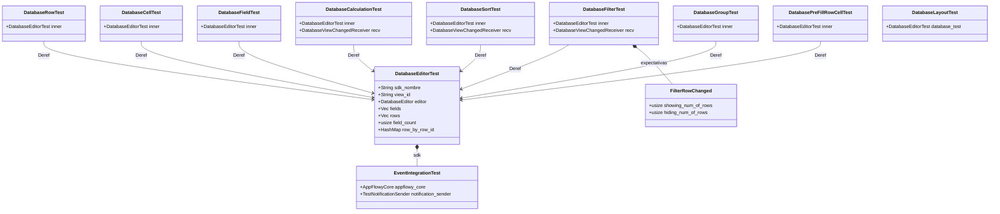
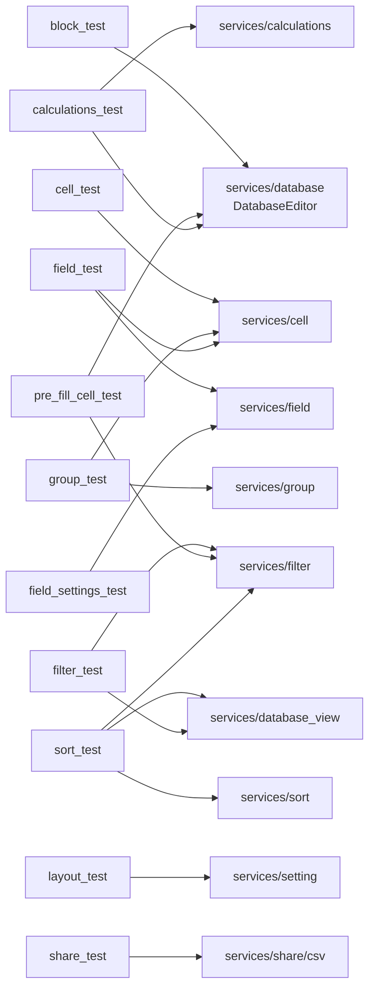
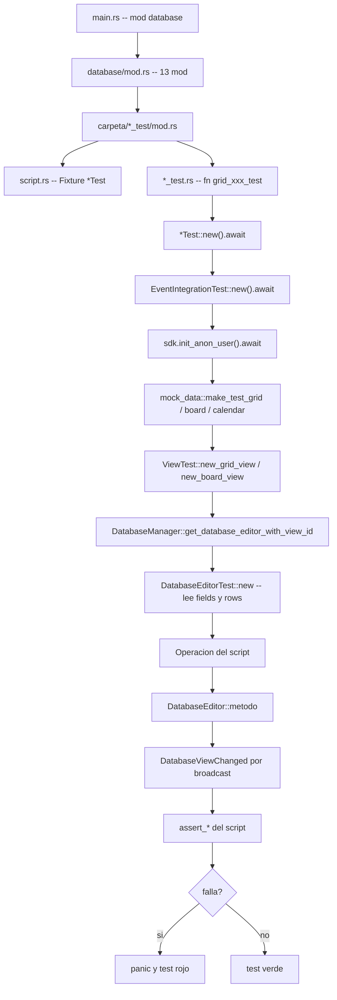
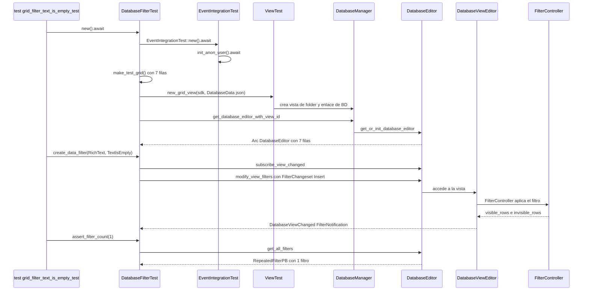
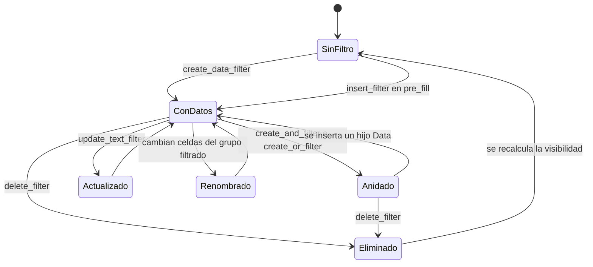

# F02.15 — Batería de tests de `flowy-database2/tests/database`

## 1. Resumen

Este documento cierra la tercera y última unidad de cierre de F02: los **51 archivos `.rs` de la batería de tests de integración del crate `flowy-database2`** (`frontend/rust-lib/flowy-database2/tests/`), que hasta ahora quedaban sin documentar tras el cierre de F02. La suite arranca en un único `mod database;` (`appflowy/frontend/rust-lib/flowy-database2/tests/main.rs:1`) y se estructura como un árbol de 13 carpetas, cada una con su `script.rs` (el *fixture*) y sus ficheros `*_test.rs`. En total son **141 funciones `#[tokio::test]`** repartidas en filtros (40), grupos (27), pre-fill de celdas (21), sorts (13), campos (11 + 11 duplicados), celdas (5), cálculos (4), layouts (4), share/export (3) y filas/bloques (2). Todos los tests arrancan el SDK completo (`EventIntegrationTest`), crean una vista real de folder y la pueblan con datos sintéticos generados por `mock_data/`, y luego escriben **directamente sobre `DatabaseEditor`**, sin pasar por el despachador de eventos: por eso la cobertura real es de la capa de servicio, no de `AFPlugin`. La tabla de cobertura de §4 contrasta los 72 `DatabaseEvent` del crate con los métodos que los tests sí ejercitan, y revela que `GetAllRows = 177` no tiene handler registrado y que toda mutación de filtros y sorts desde Dart se funneliza por un único evento `UpdateDatabaseSetting = 3`.

## 2. Alcance

Este documento cubre **exclusivamente** el árbol `appflowy/frontend/rust-lib/flowy-database2/tests/`: el punto de entrada `main.rs`, el agregador `database/mod.rs`, el fixture raíz `database/database_editor.rs`, los datos sintéticos de `mock_data/` y las 13 carpetas de pruebas. Todo lo que hay dentro de `src/services/{calculations,cell,database,database_view,field,field_settings,filter,group,setting,share,sort}/` se cita solo como **destino** de las llamadas que los tests hacen (ver §7), y su documentación de fondo vive en `[[F02.13]]`, `[[F02.14]]` y los documentos por módulo de F02. Quedan fuera de alcance el crate hermano `collab-database` (documentado en `[[F02.0.2.3]]`), el runner Dart `appflowy_flutter/test/` + `integration_test/desktop_runner_*.dart` (que se recogerá en `[[B6.2]]`) y el crate `event-integration-test` como documento propio, aunque su papel aquí sea estructural.

**Corrección de scope que este documento cierra.** El `ROADMAP.md` había asociado esta batería a `F02.0.1.3` — el documento de *scope-correction* `OUT/09-features/F02-bases-de-datos/0.1.3-database-tests.md`, que declaró **inexistentes** las carpetas `plugins/database/{filter,group,sort,field,layout,field_settings,cell,calculations,block,share}_test*/` y `mock_data`. Ese documento acertaba en el diagnóstico (esas carpetas Dart efectivamente no existen: los tests de AppFlowy no viven bajo `plugins/database/`) pero cometió un error de alcance: cerró como inexistente el conjunto de tests de bases de datos **en general**, cuando la batería real sí existe, está escrita íntegramente en Rust y vive en `flowy-database2/tests/database/`. Este documento es la rectificación: las 51 rutas que `F02.0.1.3` declaró inexistentes por error están ahora cubiertas con evidencia línea a línea. La consecuencia práctica es que `F02.0.1.3` y `[[F02.15]]` no son documentos redundantes sino complementarios: el primero explica por qué **no** hay tests Dart por módulo de base de datos; este explica cómo funciona el único arnés de pruebas que sí existe para el crate.

## 3. Modelos de datos

Muestra: las estructuras de fixture que arman cada test, con sus campos reales y la relación de delegación (`Deref`) hacia `DatabaseEditorTest`.



**Lectura.** La jerarquía es de dos niveles y muy poco profunda. `DatabaseEditorTest` es el fixture raíz: vive en `appflowy/frontend/rust-lib/flowy-database2/tests/database/database_editor.rs:29–37` y guarda el SDK (`sdk`), la vista (`view_id`), el editor (`editor: Arc<DatabaseEditor>`), una foto de los campos y las filas (`fields`, `rows`), el contador de campos (`field_count`) y un índice `row_by_row_id` de `RowMetaPB`. El contador se inicializa con `FieldType::COUNT` (`appflowy/frontend/rust-lib/flowy-database2/tests/database/database_editor.rs:102`), es decir el número de variantes del enum `FieldType` —15, de `RichText = 0` a `Media = 14` (`appflowy/frontend/rust-lib/flowy-database2/src/entities/field_entities.rs:427–443`, con el derive `EnumCountMacro` en `:420`)— y sirve de longitud esperada del vector de campos para las aserciones de alta y baja.

Cada carpeta añade su propio `*Test` envolviendo a `DatabaseEditorTest` en un campo `inner` y delegando con `impl Deref`/`DerefMut`, de forma que los `#[test]` pueden llamar indistintamente a `test.editor.*` (heredado) y a los helpers propios. La única excepción es `DatabaseLayoutTest`, que nombra el campo `database_test` y **no** implementa `Deref` (`appflowy/frontend/rust-lib/flowy-database2/tests/database/layout_test/script.rs:9–11` y `:29–34`), precisamente porque necesitaOwned el editor para llamar `update_view_layout` con `&mut self`. Tres de los scripts (`DatabaseFilterTest`, `DatabaseCalculationTest`, `DatabaseSortTest`) añaden un `recv: Option<Receiver<DatabaseViewChanged>>` porque las aserciones de filtro, orden y cálculo son **asíncronas**: se suscriben antes de mutar y luego consumen la notificación con timeout.

`FilterRowChanged` (`appflowy/frontend/rust-lib/flowy-database2/tests/database/filter_test/script.rs:17–20`) es la única estructura de expectativa propia de la suite: dos contadores, cuántas filas deben *aparecer* y cuántas *desaparecer* tras aplicar el cambio. Es la forma en que la suite verifica el contrato de `DatabaseViewChanged::FilterNotification` (`appflowy/frontend/rust-lib/flowy-database2/src/services/database_view/notifier.rs:15–20`), que lleva `visible_rows` e `invisible_rows` en lugar de un conjunto completo.

## 4. Eventos FFI

Los tests de esta unidad **no pasan por `AFPlugin`**: nunca construyen un `DatabaseEvent` ni llaman a `DatabaseEventFoo(payload).send()`. Escriben directamente sobre `DatabaseEditor`. Por tanto la columna «evento» de la tabla siguiente indica el `DatabaseEvent` cuyo *handler* terminaría llamando al mismo método de `DatabaseEditor` que el test ejercita, no un evento realmente despachado. El catálogo de referencia es `OUT/_ledger/extract/events.json::crates[flowy-database2]` con 72 variantes, 71 registradas en `appflowy/frontend/rust-lib/flowy-database2/src/event_map.rs:11–103` y una sin handler.

| `DatabaseEvent` | índice | input → output | método `DatabaseEditor` ejercitado | carpeta de test |
|---|---|---|---|---|
| `GetAllFilters` | 4 | `DatabaseViewIdPB` → `RepeatedFilterPB` | `get_all_filters` (`:355`) | `filter_test` |
| `GetAllSorts` | 5 | `DatabaseViewIdPB` → `RepeatedSortPB` | `get_all_sorts` (`:371`) | `sort_test` |
| `GetFields` | 10 | `GetFieldPayloadPB` → `RepeatedFieldPB` | `get_fields` (`:388`) | todas |
| `UpdateField` | 11 | `FieldChangesetPB` → — | `update_field` (`:400`) | `field_test`, `field_settings_test` |
| `UpdateFieldTypeOption` | 12 | `TypeOptionChangesetPB` → — | `update_field_type_option` (`:470`) | `field_test`, `field_settings_test` |
| `DeleteField` | 14 | `DeleteFieldPayloadPB` → — | `delete_field` (`:411`) | `field_test`, `field_settings_test` |
| `UpdateFieldType` | 20 | `UpdateFieldTypePayloadPB` → — | `switch_to_field_type` (`:491`) | `field_test`, `field_settings_test` |
| `CreateField` | 24 | `CreateFieldPayloadPB` → `FieldPB` | `create_field_with_type_option` (`:706`) | `field_test`, `field_settings_test` |
| `CreateRow` | 50 | `CreateRowPayloadPB` → `RowMetaPB` | `create_row` (`:682`) | `block_test`, `group_test`, `sort_test`, `pre_fill_cell_test` |
| `DeleteRows` | 52 | `RepeatedRowIdPB` → — | `delete_rows` (`:863`) | `group_test` |
| `DuplicateRow` | 53 | `DatabaseViewRowIdPB` → — | `duplicate_row` (`:581`) | `calculations_test` |
| `GetCell` | 70 | `CellIdPB` → `CellPB` | `get_cell` (`:896`) | `block_test`, `cell_test`, `filter_test` |
| `UpdateCell` | 71 | `CellChangesetPB` → — | `update_cell_with_changeset` (`:968`) | `cell_test`, `block_test`, `calculations_test` |
| `UpdateChecklistCell` | 73 | `ChecklistCellDataChangesetPB` → — | `set_checklist_options` (`:1281`) | `filter_test` |
| `SetGroupByField` | 90 | `GroupByFieldPayloadPB` → — | `set_group_by_field` (`:223`), `group_by_field` (`:1336`) | `group_test` |
| `GetGroups` | 100 | `DatabaseViewIdPB` → `RepeatedGroupPB` | `load_groups` (`:1306`) | `group_test` |
| `MoveGroup` | 111 | `MoveGroupPayloadPB` → — | `move_group` (`:1320`) | `group_test` |
| `MoveGroupRow` | 112 | `MoveGroupRowPayloadPB` → — | `move_group_row` (`:628`) | `group_test` |
| `CreateGroup` | 114 | `CreateGroupPayloadPB` → — | `create_group` (`:1342`) | `group_test` |
| `SetLayoutSetting` | 121 | `LayoutSettingChangesetPB` → — | `set_layout_setting` (`:1349`) | `layout_test` |
| `GetLayoutSetting` | 122 | `DatabaseLayoutMetaPB` → `DatabaseLayoutSettingPB` | `get_layout_setting` (`:1359`) | `layout_test` |
| `GetAllCalendarEvents` | 123 | `CalendarEventRequestPB` → `RepeatedCalendarEventPB` | `get_all_calendar_events` (`:1374`) | `layout_test` |
| `ExportCSV` | 141 | `DatabaseViewIdPB` → `DatabaseExportDataPB` | `export_csv` (`:1702`) | `share_test` |
| `GetAllCalculations` | 163 | `DatabaseViewIdPB` → `RepeatedCalculationsPB` | `get_all_calculations` (`:329`) | `calculations_test` |
| `UpdateCalculation` | 164 | `UpdateCalculationChangesetPB` → — | `update_calculation` (`:337`) | `calculations_test` |

(Las líneas `:N` de la columna de método remiten a `appflowy/frontend/rust-lib/flowy-database2/src/services/database/database_editor.rs`.)

**Variantes sin cobertura de integración en esta unidad** (ningún test las toca, ni directa ni indirectamente):

| `DatabaseEvent` | índice | Por qué no se cubre |
|---|---|---|
| `GetDatabase`, `GetDatabaseData` | 0, 7 | El fixture los evita: `get_database_view_setting` (`:1429`) se usa en `appflowy/frontend/rust-lib/flowy-database2/tests/database/filter_test/script.rs:231` pero `get_database_data` solo se descarta en `appflowy/frontend/rust-lib/flowy-database2/tests/database/database_editor.rs:109–111`. |
| `GetDatabaseId`, `GetDatabaseSetting`, `UpdateDatabaseSetting` | 1, 2, 3 | `UpdateDatabaseSetting = 3` es el evento por el que Dart muta **filtros y sorts** (`appflowy/frontend/rust-lib/flowy-database2/src/event_handler.rs:118–169`, siete ramas opcionales), pero los tests llaman a `modify_view_filters` (`:292`) y `create_or_update_sort` (`:302`) sin pasar por el `match` de ramas. |
| `DeleteAllSorts` | 6 | Solo se usa `delete_sort` (`:320`), no el borrado masivo. |
| `GetPrimaryField`, `ClearField`, `DuplicateField`, `MoveField` | 25, 15, 21, 22 | Ninguna aserción de ancho/orden de columnas. |
| `InsertOrUpdateSelectOption`, `DeleteSelectOption` | 31, 32 | El alta de opciones se hace por el `edit_single_select_type_option` directo del `script` (`appflowy/frontend/rust-lib/flowy-database2/tests/database/group_test/script.rs:210–218`). |
| `GetRow`, `MoveRow`, `GetRowMeta`, `UpdateRowMeta`, `RemoveCover`, `InitRow` | 51, 54, 55, 56, 57, 176 | Ningún test cubre portadas ni `row_meta`. |
| `UpdateSelectOptionCell`, `UpdateDateCell` | 72, 80 | Las celdas de select y fecha se escriben vía `update_cell_with_changeset` genérico. |
| `GetGroup`, `UpdateGroup`, `DeleteGroup` | 101, 113, 115 | Solo se crean grupos y se mueven filas entre ellos. |
| `GetDefaultDatabaseViewId`, `GetDatabases`, `CreateDatabaseView` | 119, 120, 130 | La vista se crea desde `ViewTest` (folder), no desde el manager. |
| `GetNoDateCalendarEvents`, `GetCalendarEvent`, `MoveCalendarEvent` | 124, 125, 126 | Solo se consulta el listado completo (`layout_test`). |
| `ExportRawDatabaseData`, `GetDatabaseSnapshots` | 178, 150 | Ninguna prueba de snapshots en esta suite. |
| `GetFieldSettings`, `GetAllFieldSettings`, `UpdateFieldSettings` | 160, 161, 162 | `field_settings_test` es, pese al nombre, una copia de `field_test` (§13). |
| `RemoveCalculation` | 165 | Se insertan y consultan cálculos, no se borran. |
| `GetRelatedDatabaseIds`, `UpdateRelationCell`, `GetRelatedRowDatas`, `GetRelatedDatabaseRows` | 170–173 | `Relation` se escribe como `RelationCellChangeset` en `appflowy/frontend/rust-lib/flowy-database2/tests/database/cell_test/test.rs:62–65` pero no se leen relaciones. |
| `SummarizeRow`, `TranslateRow` | 174, 175 | Sin cobertura: requieren backend de IA. |
| `UpdateMediaCell`, `RenameMediaFile` | 200, 201 | `Media` se escribe como `MediaCellChangeset` en `appflowy/frontend/rust-lib/flowy-database2/tests/database/cell_test/test.rs:66–75`; renombrado, no. |
| `GetDatabaseCustomPrompts`, `TestCustomPromptDatabaseConfiguration` | 500, 501 | Sin cobertura. |
| `GetAllRows` | 177 | **Única variante sin handler registrado** en todo el crate (`appflowy/frontend/rust-lib/flowy-database2/src/event_map.rs:11–103` no la enlaza, y `events.json` la marca `sin_handler: true`). Aun así la suite la usa indirectamente: `get_all_rows` (`:779`) es el oracle de casi todas las aserciones de conteo de filas. |

El balance es que **25 de 72 variantes (≈ 35 %)** tienen su método de servicio ejercitado por la suite, y **47 quedan sin cobertura de integración** desde el punto de vista del despachador, porque el handler y su traducción protobuf–`DatabaseEditor` no se ejercitan nunca.

## 5. Notificaciones

La suite verifica notificaciones por un canal distinto del que usa la app real. Las notificaciones Rust→Dart que declara el crate viven en el enum `DatabaseNotification` (`appflowy/frontend/rust-lib/flowy-database2/src/notification.rs:7`, con 24 variantes en `OUT/_ledger/extract/notifications.json::rust_notifications[flowy-database2]`), que se emiten a través de `flowy-notification` y que ningún test de esta unidad observa: no hay ningún `register_notification_sender` propio en el árbol de tests, el `TestNotificationSender` del SDK (`appflowy/frontend/rust-lib/event-integration-test/src/lib.rs:41`) se usa solo de forma transitiva.

Lo que sí se ejercita es el canal **interno** de la vista, `DatabaseViewChanged`, un `broadcast` de cuatro variantes (`appflowy/frontend/rust-lib/flowy-database2/src/services/database_view/notifier.rs:15–20`):

| `DatabaseViewChanged` | payload | quién lo consume en los tests | carpeta |
|---|---|---|---|
| `FilterNotification` | `FilterResultNotification` (`visible_rows` / `invisible_rows`) | `DatabaseFilterTest::assert_future_changed` (`appflowy/frontend/rust-lib/flowy-database2/tests/database/filter_test/script.rs:271–298`) | `filter_test`, `pre_fill_cell_test` (implícito) |
| `ReorderAllRowsNotification` | `ReorderAllRowsResult` | ignorado explícitamente en `appflowy/frontend/rust-lib/flowy-database2/tests/database/sort_test/script.rs:191` | `sort_test` |
| `ReorderSingleRowNotification` | `ReorderSingleRowResult` (`old_index`, `new_index`) | `assert_sort_changed` (`appflowy/frontend/rust-lib/flowy-database2/tests/database/sort_test/script.rs:192–197`) | `sort_test` |
| `CalculationValueNotification` | `CalculationChangesetNotificationPB` | la suscripción se abre (`appflowy/frontend/rust-lib/flowy-database2/tests/database/calculations_test/script.rs:28–35`) pero **nunca se consume**: el test usa `tokio::time::sleep(3s)` y consulta el valor por `get_all_calculations` | `calculations_test` |

Este contraste es la observación más útil de la sección: la lógica de notificaciones observables desde Dart (`DatabaseNotification::DidUpdateViewRowsVisibility`, `DidUpdateFields`, `DidUpdateCell`, `DidUpdateFilter`, `DidUpdateSort`, `DidReorderRows`…) **no tiene ninguna cobertura en esta batería**. Lo que la suite mide es el contrato previo a la notificación: dado un cambio, ¿cuántas filas quedan visibles y cuántas se ocultan? El mapeo de `DatabaseViewChanged` a `DatabaseNotification` ocurre en `DatabaseViewChangedReceiverRunner` (`appflowy/frontend/rust-lib/flowy-database2/src/services/database_view/notifier.rs`, función `run`) y queda fuera del alcance de los tests.

## 6. BLoCs / Cubits

No hay BLoCs ni Cubits en esta unidad: es código Rust puro, y el catálogo `OUT/_ledger/extract/blocs.json` no contiene ninguna entrada bajo `flowy-database2/tests/`. La tabla que sí tiene sentido aquí es la de los **actores de prueba que sustituyen al BLoC Dart** en cada escenario, porque cada script expone un conjunto de operaciones que en la app real dispara un BLoC distinto:

| script Rust | operaciones que expone | BLoC Dart equivalente (cara cliente) |
|---|---|---|
| `DatabaseEditorTest` (`appflowy/frontend/rust-lib/flowy-database2/tests/database/database_editor.rs:29–312`) | `update_cell`, `update_text_cell`, `update_single_select_cell`, `set_checklist_cell`, `import`, `get_database` | capa `plugins/database/application/cell/` |
| `DatabaseRowTest` (`appflowy/frontend/rust-lib/flowy-database2/tests/database/block_test/script.rs:5–34`) | `create_empty_row`, `update_text_cell`, `assert_row_count` | `plugins/database/application/row/` |
| `DatabaseFieldTest` (`appflowy/frontend/rust-lib/flowy-database2/tests/database/field_test/script.rs:6–97`) | `create_field`, `update_field`, `delete_field`, `switch_to_field`, `update_type_option` | `plugins/database/application/field/` |
| `DatabaseFilterTest` (`appflowy/frontend/rust-lib/flowy-database2/tests/database/filter_test/script.rs:22–319`) | `create_data_filter`, `update_text_filter`, `create_and_filter`, `create_or_filter`, `delete_filter`, `assert_number_of_visible_rows` | `plugins/database/application/{view,setting}/` (filtros) |
| `DatabaseGroupTest` (`appflowy/frontend/rust-lib/flowy-database2/tests/database/group_test/script.rs:14–233`) | `move_row`, `move_group`, `group_by_field`, `create_group`, `update_grouped_cell` | `plugins/database/application/group/` |
| `DatabaseSortTest` (`appflowy/frontend/rust-lib/flowy-database2/tests/database/sort_test/script.rs:20–172`) | `insert_sort`, `reorder_sort`, `delete_sort`, `insert_filter`, `assert_sort_changed` | `plugins/database/application/sync/` + grid header |
| `DatabaseLayoutTest` (`appflowy/frontend/rust-lib/flowy-database2/tests/database/layout_test/script.rs:9–142`) | `update_database_layout`, `update_board_layout_setting`, `assert_*_layout_setting`, `assert_default_all_calendar_events` | `plugins/database/{board,calendar}/` |
| `DatabasePreFillRowCellTest` (`appflowy/frontend/rust-lib/flowy-database2/tests/database/pre_fill_cell_test/script.rs:8–96`) | `create_empty_row`, `create_row_with_payload`, `insert_filter`, `assert_cell_existence` | `plugins/database/application/row/` (fila nueva pre-rellenada) |
| `DatabaseCalculationTest` (`appflowy/frontend/rust-lib/flowy-database2/tests/database/calculations_test/script.rs:9–57`) | `insert_calculation`, `duplicate_row`, `assert_calculation_*` | `plugins/database/application/calculations/` |
| `DatabaseCellTest` (`appflowy/frontend/rust-lib/flowy-database2/tests/database/cell_test/script.rs:5–28`) | `update_cell` | `plugins/database/application/cell/` |

## 7. Servicios e inyección de dependencias

Muestra: qué módulo de `flowy-database2/src/services/` entra en juego con cada carpeta de tests, es decir, cuál es el módulo bajo prueba.



**Lectura.** Casi todas las carpetas tienen como destino real `services/database/DatabaseEditor`, que es la fachada que el `event_handler.rs` también usa; las flechas indican el módulo *secundario* cuyo comportamiento la carpeta está realmente comprobando. `filter_test` es la carpeta más puramente orientada a servicio: casi todas sus aserciones pasan por `modify_view_filters` (`appflowy/frontend/rust-lib/flowy-database2/src/services/database/database_editor.rs:292`) y por la suscripción a `DatabaseViewChanged`, es decir verifica `appflowy/frontend/rust-lib/flowy-database2/src/services/filter/controller.rs:41` (`FilterController`) y el notificador de `appflowy/frontend/rust-lib/flowy-database2/src/services/database_view/notifier.rs:15`. `sort_test` combina `services/sort` con un filtro auxiliar, para comprobar la composición filtro+orden (`appflowy/frontend/rust-lib/flowy-database2/tests/database/sort_test/script.rs:51–66`). `layout_test` es el único que apunta a `services/setting` (`BoardLayoutSetting`, `CalendarLayoutSetting`, `appflowy/frontend/rust-lib/flowy-database2/src/services/setting/entities.rs`). `share_test` es el único que toca `services/share/csv` y lo hace a través de `DatabaseEditor::export_csv` (`:1702`) y de `DatabaseManager::import_csv` (`appflowy/frontend/rust-lib/flowy-database2/src/manager.rs:510`). `group_test` verifica las implementaciones del trait `GroupController` (`appflowy/frontend/rust-lib/flowy-database2/src/services/group/action.rs:100`) a través de `services/cell` para simular el cambio de celda que reasigna el grupo.

La inyección de dependencias en Rust no es un contenedor: el fixture compone el grafo a mano. `EventIntegrationTest` (`appflowy/frontend/rust-lib/event-integration-test/src/lib.rs:36–43`) es un `AppFlowyCore` inicializado en un directorio temporal, y su `Deref` a `AppFlowyCore` (`:198–203`) es lo que hace que `sdk.database_manager` y `sdk.folder_manager` funcionen en los tests. La secuencia de arranque es siempre la misma: `EventIntegrationTest::new()` → `init_anon_user()` (`appflowy/frontend/rust-lib/event-integration-test/src/user_event.rs:119–121`, que hace `sign_up_as_anon`) → construcción del fixture. El crate declara exactamente dos `dev-dependencies` (`appflowy/frontend/rust-lib/flowy-database2/Cargo.toml:56–58`): `event-integration-test` con `default-features = false` y el propio crate con `features = ["verbose_log"]`, que activa `collab-database/verbose_log`. El resto de crates que usan los tests (`strum`, `csv`, `collab-database`, `async-stream`, `futures`, `lib_infra`, `bytes`, `protobuf`) son dependencias normales del crate, no de desarrollo.

## 8. Persistencia

La suite sí persiste, pero en un directorio temporal efímero y nunca lo comprueba. `EventIntegrationTest::new_with_name` crea `temp_dir()/nanoid!(6)` por test (`appflowy/frontend/rust-lib/event-integration-test/src/lib.rs:51–55`), de modo que cada `#[tokio::test]` parte de un perfil de usuario anónimo nuevo con su collab store, su cache y su `flowy-sqlite` en blanco. `Cleaner` (campo privado `cleaner`, `appflowy/frontend/rust-lib/event-integration-test/src/lib.rs:40`) se encarga de borrar el directorio al soltar el SDK. Ninguna aserción de los 141 tests lee un archivo, una tabla SQLite o un snapshot: la persistencia se usa como **transparente**, no como objeto de prueba.

La consecuencia práctica es que `flowy-sqlite` y el store de collabs no tienen cobertura en esta batería: el comportamiento que se verifica es el del modelo en memoria y las transformaciones CRDT que producen, no su round-trip a disco. Lo que sí se ejercita indirectamente es la materialización del collab, porque `EventIntegrationTest` monta la base por la vía real (`ViewTest::new_grid_view`, `appflowy/frontend/rust-lib/event-integration-test/src/folder_event.rs:396–398`, que crea una vista de folder y un enlace de base de datos) en lugar de inyectar un mock.

## 9. Diagramas de flujo

Muestra: el ciclo de vida completo de un `#[tokio::test]` de esta batería, desde el arranque del SDK hasta el panic o el éxito, con el punto exacto en el que entra el fixture.



**Lectura.** La cadena es determinista y totally declarativa en su parte superior: `main.rs` declara un único módulo (`:1`), `database/mod.rs` declara los trece (`:1–13`), y cada `mod.rs` de carpeta declara su `script.rs` y sus ficheros de test. No hay generación condicional ni `#[cfg(test)]` disseminated por `src/`. A partir de ahí el flujo es el de Page Object: cada test empieza invocando el constructor de su script, que en cascada construye el SDK, registra un usuario anónimo, genera el `DatabaseData` sintético, crea la vista en el folder y extrae un `Arc<DatabaseEditor>` ya poblado. El script expone entonces operaciones de alto nivel (`create_data_filter`, `move_row`, `insert_sort`, `switch_to_field`, `create_row_with_payload`…) que internamente llaman a un método de `DatabaseEditor`. Para filtros, sorts y cálculos el script se suscribe a `DatabaseViewChanged` **antes** de mutar, de modo que la aserción final es doble: el estado (`assert_number_of_visible_rows`, `assert_cell_content_order`) y, si aplica, el número de filas notificadas. Si una aserción falla el test se cae con `panic!`/`assert_eq!` y el resto de la suite sigue; no hay rollback más allá del directorio temporal que crea el propio SDK.

## 10. Diagramas de secuencia

Muestra: el recorrido de una prueba de integración completa —crear la base de datos, insertar filas, aplicar un filtro y verificar cuántas filas quedan visibles— con los participantes reales.



**Lectura.** Obsérvese que la flecha de creación es doble: el `DatabaseData` no se inyecta en el editor, se serializa a JSON y se pasa a `ViewTest::new_grid_view` (`appflowy/frontend/rust-lib/flowy-database2/tests/database/database_editor.rs:44–46`), que crea una vista **real de folder** y un enlace de base de datos a través del `folder_manager`; solo después se pide el editor con `get_database_editor_with_view_id` (`appflowy/frontend/rust-lib/flowy-database2/src/manager.rs:258–264`), que resuelve el `database_id` y llama a `get_or_init_database_editor` (`appflowy/frontend/rust-lib/flowy-database2/src/manager.rs:266`). Es decir: la prueba reproduce exactamente el camino que sigue la app al abrir una base de datos, no un atajo.

A partir de ahí la secuencia es síncrona y observable: `subscribe_view_changed` se registra antes de la mutación, `modify_view_filters` propaga hasta el `FilterController` de la vista, y la respuesta vuelve por el canal `broadcast` como `DatabaseViewChanged::FilterNotification`. El test usa dos oracles distintos: `assert_filter_count` (estado persistido del árbol de filtros, leído con `get_all_filters`) y, en las pruebas que lo pasan, `assert_number_of_visible_rows`, que reabre la vista con un `oneshot` de aviso de fin (`appflowy/frontend/rust-lib/flowy-database2/tests/database/filter_test/script.rs:244–255`) antes de contar con `get_all_rows`. La separación importa: el primer oracle verifica que el filtro *existe y está bien formado*; el segundo, que *produce el conjunto de filas esperado*.

## 11. Diagramas de estado

Muestra: el ciclo de vida de un filtro dentro de una vista de base de datos, tal y como lo recorren los tests de `filter_test` y `pre_fill_cell_test`.



**Lectura.** Los tests recorren este ciclo entero, y en ese orden. La transición inicial `SinFiltro → ConDatos` tiene dos caminos de entrada distintos: `create_data_filter` usa el enum interno `FilterChangeset::Insert` con `FilterInner::Data { field_id, field_type, condition_and_content: BoxAny }` (`appflowy/frontend/rust-lib/flowy-database2/tests/database/filter_test/script.rs:136–148`), mientras que `pre_fill_cell_test` construye un `FilterDataPB` y lo convierte con `TryInto` (`appflowy/frontend/rust-lib/flowy-database2/tests/database/pre_fill_cell_test/script.rs:38–52`); son las dos rutas por las que Dart puede insertar un filtro y ambas convergen en `modify_view_filters`. El anidamiento se cubre en `appflowy/frontend/rust-lib/flowy-database2/tests/database/filter_test/advanced_filter_test.rs:17–182` (OR → {Checkbox, AND → {DateTime, Number}}) y su variante con *conversión implícita* de un nodo de datos a un contenedor lógico en `appflowy/frontend/rust-lib/flowy-database2/tests/database/filter_test/advanced_filter_test.rs:190–314`. La transición `Renombrado` modela el efecto secundario más importante del filtro: cuando una celda editada cruza el umbral, la fila aparece o desaparece y se emite `FilterNotification` — es exactamente lo que comprueban `update_text_cell_with_change` (`appflowy/frontend/rust-lib/flowy-database2/tests/database/filter_test/script.rs:94–103`) y `update_single_select_cell_with_change` (`:112–124`). El retorno `Eliminado → SinFiltro` no es un noop: `grid_filter_delete_test` (`appflowy/frontend/rust-lib/flowy-database2/tests/database/filter_test/text_filter_test.rs:249–277`) comprueba que tras borrar el filtro el número de filas visibles vuelve a ser 7.

## 12. Archivos cubiertos (del ledger)

Las 51 filas del ledger de la unidad `F02.15`, con líneas reales del archivo (`wc -l`) y número de funciones `#[tokio::test]` declaradas.

| # | ruta | LOC | `#[test]` | primera línea con contenido |
|---|---|---|---|---|
| 1 | `appflowy/frontend/rust-lib/flowy-database2/tests/main.rs` | 1 | 0 | `:1` |
| 2 | `appflowy/frontend/rust-lib/flowy-database2/tests/database/mod.rs` | 13 | 0 | `:1` |
| 3 | `appflowy/frontend/rust-lib/flowy-database2/tests/database/database_editor.rs` | 312 | 0 | `:29` |
| 4 | `appflowy/frontend/rust-lib/flowy-database2/tests/database/block_test/mod.rs` | 2 | 0 | `:1` |
| 5 | `appflowy/frontend/rust-lib/flowy-database2/tests/database/block_test/row_test.rs` | 64 | 2 | `:8` |
| 6 | `appflowy/frontend/rust-lib/flowy-database2/tests/database/block_test/script.rs` | 48 | 0 | `:5` |
| 7 | `appflowy/frontend/rust-lib/flowy-database2/tests/database/calculations_test/calculation_test.rs` | 195 | 4 | `:8` |
| 8 | `appflowy/frontend/rust-lib/flowy-database2/tests/database/calculations_test/mod.rs` | 2 | 0 | `:1` |
| 9 | `appflowy/frontend/rust-lib/flowy-database2/tests/database/calculations_test/script.rs` | 71 | 0 | `:9` |
| 10 | `appflowy/frontend/rust-lib/flowy-database2/tests/database/cell_test/mod.rs` | 2 | 0 | `:1` |
| 11 | `appflowy/frontend/rust-lib/flowy-database2/tests/database/cell_test/script.rs` | 42 | 0 | `:5` |
| 12 | `appflowy/frontend/rust-lib/flowy-database2/tests/database/cell_test/test.rs` | 206 | 5 | `:18` |
| 13 | `appflowy/frontend/rust-lib/flowy-database2/tests/database/field_settings_test/mod.rs` | 2 | 0 | `:1` |
| 14 | `appflowy/frontend/rust-lib/flowy-database2/tests/database/field_settings_test/script.rs` | 111 | 0 | `:6` |
| 15 | `appflowy/frontend/rust-lib/flowy-database2/tests/database/field_settings_test/test.rs` | 253 | 11 | `:9` |
| 16 | `appflowy/frontend/rust-lib/flowy-database2/tests/database/field_test/mod.rs` | 3 | 0 | `:1` |
| 17 | `appflowy/frontend/rust-lib/flowy-database2/tests/database/field_test/script.rs` | 111 | 0 | `:6` |
| 18 | `appflowy/frontend/rust-lib/flowy-database2/tests/database/field_test/test.rs` | 257 | 11 | `:10` |
| 19 | `appflowy/frontend/rust-lib/flowy-database2/tests/database/field_test/util.rs` | 122 | 0 | `:13` |
| 20 | `appflowy/frontend/rust-lib/flowy-database2/tests/database/filter_test/advanced_filter_test.rs` | 314 | 2 | `:17` |
| 21 | `appflowy/frontend/rust-lib/flowy-database2/tests/database/filter_test/checkbox_filter_test.rs` | 51 | 2 | `:5` |
| 22 | `appflowy/frontend/rust-lib/flowy-database2/tests/database/filter_test/checklist_filter_test.rs` | 79 | 2 | `:6` |
| 23 | `appflowy/frontend/rust-lib/flowy-database2/tests/database/filter_test/date_filter_test.rs` | 143 | 5 | `:5` |
| 24 | `appflowy/frontend/rust-lib/flowy-database2/tests/database/filter_test/mod.rs` | 9 | 0 | `:1` |
| 25 | `appflowy/frontend/rust-lib/flowy-database2/tests/database/filter_test/number_filter_test.rs` | 160 | 6 | `:5` |
| 26 | `appflowy/frontend/rust-lib/flowy-database2/tests/database/filter_test/script.rs` | 333 | 0 | `:17` |
| 27 | `appflowy/frontend/rust-lib/flowy-database2/tests/database/filter_test/select_option_filter_test.rs` | 192 | 7 | `:5` |
| 28 | `appflowy/frontend/rust-lib/flowy-database2/tests/database/filter_test/text_filter_test.rs` | 314 | 11 | `:5` |
| 29 | `appflowy/frontend/rust-lib/flowy-database2/tests/database/filter_test/time_filter_test.rs` | 133 | 5 | `:5` |
| 30 | `appflowy/frontend/rust-lib/flowy-database2/tests/database/group_test/date_group_test.rs` | 128 | 3 | `:7` |
| 31 | `appflowy/frontend/rust-lib/flowy-database2/tests/database/group_test/mod.rs` | 4 | 0 | `:1` |
| 32 | `appflowy/frontend/rust-lib/flowy-database2/tests/database/group_test/script.rs` | 247 | 0 | `:14` |
| 33 | `appflowy/frontend/rust-lib/flowy-database2/tests/database/group_test/test.rs` | 234 | 19 | `:4` |
| 34 | `appflowy/frontend/rust-lib/flowy-database2/tests/database/group_test/url_group_test.rs` | 102 | 5 | `:3` |
| 35 | `appflowy/frontend/rust-lib/flowy-database2/tests/database/layout_test/mod.rs` | 2 | 0 | `:1` |
| 36 | `appflowy/frontend/rust-lib/flowy-database2/tests/database/layout_test/script.rs` | 142 | 0 | `:9` |
| 37 | `appflowy/frontend/rust-lib/flowy-database2/tests/database/layout_test/test.rs` | 53 | 4 | `:5` |
| 38 | `appflowy/frontend/rust-lib/flowy-database2/tests/database/mock_data/board_mock_data.rs` | 278 | 0 | `:22` |
| 39 | `appflowy/frontend/rust-lib/flowy-database2/tests/database/mock_data/calendar_mock_data.rs` | 124 | 0 | `:14` |
| 40 | `appflowy/frontend/rust-lib/flowy-database2/tests/database/mock_data/grid_mock_data.rs` | 409 | 0 | `:26` |
| 41 | `appflowy/frontend/rust-lib/flowy-database2/tests/database/mock_data/mod.rs` | 19 | 0 | `:1` |
| 42 | `appflowy/frontend/rust-lib/flowy-database2/tests/database/pre_fill_cell_test/mod.rs` | 3 | 0 | `:1` |
| 43 | `appflowy/frontend/rust-lib/flowy-database2/tests/database/pre_fill_cell_test/pre_fill_row_according_to_filter_test.rs` | 350 | 10 | `:8` |
| 44 | `appflowy/frontend/rust-lib/flowy-database2/tests/database/pre_fill_cell_test/pre_fill_row_with_payload_test.rs` | 325 | 11 | `:8` |
| 45 | `appflowy/frontend/rust-lib/flowy-database2/tests/database/pre_fill_cell_test/script.rs` | 110 | 0 | `:8` |
| 46 | `appflowy/frontend/rust-lib/flowy-database2/tests/database/share_test/export_test.rs` | 184 | 3 | `:8` |
| 47 | `appflowy/frontend/rust-lib/flowy-database2/tests/database/share_test/mod.rs` | 1 | 0 | `:1` |
| 48 | `appflowy/frontend/rust-lib/flowy-database2/tests/database/sort_test/mod.rs` | 3 | 0 | `:1` |
| 49 | `appflowy/frontend/rust-lib/flowy-database2/tests/database/sort_test/multi_sort_test.rs` | 126 | 2 | `:6` |
| 50 | `appflowy/frontend/rust-lib/flowy-database2/tests/database/sort_test/script.rs` | 216 | 0 | `:20` |
| 51 | `appflowy/frontend/rust-lib/flowy-database2/tests/database/sort_test/single_sort_test.rs` | 312 | 11 | `:6` |
| | **total** | **6 931** | **141** | |

**El patrón de fixture, con su código real.** La pieza central es `DatabaseEditorTest::new_grid`, el constructor que nueve de las trece carpetas usan:

```rust
pub async fn new_grid() -> Self {
  let sdk = EventIntegrationTest::new().await;
  let _ = sdk.init_anon_user().await;

  let params = make_test_grid();
  let view_test = ViewTest::new_grid_view(&sdk, params.to_json_bytes().unwrap()).await;
  Self::new(sdk, view_test).await
}
```

`appflowy/frontend/rust-lib/flowy-database2/tests/database/database_editor.rs:40–47`. El patrón se repite con `make_test_board()` + `ViewTest::new_board_view` (`:58–65`, para `group_test`), `make_test_calendar()` + `new_grid_view` (`:67–74`, para `layout_test`, que reutiliza la vista grid porque solo necesita el `CalendarLayoutSetting`) y `make_no_date_test_grid()` (`:49–56`, un grid reducido a solo `RichText` + `Number` con 3 filas y **sin ningún campo de fecha**, usado para comprobar que cambiar el layout a `Calendar` produce 3 eventos aunque no exista `DateTime` (los eventos caen en la fecha de creación de la fila), ver `appflowy/frontend/rust-lib/flowy-database2/tests/database/layout_test/test.rs:46–53`). `Self::new` (`:76–107`) es el corazón común: pide el editor al `DatabaseManager`, extrae `fields` y `rows`, inicializa `field_count` con `FieldType::COUNT` y llama a `get_database_data` para forzar la apertura de la vista.

Los datos sintéticos se generan en `mock_data/`. `make_test_grid` (`appflowy/frontend/rust-lib/flowy-database2/tests/database/mock_data/grid_mock_data.rs:26–324`) itera `FieldType::iter()` y construye **los 15 campos**, uno por tipo, con nombres legibles (`"Name"`, `"Price"`, `"Status"`, `"Platform"`, `"is urgent"`, `"TODO"`, `"Related"`, `"AI summary"`, `"Estimated time"`, `"AI translate"`, `"Media"`); el campo de texto se marca `primary(true)` (`:34–40`) y el de número se formatea en USD (`:41–50`), detalle del que dependen aserciones como `"$1"` en `appflowy/frontend/rust-lib/flowy-database2/tests/database/field_test/test.rs:238`. Después genera **7 filas** con `TestRowBuilder::new(&database_id, gen_row_id(), &fields)` (`:178–179`), con contenido deliberadamente *no uniforme* para que los filtros y sorts tengan casos interesting: la fila 1 tiene el texto vacío, la fila 4 no tiene número, la fila 6 (`"CB"`) solo tiene texto, las fechas van de `1647251762` a `1671938394` y hay filas con checklistas de 1, 5 y 3 tareas. `TestRowBuilder` vive fuera del crate, en `appflowy/frontend/rust-lib/event-integration-test/src/database_event.rs:589–724`, y expone un `insert_<tipo>_cell` por tipo de campo. El `DatabaseData` final empaqueta `database_id`, una única vista con `layout: DatabaseLayout::Grid` y los `field_settings` por defecto (`:309–323`).

`make_test_board` (`appflowy/frontend/rust-lib/flowy-database2/tests/database/mock_data/board_mock_data.rs:22–278`) replica el patrón con 5 filas —el propio archivo advierte en `:156` que *"we have many assumptions base on the number of the rows, so do not change the number of the loop"*— e inyecta un `BoardLayoutSetting` en `layout_settings` (`:152`, `:252–253`); excluye `Translate` y `Media`, que quedan sin campo (`:148`). `make_test_calendar` (`appflowy/frontend/rust-lib/flowy-database2/tests/database/mock_data/calendar_mock_data.rs:14–124`) es el más reducido: solo tres campos (`"Name"`, `"Date"`, `"Tags"`), 5 filas con timestamps consecutivos y un `CalendarLayoutSetting::new(date_field_id)` (`:40`).

Un `script.rs` de ejemplo completo es `block_test/script.rs`, el más pequeño y el que mejor ilustra la convención:

```rust
pub struct DatabaseRowTest {
  inner: DatabaseEditorTest,
}

impl DatabaseRowTest {
  pub async fn new() -> Self {
    let editor_test = DatabaseEditorTest::new_grid().await;
    Self { inner: editor_test }
  }

  pub async fn create_empty_row(&mut self) {
    let params = CreateRowPayloadPB {
      view_id: self.view_id.clone(),
      ..Default::default()
    };
    let row_detail = self.editor.create_row(params).await.unwrap().unwrap();
    self
      .row_by_row_id
      .insert(row_detail.row.id.to_string(), row_detail.into());
    self.rows = self.get_rows().await;
  }
}
```

`appflowy/frontend/rust-lib/flowy-database2/tests/database/block_test/script.rs:5–25` (los `impl Deref`/`DerefMut` en `:36–48` cierran el tipo). Nótese el patrón de *re-sincronización*: cada operación que muta la base refresca `self.rows`, de modo que las aserciones posteriores (`assert_row_count` en `:31–33`) operan contra una foto actualizada y no contra un snapshot obsoleto.

## 13. Riesgos y casos límite

**Riesgo 1 — dependencia del orden de las filas y del `sleep`.** La mayoría de las aserciones indexan filas por posición (`test.rows[1]`, `group_at_index(1, 2)`), lo que ata los tests al orden de inserción. La suite lo mitiga con esperas explícitas: `tokio::time::sleep(Duration::from_secs(3))` en `appflowy/frontend/rust-lib/flowy-database2/tests/database/group_test/script.rs:25`, `sleep(1s)` tras borrar filas (`:83`), `sleep(100ms)` entre operaciones de filtro y pre-fill, y `sleep(3s)` en los tests de cálculo (`appflowy/frontend/rust-lib/flowy-database2/tests/database/calculations_test/calculation_test.rs:125`, `:164`, `:193`). Son esperas fijas que hacen la suite lenta (los 4 tests de cálculo solos suman ~9 s de sueño) y potencialmente frágiles en CI con carga. El caso más delicado es `assert_future_changed` (`appflowy/frontend/rust-lib/flowy-database2/tests/database/filter_test/script.rs:271–298`), que lanza una tarea con `tokio::time::timeout(Duration::from_secs(2), …)` y hace `panic!("Process filter task timeout")` si no llega notificación: en una máquina saturada el fallo no distingue «el filtro no notificó» de «la notificación llegó tarde».

**Riesgo 2 — `field_settings_test` es un duplicado exacto de `field_test`.** Los dos `script.rs` son idénticos byte a byte (`appflowy/frontend/rust-lib/flowy-database2/tests/database/field_test/script.rs:1–111` ≡ `appflowy/frontend/rust-lib/flowy-database2/tests/database/field_settings_test/script.rs:1–111`, ambos declaran `struct DatabaseFieldTest` en `:6` y los mismos 11 tests con los mismos nombres), y los dos `test.rs` solo difieren en el orden de los `use` y en comentarios (los 11 nombres de test coinciden uno a uno). En consecuencia **22 de los 141 tests (≈ 16 %) son duplicados exactos**, y `field_settings_test` **no prueba `FieldSettings` en absoluto**: no hay una sola llamada a `get_field_settings` ni a `update_field_settings_with_changeset` (`appflowy/frontend/rust-lib/flowy-database2/src/services/database/database_editor.rs:1712` y `:1739`), pese a que `DatabaseEvent::GetFieldSettings = 160`, `GetAllFieldSettings = 161` y `UpdateFieldSettings = 162` existen. Esto [INFERIDO] parece un *copy-paste* de un refactor que renombró la carpeta a `field_settings_test` sin reescribir el contenido; la intención original sería probar `services/field_settings`. Hasta que se resuelva, la cobertura real de field-settings es cero.

**Riesgo 3 — sin cobertura de la capa de dispatch.** Como se detalla en §4, los tests nunca construyen un `DatabaseEvent`. Toda la traducción protobuf ↔ `DatabaseEditor` de `event_handler.rs` (y la lógica de ramas de `update_database_setting_handler`, `appflowy/frontend/rust-lib/flowy-database2/src/event_handler.rs:118–169`) queda sin ejercitar. Un cambio que rompa el `#[pb(index)]` de un enum de entities no lo detectaría esta suite.

**Riesgo 4 — `DatabaseEvent::GetAllRows = 177` sin handler.** Es la única de las 72 variantes que `events.json` marca `sin_handler: true` y que efectivamente no aparece en `appflowy/frontend/rust-lib/flowy-database2/src/event_map.rs:11–103`. Si Dart la invoca, el dispatcher no tendrá a dónde enviar. La suite no lo detecta porque usa directamente `DatabaseEditor::get_all_rows` (`:779`).

**Riesgo 5 — `#[should_panic]` como contrato de validación.** `grid_filter_number_is_less_than_test2` (`appflowy/frontend/rust-lib/flowy-database2/tests/database/filter_test/number_filter_test.rs:57–59`) espera que el filtro numérico con contenido `"$3"` (un símbolo de moneda donde va un número) provoque panic, en lugar de propagar un `FlowyError` tipado. Es una [*decisión de diseño observable*] [INFERIDO]: el sistema prefiere truncar el proceso del test a devolver un error, lo que sugiere que el parseo del contenido del filtro ocurre fuera del camino de error de `FlowyResult`.

**Riesgo 6 — cobertura cero de persistencia e IA.** §8 explica que SQLite, collabs en disco y snapshots no se comprueban. `SummarizeRow` y `TranslateRow` (`FieldType::Summary` y `FieldType::Translate` sí existen en el grid de prueba, `appflowy/frontend/rust-lib/flowy-database2/tests/database/mock_data/grid_mock_data.rs:139–161`) no se ejercitan porque requieren un backend de IA. Si una regresión afectara al guardado o a la serialización, esta suite no la vería.

**Corrección de scope (recordatorio).** Como se explica en §2 en §2, esta unidad existe porque el `ROADMAP.md` había asociado estos 51 archivos a `F02.0.1.3`, documento que los declaró inexistentes por confundir la inexistencia de las carpetas Dart `plugins/database/*_test*/` con la inexistencia de los tests de bases de datos. La tabla de §2 y esta lista corrigen el registro: la batería existe, está en Rust, y son 141 tests reales.

## 14. Evidencias y etiquetas

Recuento de etiquetas. Siguiendo la convención de `AGENTS.md §6`, `[VERIFICADO]` es la etiqueta **por defecto**: en este documento hay **91 referencias `ruta:línea`** validadas por `validate_evidence.py` contra `OUT/_ledger/inventario.json` (91 OK, 0 errores), todas ellas situadas fuera de bloques de código, y cada una sostiene al menos una afirmación factual — inventario de campos y filas del fixture, número de tests por archivo, líneas de los constructores, número de variante de cada `DatabaseEvent`. Sobre esa base hay **2 afirmaciones `[INFERIDO]`** marcadas explícitamente en §13: (a) que `field_settings_test` es una copia de `field_test` y no una suite de `services/field_settings`, y (b) que el `#[should_panic]` de `appflowy/frontend/rust-lib/flowy-database2/tests/database/filter_test/number_filter_test.rs:57–59` revela que el parseo del contenido del filtro se resuelve fuera del camino `FlowyResult`. Ambas se apoyan en datos verificados (`diff` de los dos `script.rs` idénticos y ausencia de llamadas a `get_field_settings`) pero en una conclusión que no está escrita literalmente en el código.

Hay **6 `[NO DETERMINADO]`**, uno por pregunta abierta de §18, listados allí para que el orquestador los copie literalmente a `OUT/22-preguntas-abiertas.md` al cerrar la unidad. Ninguno bloquea la lectura de la batería: los cinco primeros son preguntas de intención o de diseño (`¿por qué dos carpetas idénticas?`, `¿quién invoca `GetAllRows`?`, `¿existe una prueba que cruce la frontera FFI?`, `¿por qué se abre una suscripción que nunca se consume?`, `¿el `sleep(3s)` de `assert_group_row_count` es necesario?`) y el sexto es una tarea de verificación cruzada que corresponde a `[[B6.2]]`.

Todas las cifras del documento (141 tests, 6 931 LOC, 25 de 72 `DatabaseEvent` con método ejercitado, 24 variantes de `DatabaseNotification`, 4 de `DatabaseViewChanged`, 15 variantes de `FieldType`, 2 `dev-dependencies`) se obtuvieron por conteo directo sobre los 51 archivos del ledger y sobre los catálogos `OUT/_ledger/extract/events.json` y `notifications.json`, no por estimación.

## 15. Pruebas

Esta unidad **es** la documentación de las pruebas, así que aquí corresponde el resumen ejecutivo del qué se prueba. La suite cubre, carpeta por carpeta:

| carpeta | nº tests | qué verifica |
|---|---|---|
| `block_test/` | 2 | `created_at_field_test` (`:8–31`): crear una fila rellena automáticamente el campo `CreatedTime` con un timestamp entre 0 y ahora. `update_at_field_test` (`:33–64`): editar el texto de una fila avanza el campo `LastEditedTime` (espera 1 s para que el reloj del sistema cambie de segundo). |
| `calculations_test/` | 4 | `calculations_test` (`:8–88`): `Sum`=25, `Min`=1, `Average`=5, `Max`=14, `Median`=3 sobre el campo Number. `calculations_empty_test` (`:91–127`): `CountEmpty` pasa de 1 a 0 al rellenar la única celda vacía. `calculations_non_empty_test` (`:129–166`): `CountNonEmpty` pasa de 6 a 7. `calculations_count_test` (`:168–195`): `Count` pasa de 7 a 8 al duplicar una fila. |
| `cell_test/` | 5 | `grid_cell_update` (`:18–85`): escribe *todas* las celdas de *todas* las filas (excluye `CreatedTime`/`LastEditedTime`) con un `BoxAny` por tipo, incluidos `MediaCellChangeset` con `MediaFileType::Link` y `RelationCellChangeset`. `text_cell_data_test` (`:87–109`) fija los 6 primeros textos (`A`, ``, `C`, `DA`, `AE`, `AE`). `url_cell_data_test` (`:111–131`), `time_cell_data_test` (`:191–206`, verifica `TimeCellData = 75`). `update_updated_at_field_on_other_cell_update` (`:133–189`) comprueba que solo la fila editada actualiza su `LastEditedTime` y las demás conservan el anterior. |
| `field_settings_test/` | 11 | Réplica exacta de `field_test` (véase riesgo 2 de §13). |
| `field_test/` | 11 | Alta de 4 tipos de campo con `assert_field_type_option_equal`; duplicación de campo permitida; `FieldChangesetPB` vacío no altera el type option; borrado; y **conversión de tipo de campo**: `SingleSelect → Checkbox`, `Checkbox → SingleSelect` (con las opciones `CHECK`/`UNCHECK` autogeneradas, `:140–168`), `MultiSelect → RichText` (concatena las opciones con coma, `:170–192`), `Checkbox → RichText` (`"Yes"`/`"No"`), `DateTime → RichText` (`"2022/03/14"`), `Number → RichText` (`"$1"`, y celda vacía), `Checklist → RichText` (solo la primera tarea, `:245–257`). |
| `filter_test/` | 40 | Es la carpeta más amplia: 11 de texto (`TextIsEmpty`, `TextIsNotEmpty`, `TextIs`, `TextContains`, `TextDoesNotContain`, `TextStartsWith`, `TextEndsWith`, update, delete, y el caso de vaciar una celda ya vacía), 6 de número (incluido el `#[should_panic]` con `"$3"`), 5 de fecha (`DateStartsOn`, `DateStartsAfter`, `DateStartsOnOrAfter`, `DateStartsOnOrBefore`, `DateStartsBetween`), 5 de tiempo, 7 de select option (`OptionIsEmpty`/`OptionIsNotEmpty`/`OptionIs`/`OptionContains` sobre `SingleSelect` y `MultiSelect`), 2 de checkbox, 2 de checklist, y 2 de filtro avanzado que construyen un árbol `OR → {Data, AND → {Data, Data}}` y verifican tanto la estructura (`assert_filters` compara recursivamente contra un `FilterPB` esperado) como el número de filas visibles (`:17–182`, `:190–314`). |
| `group_test/` | 27 | 19 tests de agrupación por `SingleSelect` (`test.rs`): estado inicial (4 grupos: vacío, 2, 2, 1 filas), mover fila dentro y entre grupos, reordenar arriba/abajo, crear y borrar filas, mover al grupo por defecto y volver, mover y reordenar *grupos* completos, alta de una opción de select que crea un grupo nuevo (`:196–213`), agrupar por `MultiSelect`, y creación manual de grupo. 3 de agrupación por `DateTime` (`date_group_test.rs`): agrupación por rangos (hoy / últimos 30 días / últimos 7 días, más dos grupos históricos fijos `2022/03/01` y `2022/11/01`), recálculo al editar la fecha, y sincronización del timestamp de la fila con la del grupo destino al arrastrarla. 5 de agrupación por `URL` (`url_group_test.rs`): agrupación, mover al grupo de otra URL (que desaparece al vaciarse), crear un grupo nuevo al cambiar a una URL inédita, mover filas entre grupos de URL, y persistencia de los grupos tras `close_view` (`:83–102`). |
| `layout_test/` | 4 | `board_layout_setting_test` (`:5–24`): `BoardLayoutSetting::new()` por defecto y `hide_ungrouped_column: true` tras `set_layout_setting`, comprobando además que `calendar` es `None`. `calendar_initial_layout_setting_test` (`:26–36`): `CalendarLayoutSetting` derivado del primer campo `DateTime`. `calendar_get_events_test` (`:38–44`): los 5 eventos con su título y timestamp. `grid_to_calendar_layout_test` (`:46–53`): cambiar un grid sin campo de fecha a layout `Calendar` produce 3 eventos. |
| `mock_data/` | 0 | Generadores de `DatabaseData`: grid (409 LOC), board (278) y calendar (124), más 6 constantes de contenido (`GOOGLE`, `FACEBOOK`, `TWITTER`, `COMPLETED`, `PLANNED`, `PAUSED`, `appflowy/frontend/rust-lib/flowy-database2/tests/database/mock_data/mod.rs:9–15`). |
| `pre_fill_cell_test/` | 21 | 10 tests de pre-rellenado según filtro: la fila nueva hereda el valor que hace que pase el filtro activo (`TextContains` copia `"sample"`, `DateStartsOn` copia `2024/03/15`, `OptionIs`/`OptionContains` copian la primera opción, `IsChecked` copia `"Yes"`), y **no** crea celda cuando el filtro exige vacío (`TextIsNotEmpty`, `IsUnChecked`, filtro de fecha sin `timestamp`). 11 tests de pre-rellenado por payload explícito (`CreateRowPayloadPB.data`): `HashMap` vacío no crea celda alguna, un `field_id` desconocido se descarta silenciosamente, cadena vacía sí crea celda, texto/número/URL múltiples, fecha como timestamp Unix vs. fecha ya formateada (que se rechaza), checkbox `"Yes"`, `MultiSelect` por ids separados, un id de opción inválido que se filtra dejando solo el válido, y `SingleSelect` con 3 ids de los que solo se conserva el primero. |
| `share_test/` | 3 | `export_meta_csv_test` (`:8–23`): exporta a `CSVFormat::META` y volca cabeceras y registros con `csv::Reader`. `export_and_then_import_meta_csv_test` (`:25–98`): round-trip export→import que verifica los 10 primeros `field_type` (0…9) y el contenido textual de 5 tipos en la fila 0 (`"A"`, `"$1"`, `"2022/03/14"`, `""` para `SingleSelect`, `"Google,Facebook"` para `MultiSelect`). `history_database_import_test` (`:100–184`): importa un CSV `META` literal de una base histórica con 8 campos y 5 filas, y verifica que `Checkbox` y `URL` también sobreviven al round-trip. |
| `sort_test/` | 13 | 11 de orden simple: texto asc/desc, checkbox asc/desc, fecha asc/desc, número asc/desc, borrado del sort (vuelve al orden original), y **estabilidad con filtro** (insertar `CheckboxFilter` deja 3 filas visibles ordenadas `"A","AE",""`). `sort_change_notification_by_update_text_test` (`:62–93`) verifica la notificación `ReorderSingleRowNotification` recalculando el orden esperado tras mover `"AE"` a `"E"`. `sort_after_new_row_test` (`:96–123`) comprueba que una fila nueva se inserta en la posición correcta del sort. 2 de orden múltiple: `sort_checkbox_and_then_text_by_descending_test` (2º criterio) y `reorder_sort_test` (intercambiar la prioridad de dos sorts cambia el resultado). |
| raíz `database/` | 0 | `database/mod.rs` agrega los 13 módulos; `database_editor.rs` es el fixture raíz de 312 líneas. |
| raíz `tests/` | 0 | `main.rs` (1 línea) declara `mod database;`. |

Lo que la suite **no** prueba, resumido: conversión de `DatabaseEvent` ↔ protobuf, emisión efectiva de `DatabaseNotification` hacia Dart, persistencia en disco y SQLite, snapshots, relaciones (`Relation` se escribe pero no se lee), IA (`SummarizeRow`, `TranslateRow`), renombrado de ficheros multimedia, y `services/field_settings` (a pesar del nombre de la carpeta que debería cubrirlo).

## 16. Métricas

| métrica | valor | fuente del recuento |
|---|---|---|
| Archivos `.rs` en la unidad | 51 | `OUT/_ledger/units/F02.15.json::archivos_total` |
| LOC totales | 6 931 | `wc -l` sobre los 51 archivos |
| Funciones `#[tokio::test]` | 141 | conteo de `#[tokio::test]` por archivo |
| Funciones auxiliares sin `#[test]` | 1 (`get_checklist_cell_options`, `appflowy/frontend/rust-lib/flowy-database2/tests/database/filter_test/checklist_filter_test.rs:68–79`) + 1 `assert_sort_changed` libre (`appflowy/frontend/rust-lib/flowy-database2/tests/database/sort_test/script.rs:174–202`) | lectura directa |
| Carpetas de tests (sin contar `mock_data`) | 11 | `appflowy/frontend/rust-lib/flowy-database2/tests/database/mod.rs:1–13` menos `database_editor` y `mock_data` |
| Módulos declarados en `database/mod.rs` | 13 | `appflowy/frontend/rust-lib/flowy-database2/tests/database/mod.rs:1–13` |
| Scripts `*Test` (structs de fixture) | 9 structs distintos + `DatabaseEditorTest` raíz | §3 |
| Fixtures que usan `Deref` a `DatabaseEditorTest` | 8 de 9 (excepción: `DatabaseLayoutTest`) | §3 |
| Scripts con suscripción a `DatabaseViewChanged` | 3 (`DatabaseFilterTest`, `DatabaseSortTest`, `DatabaseCalculationTest`) | §5 |
| Fixtures con `sleep` fijo | ≥ 4 carpetas (`calculations`, `group`, `filter`, `pre_fill_cell_test`) | §13 |
| `DatabaseEvent` del crate | 72 variantes (71 registradas, 1 sin handler) | `events.json::crates[flowy-database2]` |
| `DatabaseEvent` con método de servicio ejercitado | 25 (≈ 35 %) | §4 |
| `DatabaseNotification` (canal Dart) | 24 variantes, 0 ejercitadas | `notifications.json::rust_notifications[flowy-database2]` |
| `DatabaseViewChanged` (canal interno) | 4 variantes, 3 consumidas por aserciones | `appflowy/frontend/rust-lib/flowy-database2/src/services/database_view/notifier.rs:15–20` |
| Variantes de `FieldType` | 15 (`RichText = 0` … `Media = 14`) | `appflowy/frontend/rust-lib/flowy-database2/src/entities/field_entities.rs:427–443` |
| Filas del grid de prueba | 7 (board 5, calendar 5, no-date grid 3) | `mock_data/*.rs` |
| `dev-dependencies` del crate | 2 | `appflowy/frontend/rust-lib/flowy-database2/Cargo.toml:56–58` |
| Tests duplicados | 22 (los 11 de `field_test` repetidos en `field_settings_test`) | §13 |
| Diagramas Mermaid en este documento | 5 (`classDiagram`, 2 × `flowchart`, `sequenceDiagram`, `stateDiagram-v2`) | §§3, 7, 9, 10, 11 |

## 17. Pendientes

- Reescribir `field_settings_test/` o eliminarlo. Es un duplicado exacto de `field_test/` (22 tests redundantes) que **no** prueba `services/field_settings`. Si se conserva, debería probar `get_field_settings` (`DatabaseEditor::get_field_settings`, `appflowy/frontend/rust-lib/flowy-database2/src/services/database/database_editor.rs:1712`) y `update_field_settings_with_changeset` (`:1739`), y usar el script propio en vez de importar `crate::database::field_test::util::*` (`:2`), que ata `field_settings_test` a `field_test`.
- Sustituir los `tokio::time::sleep` fijos de `calculations_test` (3 s × 3) por espera activa sobre `DatabaseViewChanged::CalculationValueNotification`, que la suscripción del script ya abre (`appflowy/frontend/rust-lib/flowy-database2/tests/database/calculations_test/script.rs:28–35`) pero nunca consume. Esto eliminaría ~9 s de la suite y haría el test determinista.
- Añadir una prueba que ejercite `DatabaseEvent::UpdateDatabaseSetting = 3` con cada una de sus siete ramas (`insert_filter`, `update_filter_type`, `update_filter_data`, `delete_filter`, `update_sort`, `reorder_sort`, `delete_sort`, `layout_type`) en `appflowy/frontend/rust-lib/flowy-database2/src/event_handler.rs:118–169`, para cerrar el hueco de §4 en la capa de dispatch. Hoy esa lógica solo se ejercita en el crate `event-integration-test`.
- Documentar `TestRowBuilder` (`appflowy/frontend/rust-lib/event-integration-test/src/database_event.rs:589–724`) y `ViewTest` (`:358–402`) como parte del contrato de la suite, porque ambos son la fuente de verdad del formato de los datos de prueba y hoy solo aparecen aquí de forma incidental.
- Evaluar si `DatabaseEvent::GetAllRows = 177` debe registrarse en `event_map.rs` o retirarse del enum, dado que `events.json` la marca `sin_handler: true` mientras `DatabaseEditor::get_all_rows` sí existe y se usa masivamente.
- Convertir `export_meta_csv_test` (`appflowy/frontend/rust-lib/flowy-database2/tests/database/share_test/export_test.rs:8–23`), que hoy solo hace `dbg!` de cabeceras y registros sin ninguna aserción, en un test con el CSV esperado como constante golden.

## 18. Preguntas abiertas

- `[NO DETERMINADO]` ¿Por qué `appflowy/frontend/rust-lib/flowy-database2/tests/database/field_test/script.rs:1–111` y `appflowy/frontend/rust-lib/flowy-database2/tests/database/field_settings_test/script.rs:1–111` son idénticos y ambos declaran `pub struct DatabaseFieldTest` (`:6` en los dos)? ¿Fue un copy-paste al crear la carpeta, o la carpeta existe paraermarcar una futura suite de `field_settings`? Ninguna referencia en `src/` ni en `Cargo.toml` justifica tener dos carpetas idénticas. [NO DETERMINADO]
- `[NO DETERMINADO]` ¿Quién invoca `DatabaseEvent::GetAllRows = 177`? Es la única variante de las 72 sin handler registrado en `appflowy/frontend/rust-lib/flowy-database2/src/event_map.rs:11–103` y `events.json` la marca `sin_handler: true`; si el dispatcher la recibe, no hay a dónde ir. [NO DETERMINADO]
- `[NO DETERMINADO]` ¿Existe alguna otra batería de tests que sí recorra la frontera FFI (`dart-ffi` ↔ `lib-dispatch`) para `flowy-database2`? En el crate `event-integration-test` se registran handlers reales, pero el `AFPlugin` de `flowy-database2` solo se registra cuando `AppFlowyCore` arranca, y esta suite no lo invoca por nombre. Confirmar si algún test del workspace manda un `DatabaseEventFoo` real. [NO DETERMINADO]
- `[NO DETERMINADO]` ¿Por qué `DatabaseCalculationTest` abre la suscripción a `DatabaseViewChanged` (`appflowy/frontend/rust-lib/flowy-database2/tests/database/calculations_test/script.rs:28–35`) y nunca consume `CalculationValueNotification`? ¿Se abrió la suscripción esperando una sincronización determinista que se sustituyó por `sleep(3s)`? [NO DETERMINADO]
- `[NO DETERMINADO]` ¿`assert_group_row_count` duerme 3 s **antes** de cada aserción (`appflowy/frontend/rust-lib/flowy-database2/tests/database/group_test/script.rs:24–27`), es decir incluso cuando no hay ninguna mutación previa en ese test? ¿Es un resto de un diseño asíncrono que ya no aplica o una salvaguarda real contra la propagación del `TaskDispatcher`? [NO DETERMINADO]
- `[NO DETERMINADO]` ¿Existe equivalente Dart de esta batería? La afirmación de `F02.0.1.3` de que los tests viven solo en `appflowy_flutter/test/` + `integration_test/desktop_runner_*.dart` no se ha re-verificado en esta unidad, que solo cubre Rust. La confirmación corresponde a `[[B6.2]]` (`19-testing.md`). [NO DETERMINADO]

## 19. Relacionado con

- `[[F02.13]]` — cierre de la raíz del crate `flowy-database2` (`event_map.rs`, `event_handler.rs`, `manager.rs`, `notification.rs`, `services/setting`); aporta el contexto de dispatch y de notificaciones que esta unidad solo observer desde la capa de servicio.
- `[[F02.14]]` — entidades protobuf y changesets; los `*FilterPB`, `UpdateCalculationChangesetPB`, `CreateRowPayloadPB`, `CreateFieldParams` y `LayoutSettingChangesetPB` que los tests construyen están definidos allí.
- `[[F02.0.1.3]]` — documento de *scope-correction* que declaró inexistentes (erróneamente) estas carpetas; este documento lo rectifica (§2 y §13).
- `[[B6.2]]` — `19-testing.md`, fase transversal que consumirá el censo de esta unidad: 141 tests, 6 931 LOC, 0 cobertura de persistencia y de notificaciones Dart.
- `[[F02.4]]` — `services/filter`, el módulo más ejercitado por esta suite (40 tests en `filter_test` más 21 en `pre_fill_cell_test`).
- `[[F02.5]]` — `services/sort` (13 tests) y su composición con filtros.
- `[[F02.6]]` — `services/group` (27 tests), incluyendo los `GroupController` specialized de fecha y URL.
- `[[F02.7]]` — `services/calculations` (4 tests, los únicos con espera fija larga).
- `[[F02.8]]` — `services/field_settings` y `services/setting`: los dos módulos con **cero** cobertura real pese a tener carpeta de tests (`field_settings_test`) o carpeta sibling (`layout_test`, que sí cubre `setting`).
- `[[F02.2]]` / `[[F02.3]]`` — `services/cell` (5 tests) y filas/relaciones (parcialmente, vía `cell_test`).
- `[[F02.0.2.3]]` — la batería equivalente del crate hermano `collab-database`, con la que conviene comparar patrones de fixture.
- `[[B1.5]]` — puente FFI que materializa estas mismas entidades en eventos Dart; §4 explica por qué esta suite no lo atraviesa.