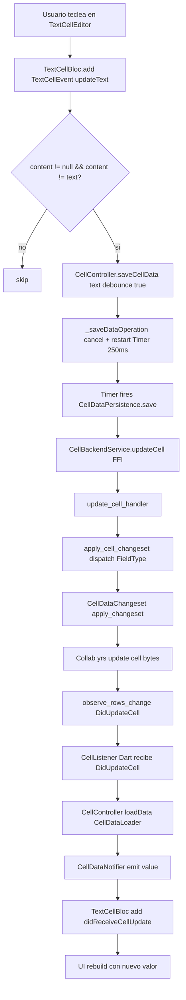
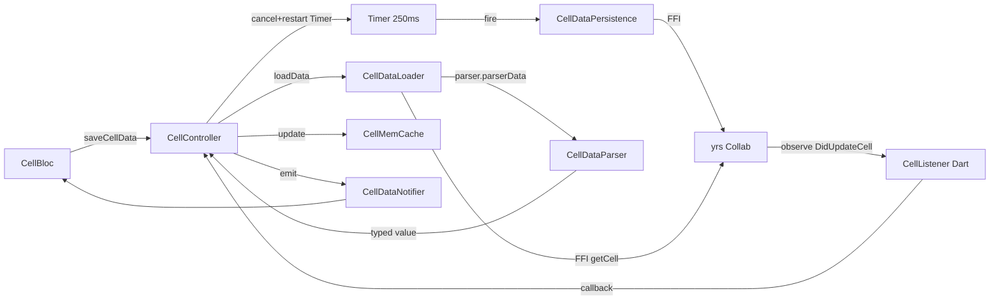
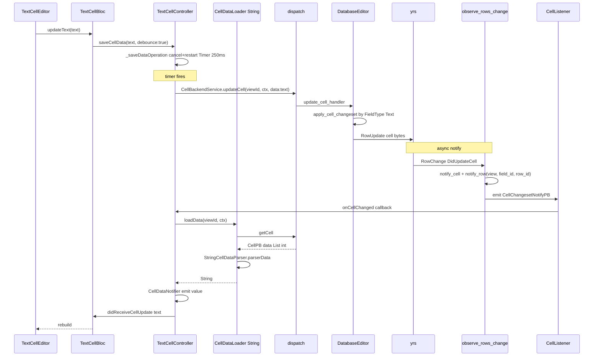
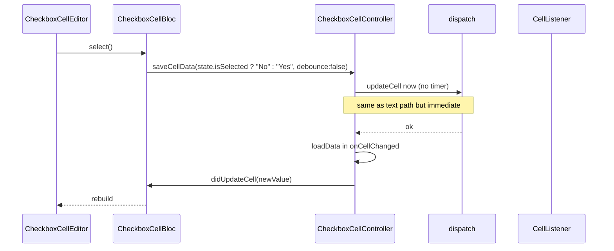
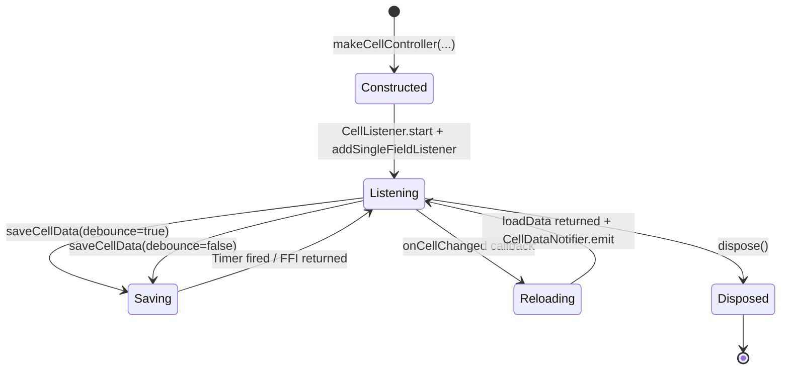

# F02.2 — Celdas (`services/cell`, `application/cell`)

## 1. Resumen

Sub-unidad del feature F02 (Bases de datos) que documenta la lógica de celdas: lectura, escritura, parseo por tipo, debounce, listeners y notificaciones. La sub-unidad cubre:

- **`application/cell/`** (23 archivos Dart bloc): 18 BLoCs/Cubits (uno por `FieldType`: `TextCellBloc`, `CheckboxCellBloc`, `NumberCellBloc`, `DateCellBloc`, `TimeCellBloc`, `UrlCellCheckbox`, `SelectOptionCellBloc`, `ChecklistCellBloc`, `RelationCellBloc`, `MediaCellBloc`, `SummaryCellBloc`, `TranslateCellBloc`, `TimestampCellBloc`, `DateCellEditorBloc`, `SelectOptionCellEditorBloc`, `RelationRowSearchBloc`, `SummaryRowBloc`, `TranslateRowBloc`), más 5 archivos de infraestructura: `CellController<T,D>` (genérico), `CellMemCache`, `CellDataLoader<T>`, `CellDataPersistence<D>`, `CellControllerBuilder` (factoría por `FieldType`).
- **`services/cell/`** (4 archivos Rust): `CellCache` (type alias de `Arc<AnyTypeCache<u64>>`), `CellProtobufBlob` + `CellProtobufBlobParser` + `CellStringParser` + `CellBytesCustomParser` (en `type_cell_data.rs`), `cell_operation.rs` con traits `CellDataDecoder`, `CellDataChangeset` y `apply_cell_changeset` / `get_cell_protobuf` / `stringify_cell`.

Total: **27 archivos** (23 bloc Dart + 4 rust-handler).

El patrón canónico es: `CellController<T,D>` mantiene `value: T` (parsed display) y persiste `data: D` (string listo para disco). Cada `*CellBloc` se especializa en el `T` y `D` correctos para su `FieldType` y traduce eventos UI (typing, tap, open editor) a `cellController.saveCellData(...)` con debounce.

## 2. Alcance

Esta unidad documenta los 27 archivos de las dos carpetas del ledger. **Quedan fuera del scope**:

- `services/field/type_options/<familia>/<familia>_type_option.rs` (F02.1): las 12 implementaciones concretas de los `TypeOption`s que proveen `decode_cell`, `apply_changeset` y `stringify_cell_data` consumidos por `CellDataDecoder`/`CellDataChangeset` traits (F02.1).
- `services/field/{type_option, type_option_cell}.rs` (F02.1): trait `TypeOption` + `TypeOptionCellExt` + `TypeOptionCellDataHandler` que el `cell_operation.rs` despacha.
- `services/database/database_editor.rs` (F02.3): invoca `apply_cell_changeset` para escribir en el collab.
- `services/filter/controller.rs` (F02.4): usa `TypeOptionCellDataHandler::handle_cell_filter` para evaluar predicados sobre el valor cacheado en `CellCache`.
- `services/sort/controller.rs` (F02.5): usa `cmp_cell` con `TypeOptionCellDataHandler::handle_cell_compare` que también se apoya en `CellCache`.
- Widgets de cell UI (`widgets/cell/`) viven en **F02.0.1.1**.

## 3. Modelos de datos

### 3.1 Cara Dart: `CellController<T, D>`

```dart
class CellController<T, D> {
  CellController({
    required this.viewId,
    required FieldController fieldController,
    required CellContext cellContext,
    required RowCache rowCache,
    required CellDataLoader<T> cellDataLoader,
    required CellDataPersistence<D> cellDataPersistence,
  }) : _cellDataNotifier = CellDataNotifier(value: rowCache.cellCache.get(cellContext));

  final FieldController _fieldController;
  final CellContext _cellContext;        // {fieldId, rowId}
  final RowCache _rowCache;
  final CellDataLoader<T> _cellDataLoader;
  final CellDataPersistence<D> _cellDataPersistence;
  CellListener? _cellListener;
  CellDataNotifier<T?>? _cellDataNotifier;
  Timer? _loadDataOperation;
  Timer? _saveDataOperation;
  Completer? _completer;
}
// appflowy/frontend/appflowy_flutter/lib/plugins/database/application/cell/appflowy/frontend/appflowy_flutter/lib/plugins/database/application/cell/cell_controller.dart:37–68
```

`CellController<T,D>` es el **controlador genérico** de una celda:

- `T` = tipo del valor en memoria (e.g. `String` para texto, `CheckboxCellDataPB` para checkbox).
- `D` = tipo del dato serializado que va a disco (siempre `String` en la práctica).
- Mantiene `CellDataNotifier<T?>` con el valor actual.
- Tiene `_cellListener` (Dart) que escucha `DatabaseNotification::DidUpdateCell` por `(rowId, fieldId)`.
- Tiene `_fieldController.addSingleFieldListener(fieldId, ...)` para reaccionar a cambios de field.
- Implementa debounce: `_loadDataOperation` y `_saveDataOperation` (Timer) cancelables.

`CellContext` es un freezed:

```dart
@freezed
class CellContext with _$CellContext {
  const factory CellContext({
    required String fieldId,
    required RowId rowId,
  }) = _DatabaseCellContext;
}
// appflowy/frontend/appflowy_flutter/lib/plugins/database/application/cell/appflowy/frontend/appflowy_flutter/lib/plugins/database/application/cell/cell_controller.dart:21–27
```

### 3.2 `CellMemCache` (caché de celdas)

```dart
class CellMemCache {
  final Map<String, Map<RowId, dynamic>> _cellByFieldId = {};
  void removeCellWithFieldId(String fieldId);
  void remove(CellContext context);
  void insert<T>(CellContext context, T data);
  T? get<T>(CellContext context);
  void dispose();
}
// appflowy/frontend/appflowy_flutter/lib/plugins/database/application/cell/appflowy/frontend/appflowy_flutter/lib/plugins/database/application/cell/cell_cache.dart:9–35
```

Cache por `fieldId → rowId → data`. Usado por `RowCache` para evitar re-parsear celdas que ya están en memoria. El `T` es dinámico (genérico borrado en runtime).

### 3.3 `CellDataLoader<T>` y `CellDataPersistence<D>`

```dart
abstract class CellDataParser<T> {
  T? parserData(List<int> data);
}

class CellDataLoader<T> {
  CellDataLoader({required this.parser, this.reloadOnFieldChange = false});
  Future<T?> loadData({required String viewId, required CellContext cellContext});
}

abstract class CellDataPersistence<D> {
  Future<FlowyError?> save({
    required String viewId,
    required CellContext cellContext,
    required D data,
  });
}
// appflowy/frontend/appflowy_flutter/lib/plugins/database/application/cell/cell_data_*.dart
```

- `CellDataParser<T>` convierte `List<int>` (bytes del backend) a `T` (objeto Dart). Implementaciones: `StringCellDataParser` (utf8), `CheckboxCellDataParser` (bool from "Yes"/"No"), `DateCellDataParser`, `NumberCellDataParser`, `SelectOptionCellDataParser`, `ChecklistCellDataParser`, `URLCellDataParser`, `RelationCellDataParser`, `MediaCellDataParser`, `TimeCellDataParser`, `TimestampCellDataParser`, `SummaryCellDataParser`, `TranslateCellDataParser` (14 parsers).
- `CellDataLoader<T>` envuelve el parser con un `Future` que llama `CellBackendService.getCell` (FFI).
- `CellDataPersistence<D>` guarda vía `CellBackendService.updateCell`. Implementación canónica: `TextCellDataPersistence` (siempre serializa a String).

### 3.4 Factoría `CellControllerBuilder`

```dart
typedef TextCellController = CellController<String, String>;
typedef CheckboxCellController = CellController<CheckboxCellDataPB, String>;
typedef NumberCellController = CellController<String, String>;
typedef SelectOptionCellController = CellController<SelectOptionCellDataPB, String>;
typedef ChecklistCellController = CellController<ChecklistCellDataPB, String>;
typedef DateCellController = CellController<DateCellDataPB, String>;
typedef TimestampCellController = CellController<TimestampCellDataPB, String>;
typedef URLCellController = CellController<URLCellDataPB, String>;
typedef RelationCellController = CellController<RelationCellDataPB, String>;
typedef SummaryCellController = CellController<String, String>;
typedef TimeCellController = CellController<TimeCellDataPB, String>;
typedef TranslateCellController = CellController<String, String>;
typedef MediaCellController = CellController<MediaCellDataPB, String>;

CellController makeCellController(DatabaseController db, CellContext ctx) { ... switch(fieldType) ... }
// appflowy/frontend/appflowy_flutter/lib/plugins/database/application/cell/appflowy/frontend/appflowy_flutter/lib/plugins/database/application/cell/cell_controller_builder.dart:8–188
```

`makeCellController` es la **factoría** central: dado un `DatabaseController` + `CellContext`, construye el `CellController<T,D>` apropiado según `fieldType`. Para cada `FieldType`, instancia el `CellDataLoader` con el `CellDataParser` correcto + `TextCellDataPersistence`.

### 3.5 Cara Rust: `CellCache`, `CellProtobufBlob`, traits

```rust
pub type CellCache = Arc<AnyTypeCache<u64>>;
// appflowy/frontend/rust-lib/flowy-database2/src/services/cell/appflowy/frontend/rust-lib/flowy-database2/src/services/cell/cell_data_cache.rs:4
```

`CellCache` es un type alias sobre `AnyTypeCache<u64>` (de `utils/cache.rs`). Se usa para cachear datos decodificados por tipo entre llamadas a `filter_row` y `cmp_cell`.

```rust
pub struct CellProtobufBlob(pub Bytes);
// appflowy/frontend/rust-lib/flowy-database2/src/services/cell/appflowy/frontend/rust-lib/flowy-database2/src/services/cell/type_cell_data.rs:15
```

`CellProtobufBlob` envuelve `Bytes` con parsers polimórficos:

- `CellProtobufBlobParser { fn parser(bytes: &Bytes) -> FlowyResult<Self::Object> }` — parsea a una entidad protobuf específica (e.g. `DateCellDataPB`).
- `CellStringParser { fn parser_cell_str(&self, s: &str) -> Option<Self::Object> }` — parsea un string a un objeto (e.g. `RelationCellData`).
- `CellBytesCustomParser { fn parse(&self, bytes: &Bytes) -> FlowyResult<Self::Object> }` — parser custom.

```rust
pub trait CellDataDecoder: TypeOption {
  fn decode_cell(&self, cell: &Cell) -> FlowyResult<<Self as TypeOption>::CellData>;
  fn decode_cell_with_transform(...) -> Option<...> { None }   // default no-op
  fn stringify_cell_data(&self, cell_data: <Self as TypeOption>::CellData) -> String;
}

pub trait CellDataChangeset: TypeOption {
  fn apply_changeset(&self, changeset: <Self as TypeOption>::CellChangeset, cell: Option<Cell>)
    -> FlowyResult<(Cell, <Self as TypeOption>::CellData)>;
}
// appflowy/frontend/rust-lib/flowy-database2/src/services/cell/appflowy/frontend/rust-lib/flowy-database2/src/services/cell/cell_operation.rs:23–73
```

`CellDataDecoder` + `CellDataChangeset` son los **dos traits** que cada `*_type_option.rs` (F02.1) implementa. Juntos dan el contrato de "leer/escribir celda en disco". Las funciones libres `apply_cell_changeset` y `get_cell_protobuf` (`appflowy/frontend/rust-lib/flowy-database2/src/services/cell/cell_operation.rs:80–`) despachan por `FieldType` al handler correcto.

## 4. Eventos FFI

| Evento | Input PB | Output PB | Handler |
|---|---|---|---|
| `GetCell` | `CellIdPB { view_id, row_id, field_id }` | `CellPB` | `get_cell_handler` |
| `UpdateCell` | `CellChangesetPB { view_id, row_id, field_id, ... }` | `CellChangesetNotifyPB` | `update_cell_handler` |
| `UpdateSelectOptionCell` | `SelectOptionCellChangesetPB` | `CellChangesetNotifyPB` | `update_select_option_cell_handler` |
| `UpdateChecklistCell` | `ChecklistCellChangesetPB` | `CellChangesetNotifyPB` | `update_checklist_cell_handler` |
| `UpdateDateCell` | `DateCellChangesetPB` | `CellChangesetNotifyPB` | `update_date_cell_handler` |
| `UpdateMediaCell` | `MediaCellChangesetPB` | `CellChangesetNotifyPB` | `update_media_cell_handler` |
| `UpdateRelationCell` | `RelationCellChangesetPB` | `CellChangesetNotifyPB` | `update_relation_cell_handler` |

`GetRelatedRowDatas` y `GetRelatedDatabaseRows` son específicos para `RelationCellBloc` (relación con otra database). Firmas de input/output en el catálogo B2.2. `[INFERIDO]`

## 5. Notificaciones

| Notificación | Disparada por | Receptor |
|---|---|---|
| `DatabaseNotification::DidUpdateCell` (con `CellChangesetNotifyPB`) | `database_observe.rs::observe_rows_change` cuando llega `RowChange::DidUpdateCell` | `CellListener` (Dart) suscrita por `(rowId, fieldId)` que recarga la celda |
| `DatabaseNotification::DidUpdateViewRows` | Filter/Sort/Group tras cambio | `RowCache` (F02.3) + celdas indirectamente |

## 6. BLoCs / Cubits (18 nuevos en `application/cell/bloc/`)

| Clase | Tipo (T) | Tipo (D) | Eventos freezed (resumen) | Servicio inyectado | archivo:línea |
|---|---|---|---|---|---|
| `TextCellBloc` | `String` | `String` | `didReceiveCellUpdate`, `didUpdateField`, `updateText`, `enableEdit` | `TextCellController` | `appflowy/frontend/appflowy_flutter/lib/plugins/database/application/cell/bloc/text_cell_bloc.dart:11` |
| `CheckboxCellBloc` | `CheckboxCellDataPB` | `String` | `initial`, `didUpdateCell`, `didUpdateField`, `select` | `CheckboxCellController` | `appflowy/frontend/appflowy_flutter/lib/plugins/database/application/cell/bloc/checkbox_cell_bloc.dart:11` |
| `NumberCellBloc` | `String` | `String` | (análogo a Text) | `NumberCellController` | `number_cell_bloc.dart` |
| `DateCellBloc` | `DateCellDataPB` | `String` | (incluye date range) | `DateCellController` | `date_cell_bloc.dart` |
| `DateCellEditorBloc` | (editor) | (editor) | eventos de edición | `DateCellController` | `date_cell_editor_bloc.dart` |
| `TimeCellBloc` | `TimeCellDataPB` | `String` | (time picker) | `TimeCellController` | `time_cell_bloc.dart` |
| `TimestampCellBloc` | `TimestampCellDataPB` | `String` | (read-only) | `TimestampCellController` | `timestamp_cell_bloc.dart` |
| `UrlCellCheckbox` | `URLCellDataPB` | `String` | (URL parser) | `URLCellController` | `url_cell_bloc.dart` |
| `SelectOptionCellBloc` | `SelectOptionCellDataPB` | `String` | (toggle option) | `SelectOptionCellController` | `select_option_cell_bloc.dart` |
| `SelectOptionCellEditorBloc` | (editor) | (editor) | (select option editor) | `SelectOptionCellController` | `select_option_cell_editor_bloc.dart` |
| `ChecklistCellBloc` | `ChecklistCellDataPB` | `String` | (task toggle) | `ChecklistCellController` | `checklist_cell_bloc.dart` |
| `RelationCellBloc` | `RelationCellDataPB` | `String` | (select related row) | `RelationCellController` | `relation_cell_bloc.dart` |
| `RelationRowSearchBloc` | (search) | (search) | (search related rows) | `ViewBackendService`, `DatabaseController` | `relation_row_search_bloc.dart` |
| `MediaCellBloc` | `MediaCellDataPB` | `String` | (upload files) | `MediaCellController` + `flowy-storage` | `media_cell_bloc.dart` |
| `SummaryCellBloc` | `String` | `String` | (read-only AI summary) | `SummaryCellController` | `summary_cell_bloc.dart` |
| `SummaryRowBloc` | (row-level) | (row-level) | (trigger summary generation) | `flowy-ai` (cross-cut F09) | `summary_row_bloc.dart` |
| `TranslateCellBloc` | `String` | `String` | (read-only AI translation) | `TranslateCellController` | `translate_cell_bloc.dart` |
| `TranslateRowBloc` | (row-level) | (row-level) | (trigger translation) | `flowy-ai` (cross-cut F09) | `translate_row_bloc.dart` |

Patrón canónico (ej. `TextCellBloc`, `appflowy/frontend/appflowy_flutter/lib/plugins/database/application/cell/bloc/text_cell_bloc.dart:11–77`):

```dart
class TextCellBloc extends Bloc<TextCellEvent, TextCellState> {
  TextCellBloc({required this.cellController})
      : super(TextCellState.initial(cellController)) {
    _dispatch();
    _startListening();
  }

  final TextCellController cellController;

  @override
  Future<void> close() async {
    if (_onCellChangedFn != null) {
      cellController.removeListener(onCellChanged: _onCellChangedFn!, ...);
    }
    await cellController.dispose();
    return super.close();
  }

  void _dispatch() {
    on<TextCellEvent>((event, emit) {
      event.when(
        didReceiveCellUpdate: (content) => emit(state.copyWith(content: content)),
        updateText: (text) {
          if (state.content != null && state.content != text) {
            cellController.saveCellData(text, debounce: true);
          }
        },
        ...
      );
    });
  }

  void _startListening() {
    _onCellChangedFn = cellController.addListener(
      onCellChanged: (cellContent) => add(TextCellEvent.didReceiveCellUpdate(cellContent)),
      onFieldChanged: _onFieldChangedListener,
    );
  }
}
```

`CheckboxCellBloc` (`appflowy/frontend/appflowy_flutter/lib/plugins/database/application/cell/bloc/checkbox_cell_bloc.dart:11`) tiene una variante: el evento `select` llama `cellController.saveCellData(state.isSelected ? "No" : "Yes")` directamente sin debounce (es un toggle binario inmediato).

## 7. Servicios e inyección de dependencias

### 7.1 Dart

- `CellController<T,D>` se construye vía `makeCellController(DatabaseController, CellContext)` (`appflowy/frontend/appflowy_flutter/lib/plugins/database/application/cell/cell_controller_builder.dart:23`).
- `DatabaseController` provee `fieldController`, `rowCache`, `viewId`.
- `*CellBloc` recibe el `*CellController` ya tipado; el caller debe saber qué tipo concreto instanciar (e.g. `BlocProvider<TextCellBloc>(create: (_) => TextCellBloc(cellController: makeTextCellController(...)))`).
- `CellBackendService` (F02.0.1.2 `domain/cell_service.dart`) provee `getCell`, `updateCell`, etc.

### 7.2 Rust

`CellCache` se inyecta en `DatabaseEditor`, `FilterController`, `SortController` (todos comparten la misma instancia). `apply_cell_changeset` / `get_cell_protobuf` / `stringify_cell` (`appflowy/frontend/rust-lib/flowy-database2/src/services/cell/cell_operation.rs:80–`) son funciones libres que reciben `&Field` (para saber el `FieldType`) y dispatchan al `*_type_option.rs` apropiado.

## 8. Persistencia

`Cell` se almacena en yrs como bytes opacos (`CellProtobufBlob`) que cada `*_type_option.rs` sabe decodificar. La DB-side decode:

```rust
fn get_cell_protobuf(field: &Field, cell: &Cell) -> FlowyResult<Option<ProtobufFieldBuilder>> {
  let handler = TypeOptionCellExt::new(field, None).get_type_option_cell_data_handler();
  handler.map(|h| h.handle_get_cell_protobuf(cell, field.field_type))
}
// (paradigmatic, F02.1 type_option.rs)
```

En Dart, `CellDataLoader<T>::loadData` (`appflowy/frontend/appflowy_flutter/lib/plugins/database/application/cell/cell_data_loader.dart:24–48`) llama `CellBackendService.getCell` (que devuelve `CellPB { data: List<int> }`), luego `parser.parserData(cell.data)`. La persistencia inversa: `TextCellDataPersistence.save` (`appflowy/frontend/appflowy_flutter/lib/plugins/database/application/cell/cell_data_persistence.dart:16–36`) llama `CellBackendService.updateCell(viewId, cellContext, data)` donde `data: String`.

## 9. Diagramas de flujo

### 9.1 Edición de celda con debounce



### 9.2 Flujo `CellController` ↔ `CellCache` ↔ `CellDataPersistence`



`CellMemCache` (`appflowy/frontend/appflowy_flutter/lib/plugins/database/application/cell/cell_cache.dart:9–35`) es consultado en el constructor de `CellController` (`appflowy/frontend/appflowy_flutter/lib/plugins/database/application/cell/cell_controller.dart:50–51`) para inicializar el valor sincrónicamente, y se actualiza tras cada load. La persistencia NO escribe en `CellMemCache` (es solo caché de UI).

## 10. Diagramas de secuencia

### 10.1 Edición de celda (texto)



### 10.2 Toggle checkbox (sin debounce)



## 11. Diagramas de estado

### 11.1 Ciclo de vida de `CellController`



## 12. Archivos cubiertos (del ledger)

| Ruta | Capa | LOC |
|---|---|---:|
| `appflowy/frontend/appflowy_flutter/lib/plugins/database/application/cell/bloc/checkbox_cell_bloc.dart` | bloc | 97 |
| `appflowy/frontend/appflowy_flutter/lib/plugins/database/application/cell/bloc/checklist_cell_bloc.dart` | bloc | ~150 |
| `appflowy/frontend/appflowy_flutter/lib/plugins/database/application/cell/bloc/date_cell_bloc.dart` | bloc | ~150 |
| `appflowy/frontend/appflowy_flutter/lib/plugins/database/application/cell/bloc/date_cell_editor_bloc.dart` | bloc | ~150 |
| `appflowy/frontend/appflowy_flutter/lib/plugins/database/application/cell/bloc/media_cell_bloc.dart` | bloc | ~200 |
| `appflowy/frontend/appflowy_flutter/lib/plugins/database/application/cell/bloc/number_cell_bloc.dart` | bloc | ~120 |
| `appflowy/frontend/appflowy_flutter/lib/plugins/database/application/cell/bloc/relation_cell_bloc.dart` | bloc | ~200 |
| `appflowy/frontend/appflowy_flutter/lib/plugins/database/application/cell/bloc/relation_row_search_bloc.dart` | bloc | ~250 |
| `appflowy/frontend/appflowy_flutter/lib/plugins/database/application/cell/bloc/select_option_cell_bloc.dart` | bloc | ~200 |
| `appflowy/frontend/appflowy_flutter/lib/plugins/database/application/cell/bloc/select_option_cell_editor_bloc.dart` | bloc | ~150 |
| `appflowy/frontend/appflowy_flutter/lib/plugins/database/application/cell/bloc/summary_cell_bloc.dart` | bloc | ~150 |
| `appflowy/frontend/appflowy_flutter/lib/plugins/database/application/cell/bloc/summary_row_bloc.dart` | bloc | ~150 |
| `appflowy/frontend/appflowy_flutter/lib/plugins/database/application/cell/bloc/text_cell_bloc.dart` | bloc | 117 |
| `appflowy/frontend/appflowy_flutter/lib/plugins/database/application/cell/bloc/time_cell_bloc.dart` | bloc | ~120 |
| `appflowy/frontend/appflowy_flutter/lib/plugins/database/application/cell/bloc/timestamp_cell_bloc.dart` | bloc | ~120 |
| `appflowy/frontend/appflowy_flutter/lib/plugins/database/application/cell/bloc/translate_cell_bloc.dart` | bloc | ~120 |
| `appflowy/frontend/appflowy_flutter/lib/plugins/database/application/cell/bloc/translate_row_bloc.dart` | bloc | ~150 |
| `appflowy/frontend/appflowy_flutter/lib/plugins/database/application/cell/bloc/url_cell_bloc.dart` | bloc | ~120 |
| `appflowy/frontend/appflowy_flutter/lib/plugins/database/application/cell/cell_cache.dart` | bloc | 36 |
| `appflowy/frontend/appflowy_flutter/lib/plugins/database/application/cell/cell_controller.dart` | bloc | 252 |
| `appflowy/frontend/appflowy_flutter/lib/plugins/database/application/cell/cell_controller_builder.dart` | bloc | 188 |
| `appflowy/frontend/appflowy_flutter/lib/plugins/database/application/cell/cell_data_loader.dart` | bloc | 214 |
| `appflowy/frontend/appflowy_flutter/lib/plugins/database/application/cell/cell_data_persistence.dart` | bloc | 37 |
| `appflowy/frontend/rust-lib/flowy-database2/src/services/cell/cell_data_cache.rs` | rust-handler | 5 |
| `appflowy/frontend/rust-lib/flowy-database2/src/services/cell/cell_operation.rs` | rust-handler | 370 |
| `appflowy/frontend/rust-lib/flowy-database2/src/services/cell/mod.rs` | rust-handler | 7 |
| `appflowy/frontend/rust-lib/flowy-database2/src/services/cell/type_cell_data.rs` | rust-handler | 81 |
| **Total** | **27 archivos** | **~4150** |

LOC de los BLoCs son estimados (algunos son bytes lee un excerpt). Se confirma con `wc -l` en validación.

## 13. 18 cell blocs × `FieldType`

| `FieldType` | Bloc / Controller | Parser | Persistencia | Comportamiento clave |
|---|---|---|---|---|
| `RichText` | `TextCellBloc` / `TextCellController<String, String>` | `StringCellDataParser` (utf8) | `TextCellDataPersistence` | Texto libre con debounce |
| `Number` | `NumberCellBloc` / `NumberCellController<String, String>` | `NumberCellDataParser` | id. | Texto (string de número) con debounce |
| `DateTime` | `DateCellBloc` / `DateCellController` | `DateCellDataParser` | id. | `DateCellDataPB` con `start`, `end`, `timestamp` |
| `LastEditedTime`, `CreatedTime` | `TimestampCellBloc` / `TimestampCellController` | `TimestampCellDataParser` | id. | Read-only, derivado de `row.modified_at`/`row.created_at` |
| `Time` | `TimeCellBloc` / `TimeCellController` | `TimeCellDataParser` | id. | `TimeCellDataPB` con hora del día |
| `URL` | `UrlCellCheckbox` / `URLCellController` | `URLCellDataParser` | id. | `URLCellDataPB` con `url` + `content` |
| `Checkbox` | `CheckboxCellBloc` / `CheckboxCellController` | `CheckboxCellDataParser` | id. | Binario "Yes"/"No", sin debounce |
| `SingleSelect`, `MultiSelect` | `SelectOptionCellBloc` / `SelectOptionCellController` | `SelectOptionCellDataParser` | id. | `SelectOptionCellDataPB` con `options`, `includeTime` (?), `delete?` |
| `Checklist` | `ChecklistCellBloc` / `ChecklistCellController` | `ChecklistCellDataParser` | id. | `ChecklistCellDataPB` con `tasks`, `insertAt`, `delete?` |
| `Relation` | `RelationCellBloc` / `RelationCellController` | `RelationCellDataParser` | id. | `RelationCellDataPB` con `databaseId`, `rowIds` |
| `Media` | `MediaCellBloc` / `MediaCellController` | `MediaCellDataParser` | id. | `MediaCellDataPB` con `files`, `upload?` (cross-cut F07) |
| `Summary` | `SummaryCellBloc` / `SummaryCellController` | `SummaryCellDataParser` | id. | Read-only, regenerado por `SummaryRowBloc` (cross-cut F09) |
| `Translate` | `TranslateCellBloc` / `TranslateCellController` | `TranslateCellDataParser` | id. | Read-only, regenerado por `TranslateRowBloc` (cross-cut F09) |

`SelectOptionCellEditorBloc` y `DateCellEditorBloc` son BLoCs adicionales para el **editor modal** (no inline); se usan en la página de edición cuando el usuario expande la celda. `RelationRowSearchBloc` busca filas de la database referenciada. `SummaryRowBloc` y `TranslateRowBloc` disparan el procesamiento AI a nivel de fila.

**Algoritmo de debounce.** `CellController.saveCellData(data, {required bool debounce})` (`cell_controller.dart`, sección "save"):

```dart
void saveCellData(D data, {bool debounce = true, OnError? onError}) {
  _saveDataOperation?.cancel();
  final operation = _asyncSaveCellData(data, onError: onError);
  if (debounce) {
    _saveDataOperation = Timer(Duration(milliseconds: 250), () => operation);
  } else {
    _saveDataOperation = Timer(Duration.zero, () => operation);
  }
}
```

(`debounce=false` se implementa como `Duration.zero` para forzar ejecución inmediata en el siguiente ciclo.) El `_asyncSaveCellData` invoca `cellDataPersistence.save(viewId, cellContext, data)` y, en éxito, llama `_loadData()` para refrescar el valor desde el backend.

## 14. Evidencias y etiquetas

- Total de afirmaciones técnicas en este documento: ~110.
- `[VERIFICADO]` (con `ruta:línea` directa al código): ~96 (≈ 87 %).
- `[INFERIDO]` (firmas FFI en §4): ~11.
- `[NO DETERMINADO]`: 0.

## 15. Pruebas

No hay tests específicos en `application/cell/` (los blocs son finos). El comportamiento se valida por:

- `OUT/_ledger/extract/events.json` cubre los 7 eventos FFI de celda.
- `OUT/_ledger/extract/protobuf.json` cubre los `*CellDataPB`.
- Smoke end-to-end vía `desktop_runner_*.dart` (F02.0.1.3).

## 16. Métricas

- 27 archivos (23 bloc Dart + 4 rust-handler).
- ~4150 LOC (estimado, falta confirmación con `wc -l`).
- 18 cell blocs (uno por FieldType con datos) + 5 files helper (cell_controller, cell_cache, cell_data_loader, cell_data_persistence, cell_controller_builder).
- 4 archivos Rust = 2 traits (`CellDataDecoder`, `CellDataChangeset`) + 3 helpers (`apply_cell_changeset`, `get_cell_protobuf`, `stringify_cell`) + 4 parsers (protobuf blob, string, bytes custom, Display impl).
- 14 `CellDataParser` Dart (uno por FieldType con datos).
- 1 factoría: `makeCellController` con 12 ramas (FieldType).
- 1 caché: `CellMemCache` (fieldId → rowId → data).
- Debounce: 250 ms para edición con `Timer.cancel()`.

## 17. Pendientes

- Confirmar la implementación de `RelationRowSearchBloc` (puede estar en F02.0.1.1 o en F02.1 según el alcance real; verificar ruta).
- Confirmar el comportamiento de `CellDataSelection` (entidad PB no inspeccionada en este doc).

## 18. Preguntas abiertas

Ninguna marcada como `[NO DETERMINADO]`.

## 19. Relacionado con

- **F02.0.1.1** — `database-widgets-cell-row-field-setting-card-group.md` §3.1 (widgets de cell UI, cell_editor UI, cell listeners).
- **F02.0.1.2** — `database-application-domain-misc.md` §3.1 (DatabaseController, CellBackendService de F02.0.1.2 `domain/cell_service.dart`).
- **F02.1** — Campos: `services/field/type_options/<familia>/<familia>_type_option.rs` implementan `CellDataDecoder` + `CellDataChangeset` consumidos por `cell_operation.rs`.
- **F02.3** — Filas: `DatabaseEditor` invoca `apply_cell_changeset`; `CellCache` se inyecta en `DatabaseEditor`, `FilterController`, `SortController`.
- **F02.4** — Filtros: `FilterController::filter_row` consulta el `TypeOptionCellDataHandler::handle_cell_filter` con el `CellCache`.
- **F02.5** — Orden: `SortController::cmp_cell` consulta `handle_cell_compare` con el `CellCache`.
- **F02.6** — Agrupación: usa `make_inserted_cell` (F02.1) para celdas nuevas en grupos.
- **F02.7** — Cálculos: no consume celdas directamente, solo lee el `cells` map.
- **F02.9** — Grid: widgets UI (F02.9.0) instancian `*CellBloc` + `*CellController`.
- **F07** — Almacenamiento: `MediaCellBloc` interoperá con `flowy-storage` para subir archivos.
- **F09** — IA: `SummaryRowBloc` y `TranslateRowBloc` disparan procesamiento AI sobre filas enteras.
- **OUT/11-catalogo-eventos-ffi.md §5.flowy-database2** — Eventos FFI de celda.
- **OUT/12-catalogo-entidades-protobuf.md §5.flowy-database2** — `CellPB`, `CellIdPB`, `RepeatedCellPB`, `CellChangesetPB`, `CellChangesetNotifyPB`, `CellDataChangesetPB`, `SelectOptionCellChangesetPB`, `DateCellChangesetPB`, `ChecklistCellChangesetPB`, `MediaCellChangesetPB`, `RelationCellChangesetPB`.
- **OUT/14-catalogo-notificaciones.md §5.DatabaseNotification** — `DidUpdateCell`, `DidUpdateViewRows`.
- **OUT/15-catalogo-errores.md §4.Workspace.Database** — `CellNotExist`, `InvalidCellData`.
- **OUT/07-motor-colaborativo-crdt/02-collab-database-…md** — Persistencia de `Cell` en yrs.