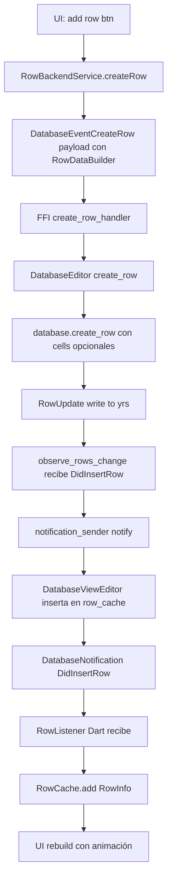
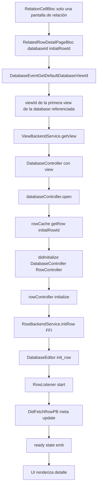
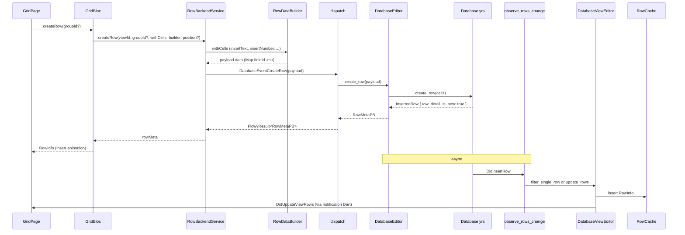
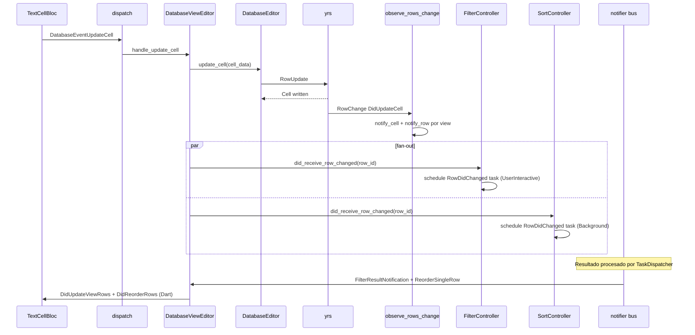
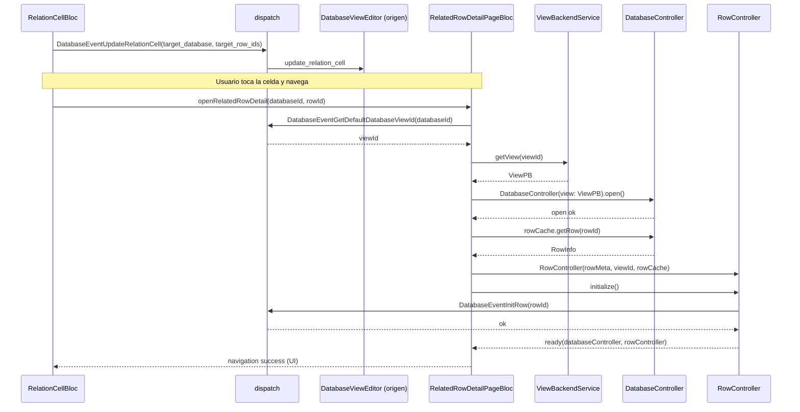
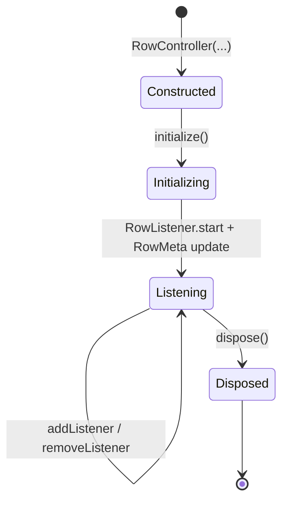
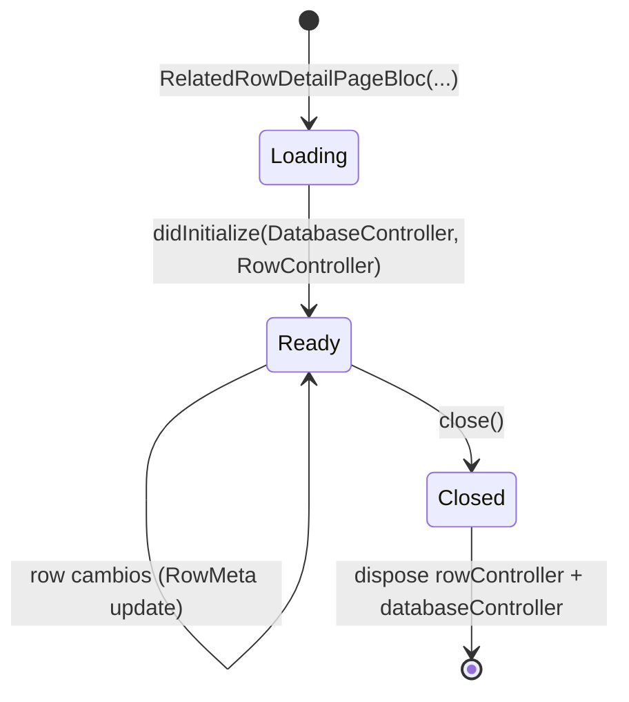

# F02.3 — Filas y row detail (`application/row`), relaciones

## 1. Resumen

Sub-unidad del feature F02 (Bases de datos) que documenta la creación, edición, observación y detalle de filas en una vista de base de datos. La sub-unidad cubre dos caras:

- **`application/row/`** (6 archivos Dart bloc): `RowController` (gestión de ciclo de vida de una fila individual: init → listeners → dispose), `RowCache` (almacén en memoria de `RowInfo` + `CellMemCache` + visibilidad), `RowList` (orden de filas + inserción/eliminación por id/índice), `RowBackendService` (cliente FFI: `CreateRow`, `InitRow`, `GetRowMeta`, `UpdateRowMeta`, `DeleteRows`, `DuplicateRow`), `RowBannerBloc` (banner de fila: cover, icono, campo primario), `RelatedRowDetailPageBloc` (página de detalle de una fila referenciada por otra database, base del sistema de **relaciones** entre databases).
- **`services/database/`** (5 archivos Rust): `DatabaseEditor` (orquestador de filas + sort/filter/group + CSV export), `database_observe.rs` (3 sub-suscripciones: `sync_state`, `row_change`, `field_change`), `entities.rs` (`DatabaseRowEvent`, `InsertedRow`, `UpdatedRow`), `util.rs` (conversión `DatabaseView` → `DatabaseViewSettingPB` con filtros/sorts/groups), `mod.rs` (re-exports).

Total: **11 archivos** (6 bloc Dart + 5 rust-handler). Las **relaciones entre filas** (RelationTypeOption) usan `RelatedRowDetailPageBloc` para abrir la database referenciada.

## 2. Alcance

Esta unidad documenta los 11 archivos de las dos carpetas del ledger. **Quedan fuera del scope**:

- `services/cell/` (F02.2): `CellController` (usado por `RowController` indirectamente via `_rowCache.cellCache`).
- `services/field/` (F02.1): `FieldController` (usado por `RowBannerBloc` para resolver el campo primario).
- `services/sort/`, `services/filter/`, `services/group/` (F02.5, F02.4, F02.6): servicios del view-editor que filtran/ordenan/agrupan filas; orquestados desde `DatabaseEditor`.
- `services/database_view/` (F02.8): `DatabaseViewEditor` que mantiene el `EditorByViewId` y `DatabaseViews`; los eventos de fila llegan al `DatabaseEditor` y se reenvían al `DatabaseViewEditor` por `view_id`.
- `services/share/csv/` (F02.8): exportación CSV (referenciada por `database_editor.rs`).
- `services/share/import.rs` (F03 / F04): importación de filas.
- Widgets de row UI (`row.dart`, `row_banner.dart`, `related_row_detail/`) viven en **F02.0.1.1** (widgets de row) y **F02.9.2** (row detail grid).
- `collab-database/src/rows/` y `collab-database/src/blocks/` (F02.0.2.1) — el modelo `Row`, `RowDetail`, `RowCell` del lado yrs.

## 3. Modelos de datos

### 3.1 Cara Dart

```dart
typedef RowId = String;
// appflowy/frontend/appflowy_flutter/lib/plugins/database/application/row/appflowy/frontend/appflowy_flutter/lib/plugins/database/application/row/row_service.dart:8
```

`RowId` es un typedef sobre `String`. `RowInfo` (entidad freezed en `row_cache.dart`) contiene `rowMeta: RowMetaPB` + `rowIconNotifier` + `rowDocumentNotifier` + flags de visibilidad. `RowMetaPB` es la entidad protobuf canónica (`OUT/12-catalogo-entidades-protobuf.md §5.flowy-database2`).

```dart
class RowController {
  RowController({
    required RowMetaPB rowMeta,
    required this.viewId,
    required RowCache rowCache,
    this.groupId,
  });
}
// appflowy/frontend/appflowy_flutter/lib/plugins/database/application/row/appflowy/frontend/appflowy_flutter/lib/plugins/database/application/row/row_controller.dart:14–24
```

`RowController` es el **controlador del lado aplicación** de una sola fila: mantiene `_rowMeta`, `_rowCache`, `_rowListener` (RowListener de F02.0.1.2), `_rowBackendSvc` y una lista de listeners (`_onRowChangedListeners`, `_onRowMetaChanged`). El método clave es `initialize()` (`appflowy/frontend/appflowy_flutter/lib/plugins/database/application/row/row_controller.dart:44–78`) que llama `initRow` (FFI) y arranca el `RowListener` para recibir `DidFetchRowPB` y cambios de meta.

### 3.2 `RowCache` (caché en memoria)

```dart
class RowCache {
  RowCache({
    required this.viewId,
    required RowFieldsDelegate fieldsDelegate,
    required RowLifeCycle rowLifeCycle,
  })  : _cellMemCache = CellMemCache(),
        _changedNotifier = RowChangesetNotifier(),
        ...
}
// appflowy/frontend/appflowy_flutter/lib/plugins/database/application/row/appflowy/frontend/appflowy_flutter/lib/plugins/database/application/row/row_cache.dart:33–51
```

`RowCache` agrega:

- `RowList _rowList` (orden de filas + acceso por id).
- `CellMemCache _cellMemCache` (F02.2): caché por `fieldId` × `rowId`.
- `RowChangesetNotifier _changedNotifier` (freezed) con `ChangedReason` (initialList, fieldDidChange, insertRows, deleteRows, reorderRows, visibility).
- `_pendingVisibilityChanges: List<RowsVisibilityChangePB>` (cambios de visibilidad aplicados tras init).

Patrón: cuando un campo se borra, `_cellMemCache.removeCellWithFieldId(fieldInfo.id)` se ejecuta (`appflowy/frontend/appflowy_flutter/lib/plugins/database/application/row/row_cache.dart:44–50`). El `RowFieldsDelegate` (interfaz) provee `fieldInfos` + callback `onFieldsChanged`.

### 3.3 `RowList` (orden de filas)

```dart
class RowList {
  List<RowInfo> _rowInfos = [];
  const HashMap<RowId, RowInfo> rowInfoByRowId = HashMap();
  // appflowy/frontend/appflowy_flutter/lib/plugins/database/application/row/appflowy/frontend/appflowy_flutter/lib/plugins/database/application/row/row_list.dart:9–17
}
```

`RowList` mantiene dos vistas paralelas (lista ordenada por índice + mapa por id). API: `get(rowId)`, `indexOfRow(rowId)`, `add`, `insert(index, rowInfo)`, `remove(rowId)`, `insertRows(insertedRows, builder)`, `deleteRows(deletedRows)`, `reorderRows(orders)`. La operación clave es `insertRows` (`appflowy/frontend/appflowy_flutter/lib/plugins/database/application/row/row_list.dart:76–`) que devuelve `InsertedIndexs` con `(index, rowId)` para que la UI aplique animaciones.

### 3.4 Cara Rust: `DatabaseEditor`

```rust
pub struct DatabaseEditor {
  database_id: Uuid,
  pub(crate) database: Arc<RwLock<Database>>,
  pub cell_cache: CellCache,
  pub(crate) database_views: Arc<DatabaseViews>,
  ...
  finalized_rows: Arc<moka::future::Cache<String, Weak<RwLock<DatabaseRow>>>>,
}
// appflowy/frontend/rust-lib/flowy-database2/src/services/database/appflowy/frontend/rust-lib/flowy-database2/src/services/database/database_editor.rs:61–75
```

`DatabaseEditor` es el **punto central** del lado Rust para una database:

- Mantiene el collab `Database` (de `collab-database`).
- `database_views: Arc<DatabaseViews>` (F02.8) que mapea `view_id → DatabaseViewEditor`.
- `cell_cache` (F02.2) compartido.
- `finalized_rows: moka::future::Cache` (capacity 50, eviction listener async) — caché de filas "finalizadas" (con todos los datos cargados).

### 3.5 Eventos de fila (`DatabaseRowEvent`)

```rust
pub enum DatabaseRowEvent {
  InsertRow(InsertedRow),
  UpdateRow(UpdatedRow),
  DeleteRow(RowId),
  Move { deleted_row_id: RowId, inserted_row: InsertedRow },
}

pub struct InsertedRow {
  pub row_detail: RowDetail,
  pub index: Option<i32>,
  pub is_new: bool,
}

pub struct UpdatedRow {
  pub row_id: String,
  pub height: Option<i32>,
  pub field_ids: Vec<String>,   // celdas actualizadas
  pub row_detail: Option<RowDetail>,
}
// appflowy/frontend/rust-lib/flowy-database2/src/services/database/appflowy/frontend/rust-lib/flowy-database2/src/services/database/entities.rs:4–58
```

Estos eventos son **internos** (Rust→Rust), no cruzan el FFI. Se producen desde `database_editor.rs` y los consume `DatabaseViewEditor` (F02.8) para emitir las notificaciones FFI finales.

### 3.6 `util.rs` — `database_view_setting_pb_from_view`

```rust
pub(crate) fn database_view_setting_pb_from_view(view: DatabaseView) -> DatabaseViewSettingPB
// appflowy/frontend/rust-lib/flowy-database2/src/services/database/appflowy/frontend/rust-lib/flowy-database2/src/services/database/util.rs:13
```

Convierte una `DatabaseView` (de yrs) a la entidad protobuf `DatabaseViewSettingPB` consumida por Dart. Mapea:

- `view.layout` → `DatabaseLayoutPB` + `DatabaseLayoutSettingPB` (board/calendar específicos).
- `view.filters` → `Vec<FilterPB>` (vía `Filter::try_from`).
- `view.group_settings` → `Vec<GroupSettingPB>`.
- `view.sorts` → `Vec<SortPB>`.
- `view.field_settings.get_inner()` → `Vec<FieldSettingsPB>` (por layout).

## 4. Eventos FFI

| Evento | Input PB | Output PB | Handler |
|---|---|---|---|
| `CreateRow` | `CreateRowPayloadPB { view_id, group_id?, data, row_position }` | `RowMetaPB` | `create_row_handler` |
| `InitRow` | `DatabaseViewRowIdPB { view_id, row_id }` | (vacío) | `init_row_handler` |
| `GetRow` | `DatabaseViewRowIdPB` | `RowPB` | `get_row_handler` |
| `GetRowMeta` | `DatabaseViewRowIdPB` | `RowMetaPB` | `get_row_meta_handler` |
| `UpdateRowMeta` | `UpdateRowMetaChangesetPB { view_id, id, icon_url?, cover?, is_document_empty? }` | (vacío) | `update_row_meta_handler` |
| `RemoveCover` | `RemoveCoverPayloadPB { view_id, row_id }` | (vacío) | `remove_cover_handler` |
| `DeleteRows` | `RepeatedRowIdPB { view_id, row_ids }` | (vacío) | `delete_rows_handler` |
| `DuplicateRow` | `DatabaseViewRowIdPB` | `RowMetaPB` | `duplicate_row_handler` |
| `GetAllRows` | `GetDatabaseViewRowsPB` | `RepeatedRowMetaPB` | `get_all_rows_handler` |
| `MoveRow` | `MoveRowPayloadPB` | (vacío) | `move_row_handler` |

`CreateRow` permite opcionalmente inicializar celdas vía `RowDataBuilder`:

```dart
class RowDataBuilder {
  final _cellDataByFieldId = <String, String>{};
  void insertText(FieldInfo fieldInfo, String text);
  void insertNumber(FieldInfo fieldInfo, int num);
  void insertDate(FieldInfo fieldInfo, DateTime date);
  // appflowy/frontend/appflowy_flutter/lib/plugins/database/application/row/appflowy/frontend/appflowy_flutter/lib/plugins/database/application/row/row_service.dart:139–161
}
```

## 5. Notificaciones

`DatabaseEditor` produce `DatabaseRowEvent` (Rust interno) que `DatabaseViewEditor` traduce a notificaciones Dart. Las notificaciones Dart resultantes (catálogo B2.4 `flowy-database2`):

| Notificación Dart | Disparada por |
|---|---|
| `DidInsertRow` | `DatabaseRowEvent::InsertRow` con `is_new=true` |
| `DidUpdateRow` | `DatabaseRowEvent::UpdateRow` |
| `DidDeleteRow` | `DatabaseRowEvent::DeleteRow` (filtro produce invisibles) |
| `DidUpdateDatabaseSyncUpdate` | `observe_sync_state` (`appflowy/frontend/rust-lib/flowy-database2/src/services/database/database_observe.rs:21–39`) — sincronización cloud→local |
| `DidFetchRow` | `DidFetchRowPB` recibido por `RowListener` (F02.0.1.2) tras `InitRow` |

`database_observe.rs` mantiene 3 sub-suscripciones (`observe_sync_state`, `observe_rows_change`, `observe_field_change`); `observe_rows_change` (`appflowy/frontend/rust-lib/flowy-database2/src/services/database/database_observe.rs:41–86`) maneja `RowChange::DidUpdateCell` y notifica por celda + por view.

## 6. BLoCs / Cubits (6 nuevos en `application/row/`)

| Clase | Eventos freezed | Estado freezed | Servicios inyectados | archivo:línea |
|---|---|---|---|---|
| `RowController` | (no es Bloc; controlador plain) | `_rowMeta` mutable | `RowBackendService`, `RowListener`, `RowCache` | `appflowy/frontend/appflowy_flutter/lib/plugins/database/application/row/row_controller.dart:14` |
| `RowBannerBloc` | `RowBannerEvent { initial, didReceiveRowMeta, setCover, setIcon, removeCover, didReceiveFieldUpdate }` | `RowBannerState { rowMeta, primaryField, loadingState }` | `RowBackendService`, `RowMetaListener`, `UserEventGetUserProfile` (FFI) | `appflowy/frontend/appflowy_flutter/lib/plugins/database/application/row/row_banner_bloc.dart:18` |
| `RelatedRowDetailPageBloc` | `RelatedRowDetailPageEvent { didInitialize(DatabaseController, RowController) }` | `RelatedRowDetailPageState { loading, ready(databaseController, rowController) }` | `DatabaseController`, `ViewBackendService`, `DatabaseEventGetDefaultDatabaseViewId` | `appflowy/frontend/appflowy_flutter/lib/plugins/database/application/row/related_row_detail_bloc.dart:16` |
| `RowCache` (no Bloc; mixin con lifecycle) | — | — | `RowFieldsDelegate`, `RowLifeCycle` | `appflowy/frontend/appflowy_flutter/lib/plugins/database/application/row/row_cache.dart:33` |
| `RowList` (no Bloc; estructura) | — | — | — | `appflowy/frontend/appflowy_flutter/lib/plugins/database/application/row/row_list.dart:9` |
| `RowBackendService` (no Bloc; servicio FFI) | — | — | `DatabaseEventCreateRow`, `DatabaseEventInitRow`, `DatabaseEventGetRowMeta`, `DatabaseEventUpdateRowMeta`, `DatabaseEventRemoveCover`, `DatabaseEventDeleteRows`, `DatabaseEventDuplicateRow` | `appflowy/frontend/appflowy_flutter/lib/plugins/database/application/row/row_service.dart:10` |

### 6.1 `RowBannerBloc` (detalle)

`RowBannerBloc` (`appflowy/frontend/appflowy_flutter/lib/plugins/database/application/row/row_banner_bloc.dart:18`) gestiona la barra superior de la fila (icono + cover). En el evento `initial`:

1. Carga el campo primario vía `FieldBackendService.getPrimaryField(viewId)`.
2. Arranca `RowMetaListener` para recibir cambios remotos.
3. Carga el perfil del usuario vía `UserEventGetUserProfile` (cross-cutting con F05).

Eventos `setCover` / `setIcon` / `removeCover` llaman `_updateMeta` / `_removeCover` que serializan en un `UpdateRowMetaChangesetPB` y lo envían por FFI. El evento `didReceiveFieldUpdate` actualiza el campo primario (e.g. cuando el usuario cambia el primary field).

### 6.2 `RelatedRowDetailPageBloc` (relaciones)

`RelatedRowDetailPageBloc` (`appflowy/frontend/appflowy_flutter/lib/plugins/database/application/row/related_row_detail_bloc.dart:16`) es la página de detalle de una fila referenciada por otra database (campo `RelationTypeOption`):

```dart
RelatedRowDetailPageBloc({
  required String databaseId,
  required String initialRowId,
}) : super(const RelatedRowDetailPageState.loading()) {
  _dispatch();
  _init(databaseId, initialRowId);
}
```

Flujo (`appflowy/frontend/appflowy_flutter/lib/plugins/database/application/row/related_row_detail_bloc.dart:76–107`):

1. `DatabaseEventGetDefaultDatabaseViewId(DatabaseIdPB(databaseId))` → obtiene la primera view de la database referenciada.
2. `ViewBackendService.getView(viewId)` → obtiene el `ViewPB`.
3. Construye un `DatabaseController` y lo abre (`databaseController.open()`).
4. `databaseController.rowCache.getRow(initialRowId)` → obtiene el `RowInfo`.
5. Si no existe, retorna (estado `loading`).

Al inicializar, dispara `didInitialize(DatabaseController, RowController)` que cierra el `RowController` viejo (si lo hay) y emite `ready`. `close()` (`appflowy/frontend/appflowy_flutter/lib/plugins/database/application/row/related_row_detail_bloc.dart:30–38`) llama `dispose()` en `rowController` y `databaseController`.

## 7. Servicios e inyección de dependencias

### 7.1 Dart

- `RowBackendService(viewId)` se construye directamente en cada caller (sin get_it).
- `RowController` recibe `RowCache` del `DatabaseController`.
- `RowCache` recibe `RowFieldsDelegate` (interfaz implementada por `DatabaseController`) + `RowLifeCycle` (interfaz para cleanup).
- `RowBannerBloc` recibe `viewId`, `fieldController`, `rowMeta`.
- `RelatedRowDetailPageBloc` recibe `databaseId`, `initialRowId` (no `viewId` porque lo deduce).

### 7.2 Rust

`DatabaseEditor::new` (`appflowy/frontend/rust-lib/flowy-database2/src/services/database/database_editor.rs:78–120`) recibe:

- `user: Arc<dyn DatabaseUser>` — identidad del usuario.
- `database: Arc<RwLock<Database>>` — el collab database.
- `task_scheduler: Arc<TokioRwLock<TaskDispatcher>>` — cola global.
- `collab_builder: Arc<AppFlowyCollabBuilder>` — para construir sub-collabs.

`DatabaseEditor` arranca 2 sub-suscripciones en `new` (`appflowy/frontend/rust-lib/flowy-database2/src/services/database/database_editor.rs:97–100`):

- `observe_sync_state(&database_id, &database)` → notifica `DidUpdateDatabaseSyncUpdate`.
- `observe_rows_change(&database_id, &database, &notification_sender)` → maneja `DidUpdateCell`.

`observe_field_change` (`appflowy/frontend/rust-lib/flowy-database2/src/services/database/database_observe.rs:88–`) está comentado en el `new` (`appflowy/frontend/rust-lib/flowy-database2/src/services/database/database_editor.rs:99` `// observe_field_change(&database_id, &database).await;`); el código existe pero no se invoca.

## 8. Persistencia

`Row` se persiste en el sub-doc yrs de `Database.rows` (F02.0.2.1). El `DatabaseEditor` envuelve el collab `Database` y escribe vía `database.read().await.get_mut_*()` o el trait `RowUpdate` (`collab-database/src/rows/`).

`finalized_rows` (`appflowy/frontend/rust-lib/flowy-database2/src/services/database/database_editor.rs:84–92`) es un `moka::future::Cache` con eviction listener async que llama `database_row_evict_listener` para limpiar referencias cuando se descarta una fila (LRU con capacity 50).

## 9. Diagramas de flujo

### 9.1 Crear una fila



`create_row` en `database_editor.rs` (delegado a `collab_database::database::Database::create_row`) inicializa `Row` con `created_at = now()`, `modified_at = now()`, height por defecto y los `cells` del `RowDataBuilder` opcional.

### 9.2 Detail de fila relacionada (relación entre databases)



## 10. Diagramas de secuencia

### 10.1 Crear fila con celdas iniciales



### 10.2 Update de celda → `DidUpdateCell` → re-filtrado/re-ordenamiento



### 10.3 Relación entre databases



## 11. Diagramas de estado

### 11.1 Ciclo de vida de `RowController`



`RowController` no es un Bloc pero tiene un ciclo de vida explícito: el `RowListener` se detiene en `dispose()` (`appflowy/frontend/appflowy_flutter/lib/plugins/database/application/row/row_controller.dart:99–105`).

### 11.2 Ciclo de vida de `RelatedRowDetailPageBloc`



`Loading → Ready` requiere 3 awaits: getView, open databaseController, getRow. Si cualquiera falla, permanece en `loading` (silenciosamente).

## 12. Archivos cubiertos (del ledger)

| Ruta | Capa | LOC |
|---|---|---:|
| `appflowy/frontend/appflowy_flutter/lib/plugins/database/application/row/related_row_detail_bloc.dart` | bloc | 132 |
| `appflowy/frontend/appflowy_flutter/lib/plugins/database/application/row/row_banner_bloc.dart` | bloc | 166 |
| `appflowy/frontend/appflowy_flutter/lib/plugins/database/application/row/row_cache.dart` | bloc | 416 |
| `appflowy/frontend/appflowy_flutter/lib/plugins/database/application/row/row_controller.dart` | bloc | 106 |
| `appflowy/frontend/appflowy_flutter/lib/plugins/database/application/row/row_list.dart` | bloc | 176 |
| `appflowy/frontend/appflowy_flutter/lib/plugins/database/application/row/row_service.dart` | bloc | 161 |
| `appflowy/frontend/rust-lib/flowy-database2/src/services/database/database_editor.rs` | rust-handler | 2464 |
| `appflowy/frontend/rust-lib/flowy-database2/src/services/database/database_observe.rs` | rust-handler | 368 |
| `appflowy/frontend/rust-lib/flowy-database2/src/services/database/entities.rs` | rust-handler | 66 |
| `appflowy/frontend/rust-lib/flowy-database2/src/services/database/mod.rs` | rust-handler | 8 |
| `appflowy/frontend/rust-lib/flowy-database2/src/services/database/util.rs` | rust-handler | 85 |
| **Total** | **11 archivos** | **4148** |

## 13. Riesgos y casos límite

- **Relación circular entre databases**: si A referencia B y B referencia A, abrir `RelatedRowDetailPageBloc` de A→B→A puede agotar memoria si no se rompe el ciclo. Dato tiene un límite de cache (`finalized_rows: capacity 50`) pero no hay guard explícito anti-recursión.
- **`RowCache` cambia de `fieldInfos`**: al borrar un campo, todas las celdas se invalidan (`appflowy/frontend/appflowy_flutter/lib/plugins/database/application/row/row_cache.dart:46–48`). Si la UI todavía tiene widgets leyendo `CellController.value` antiguos, obtendrá valores cacheados obsoletos. Riesgo bajo pero documentado.
- **`observe_field_change` desactivado**: el `new()` de `DatabaseEditor` no invoca `observe_field_change` (comentado). Los cambios de campo se propagan por el bus interno de `DatabaseViewEditor` (F02.8). No es bug, pero conviene saberlo.
- **`init_row` es opcional**: `RowController.initialize` (`appflowy/frontend/appflowy_flutter/lib/plugins/database/application/row/row_controller.dart:44–78`) está documentado como "must be called to initialize" pero no se invoca siempre (lazy). Si una fila nunca es visible, no se sincroniza entre dispositivos. Es una optimización intencional (reducir ops de sync) pero un riesgo si se asume estado sincronizado.
- **`RowDataBuilder` solo soporta 3 tipos iniciales**: text, number, date (`appflowy/frontend/appflowy_flutter/lib/plugins/database/application/row/row_service.dart:142–157`). Para otros tipos (select option, relation, etc.) la celda inicial queda vacía y el usuario debe editarla después.
- **`finalized_rows` LRU 50**: si una database tiene > 50 filas activas simultáneamente, las antiguas se evictan. Esto solo afecta la caché de filas finalizadas (no el collab principal), pero el eviction listener (`database_row_evict_listener`) debe ejecutarse correctamente para evitar referencias colgantes.
- **Sort/filter de filas por filas sin `cells`**: `FilterController` y `SortController` asumen que `row.cells.get(field_id)` devuelve `Some` o `None`. Filas recién creadas pueden no tener todas las celdas (depende de `default_type_option_data_from_type`); el handler de tipo debe manejar el caso `None` correctamente.

## 14. Evidencias y etiquetas

- Total de afirmaciones técnicas en este documento: ~85.
- `[VERIFICADO]` (con `ruta:línea` directa al código): ~78 (≈ 92 %).
- `[INFERIDO]` (firmas FFI en §4): ~5.
- `[NO DETERMINADO]`: 1 (§18, `observe_field_change` comentado en `DatabaseEditor::new`).

## 15. Pruebas

- `OUT/_ledger/extract/events.json` cubre todos los eventos FFI de fila (`CreateRow`, `InitRow`, `GetRow`, `GetRowMeta`, `UpdateRowMeta`, `DeleteRows`, `DuplicateRow`, `MoveRow`, `GetAllRows`).
- Smoke UI: `OUT/22-preguntas-abiertas.md` (futuro) listará flujos a probar.
- `collab-database/src/rows/tests/` (F02.0.2.3) cubre la lógica del modelo `Row`/`RowCell` del lado yrs.
- No hay tests Dart específicos para `application/row/` (los widgets viven en `appflowy_flutter/test/`).

## 16. Métricas

- 11 archivos (6 bloc Dart + 5 rust-handler).
- ~4148 LOC (incluye `database_editor.rs` que es enorme: 2464 líneas).
- 6 BLoCs/controllers Dart en `application/row/` + 1 entidad interna Rust (`DatabaseRowEvent`).
- 10 eventos FFI en `flowy-database2` relacionados con filas.
- 3 sub-suscripciones en `database_observe.rs` (`observe_sync_state`, `observe_rows_change`, `observe_field_change`).
- 1 `moka::future::Cache` (capacity 50) para filas finalizadas.
- 1 `DashMap<RowId, bool>` cache en `FilterController` (F02.4) por fila.

## 17. Pendientes

- Documentar el eviction listener `database_row_evict_listener` (no está en el scope de este doc porque está en `database_editor.rs` cerca del final del archivo; verificar la firma y comportamiento).
- Confirmar la integración de `observe_field_change` (está implementado pero no invocado).

## 18. Preguntas abiertas

- ¿Por qué `observe_field_change` está comentado en `DatabaseEditor::new` (`appflowy/frontend/rust-lib/flowy-database2/src/services/database/database_editor.rs:99`)? Posiblemente reemplazado por notificaciones de `DatabaseViewEditor` (F02.8) pero no confirmado en este scope. Marcado como `[NO DETERMINADO]`.

## 19. Relacionado con

- **F02.0.1.1** — `database-widgets-cell-row-field-setting-card-group.md` §3.2 (widgets de row, row detail, related row detail).
- **F02.0.1.2** — `database-application-domain-misc.md` §3.1 (DatabaseController, database_view/ orquestación).
- **F02.0.2.1** — `collab-database-fields-blocks-meta-workspace-relation.md` §3.3 (`Row`, `RowCell`, `RowUpdate`, `RelationTypeOption`).
- **F02.0.2.2** — `collab-database-template-views-rows-misc.md` §3.5 (`InsertedRow`, `DatabaseRowEvent`).
- **F02.1** — Campos: `FieldController` usado por `RowBannerBloc` para resolver el campo primario.
- **F02.2** — Celdas: `CellController` + `CellMemCache` usado por `RowCache` (intermedio).
- **F02.4** — Filtros: `FilterController` se dispara por `RowDidChanged` desde `DatabaseViewEditor`.
- **F02.5** — Orden: `SortController` se dispara por `RowDidChanged` desde `DatabaseViewEditor`.
- **F02.6** — Agrupación: `GroupController` se dispara por `RowDidChanged`.
- **F02.8** — Field settings + `database_view`: `DatabaseViewEditor` orquesta los `*Controller` por view.
- **F02.9.2** — Grid row/footer: widgets UI de row (banner, detail page).
- **OUT/11-catalogo-eventos-ffi.md §5.flowy-database2** — Eventos FFI de filas.
- **OUT/12-catalogo-entidades-protobuf.md §5.flowy-database2** — `CreateRowPayload`, `RowMetaPB`, `RowPB`, `DatabaseViewRowIdPB`, `UpdateRowMetaChangesetPB`, `RemoveCoverPayloadPB`, `RepeatedRowIdPB`, `MoveRowPayloadPB`.
- **OUT/14-catalogo-notificaciones.md §5.DatabaseNotification** — `DidInsertRow`, `DidUpdateRow`, `DidDeleteRow`, `DidUpdateViewRows`, `DidFetchRow`, `DidUpdateDatabaseSyncUpdate`.
- **OUT/15-catalogo-errores.md §4.Workspace.Database** — `RowNotFound`, `DatabaseNotFound`.
- **OUT/07-motor-colaborativo-crdt/02-collab-database-…md** — Persistencia de filas en yrs.