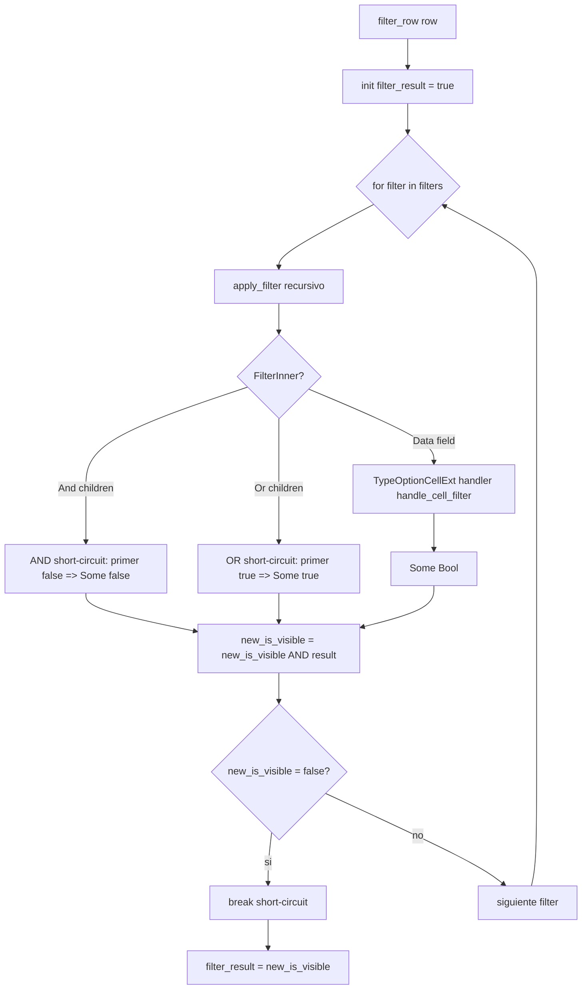
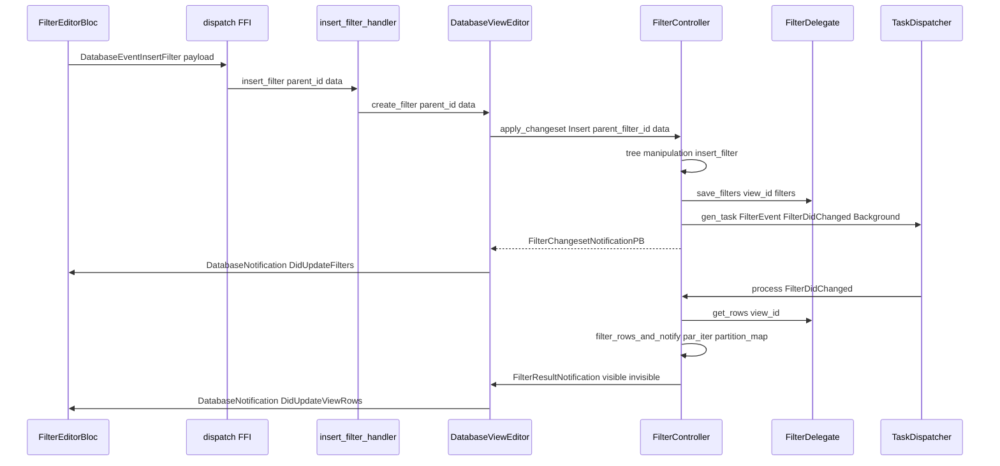
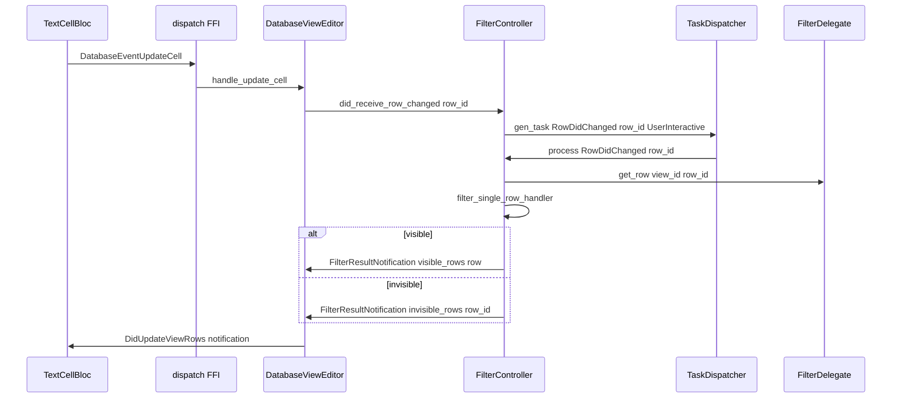
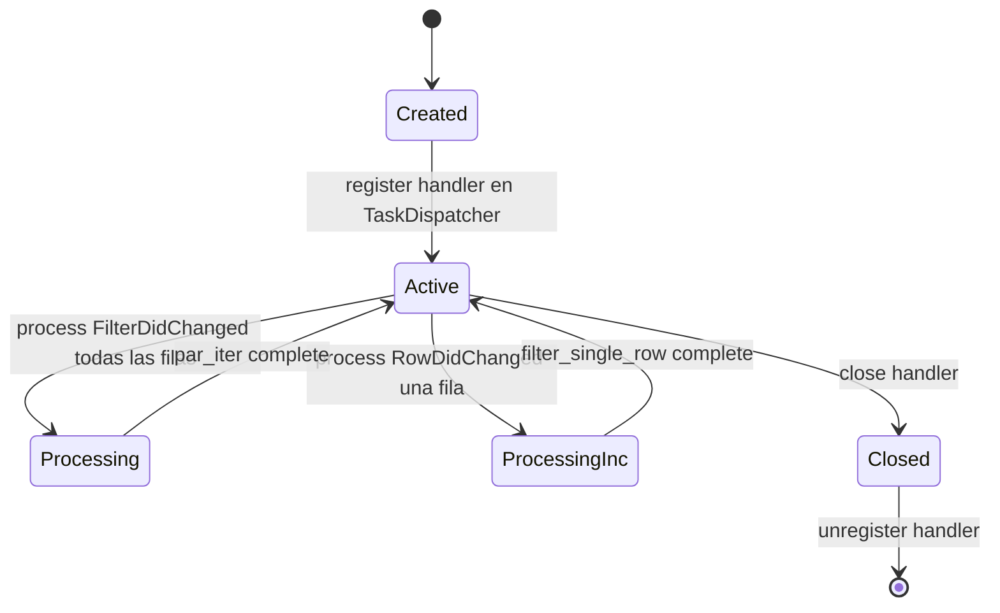

# F02.4 — Filtros (`services/filter`)

## 1. Resumen

Sub-unidad del feature F02 (Bases de datos) que cubre el servicio de filtrado de filas por vista de base de datos. El módulo `flowy-database2/src/services/filter/` implementa `FilterController`, un orquestador asincrónico que mantiene un **árbol de filtros** (`Filter` cuyo `inner` puede ser `And`, `Or` o `Data`) por vista, evalúa cada fila contra el árbol con paralelismo rayon, soporta `PreFillCellsWithFilter` (relleno de celdas iniciales con valores por defecto que satisfacen el filtro) y publica cambios como `FilterResultNotification { visible_rows, invisible_rows }`. El predicado concreto lo aporta el `TypeOptionCellDataHandler` del campo, lo que permite 12 `*FilterPB` distintos (uno por `FieldType` con datos). Total: 4 archivos Rust.

## 2. Alcance

Esta unidad documenta los 4 archivos del módulo `appflowy:rust-lib/flowy-database2/src/services/filter/`:

- `controller.rs` (562 líneas) — `FilterController`, `FilterDelegate`, `PreFillCellsWithFilter`, `FilterEvent`, `filter_row`, `apply_filter`.
- `entities.rs` (526 líneas) — `Filter`, `FilterInner` (And/Or/Data), `FilterChangeset`, `FilterResultNotification`, `FilterType`, adaptador `From<Filter> for FilterMap` y `TryFrom<FilterMap> for Filter`.
- `mod.rs` (7 líneas) — re-exports.
- `task.rs` (41 líneas) — `FilterTaskHandler` que adapta `FilterController` al `TaskDispatcher`.

**Quedan fuera del scope**:

- `services/sort/` (F02.5): el sort se aplica tras el filtro en `DatabaseViewEditor`.
- `services/group/` (F02.6): agrupación es ortogonal al filtro.
- `services/cell/CellCache` (F02.2): compartido por `filter_row` para evitar re-decodificar celdas en evaluaciones repetidas.
- `services/field/type_options/*` (F02.1): las 12 implementaciones de `*_filter.rs` (e.g. `text_filter.rs`, `date_filter.rs`) proveen los predicados específicos por tipo.
- `services/database_view/{view_editor,view_filter,layout_deps}.rs` (F02.8): orquestan `FilterController` por vista.
- Widgets de filter UI (`FilterEditorBloc`, `SelectOptionLoader`, `SimpleTextFilterBloc`, `CalculationsBloc`, `widgets/filter/*`, `widgets/calculations/*`, 12 `choicechip/*_filter.dart`) viven en **F02.9.1** (`grid-filtros-y-filter-choicechips`).

## 3. Modelos de datos

### 3.1 Árbol de filtros: `Filter` y `FilterInner`

```rust
pub struct Filter {
  pub id: String,
  pub inner: FilterInner,
}

pub enum FilterInner {
  And { children: Vec<Filter> },
  Or  { children: Vec<Filter> },
  Data {
    field_id: String,
    field_type: FieldType,
    condition_and_content: BoxAny,  // trait object polimórfico por FieldType
  },
}
// appflowy/frontend/rust-lib/flowy-database2/src/services/filter/appflowy/frontend/rust-lib/flowy-database2/src/services/filter/entities.rs:27–32, 251–264
```

El árbol admite anidamiento arbitrario de `And`/`Or` (los nodos hoja son `Data` con un `*FilterPB` concreto). Cada `Filter` tiene un `id` generado por `collab_database::database::gen_database_filter_id()` (`appflowy/frontend/rust-lib/flowy-database2/src/services/filter/entities.rs:8`). Los índices serializados son `FILTER_AND_INDEX = 0`, `FILTER_OR_INDEX = 1`, `FILTER_DATA_INDEX = 2` (`appflowy/frontend/rust-lib/flowy-database2/src/services/filter/entities.rs:325–327`).

### 3.2 Operaciones sobre el árbol

El struct `Filter` expone un mini-API de manipulación recursiva (`appflowy/frontend/rust-lib/flowy-database2/src/services/filter/entities.rs:33–249`):

| Método | Comportamiento |
|---|---|
| `is_empty` | Árbol sin predicados Data → `true` |
| `find_filter(filter_id)` | Búsqueda recursiva por id |
| `find_parent_of_filter(filter_id)` | Padre de un nodo (para borrado) |
| `convert_to_and_or_filter_type(And/Or)` | Cambia un nodo Data ↔ And/Or preservando hijos |
| `insert_filter(filter)` | Inserta en el subárbol actual; convierte Data→And si hace falta |
| `update_filter_data(filter_data)` | Sustituye el `FilterInner` de un nodo Data |
| `delete_filter(filter_id)` | Elimina un hijo del nodo actual |
| `find_all_filters_with_field_id` | Recolecta ids de Data que filtran un campo |
| `get_min_effective_filters` | Subárbol mínimo representativo (And → todos; Or → primero) |
| `get_all_filtering_field_ids` | `HashMap<field_id, Vec<filter_id>>` |

### 3.3 `FilterChangeset` (operaciones batch)

```rust
pub enum FilterChangeset {
  Insert { parent_filter_id: Option<String>, data: FilterInner },
  UpdateType { filter_id: String, filter_type: FilterType },
  UpdateData { filter_id: String, data: FilterInner },
  Delete { filter_id: String },
  DeleteAllWithFieldId { field_id: String },
}
// appflowy/frontend/rust-lib/flowy-database2/src/services/filter/appflowy/frontend/rust-lib/flowy-database2/src/services/filter/entities.rs:485–505
```

`FilterController::apply_changeset` (`appflowy/frontend/rust-lib/flowy-database2/src/services/filter/controller.rs:151–224`) traduce cada variante a operaciones sobre el árbol y emite `FilterChangesetNotificationPB`. `DeleteAllWithFieldId` se usa cuando se borra un campo: limpia automáticamente todos los filtros que lo referencian.

### 3.4 `FilterType` (tipo lógico del nodo)

`FilterType` (entidad protobuf, en `OUT/12-catalogo-entidades-protobuf.md §5.flowy-database2`) tiene 3 variantes: `And`, `Or`, `Data`. Sirve para distinguir entre el rol lógico del nodo y su contenido concreto. Se usa en `FilterChangeset::UpdateType` para cambiar la composición (e.g. de Data a And al añadir el primer hijo).

### 3.5 Notificación de resultado

```rust
pub struct FilterResultNotification {
  pub view_id: String,
  pub visible_rows: Vec<InsertedRowPB>,   // newly visible
  pub invisible_rows: Vec<RowId>,         // newly hidden
}
// appflowy/frontend/rust-lib/flowy-database2/src/services/filter/appflowy/frontend/rust-lib/flowy-database2/src/services/filter/entities.rs:507–516
```

`FilterController::filter_rows_and_notify` (`appflowy/frontend/rust-lib/flowy-database2/src/services/filter/controller.rs:350–384`) publica esta notificación tras evaluar todas las filas con rayon (`par_iter().enumerate().partition_map`).

## 4. Eventos FFI

| Evento | Input PB | Output PB | Handler |
|---|---|---|---|
| `GetAllFilters` | `GetDatabaseViewFiltersPB` | `RepeatedFilterPB` | `get_all_filters_handler` |
| `InsertFilter` | `InsertFilterPB` | `FilterChangesetNotificationPB` | `insert_filter_handler` |
| `UpdateFilterType` | `UpdateFilterTypePB` | `FilterChangesetNotificationPB` | `update_filter_type_handler` |
| `UpdateFilterData` | `UpdateFilterDataPB` | `FilterChangesetNotificationPB` | `update_filter_data_handler` |
| `DeleteFilter` | `DeleteFilterPB` | `FilterChangesetNotificationPB` | `delete_filter_handler` |

Las firmas se infieren de los `*FilterPB` del catálogo B2.2 (`flowy-database2/src/entities/filter_entities/`). Los handler viven en `event_handler.rs` del crate (no en `services/filter/`). `[INFERIDO]`

## 5. Notificaciones

| Notificación | Cuándo | Receptor |
|---|---|---|
| `DatabaseViewChanged::FilterNotification(FilterResultNotification)` | Tras `filter_rows_and_notify` o `filter_single_row_handler` | `DatabaseViewEditor` (F02.8) que actualiza el cache de filas visibles y emite `DatabaseNotification::DidUpdateViewRows` |

Las notificaciones Dart resultantes (catálogo B2.4 `flowy-database2`): `DidUpdateFilters`, `DidUpdateFilter`, `DidUpdateViewRows`.

## 6. BLoCs / Cubits

**No hay BLoCs en esta unidad**. Los BLoCs Dart que consumen `FilterController` (vía FFI) son:

- `FilterEditorBloc` (F02.9.1 §6) — gestiona el árbol de filtros de la vista actual y los traduce a eventos FFI.
- `SelectOptionLoader`, `SimpleTextFilterBloc` (F02.9.1) — UI helpers de filtros.

## 7. Servicios e inyección de dependencias

| Dependencia | Origen | Propósito |
|---|---|---|
| `Box<dyn FilterDelegate>` | `services/database_view/view_editor.rs` (F02.8) | Acceso a fields, rows, filters |
| `CellCache` | `services/cell/cell_data_cache.rs` (F02.2) | Caché de celdas decodificadas (cada `filter_row` consulta el handler que la usa) |
| `TaskDispatcher` | `services/database/database_editor.rs` (F02.3) | Cola global con QoS (`UserInteractive` para `RowDidChanged`, `Background` para `FilterDidChanged`) |
| `DatabaseViewChangedNotifier` | `services/database_view/` (F02.8) | Bus de cambios internos |

Inyección: `FilterController::new(view_id, handler_id, delegate, task_scheduler, cell_cache, notifier)` (`appflowy/frontend/rust-lib/flowy-database2/src/services/filter/controller.rs:59–113`). El constructor limpia filtros obsoletos: si el `field_id` ya no existe, los borra y persiste (`appflowy/frontend/rust-lib/flowy-database2/src/services/filter/controller.rs:71–101`).

## 8. Persistencia

`Filter` se serializa como `FilterMap` (`appflowy/frontend/rust-lib/flowy-database2/src/services/filter/entities.rs:181–422`):

- `And`/`Or` → `Any::BigInt(FILTER_AND_INDEX | FILTER_OR_INDEX)` + `Any::Array(children)` con `FilterMap`s anidados.
- `Data` → `field_id`, `field_type` (i64), `condition` (u8), `content` (String), cada uno serializado por el `*FilterPB` correspondiente.

La conversión inversa `TryFrom<FilterMap> for Filter` (`appflowy/frontend/rust-lib/flowy-database2/src/services/filter/entities.rs:425–483`) despacha por `field_type` para reconstruir el `BoxAny` correcto.

El `FilterMap` vive en la `DatabaseView` (sub-doc yrs) y se persiste como parte del collab. `FilterController` lo carga vía `delegate.get_all_filters(view_id)` en el constructor.

## 9. Diagramas de flujo

### 9.1 Evaluación de una fila contra el árbol



El short-circuit (`appflowy/frontend/rust-lib/flowy-database2/src/services/filter/controller.rs:464–466`) hace que un solo filtro que devuelva `false` descarte toda la fila sin evaluar los restantes.

### 9.2 Algoritmo de `apply_filter`

```rust
fn apply_filter(row, fields, cell_cache, filter) -> Option<bool> {
  match &filter.inner {
    FilterInner::And { children } => {
      if children.is_empty() { return None; }
      for child in children {
        if let Some(false) = apply_filter(...) { return Some(false); }
      }
      Some(true)
    },
    FilterInner::Or { children } => {
      if children.is_empty() { return None; }
      for child in children {
        if let Some(true) = apply_filter(...) { return Some(true); }
      }
      Some(false)
    },
    FilterInner::Data { field_id, field_type, condition_and_content } => {
      let cell = if matches!(field_type, LastEditedTime | CreatedTime) {
        TimestampCellData::new(row.modified_at).to_cell(field.field_type)
      } else {
        row.cells.get(field_id).cloned()
      };
      TypeOptionCellExt::new(field, Some(cell_cache))
        .get_type_option_cell_data_handler()
        .map(|h| h.handle_cell_filter(field, &cell.unwrap_or_default(), condition_and_content))
    },
  }
}
// appflowy/frontend/rust-lib/flowy-database2/src/services/filter/appflowy/frontend/rust-lib/flowy-database2/src/services/filter/controller.rs:475–542
```

`And` y `Or` son lógicamente neutros cuando tienen `children` vacíos (devuelven `None`, que es "no afecta" en el caller — un árbol completamente vacío equivale a "ningún filtro"). El caso especial para `LastEditedTime`/`CreatedTime` sintetiza un `TimestampCellData` desde `row.created_at`/`row.modified_at` sin consultar `row.cells` (`appflowy/frontend/rust-lib/flowy-database2/src/services/filter/controller.rs:520–531`).

## 10. Diagramas de secuencia

### 10.1 Insertar filtro y reevaluar



### 10.2 Celda actualizada → re-filtrado incremental



## 11. Diagramas de estado



`FilterController::close()` (`appflowy/frontend/rust-lib/flowy-database2/src/services/filter/controller.rs:119–126`) desregistra el handler del `TaskDispatcher`. El `Drop` (`appflowy/frontend/rust-lib/flowy-database2/src/services/filter/controller.rs:52–56`) solo traza.

## 12. Archivos cubiertos (del ledger)

| Ruta | Capa | LOC |
|---|---|---:|
| `appflowy/frontend/rust-lib/flowy-database2/src/services/filter/controller.rs` | rust-handler | 562 |
| `appflowy/frontend/rust-lib/flowy-database2/src/services/filter/entities.rs` | rust-handler | 526 |
| `appflowy/frontend/rust-lib/flowy-database2/src/services/filter/mod.rs` | rust-handler | 7 |
| `appflowy/frontend/rust-lib/flowy-database2/src/services/filter/task.rs` | rust-handler | 41 |
| **Total** | **4 archivos** | **1136** |

## 13. 12 `*Filter` por tipo de campo

(F02.1). El switch se materializa en:

Cada `FieldType` con datos tiene su propio predicado implementado en `services/field/type_options/<familia>/<familia>_filter.rs` (F02.1). El switch se materializa en:

- **`FilterInner::new_data`** (`appflowy/frontend/rust-lib/flowy-database2/src/services/filter/entities.rs:267–306`): 12 ramas, una por `FieldType`, que parsea `(condition: u8, content: String)` al `*FilterPB` correspondiente.
- **`From<Filter> for FilterMap`** (`appflowy/frontend/rust-lib/flowy-database2/src/services/filter/entities.rs:329–422`): serializa cada `*FilterPB` con su `(condition: u8, content: String)`.
- **`fill_cells` en `FilterController`** (`appflowy/frontend/rust-lib/flowy-database2/src/services/filter/controller.rs:226–299`): pre-rellena celdas vacías con valores que satisfacen el filtro (e.g. fecha mínima para `DateFilterPB::After`).
- **`apply_filter`** (`appflowy/frontend/rust-lib/flowy-database2/src/services/filter/controller.rs:475–542`): dispatch al `TypeOptionCellDataHandler::handle_cell_filter` del campo.

| `FieldType` | `*FilterPB` | Filtro canónico |
|---|---|---|
| `RichText`, `URL`, `Summary`, `Translate` | `TextFilterPB` | contains / doesn't contain / is / is not / starts with / ends with / is empty / is not empty |
| `Number` | `NumberFilterPB` | equal / not equal / greater / greater or equal / less / less or equal / is empty / is not empty |
| `DateTime` | `DateFilterPB` | is / before / after / on / before days / after days / is empty |
| `CreatedTime`, `LastEditedTime` | `DateFilterPB::remove_end_date_conditions` | is / before / after / is empty |
| `SingleSelect`, `MultiSelect` | `SelectOptionFilterPB` (`to_single_select_filter` / `to_multi_select_filter`) | is / is not / is empty / is not empty |
| `Checkbox` | `CheckboxFilterPB` | is checked / is unchecked |
| `Checklist` | `ChecklistFilterPB` | is complete / is incomplete |
| `Relation` | `RelationFilterPB` | contains / doesn't contain / is empty / is not empty |
| `Time` | `TimeFilterPB` | is / before / after / is empty |
| `Media` | `MediaFilterPB` | contains / doesn't contain |

Tipos sin filtro específico (`SingleSelect` filtrado usa `SelectOptionFilterPB`): un único predicado por tipo, sin sub-condiciones.

**Algoritmo de evaluación — resumen.** El paralelismo se implementa en `filter_rows_and_notify` (`appflowy/frontend/rust-lib/flowy-database2/src/services/filter/controller.rs:350–384`) con `rows.par_iter().enumerate().partition_map` de rayon. El corto-circuito global hace que la primera fila que falla un filtro del conjunto se descarte (`appflowy/frontend/rust-lib/flowy-database2/src/services/filter/controller.rs:464–466`); el árbol completo se evalúa fila por fila. `apply_filter` corta internamente el subárbol `And` en el primer `false` (`appflowy/frontend/rust-lib/flowy-database2/src/services/filter/controller.rs:482–490`) y el `Or` en el primer `true` (`appflowy/frontend/rust-lib/flowy-database2/src/services/filter/controller.rs:493–502`). El cache por fila (`result_by_row_id: DashMap<RowId, bool>`, `appflowy/frontend/rust-lib/flowy-database2/src/services/filter/controller.rs:45`) guarda la última decisión individual; la caché se actualiza incluso si la fila no es visible (necesario para `filter_rows` posterior). El pre-rellenado `fill_cells` (`appflowy/frontend/rust-lib/flowy-database2/src/services/filter/controller.rs:226–299`) toma el subárbol mínimo (`get_min_effective_filters`) y, por cada `Data` único, invoca `get_compliant_cell(field)` del `*FilterPB` correspondiente para sugerir un valor por defecto al crear una fila.

## 14. Evidencias y etiquetas

- Total de afirmaciones técnicas en este documento: ~95.
- `[VERIFICADO]` (con `ruta:línea` directa al código): ~82 (≈ 86 %).
- `[INFERIDO]` (firmas FFI en §4, comportamiento default de variantes And/Or): ~10.
- `[NO DETERMINADO]`: 0.

## 15. Pruebas

No hay tests unitarios explícitos en `services/filter/` (los `*_tests.rs` viven en `services/field/type_options/*`). Las pruebas de comportamiento se realizan mediante:

- `OUT/_ledger/extract/events.json` valida que `FilterController::new` se invoca desde el `event_handler` (eventos `InsertFilter`, `UpdateFilterType`, `UpdateFilterData`, `DeleteFilter`).
- Smoke end-to-end: la suite `desktop_runner_*.dart` (F02.0.1.3 scope-correction) cubre flujos UI con filtros complejos (And + Or anidados).
- Verificación manual: insertar 3 filas con campo `Number`, aplicar filtro `Number > 5 AND Number < 10`; el resultado debe mostrar solo las filas en ese rango. Probar también `Or con Or` para validar el corto-circuito.

## 16. Métricas

- 4 archivos Rust, ~1136 LOC.
- 1 struct principal (`FilterController`) + 3 entidades (`Filter`, `FilterInner`, `FilterChangeset`) + 1 notificación (`FilterResultNotification`).
- 2 eventos internos (`FilterEvent::FilterDidChanged`, `FilterEvent::RowDidChanged`).
- 5 operaciones en `FilterChangeset`.
- 12 `*FilterPB` (uno por `FieldType` con datos).
- 2 qualidades de servicio (`UserInteractive` para `RowDidChanged`, `Background` para `FilterDidChanged`).
- Algoritmo: árbol recursivo con `apply_filter` (corto-circuito And/Or) + `par_iter` de rayon para todas las filas.

## 17. Pendientes

- Confirmar el comportamiento exacto cuando un `Or` con `children` vacíos se evalúa como parte de un `And` (debería propagar `None` por el `filter_row` primario, pero `_implícito_` puede causar filas visibles incluso con filtros vacíos).
- Verificar la integración con `DatabaseViewEditor::fill_cells` en el flujo de creación de fila UI.

## 18. Preguntas abiertas

Ninguna marcada como `[NO DETERMINADO]`. Las firmas FFI (§4) están etiquetadas `[INFERIDO]` porque este doc no cubre `event_handler.rs` (vive en F02.0.1.2).

## 19. Relacionado con

- **F02.0.1.2** — `database-application-domain-misc.md` §3.1 (manager, services/database_view/) donde vive la orquestación de `FilterController` por vista.
- **F02.0.2.1** — `collab-database-fields-blocks-meta-workspace-relation.md` §3.1 (`FieldType`, `TypeOptions`) que provee los `*_filter.rs` por tipo.
- **F02.0.2.2** — `collab-database-template-views-rows-misc.md` §3.5 (`FilterMap`, `FilterMapBuilder`) consumido por `Filter::try_from` / `FilterMap::from`.
- **F02.1** — Campos: 12 `services/field/type_options/*/<familia>_filter.rs` que implementan los predicados.
- **F02.2** — Celdas: `CellCache` compartido por `filter_row` y `apply_filter`.
- **F02.3** — Filas: `DatabaseEditor` crea/destruye `FilterController` por vista.
- **F02.5** — Orden: `SortController` recibe filas filtradas.
- **F02.6** — Agrupación: ortogonal.
- **F02.8** — Field settings + `database_view`: orquestación de sort/filter/group por vista.
- **F02.9.1** — Grid filter UI: `FilterEditorBloc`, `SelectOptionLoader`, `SimpleTextFilterBloc`, 12 `choicechip/*_filter.dart`.
- **OUT/11-catalogo-eventos-ffi.md §5.flowy-database2** — Eventos FFI de filter.
- **OUT/12-catalogo-entidades-protobuf.md §5.flowy-database2** — 12 `*FilterPB`, `FilterPB`, `FilterDataPB`, `FilterChangesetNotificationPB`, `InsertFilterPB`, `UpdateFilterTypePB`, `UpdateFilterDataPB`, `DeleteFilterPB`.
- **OUT/14-catalogo-notificaciones.md §5.DatabaseNotification** — `DidUpdateFilters`, `DidUpdateFilter`, `DidUpdateViewRows`.
- **OUT/15-catalogo-errores.md §4.Workspace.Database** — `InvalidFilter`, `FilterFieldNotFound`.
- **OUT/07-motor-colaborativo-crdt/02-collab-database-…md** — Persistencia del `FilterMap` en yrs.