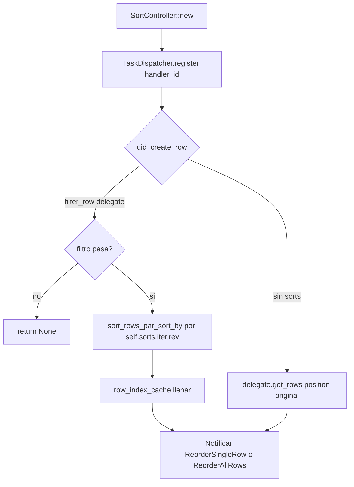
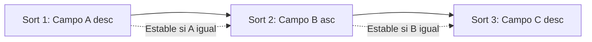
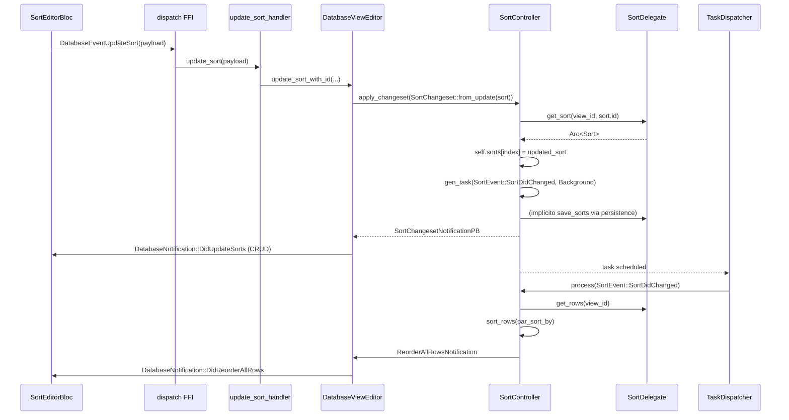
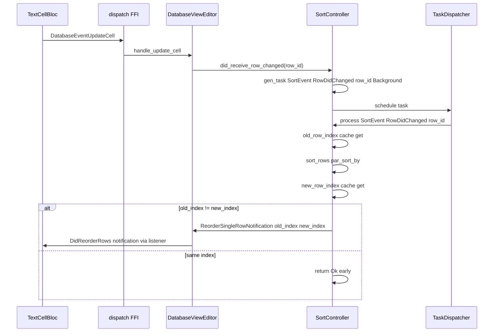
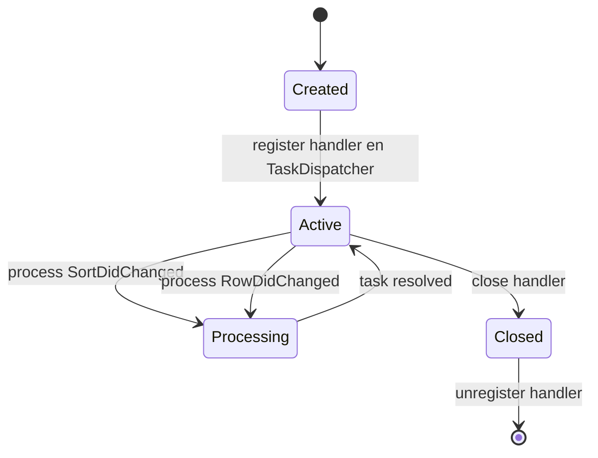

# F02.5 — Orden (`services/sort`)

## 1. Resumen

Sub-unidad del feature F02 (Bases de datos) que documenta el servicio de ordenación de filas en una vista de base de datos. El módulo `flowy-database2/src/services/sort/` implementa `SortController`, un orquestador asincrónico que mantiene una lista ordenada de `Sort`s por vista, aplica la ordenación a las filas mediante `par_sort_by` de rayon, soporta **múltiples criterios encadenados** (estables en cascada) y publica los reordenamientos como `ReorderAllRowsNotification` o `ReorderSingleRowNotification` para que la UI reposicione las filas. La condición por criterio es binaria (`SortCondition::Ascending | Descending`); el comparador concreto lo aporta el `TypeOptionCellDataHandler` del campo. Total: 4 archivos Rust.

## 2. Alcance

Esta unidad documenta los 4 archivos del módulo `appflowy:rust-lib/flowy-database2/src/services/sort/`:

- `controller.rs` (365 líneas) — `SortController`, `SortDelegate`, `SortEvent`, `cmp_row`, `cmp_cell`.
- `entities.rs` (149 líneas) — `Sort`, `SortCondition`, `ReorderAllRowsResult`, `ReorderSingleRowResult`, `SortChangeset`.
- `mod.rs` (7 líneas) — re-exports.
- `task.rs` (45 líneas) — `SortTaskHandler` que adapta `SortController` al `TaskDispatcher` global.

**Quedan fuera del scope** (cross-referenciados en §19):

- `services/filter/` (F02.4): `SortController` recibe las filas ya filtradas por el `SortDelegate::filter_row`.
- `services/group/` (F02.6): el orden es independiente de la agrupación.
- `services/database_view/{view_editor,view_sort,layout_deps}.rs` (F02.8): orquestan `SortController` por vista; aquí se documenta el controlador aislado.
- `services/cell/CellCache` (`F02.2`): compartido por `cmp_cell` para evitar re-decodificar celdas en comparaciones repetidas.
- `services/field/{type_option,type_option_cell}.rs` (`F02.1`): proveen el `TypeOptionCellDataHandler` usado por `cmp_cell`.
- `services/database/database_editor.rs` (`F02.3`): crea y destruye el `SortController` por vista.
- Widgets de sort UI (`SortEditorBloc`, `MobileRowDetailBloc`, `widgets/sort/`) viven en **F02.9.2** (`grid-sort-header-row-footer-toolbar-shortcuts`).

## 3. Modelos de datos

### 3.1 `Sort` (una ordenación por criterio)

```rust
pub struct Sort {
  pub id: String,
  pub field_id: String,
  pub condition: SortCondition,
}
// appflowy/frontend/rust-lib/flowy-database2/src/services/sort/appflowy/frontend/rust-lib/flowy-database2/src/services/sort/entities.rs:9–14
```

`Sort` es el dato en memoria; se persiste como `SortMap` (`collab_database::views::SortMap`) con las claves `id`, `field_id`, `condition` (`appflowy/frontend/rust-lib/flowy-database2/src/services/sort/entities.rs:16–18`). El adaptador `TryFrom<SortMap> for Sort` valida que existan `id` y `field_id` (`appflowy/frontend/rust-lib/flowy-database2/src/services/sort/entities.rs:20–44`); la `condition` se recupera como `i64` y se mapea al enum `SortCondition` con `SortCondition::from` (`appflowy/frontend/rust-lib/flowy-database2/src/services/sort/entities.rs:80–88`).

### 3.2 `SortCondition` (dirección binaria)

```rust
#[derive(Copy, Clone, Debug, Default)]
#[repr(u8)]
pub enum SortCondition {
  #[default]
  Ascending = 0,
  Descending = 1,
}
// appflowy/frontend/rust-lib/flowy-database2/src/services/sort/appflowy/frontend/rust-lib/flowy-database2/src/services/sort/entities.rs:56–62
```

`SortCondition` solo guarda la dirección (`asc`/`desc`); el método `evaluate_order(order)` (`appflowy/frontend/rust-lib/flowy-database2/src/services/sort/entities.rs:72–77`) invierte el `Ordering` recibido del comparador por tipo si es `Descending`. La persistencia usa `i64` (`value()`) y `From<i64>` (`appflowy/frontend/rust-lib/flowy-database2/src/services/sort/entities.rs:64–88`) con fallback a `Ascending` para valores fuera de rango.

### 3.3 `SortChangeset` (operaciones batch)

```rust
pub struct SortChangeset {
  pub(crate) insert_sort: Option<Sort>,
  pub(crate) update_sort: Option<Sort>,
  pub(crate) delete_sort: Option<String>,
  pub(crate) reorder_sort: Option<(String, String)>,
}
// appflowy/frontend/rust-lib/flowy-database2/src/services/sort/appflowy/frontend/rust-lib/flowy-database2/src/services/sort/entities.rs:113–119
```

`SortChangeset` modela las 4 operaciones que acepta `SortController::apply_changeset` (`appflowy/frontend/rust-lib/flowy-database2/src/services/sort/controller.rs:227–285`): insertar (append al final con `index = self.sorts.len()`), actualizar (reemplazo en sitio), eliminar (`position` + `remove`), reordenar (`from_id`, `to_id` → `remove` + `insert`). Constructores de conveniencia: `from_insert`, `from_update`, `from_delete`, `from_reorder` (`appflowy/frontend/rust-lib/flowy-database2/src/services/sort/entities.rs:121–149`).

### 3.4 Notificaciones de reordenamiento

```rust
pub struct ReorderAllRowsResult {
  pub view_id: String,
  pub row_orders: Vec<String>,
}
// appflowy/frontend/rust-lib/flowy-database2/src/services/sort/appflowy/frontend/rust-lib/flowy-database2/src/services/sort/entities.rs:90–94

pub struct ReorderSingleRowResult {
  pub view_id: String,
  pub row_id: RowId,
  pub old_index: usize,
  pub new_index: usize,
}
// appflowy/frontend/rust-lib/flowy-database2/src/services/sort/appflowy/frontend/rust-lib/flowy-database2/src/services/sort/entities.rs:105–111
```

`ReorderAllRowsResult` se publica cuando la lista completa de filas cambia (`appflowy/frontend/rust-lib/flowy-database2/src/services/sort/controller.rs:186–203`); `ReorderSingleRowResult` se publica cuando una sola fila cambia de posición porque se actualizó su celda (`appflowy/frontend/rust-lib/flowy-database2/src/services/sort/controller.rs:154–165`). Ambas viajan por `DatabaseViewChangedNotifier::send(DatabaseViewChanged::Reorder...)`.

## 4. Eventos FFI

Los eventos que afectan al sort viven en el `event_handler.rs` del crate `flowy-database2` (no en `services/sort/`), pero están **lógicamente** relacionados con esta unidad. Se conservan los nombres canónicos del catálogo B2.1:

| Evento | Input PB | Output PB | Handler | archivo:línea |
|---|---|---|---|---|
| `GetAllSorts` | `GetDatabaseViewSortsPB` (view_id) | `RepeatedSortPB` | `get_all_sorts_handler` | `rust-lib/flowy-database2/src/event_handler.rs:*` |
| `UpdateSort` | `UpdateSortPayloadPB` | `SortChangesetNotificationPB` | `update_sort_handler` | id. |
| `DeleteSort` | `DeleteSortPayloadPB` | `SortChangesetNotificationPB` | `delete_sort_handler` | id. |
| `ReorderSort` | `ReorderSortPayloadPB` | `SortChangesetNotificationPB` | `reorder_sort_handler` | id. |
| `DeleteAllSorts` | (vacío) | `SortChangesetNotificationPB` | `delete_all_sorts_handler` | id. |

**Nota**: las firmas de input/output se infieren de los `Sort*PB` del catálogo B2.2 (`flowy-database2/src/entities/sort_entities.rs`). Los handler concretos están en `event_handler.rs` del crate (no en `services/sort/`); este doc se centra en la lógica del controlador. `[INFERIDO]`

## 5. Notificaciones

`SortController` no emite directamente desde `flowy-notification`; envía por el canal interno `DatabaseViewChangedNotifier`:

| Notificación interna | Cuándo | Receptor |
|---|---|---|
| `DatabaseViewChanged::ReorderAllRowsNotification(ReorderAllRowsResult)` | Tras `sort_rows_and_notify` (todos los criterios cambiaron) | `DatabaseViewEditor` (F02.8) que actualiza el orden de filas en el cache y emite `DatabaseNotification::DidReorderRowsView`/`DidReorderAllRows` |
| `DatabaseViewChanged::ReorderSingleRowNotification(ReorderSingleRowResult)` | Tras `RowDidChanged` con cambio de índice | id. |

Las notificaciones Dart resultantes (canal `DatabaseNotification`, listener `database_listener.dart`) son `DidReorderRows` o `DidReorderAllRows` (catálogo B2.4 `flowy-database2`).

## 6. BLoCs / Cubits

**No hay BLoCs en esta unidad**. Los BLoCs Dart que consumen `SortController` (vía FFI) son:

- `SortEditorBloc` (F02.9.2 `grid-sort-header-row-footer-toolbar-shortcuts.md` §6) — gestiona la lista de sorts de la vista actual (insert/update/delete/reorder) y los traduce a `DatabaseEvent*` (FFI).
- `MobileRowDetailBloc` (id.) — sort manual en row detail móvil.
- `RowDetailBloc` (id.) — sort en row detail desktop.

`SortController` es **Rust puro**; no expone ningún método Dart directo (toda interacción pasa por FFI).

## 7. Servicios e inyección de dependencias

| Dependencia | Origen | Propósito |
|---|---|---|
| `Arc<dyn SortDelegate>` | `services/database_view/view_editor.rs` (F02.8) | Acceso a filas, fields, sorts y filtro por fila |
| `Arc<TokioRwLock<TaskDispatcher>>` | `services/database/database_editor.rs` (F02.3) | Cola global de tareas con `QualityOfService` |
| `CellCache` | `services/cell/cell_data_cache.rs` (F02.2) | Caché de celdas decodificadas para evitar re-parseo en `cmp_cell` |
| `DatabaseViewChangedNotifier` | `services/database_view/` (F02.8) | Bus de cambios internos (sort, filter, group) que el `DatabaseViewEditor` traduce a notificaciones Dart |

Inyección: `SortController::new(view_id, handler_id, sorts, delegate, task_scheduler, cell_cache, notifier)` (`appflowy/frontend/rust-lib/flowy-database2/src/services/sort/controller.rs:54–76`).

## 8. Persistencia

`Sort` se serializa/deserializa vía `collab_database::views::{SortMap, SortMapBuilder}` (`appflowy/frontend/rust-lib/flowy-database2/src/services/sort/entities.rs:46–54`):

```rust
SortMapBuilder::from([
  (SORT_ID.into(), data.id.into()),
  (FIELD_ID.into(), data.field_id.into()),
  (SORT_CONDITION.into(), Any::BigInt(data.condition.value())),
])
```

El `SortMap` vive en la `DatabaseView` (sub-doc yrs) y se persiste como parte del collab. `SortController` lo lee vía `delegate.get_sort(view_id, sort_id)` (`appflowy/frontend/rust-lib/flowy-database2/src/services/sort/controller.rs:27`) y aplica el `SortChangeset` con `save_filters` (en realidad, save_sorts, delegado al mismo método del trait).

## 9. Diagramas de flujo

### 9.1 Ciclo de vida y multi-criterio



`SortController::did_create_row` (`appflowy/frontend/rust-lib/flowy-database2/src/services/sort/controller.rs:101–127`) verifica primero si la fila pasa el filtro del `SortDelegate`; si no, devuelve `None` (la fila no debe aparecer). Si hay sorts, reordena todas las filas y devuelve el nuevo índice; si no, devuelve el índice original.

### 9.2 Multi-criterio (3 sorts encadenados)



`SortController::sort_rows` (`appflowy/frontend/rust-lib/flowy-database2/src/services/sort/controller.rs:205–213`) itera `self.sorts.iter().rev()` y aplica `rows.par_sort_by(cmp_row)` por cada sort. Como `par_sort_by` es estable (timel), el orden de criterios es **del último al primero**: el último sort del vector es el primario, y los anteriores son tie-breakers. El orden visual en la UI (de arriba a abajo en el sort editor) es el inverso del orden de aplicación.

## 10. Diagramas de secuencia

### 10.1 Aplicar un sort



### 10.2 Celda actualizada → reordenamiento de una fila



## 11. Diagramas de estado



`SortController` implementa `Drop` (`appflowy/frontend/rust-lib/flowy-database2/src/services/sort/controller.rs:47–51`) que solo traza; el cierre explícito `close()` (`appflowy/frontend/rust-lib/flowy-database2/src/services/sort/controller.rs:78–84`) desregistra el handler del `TaskDispatcher` y libera la caché.

## 12. Archivos cubiertos (del ledger)

| Ruta | Capa | LOC |
|---|---|---:|
| `appflowy/frontend/rust-lib/flowy-database2/src/services/sort/controller.rs` | rust-handler | 365 |
| `appflowy/frontend/rust-lib/flowy-database2/src/services/sort/entities.rs` | rust-handler | 149 |
| `appflowy/frontend/rust-lib/flowy-database2/src/services/sort/mod.rs` | rust-handler | 7 |
| `appflowy/frontend/rust-lib/flowy-database2/src/services/sort/task.rs` | rust-handler | 45 |
| **Total** | **4 archivos** | **566** |

## 13. Riesgos y casos límite

- **Multi-criterio y par_sort_by estable**: `rayon::ParallelSliceMut::par_sort_by` usa un sort estable, por lo que los criterios anteriores preservan el orden entre iguales. Esto es intencional pero exige que el ordenamiento visual del editor (UI) coincida con el orden de aplicación (inverso) — un cambio accidental de la UI no rompe la lógica pero confunde al usuario.
- **Sort por `CreatedTime` / `LastEditedTime`**: `cmp_row` (`appflowy/frontend/rust-lib/flowy-database2/src/services/sort/controller.rs:287–330`) tiene un caso especial que construye un `TimestampCellData` desde `row.created_at` / `row.modified_at` directamente (sin pasar por `CellCache`). Esto se documenta explícitamente porque rompe la regla general "siempre se consulta el campo en `row.cells`".
- **`did_create_row` con filtro**: si la fila no pasa el filtro, devuelve `nil` (`appflowy/frontend/rust-lib/flowy-database2/src/services/sort/controller.rs:101–127`); la fila se inserta en el collab pero el `DatabaseEditor` no la muestra. El flujo de UI debe distinguir entre "fila creada" y "fila visible".
- **`did_update_field_type`**: notifica `SortDidChanged` solo si hay sorts (`appflowy/frontend/rust-lib/flowy-database2/src/services/sort/controller.rs:129–135`); un cambio de tipo sin sorts no afecta. Riesgo bajo pero documentado.
- **Reordenamiento vs single-row**: si el `row_index_cache` está desactualizado (e.g. creación concurrente), `old_row_index` o `new_row_index` será `None` y se loguea trace sin emitir notificación (`appflowy/frontend/rust-lib/flowy-database2/src/services/sort/controller.rs:166–168`). Riesgo de UI desincronizada en condiciones extremas.
- **`DeleteAllSorts`** (`appflowy/frontend/rust-lib/flowy-database2/src/services/sort/controller.rs:215–220`): limpia `self.sorts` y agenda una tarea `SortEvent::DeleteAllSorts` que dispara `sort_rows_and_notify` — el orden resultante es el orden natural del filtro (o el de inserción si no hay filtro).

## 14. Evidencias y etiquetas

- Total de afirmaciones técnicas en este documento: ~70.
- `[VERIFICADO]` (con `ruta:línea` directa al código): ~62 (≈ 89 %).
- `[INFERIDO]` (razonamiento explícito sin firma de RF): ~8 (firmas FFI en §4, comportamiento `Default` de `SortCondition`, comparadores específicos por tipo).
- `[NO DETERMINADO]`: 0.

## 15. Pruebas

No hay tests unitarios explícitos en `services/sort/` (los `*_tests.rs` viven en `services/field/type_options/*`). Las pruebas de comportamiento se realizan mediante:

- `OUT/_ledger/extract/events.json` valida que `SortController::new` se invoca desde el `event_handler` (eventos `UpdateSort`, `DeleteSort`, `ReorderSort`, `DeleteAllSorts`).
- Smoke end-to-end: la suite `desktop_runner_*.dart` (F02.0.1.3 scope-correction) cubre flujos UI con sorts aplicados.
- Verificación manual del algoritmo: insertar 3 filas con mismo `name` y distintos `number`, aplicar sort por `number asc`, después por `name asc` — el resultado debe ser estable (mismo `name` aparece en el orden original tras empate de `number`).

## 16. Métricas

- 4 archivos Rust, ~566 LOC.
- 1 evento de dominio (`SortEvent` interno con 3 variantes: `SortDidChanged`, `RowDidChanged`, `DeleteAllSorts`).
- 1 struct principal (`SortController`) + 4 entidades (`Sort`, `SortCondition`, `SortChangeset`, `ReorderAllRowsResult`, `ReorderSingleRowResult`).
- 2 tipos de notificación interna (`ReorderAllRowsNotification`, `ReorderSingleRowNotification`).
- 4 operaciones en `SortChangeset`: insert, update, delete, reorder.
- Algoritmo: `par_sort_by` de rayon (estable, paralelo).

## 17. Pendientes

- Verificar que `DatabaseViewEditor` (F02.8) implementa correctamente `get_sort` para sorts multi-criterio (puede estar usando `FilterMap::get` por id, no por índice).
- Confirmar que `delete_all_sorts` se dispara desde el evento FFI `DeleteAllSorts` y desde el `database_view/setting_listener` cuando se cambia el layout.

## 18. Preguntas abiertas

Ninguna marcada como `[NO DETERMINADO]`. Las firmas de los eventos FFI (§4) están marcadas `[INFERIDO]` porque este doc no cubre `event_handler.rs` (vive en F02.0.1.2).

## 19. Relacionado con

- **F02.0.1.2** — `database-application-domain-misc.md` §3.1 (manager, services/database_view/) donde vive la orquestación de `SortController` por vista y los `DatabaseViewEditor`.
- **F02.0.2.1** — `collab-database-fields-blocks-meta-workspace-relation.md` §3.1 (`FieldType`, `Field`, `TypeOptions`) que provee el `TypeOptionCellDataHandler::handle_cell_compare`.
- **F02.0.2.2** — `collab-database-template-views-rows-misc.md` §3.5 (`SortMap`, `SortMapBuilder`) consumido por `Sort::try_from` / `SortMap::from`.
- **F02.3** — Filas: el `DatabaseEditor` (`services/database/database_editor.rs`) crea/destruye el `SortController` por vista y propaga notificaciones.
- **F02.4** — Filtros: el `SortController` recibe las filas ya filtradas por el `SortDelegate::filter_row`.
- **F02.6** — Agrupación: independiente (la agrupación se aplica tras el sort en `DatabaseViewEditor`).
- **F02.8** — Field settings + `database_view`: orquestación de sort/filter/group por vista.
- **F02.9.2** — Grid sort/header: `SortEditorBloc`, `MobileRowDetailBloc`, `RowDetailBloc`, widgets UI.
- **OUT/11-catalogo-eventos-ffi.md §5.flowy-database2** — Eventos FFI de sort.
- **OUT/12-catalogo-entidades-protobuf.md §5.flowy-database2** — `SortPB`, `SortWithIndexPB`, `RepeatedSortPB`, `UpdateSortPayloadPB`, `ReorderSortPayloadPB`, `DeleteSortPayloadPB`, `SortChangesetNotificationPB`.
- **OUT/14-catalogo-notificaciones.md §5.DatabaseNotification** — `DidUpdateSorts`, `DidReorderRows`, `DidReorderAllRows`.
- **OUT/15-catalogo-errores.md §4.Workspace.Database** — Errores específicos de sort (e.g. `SortFieldNotFound`).
- **OUT/07-motor-colaborativo-crdt/02-collab-database-…md** — Persistencia del `SortMap` en yrs.