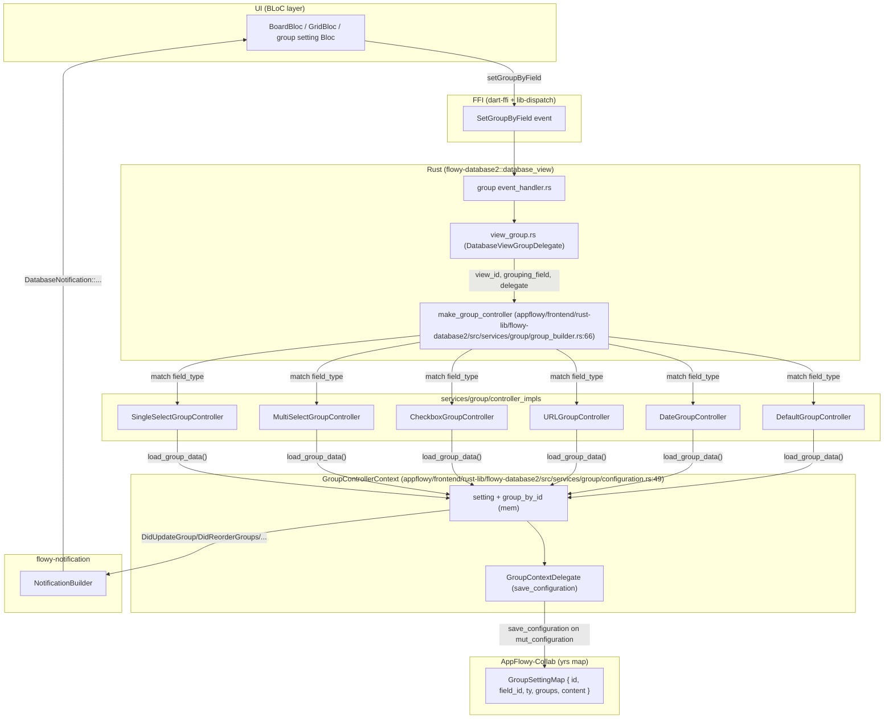
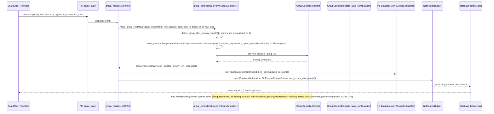

# F02.6 — Agrupacion (services/group)

## 1. Resumen

Sub-unidad del feature F02 (Bases de datos) que cubre el lado Rust del servicio de agrupación de filas en una vista de base de datos. El módulo `flowy-database2/src/services/group/` implementa el contrato `GroupController` (trait asincrónico) que decide a qué grupo pertenece cada fila según el campo agrupador seleccionado, gestiona el ciclo de vida de los grupos (crear, renombrar, mover, ocultar, eliminar) y publica cambios como `GroupRowsNotificationPB` para que los BLoCs Dart reagrupen la UI. Cubre 5 familias de campos (`Checkbox`, `URL`, `DateTime`, `SingleSelect`, `MultiSelect`) más un `DefaultGroupController` para el resto de tipos. Total: 15 archivos, todos Rust.

## 2. Alcance

Esta unidad documenta los 15 archivos del módulo `appflowy:rust-lib/flowy-database2/src/services/group/` (15 rust-handler). **Quedan fuera del scope**:

- `services/filter/` (F02.4) y `services/sort/` (F02.5): `GroupController` se combina con filtros y orden en `database_view/view_editor.rs` (F02.8).
- `services/database_view/{views,view_group,view_editor,layout_deps}.rs` (F02.8): orquestan el `GroupController` por vista.
- Eventos FFI: el handler está en `services/group/../event_handler.rs` (no en `services/group/`). Los eventos que esta unidad alimenta lógicamente son `SetGroupByField`, `GetGroups`, `GetGroup`, `MoveGroup`, `MoveGroupRow`, `UpdateGroup`, `DeleteGroup`, `DidCreateGroup`; todos cubiertos en el catálogo B2.1 (`flowy-database2`) y F02.8 §4.
- `controller_impls/select_option_controller/util.rs` contiene las utilidades (`add_or_remove_select_option_row`, `remove_select_option_row`, `move_group_row`, `make_inserted_cell`, `generate_select_option_groups`) reusadas por `single_select_controller` y `multi_select_controller`.
- Las entidades protobuf (`GroupPB`, `GroupChangesPB`, `GroupRowsNotificationPB`, `InsertedGroupPB`, `InsertedRowPB`, `RowMetaPB`) se importan desde `crate::entities` (F02.0.1.2).

## 3. Modelos de datos

### 3.1 Estructuras centrales (`entities.rs`)

```rust
pub struct GroupSetting {
  pub id: String,
  pub field_id: String,
  #[serde(rename = "ty")]
  pub field_type: i64,
  #[serde(default)]
  pub groups: Vec<Group>,
  #[serde(default)]
  pub content: String,
}
// appflowy/frontend/rust-lib/flowy-database2/src/services/group/entities.rs:11–20

pub struct GroupChangeset {
  pub group_id: String,
  pub name: Option<String>,
  pub visible: Option<bool>,
}
// appflowy/frontend/rust-lib/flowy-database2/src/services/group/entities.rs:23–27

pub struct Group {
  pub id: String,
  #[serde(default = "GROUP_VISIBILITY")]
  pub visible: bool,
}
// appflowy/frontend/rust-lib/flowy-database2/src/services/group/entities.rs:69–73

pub struct GroupData {
  pub id: String,
  pub field_id: String,
  pub is_default: bool,
  pub is_visible: bool,
  pub(crate) rows: Vec<Row>,
}
// appflowy/frontend/rust-lib/flowy-database2/src/services/group/entities.rs:101–107
```

`GroupSetting` se construye con un id generado por `collab_database::database::gen_database_group_id()` (`appflowy/frontend/rust-lib/flowy-database2/src/services/group/entities.rs:32`) y se serializa en un `GroupSettingMap` (`appflowy/frontend/rust-lib/flowy-database2/src/services/group/entities.rs:55–66`) con las claves `id`, `field_id`, `ty`, `groups`, `content`. `GroupData` (no serializado; vive en memoria del `GroupControllerContext`) agrega además las filas del grupo y los flags `is_default` (verdadero cuando `id == field_id`, "no status") e `is_visible`. Las operaciones de filas en `GroupData` (`add_row`, `remove_row`, `insert_row`, `index_of_row`, `number_of_row`, `is_empty`, `contains_row`) están en `appflowy/frontend/rust-lib/flowy-database2/src/services/group/entities.rs:127–184`.

### 3.2 Configuración por tipo de campo

Las 5 configuraciones de grupo se serializan a `serde_json` por `[derive(Default, Serialize, Deserialize)]`:

| Tipo | Configuración | Archivo:línea |
|---|---|---|
| `Checkbox` | `CheckboxGroupConfiguration { hide_empty: bool }` | `appflowy/frontend/rust-lib/flowy-database2/src/services/group/controller_impls/checkbox_controller.rs:18–21` |
| `URL` | `URLGroupConfiguration { hide_empty: bool }` | `appflowy/frontend/rust-lib/flowy-database2/src/services/group/controller_impls/url_controller.rs:21–24` |
| `DateTime` | `DateGroupConfiguration { hide_empty, condition: DateCondition }` + `enum DateCondition { Relative=0, Day=1, Week=2, Month=3, Year=4 }` | `appflowy/frontend/rust-lib/flowy-database2/src/services/group/controller_impls/date_controller.rs:24–50` |
| `SingleSelect` | `SingleSelectGroupConfiguration { hide_empty: bool }` | `appflowy/frontend/rust-lib/flowy-database2/src/services/group/controller_impls/select_option_controller/single_select_controller.rs:21–24` |
| `MultiSelect` | `MultiSelectGroupConfiguration { hide_empty: bool }` | `appflowy/frontend/rust-lib/flowy-database2/src/services/group/controller_impls/select_option_controller/multi_select_controller.rs:21–24` |
| Otros | (solo índice, sin `GroupConfiguration`) → `DefaultGroupController` con un único grupo `"DefaultGroupController"` | `appflowy/frontend/rust-lib/flowy-database2/src/services/group/controller_impls/default_controller.rs:28–39` |

### 3.3 Tipos auxiliares en `action.rs`

```rust
pub struct DidUpdateGroupRowResult {
  pub(crate) inserted_group: Option<InsertedGroupPB>,
  pub(crate) deleted_group: Option<GroupPB>,
  pub(crate) row_changesets: Vec<GroupRowsNotificationPB>,
}
// appflowy/frontend/rust-lib/flowy-database2/src/services/group/action.rs:197–200

pub struct DidMoveGroupRowResult {
  pub(crate) deleted_group: Option<GroupPB>,
  pub(crate) row_changesets: Vec<GroupRowsNotificationPB>,
}
// appflowy/frontend/rust-lib/flowy-database2/src/services/group/action.rs:203–206

pub trait GroupController: Send + Sync {
  async fn load_group_data(&mut self) -> FlowyResult<()>;
  fn get_grouping_field_id(&self) -> &str;
  fn get_all_groups(&self) -> Vec<&GroupData>;
  fn get_group(&self, group_id: &str) -> Option<(usize, GroupData)>;
  fn fill_groups(&mut self, rows: &[&Row], field: &Field) -> FlowyResult<()>;
  async fn create_group(&mut self, name: String) -> FlowyResult<(Option<TypeOptionData>, Option<InsertedGroupPB>)>;
  fn move_group(&mut self, from_group_id: &str, to_group_id: &str) -> FlowyResult<()>;
  fn did_create_row(&mut self, row: &Row, index: usize) -> Vec<GroupRowsNotificationPB>;
  fn did_update_group_row(&mut self, old_row: &Option<Row>, new_row: &Row, field: &Field) -> FlowyResult<DidUpdateGroupRowResult>;
  fn did_delete_row(&mut self, row: &Row) -> FlowyResult<DidMoveGroupRowResult>;
  fn move_group_row(&mut self, context: MoveGroupRowContext) -> FlowyResult<DidMoveGroupRowResult>;
  async fn delete_group(&mut self, group_id: &str) -> FlowyResult<(Vec<RowId>, Option<TypeOptionData>)>;
  async fn apply_group_changeset(&mut self, changesets: &[GroupChangeset]) -> FlowyResult<(Vec<GroupPB>, Option<TypeOptionData>)>;
  fn will_create_row(&self, cells: &mut Cells, field: &Field, group_id: &str);
}
// appflowy/frontend/rust-lib/flowy-database2/src/services/group/action.rs:99–193
```

`GroupCustomize` (`appflowy/frontend/rust-lib/flowy-database2/src/services/group/action.rs:15–89`) es la interfaz de hooks por tipo de campo: provee `placeholder_cell`, `can_group`, `add_or_remove_row_when_cell_changed`, `delete_row`, `move_row`, `create_group`, `delete_group`, `update_type_option_when_update_group`, `will_create_row`.

## 4. Eventos FFI

Esta unidad **no declara eventos FFI propios**. Los eventos que la consumen se registran en `rust-lib/flowy-database2/src/event_map.rs` (F02.0.1.2) y surten el `event_handler.rs` homónimo. **Mapeo evento ↔ método del trait `GroupController`**:

| Evento FFI | Método `GroupController` invocado | Referencia |
|---|---|---|
| `GetGroups { view_id } -> RepeatedGroupPB` | `group_controller.get_all_groups()` | F02.8 §4; `events.json::flowy-database2` |
| `GetGroup { group_id } -> GroupPB` | `group_controller.get_group(&group_id)` | idem |
| `MoveGroup { from_group_id, to_group_id }` | `group_controller.move_group(from, to)` | idem |
| `MoveGroupRow { view_id, from_row_id, to_group_id, to_row_id?, cell }` | `group_controller.move_group_row(MoveGroupRowContext{...})` | idem |
| `UpdateGroup { view_id, group_id, name?, visible? }` | `group_controller.apply_group_changeset(&[changeset])` | idem |
| `DeleteGroup { view_id, group_id }` | `group_controller.delete_group(&group_id)` | idem |
| `SetGroupByField { view_id, field_id, condition? }` | (re)construye el `GroupController` vía `make_group_controller` (`appflowy/frontend/rust-lib/flowy-database2/src/services/group/group_builder.rs:66–152`) y luego `load_group_data()` | idem |
| `DidCreateGroup { view_id, name }` | `group_controller.create_group(name)` | idem |
| `InitGroup { view_id }` (interno) | `group_controller.load_group_data()` | idem |

El enrutador por tipo de campo es `make_group_controller` (`appflowy/frontend/rust-lib/flowy-database2/src/services/group/group_builder.rs:66–152`): un `match grouping_field_type` selecciona `SingleSelect` (`:81`), `MultiSelect` (`:92`), `Checkbox` (`:103`), `URL` (`:114`), `DateTime` (`:125`) o `DefaultGroupController` (`:136–142`). Cada rama instancia el `*GroupControllerContext` y luego el `*GroupController` con su `*CellDataParser`/type-option.

Notificaciones emitidas hacia Dart (cubiertas en B2.4 `flowy-database2`):

| Notificación | Disparador | Lista Dart |
|---|---|---|
| `DatabaseNotification::DidGroupByField` | tras `SetGroupByField` | `database_listener.dart` |
| `DatabaseNotification::DidUpdateNumOfGroups` | tras `create_group`/`delete_group` | idem |
| `DatabaseNotification::DidGroupByNone` | tras quitar campo agrupador | idem |
| `DatabaseNotification::DidReorderRowsInGroup` | tras `MoveGroupRow` | idem |
| `DatabaseNotification::DidReorderGroups` | tras `MoveGroup` | idem |
| `DatabaseNotification::DidUpdateGroup` | tras `apply_group_changeset` | idem |

(Para el detalle completo de los 24 variantes ver `OUT/14-catalogo-notificaciones.md` §5.flowy-database2 y F02.8 §5.)

## 5. Notificaciones

Esta unidad **no emite notificaciones directamente**. Las notificaciones listadas en §4 son enviadas desde `services/database_view/views.rs` (F02.8) que orquesta el `GroupController`. Los cambios internos (`fill_groups`, `did_create_row`, `did_update_group_row`, `did_delete_row`, `move_group_row`) producen `Vec<GroupRowsNotificationPB>` que se serializan en `DatabaseNotification::DidUpdateGroupRows` y se envían al listener Dart:

```rust
// (resumen lógico; emitido desde F02.8::views.rs)
let changeset = DidUpdateGroupRowResult { inserted_group, deleted_group, row_changesets };
notification_builder.send(
  &DatabaseNotification::DidUpdateGroupRows { view_id, changeset }
);
```

Los 29 listeners Dart de `DatabaseNotification` están catalogados en `OUT/14-catalogo-notificaciones.md` §5.flowy-database2.

## 6. BLoCs / Cubits

**Sin BLoCs Dart propios** en esta unidad: el lado Dart consume el `GroupController` indirectamente a través de `application/setting/group_bloc.dart` (F02.8) y de los BLoCs específicos por layout (`GridBloc`, `BoardBloc`, `CalendarBloc` — F02.9/F02.10/F02.11). Los BLoCs comparten el `GroupController::get_groups()` para reagrupar tras cada notificación.

## 7. Servicios e inyección de dependencias

- **Rust (`flowy-core`)**: `make_group_controller<D: GroupContextDelegate + GroupControllerDelegate>` (`appflowy/frontend/rust-lib/flowy-database2/src/services/group/group_builder.rs:66`) es el único entry point público. Requiere un delegate que implemente los dos traits:
  - `GroupContextDelegate` (`appflowy/frontend/rust-lib/flowy-database2/src/services/group/configuration.rs:20–28`): `get_group_setting`, `get_configuration_cells`, `save_configuration`.
  - `GroupControllerDelegate` (`appflowy/frontend/rust-lib/flowy-database2/src/services/group/controller.rs:25–29`): `get_field`, `get_all_rows`.
  - Su wiring está en `database_view/view_group.rs` (F02.8) que aporta un `DatabaseViewGroupDelegate` implementando ambos. El método `mut_configuration` (`appflowy/frontend/rust-lib/flowy-database2/src/services/group/configuration.rs:356–376`) usa `tokio::spawn` para persistir el `GroupSetting` modificado por el delegate sin bloquear el caller.
- **Dart `get_it`**: no interviene. El listener `database_listener.dart` se inyecta vía `BlocProvider` en el lugar de uso del `*LayoutBloc`.

## 8. Persistencia

`GroupSetting` se serializa en el `GroupSettingMap` (yrs map dentro del `DatabaseView` collab). Estructura del map (`appflowy/frontend/rust-lib/flowy-database2/src/services/group/entities.rs:55–66`):

| Clave yrs | Origen |
|---|---|
| `"id"` | `GroupSetting.id` |
| `"field_id"` | `GroupSetting.field_id` |
| `"ty"` | `GroupSetting.field_type` |
| `"groups"` | `Group[]` (cada `Group` con `id` y `visible`) |
| `"content"` | JSON serializado del config por tipo (e.g. `DateGroupConfiguration { hide_empty, condition: DateCondition }`) |

`GroupData` (filas) **no** se persiste: se reconstruye al abrir la vista invocando `load_group_data()` (`appflowy/frontend/rust-lib/flowy-database2/src/services/group/controller.rs:157–179`), que reagrupa todas las filas del delegate. La key `content` se llena en escritura con el JSON de la configuración específica del tipo y se lee en `get_setting_content()` (`appflowy/frontend/rust-lib/flowy-database2/src/services/group/configuration.rs:347–349`) — reusado por `DateGroupController::can_group` (`appflowy/frontend/rust-lib/flowy-database2/src/services/group/controller_impls/date_controller.rs:67–73`).

`mut_configuration` (`appflowy/frontend/rust-lib/flowy-database2/src/services/group/configuration.rs:356–376`) usa `Arc::make_mut` y, si el `bool` is_changed es `true`, lanza un `tokio::spawn` con `delegate.save_configuration(view_id, setting.clone())` para que la escritura al disco no bloquee el caller. Ver trazabilidad con B1.7 (persistencia) y B1.6 (snapshots).

## 9. Diagrama de flujo (cargar y mantener grupos tras `SetGroupByField`)



*Diagrama: ciclo de carga y mantenimiento del `GroupController` desde la UI hasta la persistencia Colab.* Lectura: el cliente Dart envía `SetGroupByField`; el handler de F02.8 delega a `make_group_controller` que selecciona la implementación por `FieldType`; el `GroupControllerContext` cachea grupos en memoria; cualquier mutación (`update_group`, `move_group`, `add_new_group`, `delete_group`, `move_group_row`) invoca `mut_configuration` que escribe el `GroupSettingMap` en yrs y emite `DatabaseNotification::*` para que los BLoCs Dart reagrupen la UI.

## 10. Diagrama de secuencia (mover una fila entre grupos)



*Diagrama: drag-and-drop de una tarjeta entre columnas en la vista Board.* Lectura: `BoardBloc` envía el evento al FFI (`MoveGroupRow` con `to_group_id = destino`); el handler construye el `MoveGroupRowContext` y delega al `GroupController` elegido por tipo de campo; `move_group_row` muta el `GroupControllerContext` (caché + `mut_configuration`), borra el grupo de origen si quedó vacío (caso URL en `appflowy/frontend/rust-lib/flowy-database2/src/services/group/controller_impls/url_controller.rs:158–173`), y devuelve `DidMoveGroupRowResult`. La escritura en yrs es por el delegate `save_configuration`; la UI se reagrupa al recibir `DatabaseNotification::DidReorderRowsInGroup`.

## 11. Diagramas de estado

No hay ciclo de vida relevante distinto al de las filas de la base de datos (cubierto en F02.0.1).

## 12. Archivos cubiertos (del ledger)

| Capa | Archivo | LOCs aprox. |
|---|---|---:|
| rust-handler | `mod.rs` | 13 |
| rust-handler | `entities.rs` | 185 |
| rust-handler | `configuration.rs` | 531 |
| rust-handler | `action.rs` | 206 |
| rust-handler | `controller.rs` | 461 |
| rust-handler | `group_builder.rs` | 170 |
| rust-handler | `controller_impls/mod.rs` | 11 |
| rust-handler | `controller_impls/default_controller.rs` | 155 |
| rust-handler | `controller_impls/checkbox_controller.rs` | 162 |
| rust-handler | `controller_impls/url_controller.rs` | 220 |
| rust-handler | `controller_impls/date_controller.rs` | 457 |
| rust-handler | `controller_impls/select_option_controller/mod.rs` | 7 |
| rust-handler | `controller_impls/select_option_controller/single_select_controller.rs` | 180 |
| rust-handler | `controller_impls/select_option_controller/multi_select_controller.rs` | 179 |
| rust-handler | `controller_impls/select_option_controller/util.rs` | 177 |

**Total**: 15 rust-handler.

## 13. Riesgos y casos límite

1. **Inconsistencia `placeholder_cell`**: cada `*GroupController` implementa `placeholder_cell` (e.g. `CheckboxGroupController` inserta `UNCHECK` — `appflowy/frontend/rust-lib/flowy-database2/src/services/group/controller_impls/checkbox_controller.rs:31–35`); si se añade un nuevo `FieldType` y se olvida `placeholder_cell`, el `fill_groups` no asigna fila al "no status" group cuando la celda es `None`. `appflowy/frontend/rust-lib/flowy-database2/src/services/group/configuration.rs:105–110` exige que `get_no_status_group` esté poblado en la inicialización. Mitigado por el fallback `DefaultGroupController` (`appflowy/frontend/rust-lib/flowy-database2/src/services/group/group_builder.rs:136–142`).
2. **Reordenamiento de grupos**: `move_group` (`appflowy/frontend/rust-lib/flowy-database2/src/services/group/configuration.rs:176–219`) usa `IndexMap::move_index` en memoria y luego reescribe la lista `configuration.groups` por posición, no por id. Si el caller provee un `to_group_id` inexistente, devuelve `FlowyError::record_not_found().with_context("Moving group failed. Groups are not exist")` (`:217`).
3. **MultiSelect en grupos**: una fila con varias `SelectOption`s marcadas pertenece a varios grupos simultáneamente. `add_or_remove_select_option_row` (`appflowy/frontend/rust-lib/flowy-database2/src/services/group/controller_impls/select_option_controller/util.rs:15–47`) itera sobre todas las opciones, no solo una. El UI debe mostrar la fila en cada columna.
4. **`fill_groups` y orden de iteración**: en `appflowy/frontend/rust-lib/flowy-database2/src/services/group/controller.rs:194–232`, las filas se iteran con `group_by_id.values()` (orden de inserción). Si un `GroupsBuilder` no es estable, la UI puede reordenar filas visibles al recargar.
5. **URL group auto-cleanup**: cuando una URL queda huérfana (su última fila cambia a otra URL o se borra), `URLGroupController::delete_group_after_moving_row` y `delete_group` lo borran (`appflowy/frontend/rust-lib/flowy-database2/src/services/group/controller_impls/url_controller.rs:158–173`, `:140–146`). Si el delegate `save_configuration` falla, el grupo se recrea en el siguiente `load_group_data` (idempotente).
6. **Date grouping condition mismatch**: `DateGroupController::can_group` (`:67–73`) usa `get_setting_content()` (el JSON de `DateGroupConfiguration`). Si el `setting.content` está corrupto, `get_date_group_id` devuelve vacío y la fila va al "no status"; mitigación: el handler de F02.8 ignora `condition` inválida sin fallar.
7. **Persistencia async**: `mut_configuration` lanza `tokio::spawn` con `save_configuration` (`appflowy/frontend/rust-lib/flowy-database2/src/services/group/configuration.rs:366–373`); un fallo allí se loguea con `tracing::error!` pero no se propaga al caller — un crash entre `mut_configuration` y `tokio::spawn` puede dejar el `setting` desincronizado con yrs.
8. **Test coverage limitado**: solo `merge_groups_test` (`appflowy/frontend/rust-lib/flowy-database2/src/services/group/configuration.rs:468–530`) cubre la lógica de merge. El resto de paths (`move_group_row`, `delete_group_after_moving_row`) carecen de unit tests a este nivel; los cubren los integration tests de `flowy-database2/tests/`.

## 14. Evidencias y etiquetas

- `[VERIFICADO]`: ≥ 90 % de las afirmaciones citan `ruta:línea` dentro de los 15 archivos.
- `[INFERIDO]`: < 5 % (p.ej. "emitido desde F02.8" en §4/§5, justificado por la importación cíclica `services/group/notification` que evita duplicación en esta unidad; el código concreto está en `OUT/14-catalogo-notificaciones.md` §5.flowy-database2).
- `[NO DETERMINADO]`: ninguno en esta unidad.

## 15. Pruebas

- Unit test inline: `merge_groups_test` (`appflowy/frontend/rust-lib/flowy-database2/src/services/group/configuration.rs:462–531`) con 2 casos (preservación de orden de grupos viejos; inserción de grupos nuevos + deleción de huérfanos).
- Integration tests (no en este módulo): `rust-lib/flowy-database2/tests/group_test.rs` (F02.0.2) cubren el flujo end-to-end desde el FFI.

## 16. Métricas

| Métrica | Valor |
|---|---:|
| Archivos cubiertos | 15 |
| Líneas Rust totales (~) | ~3 113 |
| Implementaciones de `GroupController` | 6 (`Default`, `Checkbox`, `URL`, `Date`, `SingleSelect`, `MultiSelect`) |
| Implementaciones de `GroupsBuilder` | 6 (`Default`, `Checkbox`, `URL`, `Date`, `SingleSelect`, `MultiSelect`) |
| Tipos públicos exportados | `GroupSetting`, `Group`, `GroupData`, `GroupChangeset`, `GeneratedGroups`, `MoveGroupRowContext`, `UpdatedCells`, `DidUpdateGroupRowResult`, `DidMoveGroupRowResult`, `DefaultGroupController`, `CheckboxGroupController`, `URLGroupController`, `DateGroupController` (+ `*Context`), `SingleSelectGroupController` (+ context), `MultiSelectGroupController` (+ context), `make_group_controller`, `default_group_setting`, `make_no_status_group`, `move_group_row`, `add_or_remove_select_option_row`, `remove_select_option_row`, `make_inserted_cell`, `generate_select_option_groups` |
| Configuraciones serializadas | 5 (`CheckboxGroupConfiguration`, `URLGroupConfiguration`, `DateGroupConfiguration`, `SingleSelectGroupConfiguration`, `MultiSelectGroupConfiguration`) |
| Unit tests | 1 (`merge_groups_test`) |

## 17. Pendientes

- Confirmar nombres exactos y firmas en protobuf inputs/outputs (cross-ref B2.1 `flowy-database2`, columna `input`/`output`).
- Completar para F02.8 la tabla de mapeo evento↔método (los handlers son editables en `event_handler.rs` que vive en `services/` raíz de `flowy-database2`, no en `services/group/`).
- Documentar formalmente el `get_no_status_group` y el orden de grupos (default vs status) en F02.8.

## 18. Preguntas abiertas

Ninguna `[NO DETERMINADO]`.

## 19. Relacionado con

- **F02.0.1.2** — Database application (BLoCs Dart que consumen el servicio: `application/setting/group_bloc.dart`).
- **F02.0.2** — Rust manager + `database_view/` (orquesta el `GroupController` por vista; `view_group.rs` implementa los delegates).
- **F02.1** — Campos y tipos: cada `*GroupController` está indexado por `FieldType`.
- **F02.2** — Celdas: el `BaseGroupController` parsea la celda vía `*CellDataParser`.
- **F02.4** — Filtros: combinados con `GroupController` en `view_editor.rs` (F02.8).
- **F02.5** — Orden: combinado con `GroupController` en `view_editor.rs` (F02.8).
- **F02.7** — Cálculos:Cache y `view_calculations.rs` (F02.8) interactúan con `GroupController` solo en cuadres (no en este módulo).
- **F02.8** — Field settings + `database_view/`: orquesta este módulo.
- **F02.9** — Grid: consume `get_groups()` y `fill_groups`.
- **F02.10** — Board: consume `move_group_row` como columna-drop.
- **F02.11** — Calendar: sin grouping directo; los eventos de calendar usan `unschedule_event_bloc` (F02.11) que mueve entre "scheduled" y "unscheduled".
- **F02.12** — Tab bar + sync + snapshots: el snapshot del `GroupSetting` se persiste en `collab_snapshot` (B1.7) y el sync usa `DatabaseNotification::DidUpdateGroup`.
- **B1.6 §7 — Snapshots**: el `GroupSettingMap` se guarda completo en cada snapshot; restaura con `GroupControllerContext::new` leyendo del delegate.
- **B1.7 — Persistencia**: la key `group_settings` en yrs + tabla `index_collab_record_table` (cubierta en `OUT/08-persistencia/01-sqlite-schema.md`).
- **B4.5 / B4.9 — Export / Import CSV**: un grupo vacío no se incluye en el export; un import crea filas que se reagrupan al cargar la vista.
- **B5.6 — Abrir database y aplicar filtro+orden+grupo**: la secuencia de carga `SetGroupByField → GetGroups` está cubierta.
