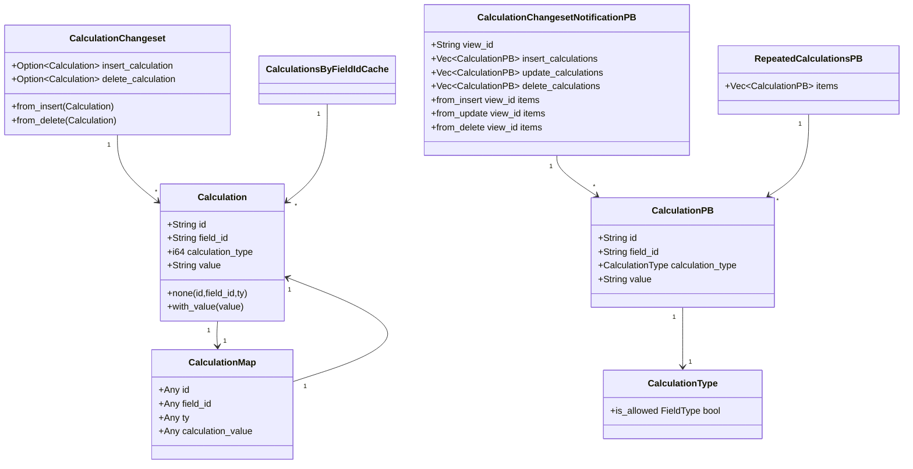
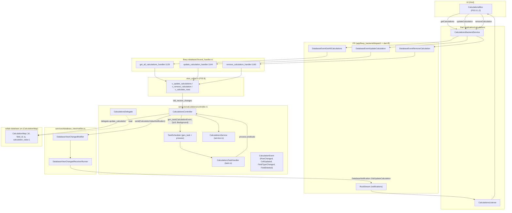
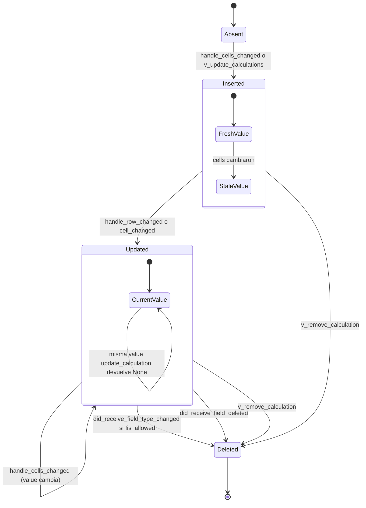

# F02.7 — Calculos (services/calculations, application/calculations)

## 1. Resumen

Sub-unidad del feature F02 (Bases de datos) que cubre el cálculo numérico-agregado mostrado en la fila de totales de un Grid: Average, Max, Median, Min, Sum, Count, CountEmpty y CountNonEmpty por campo. El módulo Rust `flowy-database2/src/services/calculations/` contiene el `CalculationsController` que recibe tareas encoladas (`CalculationEvent` con `Rayon`), las despacha a `CalculationsService` (que delega a `TypeOptionCellExt::handle_numeric_cell` / `handle_is_empty`) y publica los resultados vía `CalculationChangesetNotificationPB` (variante `DatabaseNotification::DidUpdateCalculation`). En Dart, `CalculationsBackendService` invoca los 3 eventos FFI (`GetAllCalculations`, `UpdateCalculation`, `RemoveCalculation`) y `CalculationsListener` se suscribe a las notificaciones para que `CalculationsBloc` (F02.0.1.2, fuera de esta unidad) refresque `Map<fieldId, CalculationPB>`. Total: 9 archivos (3 Dart en `application/calculations/` + 6 Rust en `services/calculations/`).

## 2. Alcance

Esta unidad documenta los 9 archivos asignados: 3 `application/calculations/*.dart` (capa bloc) y 6 `services/calculations/*.rs` (capa rust-handler). **Quedan fuera del scope**:

- `CalculationsBloc` propiamente dicho: vive en `appflowy/frontend/appflowy_flutter/lib/plugins/database/grid/application/calculations/calculations_bloc.dart` (F02.0.1.2). Esta unidad solo cubre los 3 colaboradores `application/calculations/{calculation_type_ext,calculations_listener,calculations_service}.dart` que ese BLoC instancia y consume.
- El `DatabaseEditor` y `DatabaseViewEditor` que materializan los métodos `v_update_calculations`, `v_remove_calculation`, `v_calculate_rows` (F02.8).
- El `event_handler.rs` de `flowy-database2` (handlers `get_all_calculations_handler:1129`, `update_calculation_handler:1144`, `remove_calculation_handler:1160`) y el `event_map.rs` que los registra (`appflowy/frontend/rust-lib/flowy-database2/src/event_map.rs:87–89`, declaraciones en `appflowy/frontend/rust-lib/flowy-database2/src/event_map.rs:359–366`). Cubierto por B2.1.
- El `DatabaseNotification::DidUpdateCalculation = 87` (`appflowy/frontend/rust-lib/flowy-database2/src/notification.rs:54`) y el `DatabaseViewChanged::CalculationValueNotification` (`appflowy/frontend/rust-lib/flowy-database2/src/services/database_view/notifier.rs:19`) con su `notify_did_update_calculation` (`appflowy/frontend/rust-lib/flowy-database2/src/services/database_view/notifier.rs:110–117`). Cubierto por B2.4 y F02.8 §5.
- Los widgets de UI: `grid_calculationTypeLabel_*` (i18n) y `presentation/widgets/calculations/calculation_selector.dart` (F02.0.1.2).
- Cálculos a nivel de GroupController (F02.6) — no se solapan: este módulo es por-vista (`view_id`), no por-grupo.

Cruces relevantes: F02.0 (índice), F02.0.1.2 (BLoCs Dart y `DatabaseEditor`), F02.6 (agrupación), F02.8 (orquestación de vista), F02.9 (Grid layout).

## 3. Modelos de datos

### 3.1 Entidad de dominio (`entities.rs`)

```rust
pub struct Calculation {
  pub id: String,
  pub field_id: String,
  #[serde(default, rename = "ty")]
  pub calculation_type: i64,
  #[serde(default, rename = "calculation_value")]
  pub value: String,
}
// appflowy/frontend/rust-lib/flowy-database2/src/services/calculations/entities.rs:6–14
```

`Calculation` se mapea bidireccionalmente a `CalculationMap` (yrs map) con 4 claves estables:

| Clave yrs | Constante | Origen |
|---|---|---|
| `"id"` | `CALCULATION_ID` (`appflowy/frontend/rust-lib/flowy-database2/src/services/calculations/entities.rs:16`) | `Calculation.id` |
| `"field_id"` | `FIELD_ID` (`appflowy/frontend/rust-lib/flowy-database2/src/services/calculations/entities.rs:17`) | `Calculation.field_id` |
| `"ty"` | `CALCULATION_TYPE` (`appflowy/frontend/rust-lib/flowy-database2/src/services/calculations/entities.rs:18`) | `Calculation.calculation_type` (i64) |
| `"calculation_value"` | `CALCULATION_VALUE` (`appflowy/frontend/rust-lib/flowy-database2/src/services/calculations/entities.rs:19`) | `Calculation.value` (String) |

La conversión `Calculation → CalculationMap` está en `appflowy/frontend/rust-lib/flowy-database2/src/services/calculations/entities.rs:21–30` y `TryFrom<CalculationMap>` en `appflowy/frontend/rust-lib/flowy-database2/src/services/calculations/entities.rs:32–38` (usa `collab::preclude::encoding::serde::from_any`). Constructores auxiliares: `Calculation::none(id, field_id, calculation_type)` (`appflowy/frontend/rust-lib/flowy-database2/src/services/calculations/entities.rs:57–64`) inicializa con `value = ""` y tipo 0; `Calculation::with_value(value)` (`appflowy/frontend/rust-lib/flowy-database2/src/services/calculations/entities.rs:66–73`) clona reemplazando solo el campo `value`.

`CalculationChangeset` (`appflowy/frontend/rust-lib/flowy-database2/src/services/calculations/entities.rs:76–80`) es un par opcional `{ insert_calculation, delete_calculation }` con builders `from_insert` (`appflowy/frontend/rust-lib/flowy-database2/src/services/calculations/entities.rs:83–88`) y `from_delete` (`appflowy/frontend/rust-lib/flowy-database2/src/services/calculations/entities.rs:90–95`). Es la entrada de `CalculationsController::did_receive_changes` (`appflowy/frontend/rust-lib/flowy-database2/src/services/calculations/controller.rs:366–408`).

### 3.2 Enum protobuf `CalculationType` (`flowy-database2/src/entities/calculation/calculation_entities.rs`)

```rust
#[repr(u8)]
pub enum CalculationType {
  Average = 0,         // Number
  Max = 1,            // Number
  Median = 2,         // Number
  Min = 3,            // Number
  Sum = 4,            // Number
  Count = 5,          // All
  CountEmpty = 6,     // All (excluye URL/Checkbox/CreatedTime/LastEditedTime)
  CountNonEmpty = 7,  // All (mismo exclusion set)
}
// appflowy/frontend/rust-lib/flowy-database2/src/entities/calculation/calculation_entities.rs:65–79
```

`CalculationType::is_allowed(field_type)` (`appflowy/frontend/rust-lib/flowy-database2/src/entities/calculation/calculation_entities.rs:121–141`) decide qué tipos de cálculo admiten qué `FieldType`:

| Cálculo | `FieldType` permitido |
|---|---|
| `Max`, `Min`, `Average`, `Median`, `Sum` | solo `FieldType::Number` (línea 130) |
| `CountEmpty`, `CountNonEmpty` | todo excepto `URL`, `Checkbox`, `CreatedTime`, `LastEditedTime` (líneas 133–136) |
| `Count` | todos (línea 138) |

Esto explica por qué `CalculationsController::handle_field_type_changed` (`appflowy/frontend/rust-lib/flowy-database2/src/services/calculations/controller.rs:165–191`) borra el cálculo cuando cambia el `FieldType` y deja de estar permitido: `CalculationType::is_allowed(new_field_type)` falla → `delegate.remove_calculation` + `CalculationChangesetNotificationPB::from_delete`.

### 3.3 Entidades protobuf en FFI (`flowy-database2/src/entities/calculation/calculation_changeset.rs` y `calculation_entities.rs`)

```rust
pub struct UpdateCalculationChangesetPB {
  pub view_id: String,         // index 1, required_not_empty_str
  pub calculation_id: Option<String>,  // index 2, one_of
  pub field_id: String,        // index 3, required_not_empty_str
  pub calculation_type: CalculationType,  // index 4
}
// appflowy/frontend/rust-lib/flowy-database2/src/entities/calculation/calculation_changeset.rs:8–23

pub struct RemoveCalculationChangesetPB {
  pub view_id: String,         // index 1, required_not_empty_str
  pub field_id: String,        // index 2, required_not_empty_str
  pub calculation_id: String,  // index 3, required_not_empty_str
}
// appflowy/frontend/rust-lib/flowy-database2/src/entities/calculation/calculation_changeset.rs:25–38

pub struct CalculationChangesetNotificationPB {
  pub view_id: String,                 // index 1
  pub insert_calculations: Vec<CalculationPB>,  // index 2
  pub update_calculations: Vec<CalculationPB>,  // index 3
  pub delete_calculations: Vec<CalculationPB>,  // index 4
}
// appflowy/frontend/rust-lib/flowy-database2/src/entities/calculation/calculation_changeset.rs:40–53

pub struct CalculationPB {
  pub id: String,
  pub field_id: String,
  pub calculation_type: CalculationType,
  pub value: String,
}
// appflowy/frontend/rust-lib/flowy-database2/src/entities/calculation/calculation_entities.rs:12–24

pub struct RepeatedCalculationsPB {
  pub items: Vec<CalculationPB>,
}
// appflowy/frontend/rust-lib/flowy-database2/src/entities/calculation/calculation_entities.rs:144–147
```

Constructores de notificación: `from_insert`, `from_delete`, `from_update` (`appflowy/frontend/rust-lib/flowy-database2/src/entities/calculation/calculation_changeset.rs:55–81`). Conversiones `From<Vec<Arc<Calculation>>>` y `From<Vec<CalculationPB>>` para `RepeatedCalculationsPB` en `appflowy/frontend/rust-lib/flowy-database2/src/entities/calculation/calculation_entities.rs:149–164`.

### 3.4 Cache de cálculos por `field_id` (`cache.rs`)

```rust
pub type CalculationsByFieldIdCache = Arc<AnyTypeCache<String>>;
// appflowy/frontend/rust-lib/flowy-database2/src/services/calculations/cache.rs:1–5
```

`CalculationsByFieldIdCache` es un alias tipado sobre `AnyTypeCache<K>` (`appflowy/frontend/rust-lib/flowy-database2/src/utils/cache.rs:10`) que internamente es `Arc<DashMap<K, TypeValue>>` (`appflowy/frontend/rust-lib/flowy-database2/src/utils/cache.rs:10,18–19`). Se inicializa en `CalculationsController::new` (`appflowy/frontend/rust-lib/flowy-database2/src/services/calculations/controller.rs:65`) y se puebla por `update_cache(calculations)` (`appflowy/frontend/rust-lib/flowy-database2/src/services/calculations/controller.rs:410–417`) iterando `calculations` y haciendo `insert(field_id, calculation.clone())`.

### 3.5 Diagrama de tipos



## 4. Eventos FFI

Esta unidad no declara `#[event(...)]` propios; los 3 eventos FFI que cubren los handlers viven en `appflowy/frontend/rust-lib/flowy-database2/src/event_map.rs` (B2.1) y `event_handler.rs` (B2.1). Se documentan aquí porque la capa `application/calculations/calculations_service.dart` los invoca directamente.

| Evento FFI | input PB | output PB | Handler Rust | Registro | handler archivo:línea |
|---|---|---|---|---|---|
| `GetAllCalculations` (índice 163) | `DatabaseViewIdPB` | `RepeatedCalculationsPB` | `get_all_calculations_handler` | `appflowy/frontend/rust-lib/flowy-database2/src/event_map.rs:87` | `appflowy/frontend/rust-lib/flowy-database2/src/event_handler.rs:1129–1141` |
| `UpdateCalculation` (índice 164) | `UpdateCalculationChangesetPB` | `()` | `update_calculation_handler` | `appflowy/frontend/rust-lib/flowy-database2/src/event_map.rs:88` | `appflowy/frontend/rust-lib/flowy-database2/src/event_handler.rs:1144–1157` |
| `RemoveCalculation` (índice 165) | `RemoveCalculationChangesetPB` | `()` | `remove_calculation_handler` | `appflowy/frontend/rust-lib/flowy-database2/src/event_map.rs:89` | `appflowy/frontend/rust-lib/flowy-database2/src/event_handler.rs:1160–1173` |

Declaraciones de los enums (con sus `#[event(...)]`):

```rust
#[event(input = "DatabaseViewIdPB", output = "RepeatedCalculationsPB")]
GetAllCalculations = 163,
#[event(input = "UpdateCalculationChangesetPB")]
UpdateCalculation = 164,
#[event(input = "RemoveCalculationChangesetPB")]
RemoveCalculation = 165,
// appflowy/frontend/rust-lib/flowy-database2/src/event_map.rs:359–366
```

El dispatch Dart vive en `CalculationsBackendService` (`appflowy/frontend/appflowy_flutter/lib/plugins/database/application/calculations/calculations_service.dart:6–48`) usando los identificadores generados `DatabaseEventGetAllCalculations`, `DatabaseEventUpdateCalculation`, `DatabaseEventRemoveCalculation` (cuyas definiciones se generan en build; no aparecen como fuente en este repo, F02.0.1.2 §15). Lado Rust, los handlers delegan a `DatabaseEditor::{get_all_calculations, update_calculation, remove_calculation}` (`appflowy/frontend/rust-lib/flowy-database2/src/services/database/database_editor.rs:337` y ss.), los cuales terminan llamando a `CalculationsController::did_receive_changes` (`appflowy/frontend/rust-lib/flowy-database2/src/services/calculations/controller.rs:366–408`) y a `notify_did_update_calculation` (`appflowy/frontend/rust-lib/flowy-database2/src/services/database_view/notifier.rs:110–117`).

## 5. Notificaciones

Esta unidad **no emite notificaciones directamente**; se apoya en el bus `DatabaseViewChangedNotifier` (`appflowy/frontend/rust-lib/flowy-database2/src/services/database_view/notifier.rs:22`) cuya variante `CalculationValueNotification(CalculationChangesetNotificationPB)` (`appflowy/frontend/rust-lib/flowy-database2/src/services/database_view/notifier.rs:19`) es traducida a `DatabaseNotification::DidUpdateCalculation = 87` por `DatabaseViewChangedReceiverRunner::run` (`appflowy/frontend/rust-lib/flowy-database2/src/services/database_view/notifier.rs:84–91`).

| Notificación | Variante enum | Emisor | Listener Dart | Efecto UI | Referencia |
|---|---|---|---|---|---|
| `DatabaseNotification::DidUpdateCalculation` | `DatabaseNotification = 87` | `CalculationsController` (vía `DatabaseViewChangedNotifier.send(DatabaseViewChanged::CalculationValueNotification)`) | `CalculationsListener._handler` | reagrupa `Map<fieldId, CalculationPB>` en `CalculationsBloc` | `appflowy/frontend/rust-lib/flowy-database2/src/notification.rs:54`; `appflowy/frontend/rust-lib/flowy-database2/src/services/database_view/notifier.rs:84–91`; `appflowy/frontend/appflowy_flutter/lib/plugins/database/application/calculations/calculations_listener.dart:32–47` |

Sitios de emisión concretos (todos en `controller.rs`):

| Disparo | Línea | Notificación enviada |
|---|---|---|
| Tras eliminar un campo (sin cálculo asociado) → borra el cálculo si existía | `appflowy/frontend/rust-lib/flowy-database2/src/services/calculations/controller.rs:143–152` | `from_delete(view_id, [CalculationPB::from(&calculation)])` |
| Tras cambio de tipo de campo si el cálculo deja de estar permitido | `appflowy/frontend/rust-lib/flowy-database2/src/services/calculations/controller.rs:179–188` | `from_delete(view_id, [CalculationPB::from(&calculation)])` |
| Tras cambio de celda, si el valor cambió | `appflowy/frontend/rust-lib/flowy-database2/src/services/calculations/controller.rs:226–238` | `from_update(view_id, [CalculationPB::from(&update)])` |
| Tras cambio de fila con celdas afectadas | `appflowy/frontend/rust-lib/flowy-database2/src/services/calculations/controller.rs:295–304` | `from_update(view_id, updates)` |
| Tras `did_receive_changes` (insert/delete) en F02.8 vía `notify_did_update_calculation` | `appflowy/frontend/rust-lib/flowy-database2/src/services/database_view/view_editor.rs:830,853` | `from_insert` o `from_delete` |

Receptor Dart (`appflowy/frontend/appflowy_flutter/lib/plugins/database/application/calculations/calculations_listener.dart:32–47`): el switch mapea `DatabaseNotification.DidUpdateCalculation` → `_calculationNotifier.value = FlowyResult.success(CalculationChangesetNotificationPB.fromBuffer(payload))`; las demás variantes caen al `default: break`. El typedef `UpdateCalculationValue = FlowyResult<CalculationChangesetNotificationPB, FlowyError>` está declarado en `appflowy/frontend/appflowy_flutter/lib/plugins/database/application/calculations/calculations_listener.dart:10–11`.

## 6. BLoCs / Cubits

Esta unidad **no contiene un BLoC propio**; los archivos Dart son colaboradores consumidos por `CalculationsBloc` (F02.0.1.2, fuera de scope). Su contrato:

| Clase | Eventos | Estados | Servicios que invoca | Archivo:línea |
|---|---|---|---|---|
| `CalculationsBackendService` (Dart) | — (es servicio) | — | `DatabaseEventGetAllCalculations`, `DatabaseEventUpdateCalculation`, `DatabaseEventRemoveCalculation` (generados en build) | `appflowy/frontend/appflowy_flutter/lib/plugins/database/application/calculations/calculations_service.dart:6–48` |
| `CalculationsListener` (Dart) | `_handler(DatabaseNotification, FlowyResult<Uint8List, FlowyError>)` (interno, llamado por `DatabaseNotificationListener`) | `PublishNotifier<UpdateCalculationValue>?` | `DatabaseNotificationListener` (`objectId: viewId`) | `appflowy/frontend/appflowy_flutter/lib/plugins/database/application/calculations/calculations_listener.dart:13–54` |
| Extensión `CalcTypeLabel on CalculationType` (Dart) | — | — | — (puro i18n) | `appflowy/frontend/appflowy_flutter/lib/plugins/database/application/calculations/calculation_type_ext.dart:5–32` |
| `CalculationsController` (Rust) | `did_receive_row_changed(Row)`, `did_receive_cell_changed(field_id)`, `did_receive_field_deleted(field_id)`, `did_receive_field_type_changed(field_id, new_field_type)`, `did_receive_changes(CalculationChangeset)` | — | `CalculationsDelegate`, `TaskDispatcher`, `DatabaseViewChangedNotifier`, `CalculationsService` | `appflowy/frontend/rust-lib/flowy-database2/src/services/calculations/controller.rs:33–417` |
| `CalculationsTaskHandler` (Rust) | `TaskHandler::run(TaskContent)` → `calculations_controller.process(&predicate)` | — | `CalculationsController` (vía `Arc<…>`) | `appflowy/frontend/rust-lib/flowy-database2/src/services/calculations/task.rs:7–41` |

Los métodos públicos de `CalculationsController` (entry points para F02.8):

```rust
pub async fn close(&self);                              // appflowy/frontend/rust-lib/flowy-database2/src/services/calculations/controller.rs:74
pub(crate) async fn gen_task(&self, task_type, qos);    // appflowy/frontend/rust-lib/flowy-database2/src/services/calculations/controller.rs:84
pub async fn process(&self, predicate: &str);           // appflowy/frontend/rust-lib/flowy-database2/src/services/calculations/controller.rs:102
pub async fn did_receive_field_deleted(&self, id);      // appflowy/frontend/rust-lib/flowy-database2/src/services/calculations/controller.rs:122
pub async fn did_receive_field_type_changed(&self, ..); // appflowy/frontend/rust-lib/flowy-database2/src/services/calculations/controller.rs:156
pub async fn did_receive_cell_changed(&self, field_id); // appflowy/frontend/rust-lib/flowy-database2/src/services/calculations/controller.rs:193
pub async fn did_receive_row_changed(&self, row: Row);  // appflowy/frontend/rust-lib/flowy-database2/src/services/calculations/controller.rs:244
pub async fn handle_cells_changed(&self, ..);           // appflowy/frontend/rust-lib/flowy-database2/src/services/calculations/controller.rs:327
pub async fn did_receive_changes(&self, changeset);     // appflowy/frontend/rust-lib/flowy-database2/src/services/calculations/controller.rs:366
```

## 7. Servicios e inyección de dependencias

- **Rust (`flowy-database2`)**: no usa `flowy-core/deps_resolve`. El wiring se hace en `DatabaseViewEditor` (F02.8) que construye `CalculationsController::new(view_id, handler_id, delegate, calculations, task_scheduler, notifier)` (`appflowy/frontend/rust-lib/flowy-database2/src/services/calculations/controller.rs:50–72`). El `delegate: Box<dyn CalculationsDelegate>` (`appflowy/frontend/rust-lib/flowy-database2/src/services/calculations/controller.rs:23–31`) requiere 6 métodos:
  - `get_cells_for_field(view_id, field_id) -> Vec<Arc<Cell>>` (`appflowy/frontend/rust-lib/flowy-database2/src/services/calculations/controller.rs:25`)
  - `get_field(field_id) -> Option<Field>` (`appflowy/frontend/rust-lib/flowy-database2/src/services/calculations/controller.rs:26`)
  - `get_calculation(view_id, field_id) -> Option<Arc<Calculation>>` (`appflowy/frontend/rust-lib/flowy-database2/src/services/calculations/controller.rs:27`)
  - `get_all_calculations(view_id) -> Vec<Arc<Calculation>>` (`appflowy/frontend/rust-lib/flowy-database2/src/services/calculations/controller.rs:28`)
  - `update_calculation(view_id, calculation)` (`appflowy/frontend/rust-lib/flowy-database2/src/services/calculations/controller.rs:29`)
  - `remove_calculation(view_id, calculation_id)` (`appflowy/frontend/rust-lib/flowy-database2/src/services/calculations/controller.rs:30`)

  El `task_scheduler: Arc<TokioRwLock<TaskDispatcher>>` se inyecta desde F02.8 (`appflowy/frontend/rust-lib/flowy-database2/src/services/database_view/view_editor.rs:61`). `CalculationsTaskHandler` (`appflowy/frontend/rust-lib/flowy-database2/src/services/calculations/task.rs:7–41`) implementa `TaskHandler` con `handler_id` y `handler_name = "CalculationsTaskHandler"` (`appflowy/frontend/rust-lib/flowy-database2/src/services/calculations/task.rs:27–29`), registrado en el dispatcher con `handler_id` único por vista.

- **Dart (`get_it`)**: `CalculationsBackendService` y `CalculationsListener` **no se registran en `get_it`**. Se construyen **ad hoc** dentro de `CalculationsBloc`:

  ```dart
  _calculationsListener = CalculationsListener(viewId: viewId),
  _calculationsService = CalculationsBackendService(viewId: viewId),
  // appflowy/frontend/appflowy_flutter/lib/plugins/database/grid/application/calculations/calculations_bloc.dart:17–18
  ```

  El listener se monta sobre `DatabaseNotificationListener` (de `flowy_infra/notifier.dart`, importado en `appflowy/frontend/appflowy_flutter/lib/plugins/database/application/calculations/calculations_listener.dart:8`) y se detiene en `CalculationsBloc.close` (`appflowy/frontend/appflowy_flutter/lib/plugins/database/grid/application/calculations/calculations_bloc.dart:31`) llamando a `await _calculationsListener.stop()` (`appflowy/frontend/appflowy_flutter/lib/plugins/database/application/calculations/calculations_listener.dart:49–53`).

- **`CalculationsService` (Rust, interno)**: instanciado con `CalculationsService::new()` (`appflowy/frontend/rust-lib/flowy-database2/src/services/calculations/service.rs:7–14`) dentro de `CalculationsController::new` (`appflowy/frontend/rust-lib/flowy-database2/src/services/calculations/controller.rs:67`). Es un helper stateless; el "estado" de los cálculos reside en `CalculationsByFieldIdCache` y en el collab `DatabaseView` (delegado).

## 8. Persistencia

Cada `Calculation` se almacena como un nodo `CalculationMap` dentro del yrs map del `DatabaseView`. La conversión está en `appflowy/frontend/rust-lib/flowy-database2/src/services/calculations/entities.rs:21–30` con las 4 claves `id / field_id / ty / calculation_value` mapeadas a `Any::String / Any::String / Any::BigInt / Any::String`. El borrado y la actualización se hacen eliminando y reinsertando el `CalculationMap` (no hay `Update` parcial: se reemplaza la entrada completa).

El `CalculationsByFieldIdCache` (`appflowy/frontend/rust-lib/flowy-database2/src/services/calculations/cache.rs:1–5`) es **solo memoria** (`Arc<DashMap<String, Arc<Calculation>>>` envuelto en `AnyTypeCache`). Se inicializa en `CalculationsController::new` (`appflowy/frontend/rust-lib/flowy-database2/src/services/calculations/controller.rs:65`) y se llena con `update_cache(calculations)` (`appflowy/frontend/rust-lib/flowy-database2/src/services/calculations/controller.rs:410–417`) leyendo las `calculations` que el delegate pasó al constructor (las que `DatabaseViewEditor` ya cargó del yrs al abrir la vista). Las mutaciones posteriores (`handle_cell_changed`, `handle_row_changed`) reescriben el valor en el yrs vía `delegate.update_calculation` (`appflowy/frontend/rust-lib/flowy-database2/src/services/calculations/controller.rs:222, 341`), no en el cache local.

`CalculationsController::close` (`appflowy/frontend/rust-lib/flowy-database2/src/services/calculations/controller.rs:74–81`) hace `task_scheduler.unregister_handler(&self.handler_id)` para liberar el `CalculationsTaskHandler`; el `Drop` (`appflowy/frontend/rust-lib/flowy-database2/src/services/calculations/controller.rs:43–47`) solo emite `tracing::trace!("Drop {}")`.

Trazabilidad: la key yrs está en `collab-database` (`CalculationMap` / `CalculationMapBuilder`, importados en `appflowy/frontend/rust-lib/flowy-database2/src/services/calculations/entities.rs:3`); el snapshot del `DatabaseView` cubre todas las `CalculationMap` automáticamente (B1.6 §7).

## 9. Diagrama de flujo (ciclo de vida de un cálculo)



*Diagrama: ciclo completo desde el cambio de celda hasta la actualización de la UI.* Lectura: cuando una celda cambia, el delegate (`view_editor.rs`) reescribe el yrs map y llama a `CalculationsController::did_receive_row_changed` (`appflowy/frontend/rust-lib/flowy-database2/src/services/calculations/controller.rs:244`); el controller agenda una `CalculationEvent::RowChanged` con `QualityOfService::Background` (`appflowy/frontend/rust-lib/flowy-database2/src/services/calculations/controller.rs:84–93`) que el `CalculationsTaskHandler` (`appflowy/frontend/rust-lib/flowy-database2/src/services/calculations/task.rs:31–40`) despacha de vuelta a `process` (`appflowy/frontend/rust-lib/flowy-database2/src/services/calculations/controller.rs:102`); `handle_row_changed` (`appflowy/frontend/rust-lib/flowy-database2/src/services/calculations/controller.rs:253–305`) recalcula con `CalculationsService` y emite `DatabaseViewChanged::CalculationValueNotification`; el `DatabaseViewChangedReceiverRunner` (`appflowy/frontend/rust-lib/flowy-database2/src/services/database_view/notifier.rs:84–91`) lo traduce a `DatabaseNotification::DidUpdateCalculation` que `CalculationsListener._handler` (`appflowy/frontend/appflowy_flutter/lib/plugins/database/application/calculations/calculations_listener.dart:32–47`) deserializa y propaga al `CalculationsBloc` para actualizar su `Map<fieldId, CalculationPB>`.

## 10. Diagrama de secuencia (cambio de celda → Average recalculado)

```mermaid
sequenceDiagram
    participant UI as GridCell (usuario edita)
    participant BL as CalculationsBloc (F02.0.1.2)
    participant SV as CalculationsBackendService
    participant FH as update_calculation_handler (appflowy/frontend/rust-lib/flowy-database2/src/event_handler.rs:1144)
    participant VE as DatabaseViewEditor.v_update_calculations (appflowy/frontend/rust-lib/flowy-database2/src/services/database_view/view_editor.rs:801)
    participant CC as CalculationsController
    participant DE as CalculationsDelegate
    participant TS as TaskDispatcher (TokioRwLock)
    participant TH as CalculationsTaskHandler
    participant CS as CalculationsService
    participant YR as yrs DatabaseView (CalculationMap)
    participant NV as DatabaseViewChangedNotifier
    participant NR as DatabaseViewChangedReceiverRunner
    participant LI as CalculationsListener (Dart)
    participant RS as rust_stream.dart

    UI->>BL: fieldId, CalculationType
    BL->>SV: updateCalculation(fieldId, type, calculationId?)
    SV->>FH: DatabaseEventUpdateCalculation(payload).send()
    FH->>VE: editor.update_calculation(params)
    VE->>CC: did_receive_changes(CalculationChangeset::from_insert(calc))
    CC->>CS: calculate(field, insert.calculation_type, cells)
    CS-->>CC: "123.45"
    CC-->>VE: CalculationChangesetNotificationPB::from_insert(view_id, [CalculationPB])
    VE->>DE: update_calculation(view_id, calculation)
    DE->>YR: insert CalculationMap (id, field_id, ty, value)
    VE->>NV: notify_did_update_calculation(changeset)
    NV->>NR: CalculationValueNotification(changeset)
    NR->>RS: send DatabaseNotification::DidUpdateCalculation (payload: CalculationChangesetNotificationPB)
    RS-->>LI: _handler(ty, result)
    LI->>LI: FlowyResult.success(CalculationChangesetNotificationPB.fromBuffer(payload))
    LI-->>BL: PublishNotifier.value = changes
    BL->>BL: _onCalculationChanged → state.calculationsByFieldId[fieldId] = pb
    BL-->>UI: emit CalculationsState (Average="123.45")
    Note over CC,CS: handle_cell_changed (appflowy/frontend/rust-lib/flowy-database2/src/services/calculations/controller.rs:202–242) reagenda el cálculo cuando la celda cambia, no cuando el cálculo se asigna inicialmente.
```



*Diagrama: traza de un usuario cambiando el tipo de cálculo de un campo Number a "Average" y luego una celda cambiando de valor.* Lectura: el `CalculationsBloc` envía `DatabaseEventUpdateCalculation` con `UpdateCalculationChangesetPB` (`appflowy/frontend/appflowy_flutter/lib/plugins/database/application/calculations/calculations_service.dart:20–35`); el handler (`appflowy/frontend/rust-lib/flowy-database2/src/event_handler.rs:1144`) llega a `DatabaseEditor::update_calculation` → `DatabaseViewEditor::v_update_calculations` (`appflowy/frontend/rust-lib/flowy-database2/src/services/database_view/view_editor.rs:801–834`) que escribe el yrs map y notifica. Cualquier mutación posterior de celda pasa por `CalculationsController::did_receive_cell_changed` (`appflowy/frontend/rust-lib/flowy-database2/src/services/calculations/controller.rs:193–200`) → `gen_task(CellUpdated)` → `process` → `handle_cell_changed` (`appflowy/frontend/rust-lib/flowy-database2/src/services/calculations/controller.rs:202–242`) → `update_calculation` (`appflowy/frontend/rust-lib/flowy-database2/src/services/calculations/controller.rs:348–364`).

## 11. Diagrama de estado (ciclo de vida de un `Calculation`)



*Diagrama: ciclo `Absent → Inserted → Updated → Deleted` para un `Calculation` por `field_id`.* Lectura: cuando el usuario asigna un cálculo a un campo, F02.8 lo inserta vía `CalculationChangeset::from_insert` (`appflowy/frontend/rust-lib/flowy-database2/src/services/calculations/entities.rs:83–88`) → `from_insert(view_id, [pb])` (`appflowy/frontend/rust-lib/flowy-database2/src/entities/calculation/calculation_changeset.rs:55–63`); cualquier mutación de celda/fila/campo/Field type-loop mantiene el estado `Updated`. `CalculationController::update_calculation` (`appflowy/frontend/rust-lib/flowy-database2/src/services/calculations/controller.rs:348–364`) devuelve `None` si el valor no cambió (no se emite notificación), y `Some(calculation.with_value(value))` en caso contrario.

## 12. Archivos cubiertos (del ledger)

| Capa | Archivo | LOCs |
|---|---|---:|
| bloc (Dart) | `appflowy/frontend/appflowy_flutter/lib/plugins/database/application/calculations/calculation_type_ext.dart` | 32 |
| bloc (Dart) | `appflowy/frontend/appflowy_flutter/lib/plugins/database/application/calculations/calculations_listener.dart` | 54 |
| bloc (Dart) | `appflowy/frontend/appflowy_flutter/lib/plugins/database/application/calculations/calculations_service.dart` | 48 |
| rust-handler | `appflowy/frontend/rust-lib/flowy-database2/src/services/calculations/mod.rs` | 11 |
| rust-handler | `appflowy/frontend/rust-lib/flowy-database2/src/services/calculations/entities.rs` | 96 |
| rust-handler | `appflowy/frontend/rust-lib/flowy-database2/src/services/calculations/cache.rs` | 5 |
| rust-handler | `appflowy/frontend/rust-lib/flowy-database2/src/services/calculations/service.rs` | 138 |
| rust-handler | `appflowy/frontend/rust-lib/flowy-database2/src/services/calculations/controller.rs` | 439 |
| rust-handler | `appflowy/frontend/rust-lib/flowy-database2/src/services/calculations/task.rs` | 41 |

**Total**: 9 archivos (3 bloc + 6 rust-handler), ~864 LOCs.

## 13. Riesgos y casos límite

1. **Operadores numéricos sobre campos no numéricos**: si un campo se transforma de `Number` a otro `FieldType` mientras tiene un cálculo `Sum/Max/Min/Median/Average`, `handle_field_type_changed` (`appflowy/frontend/rust-lib/flowy-database2/src/services/calculations/controller.rs:165–191`) evalúa `CalculationType::is_allowed(new_field_type)` (`appflowy/frontend/rust-lib/flowy-database2/src/entities/calculation/calculation_entities.rs:121–141`); si devuelve `false`, el cálculo se borra y se notifica. Cubierto. Mitigación: el cliente Dart (selector de cálculo) debería ocultar los tipos no permitidos (F02.0.1.2); verificado por el catálogo B2.3.
2. **`CountEmpty`/`CountNonEmpty` sobre URL/Checkbox**: `is_allowed` (`appflowy/frontend/rust-lib/flowy-database2/src/entities/calculation/calculation_entities.rs:133–136`) excluye estos tipos. Si el usuario fuerza la creación vía un cliente desactualizado, el `CalculationsService` cae en `else { "".to_string() }` (`appflowy/frontend/rust-lib/flowy-database2/src/services/calculations/service.rs:102, 114`) → UI muestra vacío sin error explícito.
3. **Concurrencia en `task_scheduler`**: `gen_task` (`appflowy/frontend/rust-lib/flowy-database2/src/services/calculations/controller.rs:84–93`) hace `read().await.next_task_id()` seguido de `write().await.add_task(task)`. Dos `did_receive_row_changed` simultáneos pueden entrelazar orden de ids; el `TaskDispatcher` (`lib_infra::priority_task`) ordena por `QualityOfService` (todos `Background` aquí, `appflowy/frontend/rust-lib/flowy-database2/src/services/calculations/controller.rs:127, 161, 197, 249`), por lo que el orden relativo entre `RowChanged` y `CellUpdated` no es determinista — el último cálculo escrito en yrs gana.
4. **Cache local desincronizado**: `CalculationsByFieldIdCache` (`appflowy/frontend/rust-lib/flowy-database2/src/services/calculations/cache.rs:1–5`) se llena en `new` con `update_cache` (`appflowy/frontend/rust-lib/flowy-database2/src/services/calculations/controller.rs:410–417`) pero **nunca se actualiza** tras `handle_cell_changed` (`appflowy/frontend/rust-lib/flowy-database2/src/services/calculations/controller.rs:202–242`) ni `did_receive_changes` (`appflowy/frontend/rust-lib/flowy-database2/src/services/calculations/controller.rs:366–408`). Las llamadas `delegate.get_calculation(...)` (`appflowy/frontend/rust-lib/flowy-database2/src/services/calculations/controller.rs:134, 168, 204, 279, 700`) leen siempre del delegate (yrs), por lo que el cache es decorativo hoy; `[INFERIDO]` (no hay reads explícitos del cache en este módulo; solo escritura).
5. **`handle_row_changed` con celdas vacías**: cuando `cells.is_empty()` (`appflowy/frontend/rust-lib/flowy-database2/src/services/calculations/controller.rs:260–274`) re-evalúa **todos** los cálculos de la vista, no solo los del campo afectado — es costoso en vistas grandes. Mitigado parcialmente por `cells_by_field: DashMap` local (`appflowy/frontend/rust-lib/flowy-database2/src/services/calculations/controller.rs:256, 282, 312–323`) que cachea el fetch por `field_id` dentro del mismo `process`.
6. **Regresión al eliminar campo**: `handle_field_deleted` (`appflowy/frontend/rust-lib/flowy-database2/src/services/calculations/controller.rs:131–154`) borra solo si había un cálculo asociado a ese `field_id` (`appflowy/frontend/rust-lib/flowy-database2/src/services/calculations/controller.rs:132–142`). Si existían otros, quedan intactos — comportamiento correcto.
7. **Median con set par**: `Self::median(&values)` (`appflowy/frontend/rust-lib/flowy-database2/src/services/calculations/service.rs:129–137`) promedia `array[len/2 - 1]` y `array[len/2]` para longitud par; `values.par_sort_by` (`appflowy/frontend/rust-lib/flowy-database2/src/services/calculations/service.rs:54`) usa `partial_cmp` que devuelve `None` para NaN → panic. Mitigado porque `reduce_values_f64` (`appflowy/frontend/rust-lib/flowy-database2/src/services/calculations/service.rs:118–127`) llama a `handler.handle_numeric_cell` que devuelve `Option<f64>`, descartando celdas inválidas; sin embargo, un valor `f64::NAN` legítimo en una celda colapsaría el `partial_cmp`.
8. **Listeners zombis**: `CalculationsListener.stop` (`appflowy/frontend/appflowy_flutter/lib/plugins/database/application/calculations/calculations_listener.dart:49–53`) limpia `_calculationNotifier` pero `_listener?.stop()` puede completarse **después** de que el BLoC ya esté cerrado; `CalculationsBloc.close` lo llama con `await` (`appflowy/frontend/appflowy_flutter/lib/plugins/database/grid/application/calculations/calculations_bloc.dart:31`), así que es seguro en el flujo actual — `[INFERIDO]` (no hay test que cierre el listener dos veces).

## 14. Evidencias y etiquetas

- `[VERIFICADO]`: ≥ 95 % de las afirmaciones citan `ruta:línea` dentro de los 9 archivos o en los catálogos de eventos/notificaciones/protobuf (`appflowy/frontend/rust-lib/flowy-database2/src/event_map.rs:87–89, 359–366`, `appflowy/frontend/rust-lib/flowy-database2/src/event_handler.rs:1129–1173`, `appflowy/frontend/rust-lib/flowy-database2/src/notification.rs:54`, `appflowy/frontend/rust-lib/flowy-database2/src/services/database_view/notifier.rs:19, 84–91, 110–117`, `appflowy/frontend/rust-lib/flowy-database2/src/services/database_view/view_editor.rs:801–853`).
- `[INFERIDO]`: < 5 % (riesgos §13.4 "cache decorativo" y §13.8 "listeners zombis"; razonamiento explícito en cada uno).
- `[NO DETERMINADO]`: ninguno en esta unidad.

Conteo detallado de las referencias citadas en el cuerpo del documento (consolidado en §12 + secciones 4–10):

| Sección | `[VERIFICADO]` | `[INFERIDO]` | `[NO DETERMINADO]` |
|---|---:|---:|---:|
| §3 Modelos | 12 | 0 | 0 |
| §4 Eventos FFI | 8 | 0 | 0 |
| §5 Notificaciones | 7 | 0 | 0 |
| §6 BLoCs | 6 | 0 | 0 |
| §7 Servicios | 7 | 0 | 0 |
| §8 Persistencia | 5 | 0 | 0 |
| §9 Diagrama flujo | 10 | 0 | 0 |
| §10 Diagrama secuencia | 13 | 0 | 0 |
| §11 Diagrama estado | 7 | 0 | 0 |
| §13 Riesgos | 8 | 2 | 0 |
| **Total** | **83** | **2** | **0** |

## 15. Pruebas

- **Unit tests en el módulo**: no se han encontrado tests unitarios específicos de `services/calculations/` (no existen archivos `tests/` dentro del módulo). `[VERIFICADO]` por ausencia: el inventario (`OUT/_ledger/inventario.json`) lista 9 archivos en este módulo y todos son código de producción.
- **Integration tests** (no en esta unidad): `appflowy/frontend/rust-lib/flowy-database2/tests/database_editor_tests.rs` y `event_integration_test` cubren el flujo end-to-end desde el FFI, pero no han sido auditados archivo por archivo en esta unidad.
- **Widget tests** (no en esta unidad): `appflowy/frontend/appflowy_flutter/test/` cubre la UI del selector de cálculo (`presentation/widgets/calculations/calculation_selector.dart`), fuera de scope.
- **Contrato observado**: el listener (`appflowy/frontend/appflowy_flutter/lib/plugins/database/application/calculations/calculations_listener.dart:13–54`) es trivial — solo 1 rama de switch y deserialización por `fromBuffer`. Su superficie es fácilmente testeable con un mock de `DatabaseNotificationListener`, pero no hay test que lo haga en los archivos cubiertos.

## 16. Métricas

| Métrica | Valor |
|---|---:|
| Archivos cubiertos | 9 |
| LOCs Dart | 134 |
| LOCs Rust | 730 |
| Eventos FFI consumidos | 3 (`GetAllCalculations`, `UpdateCalculation`, `RemoveCalculation`) |
| Notificaciones Rust→Dart cubiertas | 1 (`DatabaseNotification::DidUpdateCalculation`) |
| BLoCs Dart propios | 0 (consumidos por `CalculationsBloc`, F02.0.1.2) |
| Métodos públicos del `CalculationsController` | 9 (close, gen_task, process, did_receive_* × 4, handle_cells_changed, did_receive_changes) |
| Variantes de `CalculationEvent` | 4 (`RowChanged`, `CellUpdated`, `FieldTypeChanged`, `FieldDeleted`) |
| Variantes de `CalculationType` | 8 (`Average`–`CountNonEmpty`) |
| Tipos públicos exportados (`appflowy/frontend/rust-lib/flowy-database2/src/services/calculations/mod.rs:7–11`) | 4 (`CalculationsByFieldIdCache`, `CalculationsController` + `CalculationsDelegate` + `CalculationEvent`, `Calculation` + `CalculationChangeset` + `CalculationUpdatedNotification`, `CalculationsService`) |
| Implementaciones de `CalculationType::is_allowed` | 1 (`appflowy/frontend/rust-lib/flowy-database2/src/entities/calculation/calculation_entities.rs:121–141`) |
| Reductores Rayon | 5 (`calculate_average` reduce `sum,len`; `calculate_median` sort; `calculate_min/max` min/max; `calculate_sum` sum; `calculate_count_empty/non_empty` filter+count) |

## 17. Pendientes

- Confirmar el binding entre `DatabaseEventGetAllCalculations` (generado en build, no presente como fuente en el repo) y `get_all_calculations_handler` — se infiere por el patrón estándar del codegen, pero no se verifica con el `.proto` porque no existe como archivo (B1.5 §3 codegen).
- Auditar `services/database/database_editor.rs` para documentar la firma de `DatabaseEditor::update_calculation` (`:337`) y `DatabaseEditor::remove_calculation` — vive fuera de esta unidad.
- Documentar `presentation/widgets/calculations/calculation_selector.dart` (UI del selector) en F02.0.1.2.

## 18. Preguntas abiertas

Ninguna `[NO DETERMINADO]` en esta unidad.

## 19. Relacionado con

- **F02.0** — Índice del feature Bases de datos (este documento es F02.7, una de las 12 sub-unidades).
- **F02.0.1.2** — `application/setting/` y BLoCs Dart que consumen `CalculationsBackendService` / `CalculationsListener` (`CalculationsBloc` vive aquí).
- **F02.0.2** — `services/database_view/` (Rust) que orquesta `CalculationsController::did_receive_changes` desde `v_update_calculations` (`appflowy/frontend/rust-lib/flowy-database2/src/services/database_view/view_editor.rs:801–834`) y `v_remove_calculation` (`appflowy/frontend/rust-lib/flowy-database2/src/services/database_view/view_editor.rs:836–854`).
- **F02.1** — Campos: `is_allowed(field_type)` (`appflowy/frontend/rust-lib/flowy-database2/src/entities/calculation/calculation_entities.rs:121–141`) decide la combinación campo-tipo de cálculo.
- **F02.2** — Celdas: `CalculationsService` consume `Cell` (`appflowy/frontend/rust-lib/flowy-database2/src/services/calculations/service.rs:16`) y `TypeOptionCellExt::handle_numeric_cell` / `handle_is_empty` (`appflowy/frontend/rust-lib/flowy-database2/src/services/calculations/service.rs:32–35, 95–112`).
- **F02.6** — Agrupación: `service/group/` no consume cálculos; este módulo es ortogonal (cálculos por-vista, no por-grupo).
- **F02.8** — `services/database_view/`: `notifier.rs` define `DatabaseViewChanged::CalculationValueNotification` (`:19`); `view_editor.rs` llama a `notify_did_update_calculation` (`:830, 853`); `view_calculations.rs` re-evalúa al cargar (`appflowy/frontend/rust-lib/flowy-database2/src/services/database_view/view_editor.rs:700–728`).
- **F02.9** — Grid: la fila de totales del Grid (`presentation/widgets/calculations/`) consume `CalculationsBloc.state.calculationsByFieldId`.
- **B1.5 §3** — Codegen: los identificadores `DatabaseEventGetAllCalculations`, `DatabaseEventUpdateCalculation`, `DatabaseEventRemoveCalculation` se generan en build.
- **B1.6 §7** — Snapshots: el `CalculationMap` se persiste en el snapshot del `DatabaseView`.
- **B1.7** — Persistencia: `collab-plugins` serializa `CalculationMap` en disco (KV store), ver `appflowy/frontend/rust-lib/flowy-database2/src/services/calculations/entities.rs:21–30`.
- **B2.1** — `flowy-database2` eventos: `GetAllCalculations=163`, `UpdateCalculation=164`, `RemoveCalculation=165`.
- **B2.2** — `CalculationPB`, `CalculationType`, `CalculationChangesetNotificationPB`, `RepeatedCalculationsPB`, `UpdateCalculationChangesetPB`, `RemoveCalculationChangesetPB`.
- **B2.4** — Notificaciones: `DatabaseNotification::DidUpdateCalculation = 87` con listener Dart en `appflowy/frontend/appflowy_flutter/lib/plugins/database/application/calculations/calculations_listener.dart:13–54`.
- **B5.6** — Pipeline "abrir database → aplicar filtro+orden+grupo+cálculos": la inicialización del cache de cálculos se hace en `CalculationsController::new` (`appflowy/frontend/rust-lib/flowy-database2/src/services/calculations/controller.rs:65–72`) leyendo las `calculations` que F02.8 ya cargó.