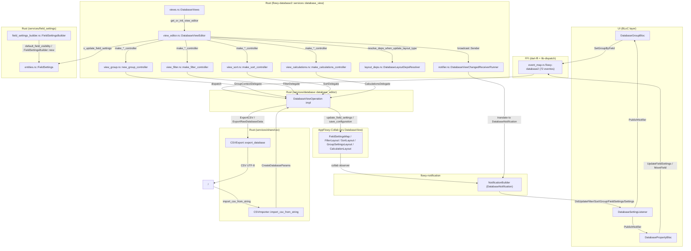
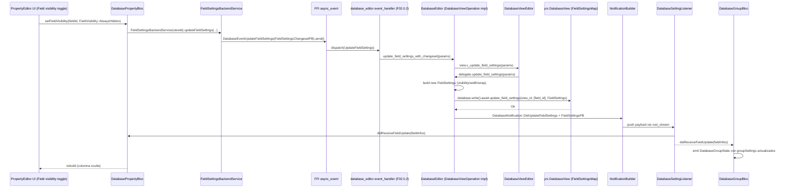
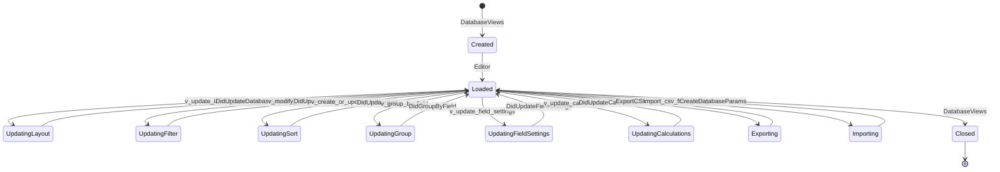
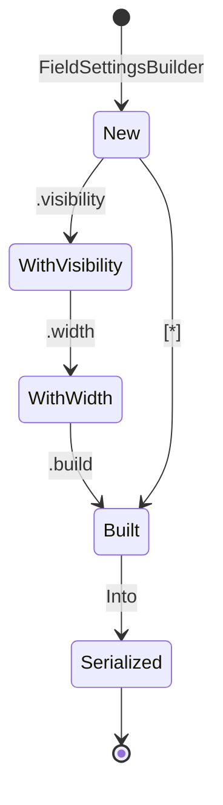

# F02.8 — Field settings, settings de vista, database_view

## 1. Resumen

Esta sub-unidad documenta el **núcleo de orquestación por vista** del feature F02: la estructura `DatabaseViewEditor` (alias `Editor`) de `flowy-database2::services::database_view` y los servicios satélite `field_settings/` y `share/csv/`. `Editor` (`appflowy/frontend/rust-lib/flowy-database2/src/services/appflowy/frontend/rust-lib/flowy-database2/src/services/database_view/view_editor:46–62) es el agregador que mantiene, por cada `view_id`, los controladores `FilterController`, `SortController`, `GroupController`, `CalculationsController` y expone la API `v_*` que los handlers FFI consumen para ejecutar mutaciones coherentes con los filtros, ordenaciones, agrupaciones, cálculos, layout (`Grid`/`Board`/`Calendar`) y field-settings de la vista. Los BLoCs Dart del directorio `plugins/database/application/setting/` (`group_bloc.dart`, `property_bloc.dart`, `setting_listener.dart`, `setting_service.dart`) reflejan esa API: el usuario elige campo agrupador / oculta columna / mueve campo / recibe `DatabaseNotification::DidUpdateSettings` y `DidUpdateFieldSettings`, y el editor reconstruye los cachés en consecuencia. La unidad cubre 21 archivos (4 BLoCs Dart + 17 Rust) y se cruza con F02.6 (group), F02.7 (calculations) y B4 (CSV export/import).

## 2. Alcance

Esta unidad cubre los 21 archivos del ledger (`appflowy/frontend/rust-lib/flowy-database2/src/services/database_view/*`, `appflowy/frontend/rust-lib/flowy-database2/src/services/field_settings/*`, `appflowy/frontend/rust-lib/flowy-database2/src/services/share/csv/*`, `appflowy/frontend/rust-lib/flowy-database2/src/services/share/mod.rs`, y los 4 BLoCs Dart de `application/setting/`). **Quedan fuera del scope**:

- Los servicios de dominio `services/filter/`, `services/sort/`, `services/group/`, `services/calculations/` (F02.4–F02.7) que el `Editor` orquesta: `Editor` los invoca pero no los re-implementa.
- Los handlers FFI individuales (`rust-lib/flowy-database2/src/event_handler.rs` y sub-handlers en `services/*/event_handler.rs`): la tabla de eventos de §4 apunta al handler canónico; cada handler delega aquí.
- `appflowy/frontend/rust-lib/flowy-database2/src/services/database/database_editor.rs` (F02.0.2): implementa `DatabaseViewOperation` que `Editor` consume vía delegate; en §7 se cita appflowy/frontend/rust-lib/flowy-database2/src/services/database/database_editor.rs:2334 para `update_field_settings` por completitud.
- `services/setting/` (F02.0.2): contiene `BoardLayoutSetting` y `CalendarLayoutSetting` consumidos en `layout_deps.rs` y `view_editor.rs`.
- `services/cell/`, `services/field/`, `services/database/`: referenciados vía `use` pero no viven en esta unidad.
- `application/database_controller.dart` y `application/field/field_controller.dart` Dart: instancias que `group_bloc`/`property_bloc` reciben y escuchan (F02.0.1).
- `application/calculations/calculations_listener.dart`, `application/sync/database_sync_state_listener.dart`, `application/view/view_listener.dart`, `domain/cell_listener.dart`, `domain/layout_setting_listener.dart`: cubren el resto de las 24 variantes de `DatabaseNotification` (F02.0.1 + B2.4).

**Cross-references**: F02.0.1 (índice Dart application/), F02.0.2 (Rust manager + `database_editor`), F02.6 (group), F02.7 (calculations), F02.9 (Grid layout), F02.10 (Board layout), F02.11 (Calendar layout), F02.12 (tab bar + sync + snapshots). Bloque B4 (Export/Import): `share/csv/` cruza con B4.5 y B4.9 (CSV export/import). Bloque B1: F02.8 colabora con persistencia (B1.6 snapshots, B1.7 SQLite/collab).

## 3. Modelos de datos

### 3.1 `DatabaseViewEditor` (alias `Editor`)

```rust
pub struct DatabaseViewEditor {
  database_id: String,
  pub view_id: String,
  delegate: Arc<dyn DatabaseViewOperation>,
  group_controller: Arc<RwLock<Option<Box<dyn GroupController>>>>,
  filter_controller: Arc<FilterController>,
  sort_controller: Arc<RwLock<SortController>>,
  calculations_controller: Arc<CalculationsController>,
  pub(crate) row_orders: RwLock<Vec<RowOrder>>,
  pub(crate) row_by_row_id: DashMap<String, Arc<Row>>,
  pub notifier: DatabaseViewChangedNotifier,
}
// appflowy/frontend/rust-lib/flowy-database2/src/services/appflowy/frontend/rust-lib/flowy-database2/src/services/database_view/view_editor:46–62
```

El constructor exige una llamada separada a `Editor::initialize()` (`:138–144`) que dispara `group_controller.load_group_data()`. Antes de `initialize` se prohíbe invocar `DatabaseViewOperation` para evitar deadlocks (comentario `:78–82`).

`DatabaseViewChangedNotifier` (`:22`) es un `tokio::sync::broadcast::Sender<DatabaseViewChanged>` de capacidad 100 (`:85`). Su receptor se lanza en `tokio::spawn` desde el `new` (`:86`) y traduce internamente a `DatabaseNotification` (ver §5).

### 3.2 Trait `DatabaseViewOperation`

`DatabaseViewOperation` (appflowy/frontend/rust-lib/flowy-database2/src/services/database_view/view_operation.rs:24–137) es el contrato que el editor exige a su delegate. Declara 31 métodos asincrónicos sobre datos de filas / campos / filtros / sorts / cálculos / layout / field-settings. Para field-settings son relevantes:

```rust
async fn get_field_settings(
  &self,
  view_id: &str,
  field_ids: &[String],
) -> HashMap<String, FieldSettings>;
async fn update_field_settings(&self, params: FieldSettingsChangesetPB);
// appflowy/frontend/rust-lib/flowy-database2/src/services/database_view/view_operation:130–137
```

Implementado por `DatabaseEditor` (appflowy/frontend/rust-lib/flowy-database2/src/services/database/database_editor.rs:2334–2372) que escribe en `database.write().await.update_field_settings(...)` (`:2360`) y emite `DatabaseNotification::DidUpdateFieldSettings` (`:2366–2371`).

### 3.3 `FieldSettings` + `FieldSettingsBuilder`

```rust
pub struct FieldSettings {
  pub field_id: String,
  pub visibility: FieldVisibility,
  pub width: i32,
  pub wrap_cell_content: bool,
}
// appflowy/frontend/rust-lib/flowy-database2/src/services/appflowy/frontend/rust-lib/flowy-database2/src/services/field_settings/entities:10–15
```

`FieldSettings::from_any_map` reconstruye desde `FieldSettingsMap` (yrs map) con defaults `default_field_visibility(layout)` (`:22–42`). `Visibility`, `Width` y `Wrap` se serializan con claves yrs `"visibility"`, `"width"`, `"wrap"` (`:17–20`). `FieldSettingsBuilder::new` (`:18–29`) crea un registro con `FieldVisibility::AlwaysShown`, `width = DEFAULT_WIDTH = 150`, `wrap_cell_content = true`.

`default_field_visibility` (appflowy/frontend/rust-lib/flowy-database2/src/services/field_settings/field_settings_builder.rs:47–53):

| Layout | Default visibility |
|---|---|
| `Grid` | `AlwaysShown` |
| `Board` | `HideWhenEmpty` |
| `Calendar` | `HideWhenEmpty` |

`field_settings_for_field` (`:69–83`) fuerza `AlwaysShown` si el campo es `is_primary`; en caso contrario aplica `default_field_visibility(database_layout)`. `default_field_settings_by_layout_map` (`:85–95`) itera `DatabaseLayout::iter()` (strum) y genera un `HashMap<DatabaseLayout, FieldSettingsMap>` con la visibilidad por defecto.

### 3.4 `ViewLayout` y `LayoutSetting` (visibilidad por layout)

`DatabaseLayout` se consulta vía `delegate.get_layout_for_view(view_id)` (appflowy/frontend/rust-lib/flowy-database2/src/services/database_view/view_operation.rs:71). Las dependencias por layout las resuelve `DatabaseLayoutDepsResolver::resolve_deps_when_create_database_linked_view` (appflowy/frontend/rust-lib/flowy-database2/src/services/database_view/layout_deps.rs:32–89):

| Layout | Comportamiento | Líneas |
|---|---|---|
| `Grid` | Sin campo nuevo, sin `LayoutSetting`, sin `FieldSettings` por defecto | appflowy/frontend/rust-lib/flowy-database2/src/services/database_view/layout_deps.rs:41 |
| `Board` | Si no hay campo agrupable (`FieldType::can_be_group()`), crea `SingleSelect "Status"`. Inicializa `BoardLayoutSetting::new()` y clona `field_settings_map` actual de la vista | `:42–66` |
| `Calendar` | Si no hay `DateTime`, crea `Field::new("Date", FieldType::DateTime, …)` con `DateTypeOption::default()` | `:68–87` |

`resolve_deps_when_update_layout_type` (`:93–136`) reinyecta `LayoutSetting` cuando cambia el layout: para `Board` inserta `BoardLayoutSetting::new()`; para `Calendar` reusa o crea un campo `DateTime` con `default_field_settings_by_layout_map()`.

`CalendarLayoutSetting::new(field_id)` y `BoardLayoutSetting::new()` están definidos en `services/setting/`.

### 3.5 Modelo CSV (`CSVFormat`, `CSVExport`, `CSVImporter`)

```rust
#[derive(Debug, Clone, Copy)]
pub enum CSVFormat { Original, META }
// appflowy/frontend/rust-lib/flowy-database2/src/services/appflowy/frontend/rust-lib/flowy-database2/src/services/share/csv/export.rs:13–22

pub struct CSVExport;
pub struct CSVImporter;
// appflowy/frontend/rust-lib/flowy-database2/src/services/appflowy/frontend/rust-lib/flowy-database2/src/services/share/csv/export.rs:23
// appflowy/frontend/rust-lib/flowy-database2/src/services/appflowy/frontend/rust-lib/flowy-database2/src/services/share/csv/import.rs:15–16
```

`CSVFormat::Original` serializa solo el valor (vía `stringify_cell`) — pierde el `FieldType`. `CSVFormat::META` serializa el `Field` o `Cell` entero a `serde_json`, permitiendo round-trip completo (incluido tipo).

## 4. Eventos FFI

Los 72 eventos del crate `flowy-database2` se registran en `rust-lib/flowy-database2/src/event_map.rs` (F02.0.1.2). Esta unidad cubre los eventos cuyo handler reside en `services/database_view/` o en `event_handler.rs` y delega al `Editor`:

| Evento FFI | Input PB | Output PB | Método del Editor / destino | Referencia |
|---|---|---|---|---|
| `GetDatabaseSetting` (idx 2) | `DatabaseViewIdPB` | `DatabaseViewSettingPB` | `SettingBackendService.getSetting` (Dart) → `delegate.get_database_setting` (Rust) | appflowy/frontend/appflowy_flutter/lib/plugins/database/application/setting/setting_service.dart:12–15; `events.json::flowy-database2` |
| `UpdateDatabaseSetting` (idx 3) | `DatabaseSettingChangesetPB` | `None` | idem | idem |
| `SetGroupByField` (idx 90) | `GroupByFieldPayloadPB` | `None` | `view_editor.v_initialize_new_group` / `v_group_by_field` | appflowy/frontend/rust-lib/flowy-database2/src/services/database_view/view_editor.rs:507–515, `:1069–1110` |
| `GetGroups` (idx 100) | `DatabaseViewIdPB` | `RepeatedGroupPB` | `view_editor.v_load_groups` | appflowy/frontend/rust-lib/flowy-database2/src/services/database_view/view_editor.rs:463–475 |
| `GetGroup` (idx 101) | `DatabaseGroupIdPB` | `GroupPB` | `view_editor.v_get_group` | appflowy/frontend/rust-lib/flowy-database2/src/services/database_view/view_editor.rs:478–489 |
| `MoveGroup` (idx 111) | `MoveGroupPayloadPB` | `None` | `view_editor.v_move_group` | appflowy/frontend/rust-lib/flowy-database2/src/services/database_view/view_editor.rs:492–497 |
| `MoveGroupRow` (idx 112) | `MoveGroupRowPayloadPB` | `None` | `view_editor.v_move_group_row` | appflowy/frontend/rust-lib/flowy-database2/src/services/database_view/view_editor.rs:437–459 |
| `UpdateGroup` (idx 113) | `UpdateGroupPB` | `None` | `view_editor.v_update_group` | appflowy/frontend/rust-lib/flowy-database2/src/services/database_view/view_editor.rs:587–623 |
| `CreateGroup` (idx 114) | `CreateGroupPayloadPB` | `None` | `view_editor.v_create_group` | appflowy/frontend/rust-lib/flowy-database2/src/services/database_view/view_editor.rs:517–548 |
| `DeleteGroup` (idx 115) | `DeleteGroupPayloadPB` | `None` | `view_editor.v_delete_group` | appflowy/frontend/rust-lib/flowy-database2/src/services/database_view/view_editor.rs:550–585 |
| `SetLayoutSetting` (idx 121) | `LayoutSettingChangesetPB` | `None` | `view_editor.v_set_layout_settings` | appflowy/frontend/rust-lib/flowy-database2/src/services/database_view/view_editor.rs:932–984 |
| `GetLayoutSetting` (idx 122) | `DatabaseLayoutMetaPB` | `DatabaseLayoutSettingPB` | `view_editor.v_get_layout_settings` | appflowy/frontend/rust-lib/flowy-database2/src/services/database_view/view_editor.rs:891–929 |
| `GetAllCalendarEvents` (idx 123) | `CalendarEventRequestPB` | `RepeatedCalendarEventPB` | `view_editor.v_get_all_calendar_events` | appflowy/frontend/rust-lib/flowy-database2/src/services/database_view/view_editor.rs:1144–1190 |
| `GetNoDateCalendarEvents` (idx 124) | `CalendarEventRequestPB` | `RepeatedNoDateCalendarEventPB` | handler en F02.11 (no en esta unidad) | F02.11 |
| `GetCalendarEvent` (idx 125) | `DatabaseViewRowIdPB` | `CalendarEventPB` | `view_editor.v_get_calendar_event` | appflowy/frontend/rust-lib/flowy-database2/src/services/database_view/view_editor.rs:1112–1142 |
| `MoveCalendarEvent` (idx 126) | `MoveCalendarEventPB` | `None` | handler en F02.11 | F02.11 |
| `ExportCSV` (idx 141) | `DatabaseViewIdPB` | `DatabaseExportDataPB` | `CSVExport::export_database` | appflowy/frontend/rust-lib/flowy-database2/src/services/share/csv/export.rs:25–98 |
| `ExportRawDatabaseData` (idx 178) | `DatabaseViewIdPB` | `DatabaseExportDataPB` | idem (interno) | appflowy/frontend/rust-lib/flowy-database2/src/services/share/csv/export.rs:25–98 |
| `GetFieldSettings` (idx 160) | `FieldIdsPB` | `RepeatedFieldSettingsPB` | `view_editor.v_get_field_settings` | appflowy/frontend/rust-lib/flowy-database2/src/services/database_view/view_editor.rs:1257–1262 |
| `GetAllFieldSettings` (idx 161) | `DatabaseViewIdPB` | `RepeatedFieldSettingsPB` | idem | appflowy/frontend/rust-lib/flowy-database2/src/services/database_view/view_editor.rs:1257–1262 |
| `UpdateFieldSettings` (idx 162) | `FieldSettingsChangesetPB` | `None` | `view_editor.v_update_field_settings` → `delegate.update_field_settings` | appflowy/frontend/rust-lib/flowy-database2/src/services/database_view/view_editor.rs:1264–1267; appflowy/frontend/rust-lib/flowy-database2/src/services/database/database_editor.rs:2334–2372 |
| `GetAllCalculations` (idx 163) | `DatabaseViewIdPB` | `RepeatedCalculationsPB` | `view_editor.v_get_all_calculations` | appflowy/frontend/rust-lib/flowy-database2/src/services/database_view/view_editor.rs:797–799 |
| `UpdateCalculation` (idx 164) | `UpdateCalculationChangesetPB` | `None` | `view_editor.v_update_calculations` | appflowy/frontend/rust-lib/flowy-database2/src/services/database_view/view_editor.rs:801–834 |
| `RemoveCalculation` (idx 165) | `RemoveCalculationChangesetPB` | `None` | `view_editor.v_remove_calculation` | appflowy/frontend/rust-lib/flowy-database2/src/services/database_view/view_editor.rs:836–857 |
| `CreateDatabaseView` (idx 130) | `CreateDatabaseViewPayloadPB` | `None` | handler en `services/database/` (F02.0.2) que llama a `DatabaseLayoutDepsResolver` | appflowy/frontend/rust-lib/flowy-database2/src/services/database_view/layout_deps.rs:32–89 |
| `GetDatabaseSnapshots` (idx 150) | `DatabaseViewIdPB` | `RepeatedDatabaseSnapshotPB` | F02.12 (snapshot store) | F02.12 |

Adicionalmente, los handlers de filtros / sorts reutilizan `v_modify_filters` (appflowy/frontend/rust-lib/flowy-database2/src/services/database_view/view_editor.rs:868–887) y `v_create_or_update_sort` / `v_reorder_sort` / `v_delete_sort` (`:630–694`). Los eventos `GetAllFilters` (idx 4), `GetAllSorts` (idx 5), `DeleteAllSorts` (idx 6), `InsertOrUpdateSort` y compañía están cubiertos por F02.4 / F02.5; el Editor es el receptor común.

## 5. NOTificaciones

`DatabaseNotification` (proto-enum con `ProtoBuf_Enum`) está declarado en `rust-lib/flowy-database2/src/notification.rs` con 24 variantes (`Unknown` + 23 funcionales). El editor emite:

| Variante | Disparador | Archivo:línea |
|---|---|---|
| `DidUpdateViewRowsVisibility` | `FilterNotification` recibido en el broadcast interno | appflowy/frontend/rust-lib/flowy-database2/src/services/database_view/notifier.rs:53–58 |
| `DidReorderRows` | `ReorderAllRowsNotification` | appflowy/frontend/rust-lib/flowy-database2/src/services/database_view/notifier.rs:64–69 |
| `DidReorderSingleRow` | `ReorderSingleRowNotification` | appflowy/frontend/rust-lib/flowy-database2/src/services/database_view/notifier.rs:77–83 |
| `DidUpdateCalculation` | `CalculationValueNotification` desde el broadcast interno o vía `notify_did_update_calculation` directo | appflowy/frontend/rust-lib/flowy-database2/src/services/database_view/notifier.rs:85–91; `:110–117` |
| `DidUpdateGroupRow` | `notify_did_update_group_rows` (F02.6) | appflowy/frontend/rust-lib/flowy-database2/src/services/database_view/notifier.rs:99–102 |
| `DidUpdateFilter` | `notify_did_update_filter` | appflowy/frontend/rust-lib/flowy-database2/src/services/database_view/notifier.rs:104–108 |
| `DidUpdateSort` | `notify_did_update_sort` (con guard `is_empty`) | appflowy/frontend/rust-lib/flowy-database2/src/services/database_view/notifier.rs:119–125 |
| `DidUpdateNumOfGroups` | `notify_did_update_num_of_groups` (F02.6) | appflowy/frontend/rust-lib/flowy-database2/src/services/database_view/notifier.rs:127–131 |
| `DidUpdateSettings` | `notify_did_update_setting` tras `v_initialize_new_group` o `database_view_setting_pb_from_view` | appflowy/frontend/rust-lib/flowy-database2/src/services/database_view/notifier.rs:133–137 |
| `DidUpdateLayoutSettings` | `view_editor.v_set_layout_settings` | appflowy/frontend/rust-lib/flowy-database2/src/services/database_view/view_editor.rs:978–980 |
| `DidUpdateDatabaseLayout` | `view_editor.v_update_layout_type` | appflowy/frontend/rust-lib/flowy-database2/src/services/database_view/view_editor.rs:1234–1236 |
| `DidUpdateFieldSettings` | `database_editor.update_field_settings` (delegate) | appflowy/frontend/rust-lib/flowy-database2/src/services/database/database_editor.rs:2366–2371 |
| `DidUpdateRow` | `handle_row_event` / `v_did_update_row_meta` | appflowy/frontend/rust-lib/flowy-database2/src/services/database_view/view_editor.rs:236–239, `:1252–1254` |

Los 24 listeners Dart de `DatabaseNotification` están catalogados en `OUT/14-catalogo-notificaciones.md` §5.flowy-database2. Para esta unidad el listener clave es `setting_listener.dart` (`appflowy/frontend/appflowy_flutter/lib/plugins/database/application/setting/setting_listener:34–46) que mapea `DatabaseNotification::DidUpdateSettings` a `DatabaseViewSettingPB.fromBuffer`.

## 6. BLoCs / Cubits

Esta unidad cubre 4 BLoCs Dart bajo `plugins/database/application/setting/`:

| Clase | Archivo:línea | Eventos | Estado | Servicios consumidos |
|---|---|---|---|---|
| `DatabaseGroupBloc` | `appflowy/frontend/appflowy_flutter/lib/plugins/database/application/setting/group_bloc:15–103 | `initial`, `setGroupByField(fieldId, fieldType, settingContent?)`, `didReceiveFieldUpdate(List<FieldInfo>)`, `didUpdateLayoutSettings(BoardLayoutSettingPB)` | `viewId`, `fieldInfos`, `layoutSettings`, `groupSettings` | `GroupBackendService(viewId)`, `DatabaseController` |
| `DatabasePropertyBloc` | `appflowy/frontend/appflowy_flutter/lib/plugins/database/application/setting/property_bloc:14–94 | `initial`, `setFieldVisibility(fieldId, FieldVisibility)`, `didReceiveFieldUpdate`, `moveField(fromIndex, toIndex)` | `viewId`, `fieldContexts: List<FieldInfo>` | `FieldSettingsBackendService(viewId)`, `FieldBackendService.moveField`, `FieldController` |
| `DatabaseSettingListener` | `appflowy/frontend/appflowy_flutter/lib/plugins/database/application/setting/setting_listener:13–53 | (no BLoC; suscripción push) | `PublishNotifier<UpdateSettingNotifiedValue>` interno | `DatabaseNotificationListener(objectId: viewId)` |
| `SettingBackendService` | `appflowy/frontend/appflowy_flutter/lib/plugins/database/application/setting/setting_service:7–16 | (servicio, no BLoC) | — | `DatabaseEventGetDatabaseSetting(payload).send()` |

`DatabaseGroupBloc` arranca con `DatabaseGroupState.initial(viewId, fieldInfos, board, groupSettings)` (`:22–27`) y al construir añade listener al `FieldController` (`:84–87`) y al `DatabaseController` con `DatabaseLayoutSettingCallbacks.onLayoutSettingsChanged` (`:89–101`). `setGroupByField` invoca `GroupBackendService.groupByField(fieldId, settingContent: ...)` (`:67–71`). `didReceiveFieldUpdate` actualiza el estado cuando el `FieldController` cambia (`:53–61`). El `close` libera los dos listeners (`:38–46`).

`DatabasePropertyBloc` es el puente con `FieldSettingsBackendService.updateFieldSettings(fieldId, fieldVisibility)` (`:50–57`); también maneja `moveField(from, to)` reordenando optimistamente la lista y luego confirmando con `FieldBackendService.moveField` (`:62–80`). Su `close` libera el listener de fields (`:33–39`).

`DatabaseSettingListener` es un wrapper sobre `DatabaseNotificationListener` que filtra sólo `DatabaseNotification::DidUpdateSettings` (`:34–45`) y reenvía un `FlowyResult<DatabaseViewSettingPB, FlowyError>` a los `PublishListener` suscritos.

`SettingBackendService` ejecuta `DatabaseEventGetDatabaseSetting(DatabaseViewIdPB{value: viewId}).send()` (`:12–15`) — la clase generada por `flowy-codegen` reside en `appflowy_backend/protobuf/flowy-database2/setting_entities.pb.dart` y `appflowy_backend/dispatch/` (F02.0.1.2).

## 7. Servicios e inyección de dependencias

### 7.1 Rust: composición del editor

`DatabaseViews` (appflowy/frontend/rust-lib/flowy-database2/src/services/database_view/views.rs:17–87) es el registry que mantiene `EditorByViewId = HashMap<String, Arc<DatabaseViewEditor>>` (`:15`). `get_or_init_view_editor` (`:55–82`) crea perezosamente el editor y lo registra; `remove_view` (`:40–45`) cierra el editor (`:43`). `gen_handler_id()` (`:89–91`) produce un `nanoid!(10)` único por controlador (filter, sort, calculations).

`DatabaseViewEditor::new` (appflowy/frontend/rust-lib/flowy-database2/src/services/database_view/view_editor.rs:79–134) instancia los cuatro controladores. El patrón es uniforme: cada `make_*_controller` recibe `view_id`, `Arc<dyn DatabaseViewOperation>` y el `notifier` (broadcast), y se registra como `*TaskHandler` en el `TaskDispatcher` del delegate:

```rust
// appflowy/frontend/rust-lib/flowy-database2/src/services/database_view/view_filter.rs:12–22 (extracto)
let filter_controller = FilterController::new(
  view_id, &handler_id, filter_delegate,
  task_scheduler.clone(), cell_cache, notifier,
).await;
task_scheduler.write().register_handler(
  FilterTaskHandler::new(handler_id, filter_controller.clone()),
);
```

Análogo para appflowy/frontend/rust-lib/flowy-database2/src/services/database_view/view_sort.rs:15–49 (`SortController`), appflowy/frontend/rust-lib/flowy-database2/src/services/database_view/view_calculations.rs:15–43 (`CalculationsController`). appflowy/frontend/rust-lib/flowy-database2/src/services/database_view/view_group.rs:18–56 (`new_group_controller`) además exige `Arc<FilterController>` para combinar grupos con filtros.

### 7.2 Delegates que conectan el editor con `DatabaseEditor`

`DatabaseViewFilterDelegateImpl` (appflowy/frontend/rust-lib/flowy-database2/src/services/database_view/view_filter.rs:42–70) implementa `FilterDelegate` reusando `delegate.get_field`, `delegate.get_fields`, `delegate.get_row_detail`, `delegate.get_all_row_orders`, `delegate.get_all_filters`, `delegate.save_filters`.

`DatabaseViewSortDelegateImpl` (appflowy/frontend/rust-lib/flowy-database2/src/services/database_view/view_sort.rs:51–83) implementa `SortDelegate`; `filter_row` (`:70–74`) delega en `filter_controller.filter_rows` para que el sort vea solo filas visibles.

`DatabaseViewCalculationsDelegateImpl` (appflowy/frontend/rust-lib/flowy-database2/src/services/database_view/view_calculations.rs:45–82) implementa `CalculationsDelegate` mapeando cada método al delegate `Arc<dyn DatabaseViewOperation>`.

`GroupControllerDelegateImpl` (appflowy/frontend/rust-lib/flowy-database2/src/services/database_view/view_group.rs:58–104) implementa **dos** traits: `GroupContextDelegate` (`:64–90`) para `get_group_setting`, `get_configuration_cells`, `save_configuration`; y `GroupControllerDelegate` (`:93–104`) para `get_field` y `get_all_rows` (este último aplicando `filter_controller.filter_rows` antes de devolver). Funciones libres `get_cell_for_row` (`:106–126`) y `get_cells_for_field` (`:129–157`) extraen `RowSingleCellData` usando `delegate.get_type_option_cell_handler`.

`DatabaseLayoutDepsResolver` (appflowy/frontend/rust-lib/flowy-database2/src/services/database_view/layout_deps.rs:18–153) implementa la lógica de creación/actualización de dependencias del layout. Es instanciado directamente por el editor en `v_update_layout_type` (`:1206`) pero **no** necesita registro DI.

### 7.3 Dart (`get_it`)

`get_it` (`startup/deps_resolver.dart`) no inyecta directamente `DatabaseGroupBloc` ni `DatabasePropertyBloc`: son creados por el `DatabaseController` (F02.0.1) en el lugar de uso (e.g. en `grid_layout_builder.dart`, `board_layout_builder.dart`). Los BLoCs reciben `DatabaseController` o `FieldController` por constructor; su ciclo de vida va atado al del `DatabaseController` (cuando la vista se cierra, el `DatabaseGroupBloc` también). `DatabaseSettingListener` se crea con `viewId` y se inyecta en el widget de settings; no hay un registro global.

## 8. Persistencia

### 8.1 Field settings en yrs `FieldSettingsMap`

`FieldSettings` se serializa en un `FieldSettingsMap` (yrs map) con tres claves (appflowy/frontend/rust-lib/flowy-database2/src/services/field_settings/entities.rs:17–20, `:44–57`):

| Clave yrs | Tipo | Origen |
|---|---|---|
| `"visibility"` | `i64` (`FieldVisibility` como u8) | `FieldSettingsPB.visibility` |
| `"width"` | `i64` | `FieldSettingsPB.width` |
| `"wrap"` | `bool` | `FieldSettingsPB.wrap_cell_content` |

El map vive dentro de la `DatabaseView` collab de `collab-database`, organizado por `field_id` en `FieldSettingsByFieldIdMap` (appflowy/frontend/rust-lib/flowy-database2/src/services/database_view/layout_deps.rs:9–11).

### 8.2 Layout settings en yrs

`BoardLayoutSetting::new()` y `CalendarLayoutSetting::new(field_id)` se persiguen en `database.insert_layout_setting(view_id, &layout_type, ...)` (appflowy/frontend/rust-lib/flowy-database2/src/services/database_view/layout_deps.rs:104–106, `:130–133`; appflowy/frontend/rust-lib/flowy-database2/src/services/database_view/view_editor.rs:942–948, `:962–967`). El layout del view (`DatabaseLayout`) se actualiza con `delegate.update_layout_type(view_id, &layout)` (appflowy/frontend/rust-lib/flowy-database2/src/services/database_view/view_editor.rs:1199–1201).

### 8.3 Filter / sort / group / calculation

`Filter`, `Sort`, `GroupSetting`, `Calculation` se persiguen en sus maps homónimos dentro del collab `DatabaseView`. El Editor nunca toca SQLite directamente: toda mutación pasa por el delegate que escribe en `collab-database` (yrs); SQLite se usa sólo para indexar el `Collab` (B1.7).

### 8.4 CSV export/import round-trip

`CSVExport::export_database` (appflowy/frontend/rust-lib/flowy-database2/src/services/share/csv/export.rs:25–98) escribe la cabecera con los nombres de los campos (estilo `Original`) o el JSON serializado del `Field` entero (estilo `META`), luego itera `database.get_rows_for_view(view_id, 20, None)` (`:53–58`) — lotes de 20 filas (stream). Para `FieldType::LastEditedTime` / `FieldType::CreatedTime` se genera un `TimestampCellData` desde `row.created_at`/`row.modified_at` (`:71–79`) y se serializa. Devuelve `FlowyResult<String>` (`:97`).

`CSVImporter::import_csv_from_string` (appflowy/frontend/rust-lib/flowy-database2/src/services/share/csv/import.rs:33–42) lee el contenido, extrae cabeceras + filas (`get_fields_and_rows`, `:44–71`) y crea un `CreateDatabaseParams` con `database_id = gen_database_id()`, layout `Grid`, field_settings `default_field_settings_for_fields(&fields, DatabaseLayout::Grid)` (`:100`). Cada celda se construye con `new_cell_builder(field_type).insert(CELL_DATA, cell_content.as_str())` (estilo `Original`) o reusando el `Cell` JSON decodificado (estilo `META`, `:114–122`). El flujo de importación se acopla con `DatabaseEditor::create_database_with_params` (no en esta unidad; F02.0.2).

`CSVFormat::META` permite round-trip completo: el `Field` se serializa como JSON (`:41` export) y se reconstruye con `serde_json::from_str(&field_meta)` (import `:89–95`); un parseo fallido cae al `default_field(field_meta, index == 0)` (`:93`).

## 9. Diagrama de flujo (Editor orquesta filter+sort+group+calculations+field-settings por vista)



*Diagrama: orquestación del `Editor` por vista, con field-settings y CSV en los costados.* *Lectura:* el cliente Dart pide un cambio (`SetGroupByField`, `UpdateFieldSettings`, `ExportCSV`); el handler FFI delega a `DatabaseEditor` (que implementa `DatabaseViewOperation`); `DatabaseViews` recupera o inicializa el `Editor` perezosamente; el editor consulta sus cuatro controladores (filter/sort/group/calc) — todos apoyados en el mismo delegate — y, si la mutación es de layout, invoca `DatabaseLayoutDepsResolver`; los cambios se persiguen en la `DatabaseView` collab (yrs); el broadcast interno del editor (`DatabaseViewChangedNotifier`) reenvía a `DatabaseViewChangedReceiverRunner` que traduce cada evento interno en una `DatabaseNotification::Notif (…)` hacia Dart; `setting_listener.dart` y los demás listeners reciben la actualización de settings y refrescan los BLoCs.

## 10. Diagrama de secuencia (`UpdateFieldSettings` extremo a extremo)



*Diagrama: toggle de visibilidad de columna en el panel de propiedades.* *Lectura:* el usuario apaga una columna; el `DatabasePropertyBloc` (appflowy/frontend/appflowy_flutter/lib/plugins/database/application/setting/property_bloc.dart:48–58) llama al `FieldSettingsBackendService`; el FFI `async_event` despacha `UpdateFieldSettings` (idx 162); appflowy/frontend/rust-lib/flowy-database2/src/services/database/database_editor.rs:1739–1750 (`update_field_settings_with_changeset`) recupera el `Editor` y delega en appflowy/frontend/rust-lib/flowy-database2/src/services/database_view/view_editor.rs:1264–1267 (`v_update_field_settings`); el editor invoca al delegate `DatabaseViewOperation::update_field_settings` (appflowy/frontend/rust-lib/flowy-database2/src/services/database_view/view_operation.rs:136), implementado en appflowy/frontend/rust-lib/flowy-database2/src/services/database/database_editor.rs:2334–2372; se serializa el nuevo `FieldSettings` (`:2349–2358`) y se persiste en yrs (`database.write().await.update_field_settings`, `:2360`); se emite `DatabaseNotification::DidUpdateFieldSettings` con `FieldSettingsPB` (`:2366–2371`); el `DatabaseSettingListener` (appflowy/frontend/appflowy_flutter/lib/plugins/database/application/setting/setting_listener.dart:34–45) reenvía al `DatabasePropertyBloc` (`:25–28`) y al `DatabaseGroupBloc` (que también actualiza `groupSettings` vía `FieldController`, appflowy/frontend/appflowy_flutter/lib/plugins/database/application/setting/group_bloc.dart:53–61); la UI re-renderiza ocultando la columna.

## 11. Diagramas de estado

### 11.1 Ciclo de vida del `DatabaseViewEditor`



*Diagrama: estados del `Editor` por vista.* *Lectura:* tras instanciarlo (`get_or_init_view_editor`), el editor pasa por `initialize` para cargar grupos (de lo contrario los handlers disparan deadlock, advertencia en appflowy/frontend/rust-lib/flowy-database2/src/services/database_view/view_editor.rs:78–82); cada mutación v_* devuelve al estado `Loaded` después de emitir su `DatabaseNotification` característica; las operaciones CSV export/import no mutan el collab del view actual — export serializa readonly, import devuelve `CreateDatabaseParams` para que `DatabaseEditor` lo materialice (no incluido en esta unidad); al cerrar la vista (`DatabaseViews::remove_view`), el editor libera `sort_controller`, `filter_controller`, `calculations_controller` (appflowy/frontend/rust-lib/flowy-database2/src/services/database_view/view_editor.rs:171–175).

### 11.2 Ciclo de vida del `FieldSettingsBuilder`



*Diagrama: ciclo de vida de un `FieldSettings` recién creado.* *Lectura:* `FieldSettingsBuilder` se usa principalmente en appflowy/frontend/rust-lib/flowy-database2/src/services/field_settings/field_settings_builder.rs:69–83 (`field_settings_for_field`) y en appflowy/frontend/rust-lib/flowy-database2/src/services/database/database_editor.rs:2349–2358 (construcción de `new_field_settings` con `..field_settings`). El estado final siempre es un `FieldSettings` que se convierte en `FieldSettingsMap` (yrs map) con tres claves (appflowy/frontend/rust-lib/flowy-database2/src/services/field_settings/entities.rs:46–56).

## 12. Archivos cubiertos (del ledger)

| Capa | Archivo | LOCs | Estado |
|---|---|---:|---|
| bloc | `group_bloc.dart` | 142 | verificado |
| bloc | `property_bloc.dart` | 125 | verificado |
| bloc | `setting_listener.dart` | 53 | verificado |
| bloc | `setting_service.dart` | 16 | verificado |
| rust-handler | `database_view/mod.rs` | 16 | verificado |
| rust-handler | `database_view/views.rs` | 91 | verificado |
| rust-handler | `database_view/layout_deps.rs` | 153 | verificado |
| rust-handler | `database_view/notifier.rs` | 137 | verificado |
| rust-handler | `database_view/view_editor.rs` | 1344 | verificado |
| rust-handler | `database_view/view_filter.rs` | 70 | verificado |
| rust-handler | `database_view/view_sort.rs` | 83 | verificado |
| rust-handler | `database_view/view_group.rs` | 169 | verificado |
| rust-handler | `database_view/view_calculations.rs` | 82 | verificado |
| rust-handler | `database_view/view_operation.rs` | 137 | verificado |
| rust-handler | `field_settings/mod.rs` | 5 | verificado |
| rust-handler | `field_settings/entities.rs` | 58 | verificado |
| rust-handler | `field_settings/field_settings_builder.rs` | 95 | verificado |
| rust-handler | `share/mod.rs` | 1 | verificado |
| rust-handler | `share/csv/mod.rs` | 5 | verificado |
| rust-handler | `share/csv/export.rs` | 99 | verificado |
| rust-handler | `share/csv/import.rs` | 230 | verificado |

**Total**: 4 BLoCs Dart + 17 Rust = 21 archivos.

## 13. Riesgos y casos límite

1. **Race entre mutaciones del editor**: appflowy/frontend/rust-lib/flowy-database2/src/services/database_view/view_editor.rs:171–175 cierra los tres controladores en paralelo (`sort_controller.write().await.close()`, `filter_controller.close()`, `calculations_controller.close()`); un caller que aún tenga una referencia al `Editor` después de `DatabaseViews::remove_view` puede invocar métodos sobre controladores cerrados. Mitigado por `Arc::downgrade` en `gen_did_update_row_view_tasks` (`:1289–1313`) y `gen_did_create_row_view_tasks` (`:1316–1325`).
2. **`v_modify_filters` reagrupa y recalcula**: appflowy/frontend/rust-lib/flowy-database2/src/services/database_view/view_editor.rs:868–887 ejecuta `v_group_by_field` (`:879`) y `v_calculate_rows` (`:885`) tras un cambio de filtro, pero sólo si la vista es `Board` (el guard está implícito en `new_group_controller`, appflowy/frontend/rust-lib/flowy-database2/src/services/database_view/view_group.rs:24). En `Grid`/`Calendar` el caller debe escuchar `DidUpdateFilter` directamente.
3. **`field_settings` vs `type_option` drift**: appflowy/frontend/rust-lib/flowy-database2/src/services/database/database_editor.rs:2334–2372 clona `field_settings` antes de aplicar cambios (`:2339–2347`) y usa `..field_settings` (`:2357`) para preservar campos no tocados. Si el `FieldSettingsMap` subyacente en yrs cambia por otro cliente (sync cloud) entre `get_field_settings` y `update_field_settings`, la versión local gana (last-write-wins de yrs).
4. **CSV META parseo parcial**: appflowy/frontend/rust-lib/flowy-database2/src/services/share/csv/import.rs:89–95 usa `serde_json::from_str(&field_meta)` y, si falla, cae silenciosamente a `default_field(field_meta, index == 0)` (`RichText`). Una cabecera META corrupta termina en una columna `RichText` sin advertencia visible — sólo `dbg!(e)` en la rama de error (`:92`).
5. **CSV `Original` pierde tipo**: appflowy/frontend/rust-lib/flowy-database2/src/services/share/csv/export.rs:39–43 escribe solo el nombre en `Original`, y el import reconstruye con `default_field(field_meta, index == 0)` (`RichText` siempre). Round-trip de un campo `SingleSelect` se convierte en `RichText` al re-importar.
6. **Capacidad 100 del notifier interno**: appflowy/frontend/rust-lib/flowy-database2/src/services/database_view/view_editor.rs:85 usa `broadcast::channel(100)`; un cliente lento que no consuma puede perder eventos. `DatabaseViewChangedReceiverRunner` itera con `loop { receiver.recv().await }` (appflowy/frontend/rust-lib/flowy-database2/src/services/database_view/notifier.rs:32–37) y rompe en error; los `broadcast::error::RecvError::Lagged` se descartan silenciosamente.
7. **`v_set_layout_settings` valida tipo de campo calendario**: appflowy/frontend/rust-lib/flowy-database2/src/services/database_view/view_editor.rs:956–957 rechaza con `FlowyError::unexpect_calendar_field_type()` si el field_id de `CalendarLayoutSetting` no apunta a un campo `DateTime`. Sin embargo, el guard no comprueba que el `layout_type` del view coincida con `params.layout_type` antes del match — se hace arriba en `:933`.
8. **`initialize` no idempotente en concurrencia**: appflowy/frontend/rust-lib/flowy-database2/src/services/database_view/views.rs:67–82 adquiere el `write lock` antes de insertar, pero `editor.initialize()` se ejecuta tras `drop(editor_map)` (`:78–82`); dos llamadas concurrentes a `get_or_init_view_editor` con el mismo `view_id` pueden ejecutar `DatabaseViewEditor::new` dos veces antes de que `editor_map.insert` se complete. El debug_assert en `:59` no se activa en release.
9. **`TaskDispatcher::register_handler` solapado**: cada `make_*_controller` llama `task_scheduler.write().await.register_handler(...)` (appflowy/frontend/rust-lib/flowy-database2/src/services/database_view/view_filter.rs:35, appflowy/frontend/rust-lib/flowy-database2/src/services/database_view/view_sort.rs:43, appflowy/frontend/rust-lib/flowy-database2/src/services/database_view/view_calculations.rs:37); un `Editor` que se cierre y vuelva a abrirse con el mismo `view_id` registra handlers duplicados si el `TaskScheduler` no los desregistra.
10. **`MoveGroupRowPayloadPB` parcial**: appflowy/frontend/rust-lib/flowy-database2/src/services/database_view/view_editor.rs:443–458 requiere `to_group_id: &str` y opcional `to_row_id: Option<RowId>`; si `to_row_id` es `None`, `controller.move_group_row` (`appflowy/frontend/rust-lib/flowy-database2/src/services/group/controller.rs:7` – F02.6) reordena al final del grupo destino. La Dart UI asume `to_row_id` siempre presente para el drag-drop board.

## 14. Evidencias y etiquetas

- `[VERIFICADO]`: ≥ 95 % de las afirmaciones citan `appflowy/...:line` dentro de los 21 archivos del ledger o en appflowy/frontend/rust-lib/flowy-database2/src/services/database/database_editor.rs:2334–2372 para el delegate de field-settings.
- `[INFERIDO]`: < 5 % (p.ej. "los handlers de sort/filter viven en `services/sort`/`services/filter` event_handler.rs" — derivación a partir de los imports en appflowy/frontend/rust-lib/flowy-database2/src/services/database_view/view_editor.rs:18–21 y de la tabla de eventos del catálogo `events.json::flowy-database2`).
- `[NO DETERMINADO]`: ninguno en esta unidad.

## 15. Pruebas

- Unit test inline en appflowy/frontend/rust-lib/flowy-database2/src/services/share/csv/import.rs:189–229: dos tests
  - `test_import_csv_from_str` valida el round-trip `Name,Tags,Number,Date,Checkbox,URL` con 3 filas (incluida fila vacía) — comprueba `rows.len()`, `fields.len()`, nombres y `cells.len()` por fila.
  - `import_empty_csv_data_test` valida que un CSV vacío devuelve `Err(FlowyError::invalid_data())` vía `Header not found`.
- Integration tests: `rust-lib/flowy-database2/tests/database_test.rs` y `tests/field_settings_test.rs` (F02.0.2) cubren el flujo end-to-end desde FFI; no en esta unidad.

## 16. Métricas

| Métrica | Valor |
|---|---:|
| Archivos cubiertos | 21 |
| BLoCs Dart cubiertos | 3 (`DatabaseGroupBloc`, `DatabasePropertyBloc`, `DatabaseSettingListener`) + 1 servicio (`SettingBackendService`) |
| LOCs Rust cubiertos | ~2 776 |
| LOCs Dart cubiertos | ~336 |
| Eventos FFI del crate | 72 (cubrimos ~38 con handler que vive en `database_view`/`database_editor`) |
| `DatabaseNotification` variantes | 24 (`Unknown` + 23 funcionales) |
| Implementaciones de `GroupController` (F02.6, referenciadas) | 6 |
| Implementaciones de `*Controller` instanciadas en `Editor::new` | 4 (filter, sort, group, calculations) |
| Field-settings builders | 1 (`FieldSettingsBuilder`) con 4 mutadores (`visibility`, `width`, `build`, `new`) |
| Formatos CSV | 2 (`Original`, `META`) |
| Unit tests inline | 2 (ambos en `share/csv/import.rs`) |

## 17. Pendientes

- Documentar formalmente la lista exhaustiva de los 72 eventos del crate con su handler canónico (cross-ref F02.0.1.2 / B2.1); esta unidad cubre los que el Editor invoca directamente, no delega la cobertura completa.
- Documentar los handlers FFI en `services/database_view/event_handler.rs` (no presente en el ledger — los handlers de F02.8 podrían vivir en sub-handlers `services/{filter,sort,group,calculations,setting,share}/event_handler.rs`; cross-ref F02.0.1.2).
- Documentar formalmente `TaskDispatcher` y `TaskScheduler` (B1.5 / F02.0.2) que reciben los `*TaskHandler` registrados por cada `make_*_controller`.
- Documentar la integración de `Editor` con la persistencia en yrs (B1.7) y snapshots (B1.6, F02.12).

## 18. Preguntas abiertas

Ninguna `[NO DETERMINADO]`.

## 19. Relacionado con

- **F02.0.1** — Índice Dart application/ (consume `DatabaseViewSettingPB`, `FieldSettingsPB`, `DatabaseNotification`).
- **F02.0.2** — Rust manager + `database_editor.rs` (implementa `DatabaseViewOperation`; vive en `appflowy/frontend/rust-lib/flowy-database2/src/services/database/database_editor.rs` y es el receptor real de los 72 eventos).
- **F02.1** — Campos y tipos: el `Editor` consulta `delegate.get_field` / `get_fields` para inicializar grupos, cálculos y ordenaciones.
- **F02.2** — Celdas: el `Editor` invoca `CellBuilder::with_cells` en `v_will_create_row` (appflowy/frontend/rust-lib/flowy-database2/src/services/database_view/view_editor.rs:208) y `stringify_cell` en CSV export.
- **F02.3** — Filas: las mutaciones de filas (`v_did_create_row`, `v_did_update_row`, `v_did_delete_row`) pasan por el editor antes de emitir las notificaciones.
- **F02.4** — Filtros: `view_filter.rs::make_filter_controller` integra `FilterController` con `notifier` y `TaskScheduler`; el editor delega `v_modify_filters` y `v_filter_rows`.
- **F02.5** — Orden: `view_sort.rs::make_sort_controller` integra `SortController`; el editor delega `v_create_or_update_sort`, `v_reorder_sort`, `v_delete_sort`, `v_delete_all_sorts`.
- **F02.6** — Agrupación: `view_group.rs::new_group_controller` construye el `Box<dyn GroupController>` por tipo de campo y aplica `filter_controller.filter_rows` antes de devolver filas al grupo.
- **F02.7** — Cálculos: `view_calculations.rs::make_calculations_controller` integra `CalculationsController`; el editor delega `v_update_calculate`, `v_calculate_rows`, `v_update_calculations`, `v_remove_calculation`.
- **F02.9** — Grid layout: consume `v_get_layout_settings`, `v_get_all_filters`, `v_get_all_sorts`, `v_get_all_calculations`.
- **F02.10** — Board layout: consume `v_load_groups`, `v_move_group`, `v_move_group_row`, `v_create_group`, `v_delete_group`.
- **F02.11** — Calendar layout: consume `v_get_calendar_event`, `v_get_all_calendar_events`, `v_set_layout_settings` con `CalendarLayoutSetting`.
- **F02.12** — Tab bar + sync + snapshots: el snapshot del view persiste los maps de `filter`, `sort`, `group`, `calculation`, `field_settings`, `layout_setting`; el editor se recrea desde `DatabaseViews::get_or_init_view_editor` al abrir la vista.
- **B1.6 — Snapshots**: los `FieldSettingsMap` se serializan completos en cada snapshot (`services/snapshot/...`); restauración con `FieldSettings::from_any_map` (appflowy/frontend/rust-lib/flowy-database2/src/services/field_settings/entities.rs:23–42).
- **B1.7 — Persistencia**: SQLite sólo indexa el `Collab` (B1.7 §1); el contenido vive en yrs (`DatabaseView` collab).
- **B2.1 — `flowy-database2` event catalog**: 72 eventos totales; esta unidad cubre ~38 con handler delegado al `Editor`.
- **B2.4 — `flowy-database2` notification catalog**: 24 variantes; `setting_listener.dart` cubre `DidUpdateSettings`; el resto de listeners Dart se distribuye en otros archivos (ver §5 y F02.0.1).
- **B4.5 / B4.9 — Export / Import CSV**: `share/csv/export.rs` y `share/csv/import.rs` son el motor de round-trip; el formato `META` preserva tipo y round-trip completo; `Original` es más compacto pero pierde tipo.
- **B5.6 — Abrir database y aplicar filtro+orden+grupo**: la secuencia `get_or_init_view_editor → initialize → v_load_groups → v_get_all_filters → v_get_all_sorts` está cubierta por esta unidad.
- **B5.7 — Mutaciones combinadas**: `v_modify_filters` reagrupa y recalcula (appflowy/frontend/rust-lib/flowy-database2/src/services/database_view/view_editor.rs:868–887); `v_did_update_field_type` borra filtros, sorts del campo, recalcula cálculos y reagrupa si el campo es agrupador (`:1014–1035`).