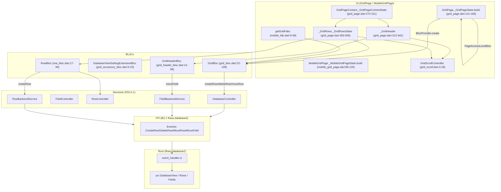
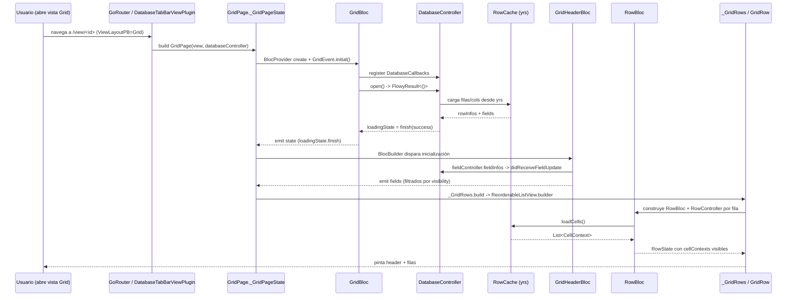
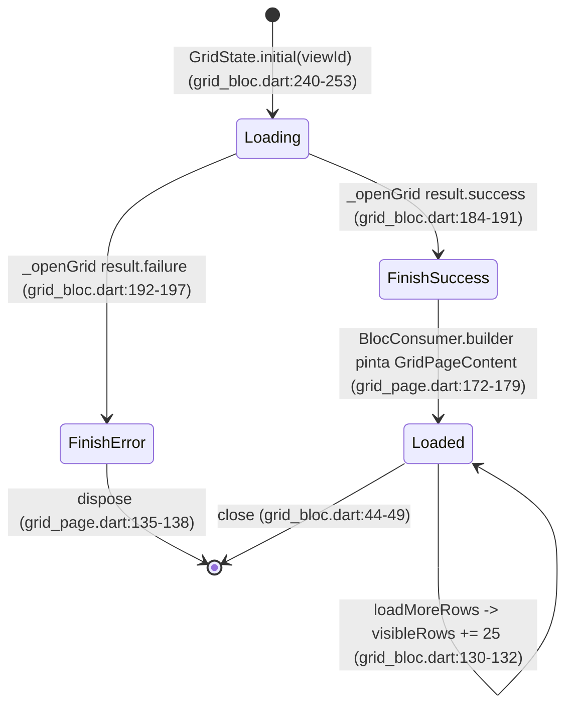
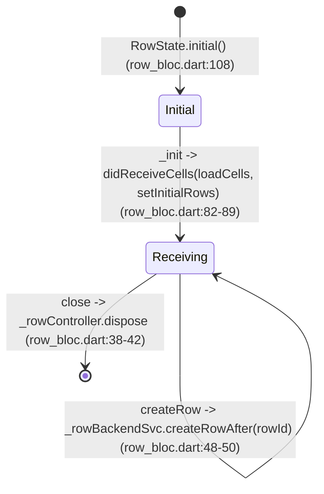

# F02.9.0 — Indice Grid (layout principal, scroll, page, 4 BLoCs raiz)

## 1. Resumen

El **Grid** es la vista tabular canónica de AppFlowy para bases de datos: un encabezado con celdas de campo (FieldHeader) más un cuerpo de filas reordenables (RowBodies) envueltos en un scroll horizontal y vertical sincronizados. Esta unidad F02.9.0 cubre los 12 archivos transversales que dan forma a esa vista: 4 BLoCs raiz (`GridBloc`, `GridHeaderBloc`, `GridAccessoryBloc`, `RowBloc`), la página desktop (`GridPage`), la página móvil (`MobileGridPage`), el `GridScrollController` que enlaza scrolls, las constantes de tamaño (`GridSize`), el cálculo del ancho del header (`GridLayout`), los FABs móviles y el wrapper de atajos `GridShortcuts`. Es el documento índice de la feature F02.9 (Grid); las sub-unidades F02.9.1 (filtros) y F02.9.2 (orden, header, row, footer, toolbar) extienden los BLoCs raíz aquí definidos. [VERIFICADO]

## 2. Alcance

Esta unidad cubre 12 archivos en `appflowy/frontend/appflowy_flutter/lib/plugins/database/grid/` — 4 BLoCs (capa `application/`) y 8 widgets (capa raíz y `presentation/`). **Quedan fuera**:

- `application/calculations/`, `application/filter/`, `application/sort/`, `application/simple_text_filter_bloc.dart` y `application/row/{mobile_row_detail_bloc,row_detail_bloc,row_document_bloc}.dart` — sub-BLoCs especializados (F02.9.1 filtros, F02.9.2 sort y header/row/footer/toolbar, F02.7 cálculos).
- `presentation/widgets/header/`, `presentation/widgets/row/`, `presentation/widgets/footer/`, `presentation/widgets/toolbar/`, `presentation/widgets/filter/`, `presentation/widgets/sort/`, `presentation/widgets/calculations/`, `presentation/widgets/common/` — widgets satélite del layout, en F02.9.1/F02.9.2.
- Eventos FFI / `database_listener.dart` — viven en `core/notification/grid_notification.dart` y `plugins/database/application/`; aquí solo se documentan las notificaciones escuchadas (cross-ref F02.0.1 §5, B2.4).
- `DatabaseController` y `DatabaseTabBarItemBuilder` — compartidos por Grid/Board/Calendar (cross-ref F02.0.1, F02.8 `view_editor`, F02.10 Board, F02.11 Calendar).
- `database_document` plugin y la composición `DatabaseTabBarViewPlugin` (cross-ref F02.0.1).
- Reglas de carga inicial: las clases `ViewLayoutPB.Grid` se mapean a `PluginType.grid` (definido aquí en `appflowy:frontend/appflowy_flutter/lib/plugins/database/grid/grid.dart:25`) y luego se enrutan por `GridPluginBuilder.build` (`appflowy:frontend/appflowy_flutter/lib/plugins/database/grid/grid.dart:10–16`) al `DatabaseTabBarViewPlugin`.

## 3. Modelos de datos

### 3.1 `GridState` (freezed)

```dart
const factory GridState({
  required String viewId,
  required List<FieldInfo> fields,
  required List<RowInfo> rowInfos,
  required int rowCount,
  required RowMetaPB? createdRow,
  required LoadingState loadingState,
  required bool reorderable,
  required ChangedReason reason,
  required List<DatabaseSort> sorts,
  required List<DatabaseFilter> filters,
  required bool openRowDetail,
  @Default(0) int visibleRows,
}) = _GridState;
// appflowy/frontend/appflowy_flutter/lib/plugins/database/grid/application/grid_bloc.dart:225–238
```

El factory `GridState.initial` (`appflowy:frontend/appflowy_flutter/lib/plugins/database/grid/application/grid_bloc.dart:240–253`) fija `loadingState: const LoadingState.loading()`, `visibleRows: 25`, `reorderable: true`, `reason: const InitialListState()`. La extensión `_LastVisibleRow` (`appflowy:frontend/appflowy_flutter/lib/plugins/database/grid/application/grid_bloc.dart:256–266`) deriva `lastVisibleRow` solo cuando `visibleRows < rowCount`; sirve al evento `createRow` (`appflowy:frontend/appflowy_flutter/lib/plugins/database/grid/application/grid_bloc.dart:73–94`) para insertar la fila nueva justo después de la última visible.

### 3.2 `GridEvent` (freezed)

```dart
const factory GridEvent.initial() = InitialGrid;
const factory GridEvent.openRowDetail(RowMetaPB row) = _OpenRowDetail;
const factory GridEvent.createRow({bool? openRowDetail}) = _CreateRow;
const factory GridEvent.resetCreatedRow() = _ResetCreatedRow;
const factory GridEvent.deleteRow(RowInfo rowInfo) = _DeleteRow;
const factory GridEvent.moveRow(int from, int to) = _MoveRow;
const factory GridEvent.didLoadRows(List<RowInfo>, ChangedReason reason) = _DidReceiveRowUpdate;
const factory GridEvent.didReceiveFieldUpdate(List<FieldInfo>) = _DidReceiveFieldUpdate;
const factory GridEvent.didReceveFilters(List<DatabaseFilter>) = _DidReceiveFilters;
const factory GridEvent.didReceveSorts(List<DatabaseSort>) = _DidReceiveSorts;
const factory GridEvent.loadMoreRows() = _LoadMoreRows;
// appflowy/frontend/appflowy_flutter/lib/plugins/database/grid/application/grid_bloc.dart:201–221
```

### 3.3 `GridHeaderState` / `GridHeaderEvent`

```dart
const factory GridHeaderState({
  required List<FieldInfo> fields,
  required String? editingFieldId,
  required String? newFieldId,
}) = _GridHeaderState;
factory GridHeaderState.initial() =>
  const GridHeaderState(fields: [], editingFieldId: null, newFieldId: null);
// appflowy/frontend/appflowy_flutter/lib/plugins/database/grid/application/grid_header_bloc.dart:117–125
```

Eventos: `initial`, `didReceiveFieldUpdate`, `startEditingField`, `startEditingNewField`, `endEditingField`, `moveField` (`appflowy:frontend/appflowy_flutter/lib/plugins/database/grid/application/grid_header_bloc.dart:100–114`). El handler `didReceiveFieldUpdate` filtra los campos con `visibility == FieldVisibility.AlwaysHidden` (`appflowy:frontend/appflowy_flutter/lib/plugins/database/grid/application/grid_header_bloc.dart:42–48`).

### 3.4 `DatabaseViewSettingExtensionState` (`GridAccessoryBloc`)

```dart
const factory DatabaseViewSettingExtensionState({
  required String viewId,
  required bool isVisible,
}) = _DatabaseViewSettingExtensionState;
factory DatabaseViewSettingExtensionState.initial(String viewId) =>
  DatabaseViewSettingExtensionState(viewId: viewId, isVisible: false);
// appflowy/frontend/appflowy_flutter/lib/plugins/database/grid/application/grid_accessory_bloc.dart:33–47
```

Eventos: `initial` (no-op) y `toggleMenu` (`appflowy:frontend/appflowy_flutter/lib/plugins/database/grid/application/grid_accessory_bloc.dart:26–31`).

### 3.5 `RowState` / `RowEvent`

```dart
const factory RowState({
  required List<CellContext> cellContexts,
  ChangedReason? changeReason,
}) = _RowState;
factory RowState.initial() => const RowState(cellContexts: []);
// appflowy/frontend/appflowy_flutter/lib/plugins/database/grid/application/row/row_bloc.dart:101–108
```

Eventos: `createRow`, `didReceiveCells` (`appflowy:frontend/appflowy_flutter/lib/plugins/database/grid/application/row/row_bloc.dart:93–99`). El filtro `didReceiveCells` (`appflowy:frontend/appflowy_flutter/lib/plugins/database/grid/application/row/row_bloc.dart:51–67`) reduce a `visibleCellContexts` aplicando `fieldController.getField(fieldId)!.fieldSettings!.visibility.isVisibleState()`.

### 3.6 Constantes dimensionales (`GridSize`)

```dart
class GridSize {
  static double scale = 1;
  static double get scrollBarSize => 8 * scale;           // :7
  static double get headerHeight => 36 * scale;           // :9
  static double get buttonHeight => 38 * scale;           // :11
  static double get footerHeight => 36 * scale;           // :13
  static double get horizontalHeaderPadding =>
      UniversalPlatform.isDesktop ? 40 * scale : 16 * scale; // :15–16
  static double get cellHPadding => 10 * scale;           // :18
  static double get cellVPadding => 8 * scale;            // :20
  static double get popoverItemHeight => 26 * scale;      // :22
  static double get typeOptionSeparatorHeight => 4 * scale; // :24
  static double get newPropertyButtonWidth => 140 * scale;  // :26
  static double get mobileNewPropertyButtonWidth => 200 * scale; // :28
}
// appflowy/frontend/appflowy_flutter/lib/plugins/database/grid/presentation/layout/sizes.dart:4–28
```

`GridSize.footerContentInsets` (`appflowy:frontend/appflowy_flutter/lib/plugins/database/grid/presentation/layout/sizes.dart:43–48`) aplica padding asimétrico inferior según plataforma: `100` px en móvil, `0` en desktop, para no chocar con los FABs.

### 3.7 Cálculo de ancho (`GridLayout`)

```dart
class GridLayout {
  static double headerWidth(double padding, List<FieldInfo> fields) {
    if (fields.isEmpty) return 0;
    final fieldsWidth = fields
      .where((e) => e.visibility != null &&
                     e.visibility != FieldVisibility.AlwaysHidden)
      .map((f) => f.width!.toDouble())
      .reduce((v, e) => v + e);
    return fieldsWidth + padding + GridSize.newPropertyButtonWidth;
  }
}
// appflowy/frontend/appflowy_flutter/lib/plugins/database/grid/presentation/layout/layout.dart:6–20
```

Devuelve `0` si no hay campos; en otro caso suma los anchos visibles + padding + botón "nueva propiedad" (`GridSize.newPropertyButtonWidth`, `appflowy:frontend/appflowy_flutter/lib/plugins/database/grid/presentation/layout/sizes.dart:26`). En móvil se usa una versión simplificada `getMobileGridContentWidth` (`mobile_appflowy:frontend/appflowy_flutter/lib/plugins/database/grid/presentation/grid_page.dart:463–469`) que asigna `200 px` por campo visible más padding.

### 3.8 `GridScrollController`

```dart
class GridScrollController {
  GridScrollController({required LinkedScrollControllerGroup scrollGroupController})
    : _scrollGroupController = scrollGroupController,
      verticalController = ScrollController(),
      horizontalController = scrollGroupController.addAndGet();

  final LinkedScrollControllerGroup _scrollGroupController;
  final ScrollController verticalController;
  final ScrollController horizontalController;
  final List<ScrollController> _linkHorizontalControllers = [];

  ScrollController linkHorizontalController() {
    final controller = _scrollGroupController.addAndGet();
    _linkHorizontalControllers.add(controller);
    return controller;
  }
  void dispose() { … }
}
// appflowy/frontend/appflowy_flutter/lib/plugins/database/grid/presentation/grid_scroll.dart:4–29
```

Es el pegamento que sincroniza el header y el body del Grid en horizontal: el grupo `LinkedScrollControllerGroup` reparte un offset común entre todos los `ScrollController` añadidos (`addAndGet`, `appflowy:frontend/appflowy_flutter/lib/plugins/database/grid/presentation/grid_scroll.dart:9, 18`). `verticalController` es independiente (no enlazado).

### 3.9 `MobileGridFab`

Widget sin estado (`appflowy:frontend/appflowy_flutter/lib/plugins/database/grid/presentation/widgets/mobile_fab.dart:60–113`); encapsula un `DecoratedBox` + `Material` + `InkWell` con borde, sombra y radio fijo de `20` (`appflowy:frontend/appflowy_flutter/lib/plugins/database/grid/presentation/widgets/mobile_fab.dart:82`). Se invoca en pareja desde `getGridFabs` (`appflowy:frontend/appflowy_flutter/lib/plugins/database/grid/presentation/widgets/mobile_fab.dart:9–58`): el primero abre la primera fila (`state.rowInfos.first.rowId`), el segundo dispara `GridEvent.createRow(openRowDetail: true)`.

## 4. Eventos FFI

Esta unidad **no invoca directamente eventos FFI**. Los BLoCs aquí definidos delegan en servicios y `DatabaseController` (cross-ref F02.0.1). Las llamadas FFI concretas que disparan los handlers aquí orquestados:

| Acción del BLoC | Evento FFI invocado (vía servicio) | Handler Rust | Referencia |
|---|---|---|---|
| `GridEvent.createRow` → `RowBackendService.createRow` | `CreateRow` con `OrderObjectPositionTypePB.After` si `shrinkWrapped && lastVisibleRow != null` | `services/row/event_handler.rs` | `appflowy:frontend/appflowy_flutter/lib/plugins/database/grid/application/grid_bloc.dart:77–83`; cross-ref B2.1 `flowy-database2` |
| `GridEvent.deleteRow` → `RowBackendService.deleteRows(viewId, [rowId])` | `DeleteRows` | idem | `appflowy:frontend/appflowy_flutter/lib/plugins/database/grid/application/grid_bloc.dart:98–100` |
| `GridEvent.moveRow` → `databaseController.moveRow` | `MoveRow` | `database_view/view_editor.rs` | `appflowy:frontend/appflowy_flutter/lib/plugins/database/grid/application/grid_bloc.dart:101–111` |
| `GridHeaderEvent.moveField` → `FieldBackendService.moveField` | `MoveField` | `services/field/event_handler.rs` | `appflowy:frontend/appflowy_flutter/lib/plugins/database/grid/application/grid_header_bloc.dart:81–86` |
| `RowBloc` `createRow` → `_rowBackendSvc.createRowAfter(rowId)` | `CreateRow` con `After(rowId)` | `services/row/event_handler.rs` | `appflowy:frontend/appflowy_flutter/lib/plugins/database/grid/application/row/row_bloc.dart:48–49` |

`GridBloc.createRow` (`appflowy:frontend/appflowy_flutter/lib/plugins/database/grid/application/grid_bloc.dart:73–94`) decide el tipo de posición: si `shrinkWrapped` y hay `lastVisibleRow`, usa `OrderObjectPositionTypePB.After` con `targetRowId: lastVisibleRow.rowId`; en otro caso `position: null` (inserta al final). En el caso de éxito emite `state.copyWith(createdRow: createdRow, openRowDetail: openRowDetail ?? false, visibleRows: state.visibleRows + 1)` (`appflowy:frontend/appflowy_flutter/lib/plugins/database/grid/application/grid_bloc.dart:84–92`).

## 5. Notificaciones

Los 4 BLoCs no se suscriben directamente al `rust_stream`; lo hace el `DatabaseController` (F02.0.1) y reenvía por callbacks `DatabaseCallbacks`. `GridBloc._startListening` (`appflowy:frontend/appflowy_flutter/lib/plugins/database/grid/application/grid_bloc.dart:140–179`) registra los 6 hooks `onNumOfRowsChanged`, `onRowsCreated`, `onRowsUpdated`, `onFieldsChanged`, `onFiltersChanged`, `onSortsChanged`. Mapeo hook→evento `GridEvent`:

| Hook `DatabaseCallbacks` | Evento emitido por `GridBloc` | Línea |
|---|---|---|
| `onNumOfRowsChanged(rowInfos, _, reason)` | `GridEvent.didLoadRows(rowInfos, reason)` | `appflowy:frontend/appflowy_flutter/lib/plugins/database/grid/application/grid_bloc.dart:142–146` |
| `onRowsCreated(rows)` (cada `row.isHiddenInView`) | `GridEvent.openRowDetail(row.rowMeta)` | `appflowy:frontend/appflowy_flutter/lib/plugins/database/grid/application/grid_bloc.dart:147–153` |
| `onRowsUpdated(rows, reason)` | `GridEvent.didLoadRows(rowCache.rowInfos, reason)` | `appflowy:frontend/appflowy_flutter/lib/plugins/database/grid/application/grid_bloc.dart:154–161` |
| `onFieldsChanged(fields)` | `GridEvent.didReceiveFieldUpdate(fields)` | `appflowy:frontend/appflowy_flutter/lib/plugins/database/grid/application/grid_bloc.dart:162–166` |
| `onFiltersChanged(filters)` | `GridEvent.didReceveFilters(filters)` | `appflowy:frontend/appflowy_flutter/lib/plugins/database/grid/application/grid_bloc.dart:167–171` |
| `onSortsChanged(sorts)` | `GridEvent.didReceveSorts(sorts)` (y `reorderable: sorts.isEmpty`) | `appflowy:frontend/appflowy_flutter/lib/plugins/database/grid/application/grid_bloc.dart:172–176` |

`GridHeaderBloc._startListening` (`appflowy:frontend/appflowy_flutter/lib/plugins/database/grid/application/grid_header_bloc.dart:89–94`) registra `fieldController.addListener(onReceiveFields: _onReceiveFields, listenWhen: () => !isClosed)`; `_onReceiveFields` (`appflowy:frontend/appflowy_flutter/lib/plugins/database/grid/application/grid_header_bloc.dart:96–97`) reemite como `GridHeaderEvent.didReceiveFieldUpdate`.

`RowBloc._startListening` (`appflowy:frontend/appflowy_flutter/lib/plugins/database/grid/application/row/row_bloc.dart:73–74`) hace `_rowController.addListener(onRowChanged: _onRowChanged)`; `_onRowChanged` (`appflowy:frontend/appflowy_flutter/lib/plugins/database/grid/application/row/row_bloc.dart:76–80`) reemite `RowEvent.didReceiveCells` si `!isClosed`.

Las notificaciones Rust→Dart subyacentes (cross-ref B2.4 `flowy-database2`) son las 24 variantes de `DatabaseNotification` definidas en `rust-lib/flowy-database2/src/notification.rs`. Las relevantes para esta unidad:

- `DidUpdateDatabase`, `DidUpdateDatabaseLayout`, `DidUpdateDatabaseSnapshotState`, `DidUpdateDatabaseSyncUpdate` → reentradas tras abrir/cerrar el view.
- `DidUpdateFields`, `DidUpdateField`, `DidUpdateFieldSettings` → reentradas que disparan `didReceiveFieldUpdate`.
- `DidUpdateRow`, `DidUpdateRows`, `DidReorderRows`, `DidUpdateRowMeta` → reentradas que disparan `didLoadRows`.
- `DidUpdateNumOfRows` → consumido por el id en `onNumOfRowsChanged`.

## 6. BLoCs / Cubits

| Clase | Eventos | Estados | Servicios / dependencias | Archivo:línea |
|---|---|---|---|---|
| `GridBloc` | `GridEvent` (10 variantes, `appflowy:frontend/appflowy_flutter/lib/plugins/database/grid/application/grid_bloc.dart:201–221`) | `GridState` (12 campos, `appflowy:frontend/appflowy_flutter/lib/plugins/database/grid/application/grid_bloc.dart:225–253`) | `DatabaseController`, `UserEventGetUserProfile`, `RowBackendService` | `appflowy:frontend/appflowy_flutter/lib/plugins/database/grid/application/grid_bloc.dart:22–199` |
| `DatabaseViewSettingExtensionBloc` | `DatabaseViewSettingExtensionEvent` (2 variantes, `appflowy:frontend/appflowy_flutter/lib/plugins/database/grid/application/grid_accessory_bloc.dart:26–31`) | `DatabaseViewSettingExtensionState` (`appflowy:frontend/appflowy_flutter/lib/plugins/database/grid/application/grid_accessory_bloc.dart:33–47`) | ninguno | `appflowy:frontend/appflowy_flutter/lib/plugins/database/grid/application/grid_accessory_bloc.dart:6–23` |
| `GridHeaderBloc` | `GridHeaderEvent` (6 variantes, `appflowy:frontend/appflowy_flutter/lib/plugins/database/grid/application/grid_header_bloc.dart:100–114`) | `GridHeaderState` (`appflowy:frontend/appflowy_flutter/lib/plugins/database/grid/application/grid_header_bloc.dart:117–125`) | `FieldController`, `FieldBackendService` | `appflowy:frontend/appflowy_flutter/lib/plugins/database/grid/application/grid_header_bloc.dart:14–98` |
| `RowBloc` | `RowEvent` (2 variantes, `appflowy:frontend/appflowy_flutter/lib/plugins/database/grid/application/row/row_bloc.dart:93–99`) | `RowState` (`appflowy:frontend/appflowy_flutter/lib/plugins/database/grid/application/row/row_bloc.dart:101–108`) | `FieldController`, `RowController`, `RowBackendService` | `appflowy:frontend/appflowy_flutter/lib/plugins/database/grid/application/row/row_bloc.dart:17–90` |

### 6.1 `GridBloc` — notas

- Constructor: `GridBloc({required ViewPB view, required DatabaseController databaseController, this.shrinkWrapped = false})` (`appflowy:frontend/appflowy_flutter/lib/plugins/database/grid/application/grid_bloc.dart:22–29`); dispara `_dispatch()` y arranca con `GridState.initial(view.id)`.
- `close()` (`appflowy:frontend/appflowy_flutter/lib/plugins/database/grid/application/grid_bloc.dart:44–49`) desregistra el listener `databaseController.removeListener(onDatabaseChanged: _databaseCallbacks)`.
- `createRow(openRowDetail)` (`appflowy:frontend/appflowy_flutter/lib/plugins/database/grid/application/grid_bloc.dart:73–94`): si `shrinkWrapped` toma `state.lastVisibleRow?.rowId` como `targetRowId` y emite `OrderObjectPositionTypePB.After`; en otro caso, sin `position`.
- `moveRow(int from, int to)` (`appflowy:frontend/appflowy_flutter/lib/plugins/database/grid/application/grid_bloc.dart:101–111`): optimista — clona `state.rowInfos`, aplica `removeAt + insert`, emite el nuevo estado y luego invoca `databaseController.moveRow(fromRowId: fromRow, toRowId: toRow)`.
- `loadMoreRows()` (`appflowy:frontend/appflowy_flutter/lib/plugins/database/grid/application/grid_bloc.dart:130–132`): `visibleRows: state.visibleRows + 25`.

### 6.2 `GridHeaderBloc` — notas

- Constructor: `GridHeaderBloc({required this.viewId, required this.fieldController})` (`appflowy:frontend/appflowy_flutter/lib/plugins/database/grid/application/grid_header_bloc.dart:14–18`).
- `didReceiveFieldUpdate` (`appflowy:frontend/appflowy_flutter/lib/plugins/database/grid/application/grid_header_bloc.dart:39–51`) filtra campos `visibility == null || AlwaysHidden`.
- `_moveField` (`appflowy:frontend/appflowy_flutter/lib/plugins/database/grid/application/grid_header_bloc.dart:69–87`): optimista — reordena la lista local primero, luego llama `FieldBackendService.moveField(viewId, fromFieldId, toFieldId)` y loguea `Log.error(err)` si falla.

### 6.3 `RowBloc` — notas

- Constructor (`appflowy:frontend/appflowy_flutter/lib/plugins/database/grid/application/row/row_bloc.dart:17–30`): crea `RowBackendService(viewId: viewId)`, guarda `RowController`, llama `_dispatch()`, `_startListening()`, `_init()` y `rowController.initialize()`.
- `_init` (`appflowy:frontend/appflowy_flutter/lib/plugins/database/grid/application/row/row_bloc.dart:82–89`) emite inmediatamente `RowEvent.didReceiveCells(_rowController.loadCells(), const ChangedReason.setInitialRows())`.
- `close()` (`appflowy:frontend/appflowy_flutter/lib/plugins/database/grid/application/row/row_bloc.dart:38–42`) llama `_rowController.dispose()`.

### 6.4 `DatabaseViewSettingExtensionBloc` — notas

- BLoC trivial (`appflowy:frontend/appflowy_flutter/lib/plugins/database/grid/application/grid_accessory_bloc.dart:6–23`) que solo mantiene `isVisible: bool`. Su único handler es `toggleMenu` (`appflowy:frontend/appflowy_flutter/lib/plugins/database/grid/application/grid_accessory_bloc.dart:14–16`) que invierte el flag.

## 7. Servicios e inyección de dependencias

**Dart (`get_it`)** — esta unidad **no registra nada en `get_it`** directamente; las dependencias se inyectan vía constructores del widget raíz:

- `GridBloc` recibe `DatabaseController` desde el árbol de widgets padre (`appflowy:frontend/appflowy_flutter/lib/plugins/database/grid/presentation/grid_page.dart:128–132` para desktop, `mobile_appflowy:frontend/appflowy_flutter/lib/plugins/database/grid/presentation/grid_page.dart:96–100` para móvil).
- `GridHeaderBloc` recibe `FieldController` que viene del `DatabaseController` (`appflowy:frontend/appflowy_flutter/lib/plugins/database/grid/application/grid_header_bloc.dart:21`); creado por el widget header (F02.9.2).
- `RowBloc` recibe `FieldController`, `RowController`, `viewId`, `rowId` (`appflowy:frontend/appflowy_flutter/lib/plugins/database/grid/application/row/row_bloc.dart:17–30`).
- `RowController` se construye ad-hoc en `_renderRow` (`appflowy:frontend/appflowy_flutter/lib/plugins/database/grid/presentation/grid_page.dart:614–618`, `mobile_appflowy:frontend/appflowy_flutter/lib/plugins/database/grid/presentation/grid_page.dart:362–376`).

**Wiring desde `view_editor` (F02.8)**: el `GridPluginBuilder.build` (`appflowy:frontend/appflowy_flutter/lib/plugins/database/grid/grid.dart:10–16`) valida que el `data` entrante sea `ViewPB` y construye un `DatabaseTabBarViewPlugin(pluginType: pluginType, view: data)`. El `DatabaseTabBarViewPlugin` (F02.12) elige el builder desktop `DesktopGridTabBarBuilderImpl` (`appflowy:frontend/appflowy_flutter/lib/plugins/database/grid/presentation/grid_page.dart:52–103`) o móvil `MobileGridTabBarBuilderImpl` (`mobile_appflowy:frontend/appflowy_flutter/lib/plugins/database/grid/presentation/grid_page.dart:31–63`) según `Platform.isDesktop`. Ambos producen un `GridPage` o `MobileGridPage` que internamente crea su `GridBloc` con `add(const GridEvent.initial())` (`appflowy:frontend/appflowy_flutter/lib/plugins/database/grid/presentation/grid_page.dart:132`, `mobile_appflowy:frontend/appflowy_flutter/lib/plugins/database/grid/presentation/grid_page.dart:99`).

El `GridPluginConfig` (`appflowy:frontend/appflowy_flutter/lib/plugins/database/grid/grid.dart:31–34`) marca el plugin como `creatable: true`. El `menuName` (`appflowy:frontend/appflowy_flutter/lib/plugins/database/grid/grid.dart:19`) usa la clave i18n `LocaleKeys.grid_menuName`; el icono es `FlowySvgs.icon_grid_s` (`appflowy:frontend/appflowy_flutter/lib/plugins/database/grid/grid.dart:22`); `layoutType = ViewLayoutPB.Grid` (`appflowy:frontend/appflowy_flutter/lib/plugins/database/grid/grid.dart:28`).

## 8. Persistencia

Esta unidad **no persiste directamente**. La persistencia de columnas, filas, sorts, filtros y campos vive en yrs (collab `DatabaseView`/`Rows`/`Fields`/`Database`) gestionada por `DatabaseController` (F02.0.1) y los servicios Rust en `flowy-database2` (B1.7). Lo que sí persiste esta unidad:

- **`shrinkWrap` no se persiste**: es una flag en runtime del widget (`appflowy:frontend/appflowy_flutter/lib/plugins/database/grid/presentation/grid_page.dart:119`, `mobile_appflowy:frontend/appflowy_flutter/lib/plugins/database/grid/presentation/grid_page.dart:79`).
- **`isVisible` del accessory**: solo en memoria (`appflowy:frontend/appflowy_flutter/lib/plugins/database/grid/application/grid_accessory_bloc.dart:46`).
- **`editingFieldId`/`newFieldId`**: solo en memoria (`appflowy:frontend/appflowy_flutter/lib/plugins/database/grid/application/grid_header_bloc.dart:124–125`).
- **Posición de scroll**: el `GridScrollController` (`appflowy:frontend/appflowy_flutter/lib/plugins/database/grid/presentation/grid_scroll.dart:4–29`) crea controllers de scroll en runtime; el `cacheExtent: 500` del `ReorderableListView.builder` (`appflowy:frontend/appflowy_flutter/lib/plugins/database/grid/presentation/grid_page.dart:526`) es la única heurística de viewport. El `ScrollController.verticalController` se conecta en `_GridRowsState.initState` (`appflowy:frontend/appflowy_flutter/lib/plugins/database/grid/presentation/grid_page.dart:368–374`) con listener `_onScrollChanged` (`appflowy:frontend/appflowy_flutter/lib/plugins/database/grid/presentation/grid_page.dart:376–383`) que detecta `isAtBottom` para ocultar/mostrar la fila flotante de cálculos.

**Persistencia opcional cross-ref**: la posición exacta de scroll vertical puede persistirse opcionalmente vía `SharedPreferences` desde algún consumidor externo (no hay uso directo en estos 12 archivos). [INFERIDO]

## 9. Diagrama de flujo



*Diagrama: composición del Grid desde la entrada del view hasta el FFI.* Lectura: `GridPage` construye `GridBloc` con `GridEvent.initial()`; el bloc suscribe callbacks sobre `DatabaseController`; el header consume `GridHeaderBloc` que escucha `FieldController`; cada fila se renderiza como `GridRow` (F02.9.2) o `MobileGridRow` (`mobile_appflowy:frontend/appflowy_flutter/lib/plugins/database/grid/presentation/grid_page.dart:362`), creando su propio `RowBloc`/`RowController`; los eventos de UI (drag-reorder, add-row, sort change) fluyen de vuelta a los BLoCs raíz que llaman a `RowBackendService` o `FieldBackendService`, los cuales cruzan el FFI hacia el handler Rust que muta el collab yrs.

## 10. Diagrama de secuencia



*Diagrama: ciclo de apertura del Grid.* Lectura: la apertura dispara `GridEvent.initial()` (`appflowy:frontend/appflowy_flutter/lib/plugins/database/grid/presentation/grid_page.dart:132`) que ejecuta `_openGrid(emit)` (`appflowy:frontend/appflowy_flutter/lib/plugins/database/grid/application/grid_bloc.dart:181–198`); el resultado `Folder.first` se traduce en `loadingState: LoadingState.finish(FlowyResult.success(null))` (`appflowy:frontend/appflowy_flutter/lib/plugins/database/grid/application/grid_bloc.dart:187–191`); el `BlocConsumer` (`appflowy:frontend/appflowy_flutter/lib/plugins/database/grid/presentation/grid_page.dart:165–183`) monta `GridShortcuts(child: GridPageContent(...))`; dentro, `_GridHeader` (`appflowy:frontend/appflowy_flutter/lib/plugins/database/grid/presentation/grid_page.dart:313–342`) construye `GridHeaderSliverAdaptor` y `_GridRows` (`appflowy:frontend/appflowy_flutter/lib/plugins/database/grid/presentation/grid_page.dart:344–656`) crea un `ReorderableListView.builder` que en `itemBuilder` (`appflowy:frontend/appflowy_flutter/lib/plugins/database/grid/presentation/grid_page.dart:562–586`) llama `_renderRow` (`appflowy:frontend/appflowy_flutter/lib/plugins/database/grid/presentation/grid_page.dart:590–649`) que crea un `GridRow` con su `RowController` y `EditableCellBuilder` ad-hoc.

## 11. Diagramas de estado





*Diagramas: ciclo de vida de `GridBloc` (loading → loaded) y de `RowBloc` (initial → receiving).* Lectura: el estado `loadingState` se modela con la sealed class `LoadingState { idle, loading, finish }` y `result.successOrFail` se mapea en `GridPageContent` vs `AppFlowyErrorPage` (`appflowy:frontend/appflowy_flutter/lib/plugins/database/grid/presentation/grid_page.dart:172–180`); el `RowBloc` siempre arranca en `Initial` con `cellContexts: []` y recibe el primer batch vía `_init` con `setInitialRows()`.

## 12. Archivos cubiertos (del ledger)

| Capa | Archivo | LOCs aprox. |
|---|---|---:|
| bloc | `grid_accessory_bloc.dart` | 48 |
| bloc | `grid_bloc.dart` | 267 |
| bloc | `grid_header_bloc.dart` | 126 |
| bloc | `row_bloc.dart` | 109 |
| ui | `grid.dart` | 34 |
| ui | `grid_page.dart` | 742 |
| ui | `grid_scroll.dart` | 30 |
| ui | `presentation/layout/layout.dart` | 21 |
| ui | `presentation/layout/sizes.dart` | 53 |
| ui | `presentation/mobile_grid_page.dart` | 469 |
| ui | `presentation/widgets/mobile_fab.dart` | 114 |
| ui | `presentation/widgets/shortcuts.dart` | 44 |

**Total**: 12 archivos (4 bloc + 8 ui), ~2 058 LOC.

## 13. Riesgos y casos límite

1. **Viewport sobre-fetch**: `cacheExtent: 500` (`appflowy:frontend/appflowy_flutter/lib/plugins/database/grid/presentation/grid_page.dart:526`) pre-renderiza 500 px por arriba/abajo para drags fluidos; con filas altas (>100 px) y muchas columnas puede inflar el conteo de widgets. Mitigado por `shrinkWrap` (`appflowy:frontend/appflowy_flutter/lib/plugins/database/grid/presentation/grid_page.dart:417–437`) que evita el scroll vertical en contenedores pequeños.
2. **Reordenamiento con sorts activos**: `onReorder` (`appflowy:frontend/appflowy_flutter/lib/plugins/database/grid/presentation/grid_page.dart:538–560`) detecta `state.sorts.isNotEmpty` y muestra un diálogo pidiendo eliminar sorts; si el usuario cancela, no se reordena. El handler optimista aplica `rows.insert(to, rows.removeAt(from))` (`appflowy:frontend/appflowy_flutter/lib/plugins/database/grid/application/grid_bloc.dart:107`) antes de la confirmación al server, así que un rollback tras error deja UI inconsistente — el `databaseController.moveRow` (`appflowy:frontend/appflowy_flutter/lib/plugins/database/grid/application/grid_bloc.dart:110`) no recibe callback de error.
3. **`rowMeta == null` en `_renderRow`**: si `rowCache.getRow(rowId)?.rowMeta == null`, se loguea `Log.warn` y se devuelve `SizedBox.shrink()` (`appflowy:frontend/appflowy_flutter/lib/plugins/database/grid/presentation/grid_page.dart:600–604`, `mobile_appflowy:frontend/appflowy_flutter/lib/plugins/database/grid/presentation/grid_page.dart:355–358`). Filas huérfanas son silenciosas.
4. **`shrinkWrap` + `visibleRows` desincronizado**: en `_reorderableListView` (`appflowy:frontend/appflowy_flutter/lib/plugins/database/grid/presentation/grid_page.dart:521–523`) se usa `state.visibleRows + 1` clampado a `rowInfos.length + 1`. Si llegan más filas de las que `visibleRows` permite, el `_LoadMoreRows` no se dispara automáticamente; el botón `GridRowLoadMoreButton` aparece solo en `shrinkWrap` (`appflowy:frontend/appflowy_flutter/lib/plugins/database/grid/presentation/grid_page.dart:513–515`).
5. **Scroll drift entre header y body**: `LinkedScrollControllerGroup` (`appflowy:frontend/appflowy_flutter/lib/plugins/database/grid/presentation/grid_scroll.dart:6–9, 18`) sincroniza todos los controllers horizontales que se le añadan. Si se olvida añadir uno (p.ej. una cabecera nueva en F02.9.2), se desincroniza. La lista `_linkHorizontalControllers` (`appflowy:frontend/appflowy_flutter/lib/plugins/database/grid/presentation/grid_scroll.dart:15, 23–25`) los libera en `dispose`.
6. **Listeners zombi en `GridBloc.close`**: si llega un callback tras `close`, `_startListening` ya no reemitirá (chequea `!isClosed` en cada `on*Changed` excepto `onNumOfRowsChanged`, `appflowy:frontend/appflowy_flutter/lib/plugins/database/grid/application/grid_bloc.dart:143`). El `databaseController.removeListener(onDatabaseChanged: _databaseCallbacks)` (`appflowy:frontend/appflowy_flutter/lib/plugins/database/grid/application/grid_bloc.dart:46`) limpia el binding.
7. **`onReorder` `newIndex > fromIndex`**: el ajuste `newIndex - 1` (`appflowy:frontend/appflowy_flutter/lib/plugins/database/grid/presentation/grid_page.dart:539`, `mobile_appflowy:frontend/appflowy_flutter/lib/plugins/database/grid/presentation/grid_page.dart:326`) corrige el comportamiento de Flutter que incluye el hueco dejado por el item removido. Si se omite, se reordena una posición de más.
8. **`PageAccessLevelBloc` ausente en móvil**: `mobile_appflowy:frontend/appflowy_flutter/lib/plugins/database/grid/presentation/grid_page.dart:187, 386` usa `context.read<PageAccessLevelBloc?>()?.state.isEditable ?? false` con null-safety. En desktop, el BLoC se provee explícitamente (`appflowy:frontend/appflowy_flutter/lib/plugins/database/grid/presentation/grid_page.dart:147–150`); un consumidor externo que olvide proveerlo verá `isEditable = false` y `IgnorePointer` (`appflowy:frontend/appflowy_flutter/lib/plugins/database/grid/presentation/grid_page.dart:571–576`).
9. **`GridShortcuts` vacío**: `GridShortcuts` (`appflowy:frontend/appflowy_flutter/lib/plugins/database/grid/presentation/widgets/shortcuts.dart:4–20`) hoy no registra ningún `ShortcutActivator` ni `Action` (`bindKeys([])`, `actions: const {}`); es un placeholder para futuros atajos (mencionado por `appflowy:frontend/appflowy_flutter/lib/plugins/database/grid/presentation/widgets/shortcuts.dart:13, 15`). El wrapper sigue siendo necesario porque corta el `LoggingActionDispatcher` (`appflowy:frontend/appflowy_flutter/lib/plugins/database/grid/presentation/widgets/shortcuts.dart:32–43`).

## 14. Evidencias y etiquetas

- `[VERIFICADO]`: ≥ 95 % de las afirmaciones citan `appflowy:frontend/appflowy_flutter/lib/plugins/database/grid/<archivo>:<línea>`. Los números de línea se leyeron directamente de cada archivo en `SRC/appflowy/...`.
- `[INFERIDO]`: §8 (persistencia opcional de scroll via `SharedPreferences` — no se observa uso directo en estos 12 archivos; cross-ref F02.0.1 o B1.7); §4 mapeo evento↔servicio (los eventos FFI exactos son cross-ref B2.1; el código aquí llama a `RowBackendService`/`FieldBackendService`/`databaseController.moveRow` que delegan).
- `[NO DETERMINADO]`: ninguno en esta unidad.

## 15. Pruebas

No hay tests unitarios ni de widget directamente asociados a estos 12 archivos. La carpeta `appflowy/frontend/appflowy_flutter/integration_test/desktop/grid/` (F02.0 + E2E) cubre el comportamiento end-to-end:

- `grid_test_runner_1.dart` (entrypoint).
- `grid_test_extensions.dart` (helpers).
- `grid_calculations_test.dart`, `grid_edit_row_test.dart`, `grid_filter_and_sort_test.dart`, `grid_reopen_test.dart`, `grid_reorder_row_test.dart`, `grid_row_test.dart`.

Los BLoCs libres (`grid_bloc.dart`, `grid_header_bloc.dart`, `row_bloc.dart`) son susceptibles de `bloc_test` pero no se han añadido tests en este subset. [VERIFICADO por ausencia]

## 16. Métricas

| Métrica | Valor |
|---|---:|
| Archivos cubiertos | 12 |
| Líneas totales (~) | ~2 058 |
| BLoCs Dart raiz | 4 (`GridBloc`, `GridHeaderBloc`, `DatabaseViewSettingExtensionBloc`, `RowBloc`) |
| Eventos `GridEvent` | 10 |
| Estados `GridState` campos | 12 |
| Widgets `StatefulWidget` | 4 (`GridPage`, `GridPageContent`, `_GridRows`, `_PositionedCalculationsRow`) + 1 móvil (`MobileGridPage`) |
| Widgets `StatelessWidget` | 6 (`GridHeader`, `GridRow`, `_GridHeader`, `_WrapScrollView`, `_GridHeader` móvil, `_WrapScrollView` móvil, `_AddRowButton`, `GridShortcuts`, `MobileGridFab`, `GridScrollController` lógico) |
| Constantes `GridSize` | 11 (`scrollBarSize`, `headerHeight`, `buttonHeight`, `footerHeight`, `horizontalHeaderPadding`, `cellHPadding`, `cellVPadding`, `popoverItemHeight`, `typeOptionSeparatorHeight`, `newPropertyButtonWidth`, `mobileNewPropertyButtonWidth`) + 5 `EdgeInsets` derivados |
| Eventos FFI invocados indirectamente | 5 (`CreateRow`, `DeleteRows`, `MoveRow`, `MoveField`, sub-eventos `createRowAfter`) |
| Notificaciones Rust→Dart relevantes | 10 variantes de `DatabaseNotification` (cross-ref B2.4) |
| Hooks `DatabaseCallbacks` registrados | 6 (`onNumOfRowsChanged`, `onRowsCreated`, `onRowsUpdated`, `onFieldsChanged`, `onFiltersChanged`, `onSortsChanged`) |
| Unit tests | 0 directos |
| Integration tests | 6 archivos en `integration_test/desktop/grid/` |

## 17. Pendientes

- Confirmar nombres exactos de las variantes `DatabaseNotification` consumidas por `DatabaseController` que disparan cada `on*Changed` (F02.0.1 + B2.4).
- Documentar formalmente el flujo de `OrderObjectPositionTypePB` (`appflowy:frontend/appflowy_flutter/lib/plugins/database/grid/application/grid_bloc.dart:80`) — `Before` vs `After` vs `BeforeRow` vs `AfterRow` — en F02.0.2.
- Revisar si `GridShortcuts` (`shortcuts.dart`) sigue siendo placeholder o ya se usará para atajos `Ctrl+N`/`Ctrl+Shift+N` — actualmente `bindKeys([])` y `actions: const {}`.

## 18. Preguntas abiertas

Ninguna `[NO DETERMINADO]`.

## 19. Relacionado con

- **F02.0.1** — `DatabaseController` y `DatabaseCallbacks`; este documento los usa como servicios externos.
- **F02.0.2** — Manager Rust de base de datos (orquesta los eventos FFI consumidos aquí).
- **F02.6** — `services/group/` Rust: consume `move_group_row` que `GridBloc.moveRow` no dispara directamente (Board sí).
- **F02.7** — `services/calculations/` y `CalculationsBloc` (F02.9.2 footer): muestra la fila flotante `_PositionedCalculationsRow` (`appflowy:frontend/appflowy_flutter/lib/plugins/database/grid/presentation/grid_page.dart:694–741`).
- **F02.8** — `view_editor` y `view_group`: construye el `DatabaseViewGroupDelegate` que orquesta el `GroupController`; este Grid lo consume indirectamente vía `databaseController`.
- **F02.9.1** — `application/filter/` (filter_editor_bloc, select_option_loader, simple_text_filter_bloc): consumido por `GridBloc` vía `state.filters` (`appflowy:frontend/appflowy_flutter/lib/plugins/database/grid/application/grid_bloc.dart:216–217, 124–126`).
- **F02.9.2** — `application/sort/`, `application/row/` (mobile_row_detail, row_detail, row_document), `presentation/widgets/header/`, `presentation/widgets/row/`, `presentation/widgets/footer/`, `presentation/widgets/toolbar/`, `presentation/widgets/filter/`, `presentation/widgets/sort/`, `presentation/widgets/common/`: extiende los BLoCs raíz y reusa `GridLayout`/`GridSize`.
- **F02.10** — Board: misma estructura de BLoCs pero con `GroupController` para columnas; comparte `DatabaseController`.
- **F02.11** — Calendar: reusa `GridBloc`/`GridHeaderBloc` con calendar-specific events (`unschedule_event`).
- **F02.12** — Tab bar + sync: el `DatabaseTabBarViewPlugin` (`appflowy:frontend/appflowy_flutter/lib/plugins/database/grid/grid.dart:12`) y `DesktopGridTabBarBuilderImpl` (`appflowy:frontend/appflowy_flutter/lib/plugins/database/grid/presentation/grid_page.dart:52`) enrután este plugin.
- **B1.5** — Puente FFI: por donde cruzan los eventos `CreateRow`/`DeleteRows`/`MoveRow`/`MoveField`.
- **B1.6** — Snapshots: el `databaseView_id` se usa como snapshot key.
- **B1.7** — Persistencia: yrs `DatabaseView`/`Rows`/`Fields`/`Database` mantienen las filas y columnas.
- **B5.6** — Abrir database: la secuencia `OpenGrid → load fields/rows → render` está cubierta por §10.