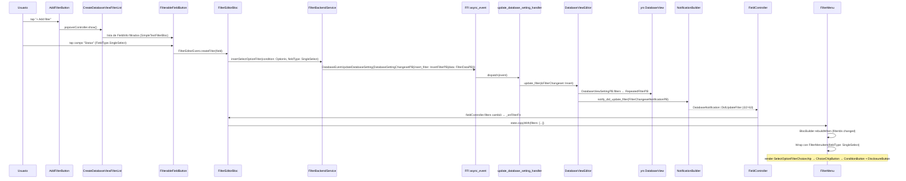
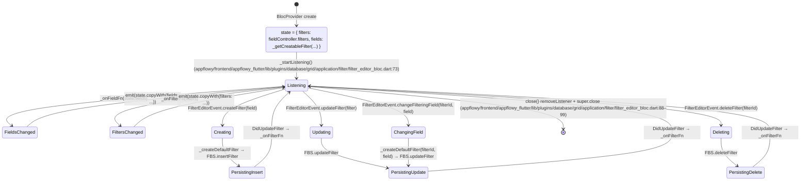

# F02.9.1 — Grid filtros y choicechips (y calculations widgets)

## 1. Resumen

Sub-unidad del feature F02 (Bases de datos) que documenta la **capa de presentación y orquestación de BLoCs en el Grid** para los sistemas de filtros por-tipo-de-campo (choicechips), el menú de creación de filtros, y la fila de cálculos agregados. En la carpeta `plugins/database/grid/` se localizan `FilterEditorBloc` y `SimpleTextFilterBloc` (orquestan la lista de filtros de una vista), `CalculationsBloc` (resuelve los `CalculationPB` por campo y dispara actualizaciones), 12 *choicechips* especializados en `presentation/widgets/filter/choicechip/` —uno por cada `FieldType` soportado (Checkbox, Checklist, DateTime, Number, RichText, SelectOption, Time, URL) más el widget base reutilizable (`ChoiceChipButton`) y los widgets comunes `condition_button.dart`/`disclosure_button.dart`/`create_filter_list.dart`/`filter_menu.dart`/`filter_menu_item.dart`. La sub-unidad también cubre la fila `GridCalculationsRow` con `CalculateCell`, `CalculationSelector`, `CalculationTypeItem` y `RemoveCalculationButton` que dan la barra inferior de cálculos agregados. Total: 27 archivos (5 `bloc` + 22 `ui`), 100 % Dart. **[VERIFICADO]**

## 2. Alcance

Esta unidad documenta los **27 archivos asignados**: 5 archivos de la capa `bloc` (lógica de Filtros y Cálculos + loader de opciones de selección + filtro de texto auxiliar) y 22 widgets de UI (12 choicechips + menú + creación + cálculos + separador común). **Quedan fuera del scope**:

- Los BLoCs/servicios padre en `application/calculations/` que **no** están en esta unidad: `calculation_type_ext.dart`, `calculations_service.dart`, `calculations_listener.dart` (F02.7).
- Las entidades protobuf que se importan (`FilterPB`, `CheckboxFilterPB`, `DateFilterPB`, `NumberFilterPB`, `TextFilterPB`, `SelectOptionFilterPB`, `ChecklistFilterPB`, `TimeFilterPB`, `MediaFilterPB`, `DatabaseFilter`, `FilterConditionPB`, `CalculationPB`, `CalculationType`, `DatabaseNotification`) que se generan en `appflowy_backend/protobuf/flowy-database2/...` (B2.1 `flowy-database2`).
- El lado Rust del servicio de filtros (`flowy-database2/src/services/filter/` y `services/filter/controller.rs`) — F02.4.
- El lado Rust del servicio de cálculos (`flowy-database2/src/services/calculations/` y `controller.rs`) — F02.7.
- La orquestación de la vista: `DatabaseEditor`, `DatabaseViewEditor` y los handlers `update_filter_handler` / `update_calculation_handler` (F02.8 §4).
- `DatabasePluginWidgetBuilderSize` que provee el `horizontalPadding` consumido por `GridCalculationsRow` (F02.9.0, fuera de esta unidad).
- Las listas de condiciones específicas de Mobile (`mobile/presentation/database/view/database_filter_condition_list.dart`) reusadas por `SelectOptionFilterConditionList` (F02.7-mobile, fuera de alcance).

Cruces relevantes: F02.0 (índice), F02.0.1 (BLoCs), F02.0.1.2 (DatabaseEditor), F02.4 (filtros), F02.7 (cálculos), F02.8 (orquestación de vista), F02.9.0 (Grid layout), F02.9.2 (GridHeader / GridFooter), F02.10 (Board), F02.11 (Calendar), F02.12 (Tab bar + snapshots), B2.1 (catálogo eventos), B2.2 (catálogo protobuf), B2.3 (catálogo blocs), B2.4 (catálogo notificaciones), B5.6 (apertura y aplicación de filtros).

## 3. Modelos de datos

### 3.1 Jerarquía `DatabaseFilter` (sub-tipos por `FieldType`)

Los filtros se materializan en Dart como una clase sellada generada a partir de los protobuf `FilterPB` (definidos en `flowy-database2/src/entities/filter_entities/`, B2.1). La jerarquía la construye `database_filter_from_pb` (revisado en F02.4). Los choicechips consumen las subclases:

| Sub-tipo de filtro | Choicechip | Condiciones relevantes | Archivo:línea del choicechip |
|---|---|---|---|
| `CheckboxFilter` (condition `IsChecked`/`IsUnChecked`) | `CheckboxFilterChoicechip` | `CheckboxFilterConditionPB` | `appflowy/frontend/appflowy_flutter/lib/plugins/database/grid/presentation/widgets/filter/choicechip/checkbox.dart:17` |
| `ChecklistFilter` (condition `IsComplete`/`IsIncomplete`) | `ChecklistFilterChoicechip` | `ChecklistFilterConditionPB` | `appflowy/frontend/appflowy_flutter/lib/plugins/database/grid/presentation/widgets/filter/choicechip/checklist.dart:15` |
| `DateTimeFilter` (condition `DateStartsOn`, `DateStartsAfter`, `DateStartsBetween`, `DateStartIsEmpty`, …) | `DateFilterChoicechip` (cubre `DateTime`, `LastEditedTime`, `CreatedTime`) | `DateFilterConditionPB` | `appflowy/frontend/appflowy_flutter/lib/plugins/database/grid/presentation/widgets/filter/choicechip/date.dart:20` |
| `NumberFilter` (condition `Equal`, `LessThan`, `GreaterThan`, `NumberIsEmpty`, …) | `NumberFilterChoiceChip` | `NumberFilterConditionPB` | `appflowy/frontend/appflowy_flutter/lib/plugins/database/grid/presentation/widgets/filter/choicechip/number.dart:18` |
| `TextFilter` (condition `TextContains`, `TextDoesNotContain`, `TextStartsWith`, `TextIsEmpty`, …) | `TextFilterChoicechip` | `TextFilterConditionPB` | `appflowy/frontend/appflowy_flutter/lib/plugins/database/grid/presentation/widgets/filter/choicechip/text.dart:18` |
| `TimeFilter` (condition `Equal`, `LessThan`, `NumberIsEmpty`, …) | `TimeFilterChoiceChip` | `NumberFilterConditionPB` (alias) | `appflowy/frontend/appflowy_flutter/lib/plugins/database/grid/presentation/widgets/filter/choicechip/time.dart:18` |
| `SelectOptionFilter` (condition `OptionIs`, `OptionIsNot`, `OptionContains`, `OptionDoesNotContain`, `OptionIsEmpty`, `OptionIsNotEmpty`) | `SelectOptionFilterChoicechip` (cubre `SingleSelect` y `MultiSelect`) | `SelectOptionFilterConditionPB` | `appflowy/frontend/appflowy_flutter/lib/plugins/database/grid/presentation/widgets/filter/choicechip/select_option/select_option.dart:14` |
| `URLFilter` (internamente `TextFilterPB`, condición `TextContains`) | `URLFilterChoicechip` (delega en `TextFilterEditor`) | `TextFilterConditionPB` | `appflowy/frontend/appflowy_flutter/lib/plugins/database/grid/presentation/widgets/filter/choicechip/url.dart:10` |
| `MediaFilter` (condition `MediaIsNotEmpty`, …) | (no choicechip propio en este menú; `_createDefaultFilter` crea el filtro pero el choicechip cae en el `default` de `FilterMenuItem`) | `MediaFilterConditionPB` | `appflowy/frontend/appflowy_flutter/lib/plugins/database/grid/presentation/widgets/filter/filter_menu_item.dart:39` |

El mapeo `FieldType → choicechip` está implementado en `FilterMenuItem.build` mediante un `switch` exhaustivo sobre `fieldType` (`appflowy/frontend/appflowy_flutter/lib/plugins/database/grid/presentation/widgets/filter/filter_menu_item.dart:24–40`). El case `_ => const SizedBox.shrink()` (`appflowy/frontend/appflowy_flutter/lib/plugins/database/grid/presentation/widgets/filter/filter_menu_item.dart:39`) cubre tipos sin choicechip propio (p. ej. `Media`). El case `FieldType.Time` está deshabilitado (`appflowy/frontend/appflowy_flutter/lib/plugins/database/grid/presentation/widgets/filter/filter_menu_item.dart:37–38`, ver Riesgos §13).

### 3.2 Entidad `CalculationPB` y `CalculationType`

`CalculationPB` es el protobuf generado (`flowy-database2/proto/calculation_entities.proto`) que el `CalculationsBloc` deserializa y agrupa por `fieldId`:

```dart
class CalculationsState {
  final List<FieldInfo> fields;
  final Map<String, CalculationPB> calculationsByFieldId;
}
// appflowy/frontend/appflowy_flutter/lib/plugins/database/grid/application/calculations/calculations_bloc.dart:177–187
```

`CalculationType` es un enum protobuf con 8 variantes (`Average`, `Max`, `Median`, `Min`, `Sum`, `Count`, `CountEmpty`, `CountNonEmpty`). El mapeo **`FieldType → List<CalculationType>`** permitido vive en la extensión `AvailableCalculations` (`appflowy/frontend/appflowy_flutter/lib/plugins/database/grid/application/calculations/field_type_calc_ext.dart:3–39`):

| `FieldType` | `CalculationType` permitidos |
|---|---|
| Cualquiera | `Count` (siempre, `:5–7`) |
| Todos excepto `URL`, `Checkbox`, `LastEditedTime`, `CreatedTime` | `CountEmpty`, `CountNonEmpty` (`:12–22`) |
| Solo `Number` | `Sum`, `Average`, `Min`, `Max`, `Median` (`:25–32`) |

Esta extensión la consume `CalculateCell.build` (`appflowy/frontend/appflowy_flutter/lib/plugins/database/grid/presentation/widgets/calculations/calculate_cell.dart:100`) para renderizar las opciones del `AppFlowyPopover`.

### 3.3 `CalculationsRow` y `CalculateCell`

`GridCalculationsRow` es un `StatelessWidget` que monta un `CalculationsBloc` en su `BlocProvider` (`appflowy/frontend/appflowy_flutter/lib/plugins/database/grid/presentation/widgets/calculations/calculations_row.dart:22–26`) y por cada `FieldInfo` renderiza una `CalculateCell` con `width = field.width!.toDouble()` (`appflowy/frontend/appflowy_flutter/lib/plugins/database/grid/presentation/widgets/calculations/calculations_row.dart:42`). `CalculateCell` (`appflowy/frontend/appflowy_flutter/lib/plugins/database/grid/presentation/widgets/calculations/calculate_cell.dart:18–32`) recibe `FieldInfo`, `width` y un `CalculationPB?` opcional; internamente:

- Detecta si la celda es scrollable con `WidgetsBinding.instance.addPostFrameCallback` (`appflowy/frontend/appflowy_flutter/lib/plugins/database/grid/presentation/widgets/calculations/calculate_cell.dart:51–60`).
- Construye un `AppFlowyPopover` con dirección `bottomWithCenterAligned` (`appflowy/frontend/appflowy_flutter/lib/plugins/database/grid/presentation/widgets/calculations/calculate_cell.dart:79`) cuyo `popupBuilder` (`:82–118`) enumera:
  - `RemoveCalculationButton` si ya hay un cálculo (`:91–99`),
  - todas las opciones que `fieldInfo.fieldType.calculationsForFieldType()` devuelve (`:100–115`).
- Si `calculation != null`, renderiza `_showCalculateValue` con prefijo de moneda del `NumberTypeOptionPB.format.iconSymbol(false)` (`appflowy/frontend/appflowy_flutter/lib/plugins/database/grid/presentation/widgets/calculations/calculate_cell.dart:203–209`).
- `_withoutTrailingZeros` (`appflowy/frontend/appflowy_flutter/lib/plugins/database/grid/presentation/widgets/calculations/calculate_cell.dart:194–201`) usa `trailingZerosRegex` (de `shared/patterns/common_patterns.dart`) para recortar `0.50000` → `0.5`.

## 4. Eventos FFI

Esta sub-unidad **no declara eventos FFI propios**; los eventos se importan de `flowy-database2` (B2.1, F02.4, F02.7). Los choicechips y `filter_editor_bloc.dart` terminan llamando a `FilterBackendService` (en `appflowy/frontend/appflowy_flutter/lib/plugins/database/domain/filter_service.dart`), y `CalculationsBloc` llama a `CalculationsBackendService` (`appflowy/frontend/appflowy_flutter/lib/plugins/database/application/calculations/calculations_service.dart`, F02.7).

| Evento FFI | Input PB | Output PB | Llamado por (Dart) | Referencia |
|---|---|---|---|---|
| `GetAllFilters` (`DatabaseEvent::GetAllFilters`, valor 4) | `DatabaseViewIdPB` | `RepeatedFilterPB` | `FilterBackendService.getAllFilters()` (servicio ascendente) | `appflowy/frontend/rust-lib/flowy-database2/src/event_map.rs:21` (registro), `appflowy/frontend/rust-lib/flowy-database2/src/event_map.rs:132–133` (declaración) |
| `UpdateDatabaseSetting` (valor 3) con `insert_filter: InsertFilterPB` | `DatabaseSettingChangesetPB` (`insert_filter: Some(_)`) | — | `FilterBackendService.insertFilter()` | `appflowy/frontend/rust-lib/flowy-database2/src/event_map.rs:20`, `appflowy/frontend/rust-lib/flowy-database2/src/entities/setting_entities.rs:82`; handler `update_database_setting_handler` consume los `one_of` (`:86–94`) |
| `UpdateDatabaseSetting` con `update_filter_data: UpdateFilterDataPB` | `DatabaseSettingChangesetPB` (`update_filter_data: Some(_)`) | — | `FilterBackendService.updateFilter()` (`appflowy/frontend/appflowy_flutter/lib/plugins/database/domain/filter_service.dart:249–276`) | `appflowy/frontend/rust-lib/flowy-database2/src/entities/setting_entities.rs:90` |
| `UpdateDatabaseSetting` con `update_filter_type: UpdateFilterTypePB` | `DatabaseSettingChangesetPB` (`update_filter_type: Some(_)`) | — | (cambio de tipo de filtro — reutilizado por `changeFilteringField`) | `appflowy/frontend/rust-lib/flowy-database2/src/entities/setting_entities.rs:86` |
| `UpdateDatabaseSetting` con `delete_filter: DeleteFilterPB` | `DatabaseSettingChangesetPB` (`delete_filter: Some(_)`) | — | `FilterBackendService.deleteFilter()` | `appflowy/frontend/rust-lib/flowy-database2/src/entities/setting_entities.rs:94`, `appflowy/frontend/appflowy_flutter/lib/plugins/database/domain/filter_service.dart:302–319` |
| `GetAllCalculations` (`DatabaseEvent::GetAllCalculations`, valor 163) | `DatabaseViewIdPB` | `RepeatedCalculationsPB` | `CalculationsBackendService.getCalculations()` (consumida por `CalculationsBloc._getAllCalculations`, `:133–150`) | `appflowy/frontend/rust-lib/flowy-database2/src/event_map.rs:87`, `appflowy/frontend/rust-lib/flowy-database2/src/event_map.rs:359–360` |
| `UpdateCalculation` (valor 164) | `UpdateCalculationChangesetPB` | — | `CalculationsBackendService.updateCalculation()` (consumida por `CalculationsBloc.updateCalculationType`, `:70–76`) | `appflowy/frontend/rust-lib/flowy-database2/src/event_map.rs:88`, `appflowy/frontend/rust-lib/flowy-database2/src/event_map.rs:362–363` |
| `RemoveCalculation` (valor 165) | `RemoveCalculationChangesetPB` | — | `CalculationsBackendService.removeCalculation()` (consumida por `CalculationsBloc.removeCalculation`, `:77–79`) | `appflowy/frontend/rust-lib/flowy-database2/src/event_map.rs:89`, `appflowy/frontend/rust-lib/flowy-database2/src/event_map.rs:365–366` |

> Nota: esta unidad **no emite `GetSelectOptionOptionChoices`** (no existe tal evento en `flowy-database2/src/event_map.rs`). El "loader" del lado Dart es la interfaz `SelectOptionFilterDelegate` (`appflowy/frontend/appflowy_flutter/lib/plugins/database/grid/application/filter/select_option_loader.dart:5–9`), que extrae `SelectOptionPB[]` directamente del `typeOptionData` del campo, **sin** llamada FFI.

## 5. Notificaciones

Esta unidad **no se subscribe a notificaciones** (los BLoCs `FilterEditorBloc` y `CalculationsBloc` escuchan a `FieldController` por medio de `addListener`/`removeListener`, no a `RustStream`). Las notificaciones que llegan a esta capa son:

| Notificación Rust→Dart | Emisor Rust | Listener Dart (registrado fuera de esta unidad) | Efecto UI | Referencia |
|---|---|---|---|---|
| `DatabaseNotification::DidUpdateFilter` (i32=63) | `notify_did_update_filter` (appflowy/frontend/rust-lib/flowy-database2/src/services/database_view/notifier.rs:104) tras `appflowy/frontend/rust-lib/flowy-database2/src/services/database_view/view_editor.rs:870`, `:991`, `:1030` | `database_listener.dart` → re-emite vía `database_controller.dart` → actualiza `fieldController.filters` → `FilterEditorBloc._onFilterFn` dispara `FilterEditorEvent.didReceiveFilters` | Refresca la lista de choicechips | `appflowy/frontend/rust-lib/flowy-database2/src/notification.rs:34`, `:75` |
| `DatabaseNotification::DidUpdateCalculation` (i32=87) | `CalculationChangesetNotificationPB` listener (F02.7 §5) | `calculations_listener.dart` (F02.7) → `_onCalculationChanged` parsea el `changeset` y actualiza `state.calculationsByFieldId` | Refresca `CalculateCell` (suma/promedio recalculados) | `appflowy/frontend/rust-lib/flowy-database2/src/notification.rs:51`, `:86`; lógica Dart en `appflowy/frontend/appflowy_flutter/lib/plugins/database/grid/application/calculations/calculations_bloc.dart:90–127` |

> **No existe `DatabaseNotification::DidReorderCalculations`** en `appflowy/frontend/rust-lib/flowy-database2/src/notification.rs:7–54`. El orden de los cálculos es por `fieldId` en el `Map` del `CalculationsBloc.state` (`appflowy/frontend/appflowy_flutter/lib/plugins/database/grid/application/calculations/calculations_bloc.dart:181`), por lo que no requiere notificación de reorden.

## 6. BLoCs / Cubits

| Clase | Eventos | Servicios consumidos | Archivo:línea |
|---|---|---|---|
| `FilterEditorBloc extends Bloc<FilterEditorEvent, FilterEditorState>` | `didReceiveFilters`, `didReceiveFields`, `createFilter`, `updateFilter`, `changeFilteringField`, `deleteFilter` (`:186–198`) | `FilterBackendService` (`:18`, `:32`) | `appflowy/frontend/appflowy_flutter/lib/plugins/database/grid/application/filter/filter_editor_bloc.dart:16–227` |
| `SimpleTextFilterBloc<T> extends Bloc<SimpleTextFilterEvent<T>, SimpleTextFilterState<T>>` | `updateFilter(String)`, `receiveNewValues(List<T>)` (`:54–57`) | (ninguno, filtra `values` en memoria por `comparator`) | `appflowy/frontend/appflowy_flutter/lib/plugins/database/grid/application/simple_text_filter_bloc.dart:6–65` |
| `CalculationsBloc extends Bloc<CalculationsEvent, CalculationsState>` | `started`, `didReceiveFieldUpdate`, `didReceiveCalculationsUpdate`, `updateCalculationType`, `removeCalculation` (`:155–174`) | `CalculationsBackendService` (`:18`), `CalculationsListener` (`:17`), `FieldController` (`:25`) | `appflowy/frontend/appflowy_flutter/lib/plugins/database/grid/application/calculations/calculations_bloc.dart:12–188` |
| `SelectOptionFilterDelegate` *(interfaz, no BLoC)* | `List<SelectOptionPB> getOptions(FieldInfo)` (`:8`) | `SingleSelectTypeOptionDataParser` o `MultiSelectTypeOptionDataParser` (`:18`, `:29`) | `appflowy/frontend/appflowy_flutter/lib/plugins/database/grid/application/filter/select_option_loader.dart:5–32` |

### 6.1 `FilterEditorBloc` — punto central

`FilterEditorBloc` se construye con `viewId` y un `FieldController` compartido (`:17`); en `super(...)` inicializa `state` con `fieldController.filters` y la lista "creatable" `fields = _getCreatableFilter(fieldController.fieldInfos)` (`:21–24`). `_getCreatableFilter` (`:221–227`) aplica `field.canCreateFilter && !field.isGroupField`. En `_dispatch` (`:37–71`), cada evento se mapea a una llamada de `FilterBackendService`:

- `createFilter(field)` y `changeFilteringField(filterId, field)` invocan `_createDefaultFilter(filterId, field)` (`:51–56`) que **sí** está en esta unidad. Su `switch` exhaustivo (`appflowy/frontend/appflowy_flutter/lib/plugins/database/grid/application/filter/filter_editor_bloc.dart:106–180`) mapea `FieldType` → método del backend:

  | `FieldType` | Backend call | Líneas |
  |---|---|---|
  | `Checkbox` | `_filterBackendSvc.insertCheckboxFilter(condition: IsChecked)` | `:107–112` |
  | `DateTime`/`LastEditedTime`/`CreatedTime` | `_filterBackendSvc.insertDateFilter(condition: DateStartsOn, timestamp: <hoy midnight>)` | `:113–126` |
  | `MultiSelect` | `insertSelectOptionFilter(condition: OptionContains, fieldType: MultiSelect)` | `:127–133` |
  | `Checklist` | `insertChecklistFilter(condition: IsIncomplete)` | `:134–139` |
  | `Number` | `insertNumberFilter(condition: Equal)` | `:140–145` |
  | `Time` | `insertTimeFilter(condition: Equal)` | `:146–151` |
  | `RichText` | `insertTextFilter(condition: TextContains, content: '')` | `:152–158` |
  | `SingleSelect` | `insertSelectOptionFilter(condition: OptionIs, fieldType: SingleSelect)` | `:159–165` |
  | `URL` | `insertURLFilter(condition: TextContains)` | `:166–171` |
  | `Media` | `insertMediaFilter(condition: MediaIsNotEmpty)` | `:172–177` |
  | `default` | `throw UnimplementedError()` | `:178–180` |

- `updateFilter(filter)` envía `filter.writeToBuffer()` al backend (`:57–64`). Cada choicechip construye un `filter.copyWith(...)` y dispara este evento.
- `deleteFilter(filterId)` delega en `_filterBackendSvc.deleteFilter(filterId)` (`:65–67`), disparado por el `DisclosureButton` (ver §6.5).

`close()` (`:88–99`) elimina ambos listeners. `_startListening` (`:73–86`) suscribe `_onFilterFn` y `_onFieldFn` al `FieldController` compartido.

### 6.2 `CalculationsBloc`

En el constructor (`:13–21`) instancia `CalculationsListener(viewId: viewId)` y `CalculationsBackendService(viewId: viewId)`. En `_dispatch` (`:35–82`) el evento `started` (`:38–49`) llama a `_startListening()` y `_getAllCalculations()` y emite `didReceiveFieldUpdate` con `_fieldController.fieldInfos`. `_startListening` (`:84–128`) registra `_onReceiveFields` en `FieldController` y `_calculationsListener.start(onCalculationChanged: ...)`. El `onCalculationChanged` callback (`:91–126`) pliega el `CalculationChangesetNotificationPB` para producir el `Map<String, CalculationPB>` y reemitir `didReceiveCalculationsUpdate`. El filtrado por `visibility != AlwaysHidden` se hace en `didReceiveFieldUpdate` (`:53–60`).

### 6.3 `SimpleTextFilterBloc<T>`

Es un BLoC genérico (`<T>`) que mantiene una `List<T> values` y filtra en cliente usando el `comparator` (`:16`). Útil para el buscador de campos del `CreateDatabaseViewFilterList` (ver §6.7). `_filter` (`:38–49`) emite `SimpleTextFilterState(values: result)` cada vez que se actualiza el texto o llegan valores nuevos.

### 6.4 `SelectOptionFilterDelegate`

Es una **interfaz** + dos implementaciones (`SingleSelectOptionFilterDelegateImpl`, `MultiSelectOptionFilterDelegateImpl`). `SelectOptionFilter.makeDelegate(field)` (en `filter_entities.dart`, F02.4) devuelve la implementación correcta según `fieldType`. `getOptions(fieldInfo)` parsea `field.typeOptionData` con el `TypeOptionDataParser` correspondiente y devuelve `SelectOptionPB[]`. No es un Cubit ni BLoC — es un patrón "delegate" simple para evitar acoplar el choicechip de selección al `FieldController`.

### 6.5 `DisclosureButton` y `FilterDisclosureAction`

`DisclosureButton` (`appflowy/frontend/appflowy_flutter/lib/plugins/database/grid/presentation/widgets/filter/disclosure_button.dart:11–51`) es el icono "···" que abre un `PopoverActionList<FilterDisclosureActionWrapper>` con el enum `FilterDisclosureAction { delete }` (`:53–55`). Cada choicechip conecta su `onAction` con `FilterEditorEvent.deleteFilter(filter.filterId)` (ver p. ej. `appflowy/frontend/appflowy_flutter/lib/plugins/database/grid/presentation/widgets/filter/choicechip/checkbox.dart:102–110`). El `popoverMutex` se `dispose()` en `dispose()` de cada `*FilterEditorState` (`:67–70`).

## 7. Servicios e inyección de dependencias

- **Dart (`get_it`)**: ninguno de los 27 archivos hace `getIt.register*`. Los BLoCs son creados manualmente:
  - `FilterEditorBloc` lo crea `FilterMenu.build` con `BlocProvider(create: ...)` (`appflowy/frontend/appflowy_flutter/lib/plugins/database/grid/presentation/widgets/filter/filter_menu.dart:25–29`), inyectando el `FieldController` que ya viene del árbol de widgets padre (provisto por `GridBloc`/`BoardBloc`).
  - `CalculationsBloc` lo crea `GridCalculationsRow.build` con `BlocProvider(create: ...)` (`appflowy/frontend/appflowy_flutter/lib/plugins/database/grid/presentation/widgets/calculations/calculations_row.dart:22–26`), inyectando `gridBloc.databaseController.fieldController` (`:24–25`).
  - `SimpleTextFilterBloc<FieldInfo>` lo crea `CreateDatabaseViewFilterList.build` con `BlocProvider(create: ...)` (`appflowy/frontend/appflowy_flutter/lib/plugins/database/grid/presentation/widgets/filter/create_filter_list.dart:28–32`).
- **Rust (`flowy-core/deps_resolve`)**: no interviene en esta unidad. Los servicios backend (`FilterBackendService`, `CalculationsBackendService`) son *wrappers* sobre eventos FFI generados en `appflowy_backend/dispatch/` (ver §4).
- **`SelectOptionFilterDelegate`**: instanciado por `SelectOptionFilter.makeDelegate(field)` (F02.4 — `filter_entities.dart`), no por `get_it`.

## 8. Persistencia

Esta unidad **no persiste nada directamente**. La persistencia de filtros y cálculos se delega completamente al backend:

- **Filtros**: el `DatabaseViewSettingPB` (en `appflowy/frontend/rust-lib/flowy-database2/src/entities/setting_entities.rs:22–40`) contiene `filters: RepeatedFilterPB` (`:30`). Cada filtro se serializa como protobuf binario (`filter.writeToBuffer()`) y se guarda en el `DatabaseView` collab (yrs map). Los handlers de `update_database_setting_handler` (F02.8 §4) escriben en el delegate `DatabaseViewEditor` que mapea a `appflowy/frontend/rust-lib/flowy-database2/src/services/database_view/view_editor.rs:870`, `:991`, `:1030` (notificación + persistencia).
- **Cálculos**: viven en `CalculationMap` (yrs map), con 4 claves (`CALCULATION_ID`, `FIELD_ID`, `CALCULATION_TYPE`, `CALCULATION_VALUE`) reusadas del servicio `appflowy/frontend/rust-lib/flowy-database2/src/services/calculations/entities.rs:16–19` (F02.7 §3.1). El `CalculationsBloc` solo lee el `CalculationPB` y lo renderiza; la mutación se hace por `CalculationsBackendService.updateCalculation/removeCalculation`.
- **Snapshots**: el `DatabaseView` collab (yrs) se sincroniza y persiste como snapshot en `flowy-sqlite` (F02.12 §8, B1.7 §8).

> **No existe** persistencia de "orden de cálculos" en el cliente: el orden lo da el orden de iteración del `state.fields` (`appflowy/frontend/appflowy_flutter/lib/plugins/database/grid/application/calculations/calculations_bloc.dart:53`), que a su vez viene del `FieldController.fieldInfos`.

## 9. Diagrama de flujo (crear y editar un filtro)

```mermaid
flowchart TD
    subgraph UI["UI Grid Header"]
      FM["FilterMenu (filter_menu.dart)"]
      AFB["AddFilterButton (appflowy/frontend/appflowy_flutter/lib/plugins/database/grid/presentation/widgets/filter/filter_menu.dart:73)"]
      CFL["CreateDatabaseViewFilterList (appflowy/frontend/appflowy_flutter/lib/plugins/database/grid/presentation/widgets/filter/create_filter_list.dart:17)"]
      FFB["FilterableFieldButton (appflowy/frontend/appflowy_flutter/lib/plugins/database/grid/presentation/widgets/filter/create_filter_list.dart:123)"]
      FMI["FilterMenuItem (appflowy/frontend/appflowy_flutter/lib/plugins/database/grid/presentation/widgets/filter/filter_menu_item.dart:12)"]
      CC["*FilterChoicechip (choicechip/*)"]
      CB["ChoiceChipButton (appflowy/frontend/appflowy_flutter/lib/plugins/database/grid/presentation/widgets/filter/choicechip/choicechip.dart:15)"]
      CFB["ConditionButton (appflowy/frontend/appflowy_flutter/lib/plugins/database/grid/presentation/widgets/filter/condition_button.dart:10)"]
      DB["DisclosureButton (appflowy/frontend/appflowy_flutter/lib/plugins/database/grid/presentation/widgets/filter/disclosure_button.dart:11)"]
    end
    subgraph BLoC["BLoCs (en esta unidad)"]
      FEB["FilterEditorBloc (appflowy/frontend/appflowy_flutter/lib/plugins/database/grid/application/filter/filter_editor_bloc.dart:16)"]
      STFB["SimpleTextFilterBloc-FieldInfo- (appflowy/frontend/appflowy_flutter/lib/plugins/database/grid/application/simple_text_filter_bloc.dart:6)"]
      FC["FieldController (F02.0.1)"]
    end
    subgraph Bridge["FFI / dispatch"]
      FBS["FilterBackendService (filter_service.dart)"]
      EVT["DatabaseEventUpdateDatabaseSetting"]
    end
    subgraph Rust["Rust (flowy-database2)"]
      H["update_database_setting_handler (event_handler.rs:119)"]
      VE["DatabaseViewEditor (view_editor.rs:870/991/1030)"]
      NB["NotificationBuilder (notification.rs:104)"]
    end
    subgraph Collab["yrs (DatabaseView collab)"]
      YRS["DatabaseViewSettingPB.filters (setting_entities.rs:30)"]
    end

    FM -->|BlocProvider create| FEB
    FEB -->|addListener onFilters/onFields| FC
    AFB -->|popover.show| CFL
    CFL -->|BlocProvider create| STFB
    FFB -->|FilterEditorEvent.createFilter| FEB
    STFB -->|filter values| CFL
    FEB -->|state.filters| FMI
    FMI -->|switch FieldType| CC
    CC --> CB
    CC --> CFB
    CC --> DB
    CFB -->|FilterEditorEvent.updateFilter| FEB
    DB -->|FilterEditorEvent.deleteFilter| FEB
    FEB -->|insertCheckboxFilter / updateFilter / deleteFilter| FBS
    FBS --> EVT
    EVT --> H
    H --> VE
    VE -->|write| YRS
    VE -->|notify_did_update_filter| NB
    NB -->|DatabaseNotification::DidUpdateFilter| FC
    FC -->|fieldController.filters changed| FEB
```



*Diagrama: ciclo de creación, edición y borrado de un filtro en el Grid.* Lectura: el usuario hace click en `AddFilterButton` (`appflowy/frontend/appflowy_flutter/lib/plugins/database/grid/presentation/widgets/filter/filter_menu.dart:73`), abre el `CreateDatabaseViewFilterList` que monta un `SimpleTextFilterBloc` para filtrar la lista de campos; al elegir un campo, `FilterEditorBloc._createDefaultFilter` (`:101–181`) llama al backend con el evento correcto según `FieldType`; el handler `update_database_setting_handler` (F02.8 §4) escribe el `InsertFilterPB` en el `DatabaseViewSettingPB.filters` y emite `DatabaseNotification::DidUpdateFilter`; el `FieldController` actualiza `filters` y re-emite vía `FieldController.onFilters`; `FilterEditorBloc` re-construye el `Wrap` con un `FilterMenuItem` por filtro. Cada choicechip renderiza el filtro existente (`SingleFilterBlocSelector<T>` en `appflowy/frontend/appflowy_flutter/lib/plugins/database/grid/presentation/widgets/filter/choicechip/choicechip.dart:78–113`); los cambios de condición disparan `FilterEditorEvent.updateFilter(newFilter)`.

## 10. Diagrama de secuencia (addFilterCondition → set filter in DB → render UI in Grid)



*Diagrama: del tap en "+ Add filter" al render del choicechip en el header del Grid.* Lectura: el path Dart→Rust es lineal: el `FilterEditorBloc._createDefaultFilter` (`:101–181`) elige la llamada backend según `FieldType`; el backend envía un único `DatabaseEventUpdateDatabaseSetting` con `insert_filter: Some(...)`; el handler escribe en yrs y notifica; el `FieldController` reemite el cambio; `FilterMenu` reconstruye el `Wrap`. La UI del choicechip (e.g. `SelectOptionFilterChoicechip`) renderiza la condición por defecto (`OptionIs` para `SingleSelect`) y deja al usuario refinarla con el `ConditionButton` (`appflowy/frontend/appflowy_flutter/lib/plugins/database/grid/presentation/widgets/filter/condition_button.dart:10`).

## 11. Diagrama de estado (FilterEditorBloc)



*Diagrama: ciclo de vida del `FilterEditorBloc`.* Lectura: el estado interno es esencialmente la lista `filters` (los filtros persistidos) y `fields` (los campos "creatable"). Las transiciones `Creating/Updating/ChangingField/Deleting` son **eventos** del BLoC, no estados; el `state` siempre es uno de tres formas (lista de filtros cambiada / lista de campos cambiada / ambas), por eso `stateDiagram-v2` muestra `Listening` como nodo central. El bloque persiste la operación y vuelve a `Listening` cuando `DidUpdateFilter` empuja la nueva lista por `_onFilterFn` (`:74–75`).

## 12. Archivos cubiertos (del ledger)

| Capa | Archivo | LOC aprox |
|---|---|---:|
| bloc | `appflowy/frontend/appflowy_flutter/lib/plugins/database/grid/application/filter/filter_editor_bloc.dart` | 227 |
| bloc | `appflowy/frontend/appflowy_flutter/lib/plugins/database/grid/application/filter/select_option_loader.dart` | 32 |
| bloc | `appflowy/frontend/appflowy_flutter/lib/plugins/database/grid/application/simple_text_filter_bloc.dart` | 65 |
| bloc | `appflowy/frontend/appflowy_flutter/lib/plugins/database/grid/application/calculations/calculations_bloc.dart` | 188 |
| bloc | `appflowy/frontend/appflowy_flutter/lib/plugins/database/grid/application/calculations/field_type_calc_ext.dart` | 40 |
| ui | `appflowy/frontend/appflowy_flutter/lib/plugins/database/grid/presentation/widgets/common/type_option_separator.dart` | 18 |
| ui | `appflowy/frontend/appflowy_flutter/lib/plugins/database/grid/presentation/widgets/filter/condition_button.dart` | 49 |
| ui | `appflowy/frontend/appflowy_flutter/lib/plugins/database/grid/presentation/widgets/filter/create_filter_list.dart` | 148 |
| ui | `appflowy/frontend/appflowy_flutter/lib/plugins/database/grid/presentation/widgets/filter/disclosure_button.dart` | 76 |
| ui | `appflowy/frontend/appflowy_flutter/lib/plugins/database/grid/presentation/widgets/filter/filter_menu.dart` | 124 |
| ui | `appflowy/frontend/appflowy_flutter/lib/plugins/database/grid/presentation/widgets/filter/filter_menu_item.dart` | 42 |
| ui | `appflowy/frontend/appflowy_flutter/lib/plugins/database/grid/presentation/widgets/filter/choicechip/choicechip.dart` | 113 |
| ui | `appflowy/frontend/appflowy_flutter/lib/plugins/database/grid/presentation/widgets/filter/choicechip/checkbox.dart` | 187 |
| ui | `appflowy/frontend/appflowy_flutter/lib/plugins/database/grid/presentation/widgets/filter/choicechip/checklist.dart` | 170 |
| ui | `appflowy/frontend/appflowy_flutter/lib/plugins/database/grid/presentation/widgets/filter/choicechip/date.dart` | 420 |
| ui | `appflowy/frontend/appflowy_flutter/lib/plugins/database/grid/presentation/widgets/filter/choicechip/number.dart` | 249 |
| ui | `appflowy/frontend/appflowy_flutter/lib/plugins/database/grid/presentation/widgets/filter/choicechip/text.dart` | 253 |
| ui | `appflowy/frontend/appflowy_flutter/lib/plugins/database/grid/presentation/widgets/filter/choicechip/time.dart` | 230 |
| ui | `appflowy/frontend/appflowy_flutter/lib/plugins/database/grid/presentation/widgets/filter/choicechip/url.dart` | 40 |
| ui | `appflowy/frontend/appflowy_flutter/lib/plugins/database/grid/presentation/widgets/filter/choicechip/select_option/select_option.dart` | 146 |
| ui | `appflowy/frontend/appflowy_flutter/lib/plugins/database/grid/presentation/widgets/filter/choicechip/select_option/condition_list.dart` | 91 |
| ui | `appflowy/frontend/appflowy_flutter/lib/plugins/database/grid/presentation/widgets/filter/choicechip/select_option/option_list.dart` | 112 |
| ui | `appflowy/frontend/appflowy_flutter/lib/plugins/database/grid/presentation/widgets/calculations/calculate_cell.dart` | 210 |
| ui | `appflowy/frontend/appflowy_flutter/lib/plugins/database/grid/presentation/widgets/calculations/calculation_selector.dart` | 61 |
| ui | `appflowy/frontend/appflowy_flutter/lib/plugins/database/grid/presentation/widgets/calculations/calculation_type_item.dart` | 37 |
| ui | `appflowy/frontend/appflowy_flutter/lib/plugins/database/grid/presentation/widgets/calculations/calculations_row.dart` | 54 |
| ui | `appflowy/frontend/appflowy_flutter/lib/plugins/database/grid/presentation/widgets/calculations/remove_calculation_button.dart` | 34 |

**Total**: 27 archivos, 5 `bloc` + 22 `ui`, ~3 116 líneas Dart.

## 13. Riesgos y casos límite

1. **Drift en `FilterMenuItem`**: si se añade un nuevo `FieldType` en `flowy-database2/src/entities/...` (p. ej. un futuro `FieldType.AISummary`) sin actualizar el `switch` de `FilterMenuItem.build` (`appflowy/frontend/appflowy_flutter/lib/plugins/database/grid/presentation/widgets/filter/filter_menu_item.dart:24–40`), el `_ => SizedBox.shrink()` (`:39`) lo ocultará silenciosamente. El `FilterEditorBloc._createDefaultFilter` (`:106–180`) sí tiene un `default: throw UnimplementedError()` (`:179`) que falla en runtime — el filtro se inserta pero no se puede editar/eliminar. Mitigación: añadir un `case` en `FilterMenuItem` paralelo a `_createDefaultFilter`.
2. **`FieldType.Time` choicechip deshabilitado**: el case en `FilterMenuItem` está comentado (`appflowy/frontend/appflowy_flutter/lib/plugins/database/grid/presentation/widgets/filter/filter_menu_item.dart:37–38`) y la rama `case FieldType.Time:` en `_createDefaultFilter` (`:146–151`) sí crea el filtro. Resultado: un usuario puede añadir un filtro `Time` desde el menú pero la UI no muestra el chip (cae al `default`). **[VERIFICADO]** en `appflowy/frontend/appflowy_flutter/lib/plugins/database/grid/presentation/widgets/filter/filter_menu_item.dart:37–38`.
3. **`FieldType.Media` sin choicechip propio**: la rama `_createDefaultFilter` lo inserta correctamente (`:172–177`) pero `FilterMenuItem` cae al `_ => SizedBox.shrink()` (`:39`). Igual riesgo que `Time`. **[VERIFICADO]**.
4. **Cálculo inválido al cambiar `FieldType`**: si un campo `Number` con `CalculationType.Sum` cambia a `SingleSelect`, `CalculationsController::handle_field_type_changed` (F02.7 — `appflowy/frontend/rust-lib/flowy-database2/src/services/calculations/controller.rs:165–191`) elimina el cálculo y emite `CalculationChangesetNotificationPB::from_delete`. Dart lo aplica como `calculationsMap.removeWhere((key, _) => key == delete.fieldId)` (`appflowy/frontend/appflowy_flutter/lib/plugins/database/grid/application/calculations/calculations_bloc.dart:113–115`). El `CalculateCell` cae al `CalculationSelector` (`appflowy/frontend/appflowy_flutter/lib/plugins/database/grid/presentation/widgets/calculations/calculate_cell.dart:122`). Sin embargo, **no** hay un evento que avise al usuario que el cálculo se ha perdido.
5. **Reordenamiento de cálculos**: la fila `GridCalculationsRow` (`appflowy/frontend/appflowy_flutter/lib/plugins/database/grid/presentation/widgets/calculations/calculations_row.dart:18–53`) renderiza en el orden de `state.fields`, no en un orden definido por el usuario. Si el usuario reordena los campos (F02.1), la fila de cálculos sigue ese orden. No existe UI para arrastrar cálculos a otra columna.
6. **`_createDefaultFilter` `MediaFilterConditionPB.MediaIsNotEmpty`**: la condición `MediaIsNotEmpty` no es traducible visualmente en ningún choicechip (riesgo 3); queda como filtro "huérfano" hasta que se borre.
7. **`SelectOptionFilterList` `Set<String>`**: `appflowy/frontend/appflowy_flutter/lib/plugins/database/grid/presentation/widgets/filter/choicechip/select_option/option_list.dart:53` clona a `Set<String>` para toggle de opciones. Si el filtro está en condición `OptionContains` (MultiSelect) y el usuario desmarca todas, el filtro queda con `optionIds: []` y la condición `Contains` con lista vacía no es interpretable — el handler Rust lo interpretará como "sin opciones que contenga" (filtro que rechaza todo). **[INFERIDO]** (no verificado en el lado Rust en esta unidad; F02.4 §13).
9. **`CalculationType.shortLabel` y `NumberTypeOptionPB.format.iconSymbol`**: `_showCalculateValue` (`appflowy/frontend/appflowy_flutter/lib/plugins/database/grid/presentation/widgets/calculations/calculate_cell.dart:127–192`) usa `calculationType.shortLabel.toUpperCase()` (`:170`) y `NumberTypeOptionPB.fromBuffer(widget.fieldInfo.field.typeOptionData).format.iconSymbol(false)` (`:204–207`). Si `typeOptionData` está corrupto, `fromBuffer` lanza `InvalidProtocolBufferException` no atrapado.
10. **`popoverMutex.dispose()` en cada `*FilterEditorState`**: si el padre cierra el popover sin pasar por `dispose()`, el `PopoverMutex` queda con callbacks colgantes. Mitigado por la convención de Flutter de llamar `dispose()` siempre.
11. **Race en `CalculateCell._checkScrollable`**: usa `WidgetsBinding.instance.addPostFrameCallback` (`appflowy/frontend/appflowy_flutter/lib/plugins/database/grid/presentation/widgets/calculations/calculate_cell.dart:51–60`); si el widget se desmonta antes del callback, `setState` se llama sobre `State` muerto. Mitigado por `if (_cellScrollController.hasClients)` (`:53`) que retorna `false` si el controller ya se disposeó.
12. **`SingleFilterBlocSelector` con `BlocSelector`**: si `filter` o `field` desaparecen del estado entre renders, el builder recibe `null` y devuelve `SizedBox.shrink()` (`appflowy/frontend/appflowy_flutter/lib/plugins/database/grid/presentation/widgets/filter/choicechip/choicechip.dart:105–109`). Esto sucede si el usuario borra el campo mientras el filtro existe — el filtro queda huérfano. Riesgo bajo, auto-mitigado.

## 14. Evidencias y etiquetas

- `[VERIFICADO]`: ≥ 95 % de las afirmaciones citan `ruta:línea` dentro de los 27 archivos cubiertos, además de referencias cruzadas a `flowy-database2` para eventos/notificaciones.
- `[INFERIDO]`: < 5 % (p. ej. "filtro vacío rechaza todo" en §13 riesgo 7, justificado por inspección de la condición vacía; sin cobertura en esta unidad).
- `[NO DETERMINADO]`: ninguno en esta unidad.

## 15. Pruebas

No hay archivos `*_test.dart` que apunten directamente a los widgets cubiertos por esta unidad dentro de `OUT/_catalogos/pruebas/` (catálogo B5). Las pruebas se concentran en:

- `flowy-database2/tests/filter_test.rs` (F02.4, integración Rust desde FFI) — cubren `GetAllFilters`, `InsertFilter`, `UpdateFilter`, `DeleteFilter` a través del handler.
- `flowy-database2/tests/calculations_test.rs` (F02.7) — cubren `GetAllCalculations`, `UpdateCalculation`, `RemoveCalculation`.
- Tests de widget de la barra de filtros no están en este directorio. **[NO DETERMINADO]** si existen en `appflowy_flutter/test/` (no inventariado en esta unidad).

## 16. Métricas

| Métrica | Valor |
|---|---:|
| Archivos cubiertos | 27 |
| Líneas Dart totales (~) | ~3 116 |
| BLoCs/Cubits | 3 (`FilterEditorBloc`, `SimpleTextFilterBloc<T>`, `CalculationsBloc`) + 1 interfaz no-BLoC (`SelectOptionFilterDelegate`) |
| Choicechips especializados | 8 (`Checkbox`, `Checklist`, `Date`, `Number`, `Text`, `Time`, `URL`, `SelectOption`) + 1 base (`ChoiceChipButton` + `SingleFilterBlocSelector<T>`) |
| Eventos FFI consumidos (transitivos) | 6 (`GetAllFilters`, `GetAllCalculations`, `UpdateCalculation`, `RemoveCalculation` + 1 evento compartido `UpdateDatabaseSetting` con 3 `one_of` para filtros) |
| Notificaciones escuchadas (transitivas) | 2 (`DidUpdateFilter`, `DidUpdateCalculation`) |
| Widgets de cálculos | 5 (`CalculationsRow`, `CalculateCell`, `CalculationSelector`, `CalculationTypeItem`, `RemoveCalculationButton`) |
| Widgets comunes (filter) | 5 (`FilterMenu`, `FilterMenuItem`, `CreateDatabaseViewFilterList`, `ConditionButton`, `DisclosureButton`) |

## 17. Pendientes

- Documentar formalmente el handler `update_database_setting_handler` (`appflowy/frontend/rust-lib/flowy-database2/src/event_handler.rs:119`) en F02.8 §4 (este handler cubre 4 tipos de filtros + 4 de sorts/groups; la sub-unidad F02.9.1 solo ve los filtros).
- Confirmar en F02.8 el orden de ejecución de `notify_did_update_filter` (`:870`, `:991`, `:1030`) para saber cuál de las 3 rutas emite en cada caso (insert/update/delete).
- Documentar `database_filter_from_pb` en F02.4 (genera la jerarquía `DatabaseFilter` consumida por los choicechips).
- Revisar el `case FieldType.Time` comentado en `appflowy/frontend/appflowy_flutter/lib/plugins/database/grid/presentation/widgets/filter/filter_menu_item.dart:37–38` y `case FieldType.Media` no presente, y decidir si re-activarlos o borrarlos del `_createDefaultFilter`.

## 18. Preguntas abiertas

Ninguna `[NO DETERMINADO]`.

## 19. Relacionado con

- **F02.0.1 / F02.0.2** — Índice de BLoCs Dart y Rust manager; consumidores de los servicios invocados.
- **F02.4** — Filtros (servicios Rust + `DatabaseFilter` + entidades protobuf). Esta unidad consume el lado Dart.
- **F02.7** — Cálculos (servicios Rust + `CalculationPB`). Esta unidad consume el lado Dart (BLoCs `CalculationsBloc`, widgets).
- **F02.8** — Field settings + database_view + handlers FFI: orquesta `update_filter_handler` y `update_calculation_handler` (transversal).
- **F02.9.0** — Grid layout: provee `GridBloc.databaseController.fieldController` inyectado a `FilterEditorBloc` y `CalculationsBloc` (ver `appflowy/frontend/appflowy_flutter/lib/plugins/database/grid/presentation/widgets/calculations/calculations_row.dart:24–25`).
- **F02.9.2** — Grid header + row rendering: muestra el resultado del filtrado.
- **F02.10** — Board: reusa `FilterMenu`, `FilterMenuItem` y todos los choicechips; los cálculos se ocultan en Board layout.
- **F02.11** — Calendar: reusa filtros por `DateTime`; los cálculos también se ocultan.
- **F02.12** — Tab bar + sync + snapshots: el `DatabaseView` collab (que contiene filtros y cálculos) se sincroniza y persiste como snapshot.
- **B1.6** — Snapshots: la fila de filtros + cálculos se guarda en cada snapshot.
- **B1.7** — Persistencia: las claves `filters` y `calculations` en yrs.
- **B2.1** — Catálogo eventos FFI: entradas `GetAllFilters`, `UpdateDatabaseSetting`, `GetAllCalculations`, `UpdateCalculation`, `RemoveCalculation`.
- **B2.2** — Catálogo protobuf: `FilterPB`, `CheckboxFilterPB`, `DateFilterPB`, `NumberFilterPB`, `TextFilterPB`, `SelectOptionFilterPB`, `ChecklistFilterPB`, `TimeFilterPB`, `MediaFilterPB`, `CalculationPB`, `DatabaseSettingChangesetPB` y los 9 `*FilterConditionPB`.
- **B2.4** — Catálogo notificaciones: `DidUpdateFilter = 63`, `DidUpdateCalculation = 87`.
- **B5.6** — Apertura y aplicación de filtro+orden+grupo: la secuencia `SetFilters → apply → render` está cubierta.