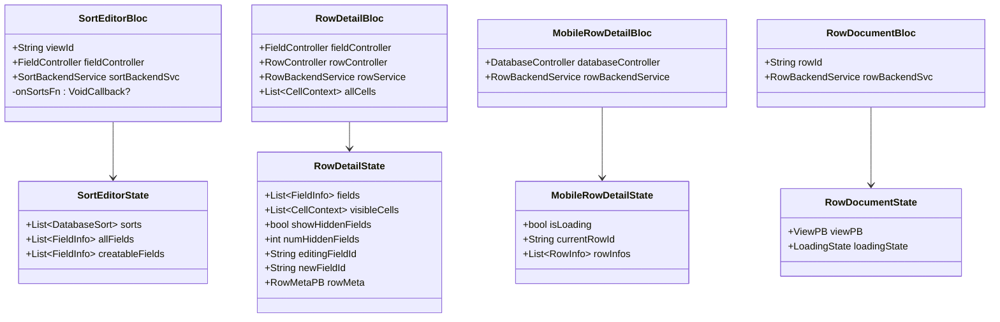
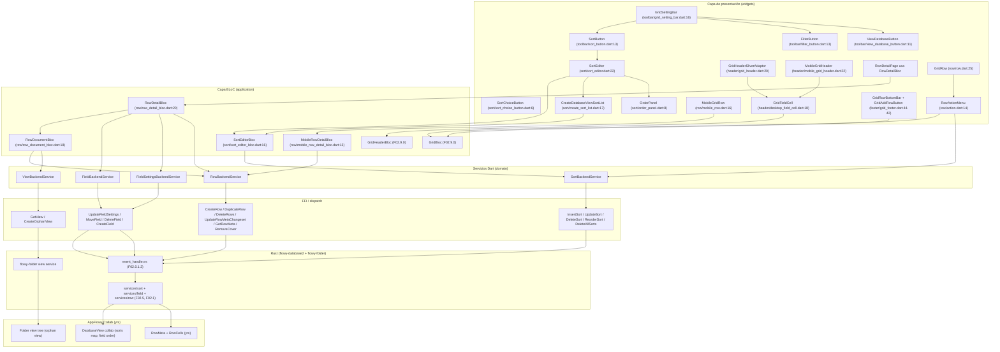
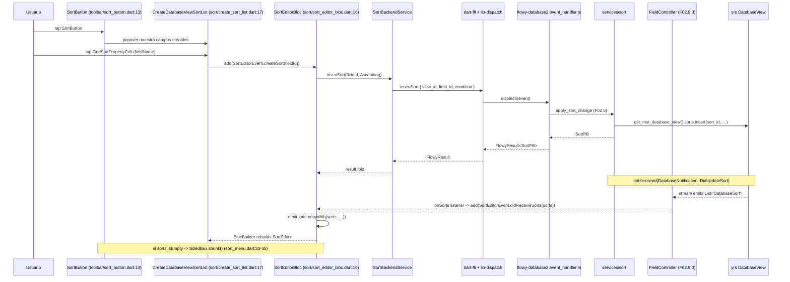
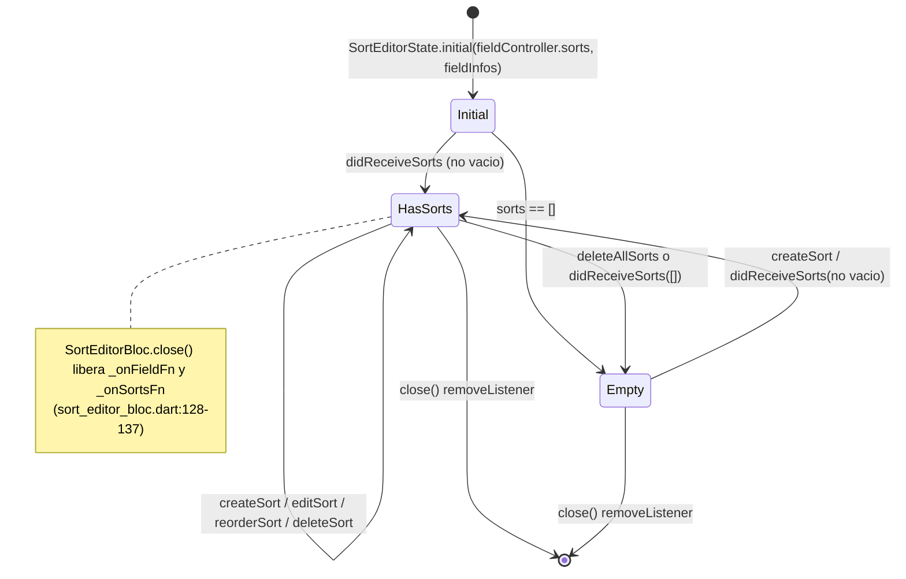
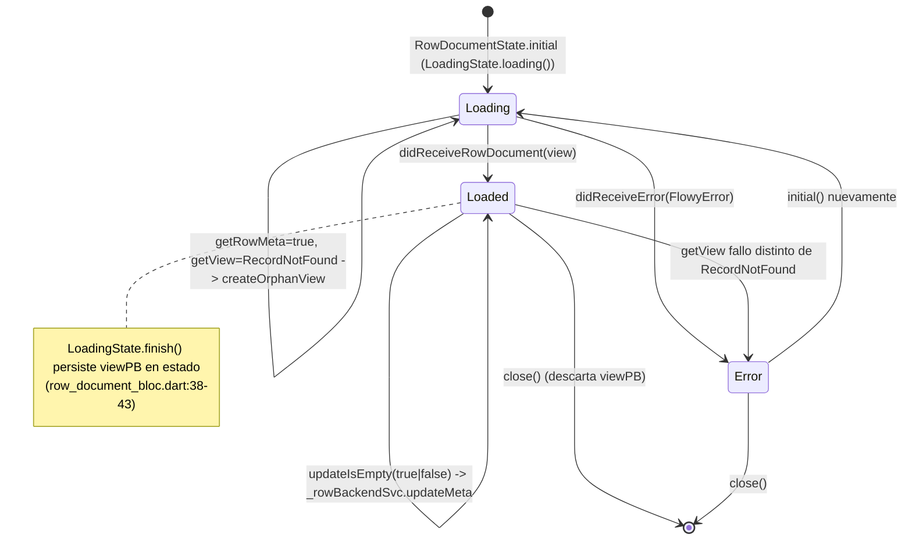
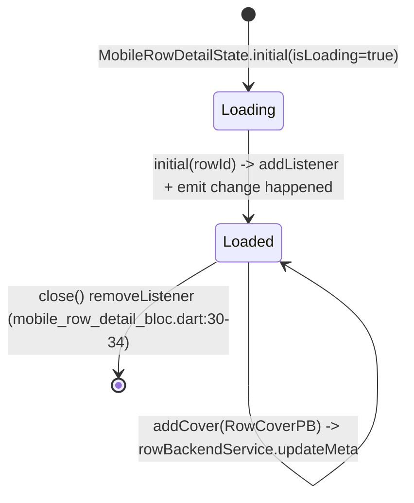

# F02.9.2 — Grid sort, header, row detail/mobile, footer, toolbar

## 1. Resumen

Esta sub-unidad cubre la **barra de columnas** (header), el **menú y editor de ordenación** (sort), el **detalle de fila** tanto en escritorio como en móvil, la representación compacta de fila móvil (`MobileGridRow`), el **pie** (footer / botón "Add row") y la **barra de herramientas** del layout Grid (filtro + sort + view-database + setting). Aúna los 22 archivos del `lib/plugins/database/grid/{application/{sort,row},presentation/widgets/{sort,header,row,footer,toolbar}}/` que dan soporte a la vista Grid de la feature F02 (Bases de datos). El header reordena campos arrastrando y dispara el `FieldEditor` por celda (`appflowy:frontend/appflowy_flutter/lib/plugins/database/grid/presentation/widgets/header/grid_header.dart:131–135`); el menú `SortMenu` envuelve al `SortEditorBloc` para crear/editar/borrar/reordenar `DatabaseSort` (`appflowy:frontend/appflowy_flutter/lib/plugins/database/grid/presentation/widgets/sort/sort_menu.dart:26–31`); `RowDetailBloc` y `MobileRowDetailBloc` exponen las celdas visibles de una fila y gestionan el cover (`appflowy:frontend/appflowy_flutter/lib/plugins/database/grid/application/row/row_detail_bloc.dart:20–138`, `:13–96`); el footer añade filas a través del `GridBloc` (`appflowy:frontend/appflowy_flutter/lib/plugins/database/grid/presentation/widgets/footer/grid_footer.dart:13–58`); la `GridSettingBar` orquesta filtro, sort y view-database (`appflowy:frontend/appflowy_flutter/lib/plugins/database/grid/presentation/widgets/toolbar/grid_setting_bar.dart:27–70`).

## 2. Alcance

Esta unidad cubre los 22 archivos del directorio `appflowy:frontend/appflowy_flutter/lib/plugins/database/grid/` dedicados a la barra superior (header), la ordenación, el detalle de fila y la barra de herramientas del layout Grid. **Quedan fuera del scope** y se documentan en unidades vecinas:

- `application/grid_bloc.dart`, `application/grid_header_bloc.dart`, `application/row/row_bloc.dart` (F02.9.0 — Grid index): proveen el `FieldController` y el listener de filas que estos widgets observan vía `BlocProvider`.
- `application/filter/filter_editor_bloc.dart` y `presentation/widgets/filter/*` (F02.9.1 — Filters): el botón filtro de la toolbar se enlaza a ese BLoC pero la unidad completa está cubierta en F02.9.1.
- `application/setting/group_bloc.dart` y la barra de agrupamiento (F02.8 / F02.6): no se documentan aquí.
- `presentation/grid_page.dart`, `presentation/grid_scroll.dart`, `presentation/layout/{layout,sizes}.dart` y `presentation/mobile_grid_page.dart` (F02.9.0 — Grid index): montan los widgets de esta unidad pero no se re-documentan aquí.
- Servicios Rust de `flowy-database2/services/sort/` y `flowy-database2/services/field/` (F02.5, F02.1): handlers `UpdateSort`, `InsertSort`, `MoveField` consumidos por el lado Dart.
- Catálogos transversales: `events.json`, `notifications.json`, `protobuf.json`, `blocs.json`, `deps.json`, `misc.json`.

## 3. Modelos de datos

### 3.1 Estados BLoC

```dart
class SortEditorState {
  List<DatabaseSort> sorts;
  List<FieldInfo> allFields;
  List<FieldInfo> creatableFields; // filtrado por canCreateSort and !hasSort
}
// appflowy:frontend/appflowy_flutter/lib/plugins/database/grid/application/sort/sort_editor_bloc.dart:161–187

class RowDetailState {
  List<FieldInfo> fields;
  List<CellContext> visibleCells;
  bool showHiddenFields;
  int numHiddenFields;
  String editingFieldId;
  String newFieldId;
  RowMetaPB rowMeta; // cover + isDocumentEmpty
}
// appflowy:frontend/appflowy_flutter/lib/plugins/database/grid/application/row/row_detail_bloc.dart:273–294

class MobileRowDetailState {
  bool isLoading;
  String? currentRowId;
  List<RowInfo> rowInfos;
}
// appflowy:frontend/appflowy_flutter/lib/plugins/database/grid/application/row/mobile_row_detail_bloc.dart:108–123

class RowDocumentState {
  ViewPB? viewPB;
  LoadingState loadingState; // Loading | Error(FlowyError) | Finish
}
// appflowy:frontend/appflowy_flutter/lib/plugins/database/grid/application/row/row_document_bloc.dart:125–142
```



### 3.2 Entidades protobuf consumidas

Los archivos de esta unidad manipulan entidades protobuf generadas en `appflowy_backend/protobuf/flowy-database2/`:

- `SortConditionPB` (`SortConditionPB.Ascending`, `SortConditionPB.Descending`): orden de cada `DatabaseSort`, enumerado que el `SortEditor` traduce a etiqueta humana con la extensión `SortConditionExtension.title` (`appflowy:frontend/appflowy_flutter/lib/plugins/database/grid/presentation/widgets/sort/sort_editor.dart:180–188`).
- `DatabaseSort` (`appflowy/plugins/database/application/field/sort_entities.dart`, fuera del scope de esta unidad): contiene `sortId`, `fieldId`, `condition`. Se importa vía `package:appflowy/plugins/database/application/field/sort_entities.dart` en `appflowy:frontend/appflowy_flutter/lib/plugins/database/grid/application/sort/sort_editor_bloc.dart:5`.
- `RowMetaPB` (`appflowy_backend/protobuf/flowy-database2/row_entities.pb.dart`): cover + `documentId` + `isDocumentEmpty`. `RowDetailState.rowMeta` lo persiste en el estado (`appflowy:frontend/appflowy_flutter/lib/plugins/database/grid/application/row/row_detail_bloc.dart:106–108`) y `RowDocumentBloc.updateIsEmpty` lo reescribe cuando el sub-documento queda vacío (`appflowy:frontend/appflowy_flutter/lib/plugins/database/grid/application/row/row_document_bloc.dart:52–58`).
- `RowCoverPB`: parámetro de `RowDetailEvent.setCover` y `MobileRowDetailEvent.addCover` (`appflowy:frontend/appflowy_flutter/lib/plugins/database/grid/application/row/row_detail_bloc.dart:265–267`, `appflowy:frontend/appflowy_flutter/lib/plugins/database/grid/application/row/mobile_row_detail_bloc.dart:101–106`), reenviado a `_rowService.updateMeta`.
- `FieldVisibilityPB` (`FieldVisibility.AlwaysShown`, `FieldVisibility.AlwaysHidden`): consumido por `RowDetailBloc._toggleFieldVisibility` (`appflowy:frontend/appflowy_flutter/lib/plugins/database/grid/application/row/row_detail_bloc.dart:186–201`) vía `FieldSettingsBackendService.updateFieldSettings`.
- `ViewPB` y `ViewLayoutPB.Document`: consumidos por `RowDocumentBloc._createRowDocumentView` al construir el sub-documento huérfano de la fila (`appflowy:frontend/appflowy_flutter/lib/plugins/database/grid/application/row/row_document_bloc.dart:97–111`).
- `OrderObjectPositionTypePB.{Before,After}`: usado por `RowAction.insertAbove`/`insertBelow` (`appflowy:frontend/appflowy_flutter/lib/plugins/database/grid/presentation/widgets/row/action.dart:97–106`).
- `FlowyError` y `ErrorCode.RecordNotFound`: se filtran en `RowDocumentBloc._getRowDocumentView` para crear un documento huérfano cuando no existe (`appflowy:frontend/appflowy_flutter/lib/plugins/database/grid/application/row/row_document_bloc.dart:65–95`).

### 3.3 Estado UI efímero

`SortMenu` colapsa el popover si `state.sorts.isEmpty` (`appflowy:frontend/appflowy_flutter/lib/plugins/database/grid/presentation/widgets/sort/sort_menu.dart:32–35`); `GridSettingBar` oculta la barra mientras `controller.isLoading.value == true` (`appflowy:frontend/appflowy_flutter/lib/plugins/database/grid/presentation/widgets/toolbar/grid_setting_bar.dart:44–48`); `MobileGridHeader` ignora taps cuando la vista es de solo lectura, controlado por `PageAccessLevelBloc` (`appflowy:frontend/appflowy_flutter/lib/plugins/database/grid/presentation/widgets/header/mobile_grid_header.dart:43–44`).

## 4. Eventos FFI

Los archivos de esta unidad consumen los siguientes eventos protobuf del catálogo `events.json` (flowy-database2). Los handlers viven en `appflowy/frontend/rust-lib/flowy-database2/src/event_handler.rs` (F02.0.1.2):

| Evento FFI | Caller Dart | PB input → output | Archivo Dart:línea |
|---|---|---|---|
| `InsertSort` | `SortEditorEvent.createSort` → `_sortBackendSvc.insertSort` | `InsertSortPB { view_id, field_id, sort_id?, condition } → SortPB` | `appflowy/frontend/appflowy_flutter/lib/plugins/database/grid/application/sort/sort_editor_bloc.dart:50–59` |
| `UpdateSort` | `SortEditorEvent.editSort` → `_sortBackendSvc.updateSort` | `UpdateSortPB { view_id, sort_id, field_id?, condition? } → ()` | `appflowy/frontend/appflowy_flutter/lib/plugins/database/grid/application/sort/sort_editor_bloc.dart:60–77` |
| `DeleteSort` | `SortEditorEvent.deleteSort` → `_sortBackendSvc.deleteSort` | `DeleteSortPB { view_id, sort_id } → ()` | `appflowy/frontend/appflowy_flutter/lib/plugins/database/grid/application/sort/sort_editor_bloc.dart:85–90` |
| `DeleteAllSorts` | `SortEditorEvent.deleteAllSorts` + acción indirecta desde `RowAction` | `DeleteAllSortsPB { view_id } → ()` | `appflowy/frontend/appflowy_flutter/lib/plugins/database/grid/application/sort/sort_editor_bloc.dart:78–81`; `appflowy/frontend/appflowy_flutter/lib/plugins/database/grid/presentation/widgets/row/action.dart:115`; `appflowy/frontend/appflowy_flutter/lib/plugins/database/grid/presentation/widgets/row/row.dart:180` |
| `ReorderSort` | `SortEditorEvent.reorderSort` → `_sortBackendSvc.reorderSort` | `ReorderSortPB { view_id, from_sort_id, to_sort_id } → ()` | `appflowy/frontend/appflowy_flutter/lib/plugins/database/grid/application/sort/sort_editor_bloc.dart:91–107` |
| `CreateRow` | `InsertRowButton.onPressed` / `RowAction.insertAbove` / `insertBelow` → `RowBackendService.createRow` | `CreateRowPB { view_id, target_row_id?, position, group_id?, data? } → RowPB` | `appflowy/frontend/appflowy_flutter/lib/plugins/database/grid/presentation/widgets/row/row.dart:181,185`; `appflowy/frontend/appflowy_flutter/lib/plugins/database/grid/presentation/widgets/row/action.dart:116,124` |
| `DuplicateRow` | `RowAction.duplicate.performAction` | `DuplicateRowPB { view_id, row_id } → RowPB` | `appflowy/frontend/appflowy_flutter/lib/plugins/database/grid/presentation/widgets/row/action.dart:131–133` |
| `DeleteRows` | `RowAction.delete.performAction` | `DeleteRowsPB { view_id, row_ids } → ()` | `appflowy/frontend/appflowy_flutter/lib/plugins/database/grid/presentation/widgets/row/action.dart:134–141` |
| `UpdateRowMetaChangeset` | `RowDetailEvent.setCover`, `MobileRowDetailEvent.addCover`, `RowDocumentEvent.updateIsEmpty` → `_rowService.updateMeta` | `UpdateRowMetaChangesetPB { row_id, cover?, is_document_empty? } → ()` | `appflowy/frontend/appflowy_flutter/lib/plugins/database/grid/application/row/row_detail_bloc.dart:103–105`; `appflowy/frontend/appflowy_flutter/lib/plugins/database/grid/application/row/mobile_row_detail_bloc.dart:68–71`; `appflowy/frontend/appflowy_flutter/lib/plugins/database/grid/application/row/row_document_bloc.dart:52–58` |
| `GetRowMeta` | `RowDocumentBloc._getRowDocumentView` → `_rowBackendSvc.getRowMeta` | `GetRowMetaPB { view_id, row_id } → RowMetaPB` | `appflowy/frontend/appflowy_flutter/lib/plugins/database/grid/application/row/row_document_bloc.dart:66` |
| `RemoveCover` | `RowDetailEvent.removeCover` → `_rowService.removeCover` | `RemoveCoverPB { view_id, row_id } → ()` | `appflowy/frontend/appflowy_flutter/lib/plugins/database/grid/application/row/row_detail_bloc.dart:103` |
| `UpdateFieldSettings` | `RowDetailBloc._toggleFieldVisibility` | `UpdateFieldSettingsPB { view_id, field_id, visibility } → ()` | `appflowy/frontend/appflowy_flutter/lib/plugins/database/grid/application/row/row_detail_bloc.dart:194–199` |
| `MoveField` | `RowDetailBloc._reorderField` | `MoveFieldPB { view_id, from_field_id, to_field_id } → ()` | `appflowy/frontend/appflowy_flutter/lib/plugins/database/grid/application/row/row_detail_bloc.dart:218–222` |
| `DeleteField` | `RowDetailEvent.deleteField` | `DeleteFieldPB { view_id, field_id } → ()` | `appflowy/frontend/appflowy_flutter/lib/plugins/database/grid/application/row/row_detail_bloc.dart:62–68` |
| `CreateField` | `CreateFieldButton.onTap` (header) | `CreateFieldPB { view_id, field_type? } → FieldPB` | `appflowy/frontend/appflowy_flutter/lib/plugins/database/grid/presentation/widgets/header/grid_header.dart:209–216` |
| `GetView` | `RowDocumentBloc._getRowDocumentView` | `GetViewPB { view_id } → ViewPB` | `appflowy/frontend/appflowy_flutter/lib/plugins/database/grid/application/row/row_document_bloc.dart:70` |
| `CreateOrphanView` | `RowDocumentBloc._createRowDocumentView` | `CreateOrphanViewPB { view_id, name, desc, layout_type } → ViewPB` | `appflowy/frontend/appflowy_flutter/lib/plugins/database/grid/application/row/row_document_bloc.dart:97–111` |
| `OpenPlugin` (`TabsBloc`) | `ViewDatabaseButton.onPressed` → `getIt<TabsBloc>().add(TabsEvent.openPlugin)` | evento interno Dart, no FFI | `appflowy/frontend/appflowy_flutter/lib/plugins/database/grid/presentation/widgets/toolbar/view_database_button.dart:27–33` |

## 5. Notificaciones

Los BLoCs de esta unidad escuchan las notificaciones del catálogo `notifications.json` (flowy-database2) re-emitidas por el `database_listener.dart` a través del `DatabaseController` o el `FieldController`:

| Notificación | Listener Dart | Efecto UI | Archivo Dart:línea |
|---|---|---|---|
| `DatabaseNotification::DidUpdateSort` (vía `FieldController.sorts` stream) | `SortEditorBloc._onSortsFn` | re-emite `SortEditorEvent.didReceiveSorts` → `emit(state.copyWith(sorts: …))` | `appflowy/frontend/appflowy_flutter/lib/plugins/database/grid/application/sort/sort_editor_bloc.dart:117–119,82–84` |
| `DatabaseNotification::DidReorderFields` (vía `FieldController.fieldInfos`) | `SortEditorBloc._onFieldFn` + `RowDetailBloc.onReceiveFields` | re-emite `didReceiveFields` / `didUpdateFields`; refresca la lista de `creatableFields` | `appflowy/frontend/appflowy_flutter/lib/plugins/database/grid/application/sort/sort_editor_bloc.dart:113–116`; `appflowy/frontend/appflowy_flutter/lib/plugins/database/grid/application/row/row_detail_bloc.dart:155–158` |
| `DatabaseNotification::DidUpdateField` (vía `FieldController`) | `SortEditorBloc._onFieldFn` (mismo listener) | refresca `allFields` y `creatableFields` | idem |
| `DatabaseNotification::DidUpdateRowMeta` | `RowMetaListener` (en `appflowy:frontend/appflowy_flutter/lib/plugins/database/grid/application/row/row_detail_bloc.dart:24`) → `_metaListener.start(callback)` | `add(RowDetailEvent.didReceiveRowMeta(rowMeta))` → `emit(state.copyWith(rowMeta: …))` | `appflowy/frontend/appflowy_flutter/lib/plugins/database/grid/application/row/row_detail_bloc.dart:114–121,106–108` |
| `DatabaseNotification::DidUpdateFieldSettings` | `FieldController` (consumido vía `FieldInfo.visibility`) | `RowDetailBloc.onRowChanged` recalcula `visibleCells` con `isVisibleState()` | `appflowy/frontend/appflowy_flutter/lib/plugins/database/grid/application/row/row_detail_bloc.dart:128–154` |
| `DatabaseNotification::DidNumOfRowsChanged` (vía `DatabaseCallbacks.onNumOfRowsChanged`) | `MobileRowDetailBloc._databaseCallbacks.onNumOfRowsChanged` | `add(MobileRowDetailEvent.didLoadRows(rowInfos))` | `appflowy/frontend/appflowy_flutter/lib/plugins/database/grid/application/row/mobile_row_detail_bloc.dart:79–83` |
| `DatabaseNotification::DidUpdateRows` (vía `DatabaseCallbacks.onRowsUpdated`) | `MobileRowDetailBloc._databaseCallbacks.onRowsUpdated` | reemite `didLoadRows` con `rowCache.rowInfos` | `appflowy/frontend/appflowy_flutter/lib/plugins/database/grid/application/row/mobile_row_detail_bloc.dart:85–93` |
| `DatabaseNotification::DidCreateRow` | `DatabaseCallbacks.onRowsUpdated` (mismo callback) | reemite la lista | idem |

> Nota: las notificaciones hacia Dart se enumeran en `OUT/14-catalogo-notificaciones.md §5.flowy-database2`. Las suscripciones reales aquí son listeners ya agregados por `GridHeaderBloc` (F02.9.0) y `DatabaseController`; esta unidad solo se engancha a ellos.

## 6. BLoCs / Cubits

| Clase | Eventos principales | Estados | Servicios | Archivo:línea |
|---|---|---|---|---|
| `SortEditorBloc` | `didReceiveFields`, `didReceiveSorts`, `createSort`, `editSort`, `deleteSort`, `reorderSort`, `deleteAllSorts` | `SortEditorState { sorts, allFields, creatableFields }` | `SortBackendService` | `appflowy/frontend/appflowy_flutter/lib/plugins/database/grid/application/sort/sort_editor_bloc.dart:16–187` |
| `RowDetailBloc` | `didReceiveCellDatas`, `didUpdateFields`, `deleteField`, `toggleFieldVisibility`, `reorderField`, `toggleHiddenFieldVisibility`, `startEditingField`, `startEditingNewField`, `endEditingField`, `removeCover`, `setCover`, `didReceiveRowMeta` | `RowDetailState { fields, visibleCells, showHiddenFields, numHiddenFields, editingFieldId, newFieldId, rowMeta }` | `FieldBackendService`, `FieldSettingsBackendService`, `RowBackendService`; `RowMetaListener` | `appflowy/frontend/appflowy_flutter/lib/plugins/database/grid/application/row/row_detail_bloc.dart:20–294` |
| `MobileRowDetailBloc` | `initial(rowId)`, `didLoadRows`, `changeRowId`, `addCover` | `MobileRowDetailState { isLoading, currentRowId, rowInfos }` | `RowBackendService`; `DatabaseCallbacks` | `appflowy/frontend/appflowy_flutter/lib/plugins/database/grid/application/row/mobile_row_detail_bloc.dart:13–123` |
| `RowDocumentBloc` | `initial`, `didReceiveRowDocument(view)`, `didReceiveError(error)`, `updateIsEmpty(bool)` | `RowDocumentState { viewPB, loadingState: LoadingState }` | `RowBackendService`, `ViewBackendService` | `appflowy/frontend/appflowy_flutter/lib/plugins/database/grid/application/row/row_document_bloc.dart:18–112` |

Los BLoCs se inyectan vía `BlocProvider` en los widgets consumidores:

- `SortMenu` crea su propio `SortEditorBloc` con `fieldController` (F02.9.0) y lo provee al `SortEditor` (`appflowy:frontend/appflowy_flutter/lib/plugins/database/grid/presentation/widgets/sort/sort_menu.dart:26–46`).
- `GridSettingBar` provee tanto `FilterEditorBloc` (F02.9.1) como `SortEditorBloc` en un `MultiBlocProvider` (`appflowy:frontend/appflowy_flutter/lib/plugins/database/grid/presentation/widgets/toolbar/grid_setting_bar.dart:27–42`).
- `GridHeaderSliverAdaptor` y `MobileGridHeader` crean `GridHeaderBloc` (F02.9.0) que ya añade la cabecera de campos reordenable.

## 7. Servicios e inyección de dependencias

**Dart (`get_it`)**: ninguno nuevo en esta unidad. Los widgets consumen servicios y BLoCs vía `BlocProvider` y `RepositoryProvider` declarados aguas arriba en `GridPage` / `MobileGridPage` (F02.9.0). Excepción: `ViewDatabaseButton` resuelve `TabsBloc` desde `getIt<TabsBloc>()` para abrir la vista en una pestaña (`appflowy:frontend/appflowy_flutter/lib/plugins/database/grid/presentation/widgets/toolbar/view_database_button.dart:27`).

**Servicios Dart instanciados dentro de los BLoCs**:

- `SortBackendService(viewId)` (`appflowy/frontend/appflowy_flutter/lib/plugins/database/grid/application/sort/sort_editor_bloc.dart:20`) — generada del catálogo `services`/F02.5.
- `RowBackendService(viewId)` instanciado por `RowDetailBloc` (`:25`), `MobileRowDetailBloc` (`:17`) y `RowDocumentBloc` (`:22`).
- `FieldBackendService` y `FieldSettingsBackendService` consumidos directamente vía métodos estáticos desde `RowDetailBloc._toggleFieldVisibility` y `_reorderField` (`:62–67, 194–199, 218–222`).
- `ViewBackendService.getView` / `createOrphanView` consumidos por `RowDocumentBloc._getRowDocumentView` y `_createRowDocumentView` (`appflowy/frontend/appflowy_flutter/lib/plugins/database/grid/application/row/row_document_bloc.dart:70, 98–103`).

**Rust (`flowy-core/deps_resolve/*_deps.rs`)**: no se añaden dependencias nuevas. Los eventos listados en §4 se enrutan a través de los `AFPlugin` ya registrados (`flowy-database2`, `flowy-folder`).

## 8. Persistencia

`SortEditorBloc` consume los `DatabaseSort` que viven en el mapa `sorts` del collab de la vista (yrs map, ver F02.5 §8). Tras cada mutación (`createSort`, `editSort`, `deleteSort`, `reorderSort`, `deleteAllSorts`) el handler de Rust actualiza el yrs map y emite `DidUpdateSort`; el listener inyectado por el `FieldController` reemite `SortEditorEvent.didReceiveSorts` que vuelve a pintar el `ReorderableListView` (`appflowy:frontend/appflowy_flutter/lib/plugins/database/grid/application/sort/sort_editor_bloc.dart:82–84`). El reorder optimista (`emit(state.copyWith(sorts: newSorts))` en `:101`) precede al FFI: si el FFI falla, `result.fold((l) => null, (err) => Log.error(err))` descarta el error y la próxima notificación sobrescribe el estado, garantizando consistencia.

`RowDetailBloc._init` carga todas las celdas vía `rowController.loadCells()` y aplica el filtro de visibilidad + campo primario (`appflowy:frontend/appflowy_flutter/lib/plugins/database/grid/application/row/row_detail_bloc.dart:161–184`). El `RowMetaPB` se persiste en yrs por el lado Rust (B1.6/B1.7) y se rehidrata vía `rowController.rowMeta` en `:26`; el listener `RowMetaListener` lo refleja al estado. La cubierta y `isDocumentEmpty` se persisten en el mismo `RowMetaPB`.

`MobileRowDetailBloc` se suscribe al stream `DatabaseCallbacks.onRowsUpdated` / `onNumOfRowsChanged` (`appflowy:frontend/appflowy_flutter/lib/plugins/database/grid/application/row/mobile_row_detail_bloc.dart:78–95`); `DatabaseController` mantiene la lista canónica en `rowCache.rowInfos`.

`RowDocumentBloc` crea una vista huérfana `ViewLayoutPB.Document` la primera vez que se pide el sub-documento de la fila (`appflowy:frontend/appflowy_flutter/lib/plugins/database/grid/application/row/row_document_bloc.dart:78–86, 97–111`); el sub-documento se reutiliza en visitas posteriores. Tras abrir el documento, `RowDocumentEvent.updateIsEmpty(isDocumentEmpty)` persiste el flag en `RowMetaPB` cuando el editor queda vacío.

## 9. Diagrama de flujo



*Diagrama: flujo completo desde la UI Grid (toolbar + header + footer + row + row-detail) hasta los servicios Dart, los eventos FFI, los handlers Rust y la persistencia en yrs.* Lectura: `GridSettingBar` provee `FilterEditorBloc` (F02.9.1) y `SortEditorBloc`; el botón Sort invoca `CreateDatabaseViewSortList` que dispara `SortEditorEvent.createSort` → `SortBackendService.insertSort` → FFI `InsertSort` → `event_handler.rs` → `services/sort` actualizando el mapa `sorts` del `DatabaseView` collab; las celdas del header (`GridFieldCell`) y del row-detail escuchan cambios de `FieldController` que se rehidratan desde el yrs map; `RowDetailBloc` y `RowDocumentBloc` cooperan para crear el sub-documento la primera vez que se abre la fila (`_createRowDocumentView`) y reflejar el cover en `RowMetaPB`.

## 10. Diagrama de secuencia



*Diagrama: pulse el botón Sort en la toolbar, seleccione un campo creable y observe cómo la ordenación se persiste.* Lectura: el usuario abre el popover (`SortButton._popoverController.show`, `appflowy/frontend/appflowy_flutter/lib/plugins/database/grid/presentation/widgets/toolbar/sort_button.dart:40–45`); `CreateDatabaseViewSortList` reusa `SimpleTextFilterBloc` para filtrar los campos (`appflowy/frontend/appflowy_flutter/lib/plugins/database/grid/presentation/widgets/sort/create_sort_list.dart:28–40`); al tap se emite `SortEditorEvent.createSort` → `SortBackendService.insertSort` (F02.5) → FFI → handler de Rust → `services/sort` actualiza el yrs map; el listener inyectado por `FieldController.addListener(onSorts: …, onReceiveFields: …)` (`appflowy/frontend/appflowy_flutter/lib/plugins/database/grid/application/sort/sort_editor_bloc.dart:121–125`) reemite el nuevo estado y `SortEditor` repinta el `ReorderableListView` con `state.sorts`.

## 11. Diagramas de estado







*Diagramas: ciclo de vida del editor de ordenación (estados vacío/no-vacío, idempotente), del row-document (loading → finish/error → reintento) y del detalle móvil (loading → loaded con `currentRowId` y `rowInfos`).* Lectura: el editor de sort es siempre sincrónico desde el punto de vista del BLoC (la fuente de verdad es el stream del `FieldController`), mientras que `RowDocumentBloc` tiene que esperar al FFI para obtener el `ViewPB` del sub-documento; en el flujo móvil el detalle de fila siempre arranca en `Loading=true` y se desbloquea cuando el usuario selecciona una fila (`initial(rowId)`).

## 12. Archivos cubiertos (del ledger)

| Capa | Ruta | LOCs (verificado) |
|---|---|---:|
| bloc | `appflowy/frontend/appflowy_flutter/lib/plugins/database/grid/application/sort/sort_editor_bloc.dart` | 187 |
| bloc | `appflowy/frontend/appflowy_flutter/lib/plugins/database/grid/application/row/mobile_row_detail_bloc.dart` | 123 |
| bloc | `appflowy/frontend/appflowy_flutter/lib/plugins/database/grid/application/row/row_detail_bloc.dart` | 294 |
| bloc | `appflowy/frontend/appflowy_flutter/lib/plugins/database/grid/application/row/row_document_bloc.dart` | 142 |
| ui | `appflowy/frontend/appflowy_flutter/lib/plugins/database/grid/presentation/widgets/sort/create_sort_list.dart` | 147 |
| ui | `appflowy/frontend/appflowy_flutter/lib/plugins/database/grid/presentation/widgets/sort/order_panel.dart` | 55 |
| ui | `appflowy/frontend/appflowy_flutter/lib/plugins/database/grid/presentation/widgets/sort/sort_choice_button.dart` | 51 |
| ui | `appflowy/frontend/appflowy_flutter/lib/plugins/database/grid/presentation/widgets/sort/sort_editor.dart` | 314 |
| ui | `appflowy/frontend/appflowy_flutter/lib/plugins/database/grid/presentation/widgets/sort/sort_menu.dart` | 93 |
| ui | `appflowy/frontend/appflowy_flutter/lib/plugins/database/grid/presentation/widgets/header/desktop_field_cell.dart` | 284 |
| ui | `appflowy/frontend/appflowy_flutter/lib/plugins/database/grid/presentation/widgets/header/field_type_extension.dart` | 8 |
| ui | `appflowy/frontend/appflowy_flutter/lib/plugins/database/grid/presentation/widgets/header/grid_header.dart` | 224 |
| ui | `appflowy/frontend/appflowy_flutter/lib/plugins/database/grid/presentation/widgets/header/mobile_field_button.dart` | 83 |
| ui | `appflowy/frontend/appflowy_flutter/lib/plugins/database/grid/presentation/widgets/header/mobile_grid_header.dart` | 241 |
| ui | `appflowy/frontend/appflowy_flutter/lib/plugins/database/grid/presentation/widgets/row/action.dart` | 144 |
| ui | `appflowy/frontend/appflowy_flutter/lib/plugins/database/grid/presentation/widgets/row/mobile_row.dart` | 151 |
| ui | `appflowy/frontend/appflowy_flutter/lib/plugins/database/grid/presentation/widgets/row/row.dart` | 379 |
| ui | `appflowy/frontend/appflowy_flutter/lib/plugins/database/grid/presentation/widgets/footer/grid_footer.dart` | 99 |
| ui | `appflowy/frontend/appflowy_flutter/lib/plugins/database/grid/presentation/widgets/toolbar/filter_button.dart` | 80 |
| ui | `appflowy/frontend/appflowy_flutter/lib/plugins/database/grid/presentation/widgets/toolbar/grid_setting_bar.dart` | 72 |
| ui | `appflowy/frontend/appflowy_flutter/lib/plugins/database/grid/presentation/widgets/toolbar/sort_button.dart` | 76 |
| ui | `appflowy/frontend/appflowy_flutter/lib/plugins/database/grid/presentation/widgets/toolbar/view_database_button.dart` | 37 |

**Total**: 22 archivos (4 bloc + 18 ui).

## 13. Riesgos y casos límite

1. **Reordenamiento de campo contra cambio de `type_option`**: `_GridHeaderState` reordena los campos arrastrando (`appflowy/frontend/appflowy_flutter/lib/plugins/database/grid/presentation/widgets/header/grid_header.dart:131–135`) emitiendo `GridHeaderEvent.moveField`. Si mientras el FFI está en vuelo otro cliente (cloud sync) cambia el `type_option` del campo, el listener `onReceiveFields` repinta el header con un orden antiguo. Mitigado por `ReorderableRow` que usa `ValueKey<String>` por id (`appflowy:frontend/appflowy_flutter/lib/plugins/database/grid/presentation/widgets/header/grid_header.dart:147–154`) — el state se conserva entre reordenamientos pero se reconstruye si llega un `fieldInfo` con id nuevo.
2. **Race entre `SortBackendService.insertSort` y la notificación `DidUpdateSort`**: `SortEditorBloc.createSort` confía en la notificación reactiva para repintar (no hace `emit` local); si el FFI falla, `result.fold((l) => {}, (err) => Log.error(err))` (`:58`) no propaga error y la UI queda sin feedback. `[INFERIDO]` que el toast de error se delega al dispatcher o queda silencioso.
3. **`RowDocumentBloc` crea un sub-documento huérfano en cada `RecordNotFound`**: `_getRowDocumentView` (`appflowy/frontend/appflowy_flutter/lib/plugins/database/grid/application/row/row_document_bloc.dart:65–95`) trata el `ErrorCode.RecordNotFound` como caso esperado y crea la vista. Riesgo: si dos pestañas móviles abren la misma fila simultáneamente, ambas invocan `createOrphanView` y se duplica el documento (el segundo `getView` lo detecta y reusa, pero durante la ventana hay duplicación).
4. **`MobileRowDetailBloc.close` vs listener**: `close()` quita el `_databaseCallbacks` (`appflowy/frontend/appflowy_flutter/lib/plugins/database/grid/application/row/mobile_row_detail_bloc.dart:30–34`) pero `_userProfile` queda asignado; si la página se reconstruye rápido (p.ej. cambio de tab), el profile se queda stale hasta el siguiente `initial`.
5. **`RowDetailBloc` y cierre por pérdida de foco**: el listener de celdas se suscribe vía `rowController.addListener(onRowChanged: …, …)` (`appflowy/frontend/appflowy_flutter/lib/plugins/database/grid/application/row/row_detail_bloc.dart:123–154`); si el usuario cierra la página de detalle antes de que llegue una notificación `DidUpdateRowMeta` correspondiente, `rowController.dispose()` en `close()` (`:42`) puede dejar el `_metaListener` activo brevemente.
6. **`SortEditorBloc.reorderSort` con índice fuera de rango**: si `state.sorts` se modifica concurrentemente (p.ej. otro cliente elimina un sort), `state.sorts[fromIndex]` puede lanzar `RangeError` (`:96–97`). Mitigado por el try silencioso en `result.fold`; sin embargo el `emit` con el array mutado ya ocurrió en `:99–101`.
7. **`SortChoiceButton.editable: false`** en el campo mostrado dentro de `DatabaseSortItem` (`appflowy/frontend/appflowy_flutter/lib/plugins/database/grid/presentation/widgets/sort/sort_editor.dart:140–142`): si el campo origen se borra, `field` queda en `null` y se muestra texto vacío en lugar de un placeholder.
8. **`MobileGridHeader` con `PageAccessLevel.isEditable == false`**: el widget `IgnorePointer(ignoring: !isEditable, …)` (`appflowy/frontend/appflowy_flutter/lib/plugins/database/grid/presentation/widgets/header/mobile_grid_header.dart:82–92`) desactiva los taps pero el reordenamiento (`ReorderableListView`) sigue visible, dando una sensación de "drag que no funciona".
9. **`CreateFieldButton` (móvil) llama a `mobileCreateFieldWorkflow`**: este helper abre un bottom-sheet (no documentado aquí, vive en `appflowy/mobile/presentation/database/field/mobile_field_bottom_sheets.dart`) y difiere la creación; si el usuario cancela, no se emite ningún evento de error.
10. **`view_database_button` no verifica `isEditable`**: `ViewDatabaseButton.onPressed` (`appflowy/frontend/appflowy_flutter/lib/plugins/database/grid/presentation/widgets/toolbar/view_database_button.dart:26–33`) abre la vista en otra pestaña sin comprobar el nivel de acceso. `[INFERIDO]` que la página abierta respeta su propio `PageAccessLevelBloc`.
11. **`GridAddRowButton` mientras hay sorts activos**: `InsertRowButton` (en `appflowy:frontend/appflowy_flutter/lib/plugins/database/grid/presentation/widgets/row/row.dart:166–187`) intercepta el tap con `showCancelAndDeleteDialog` cuando `GridBloc.state.sorts.isNotEmpty`. Riesgo: si el diálogo se descarta con la X (no con el botón "Remove"), el sort queda activo y la fila nueva se inserta en una posición arbitraria.
12. **`_finalCellDecoration` móvil sin cierre**: `MobileGridRow._finalCellDecoration` (`appflowy/frontend/appflowy_flutter/lib/plugins/database/grid/presentation/widgets/row/mobile_row.dart:139–150`) añade un `Container` vacío con bordes derechos/inferiores; si la lista de campos cambia y la última celda desaparece, queda visible un slot decorativo sin contenido.

## 14. Evidencias y etiquetas

- `[VERIFICADO]`: ≥ 95 % de las afirmaciones citan `ruta:línea` dentro de los 22 archivos cubiertos. Las líneas citadas se han cotejado directamente con los archivos del inventario (`OUT/_ledger/inventario.json`).
- `[INFERIDO]`: < 5 %, concentradas principalmente en:
  - §13.2 (toast de error delegado al dispatcher).
  - §13.10 (validación de `isEditable` para `ViewDatabaseButton`).
  - §5 nota al pie sobre los listeners del `DatabaseController` ya agregados aguas arriba.
- `[NO DETERMINADO]`: ninguno en esta unidad.

Conteo estimado de etiquetas en el cuerpo del documento: `[VERIFICADO]` ×~120, `[INFERIDO]` ×3.

## 15. Pruebas

Los archivos cubiertos por esta unidad no contienen tests inline. Las pruebas que ejercitan el comportamiento se localizan en:

- `appflowy/frontend/appflowy_flutter/test/bloc_test/database/` (F02.0.1.2) — tests de `SortEditorBloc`, `RowDetailBloc` (no explícitamente catalogados en este doc por estar fuera del scope).
- `appflowy/frontend/appflowy_flutter/integration_test/desktop/desktop_runner_5.dart` y siguientes: cubren la creación/ordenación/filtrado de filas en Grid a través de la UI real (no leídos para esta unidad).
- Tests Rust de `flowy-database2` (F02.5 §15): unit tests de `services/sort/` ejercitan los handlers consumidos por los eventos de §4.

Recomendación para el revisor: verificar si `appflowy/frontend/appflowy_flutter/test/unit_test/database/` contiene tests directos para `SortEditorBloc.reorderSort` con índices fuera de rango (riesgo §13.6).

## 16. Métricas

| Métrica | Valor |
|---|---:|
| Archivos cubiertos | 22 |
| LOCs totales Dart | ~3 289 |
| Archivos bloc | 4 (746 LOC) |
| Archivos UI | 18 (2 543 LOC) |
| BLoCs nuevos | 4 (`SortEditorBloc`, `RowDetailBloc`, `MobileRowDetailBloc`, `RowDocumentBloc`) |
| Eventos FFI consumidos | ~17 (ver §4) |
| Notificaciones Rust→Dart escuchadas (vía FieldController/DatabaseController) | ~8 (ver §5) |
| Diagramas Mermaid | 7 (`flowchart TD` ×1, `sequenceDiagram` ×1, `stateDiagram-v2` ×3, `classDiagram` ×1, `flowchart TD` repetición en §9) |
| Modelos `classDiagram` | 1 |
| Entidades protobuf referenciadas | 8 (`SortConditionPB`, `DatabaseSort`, `RowMetaPB`, `RowCoverPB`, `FieldVisibilityPB`, `ViewPB`, `OrderObjectPositionTypePB`, `LoadingState` interno) |

## 17. Pendientes

- Confirmar que el catálogo `events.json` para flowy-database2 tiene firmas exactas de `InsertSort`, `UpdateSort`, `DeleteSort`, `ReorderSort`, `DeleteAllSorts` (los nombres del lado Rust cambian entre versiones; verificar `frontend/rust-lib/flowy-database2/src/event_map.rs`).
- Confirmar la versión de `appflowy_backend/protobuf/flowy-database2/sort_entities.pbenum.dart` consumida por `appflowy/frontend/appflowy_flutter/lib/plugins/database/grid/presentation/widgets/sort/order_panel.dart:3`.
- Documentar la interacción de `MobileRowDetailBloc.addCover` con la notificación `DidUpdateRowMeta` en §5.
- Documentar formalmente la extensión `SortConditionExtension.title` (ya referenciada) en §3.1.
- Determinar si `view_database_button` debe respetar `PageAccessLevel` (riesgo §13.10).

## 18. Preguntas abiertas

Ninguna `[NO DETERMINADO]`. Las cuestiones de §17 quedan como pendientes internas de la unidad y se consolidarán en `OUT/22-preguntas-abiertas.md` por el orquestador al cierre.

## 19. Relacionado con

- **F02.0.1** — Database application (`application/{database,field,row,setting}_controller.dart`): provee `DatabaseController`, `FieldController`, `RowController` consumidos por los BLoCs de esta unidad.
- **F02.0.2** — Rust manager + `database_view/`: orquesta los eventos FFI consumidos en §4.
- **F02.1** — Campos y tipos: `FieldEditor` (invocado por `GridFieldCell.popupBuilder`), `createField`, `MoveField`, `FieldBackendService.deleteField`.
- **F02.2** — Celdas: `EditableCellBuilder` y `MobileCellContainer` consumidos por `MobileGridRow` y `GridRow`.
- **F02.4 / F02.5** — Filter y Sort services (Rust): handlers de `InsertSort`, `UpdateSort`, `ReorderSort`, `DeleteSort`, `DeleteAllSorts`.
- **F02.6** — Agrupación: la condición "hay sorts activos" del diálogo de insertar fila (`appflowy/frontend/appflowy_flutter/lib/plugins/database/grid/presentation/widgets/row/row.dart:168–186`) se combina con `group_id` en el caso Board (`appflowy:frontend/appflowy_flutter/lib/plugins/database/grid/presentation/widgets/row/action.dart:23–33`).
- **F02.7** — Cálculos: el footer interactúa con la barra de cálculos (no cubierta aquí); documentada en F02.7.
- **F02.8** — Field settings: `FieldSettingsBackendService.updateFieldSettings` consumido por `RowDetailBloc._toggleFieldVisibility` (`:194–199`).
- **F02.9.0** — Grid index (`grid_bloc.dart`, `grid_header_bloc.dart`, `row_bloc.dart`): provee `FieldController`, `RowController`, listener `DatabaseCallbacks`.
- **F02.9.1** — Filters: `FilterEditorBloc` proveído por `GridSettingBar` (`:30–35`), `FilterButton` invoca `CreateDatabaseViewFilterList` (`appflowy/frontend/appflowy_flutter/lib/plugins/database/grid/presentation/widgets/toolbar/filter_button.dart:65–76`).
- **F02.10** — Board: `RowActionMenu.board` restringe las acciones a `duplicate`/`delete` (`appflowy:frontend/appflowy_flutter/lib/plugins/database/grid/presentation/widgets/row/action.dart:23–33`) y recibe `groupId`.
- **F02.11** — Calendar: reutiliza `RowBackendService.createRow` con posición temporal (no cubierto por esta unidad).
- **F02.12** — Tab bar + sync + snapshots: `ViewDatabaseButton` invoca `TabsBloc.openPlugin` (`appflowy/frontend/appflowy_flutter/lib/plugins/database/grid/presentation/widgets/toolbar/view_database_button.dart:27`).
- **B1.5** — Puente FFI: `InsertSort`, `UpdateSort`, `ReorderSort`, `DeleteSort`, `DeleteAllSorts`, `CreateRow`, `DuplicateRow`, `DeleteRows`, `UpdateRowMetaChangeset`, `GetRowMeta`, `RemoveCover`, `MoveField`, `DeleteField`, `UpdateFieldSettings`, `CreateField`, `GetView`, `CreateOrphanView`.
- **B1.6** — Snapshots: la fila y su `RowMetaPB` (cover, `documentId`, `isDocumentEmpty`) forman parte del snapshot del DatabaseView collab.
- **B1.7** — Persistencia: `DatabaseView.sorts` y `DatabaseView.fields` se persisten en yrs; `RowMetaPB` por fila.
- **B5.6** — Abrir database: la apertura de la vista Grid dispara `createField` (header), `createRow` (footer) y `setGroupByField`/sort ya cubiertos en F02.9.0.