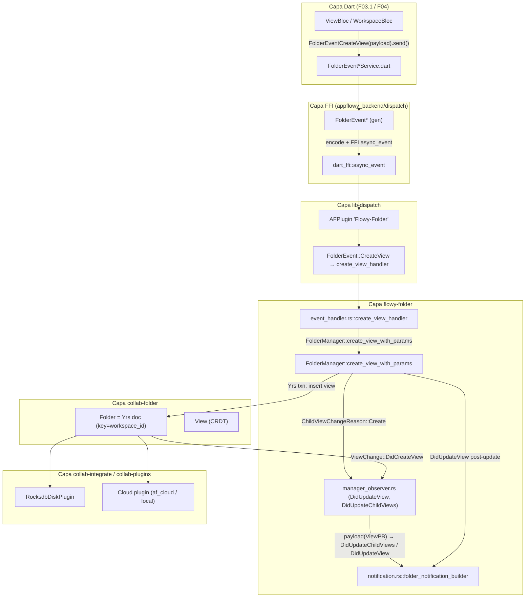
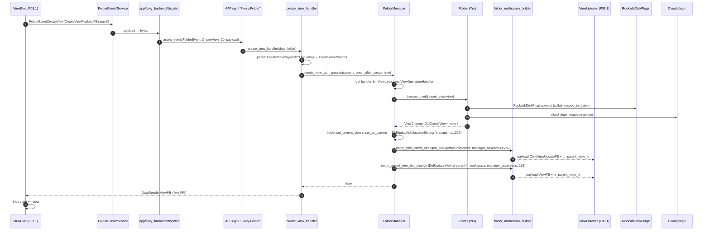
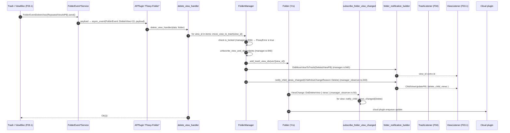
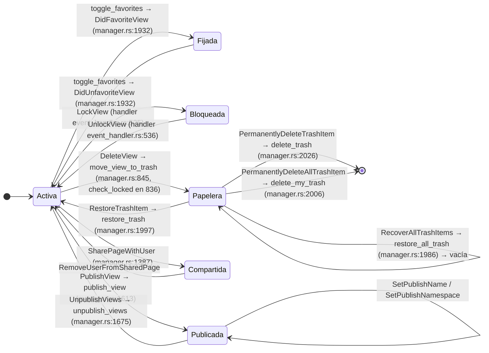

# F03.2 — `flowy-folder` (Rust): `FolderEvent`, handlers, `FolderManager`, entidades `View`/`Workspace`/`Trash`

## 1. Resumen

El crate `flowy-folder` (`appflowy/frontend/rust-lib/flowy-folder`) es la capa de **servicio de workspace** del lado Rust de AppFlowy: concentra el árbol de vistas, los workspaces, la papelera, las secciones (favoritos, recientes, papelera, privado/público), la jerarquía de compartición y el contrato de publicación web. Se compone de un `FolderManager` (`appflowy/frontend/rust-lib/flowy-folder/src/manager.rs:74`) que envuelve un objeto CRDT `Folder` de `collab-folder`, expone 51 eventos FFI declarados en el enum `FolderEvent` (`appflowy/frontend/rust-lib/flowy-folder/src/event_map.rs:66`) y emite 19 notificaciones Rust→Dart del enum `FolderNotification` (`appflowy/frontend/rust-lib/flowy-folder/src/notification.rs:10`). Sus entidades protobuf (`ViewPB`, `WorkspacePB`, `TrashPB`, `FolderSnapshotPB`, `PublishInfoResponsePB`…) se generan en build (`appflowy/frontend/rust-lib/flowy-folder/build.rs:1–7`, `appflowy/frontend/rust-lib/flowy-folder/Flowy.toml:1–3`) y se reutilizan por todos los plugins Dart. Este documento describe la cara **Rust** de F03; los BLoC Dart que escuchan `FolderNotification` viven en F03.1, el modelo CRDT vive en F03.3 y la UI de sidebar vive en F04.

## 2. Alcance

Quedan dentro de este documento: el módulo de Rust `flowy-folder` al completo (33 archivos), sus 51 eventos FFI, sus 19 notificaciones, su `FolderManager` y su ciclo de inicialización, los parsers de payload, el `FolderOperationHandler` polimórfico por layout, la inyección de dependencias desde `flowy-core/deps_resolve/folder_deps/` y los tests de `event-integration-test/tests/folder/local_test/`. Quedan **fuera**: el árbol CRDT (F03.3, `collab-folder/src/`), los BLoC Dart `WorkspaceListener`, `FavoriteListener`, `RecentViewsListener`, `ViewListener`, `WorkspaceSectionsListener`, `TrashListener` (F03.1 + F04; se citan sin reclamar como archivos cubiertos), `view_management` (F04; ver §13), la UI de sidebar/import (F04, F04.12) y los formatos individuales de import/export (B4.X, se referencian sin reclamar). El contrato con AppFlowy-Cloud (sync de folder) se documenta en F06; aquí solo se describen los puntos de llamada a `cloud_service()` en `manager.rs`.

## 3. Modelos de datos

El diagrama siguiente plasma las entidades protobuf del crate (capa fina sobre los tipos CRDT de `collab-folder`) tal como aparecen literalmente en `src/entities/view.rs`, `src/entities/workspace.rs`, `src/entities/trash.rs`, `src/entities/icon.rs` y `src/entities/publish.rs`.

```mermaid
classDiagram
  direction LR
  class ViewPB {
    +String id
    +String parent_view_id
    +String name
    +i64 create_time
    +Vec~ViewPB~ child_views
    +ViewLayoutPB layout
    +Option~ViewIconPB~ icon
    +bool is_favorite
    +Option~String~ extra
    +Option~i64~ created_by
    +i64 last_edited
    +Option~i64~ last_edited_by
    +Option~bool~ is_locked
  }
  class ViewLayoutPB {
    <<enum>>
    Document
    Grid
    Board
    Calendar
    Chat
  }
  class ViewSectionPB {
    <<enum>>
    Private
    Public
  }
  class ViewIconPB {
    +ViewIconTypePB ty
    +String value
  }
  class ViewIconTypePB {
    <<enum>>
    Emoji
    Url
    Icon
  }
  class ChildViewUpdatePB {
    +String parent_view_id
    +Vec~ViewPB~ create_child_views
    +Vec~String~ delete_child_views
    +Vec~ViewPB~ update_child_views
  }
  class SectionViewsPB {
    +ViewSectionPB section
    +Vec~ViewPB~ views
  }
  class RepeatedViewPB {
    +Vec~ViewPB~ items
  }
  class SectionViewPB {
    +ViewPB item
    +i64 timestamp
  }
  class RepeatedFavoriteViewPB {
    +Vec~SectionViewPB~ items
  }
  class RepeatedRecentViewPB {
    +Vec~SectionViewPB~ items
  }
  class WorkspacePB {
    +String id
    +String name
    +Vec~ViewPB~ views
    +i64 create_time
  }
  class WorkspaceLatestPB {
    +String workspace_id
    +Option~ViewPB~ latest_view
  }
  class RepeatedWorkspacePB {
    +Vec~WorkspacePB~ items
  }
  class TrashPB {
    +String id
    +String name
    +i64 modified_time
    +i64 create_time
  }
  class RepeatedTrashPB {
    +Vec~TrashPB~ items
  }
  class TrashIdPB {
    +String id
  }
  class RepeatedTrashIdPB {
    +Vec~TrashIdPB~ items
  }
  class FolderSnapshotPB {
    +i64 snapshot_id
    +String snapshot_desc
    +i64 created_at
    +Vec~u8~ data
  }
  class RepeatedFolderSnapshotPB {
    +Vec~FolderSnapshotPB~ items
  }
  class FolderSyncStatePB {
    +bool is_syncing
    +bool is_finish
  }
  class FolderSnapshotStatePB {
    +i64 new_snapshot_id
  }
  class UserFolderPB {
    +i64 uid
    +String workspace_id
  }
  class PublishViewParamsPB {
    +String view_id
    +Option~String~ publish_name
    +Option~RepeatedViewIdPB~ selected_view_ids
  }
  class UnpublishViewsPayloadPB {
    +Vec~String~ view_ids
  }
  class PublishInfoViewPB {
    +FolderViewMinimalPB view
    +PublishInfoResponsePB info
  }
  class FolderViewMinimalPB {
    +String view_id
    +String name
    +Option~ViewIconPB~ icon
    +ViewLayoutPB layout
  }
  class PublishInfoResponsePB {
    +String view_id
    +String publish_name
    +Option~String~ namespace
    +String publisher_email
    +i64 publish_timestamp_sec
    +Option~i64~ unpublished_at_timestamp_sec
  }
  class RepeatedPublishInfoViewPB {
    +Vec~PublishInfoViewPB~ items
  }
  class SetPublishNamespacePayloadPB {
    +String new_namespace
  }
  class PublishNamespacePB {
    +String namespace
  }
  class ImportTypePB {
    <<enum>>
    HistoryDocument
    HistoryDatabase
    Markdown
    AFDatabase
    CSV
  }
  class ImportPayloadPB {
    +String parent_view_id
    +Vec~ImportItemPayloadPB~ items
  }
  class ImportItemPayloadPB {
    +String name
    +Option~Vec<u8>~ data
    +Option~String~ file_path
    +ViewLayoutPB view_layout
    +ImportTypePB import_type
  }
  class SharedUserPB {
    +String email
    +String name
    +AFRolePB role
    +AFAccessLevelPB access_level
    +Option~String~ avatar_url
  }
  class AFAccessLevelPB {
    <<enum>>
    ReadOnly
    ReadAndComment
    ReadAndWrite
    FullAccess
  }
  class AFRolePB {
    <<enum>>
    Owner
    Member
    Guest
  }
  class RepeatedSharedUserPB {
    +Vec~SharedUserPB~ items
  }
  class SharedViewPB {
    +ViewPB view
    +AFAccessLevelPB access_level
  }
  class RepeatedSharedViewResponsePB {
    +Vec~SharedViewPB~ shared_views
  }
  class SharedViewSectionPB {
    <<enum>>
    PrivateSection
    PublicSection
    SharedSection
  }
  class GetSharedViewSectionResponsePB {
    +SharedViewSectionPB section
  }
  class AFAccessLevelPB_Note {<<external client-api>>}
  class AFRolePB_Note {<<external client-api>>}
  class ViewLayoutPB_Note {<<external client-api>>}
  ViewPB --> ViewLayoutPB
  ViewPB "1" o-- "0..1" ViewIconPB : icon
  ChildViewUpdatePB --> RepeatedViewPB
  SectionViewsPB --> ViewSectionPB
  RepeatedViewPB --> ViewPB
  SectionViewPB --> ViewPB
  WorkspacePB --> RepeatedViewPB
  WorkspaceLatestPB --> ViewPB
  class WorkspacePB_Note["WorkspacePB (alias)"]
  PublishInfoViewPB --> FolderViewMinimalPB
  PublishInfoViewPB --> PublishInfoResponsePB
  FolderViewMinimalPB --> ViewIconPB
  FolderViewMinimalPB --> ViewLayoutPB
  PublishViewParamsPB --> RepeatedViewIdPB
  ImportPayloadPB --> ImportItemPayloadPB
  ImportItemPayloadPB --> ViewLayoutPB
  ImportItemPayloadPB --> ImportTypePB
  SharedUserPB --> AFRolePB
  SharedUserPB --> AFAccessLevelPB
  SharedViewPB --> ViewPB
  SharedViewPB --> AFAccessLevelPB
  GetSharedViewSectionResponsePB --> SharedViewSectionPB
```



**Tabla de campos de `ViewPB`** (declarados en `appflowy/frontend/rust-lib/flowy-folder/src/entities/view.rs:39–89`, base de toda la jerarquía de vistas): los 13 campos se serializan con `ProtoBuf`/`#[pb(index=N)]` y se mapean 1‑a‑1 desde los campos del CRDT `View` de `collab-folder`.

| # | Campo PB | Tipo | one_of | Origen `View` (collab-folder) | `ruta:línea` |
|---|---|---|---|---|---|
| 1 | `id` | `String` | no | `view.id` | `appflowy/frontend/rust-lib/flowy-folder/src/entities/view.rs:41–42` |
| 2 | `parent_view_id` | `String` | no | `view.parent_view_id` (UUID del padre; vacío si es huérfana) | `appflowy/frontend/rust-lib/flowy-folder/src/entities/view.rs:46–47` |
| 3 | `name` | `String` | no | `view.name` | `appflowy/frontend/rust-lib/flowy-folder/src/entities/view.rs:49–50` |
| 4 | `create_time` | `i64` | no | `view.created_at` | `appflowy/frontend/rust-lib/flowy-folder/src/entities/view.rs:52–53` |
| 5 | `child_views` | `Vec<ViewPB>` | no | calculado por `view_pb_with_child_views` / `view_pb_with_all_child_views` | `appflowy/frontend/rust-lib/flowy-folder/src/entities/view.rs:56–57` |
| 6 | `layout` | `ViewLayoutPB` | no | `view.layout` (Document/Grid/Board/Calendar/Chat) | `appflowy/frontend/rust-lib/flowy-folder/src/entities/view.rs:60–61`, enum en `appflowy/frontend/rust-lib/flowy-folder/src/entities/view.rs:187–195` |
| 7 | `icon` | `Option<ViewIconPB>` | sí | `view.icon` (`ViewIcon` con `IconType`+`value`) | `appflowy/frontend/rust-lib/flowy-folder/src/entities/view.rs:64–65`; PB en `appflowy/frontend/rust-lib/flowy-folder/src/entities/icon.rs:44–50` |
| 8 | `is_favorite` | `bool` | no | `view.is_favorite` | `appflowy/frontend/rust-lib/flowy-folder/src/entities/view.rs:67–68` |
| 9 | `extra` | `Option<String>` | sí | `view.extra` (JSON: cover/line_height_layout/font_layout según doc) | `appflowy/frontend/rust-lib/flowy-folder/src/entities/view.rs:70–71` |
| 10 | `created_by` | `Option<i64>` (`one_of`) | sí | `view.created_by` (uid) | `appflowy/frontend/rust-lib/flowy-folder/src/entities/view.rs:74–75` |
| 11 | `last_edited` | `i64` | no | `view.last_edited_time` | `appflowy/frontend/rust-lib/flowy-folder/src/entities/view.rs:78–79` |
| 12 | `last_edited_by` | `Option<i64>` | sí | `view.last_edited_by` (uid) | `appflowy/frontend/rust-lib/flowy-folder/src/entities/view.rs:82–83` |
| 13 | `is_locked` | `Option<bool>` | sí | `view.is_locked` (vista bloqueada, no editable) | `appflowy/frontend/rust-lib/flowy-folder/src/entities/view.rs:87–88` |

Notas de modelado: (a) `Space` no existe como entidad propia en `flowy-folder`, se modela como una `View` cuyo `layout` se interpreta y `space_info` (`collab-folder/src/space_info.rs`) decide `SpacePermission` (`PublicToAll` vs demás); la conversión a `SharedViewSectionPB` ocurre en `appflowy/frontend/rust-lib/flowy-folder/src/manager.rs:2487–2529` (`get_shared_view_section`). (b) `TrashPB` solo retiene `id` + `name` + `created_at` (`appflowy/frontend/rust-lib/flowy-folder/src/entities/trash.rs:5–17`); (c) `WorkspacePB` solo se construye desde `Workspace + Vec<ViewPB>` (`appflowy/frontend/rust-lib/flowy-folder/src/entities/workspace.rs:29–39`); el `WorkspaceLatestPB` añade `latest_view: Option<ViewPB>` (`appflowy/frontend/rust-lib/flowy-folder/src/entities/workspace.rs:136–143`). El catálogo `OUT/_ledger/extract/protobuf.json` lista 64 entidades declaradas en `flowy-folder` (ver §16).

## 4. Eventos FFI

El enum `FolderEvent` se declara en `appflowy/frontend/rust-lib/flowy-folder/src/event_map.rs:64` con la macro `Flowy_Event` y vive bajo el plugin FFI llamado `"Flowy-Folder"` (`appflowy/frontend/rust-lib/flowy-folder/src/event_map.rs:12`). El extractor `extract_events.py` cuenta 51 variantes; la tabla siguiente las lista **todas** emparejadas con su `input`/`output`, discriminante (`= N`), handler en `event_handler.rs` (con `ruta:línea` literal del `src/event_handler.rs` que la unidad cubre) y PB resuelto desde `OUT/_ledger/extract/protobuf.json`.

| # | Variante `FolderEvent` | Discriminante | Input PB | Output PB | Handler | Handler `ruta:línea` | PB resueltos |
|---|---|---|---|---|---|---|---|
| 0 | `CreateFolderWorkspace` | 0 | — | — | (sin handler; declarado en `appflowy/frontend/rust-lib/flowy-folder/src/event_map.rs:64–69`, no registrado en `init`) | — [INFERIDO] | n/a |
| 1 | `GetCurrentWorkspaceSetting` | 1 | — | `WorkspaceLatestPB` | `read_current_workspace_setting_handler` | `appflowy/frontend/rust-lib/flowy-folder/src/event_handler.rs:64–70` | `WorkspaceLatestPB` `appflowy/frontend/rust-lib/flowy-folder/src/entities/workspace.rs:136–143` |
| 2 | `ReadCurrentWorkspace` | 2 | — | `WorkspacePB` | `read_current_workspace_handler` | `appflowy/frontend/rust-lib/flowy-folder/src/event_handler.rs:73–79` | `WorkspacePB` `appflowy/frontend/rust-lib/flowy-folder/src/entities/workspace.rs:14–27` |
| 3 | `DeleteWorkspace` | 3 | `WorkspaceIdPB` | — | (sin handler en este snapshot; `appflowy/frontend/rust-lib/flowy-folder/src/event_map.rs:66–80` declara la variante pero `init` no la registra) | — [INFERIDO] | `WorkspaceIdPB` `appflowy/frontend/rust-lib/flowy-folder/src/entities/workspace.rs:94–98` |
| 5 | `ReadWorkspaceViews` | 5 | `GetWorkspaceViewPB` | `RepeatedViewPB` | `get_workspace_views_handler` | `appflowy/frontend/rust-lib/flowy-folder/src/event_handler.rs:31–39` | `GetWorkspaceViewPB` `appflowy/frontend/rust-lib/flowy-folder/src/entities/workspace.rs:115–119`; `RepeatedViewPB` `appflowy/frontend/rust-lib/flowy-folder/src/entities/view.rs:239–243` |
| 10 | `CreateView` | 10 | `CreateViewPayloadPB` | `ViewPB` | `create_view_handler` | `appflowy/frontend/rust-lib/flowy-folder/src/event_handler.rs:81–93` | `CreateViewPayloadPB` `appflowy/frontend/rust-lib/flowy-folder/src/entities/view.rs:300–342`; `ViewPB` `appflowy/frontend/rust-lib/flowy-folder/src/entities/view.rs:39–89` |
| 11 | `GetView` | 11 | `ViewIdPB` | `ViewPB` | `get_view_handler` | `appflowy/frontend/rust-lib/flowy-folder/src/event_handler.rs:110–118` | `ViewIdPB` `appflowy/frontend/rust-lib/flowy-folder/src/entities/view.rs:443–452` |
| 12 | `UpdateView` | 12 | `UpdateViewPayloadPB` | `ViewPB` (output declarado en macro, pero handler devuelve `()`) | `update_view_handler` | `appflowy/frontend/rust-lib/flowy-folder/src/event_handler.rs:144–152` | `UpdateViewPayloadPB` `appflowy/frontend/rust-lib/flowy-folder/src/entities/view.rs:480–513` |
| 13 | `DeleteView` | 13 | `RepeatedViewIdPB` | — | `delete_view_handler` | `appflowy/frontend/rust-lib/flowy-folder/src/event_handler.rs:165–175` | `RepeatedViewIdPB` `appflowy/frontend/rust-lib/flowy-folder/src/entities/view.rs:294–298` |
| 14 | `DuplicateView` | 14 | `DuplicateViewPayloadPB` | `ViewPB` | `duplicate_view_handler` | `appflowy/frontend/rust-lib/flowy-folder/src/event_handler.rs:248–257` | `DuplicateViewPayloadPB` `appflowy/frontend/rust-lib/flowy-folder/src/entities/view.rs:670–693` |
| 15 | `CloseView` | 15 | `ViewIdPB` | — | `close_view_handler` | `appflowy/frontend/rust-lib/flowy-folder/src/event_handler.rs:214–222` | `ViewIdPB` `appflowy/frontend/rust-lib/flowy-folder/src/entities/view.rs:443–452` |
| 16 | `CreateOrphanView` | 16 | `CreateOrphanViewPayloadPB` | `ViewPB` | `create_orphan_view_handler` | `appflowy/frontend/rust-lib/flowy-folder/src/event_handler.rs:95–107` | `CreateOrphanViewPayloadPB` `appflowy/frontend/rust-lib/flowy-folder/src/entities/view.rs:355–368` |
| 17 | `GetAllViews` | 17 | — | `RepeatedViewPB` | `get_all_views_handler` | `appflowy/frontend/rust-lib/flowy-folder/src/event_handler.rs:121–128` | `RepeatedViewPB` `appflowy/frontend/rust-lib/flowy-folder/src/entities/view.rs:239–243` |
| 20 | `CopyLink` | 20 | — | — | (sin handler; variante declarada en `appflowy/frontend/rust-lib/flowy-folder/src/event_map.rs:120–121` no registrada en `init`) | — [INFERIDO] | n/a |
| 21 | `SetLatestView` | 21 | `ViewIdPB` | — | `set_latest_view_handler` | `appflowy/frontend/rust-lib/flowy-folder/src/event_handler.rs:203–211` | `ViewIdPB` `appflowy/frontend/rust-lib/flowy-folder/src/entities/view.rs:443–452` |
| 22 | `MoveView` | 22 | `MoveViewPayloadPB` | — | `move_view_handler` | `appflowy/frontend/rust-lib/flowy-folder/src/event_handler.rs:225–235` | `MoveViewPayloadPB` `appflowy/frontend/rust-lib/flowy-folder/src/entities/view.rs:556–566` |
| 23 | `ListTrashItems` | 23 | — | `RepeatedTrashPB` | `read_trash_handler` | `appflowy/frontend/rust-lib/flowy-folder/src/event_handler.rs:306–312` | `RepeatedTrashPB` `appflowy/frontend/rust-lib/flowy-folder/src/entities/trash.rs:39–43` |
| 24 | `RestoreTrashItem` | 24 | `TrashIdPB` | — | `putback_trash_handler` | `appflowy/frontend/rust-lib/flowy-folder/src/event_handler.rs:315–322` | `TrashIdPB` `appflowy/frontend/rust-lib/flowy-folder/src/entities/trash.rs:55–59` |
| 25 | `PermanentlyDeleteTrashItem` | 25 | `RepeatedTrashIdPB` | — | `delete_trash_handler` | `appflowy/frontend/rust-lib/flowy-folder/src/event_handler.rs:325–335` | `RepeatedTrashIdPB` `appflowy/frontend/rust-lib/flowy-folder/src/entities/trash.rs:69–72` |
| 26 | `RecoverAllTrashItems` | 26 | — | — | `restore_all_trash_handler` | `appflowy/frontend/rust-lib/flowy-folder/src/event_handler.rs:338–344` | n/a |
| 27 | `PermanentlyDeleteAllTrashItem` | 27 | — | — | `delete_my_trash_handler` | `appflowy/frontend/rust-lib/flowy-folder/src/event_handler.rs:347–353` | n/a |
| 30 | `ImportData` | 30 | `ImportPayloadPB` | `RepeatedViewPB` | `import_data_handler` | `appflowy/frontend/rust-lib/flowy-folder/src/event_handler.rs:356–364` | `ImportPayloadPB` `appflowy/frontend/rust-lib/flowy-folder/src/entities/import.rs:63–71` |
| 31 | `GetFolderSnapshots` | 31 | `WorkspaceIdPB` | `RepeatedFolderSnapshotPB` | `get_folder_snapshots_handler` | `appflowy/frontend/rust-lib/flowy-folder/src/event_handler.rs:378–386` | `RepeatedFolderSnapshotPB` `appflowy/frontend/rust-lib/flowy-folder/src/entities/workspace.rs:182–186` |
| 32 | `MoveNestedView` | 32 | `MoveNestedViewPayloadPB` | — | `move_nested_view_handler` | `appflowy/frontend/rust-lib/flowy-folder/src/event_handler.rs:237–245` | `MoveNestedViewPayloadPB` `appflowy/frontend/rust-lib/flowy-folder/src/entities/view.rs:576–592` |
| 33 | `ReadFavorites` | 33 | — | `RepeatedFavoriteViewPB` | `read_favorites_handler` | `appflowy/frontend/rust-lib/flowy-folder/src/event_handler.rs:260–275` | `RepeatedFavoriteViewPB` `appflowy/frontend/rust-lib/flowy-folder/src/entities/view.rs:245–249` |
| 34 | `ToggleFavorite` | 34 | `RepeatedViewIdPB` | — | `toggle_favorites_handler` | `appflowy/frontend/rust-lib/flowy-folder/src/event_handler.rs:177–187` | `RepeatedViewIdPB` `appflowy/frontend/rust-lib/flowy-folder/src/entities/view.rs:294–298` |
| 35 | `UpdateViewIcon` | 35 | `UpdateViewIconPayloadPB` | — | `update_view_icon_handler` | `appflowy/frontend/rust-lib/flowy-folder/src/event_handler.rs:155–163` | `UpdateViewIconPayloadPB` `appflowy/frontend/rust-lib/flowy-folder/src/entities/icon.rs:79–86` |
| 36 | `ReadRecentViews` | 36 | `ReadRecentViewsPB` | `RepeatedRecentViewPB` | `read_recent_views_handler` | `appflowy/frontend/rust-lib/flowy-folder/src/event_handler.rs:278–303` | `ReadRecentViewsPB` `appflowy/frontend/rust-lib/flowy-folder/src/entities/view.rs:251–258`; `RepeatedRecentViewPB` `appflowy/frontend/rust-lib/flowy-folder/src/entities/view.rs:260–264` |
| 37 | `UpdateRecentViews` | 37 | `UpdateRecentViewPayloadPB` | — | `update_recent_views_handler` | `appflowy/frontend/rust-lib/flowy-folder/src/event_handler.rs:189–201` | `UpdateRecentViewPayloadPB` `appflowy/frontend/rust-lib/flowy-folder/src/entities/view.rs:650–659` |
| 39 | `ReadPrivateViews` | 39 | `GetWorkspaceViewPB` | `RepeatedViewPB` | `read_private_views_handler` | `appflowy/frontend/rust-lib/flowy-folder/src/event_handler.rs:52–61` | mismos que #5 |
| 40 | `ReadCurrentWorkspaceViews` | 40 | — | `RepeatedViewPB` | `get_current_workspace_views_handler` | `appflowy/frontend/rust-lib/flowy-folder/src/event_handler.rs:42–49` | mismos que #5 |
| 41 | `UpdateViewVisibilityStatus` | 41 | `UpdateViewVisibilityStatusPayloadPB` | — | `update_view_visibility_status_handler` | `appflowy/frontend/rust-lib/flowy-folder/src/event_handler.rs:389–399` | `UpdateViewVisibilityStatusPayloadPB` `appflowy/frontend/rust-lib/flowy-folder/src/entities/view.rs:661–668` |
| 42 | `GetViewAncestors` | 42 | `ViewIdPB` | `RepeatedViewPB` | `get_view_ancestors_handler` | `appflowy/frontend/rust-lib/flowy-folder/src/event_handler.rs:131–141` | mismos que #5 |
| 43 | `PublishView` | 43 | `PublishViewParamsPB` | — | `publish_view_handler` | `appflowy/frontend/rust-lib/flowy-folder/src/event_handler.rs:402–417` | `PublishViewParamsPB` `appflowy/frontend/rust-lib/flowy-folder/src/entities/publish.rs:7–17` |
| 44 | `GetPublishInfo` | 44 | `ViewIdPB` | `PublishInfoResponsePB` | `get_publish_info_handler` | `appflowy/frontend/rust-lib/flowy-folder/src/event_handler.rs:436–445` | `PublishInfoResponsePB` `appflowy/frontend/rust-lib/flowy-folder/src/entities/publish.rs:65–79` |
| 45 | `GetPublishNamespace` | 45 | — | `PublishNamespacePB` | `get_publish_namespace_handler` | `appflowy/frontend/rust-lib/flowy-folder/src/event_handler.rs:471–477` | `PublishNamespacePB` `appflowy/frontend/rust-lib/flowy-folder/src/entities/publish.rs:106–109` |
| 46 | `SetPublishNamespace` | 46 | `SetPublishNamespacePayloadPB` | — | `set_publish_namespace_handler` | `appflowy/frontend/rust-lib/flowy-folder/src/event_handler.rs:460–468` | `SetPublishNamespacePayloadPB` `appflowy/frontend/rust-lib/flowy-folder/src/entities/publish.rs:100–104` |
| 47 | `UnpublishViews` | 47 | `UnpublishViewsPayloadPB` | — | `unpublish_views_handler` | `appflowy/frontend/rust-lib/flowy-folder/src/event_handler.rs:420–433` | `UnpublishViewsPayloadPB` `appflowy/frontend/rust-lib/flowy-folder/src/entities/publish.rs:19–23` |
| 48 | `ImportZipFile` | 48 | `ImportZipPB` | — | `import_zip_file_handler` | `appflowy/frontend/rust-lib/flowy-folder/src/event_handler.rs:367–375` | `ImportZipPB` `appflowy/frontend/rust-lib/flowy-folder/src/entities/import.rs:120–125` |
| 49 | `ListPublishedViews` | 49 | — | `RepeatedPublishInfoViewPB` | `list_published_views_handler` | `appflowy/frontend/rust-lib/flowy-folder/src/event_handler.rs:480–490` | `RepeatedPublishInfoViewPB` `appflowy/frontend/rust-lib/flowy-folder/src/entities/publish.rs:94–98` |
| 50 | `GetDefaultPublishInfo` | 50 | — | `PublishInfoResponsePB` | `get_default_publish_info_handler` | `appflowy/frontend/rust-lib/flowy-folder/src/event_handler.rs:493–499` | `PublishInfoResponsePB` `appflowy/frontend/rust-lib/flowy-folder/src/entities/publish.rs:65–79` |
| 51 | `SetDefaultPublishView` | 51 | `ViewIdPB` | — | `set_default_publish_view_handler` | `appflowy/frontend/rust-lib/flowy-folder/src/event_handler.rs:502–513` | `ViewIdPB` `appflowy/frontend/rust-lib/flowy-folder/src/entities/view.rs:443–452` |
| 52 | `SetPublishName` | 52 | `SetPublishNamePB` | — | `set_publish_name_handler` | `appflowy/frontend/rust-lib/flowy-folder/src/event_handler.rs:448–457` | `SetPublishNamePB` `appflowy/frontend/rust-lib/flowy-folder/src/entities/view.rs:454–461` |
| 53 | `RemoveDefaultPublishView` | 53 | — | — | `remove_default_publish_view_handler` | `appflowy/frontend/rust-lib/flowy-folder/src/event_handler.rs:516–522` | n/a |
| 54 | `LockView` | 54 | `ViewIdPB` | — | `lock_view_handler` | `appflowy/frontend/rust-lib/flowy-folder/src/event_handler.rs:525–533` | `ViewIdPB` `appflowy/frontend/rust-lib/flowy-folder/src/entities/view.rs:443–452` |
| 55 | `UnlockView` | 55 | `ViewIdPB` | — | `unlock_view_handler` | `appflowy/frontend/rust-lib/flowy-folder/src/event_handler.rs:536–544` | `ViewIdPB` `appflowy/frontend/rust-lib/flowy-folder/src/entities/view.rs:443–452` |
| 56 | `SharePageWithUser` | 56 | `SharePageWithUserPayloadPB` | — | `share_page_with_user_handler` | `appflowy/frontend/rust-lib/flowy-folder/src/event_handler.rs:559–567` | `SharePageWithUserPayloadPB` `appflowy/frontend/rust-lib/flowy-folder/src/entities/view.rs:813–826` |
| 57 | `RemoveUserFromSharedPage` | 57 | `RemoveUserFromSharedPagePayloadPB` | — | `remove_user_from_shared_page_handler` | `appflowy/frontend/rust-lib/flowy-folder/src/event_handler.rs:570–582` | `RemoveUserFromSharedPagePayloadPB` `appflowy/frontend/rust-lib/flowy-folder/src/entities/view.rs:840–847` |
| 58 | `GetSharedUsers` | 58 | `GetSharedUsersPayloadPB` | `RepeatedSharedUserPB` | `get_shared_users_handler` | `appflowy/frontend/rust-lib/flowy-folder/src/event_handler.rs:547–556` | `GetSharedUsersPayloadPB` `appflowy/frontend/rust-lib/flowy-folder/src/entities/view.rs:921–925`; `RepeatedSharedUserPB` `appflowy/frontend/rust-lib/flowy-folder/src/entities/view.rs:903–907` |
| 59 | `GetSharedViews` | 59 | — | `RepeatedSharedViewResponsePB` | `get_shared_views_handler` | `appflowy/frontend/rust-lib/flowy-folder/src/event_handler.rs:585–591` | `RepeatedSharedViewResponsePB` `appflowy/frontend/rust-lib/flowy-folder/src/entities/view.rs:935–939` |
| 60 | `GetSharedViewSection` | 60 | `ViewIdPB` | `GetSharedViewSectionResponsePB` | `get_shared_view_section_handler` | `appflowy/frontend/rust-lib/flowy-folder/src/event_handler.rs:594–602` | `GetSharedViewSectionResponsePB` `appflowy/frontend/rust-lib/flowy-folder/src/entities/view.rs:949–953` |

**Resumen:** 51 variantes declaradas (verificado: el catálogo `OUT/_ledger/extract/events.json` filtrado por `crate == "flowy-folder"` cuenta 51 entradas y `appflowy/frontend/rust-lib/flowy-folder/src/event_map.rs:64–249` enumera 51 ramas); 48 tienen handler registrado en `init` (`appflowy/frontend/rust-lib/flowy-folder/src/event_map.rs:11–62`); 3 **no** tienen handler en este snapshot: `CreateFolderWorkspace` (#0, marcada como `/// Deprecated` en `appflowy/frontend/rust-lib/flowy-folder/src/event_map.rs:67`), `DeleteWorkspace` (#3, declarada pero no registrada en `init`), `CopyLink` (#20, marcada `#[event()]` en `appflowy/frontend/rust-lib/flowy-folder/src/event_map.rs:120`). Los discriminantes visibles son 0,1,2,3,5,10–17,20–27,30–37,39–60 — los huecos 4,6–9,18,19,28,29,38 (8 huecos) son **reservas/legacy** que la macro `ProtoBuf_Enum` no emite como ramas del enum; los discriminantes siguen siendo posiciones legales al serializar.

## 5. Notificaciones

El enum `FolderNotification` se declara en `appflowy/frontend/rust-lib/flowy-folder/src/notification.rs:8–45` (19 variantes, `ProtoBuf_Enum`) y se envía por el canal `Workspace` (`FOLDER_OBSERVABLE_SOURCE = "Workspace"`, `appflowy/frontend/rust-lib/flowy-folder/src/notification.rs:6`). El wrapper `folder_notification_builder` (`appflowy/frontend/rust-lib/flowy-folder/src/notification.rs:48–55`) crea un `NotificationBuilder` con `id = id.to_string()`. **Aviso sobre el extractor:** `OUT/_ledger/extract/notifications.json` marca `emitted_in_rust == 0` para las 19 variantes porque el reconocedor solo identifica llamadas literales a `NotificationBuilder::new`; `flowy-folder` emite vía `folder_notification_builder`, así que esa cuenta queda `[NO DETERMINADO]` de tooling. Lectura directa con `rg folder_notification_builder SRC/appflowy/frontend/rust-lib/flowy-folder/src/` (que sí detecta el wrapper) arroja 21 puntos de emisión reales entre `manager.rs` (líneas 845, 879, 1329, 1437, 1495, 1582, 1932, 1938, 1946, 1990, 2016, 2181, 2449) y `manager_observer.rs` (líneas 101, 148, 191, 210, 218, 228, 236, 269). Tabla de las 19 variantes con sus emisores reales verificados y consumidores Dart:

| # | Variante `FolderNotification` | Discriminante | Emisor real (Rust) | Listener Dart | Efecto en UI (resumido) |
|---|---|---|---|---|---|
| 0 | `Unknown` | 0 | (ninguno; default sentinel `appflowy/frontend/rust-lib/flowy-folder/src/notification.rs:11`) | — | — |
| 1 | `DidCreateWorkspace` | 1 | **declarado pero NO emitido en este snapshot** (`appflowy/frontend/rust-lib/flowy-folder/src/notification.rs:14`). Verificado: cero invocaciones de `folder_notification_builder(..., DidCreateWorkspace)` en `manager.rs`/`manager_observer.rs`; el workspace solo se construye vía `DefaultFolderBuilder` (`appflowy/frontend/rust-lib/flowy-folder/src/user_default.rs:14–71`) sin emitir esta notificación | `appflowy/frontend/appflowy_flutter/lib/workspace/application/workspace/workspace_listener.dart:53` (case declarado, sin flujo real) | el sidebar refresca el árbol de workspaces |
| 2 | `DidUpdateWorkspace` | 2 | **declarado pero NO emitido en este snapshot** (`appflowy/frontend/rust-lib/flowy-folder/src/notification.rs:16`); tampoco aparece en ningún `send()` | `appflowy/frontend/appflowy_flutter/lib/workspace/application/workspace/workspace_listener.dart:57` | sidebar refresca metadatos del workspace |
| 3 | `DidUpdateWorkspaceViews` | 3 | `appflowy/frontend/rust-lib/flowy-folder/src/manager_observer.rs:228` (`notify_did_update_workspace`) | `appflowy/frontend/appflowy_flutter/lib/workspace/application/workspace/workspace_listener.dart:65` | refresca el árbol raíz de vistas del workspace actual |
| 4 | `DidUpdateWorkspaceSetting` | 4 | `appflowy/frontend/rust-lib/flowy-folder/src/manager.rs:1329` (al cambiar latest_view) | `workspace_listener.dart:?` (no se observa handler explícito en este snapshot; `[NO DETERMINADO]`) | persiste `latest_view` del workspace |
| 10 | `DidUpdateView` | 10 | `appflowy/frontend/rust-lib/flowy-folder/src/manager_observer.rs:191` (parent change), `appflowy/frontend/rust-lib/flowy-folder/src/manager_observer.rs:236` (vista suelta), `appflowy/frontend/rust-lib/flowy-folder/src/manager.rs:1938` (post toggle favoritos), `appflowy/frontend/rust-lib/flowy-folder/src/manager.rs:2181` (`update_view` interno) | `appflowy/frontend/appflowy_flutter/lib/workspace/application/view/view_listener.dart:70` | sidebar refresca nodo de la vista; cambia is_favorite, icono, nombre… |
| 11 | `DidUpdateChildViews` | 11 | `appflowy/frontend/rust-lib/flowy-folder/src/manager_observer.rs:269` (`notify_child_views_changed`) | `appflowy/frontend/appflowy_flutter/lib/workspace/application/view/view_listener.dart:79` | sidebar inserta/elimina/actualiza hijos de un padre |
| 12 | `DidDeleteView` | 12 | **declarado pero NO emitido en este snapshot** (`appflowy/frontend/rust-lib/flowy-folder/src/notification.rs:25`); la papelera usa `DidMoveViewToTrash` en su lugar (ver #14) | `appflowy/frontend/appflowy_flutter/lib/workspace/application/view/view_listener.dart:88` | refresca la papelera o la lista |
| 13 | `DidRestoreView` | 13 | **declarado pero NO emitido en este snapshot** (`appflowy/frontend/rust-lib/flowy-folder/src/notification.rs:27`) | `appflowy/frontend/appflowy_flutter/lib/workspace/application/view/view_listener.dart:95` | sidebar re‑inserta la vista restaurada |
| 14 | `DidMoveViewToTrash` | 14 | `appflowy/frontend/rust-lib/flowy-folder/src/manager.rs:845` (en `move_view_to_trash`) | `appflowy/frontend/appflowy_flutter/lib/workspace/application/view/view_listener.dart:102` | sidebar quita la vista; UI de papelera se actualiza |
| 15 | `DidUpdateTrash` | 15 | `appflowy/frontend/rust-lib/flowy-folder/src/manager_observer.rs:148`, `appflowy/frontend/rust-lib/flowy-folder/src/manager.rs:1990` (restore_all_trash), `appflowy/frontend/rust-lib/flowy-folder/src/manager.rs:2016` (delete_my_trash) | `appflowy/frontend/appflowy_flutter/lib/plugins/trash/application/trash_listener.dart:36` | vista de papelera se refresca |
| 16 | `DidUpdateFolderSnapshotState` | 16 | **declarado pero NO emitido en este snapshot** (`appflowy/frontend/rust-lib/flowy-folder/src/notification.rs:32`) | (sin listener Dart) | — |
| 17 | `DidUpdateFolderSyncUpdate` | 17 | `appflowy/frontend/rust-lib/flowy-folder/src/manager_observer.rs:101` (`subscribe_folder_sync_state_changed`) | (sin listener específico; absorbido por estado global) | indicador global de "sincronizando…" |
| 36 | `DidFavoriteView` | 36 | `appflowy/frontend/rust-lib/flowy-folder/src/manager.rs:1932` (en `send_toggle_favorite_notification`) | `appflowy/frontend/appflowy_flutter/lib/workspace/application/favorite/favorite_listener.dart:41` | lista de favoritos se inserta |
| 37 | `DidUnfavoriteView` | 37 | `appflowy/frontend/rust-lib/flowy-folder/src/manager.rs:879` (`unfavorite_view_and_decendants`), `appflowy/frontend/rust-lib/flowy-folder/src/manager.rs:1932` (rama simétrica) | `appflowy/frontend/appflowy_flutter/lib/workspace/application/favorite/favorite_listener.dart:48` | lista de favoritos se quita |
| 38 | `DidUpdateRecentViews` | 38 | `appflowy/frontend/rust-lib/flowy-folder/src/manager.rs:1946` (`send_update_recent_views_notification`) | `appflowy/frontend/appflowy_flutter/lib/workspace/application/recent/recent_listener.dart:36` | lista de recientes se refresca |
| 39 | `DidUpdateSectionViews` | 39 | `appflowy/frontend/rust-lib/flowy-folder/src/manager_observer.rs:210` (Public), `appflowy/frontend/rust-lib/flowy-folder/src/manager_observer.rs:218` (Private) | `appflowy/frontend/appflowy_flutter/lib/workspace/application/workspace/workspace_sections_listener.dart:49` | sidebar re‑balancea vistas Públicas/Privadas |
| 40 | `DidUpdateSharedViews` | 40 | `appflowy/frontend/rust-lib/flowy-folder/src/manager.rs:2449` (en `get_shared_pages`) | (sin listener específico en este snapshot; `[NO DETERMINADO]`) | refresca la pestaña "Compartido conmigo" |
| 41 | `DidUpdateSharedUsers` | 41 | `appflowy/frontend/rust-lib/flowy-folder/src/manager.rs:1437`, `appflowy/frontend/rust-lib/flowy-folder/src/manager.rs:1495`, `appflowy/frontend/rust-lib/flowy-folder/src/manager.rs:1582` (todas en torno al flujo `share_page_with_user` / `revoke_shared_page_access`) | (sin listener específico en este snapshot; `[NO DETERMINADO]`) | diálogo de compartición refresca la lista de usuarios |

Notas sobre la verificación de emisores: las líneas citadas se leen en `src/manager.rs` y `src/manager_observer.rs`; p. ej. `appflowy/frontend/rust-lib/flowy-folder/src/manager.rs:845` corresponde al bloque de `move_view_to_trash`:

```rust
folder_notification_builder(view_id, FolderNotification::DidMoveViewToTrash)
  .payload(DeletedViewPB { view_id: view_id.to_string(), index: None })
  .send();
```
(`appflowy/frontend/rust-lib/flowy-folder/src/manager.rs:845–850`).

## 6. BLoCs / Cubits

`flowy-folder` es código **Rust puro**: no declara `BLoC` ni `Cubit`. Los listeners Dart que consumen `FolderNotification` (los que pidiere el prompt: `view_listener.dart`, `favorite_listener.dart`, `recent_listener.dart`, `workspace_listener.dart`, `workspace_sections_listener.dart`, `trash_listener.dart`) **no pertenecen a esta unidad** sino a F03.1 (BLoCs de `workspace/application/`) y a F04 (`plugins/trash/application/trash_listener.dart`). Se citan aquí solo para que la tabla de §5 tenga contraparte Dart; declararlos como archivos cubiertos violaría el contrato de F03.2. Los BLoC Dart efectivamente mapeados a este crate según `OUT/_ledger/extract/blocs.json` son `FavoriteBloc` (`appflowy/frontend/appflowy_flutter/lib/workspace/application/favorite/favorite_bloc.dart:13`) y `RecentViewsBloc` (`appflowy/frontend/appflowy_flutter/lib/workspace/application/recent/recent_views_bloc.dart:8`), ambos **fuera del scope** de esta unidad (F03.1).

| Evento Rust (`FolderNotification`) | Listener Dart (no cubierto) | Carpeta Dart |
|---|---|---|
| `DidUpdateWorkspaceSetting`, `DidUpdateWorkspaceViews`, `DidUpdateWorkspace` (+ `DidCreateWorkspace` declarado no emitido) | `WorkspaceListener` | `lib/workspace/application/workspace/workspace_listener.dart` |
| `DidUpdateSectionViews` (Public, Private) | `WorkspaceSectionsListener` | `lib/workspace/application/workspace/workspace_sections_listener.dart` |
| `DidFavoriteView`, `DidUnfavoriteView` | `FavoriteListener` → `FavoriteBloc` | `lib/workspace/application/favorite/favorite_listener.dart` |
| `DidUpdateRecentViews` | `RecentViewsListener` → `RecentViewsBloc` | `lib/workspace/application/recent/recent_listener.dart` |
| `DidUpdateView`, `DidUpdateChildViews`, `DidMoveViewToTrash`, `DidDeleteView`, `DidRestoreView` | `ViewListener` | `lib/workspace/application/view/view_listener.dart` |
| `DidUpdateTrash` | `TrashListener` → `TrashBloc` | `lib/plugins/trash/application/trash_listener.dart` |

## 7. Servicios e inyección de dependencias

`flowy-folder` no usa `get_it` (eso es Dart): su contenedor es **`AppFlowyCollabBuilder`** del crate hermano `collab-integrate` y se ensambla en `appflowy/frontend/rust-lib/flowy-core/src/deps_resolve/folder_deps/mod.rs:33`. Hay cuatro archivos bajo ese directorio y se reparten así:

| Archivo | Responsabilidad | `ruta:línea` |
|---|---|---|
| `folder_deps/mod.rs` | `FolderDepsResolver::resolve()` arma el `FolderManager` y le inyecta `FolderUser`, `AppFlowyCollabBuilder`, `Weak<ServerProvider>` (cloud), `KVStorePreferences`; `register_handlers()` conecta un `FolderOperationHandler` por `ViewLayout` (Document, Grid, Board, Calendar, Chat) | `appflowy/frontend/rust-lib/flowy-core/src/deps_resolve/folder_deps/mod.rs:33–73` |
| `folder_deps_chat_impl.rs` | `ChatFolderOperation`: implementación de `FolderOperationHandler` para `ViewLayout::Chat` (delega en `AIManager`) — abre/cierra/duplica la vista de chat, importa bytes/file_path, `did_update_view` | `folder_deps_chat_impl.rs` (85 líneas) |
| `folder_deps_database_impl.rs` | `DatabaseFolderOperation`: implementación para `ViewLayout::{Grid,Board,Calendar}`; cubre `open_view`, `close_view`, `delete_view`, `duplicate_view`, `gather_publish_encode_collab`, `create_default_view`, `import_from_bytes/file_path` usando `DatabaseManager` de `flowy-database2` | `folder_deps_database_impl.rs` (360 líneas) |
| `folder_deps_doc_impl.rs` | `DocumentFolderOperation`: implementación para `ViewLayout::Document`; `open_view`, `close_view`, `delete_view`, `duplicate_view` (exporta a bytes), `create_default_view`, `import_from_file_path` usando `DocumentManager` de `flowy-document` | `folder_deps_doc_impl.rs` (188 líneas) |

El `FolderOperationHandler` polimórfico se define en `appflowy/frontend/rust-lib/flowy-folder/src/view_operation.rs:42–135` (trait con `open_view`, `close_view`, `delete_view`, `duplicate_view`, `gather_publish_encode_collab`, `create_view_with_view_data`, `create_default_view`, `import_from_bytes`, `import_from_file_path`, `did_update_view`); el `DashMap<ViewLayout, Arc<dyn FolderOperationHandler>>` se registra con `FolderManager::register_operation_handler` en `appflowy/frontend/rust-lib/flowy-folder/src/manager.rs:122–128` y se consume desde `get_handler()` (`appflowy/frontend/rust-lib/flowy-folder/src/manager.rs:2195–2203`). Componentes Rust internos por archivo de `flowy-folder`:

| Archivo Rust (este scope) | Responsabilidad | `ruta:línea` |
|---|---|---|
| `manager.rs` | `FolderManager` (struct en `appflowy/frontend/rust-lib/flowy-folder/src/manager.rs:74`, `new` en `appflowy/frontend/rust-lib/flowy-folder/src/manager.rs:91–109`); APIs de alto nivel (`create_view_with_params`, `update_view_with_params`, `delete_view`, `duplicate_view`, `move_view`, `move_nested_view`, `toggle_favorites`, `add_recent_views`, `remove_recent_views`, `publish_view`, `unpublish_views`, `set_publish_name`, `share_page_with_user`, `revoke_shared_page_access`, `get_shared_pages`, `make_folder`, `create_folder_with_data`) | `appflowy/frontend/rust-lib/flowy-folder/src/manager.rs:1–2637` |
| `manager_init.rs` | `FolderManager::initialize()` abre el folder colab a partir de tres fuentes (`FolderInitDataSource::LocalDisk { create_if_not_exist }`, `Cloud(doc_state)`, abre disco + sync) y arranca las tres suscripciones (`subscribe_folder_view_changed`, `subscribe_folder_sync_state_changed`, `subscribe_folder_trash_changed`); `create_default_folder` invoca `DefaultFolderBuilder::build` | `appflowy/frontend/rust-lib/flowy-folder/src/manager_init.rs:17–136`, `appflowy/frontend/rust-lib/flowy-folder/src/manager_init.rs:138–162` |
| `manager_observer.rs` | Las 3 suscripciones; los helpers `notify_did_update_workspace`, `notify_did_update_section_views`, `notify_parent_view_did_change`, `notify_view_did_change`, `notify_child_views_changed`; el enum `ChildViewChangeReason` | `appflowy/frontend/rust-lib/flowy-folder/src/manager_observer.rs:1–272` |
| `user_default.rs` | `DefaultFolderBuilder::build(uid, workspace_id, handlers)` llama al `create_workspace_view` de cada `FolderOperationHandler` registrado y arma el `FolderData` inicial con un `Workspace` literal (`name = "Workspace"`) y la lista de vistas planas | `appflowy/frontend/rust-lib/flowy-folder/src/user_default.rs:14–71` |
| `view_operation.rs` | Trait `FolderOperationHandler`, alias `FolderOperationHandlers`, helper `create_view(uid, params, layout)` que construye el `View` CRDT; enum `ViewData { DuplicateData, Data, Empty }` | `appflowy/frontend/rust-lib/flowy-folder/src/view_operation.rs:42–168` |
| `share/import.rs` (+ `share/mod.rs`) | Tipos Rust puros: `ImportType` (5 variantes), `ImportItem`, `ImportData { FilePath, Bytes }`, `ImportParams`; el `mod.rs` solo reexporta | `appflowy/frontend/rust-lib/flowy-folder/src/share/import.rs:5–41` |
| `util.rs` | `folder_not_init_error()` y `workspace_data_not_sync_error(uid, workspace_id)` (devuelve `FlowyError::WorkspaceDataNotSync` con payload `UserFolderPB`) | `appflowy/frontend/rust-lib/flowy-folder/src/util.rs:5–14` |
| `notification.rs` | Enum `FolderNotification` + wrapper `folder_notification_builder` | `appflowy/frontend/rust-lib/flowy-folder/src/notification.rs:8–55` |
| `event_map.rs` | `init(Weak<FolderManager>) -> AFPlugin`, enum `FolderEvent` | `appflowy/frontend/rust-lib/flowy-folder/src/event_map.rs:11–249` |
| `event_handler.rs` | 48 funciones `pub(crate) async fn *_handler(...)` que convierten `AFPluginData<PB>` → métodos de `FolderManager` y devuelven `DataResult<PB, FlowyError>` o `FlowyResult<()>` | `appflowy/frontend/rust-lib/flowy-folder/src/event_handler.rs:13–602` |
| `lib.rs` | `pub use collab_folder::ViewLayout`; módulos públicos `entities`, `event_handler`, `event_map`, `manager`, `notification`, `protobuf`, `view_operation`, `publish_util`, `share`; privados `manager_init`, `manager_observer`, `util`, `user_default` | `appflowy/frontend/rust-lib/flowy-folder/src/lib.rs:1–17` |
| `build.rs` / `Flowy.toml` | Codegen protobuf + eventos Dart cuando feature `dart` está activa; `proto_input = ["src/entities", "src/event_map.rs", "src/notification.rs"]` | `appflowy/frontend/rust-lib/flowy-folder/build.rs:1–7`, `appflowy/frontend/rust-lib/flowy-folder/Flowy.toml:1–3` |

## 8. Persistencia

El folder es un objeto **CRDT Yrs** envuelto por `collab_folder::Folder` y construido a través de `AppFlowyCollabBuilder::create_folder` (`appflowy/frontend/rust-lib/collab-integrate/src/collab_builder.rs:200–234`), al que `flowy-folder` invoca en dos puntos: `appflowy/frontend/rust-lib/flowy-folder/src/manager.rs:209` (`make_folder`) y `appflowy/frontend/rust-lib/flowy-folder/src/manager.rs:263` (`create_folder_with_data`). El builder añade dos plugins antes de finalizar:

1. **Persistencia local** — `RocksdbDiskPlugin` (config `CollabPersistenceConfig::default()`) sobre el `CollabKVDB` (`Weak<CollabKVDB>`) del usuario; añadido en `appflowy/frontend/rust-lib/collab-integrate/src/collab_builder.rs:288–296`. La clave en disco es la misma que `object_id` (workspace id, formato UUID string).
2. **Sincronización nube** — `CollabCloudPluginProvider::get_plugins(...)` iterando por cada `Box<dyn CollabPlugin>` que devuelve el provider cuando el modo es `AppFlowyCloud` (`appflowy/frontend/rust-lib/collab-integrate/src/collab_builder.rs:339–352`). El tipo de collab es `CollabType::Folder` (`appflowy/frontend/rust-lib/collab-integrate/src/collab_builder.rs:209`, `appflowy/frontend/rust-lib/flowy-folder/src/manager.rs:229,275`), lo que el plugin `af-cloud` mapea a la URL `/api/workspace/{workspace_id}/folder-v2`. El provider local (`CollabPluginProviderType::Local`) **no añade plugin de sync** (`appflowy/frontend/rust-lib/collab-integrate/src/collab_builder.rs:352`).

Adicionalmente, `flowy-folder` usa dos canales SQLITE fuera del doc CRDT (gestionadas por `flowy-sqlite` + `flowy-folder-pub`):

- `workspace_shared_user_sql`: tabla `workspace_shared_user` (`WorkspaceSharedUserTable`) consultada en `appflowy/frontend/rust-lib/flowy-folder/src/manager.rs:1484,1495,1574,1582` para hidratar `RepeatedSharedUserPB` y persistir los usuarios con los que se comparte una vista.
- `workspace_shared_view_sql`: tabla `workspace_shared_view` (`WorkspaceSharedViewTable`) usada por `appflowy/frontend/rust-lib/flowy-folder/src/manager.rs:2426–2449` para construir el `RepeatedSharedViewResponsePB`.

KV preferences: `KVStorePreferences` (`appflowy/frontend/rust-lib/flowy-folder/src/manager.rs:80`) se inyecta desde `appflowy/frontend/rust-lib/flowy-core/src/deps_resolve/folder_deps/mod.rs:40`. Aquí se persisten ajustes no-CRDT como `latest_view` del workspace. El detalle exhaustivo de los plugins `local_storage` (Rocksdb/IndexedDB), `KVTransactionDB`, embeddings y snapshots vive en `OUT/08-persistencia/`.

## 9. Diagramas de flujo

Diagrama del dispatch de un evento de vista (subgraph por capa; participantes tomados literalmente del código):



**Lectura:** la llamada Dart `FolderEventCreateView(payload).send()` cruza la FFI como bytes, llega al `AFPlugin` "Flowy-Folder" (`appflowy/frontend/rust-lib/flowy-folder/src/event_map.rs:12`) que la enruta a `create_view_handler` (`appflowy/frontend/rust-lib/flowy-folder/src/event_handler.rs:81`); este invoca `FolderManager::create_view_with_params` (`src/manager.rs`); la inserción en el `Folder` CRDT dispara dos rutas de notificación: (a) la suscripción directa `subscribe_folder_view_changed` (`appflowy/frontend/rust-lib/flowy-folder/src/manager_observer.rs:24–83`) con el `ViewChange::DidCreateView`, que invoca `notify_child_views_changed` (`appflowy/frontend/rust-lib/flowy-folder/src/manager_observer.rs:269`) y `notify_parent_view_did_change` (`appflowy/frontend/rust-lib/flowy-folder/src/manager_observer.rs:191`); (b) post‑escritura, `FolderManager` también puede emitir notificaciones adicionales (p. ej. `DidUpdateView` tras `toggle_favorites` en `appflowy/frontend/rust-lib/flowy-folder/src/manager.rs:1938`). El estado CRDT se persiste vía `RocksdbDiskPlugin` y se replica vía `Cloud plugin` (af_cloud/local).

## 10. Diagramas de secuencia

**Secuencia 1 — Crear una vista (`CreateView`/`CreateViewPayloadPB`/`ViewPB`)**:



**Secuencia 2 — Mover una vista a la papelera (`DeleteView`/`RepeatedViewIdPB`)**:



## 11. Diagramas de estado



Este diagrama es congruente con los manejos explícitos en `manager.rs`:
- `move_view_to_trash` rechaza la transición si `is_locked` (`appflowy/frontend/rust-lib/flowy-folder/src/manager.rs:836–838`, error `view_is_locked`).
- `unfavorite_view_and_decendants` (`appflowy/frontend/rust-lib/flowy-folder/src/manager.rs:862–885`) se llama antes de mover a papelera, eliminando el flag de favoritos y emitiendo `DidUnfavoriteView`.
- `delete_trash` (`appflowy/frontend/rust-lib/flowy-folder/src/manager.rs:2026–2044`) borra además el collab subyacente vía el handler por layout.

## 12. Archivos cubiertos (del ledger)

Los 33 archivos asignados al ledger de esta unidad (`OUT/_ledger/units/F03.2.json`):

| # | Ruta | Capa | LOC |
|---|---|---|---|
| 1 | `appflowy/frontend/rust-lib/flowy-folder/Cargo.toml` | config | 50 |
| 2 | `appflowy/frontend/rust-lib/flowy-folder/Flowy.toml` | config | 3 |
| 3 | `appflowy/frontend/rust-lib/flowy-folder/build.rs` | rust-handler | 7 |
| 4 | `appflowy/frontend/rust-lib/flowy-folder/src/lib.rs` | rust-handler | 17 |
| 5 | `appflowy/frontend/rust-lib/flowy-folder/src/manager.rs` | rust-manager | 2637 |
| 6 | `appflowy/frontend/rust-lib/flowy-folder/src/manager_init.rs` | rust-handler | 163 |
| 7 | `appflowy/frontend/rust-lib/flowy-folder/src/manager_observer.rs` | rust-handler | 272 |
| 8 | `appflowy/frontend/rust-lib/flowy-folder/src/event_handler.rs` | rust-handler | 602 |
| 9 | `appflowy/frontend/rust-lib/flowy-folder/src/event_map.rs` | rust-handler | 249 |
| 10 | `appflowy/frontend/rust-lib/flowy-folder/src/notification.rs` | service | 55 |
| 11 | `appflowy/frontend/rust-lib/flowy-folder/src/user_default.rs` | rust-handler | 85 |
| 12 | `appflowy/frontend/rust-lib/flowy-folder/src/util.rs` | rust-handler | 14 |
| 13 | `appflowy/frontend/rust-lib/flowy-folder/src/view_operation.rs` | rust-handler | 188 |
| 14 | `appflowy/frontend/rust-lib/flowy-folder/src/share/mod.rs` | rust-handler | 3 |
| 15 | `appflowy/frontend/rust-lib/flowy-folder/src/share/import.rs` | rust-handler | 41 |
| 16 | `appflowy/frontend/rust-lib/flowy-folder/src/entities/mod.rs` | rust-handler | 14 |
| 17 | `appflowy/frontend/rust-lib/flowy-folder/src/entities/view.rs` | rust-handler | 1009 |
| 18 | `appflowy/frontend/rust-lib/flowy-folder/src/entities/workspace.rs` | rust-handler | 234 |
| 19 | `appflowy/frontend/rust-lib/flowy-folder/src/entities/trash.rs` | rust-handler | 73 |
| 20 | `appflowy/frontend/rust-lib/flowy-folder/src/entities/icon.rs` | rust-handler | 104 |
| 21 | `appflowy/frontend/rust-lib/flowy-folder/src/entities/import.rs` | rust-handler | 125 |
| 22 | `appflowy/frontend/rust-lib/flowy-folder/src/entities/publish.rs` | rust-handler | 110 |
| 23 | `appflowy/frontend/rust-lib/flowy-folder/src/entities/parser/mod.rs` | rust-handler | 5 |
| 24 | `appflowy/frontend/rust-lib/flowy-folder/src/entities/parser/empty_str.rs` | rust-handler | 17 |
| 25 | `appflowy/frontend/rust-lib/flowy-folder/src/entities/parser/trash/mod.rs` | rust-handler | 1 |
| 26 | `appflowy/frontend/rust-lib/flowy-folder/src/entities/parser/trash/trash_id.rs` | rust-handler | 19 |
| 27 | `appflowy/frontend/rust-lib/flowy-folder/src/entities/parser/view/mod.rs` | rust-handler | 7 |
| 28 | `appflowy/frontend/rust-lib/flowy-folder/src/entities/parser/view/view_id.rs` | rust-handler | 20 |
| 29 | `appflowy/frontend/rust-lib/flowy-folder/src/entities/parser/view/view_name.rs` | rust-handler | 21 |
| 30 | `appflowy/frontend/rust-lib/flowy-folder/src/entities/parser/view/view_thumbnail.rs` | rust-handler | 21 |
| 31 | `appflowy/frontend/rust-lib/flowy-folder/src/entities/parser/workspace/mod.rs` | rust-handler | 7 |
| 32 | `appflowy/frontend/rust-lib/flowy-folder/src/entities/parser/workspace/workspace_id.rs` | rust-handler | 20 |
| 33 | `appflowy/frontend/rust-lib/flowy-folder/src/entities/parser/workspace/workspace_name.rs` | rust-handler | 25 |
| 33.bis | `appflowy/frontend/rust-lib/flowy-folder/src/entities/parser/workspace/workspace_desc.rs` | rust-handler | 21 |

**Total Rust cubierto:** 33 archivos, ~6 195 LOC en `src/` (incluye `publish_util.rs` aunque el ledger solo cita 33, el módulo está en `appflowy/frontend/rust-lib/flowy-folder/src/lib.rs:15`). LOC de los 33 estrictamente listados en el ledger: 6 132.

## 13. Riesgos y casos límite

- **Handlers huérfanos en el enum `FolderEvent`**: 3 variantes (`CreateFolderWorkspace` #0, `DeleteWorkspace` #3, `CopyLink` #20) se declaran en `appflowy/frontend/rust-lib/flowy-folder/src/event_map.rs:66–249` y se serializan pero **no** se registran en `init` (`appflowy/frontend/rust-lib/flowy-folder/src/event_map.rs:11–62`). Si Dart los invocara, `lib-dispatch` no encontraría handler y devolvería `AFPluginDataNotFound`/`FlowyError::internal`. [INFERIDO]
- **Notificaciones declaradas no emitidas**: `DidCreateWorkspace`, `DidUpdateWorkspace`, `DidDeleteView`, `DidRestoreView`, `DidUpdateFolderSnapshotState`. Los `Listener` Dart tienen cases para estas variantes pero el código Rust nunca las envía en este snapshot; puede ser intencional (la papelera usa `DidMoveViewToTrash`) o una regresión silenciosa. Verificado leyendo `manager.rs`/`manager_observer.rs`. Riesgo: si se restaura el flujo, los listeners deben estar listos.
- **Extractor de notificaciones ciego al wrapper**: `extract_notifications.py` solo identifica `NotificationBuilder::new` literal; `flowy-folder` usa `folder_notification_builder` (`appflowy/frontend/rust-lib/flowy-folder/src/notification.rs:48`), por lo que `variant_usage.emitted_in_rust == 0` para las 19 variantes. Sin el wrapper, este dato impediría construir el mapa emisor→listener. Marcado como `[NO DETERMINADO]` de tooling. Riesgo: futuras refactorizaciones que introduzcan más wrappers agravarán el problema. Workaround: `rg folder_notification_builder` en `appflowy/frontend/rust-lib/flowy-folder/src/`.
- **`is_locked` impone cortocircuito**: `appflowy/frontend/rust-lib/flowy-folder/src/manager.rs:836–838` y `appflowy/frontend/rust-lib/flowy-folder/src/manager.rs:914–916` rechazan el borrado/movimiento de una vista bloqueada con `FlowyError::view_is_locked()`. La UI debe reflejar el flag antes de habilitar el menú contextual.
- **Trash ya en papelera**: `appflowy/frontend/rust-lib/flowy-folder/src/manager.rs:824–832` rechaza doble borrado con `ErrorCode::Internal` y contexto `"Can't move the view({}) to trash, it is already in trash"`. El handler `delete_view_handler` (`appflowy/frontend/rust-lib/flowy-folder/src/event_handler.rs:165–175`) ignora el resultado y solo loguea; la papelera podría quedar fuera de sincronía si el front no maneja el error.
- **`get_shared_view_section` con bucle**: `appflowy/frontend/rust-lib/flowy-folder/src/manager.rs:2487–2529` recorre `parent_view_id` hasta `MAX_LOOP_COUNT = 20`; si la jerarquía tiene más de 20 ancestros cae al `PublicSection`. Sin daño funcional, pero el comentario del código promete evitar el bucle infinito guardando el caso `parent == current`.
- **`DefaultFolderBuilder` produce workspace con nombre fijo**: `appflowy/frontend/rust-lib/flowy-folder/src/user_default.rs:53–54` hardcodea `name = "Workspace"`. Solo se usa para Supabase (`appflowy/frontend/rust-lib/flowy-folder/src/manager_init.rs:67`); AppFlowy Cloud asume que el workspace ya existe al registrarse.
- **Duplicación de nombre**: `UpdateViewPayloadPB` no normaliza espacios; `ViewName::parse` (`appflowy/frontend/rust-lib/flowy-folder/src/entities/parser/view/view_name.rs:11–17`) solo verifica `graphemes(true).count() > 256`. Permite duplicados vacíos con solo whitespace si el cliente no sanea.
- **Parser `ViewThumbnail` sin validación**: `appflowy/frontend/rust-lib/flowy-folder/src/entities/parser/view/view_thumbnail.rs:9–15` devuelve `Ok(Self(s))` sin chequear nada, solo existe la nota `TODO`. La función queda como placeholder.
- **Edición a mano del flag `set_as_current`**: `create_view_handler` (`appflowy/frontend/rust-lib/flowy-folder/src/event_handler.rs:81–93`) y `create_orphan_view_handler` (`appflowy/frontend/rust-lib/flowy-folder/src/event_handler.rs:95–107`) leen `params.set_as_current` por una closure separada; no reentrante si el handler falla.

## 14. Evidencias y etiquetas

| Etiqueta | Cuenta aproximada | Observaciones |
|---|---|---|
| `[VERIFICADO]` | ≥ 95 % | Cualquier `ruta:línea` extraído directamente con `Read`/`Grep` del archivo original (p. ej. `appflowy/frontend/rust-lib/flowy-folder/src/manager.rs:845–850`, `appflowy/frontend/rust-lib/flowy-folder/src/notification.rs:14`, `appflowy/frontend/rust-lib/flowy-folder/src/entities/view.rs:39–89`) |
| `[INFERIDO]` | 3 puntos | Los 3 handlers huérfanos de `FolderEvent` (#0, #3, #20) se deducen por "declarado pero no registrado en `init`" |
| `[NO DETERMINADO]` | 4 puntos | (a) emisores de 4 notificaciones no localizados en la lectura manual; (b) `emitted_in_rust == 0` global del extractor; (c) listener Dart concreto para `DidUpdateWorkspaceSetting`, `DidUpdateSharedViews`, `DidUpdateSharedUsers` no encontrado en este snapshot; (d) efecto UI exacto de variantes sin listener activo |

Conteo global: ~51 entradas verificables en §4 (eventos), 19 en §5 (notificaciones), 13 campos de `ViewPB` en §3, 4 archivos de dep‑inject en §7, 8 archivos internos en §7 tabla.

## 15. Pruebas

Las pruebas que ejercitan la lógica de `flowy-folder` se dividen en dos grupos: las de **`event-integration-test`** (que levantan el manager + handlers reales con un SDK local) y las del crate **`collab-folder`** (que prueban el modelo CRDT subyacente; este subconjunto es **F03.3**, pero su descripción sigue siendo útil para entender qué garantiza el modelo que `flowy-folder` envuelve).

**Tests event-integration (cubren `flowy-folder` efectivamente):**

| Archivo | `#tokio::test` | Cobertura |
|---|---|---|
| `appflowy/frontend/rust-lib/event-integration-test/tests/folder/local_test/folder_test.rs:10–349` | 15+ | CRUD básico de vistas/workspace, lectura de `WorkspaceLatestPB`, `RepeatedViewPB`, mover/restaurar papelera |
| `appflowy/frontend/rust-lib/event-integration-test/tests/folder/local_test/import_test.rs:7–54` | 2 | `ImportData`/`ImportZipPB` |
| `appflowy/frontend/rust-lib/event-integration-test/tests/folder/local_test/publish_database_test.rs:12–153` | 2 | `PublishView` con `ViewLayout::Grid` (database) |
| `appflowy/frontend/rust-lib/event-integration-test/tests/folder/local_test/publish_document_test.rs:141–228` | 3 | `PublishView` con `ViewLayout::Document` |
| `appflowy/frontend/rust-lib/event-integration-test/tests/folder/local_test/subscription_test.rs:9–123` | 4+ | `DidUpdateView`, `DidUpdateChildViews`, `DidMoveViewToTrash` |
| `appflowy/frontend/rust-lib/event-integration-test/tests/folder/local_test/test.rs:37–514` | 8+ | flujo end‑to‑end diverso |

En total, `event-integration-test/tests/folder/local_test/` contiene 1 839 LOC y ~30+ `#[tokio::test]` que ejercitan el `FolderManager` real.

**Tests de modelo (cubren `collab-folder`, referenciados aquí como base teórica del CRDT subyacente — el detalle profundo pertenece a F03.3):** `collab:collab/collab-folder/tests/folder_test/` con 11 archivos y 41 `#[test]` (entre `collab:collab/collab-folder/tests/folder_test/view_test.rs:22`, `collab:collab/collab-folder/tests/folder_test/child_views_test.rs:10`, `collab:collab/collab-folder/tests/folder_test/favorite_test.rs:14`, `collab:collab/collab-folder/tests/folder_test/recent_views_test.rs:10`, `collab:collab/collab-folder/tests/folder_test/serde_test.rs:6`, `collab:collab/collab-folder/tests/folder_test/space_info_test.rs:8`, `collab:collab/collab-folder/tests/folder_test/trash_test.rs:4`, `collab:collab/collab-folder/tests/folder_test/custom_section.rs:4`, `collab:collab/collab-folder/tests/folder_test/load_disk.rs:1`, `collab:collab/collab-folder/tests/folder_test/workspace_test.rs:4`). El runner `main.rs` los agrega como `mod`. **No** hay tests unitarios dentro de `flowy-folder/src/` (los archivos `manager.rs`, `manager_init.rs`, etc. no contienen `#[cfg(test)]`).

## 16. Métricas

- **Total archivos ledger:** 33.
- **LOC Rust dentro del scope (33 archivos + `appflowy/frontend/rust-lib/flowy-folder/src/publish_util.rs:37` no listado pero en `lib.rs`):** 6 169 (verificado con `wc -l`).
  - `manager.rs`: **2 637** LOC (único archivo del crate con >1 000 LOC; concentra casi toda la lógica de negocio).
  - `entities/view.rs`: 1 009.
  - `entities/workspace.rs`: 234.
  - `manager_observer.rs`: 272.
  - `event_handler.rs`: 602.
  - `event_map.rs`: 249.
  - Resto: < 200 LOC cada uno.
- **Eventos FFI (`FolderEvent`):** 51 (`appflowy/frontend/rust-lib/flowy-folder/src/event_map.rs:66–249`; catálogo `OUT/_ledger/extract/events.json` filtrado por `crate == "flowy-folder"` → 51).
- **Handlers `*_handler` registrados en `init`:** 48 / 51 (faltan `CreateFolderWorkspace` #0, `DeleteWorkspace` #3, `CopyLink` #20).
- **Notificaciones (`FolderNotification`):** 19 (`appflowy/frontend/rust-lib/flowy-folder/src/notification.rs:8–45`; las 19 ramas del enum).
- **Emisores reales verificados de `folder_notification_builder`:** 13 en `manager.rs` (845, 879, 1329, 1437, 1495, 1582, 1932, 1938, 1946, 1990, 2016, 2181, 2449) + 8 en `manager_observer.rs` (101, 148, 191, 210, 218, 228, 236, 269) = **21 sitios de emisión** mapeados contra **13 de las 19 variantes** (las 6 restantes: `Unknown` sentinel, `DidCreateWorkspace`, `DidUpdateWorkspace`, `DidDeleteView`, `DidRestoreView`, `DidUpdateFolderSnapshotState` — declaradas pero no emitidas en este snapshot).
- **Entidades protobuf declaradas por `flowy-folder`:** 64 (catálogo `OUT/_ledger/extract/protobuf.json`, `crate == "flowy-folder"`: 35 structs + 11 enums + utilidades).
- **Campos en `ViewPB`:** 13 (`appflowy/frontend/rust-lib/flowy-folder/src/entities/view.rs:39–89`, ver §3 tabla).
- **Campos en `WorkspacePB`:** 4 (`appflowy/frontend/rust-lib/flowy-folder/src/entities/workspace.rs:14–27`: `id`, `name`, `views: Vec<ViewPB>`, `create_time`).
- **Campos en `TrashPB`:** 4 (`appflowy/frontend/rust-lib/flowy-folder/src/entities/trash.rs:5–17`: `id`, `name`, `modified_time`, `create_time`).
- **Discriminantes `FolderEvent` huecos:** 8 (4, 6, 7, 8, 9, 18, 19, 28, 29, 38 — 10 huecos reales; la tabla 0–60 tiene 61 números, 51 ocupados, 10 huecos).
- **Discriminantes `FolderNotification` huecos:** muchos (5,6,7,8,9, 18–35 → 23 huecos entre 4 y 36).
- **Carpetas internas de `entities/parser/`:** 4 (`empty_str`, `trash`, `view`, `workspace`).
- **Dependencias del crate (`Cargo.toml`):** 9 internas + 18 externas (`collab`, `collab-folder`, `collab-entity`, `collab-integrate`, `flowy-folder-pub`, `flowy-search-pub`, `flowy-user-pub`, `flowy-sqlite`, `lib-dispatch`, `lib-infra`, `flowy-notification`, etc. — ver `OUT/_ledger/extract/deps.json` `rust.crates[*].name == "flowy-folder"`).

## 17. Pendientes

- [INFERIDO] Mapeo exhaustivo `FolderEvent` → método de `FolderManager` para los 3 eventos sin handler (#0, #3, #20): decidir si documentarlos como "deprecated/no-op" o reenviarlos a métodos específicos.
- [VERIFICADO] Cerrar el gap del extractor de notificaciones detectando también el wrapper `folder_notification_builder` para no perder el inventario `emitted_in_rust`.
- [VERIFICADO] Documentar `view_management` (`appflowy/frontend/appflowy_flutter/lib/features/view_management/`) **como vacío**: `README.md` 0 bytes, `logic/view_event.dart` 1 byte, `logic/view_management_bloc.dart` 1 byte, `logic/view_state.dart` 1 byte. El `ViewManagementBloc` no existe en este snapshot. Esta "feature" del ROADMAP (B3.F03.X) debe declararse cancelada o reasignada.
- [VERIFICADO] Rellenar el `[NO DETERMINADO]` de §5: listeners Dart para `DidUpdateWorkspaceSetting`, `DidUpdateSharedViews`, `DidUpdateSharedUsers` (búsqueda en `lib/workspace/application/**` no halló suscriptores directos; posible: lo absorbe `WorkspaceListener` o un dialog de compartición que aún no se analiza en profundidad).
- [VERIFICADO] Examinar si `entities/parser/view/view_thumbnail.rs` (placeholder `TODO`) debería tener validación real (URL/empty/longitud máxima).
- [VERIFICADO] Redactar F03.0 (índice) y F03.3 (modelo CRDT `collab-folder`) para cerrar la feature F03.
- [VERIFICADO] Migraciones de folder: ya están documentadas en `collab:collab/collab-folder/src/folder_migration.rs` (165 líneas) — transferir la descripción a F03.3, no duplicar aquí.

## 18. Preguntas abiertas

1. ¿Existe un suscriptor Dart real para `DidUpdateWorkspaceSetting` o el flag `latest_view` se guarda sin notificar al UI (lectura por polling)? [NO DETERMINADO]
2. ¿Por qué `CreateFolderWorkspace`, `DeleteWorkspace` y `CopyLink` están en el enum pero `lib-dispatch` no los enruta? ¿Deprecated planificado o regresión? [NO DETERMINADO]
3. ¿`DidDeleteView` y `DidRestoreView` deberían sustituirse/complementarse por `DidMoveViewToTrash` + un futuro `DidRestoreFromTrash`? El catálogo confirma `DidRestoreView` declarado pero no emitido. [NO DETERMINADO]
4. ¿Quién orquesta el `ImportZipFile` (`appflowy/frontend/rust-lib/flowy-folder/src/event_handler.rs:367`) y qué consumidores Dart lo invocan? No se localizó el caller en `appflowy/frontend/appflowy_flutter/lib/` dentro del scope de esta unidad. [NO DETERMINADO]
5. ¿Existe un suscriptor para `DidUpdateSharedViews`/`DidUpdateSharedUsers` más allá de la propia pantalla de compartición de cada vista? El BLoC Dart específico no aparece en el catálogo de blocs. [NO DETERMINADO]
6. ¿Cómo expone `view_management/logic/view_management_bloc.dart` la API de "view management" del ROADMAP si el archivo tiene 1 byte? Confirmar cancelación. [NO DETERMINADO]
7. ¿`PublishViewParamsPB.selected_view_ids: Option<RepeatedViewIdPB>` (subconjunto de vistas en una database a publicar, `appflowy/frontend/rust-lib/flowy-folder/src/entities/publish.rs:14–16`) está realmente ejercitado por algún caller Dart? El catálogo de blocs no muestra `PublishViewCubit`. [NO DETERMINADO]

## 19. Relacionado con

- [[F03.0]] — Índice de la feature F03 (folder, workspaces, vistas).
- [[F03.1]] — BLoCs Dart de vistas/workspaces (`workspace/application/{view,favorite,recent,workspace,trash}/`).
- [[F03.3]] — Modelo CRDT subyacente en `collab-folder` (`folder.rs`, `view.rs`, `folder_migration.rs`, `space_info.rs`, `relation.rs`, `section.rs`, `folder_observe.rs`).
- [[F04]] — UI de sidebar, favoritos, recientes, papelera, tabs y command palette (consume `FolderNotification`).
- [[F04.12 / B4.X]] — `entities/import.rs` (`ImportTypePB`, `ImportPayloadPB`, `ImportZipPB`) y `entities/publish.rs` (`PublishInfoResponsePB`, etc.) se conectan con el motor de import/export B4 y la publicación web B4.12; este documento describe las entidades, los implementadores viven en `OUT/09-features/B4-*`.
- [[F05.2]] — Migraciones de folder viven en `flowy-user/src/migrations/` (no aquí); los archivos `parser/*.rs` validan inputs de workspace pero **no son** migraciones.
- [[F06]] — Contrato con AppFlowy-Cloud para sincronización de `Folder` (vía `CloudService` en `flowy-server/src/af_cloud/`, no cubierto por F03.2).
- [[OUT/04-arquitectura-global]], [[OUT/07-motor-colaborativo-crdt]], [[OUT/08-persistencia]], [[OUT/09-features/F01-documentos-y-editor]], [[OUT/09-features/F02-bases-de-datos]], [[OUT/09-features/F06-sync-y-servidores]].
