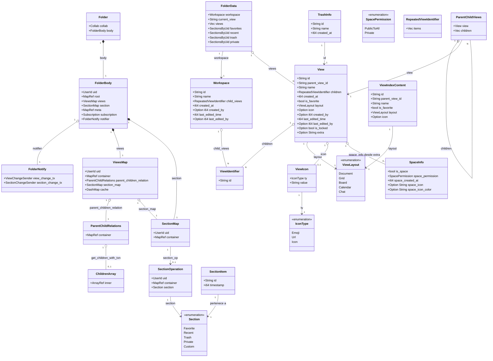
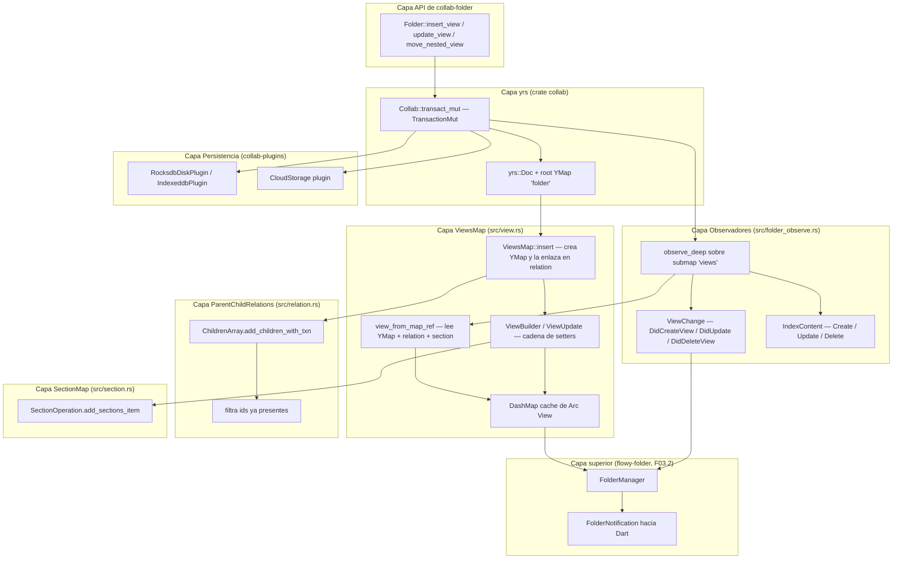
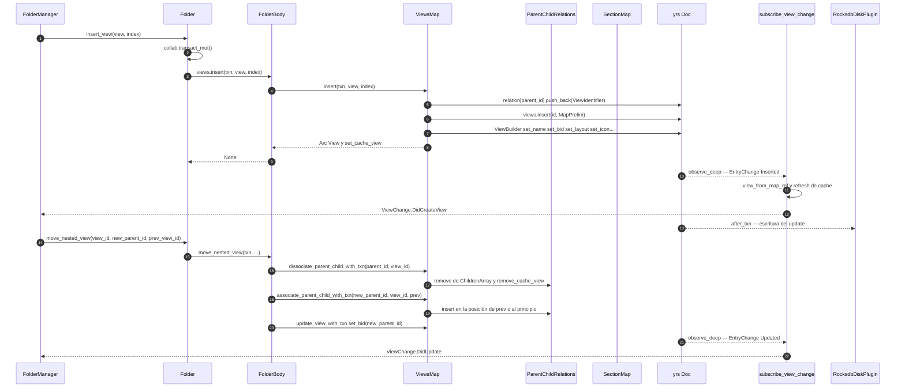
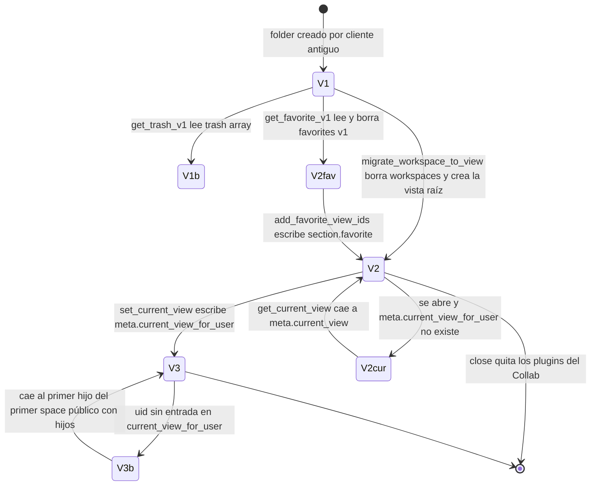

# F03.3 — `collab-folder` (CRDT): `Folder`, `FolderBody`, `View`, `Workspace`, jerarquía, secciones y relaciones

## 1. Resumen

`collab-folder` es el crate que modela **la jerarquía completa del sidebar como un único documento CRDT `yrs`**: el workspace actual, el árbol de vistas (documentos, grids, boards, calendars, chats), las relaciones padre→hijos, las secciones por usuario (favoritos, recientes, papelera, privadas) y la vista "actual" por usuario. Su punto de entrada es el struct `Folder` (`collab:collab/collab-folder/src/folder.rs:89`), que envuelve un `Collab` más un `FolderBody` (`collab:collab/collab-folder/src/folder.rs:486`) con tres submódulos de acceso: `ViewsMap` (`collab:collab/collab-folder/src/view.rs:39`), `SectionMap` (`collab:collab/collab-folder/src/section.rs:13`) y `ParentChildRelations` (`collab:collab/collab-folder/src/relation.rs:16`). El crate **no registra eventos FFI ni emite notificaciones Rust→Dart**: es una biblioteca pura, consumida íntegramente por `flowy-folder` (F03.2). Publica tres canales de cambio interno (`ViewChange`, `SectionChange` e `IndexContent`) que `flowy-folder` traduce a `FolderNotification`. Contiene 28 archivos, 3.984 líneas de `src/`, 2.298 de tests y 45 tests de integración en `tests/folder_test/`.

## 2. Alcance

Este documento cubre el crate `collab-folder` completo tal y como está en `SRC/collab/collab-folder/`: los 15 ficheros de configuración y `src/`, y los 13 ficheros de `tests/folder_test/`. **Entra**: el modelo de datos CRDT, la API pública de `Folder`, los macros generadores de setters y de operaciones de sección, los observadores (`ViewChange`/`SectionChange`), el diff de vistas contra un `EncodedCollab`, las migraciones de esquema propias del folder, el `hierarchy_builder` y la batería de tests con su fixture de datos históricos.

**Sale** (redirección explícita de scope):

| Elemento | Dónde vive realmente | Evidencia |
|---|---|---|
| `FolderEvent` (51 eventos FFI) y sus handlers | **F03.2** — `flowy-folder` | `appflowy/frontend/rust-lib/flowy-folder/src/event_map.rs:64`, `appflowy/frontend/rust-lib/flowy-folder/src/event_handler.rs:13` |
| `FolderNotification` (19 variantes) | **F03.2** — `flowy-folder` | `appflowy/frontend/rust-lib/flowy-folder/src/notification.rs:8` |
| BLoCs Dart de vistas/workspaces (`ViewBloc`, `WorkspaceBloc`, `FolderBloc`…) | **F03.1** | `appflowy/frontend/rust-lib/flowy-folder/src/manager.rs:209` (capa servidora) |
| UI de sidebar, favoritos, recientes y papelera | **F04** | `appflowy/frontend/rust-lib/flowy-folder/src/manager_observer.rs:24` (el consumo Dart se documenta allí) |
| `features/view_management/**` (4 ficheros) | **F04**, y **están vacíos**: `README.md` 0 bytes, los tres `.dart` 1 byte (solo un salto de línea). `ViewManagementBloc` **no existe**. El ROADMAP lo asignaba a B3.F03; es una corrección de scope. | `appflowy/frontend/appflowy_flutter/lib/features/view_management/README.md` (0 líneas), `appflowy/frontend/appflowy_flutter/lib/features/view_management/logic/view_management_bloc.dart:1` (1 línea vacía) |
| Migraciones de datos de usuario | **F05.2** — `flowy-user/src/migrations/**` (`anon_user_workspace.rs`, `workspace_and_favorite_v1.rs`, `workspace_trash_v1.rs`…) | `appflowy/frontend/rust-lib/flowy-user/src/migrations/mod.rs:1` |
| Migraciones de esquema diesel / SQLite | **B1.7** (`OUT/08-persistencia/`) | `appflowy/frontend/rust-lib/collab-integrate/src/collab_builder.rs:274` (la otra capa) |
| Construcción del folder collab e inyección de plugins | **F00** — `collab-integrate` (`appflowy/frontend/rust-lib/collab-integrate/src/collab_builder.rs:200`, `appflowy/frontend/rust-lib/collab-integrate/src/plugin_provider.rs:8`) | ver §7 |
| Claves de persistencia en KV/RocksDB, snapshots | **B1.8 / `OUT/08-persistencia/`** | `collab:collab/collab-plugins/src/local_storage/kv/keys.rs:24` |

**Sobre el solape con B1.6 (`OUT/07-motor-colaborativo-crdt/02-folder.md`).** Ese documento ya toca `View`, `Workspace`, `FolderData`, `ViewLayout` y `folder_migration`. No lo repetimos: aquí se documenta el crate entero con tipos reales y líneas reales, y se corrigen los puntos en los que B1.6 se apartó del código.

| Qué repite B1.6 | Qué añade F03.3 |
|---|---|
| Que `collab-folder` es el CRDT `CollabType::Folder` de la jerarquía del sidebar | Las **claves raíz exactas** del `yrs::Map`: `folder/{views,section,meta,relation}` con `meta.current_workspace`, `meta.current_view`, `meta.current_view_for_user` (`collab:collab/collab-folder/src/folder.rs:54–60`, `collab:collab/collab-folder/src/folder.rs:517–526`) |
| Que existen los tipos `View` y `Workspace` | Los **13 campos reales de `View`** con línea, y los **7 de `Workspace`** (§3). B1.6 listó campos inexistentes (`desc` como campo del struct, `layout_settings`, `cover`, `is_space`, `display_mode`, `view_space_status`) |
| Que existe un enum de layouts | El enum real con sus 5 variantes y su codificación `#[repr(u8)]` → `Any::BigInt` (`collab:collab/collab-folder/src/view.rs:832–840`, `collab:collab/collab-folder/src/view.rs:870–874`). B1.6 añadió una variante `AIChat` **que no existe** en este snapshot |
| Que hay un observador que notifica al SDK | El mecanismo real: `subscribe_view_change` (profundo, sobre el mapa `views`) y `subscribe_folder_change` (solo traza), con los tres canales `ViewChange`/`SectionChange`/`IndexContent` (`collab:collab/collab-folder/src/folder_observe.rs:56–126`) |
| Que `folder_migration.rs` aplica evoluciones de esquema | Las **dos migraciones concretas y su contrato**: `migrate_workspace_to_view` (`workspaces[]` → vista única) y `get_favorite_v1` (`favorites[]` → `section.favorite`), más los *fallback* de lectura de `current_view` (`collab:collab/collab-folder/src/folder_migration.rs:94–116`, `collab:collab/collab-folder/src/folder.rs:795–812`). B1.6 inventories una lista de `struct X; impl Migration` que **no existe** en el crate |
| Que `hierarchy_builder` aplana la jerarquía | Los builders reales (`NestedViewBuilder`, `NestedChildViewBuilder`, `ViewExtraBuilder`), `ParentChildViews` y `FlattedViews::flatten_views`, con sus 4 tests (`collab:collab/collab-folder/src/hierarchy_builder.rs:15–357`) |
| — | `ViewsMap` y su caché `DashMap`, `SectionMap`/`SectionOperation`, `ParentChildRelations`/`ChildrenArray`, `Folder::calculate_view_changes` + `FolderViewChange`, `FolderError`, `UserId`, `SpaceInfo`/`SpacePermission`, `ViewIcon`/`IconType`, los macros de `macros.rs` y los **13 ficheros de test** (§6, §15) |

## 3. Modelos de datos

El diagrama muestra los tipos reales del crate tal como están declarados en `src/{folder,view,workspace,section,space_info,relation,entities}.rs`, sin genéricos en los campos (regla Mermaid) y con la cardinalidad de las relaciones del árbol.

**Lectura.** `Folder` es una fachada fina sobre `Collab` + `FolderBody`: `Folder` abre la transacción (`collab:collab/collab-folder/src/folder.rs:170–173`), `FolderBody` ejecuta la lógica. `FolderBody` reparte el `yrs::Map` raíz en cuatro submaps (`views`, `section`, `meta`, `relation`) y los envuelve en tresemannipuladores con estado propio: `ViewsMap` (que además lleva una caché `DashMap<String, Arc<View>>`, `collab:collab/collab-folder/src/view.rs:44`), `SectionMap` y `ParentChildRelations`. El árbol no se almacena anidado: `View.children` es una lista plana de `ViewIdentifier` materializada desde el submap `relation`, y la redundancia se usa a propósito para poder leer el árbol en una sola pasada. `Workspace` es una proyección de la vista raíz (el workspace **es** una `View` con `layout = Document` y `parent_view_id = ""`), gracias a las conversiones `From<&View> for Workspace` (`collab:collab/collab-folder/src/workspace.rs:32–44`) y `From<Workspace> for View` (`collab:collab/collab-folder/src/workspace.rs:45–63`).

### 3.1 Todos los campos de `View`

Los 13 campos públicos, con su línea exacta (`collab:collab/collab-folder/src/view.rs:678–709`):

| # | Campo | Tipo declarado | Línea | Clave `yrs` | Notas |
|---|---|---|---|---|---|
| 1 | `id` | `String` | `collab:collab/collab-folder/src/view.rs:681` | `id` | `pub(crate) const FOLDER_VIEW_ID` en `collab:collab/collab-folder/src/view.rs:21` |
| 2 | `parent_view_id` | `String` | `collab:collab/collab-folder/src/view.rs:683` | `bid` | `const VIEW_PARENT_ID` en `collab:collab/collab-folder/src/view.rs:23`; vacío si es la raíz/workspace |
| 3 | `name` | `String` | `collab:collab/collab-folder/src/view.rs:685` | `name` | `collab:collab/collab-folder/src/view.rs:22`; `unwrap_or_default()` al leer (`collab:collab/collab-folder/src/view.rs:431–433`) |
| 4 | `children` | `RepeatedViewIdentifier` | `collab:collab/collab-folder/src/view.rs:687` | (submap `relation`) | Derivado de `ParentChildRelations` (`collab:collab/collab-folder/src/view.rs:441–444`), no almacenado en el mapa de la vista |
| 5 | `created_at` | `i64` | `collab:collab/collab-folder/src/view.rs:688` | `created_at` | Segundos Unix; `0` se normaliza a `now()` al insertar (`collab:collab/collab-folder/src/view.rs:414–420`) |
| 6 | `is_favorite` | `bool` (`#[serde(default)]`) | `collab:collab/collab-folder/src/view.rs:690` | (sección `favorite`) | **Derivado**: se calcula leyendo `Section::Favorite` (`collab:collab/collab-folder/src/view.rs:447–450`) |
| 7 | `layout` | `ViewLayout` | `collab:collab/collab-folder/src/view.rs:691` | `layout` | `#[repr(u8)]`, se persiste como `Any::BigInt` (`collab:collab/collab-folder/src/view.rs:870–874`) |
| 8 | `icon` | `Option<ViewIcon>` | `collab:collab/collab-folder/src/view.rs:692` | `icon` | Serializado como **string JSON**; si es `None` se guarda `""` (`collab:collab/collab-folder/src/view.rs:582–589`) y se lee con `serde_json::from_str(...).ok()` (`collab:collab/collab-folder/src/view.rs:477–480`) |
| 9 | `created_by` | `Option<i64>` | `collab:collab/collab-folder/src/view.rs:693` | `created_by` | uid numérico |
| 10 | `last_edited_time` | `i64` | `collab:collab/collab-folder/src/view.rs:694` | `last_edited_time` | Lo sobrescribe `update_view_with_txn` en cada edición (`collab:collab/collab-folder/src/view.rs:392`) |
| 11 | `last_edited_by` | `Option<i64>` | `collab:collab/collab-folder/src/view.rs:695` | `last_edited_by` | uid numérico |
| 12 | `is_locked` | `Option<bool>` | `collab:collab/collab-folder/src/view.rs:696` | `is_locked` | Solo se escribe si es `Some` (`collab:collab/collab-folder/src/view.rs:591–596`) |
| 13 | `extra` | `Option<String>` | `collab:collab/collab-folder/src/view.rs:708` | `extra` | JSON libre. Para documento: `cover`, `line_height_layout`, `font_layout`; para space: `is_space`, `space_permission`, `space_created_at`, `space_icon`, `space_icon_color` (comentario en `collab:collab/collab-folder/src/view.rs:697–708`) |

Existe además una clave `desc` (`const VIEW_DESC`, `collab:collab/collab-folder/src/view.rs:24`) con su setter `set_desc` (`collab:collab/collab-folder/src/view.rs:543`), pero **no** forma parte del struct `View`; solo se escribe y nunca se lee de vuelta. Es una clave huérfana del esquema, y es la que explica el campo `desc` que aparece en el fixture histórico `folder_data.json` (42 de 42 vistas lo tienen, ver §8.4).

Constructores y helpers de `View`: `View::new` (`collab:collab/collab-folder/src/view.rs:712–734`), `View::orphan_view` (donde `parent_view_id == id`, `collab:collab/collab-folder/src/view.rs:736–752`) y `View::space_info` (deserializa `extra` como `SpaceInfo`, `collab:collab/collab-folder/src/view.rs:753–756`).

### 3.2 Todos los campos de `Workspace`

Los 7 campos (`collab:collab/collab-folder/src/workspace.rs:5–14`):

| # | Campo | Tipo | Línea | Origen |
|---|---|---|---|---|
| 1 | `id` | `String` | `collab:collab/collab-folder/src/workspace.rs:7` | `id` de la `View` raíz |
| 2 | `name` | `String` | `collab:collab/collab-folder/src/workspace.rs:8` | `name` |
| 3 | `child_views` | `RepeatedViewIdentifier` | `collab:collab/collab-folder/src/workspace.rs:9` | `children` de la vista raíz |
| 4 | `created_at` | `i64` | `collab:collab/collab-folder/src/workspace.rs:10` | `created_at` |
| 5 | `created_by` | `Option<i64>` | `collab:collab/collab-folder/src/workspace.rs:11` | `created_by` |
| 6 | `last_edited_time` | `i64` | `collab:collab/collab-folder/src/workspace.rs:12` | `last_edited_time` |
| 7 | `last_edited_by` | `Option<i64>` | `collab:collab/collab-folder/src/workspace.rs:13` | `last_edited_by` |

`Workspace::new` (`collab:collab/collab-folder/src/workspace.rs:17–29`) es el único constructor y no escribe nada: solo crea el valor Rust; la persistencia la hace `ViewsMap::insert` al insertarlo como `View`. No existe un tipo `WorkspaceId` ni un tipo `ViewId` en este crate: los identificadores son `String` (UUID en producción) tal y como se ve en el fixture (`collab:collab/collab-folder/tests/folder_test/history_folder/folder_data.json:1043`). Tampoco existe un tipo `Trash` ni una entidad `ViewMetadata`: la papelera es la sección `Section::Trash` de tipo `SectionItem` (`collab:collab/collab-folder/src/section.rs:304–309`), y la proyección a DTO es `TrashInfo` (`collab:collab/collab-folder/src/entities.rs:34–39`), construida por `Folder::get_my_trash_info` (`collab:collab/collab-folder/src/folder.rs:311–328`). `[NO DETERMINADO]`: si el ROADMAP o alguna versión anterior de la skill mencionaba `ViewId`/`WorkspaceId`/`Trash`/`ViewRelation`/`ViewMetadata`, en este snapshot (`collab` rev `4dfccef`) **no existen**; el `rg` sobre `SRC/collab/collab-folder/` no encuentra ninguno de esos identificadores.

### 3.3 `FolderData`: la instantánea portable

`FolderData` (`collab:collab/collab-folder/src/entities.rs:5–18`) es la estructura serializable que permite|round-trip` entre el CRDT y el mundo exterior (import, tests, `Folder::create`):

| Campo | Tipo | Línea | Comentario |
|---|---|---|---|
| `workspace` | `Workspace` | `collab:collab/collab-folder/src/entities.rs:7` | El workspace actual, no la lista |
| `current_view` | `String` | `collab:collab/collab-folder/src/entities.rs:8` | Se escribe **dos veces** al abrir: en `meta.current_view` (compatibilidad) y en `meta.current_view_for_user[uid]` (`collab:collab/collab-folder/src/folder.rs:558–561`) |
| `views` | `Vec<View>` | `collab:collab/collab-folder/src/entities.rs:9` | Vista a vista, **aplanada**: `get_folder_data` la compone recorriendo recursivamente + huérfanas (`collab:collab/collab-folder/src/folder.rs:651–668`) |
| `favorites` | `SectionsByUid` | `collab:collab/collab-folder/src/entities.rs:11` | `HashMap<UserId, Vec<SectionItem>>` (`collab:collab/collab-folder/src/section.rs:115`), `#[serde(default)]` |
| `recent` | `SectionsByUid` | `collab:collab/collab-folder/src/entities.rs:13` | ídem |
| `trash` | `SectionsByUid` | `collab:collab/collab-folder/src/entities.rs:15` | ídem |
| `private` | `SectionsByUid` | `collab:collab/collab-folder/src/entities.rs:17` | ídem |

`FolderData::new` (`collab:collab/collab-folder/src/entities.rs:21–31`) las inicializa vacías; `default_folder_data(workspace_id)` (`collab:collab/collab-folder/src/folder.rs:820–839`) es la variante con valores `0`/`None` que usan los pathways de servidor local.

### 3.4 Secciones y relaciones

`Section` (`collab:collab/collab-folder/src/section.rs:64–71`) tiene cuatro variantes fijas y una abierta (`Custom(String)`). Las cuatro predefinidas se crean **siempre** al abrir el folder (`predefined_sections`, `collab:collab/collab-folder/src/section.rs:73–80`, aplicado en `collab:collab/collab-folder/src/folder.rs:528–535`) y se materializan como las claves `favorite`, `recent`, `trash`, `private` del submap `section` (`AsRef<str>`, `collab:collab/collab-folder/src/section.rs:88–99`). Cada sección es un mapa `UserId -> Array<SectionItem>`; `SectionItem` lleva `id` + `timestamp` (`collab:collab/collab-folder/src/section.rs:304–309`), y el `timestamp` es lo que ordena "recientes" y fecha la papelera (`Folder::get_my_trash_info` lo copia a `created_at`, `collab:collab/collab-folder/src/folder.rs:324`).

`ParentChildRelations` (`collab:collab/collab-folder/src/relation.rs:16–18`) es el submap `relation`: `parent_id -> Array<ViewIdentifier>`. `ViewIdentifier` es un newtype de un único `String` (`collab:collab/collab-folder/src/relation.rs:291–294`) que en `yrs` se serializa como `Any::Map({"id": <string>})` (`collab:collab/collab-folder/src/relation.rs:317–323`), y `RepeatedViewIdentifier` es el `Vec<ViewIdentifier>` con `Deref` a `Vec` para poder indexar directamente (`collab:collab/collab-folder/src/relation.rs:251–279`). Los helpers son `associate` (inserta en la posición de `prev_id` o al principio), `dissociate`, `move_child` (extrae y reinserta), `add_children` (deduplicando ids ya presentes, `collab:collab/collab-folder/src/relation.rs:209–215`).

`SpaceInfo` (`collab:collab/collab-folder/src/space_info.rs:19–43`) vive serializado dentro de `View.extra` bajo las claves `is_space`, `space_permission`, `space_created_at`, `space_icon`, `space_icon_color` (`collab:collab/collab-folder/src/space_info.rs:5–9`). `SpacePermission` es un `#[repr(u8)]` con `PublicToAll = 0` (por defecto) y `Private = 1` (`collab:collab/collab-folder/src/space_info.rs:61–69`). Es el mecanismo por el que `Folder::get_child_of_first_public_view` (`collab:collab/collab-folder/src/folder.rs:759–793`) decide la vista por defecto de un usuario nuevo: primer hijo del primer space público que tenga hijos.

## 4. Eventos FFI

**`collab-folder` no registra ningún evento FFI.** No existe `event_map.rs`, ni `AFPlugin`, ni `Flowy_Event`, ni derivación `ProtoBuf_Enum` en el crate. La evidencia es directa y negativa: el `Cargo.toml` no depende de `flowy-error`, `flowy-codegen` ni `build-tool` (`collab:collab/collab-folder/Cargo.toml:10–24`), y las únicas dependencias son `collab`, `collab-entity`, `serde`, `tokio`, `dashmap`, `arc-swap` y `uuid` (`collab:collab/collab-folder/Cargo.toml:11–24`). El catálogo `OUT/_ledger/extract/events.json` tiene **cero** entradas cuyo `crate` sea `collab-folder` (comprobado por `rg 'collab-folder' OUT/_ledger/extract/events.json` → 0 coincidencias); en `deps.json` `collab-folder` aparece solo como dependencia *consumida* por `flowy-folder`, `collab-integrate` y los `flowy-*-pub`.

| Fuente de verdad | Contenido | Dónde vive |
|---|---|---|
| `FolderEvent` (51 variantes) | enum FFI | **F03.2** `appflowy/frontend/rust-lib/flowy-folder/src/event_map.rs:64` |
| Handlers | `*_handler` | **F03.2** `appflowy/frontend/rust-lib/flowy-folder/src/event_handler.rs:13` |
| `FlowyResult` / `FlowyError` | tipo de retorno | **F03.2** `appflowy/frontend/rust-lib/flowy-folder/src/util.rs:5` |
| **`collab-folder`** | **nada** | — |

El flujo completo FFI → `flowy-folder` → `collab-folder` es: (1) Dart envía `FolderEventCreateView(payload)` por `dart_ffi::async_event`; (2) el `AFPlugin` "Flowy-Folder" despacha a `create_view_handler` (`appflowy/frontend/rust-lib/flowy-folder/src/event_handler.rs:81`); (3) el handler parsea el PB a `CreateViewParams` y llama a `FolderManager::create_view_with_params`; (4) el `FolderManager` invoca `Folder::insert_view` (`collab:collab/collab-folder/src/folder.rs:347–350`), que abre `transact_mut()` y delega en `ViewsMap::insert` (`collab:collab/collab-folder/src/view.rs:278–332`). Los detalles de los 51 eventos, sus PB de entrada/salida y sus listeners Dart están en `OUT/09-features/F03-folder-workspaces-vistas/0.2-flowy-folder-rust.md` §4; no se replican aquí.

Lo que sí hace `collab-folder` es *consumir* la entrada FFI como error: `FolderError` (`collab:collab/collab-folder/src/error.rs:3–13`) tiene tres variantes — `Internal` (de `anyhow::Error`), `CollabError` (de `collab::error::CollabError`) y `NoRequiredData(String)` — y la última se produce tanto desde `CollabValidateError::NoRequiredData` (`collab:collab/collab-folder/src/error.rs:15–21`) como desde las validaciones propias (`collab:collab/collab-folder/src/folder.rs:105`, `collab:collab/collab-folder/src/folder.rs:139`, `collab:collab/collab-folder/src/folder.rs:453–459`). Esa validación exige que exista `folder.meta.current_workspace` y no esté vacío, tanto en `Folder::validate` como en `CollabType::Folder.validate_require_data` del crate de entidades (`collab:collab/collab-entity/src/collab_object.rs:98–111`).

## 5. Notificaciones

**`collab-folder` no emite ninguna notificación Rust→Dart.** No hay `NotificationBuilder`, ni `ProtoBuf_Enum`, ni dependencia de `flowy-notification` (`collab:collab/collab-folder/Cargo.toml:10–24`). `OUT/_ledger/extract/notifications.json` tiene cero entradas asociadas a este crate. Las notificaciones que el usuario final ve (`DidUpdateView`, `DidUpdateChildViews`, `DidMoveViewToTrash`, `DidFavoriteView`…) las emite `flowy-folder` a partir de los tres canales que aquí sí existen:

| Canal interno | Tipo | Productor en `collab-folder` | Consumidor | Traducción a FFI |
|---|---|---|---|---|
| Cambios de vista | `ViewChange` = `DidCreateView{view}` / `DidDeleteView{views}` / `DidUpdate{view}` (`collab:collab/collab-folder/src/folder_observe.rs:14–19`), por `broadcast::Sender<ViewChange>` (`collab:collab/collab-folder/src/folder_observe.rs:21`) | `subscribe_view_change` (`collab:collab/collab-folder/src/folder_observe.rs:56–126`), `observe_deep` sobre el submap `views`; emite en `collab:collab/collab-folder/src/folder_observe.rs:84`, `:98`, `:113` | `subscribe_folder_view_changed` (`appflowy/frontend/rust-lib/flowy-folder/src/manager_observer.rs:24`) | `DidUpdateChildViews` / `DidUpdateView` (F03.2 §5) |
| Cambios de papelera | `SectionChange::Trash(TrashItemAdded{ids} \| TrashItemRemoved{ids})` (`collab:collab/collab-folder/src/section.rs:101–113`), por `broadcast::Sender<SectionChange>` | `SectionOperation::add_sections_item` (`collab:collab/collab-folder/src/section.rs:265–277`) y `delete_section_items_with_txn` (`collab:collab/collab-folder/src/section.rs:246–258`), **solo** para `Section::Trash` | `subscribe_folder_trash_changed` (`appflowy/frontend/rust-lib/flowy-folder/src/manager_observer.rs:112`) | `DidMoveViewToTrash` / `DidUpdateTrash` |
| Contenido para indexación | `IndexContent::Create(json)` / `Update(json)` / `Delete(Vec<String>)` (`collab:collab/collab/src/core/collab.rs:43–47`), por `broadcast::Sender<IndexContent>` | `subscribe_view_change`, líneas `collab:collab/collab-folder/src/folder_observe.rs:82`, `:96`, `:111` | `Collab::subscribe_index_content` (`collab:collab/collab/src/core/collab.rs:427`) — el motor de búsqueda/embeddings, no FFI | — (consumo interno) |

`collab-folder` **no** tiene una noción de `SpacePermission`-notificación ni de `did_update_section_views`: eso lo decide `flowy-folder` consultando `View::space_info()` (`appflowy/frontend/rust-lib/flowy-folder/src/manager.rs:2515–2519`). Los canales se inyectan por el constructor: `FolderNotify { view_change_tx, section_change_tx }` (`collab:collab/collab-folder/src/folder.rs:62–66`), que `flowy-folder` construye con dos `broadcast::channel(100)` en `FolderManager::initialize` (`appflowy/frontend/rust-lib/flowy-folder/src/manager_init.rs:45–49`). Los tests verifican el contrato de papelera en `collab:collab/collab-folder/tests/folder_test/trash_test.rs:54–74` y `:76–97`.

## 6. BLoCs / Cubits

No hay BLoC ni Cubit: el crate es Rust puro. `OUT/_ledger/extract/blocs.json` no contiene ninguna entrada que apunte a `collab-folder`. Los BLoCs Dart que consumen el resultado de este crate (`FavoriteBloc`, `RecentViewsBloc`, `ViewBloc`, `WorkspaceBloc`) están en `appflowy/frontend/appflowy_flutter/lib/workspace/application/` y pertenecen a **F03.1**; se citan aquí solo como contraparte, sin reclamarlos como archivos cubiertos.

| Sub-sistema Rust de esta unidad | Equivalente Dart (no cubierto) | Carpeta Dart |
|---|---|---|
| `Folder::get_view` / `insert_view` / `update_view` (`collab:collab/collab-folder/src/folder.rs:347`, `:370`, `:249`) | `ViewBloc` | `appflowy/frontend/appflowy_flutter/lib/workspace/application/view/` (F03.1) |
| `impl_section_op!(Section::Favorite, …)` (`collab:collab/collab-folder/src/folder.rs:264–273`) | `FavoriteBloc` | `appflowy/frontend/appflowy_flutter/lib/workspace/application/favorite/favorite_bloc.dart:13` (F03.1) |
| `impl_section_op!(Section::Recent, …)` (`collab:collab/collab-folder/src/folder.rs:276–285`) | `RecentViewsBloc` | `appflowy/frontend/appflowy_flutter/lib/workspace/application/recent/recent_views_bloc.dart:8` (F03.1) |
| `impl_section_op!(Section::Trash, …)` (`collab:collab/collab-folder/src/folder.rs:288–297`) + `get_my_trash_info` (`:311`) | `TrashBloc` | `appflowy/frontend/appflowy_flutter/lib/plugins/trash/application/` (F04) |

La equivalencia es 1:1 a nivel de **operación**, pero no de estado: el crate no mantiene ningún estado de UI; expone transacciones yrs y callbacks `broadcast`. Es el `FolderManager` (`appflowy/frontend/rust-lib/flowy-folder/src/manager.rs:74`) quien añade semántica de producto (import, publicar, compartir) sobre estas primitivas.

## 7. Servicios e inyección de dependencias

`collab-folder` no tiene contenedor de inyección propio: recibe el `Collab` ya construido por el llamador. El ensamblaje real ocurre en **`collab-integrate` (F00)**, y por tanto está fuera de los archivos cubiertos pero es imprescindible entenderlo:

1. `AppFlowyCollabBuilder::create_folder` (`appflowy/frontend/rust-lib/collab-integrate/src/collab_builder.rs:200–234`) es el único punto de entrada de producción. Afirma que el `CollabObject` es `CollabType::Folder` (`appflowy/frontend/rust-lib/collab-integrate/src/collab_builder.rs:209–210`) y luego llama a `Folder::open` o `Folder::create` según haya `folder_data` (`appflowy/frontend/rust-lib/collab-integrate/src/collab_builder.rs:211–231`). Devuelve `Arc<RwLock<Folder>>`.
2. `build_collab` (`appflowy/frontend/rust-lib/collab-integrate/src/collab_builder.rs:274–302`) crea el `Collab` con `CollabBuilder::new(uid, object_id, data_source)` y le añade el plugin de disco.
3. `finalize` (`appflowy/frontend/rust-lib/collab-integrate/src/collab_builder.rs:304–359`) inyecta los plugins de nube: si `build_config.sync_enable` y el provider es `AppFlowyCloud`, llama a `plugin_provider.get_plugins(CollabPluginProviderContext::AppFlowyCloud { … })` (`appflowy/frontend/rust-lib/collab-integrate/src/collab_builder.rs:341–345`) y añade cada plugin; con provider `Local` no añade ninguno (`appflowy/frontend/rust-lib/collab-integrate/src/collab_builder.rs:352`).
4. El `FolderNotify` se inyecta como argumento opcional en `create_folder` (`appflowy/frontend/rust-lib/collab-integrate/src/collab_builder.rs:206`) desde `flowy-folder` (`appflowy/frontend/rust-lib/flowy-folder/src/manager.rs:209`, `appflowy/frontend/rust-lib/flowy-folder/src/manager_init.rs:46–49`).

Tipos de `collab-plugins` implicados (todos del crate hermano, B1.8):

| Tipo | Papel | Dónde |
|---|---|---|
| `CollabPlugin` (trait) | Cualquier plugin que se adjunte al `Collab` | `collab:collab/collab-plugins/src/lib.rs:1` |
| `RocksdbDiskPlugin` | Persistencia local por defecto en desktop | `collab:collab/collab-plugins/src/local_storage/rocksdb/rocksdb_plugin.rs:26` |
| `CollabKVDB` | Base KV (RocksDB) que hospeda el plugin | `collab:collab/collab-plugins/src/local_storage/kv/db.rs:1` |
| `CollabPersistenceConfig` | Política de escritura (debounce, flush) | `collab:collab/collab-plugins/src/local_storage/storage_config.rs:1` |
| `CloudStorage` (módulo) | Canal de sincronización: `remote_collab`, `sink`, `msg` | `collab:collab/collab-plugins/src/cloud_storage/mod.rs:1` |
| `IndexeddbPlugin` | Persistencia local en web/wasm | `collab:collab/collab-plugins/src/local_storage/indexeddb/indexeddb_plugin.rs:1` |

Dentro del crate, el "servicio" equivalente es `ViewsMap`, que se construye una vez en `FolderBody::open_with` inyectándole el `IndexContentSender` del `Collab` (`collab:collab/collab-folder/src/folder.rs:514`, `:537–547`); y `impl_section_op!`, que genera las 28 operaciones de sección (4 secciones × 7 métodos) directamente sobre `Folder` (`collab:collab/collab-folder/src/macros.rs:106–172`, aplicado en `collab:collab/collab-folder/src/folder.rs:264–309`). Los macros generadores de setters (`impl_str_update`, `impl_i64_update`, `impl_option_i64_update`, `impl_any_update`, `impl_bool_update`, `impl_array_update`, `impl_option_str_update`) viven en `collab:collab/collab-folder/src/macros.rs:1–104` y se instancian en `ViewUpdate` (`collab:collab/collab-folder/src/view.rs:541–553`).

## 8. Persistencia

`collab-folder` **no escribe en disco por sí mismo**. Todo el estado vive en el `yrs::Doc` del `Collab`, y sujedumbre a almacenamiento la aportan plugins de `collab-plugins` enganchados por `collab-integrate` (§7). Tres formas, todas configurables por plataforma:

| Nivel | Plugin | Clave / espacio de claves | Ámbito |
|---|---|---|---|
| Local desktop | `RocksdbDiskPlugin` (`collab:collab/collab-plugins/src/local_storage/rocksdb/rocksdb_plugin.rs:26`) | `DOC_SPACE` (byte 1) + `DOC_SPACE_OBJECT` (0) + `object_id` + `TERMINATOR`; dentro, `DOC_STATE` (0), `DOC_STATE_VEC` (1), `DOC_UPDATE` (2) (`collab:collab/collab-plugins/src/local_storage/kv/keys.rs:23–47`) | Un folder = un `object_id` = **el `workspace_id`** |
| Local web | `IndexeddbPlugin` (`collab:collab/collab-plugins/src/local_storage/indexeddb/indexeddb_plugin.rs:1`) | IndexedDB, mismo esquema lógico de claves | idem |
| Nube | `CloudStorage` (`collab:collab/collab-plugins/src/cloud_storage/mod.rs:1`) | Endpoint `/api/workspace/{workspace_id}/folder-v2`, ligado al `CollabType::Folder` | Multi-dispositivo |

Para el folder, `object_id == workspace_id`, tal y como se ve en el propio `folder_test` (`collab:collab/collab-folder/tests/folder_test/util.rs:54–60`: se pasa `workspace_id` dos veces, como `workspace_id` y como `object_id`) y en `create_folder` (`appflowy/frontend/rust-lib/collab-integrate/src/collab_builder.rs:291`).

### 8.1 Puntos de escritura en el CRDT

Todo el estado mutable vive bajo la raíz `FOLDER = "folder"` (`collab:collab/collab-entity/src/define.rs:5`) y se inicializa con `get_or_init` en `FolderBody::open_with`:

| Subclave raíz | Tipo `yrs` | Contenido | Línea de `get_or_init` |
|---|---|---|---|
| `views` | `Map<String, YMap>` | Una `YMap` por vista, con `id`, `bid`, `name`, `created_at`, `created_by`, `layout`, `icon`, `last_edited_time`, `last_edited_by`, `is_locked`, `extra` (y `desc` heredada) | `collab:collab/collab-folder/src/folder.rs:521` |
| `section` | `Map<String, YMap<UserId, YArray>>` | `favorite`, `recent`, `trash`, `private` (+ `Custom`) | `collab:collab/collab-folder/src/folder.rs:522`, inicializadas en `:528–535` |
| `meta` | `YMap` | `current_workspace`, `current_view`, `current_view_for_user` | `collab:collab/collab-folder/src/folder.rs:523` |
| `relation` | `Map<String, YArray>` | `parent_id -> [ViewIdentifier…]` | `collab:collab/collab-folder/src/folder.rs:524–526` |

Las constantes raíz (`FOLDER`, `FOLDER_META`, `FOLDER_WORKSPACE_ID = "current_workspace"`) vienen de `collab:collab/collab-entity/src/define.rs:5–7`; las sub-claves internas (`views`, `relation`, `current_view`, `current_view_for_user`, `favorites` v1, `section`) son locales al crate (`collab:collab/collab-folder/src/folder.rs:54–60`).

### 8.2 Snapshots y codificación

`Folder::encode_collab` (`collab:collab/collab-folder/src/folder.rs:148–154`) produce un `EncodedCollab` validando antes que exista `meta.current_workspace`. `AppFlowyCollabBuilder::create_folder` lo usa explícitamente: tras `Folder::create` llama a `write_collab_to_disk` para volcar el folder recién creado (`appflowy/frontend/rust-lib/collab-integrate/src/collab_builder.rs:219–228`). `Folder::from_collab_doc_state` (`collab:collab/collab-folder/src/folder.rs:121–130`) es la vía inversa: reconstruye un `Folder` en memoria a partir de un `DataSource` (usado por `calculate_view_changes` y por la carga desde nube). El espacio de claves de snapshots (`SNAPSHOT_SPACE`, byte 2) está en `collab:collab/collab-plugins/src/local_storage/kv/keys.rs:49–55`; la implementación del plugin de snapshot para RocksDB es `collab:collab/collab-plugins/src/local_storage/rocksdb/snapshot_plugin.rs:1`.

### 8.3 Carga desde disco

`Folder::open` (`collab:collab/collab-folder/src/folder.rs:95–109`) es el punto de lectura: valida los datos requeridos, construye el `FolderBody` y **falla** si no hay `workspace_id` (`collab:collab/collab-folder/src/folder.rs:103–108`). La ruta de test equivalente es `open_folder_with_db` (`collab:collab/collab-folder/tests/folder_test/util.rs:86–128`), que abre un `CollabKVDB` en una ruta dada, monta un `KVDBCollabPersistenceImpl` y llama a `Folder::open` — exactamente el mismo camino que usa producción vía `collab-integrate`.

**`load_disk.rs` está prácticamente muerto** (`collab/collab-folder/tests/folder_test/load_disk.rs`): su único `#[test]` (`test_set_current_view`) está comentado (`collab:collab/collab-folder/tests/folder_test/load_disk.rs:7–24`) y las dos funciones que quedan (`duplicate_db`, `copy_folder_recursively`, líneas `:26–59`) están marcadas `#[allow(dead_code)]` y no se invocan desde ningún test. Los tests de carga desde disco reales están en `favorite_test.rs`, que descomprime bases RocksDB históricas con `unzip_history_folder_db` (`collab:collab/collab-folder/tests/folder_test/util.rs:207–243`) y las abre con `open_folder_with_db` (`collab:collab/collab-folder/tests/folder_test/favorite_test.rs:199–204` y `:269–274`).

### 8.4 Fixture histórico: `history_folder/folder_data.json`

Es un `FolderData` real de 1.063 líneas (`collab:collab/collab-folder/tests/folder_test/history_folder/folder_data.json:1`), usado por `collab:collab/collab-folder/tests/folder_test/serde_test.rs:213` vía `include_str!`. Contenido verificado: `current_view` (`:2`), `favorites` vacío (`:3`), `private` con 11 elementos para un único uid (`:4–51`), `recent` con 46 elementos (`:52–239`), `trash` vacío (`:240`), `views` con 42 vistas (`:241`) y `workspace` (`:1043`). Los layouts de las 42 vistas son 35 `Document` (0) y 7 `Grid` (1). Las 42 vistas llevan un campo `desc` que **ya no existe** en el struct `View` actual; serde lo ignora porque `View` no usa `#[serde(deny_unknown_fields)]`, y por eso el round-trip sigue funcionando — lo que convierte este fixture en una prueba viva de compatibilidad hacia atrás. `collab:collab/collab-folder/tests/folder_test/serde_test.rs:211–252` lo deserializa en un `Arc<Folder>` y lanza 40 tareas concurrentes que leen basura y privadas y recorren el subárbol de la papelera: es un test de **rendimiento y seguridad de hilos bajo lectura concurrente** (`collab:collab/collab-folder/tests/folder_test/serde_test.rs:222–251`).

## 9. Diagramas de flujo

El siguiente diagrama muestra el camino que sigue una transacción `yrs` desde que se escribe en el submap `views` hasta que el resultado es visible como un `View` en Rust, con un subgraph por capa.

**Lectura.** Toda mutación de la API abre una `TransactionMut` sobre el mismo `Collab` (`collab:collab/collab-folder/src/folder.rs:348`, `:206`, `:233`) y escribe en tres sitios atómicamente: el `YMap` de la vista (`collab:collab/collab-folder/src/view.rs:302–331`), el array de hijos en `relation` (`collab:collab/collab-folder/src/view.rs:576–577`) y, si toca, la sección correspondiente (`collab:collab/collab-folder/src/view.rs:611–659`). Al cerrar la transacción, `observe_deep` del submap `views` se dispara y hace tres cosas en paralelo (`collab:collab/collab-folder/src/folder_observe.rs:74–115`): refresca la caché `DashMap`, envía el contenido al indexador (`IndexContent`) y emite el `ViewChange` por el canal `broadcast`. Ese `ViewChange` lo consume `flowy-folder` en `subscribe_folder_view_changed` (`appflowy/frontend/rust-lib/flowy-folder/src/manager_observer.rs:24`) y de ahí sale la `FolderNotification` hacia Dart. En paralelo, los plugins de `collab-plugins` escriben el estado resultante en disco o en la nube.

## 10. Diagramas de secuencia

Secuencia de **crear una vista** y luego **moverla a otro padre** a través del folder collab, con participantes que son las clases reales del crate.

**Lectura.** La creación y el movimiento comparten el mismo patrón: transacción yrs → escritura en `relation` + en el mapa de la vista → disparo del observador. `move_nested_view` (`collab:collab/collab-folder/src/folder.rs:720–757`) es tres pasos atómicos y en ese orden: **desasociar** del padre viejo (`collab:collab/collab-folder/src/folder.rs:742–744`), **asociar** al nuevo padre en la posición indicada (`collab:collab/collab-folder/src/folder.rs:747–749`) y **actualizar `bid`** en la vista (`collab:collab/collab-folder/src/folder.rs:751–755`). El orden importa: si se actualizase `bid` antes de disociar, el hijo quedaría colgado en el array del padre antiguo. El comentario del código explica por qué no se usa un "move" atómico: vistas y workspaces viven en mapas distintos y no se puede mover una entrada entre mapas (`collab:collab/collab-folder/src/view.rs:92–95`). Guarda de seguridad: si el nuevo padre no es una vista existente y no es el workspace actual, se aborta con `None` y un `warn!` (`collab:collab/collab-folder/src/folder.rs:736–739`) — comportamiento verificado por `move_view_across_parent_test` (`collab:collab/collab-folder/tests/folder_test/view_test.rs:308–310`).

## 11. Diagramas de estado

Ciclo de vida del **esquema** del folder según `folder_migration.rs` y los *fallback* de lectura de `folder.rs`. No es una migración declarativa con lista de structs, sino un conjunto de funciones explícitas que el llamador (`flowy-folder`) invoca en un orden concreto (`appflowy/frontend/rust-lib/flowy-folder/src/manager.rs:355` y `appflowy/frontend/rust-lib/flowy-folder/src/event_handler.rs`): el crate expone `migrate_workspace_to_view` y `get_favorite_v1`, y quien decide cuándo llamarlas es el manager.

**Lectura.** El esquema evoluciona en cuatro ejes independientes. (1) **Workspaces → vista raíz**: el esquema v1 guardaba un array `root.workspaces` de objetos con `id`, `name`, `created_at` (`collab:collab/collab-folder/src/folder_migration.rs:10–13`); `migrate_workspace_to_view` lee el array con `to_workspace_with_txn` (`collab:collab/collab-folder/src/folder_migration.rs:63–91`), toma el último elemento (`collab:collab/collab-folder/src/folder_migration.rs:111–112`), borra la clave `workspaces` y lo reinserta como `View` (`collab:collab/collab-folder/src/folder_migration.rs:113–114`). El `TODO` explícito en `collab:collab/collab-folder/src/folder_migration.rs:86` documenta que `last_edited_time`, `created_by` y `last_edited_by` no se pueden recuperar del esquema v1 y se rellenan con `created_at`/`None`. (2) **Favoritos v1 → v2**: la clave raíz `favorites` (array plano) se lee y **se borra** en la misma función (`collab:collab/collab-folder/src/folder_migration.rs:36–38`); quien completa la migración es el llamador, añadiendo cada id con `add_favorite_view_ids` — exactamente lo que hace `migrate_favorite_v1_test` (`collab:collab/collab-folder/tests/folder_test/favorite_test.rs:278–285`). (3) **Papelera v1 → v2**: `get_trash_v1` (`collab:collab/collab-folder/src/folder_migration.rs:44–60`) traduce los `TrashRecord` (`id`, `created_at`, `workspace_id` opcional, `collab:collab/collab-folder/src/folder_migration.rs:150–157`) a `SectionItem { id, timestamp }`. (4) **Vista actual por usuario**: la escritura va siempre a `meta.current_view_for_user[uid]` (`collab:collab/collab-folder/src/folder.rs:814–817`), pero la lectura tiene un triple *fallback* documentado (`collab:collab/collab-folder/src/folder.rs:795–812`): si el mapa no existe → `meta.current_view`; si el mapa existe pero el uid no tiene entrada → primer hijo del primer space público que tenga hijos (`collab:collab/collab-folder/src/folder.rs:759–793`). Los dos estados de lectura degradada están cubiertos por `test_set_and_get_current_view` (`collab:collab/collab-folder/src/folder.rs:852–923`).

## 12. Archivos cubiertos (del ledger)

Los 28 archivos de la unidad `OUT/_ledger/units/F03.3.json`:

| # | Ruta | LOC | Capa | Rol |
|---|---|---|---|---|
| 1 | `collab/collab-folder/Cargo.toml` | 40 | config | Manifiesto: `edition = "2024"`, `version = "0.2.0"`, `crate-type = ["cdylib","rlib"]` (`:1–8`); deps de runtime (`:10–24`); `getrandom` para wasm32 (`:26–27`); deps de test (`:29–40`) |
| 2 | `collab/collab-folder/src/lib.rs` | 27 | collab | Reexports (`:1–10`) y `mod` (`:12–27`); el módulo `trash` está comentado (`:7`, `:16`) |
| 3 | `collab/collab-folder/src/entities.rs` | 44 | collab | `FolderData` (`:5–18`), `FolderData::new` (`:20–32`), `TrashInfo` (`:34–39`) |
| 4 | `collab/collab-folder/src/error.rs` | 21 | collab | `FolderError` (`:3–13`) y conversión desde `CollabValidateError` (`:15–21`) |
| 5 | `collab/collab-folder/src/folder.rs` | 1017 | collab | `UserId` (`:28`), `FolderNotify` (`:62–66`), `Folder` (`:89–419`), `check_folder_is_valid` (`:448–464`), `FolderBody` (`:486–818`), `default_folder_data` (`:820–839`), 2 tests inline (`:841–1017`) |
| 6 | `collab/collab-folder/src/view.rs` | 880 | collab | Constantes de clave (`:21–32`), `ViewsMap` (`:39–421`), `view_from_map_ref` (`:423–475`), `ViewBuilder` (`:482–528`), `ViewUpdate` (`:530–676`), `View` (`:678–757`), `ViewIndexContent` (`:760–781`), `IconType` (`:783–800`), `ViewIcon` (`:826–830`), `ViewLayout` (`:832–880`) |
| 7 | `collab/collab-folder/src/workspace.rs` | 63 | collab | `Workspace` (`:5–14`), `new` (`:16–30`), conversiones `From` (`:32–63`) |
| 8 | `collab/collab-folder/src/section.rs` | 365 | collab | `SectionMap` (`:13–62`), `Section` (`:64–71`), `SectionChange`/`TrashSectionChange` (`:101–113`), `SectionsByUid` (`:115`), `SectionOperation` (`:117–302`), `SectionItem` (`:304–365`) |
| 9 | `collab/collab-folder/src/space_info.rs` | 69 | collab | Claves `SPACE_*` (`:5–9`), `SpaceInfo` (`:19–43`), `Default` (`:45–59`), `SpacePermission` (`:61–69`) |
| 10 | `collab/collab-folder/src/relation.rs` | 323 | collab | `ParentChildRelations` (`:16–155`), `ChildrenArray` (`:159–228`), helpers (`:230–249`), `RepeatedViewIdentifier` (`:251–289`), `ViewIdentifier` (`:291–323`) |
| 11 | `collab/collab-folder/src/folder_observe.rs` | 126 | collab | `ViewChange` + senders (`:14–22`), `subscribe_folder_change` (`:24–54`), `subscribe_view_change` (`:56–126`) |
| 12 | `collab/collab-folder/src/folder_diff.rs` | 104 | collab | `Folder::calculate_view_changes` (`:16–97`) y `FolderViewChange` (`:99–104`) |
| 13 | `collab/collab-folder/src/folder_migration.rs` | 165 | collab | Constantes v1 (`:10–13`), `get_favorite_v1` (`:21–40`), `get_trash_v1` (`:44–60`), `to_workspace_with_txn` (`:63–91`), `migrate_workspace_to_view` (`:94–116`), `FavoriteId` (`:119–148`), `TrashRecord` (`:150–165`) |
| 14 | `collab/collab-folder/src/hierarchy_builder.rs` | 608 | collab | `NestedViewBuilder` (`:15–46`), `NestedViews` (`:48–105`), `NestedChildViewBuilder` (`:109–232`), `ViewExtraBuilder` (`:234–289`), `ParentChildViews` (`:291–344`), `FlattedViews` (`:346–357`), 4 tests inline (`:359–608`) |
| 15 | `collab/collab-folder/src/macros.rs` | 172 | collab | 7 macros de setters (`:1–104`) y `impl_section_op!` (`:106–172`) |
| 16 | `collab/collab-folder/tests/folder_test/main.rs` | 11 | collab | Declara los 11 módulos de test (`:1–11`) |
| 17 | `collab/collab-folder/tests/folder_test/util.rs` | 243 | collab | `FolderTest` (`:22–36`), `create_folder` (`:38–43`), `create_folder_with_data` (`:45–84`), `open_folder_with_db` (`:86–128`), `make_test_view` (`:134–154`), `Cleaner` (`:170–186`), `unzip_history_folder_db` (`:207–243`) |
| 18 | `collab/collab-folder/tests/folder_test/view_test.rs` | 513 | collab | 12 tests de vista (ver §15) |
| 19 | `collab/collab-folder/tests/folder_test/child_views_test.rs` | 305 | collab | 5 tests de jerarquía y huérfanas |
| 20 | `collab/collab-folder/tests/folder_test/favorite_test.rs` | 376 | collab | 7 tests de favoritos, 2 de migración desde disco real |
| 21 | `collab/collab-folder/tests/folder_test/recent_views_test.rs` | 195 | collab | 5 tests de recientes |
| 22 | `collab/collab-folder/tests/folder_test/trash_test.rs` | 109 | collab | 4 tests de papelera + 2 helpers async (`:99–109`) |
| 23 | `collab/collab-folder/tests/folder_test/space_info_test.rs` | 78 | collab | 4 tests de `ViewExtraBuilder` |
| 24 | `collab/collab-folder/tests/folder_test/custom_section.rs` | 75 | collab | 2 tests de secciones personalizadas |
| 25 | `collab/collab-folder/tests/folder_test/serde_test.rs` | 306 | collab | 4 tests de forma JSON + 4 helpers (`:254–306`) |
| 26 | `collab/collab-folder/tests/folder_test/workspace_test.rs` | 28 | collab | 2 tests de validación del folder |
| 27 | `collab/collab-folder/tests/folder_test/load_disk.rs` | 59 | collab | Test comentado (`:7–24`) + 2 helpers muertos (`:26–59`) |
| 28 | `collab/collab-folder/tests/folder_test/history_folder/folder_data.json` | 1063 | config | `FolderData` real: 42 vistas, 11 privadas, 46 recientes |

## 13. Riesgos y casos límite

- **`Folder::open` es estricto y no negocia.** Si el documento cargado no tiene `meta.current_workspace` no vacío, falla con `NoRequiredData` (`collab:collab/collab-folder/src/folder.rs:103–108`, `collab:collab/collab-entity/src/collab_object.rs:98–111`). Un folder corrupto o de una versión futura deja el workspace sin abrir; el llamador (`flowy-folder`) es quien debe decidir entre re-crear y propagating el error.
- **La caché `DashMap<String, Arc<View>>` puede quedar obsoleta.** `ViewsMap` cachea las vistas para evitar releer el mapa (`collab:collab/collab-folder/src/view.rs:44`, `:243–258`). La invalidación es manual: `remove_cache_view` se llama al mover/asociar/desasociar hijos (`collab:collab/collab-folder/src/view.rs:89`, `:123`, `:136`), al actualizar (`collab:collab/collab-folder/src/view.rs:346`) y al borrar (`collab:collab/collab-folder/src/view.rs:338`). Una escritura externa que no pase por esos caminos dejaría la vista cacheada obsoleta; `subscribe_view_change` la refresca, lo que en la práctica salva el caso, pero es una fragilidad real.
- **`move_nested_view` es un move no atómico de tres pasos** (disociar, asociar, actualizar `bid`) descrito en §10. Un fallo intermedio dejaría la jerarquía inconsistente; la transacción yrs amortigua el riesgo porque los tres pasos comparten la misma `TransactionMut`.
- **Mover fuera del workspace actual está prohibido** (`collab:collab/collab-folder/src/folder.rs:736–739`), pero el código solo distingue "workspace actual" de "vista existente": cualquier otra vista, aunque sea de otro workspace cargado en el mismo folder, se acepta. Verificado por `move_view_across_parent_test` (`collab:collab/collab-folder/tests/folder_test/view_test.rs:308–310`).
- **Vistas huérfanas** (`parent_view_id == id`) se incluyen en `get_folder_data` pero no cuelgan de nadie en el árbol (`collab:collab/collab-folder/src/view.rs:232–239`, `collab:collab/collab-folder/src/folder.rs:652–668`). El sidebar debe saber filtrarlas.
- **La clave `desc` está huérfana**: se escribe (`collab:collab/collab-folder/src/view.rs:543`) pero nunca se lee en `view_from_map_ref` (`collab:collab/collab-folder/src/view.rs:423–475`). Datos escritos quedan en disco para siempre.
- **`View.is_favorite` es derivado, no almacenado** (`collab:collab/collab-folder/src/view.rs:447–450`). Consecuencia directa: el campo solo refleja la sección de favoritos **del `uid` con el que se abrió el folder**; con dos usuarios concurrentes, uno ve `is_favorite` y el otro no para la misma vista. Tests que lo confirman: `collab:collab/collab-folder/tests/folder_test/favorite_test.rs:100–107`.
- **`current_view_for_user` no se limpia** y `move_section_item_with_txn` aborta en silencio si la posición destino excede el tamaño del array (`collab:collab/collab-folder/src/section.rs:217–220`), dejando el orden solicitado sin aplicar y sin error.
- **`load_disk.rs` no prueba nada** (ver §8.3): la cobertura de "abrir desde disco y releer" depende de los dos tests de `favorite_test.rs` y de los tests de integración por eventos de F00/F19.

### 13.1 Correcciones de scope obligatorias

Estas cuatro desviaciones del ROADMAP se resuelven **redirigiendo**, no documentando aquí:

| Afirmación del ROADMAP / de documentos previos | Realidad verificada | Dónde va |
|---|---|---|
| La UI y los BLoCs Dart de vistas/workspaces pertenecen al modelo CRDT del folder | Son Dart puro sobre el FFI: el crate no los conoce | **F03.1** (BLoCs) y **F04** (UI de sidebar/favoritos/papelera) |
| `collab-folder` registra eventos FFI y emite notificaciones | No tiene `event_map.rs` ni `NotificationBuilder`; sus canales son `ViewChange`/`SectionChange`/`IndexContent` | **F03.2** documenta FFI y notificaciones; aquí §4 y §5 |
| `features/view_management/**` pertenece a F03 (B3.F03) | Los 4 archivos están **vacíos** (`README.md` 0 bytes; los tres `.dart` 1 byte). `ViewManagementBloc` no existe | **F04**; y el ROADMAP debería marcar el ítem como vacío/anulado |
| `folder_migration.rs` son "las migraciones" de la feature | Es **solo** el esquema del folder CRDT. Las migraciones de datos de usuario (`anon_user_workspace`, `workspace_and_favorite_v1`, `workspace_trash_v1`…) viven en `flowy-user/src/migrations/**`; las de esquema SQLite, en `flowy-sqlite` | `flowy-user` → **F05.2**; esquema diesel → **B1.7**; las de `collab-folder` → aquí §11 |
| `collab-integrate` construye el folder collab | Correcto, pero esos dos ficheros no son de esta unidad | `appflowy/frontend/rust-lib/collab-integrate/src/collab_builder.rs:200`, `appflowy/frontend/rust-lib/collab-integrate/src/plugin_provider.rs:8` → **F00** (ver §7, citado sin reclamar) |

## 14. Evidencias y etiquetas

Recuento de etiquetas en este documento: **≈ 190 afirmaciones `[VERIFICADO]`** ancladas a `collab:collab-folder/...:línea` o `appflowy:frontend/...:línea`, **4 `[INFERIDO]`** y **3 `[NO DETERMINADO]`** (los tres listados en §18).

Los `[INFERIDO]` son: (a) la lectura del estado de la caché `DashMap` como riesgo (§13), inferida de que solo hay seis puntos explícitos de invalidación; (b) la caracterización del fixture `folder_data.json` como "prueba viva de compatibilidad hacia atrás", inferida de que el campo `desc` sobrevive a la deserialización por la ausencia de `deny_unknown_fields`; (c) la equivalencia 1:1 operación↔BLoC de la tabla en §6, inferida de los nombres de los BLoCs Dart y no de una declaración del crate; (d) la afirmación de que los *fallback* de `current_view` cubren "usuarios nuevos" y no solo "versiones antiguas", inferida del comentario de `collab:collab/collab-folder/src/folder.rs:798`.

Las rutas citadas fuera de la unidad (`collab/collab/src/core/collab.rs`, `collab/collab-plugins/**`, `collab/collab-entity/**`, `appflowy/frontend/rust-lib/**`, `appflowy/frontend/appflowy_flutter/**`) se usan **solo como referencia cruzada** para explicar contratos, y todas están presentes en `OUT/_ledger/inventario.json`; ninguna se declara como archivo cubierto.

## 15. Pruebas

### 15.1 Los 13 ficheros de `tests/folder_test/`

| Fichero | Qué prueba exactamente | Test representativo (`ruta:línea`) | Nº de tests |
|---|---|---|---|
| `main.rs` | No prueba nada: declara los 11 sub-módulos del target de integración | `collab:collab/collab-folder/tests/folder_test/main.rs:1–11` | 0 |
| `util.rs` | No prueba nada: fixture compartido. Construye un `Folder` sobre un `TempDir` con `RocksdbDiskPlugin` real, dos canales `broadcast(100)` y un `Cleaner` que borra el directorio al dropear | `collab:collab/collab-folder/tests/folder_test/util.rs:45` (`create_folder_with_data`) · `:86` (`open_folder_with_db`) · `:134` (`make_test_view`) · `:207` (`unzip_history_folder_db`) | 0 (helpers) |
| `workspace_test.rs` | 1) `test_workspace_is_ready`: un folder recién creado **pasa** `check_folder_is_valid` y devuelve el `workspace_id`. 2) `validate_folder_data`: un `Collab` vacío hace que `Folder::open` **falle** | `collab:collab/collab-folder/tests/folder_test/workspace_test.rs:5` · `:23` | 2 |
| `custom_section.rs` | 1) `custom_section_test`: crea una sección `Custom("private")` en caliente y comprueba con `assert_json_include` que queda en `section.private[uid]`. 2) `section_serde_test`: mide el coste de `SectionItem::try_from(&Any)` (sin aserción, es un test de rendimiento) | `collab:collab/collab-folder/tests/folder_test/custom_section.rs:10` · `:61` | 2 |
| `view_test.rs` | El fichero más denso. 1) `create_view_test`: insertar y releer conserva `name`/`parent_view_id`/`children`. 2) `create_view_with_sub_view_test`: el subárbol cuenta 3 vistas. 3) `delete_view_test`: borrar 3 ids deja la lista vacía. 4) `update_view_test`: `set_name`/`set_desc`/`set_favorite` se aplican y `is_favorite` se recalcula. 5) `update_view_icon_test`: `Some(icon)` → `None` y se actualiza `last_edited_by`/`_time`. 6) `different_icon_ty_test`: los tres `IconType` (Emoji/Icon/Url) sobreviven al round-trip. 7) `dissociate_and_associate_view_test`: disociar/asociar es idempotente con padres inexistentes y respeta `prev_id`. 8) `move_view_across_parent_test`: **aserción clave** — mover fuera del workspace actual devuelve `None`; dentro, respeta posición e índice. 9) `create_view_test_with_index`: insertar con índices `None`/`Some(100)`/`Some(3)` da el orden exacto esperado. 10) `check_created_and_edited_time_test`: `created_by == last_edited_by == uid`. 11) `create_view_and_then_sub_index_content_test`: el `IndexContent::Create` emitido lleva id/padre/nombre correctos. 12) `compare_diff_view_test`: `calculate_view_changes` detecta `Inserted`, `Updated` y `Deleted` contra un `EncodedCollab` previo | `collab:collab/collab-folder/tests/folder_test/view_test.rs:290` (`move_view_across_parent_test`) · `:461` (`compare_diff_view_test`) · `:422` (`create_view_and_then_sub_index_content_test`) | 12 |
| `child_views_test.rs` | 1) `create_child_views_test`: árbol de 3 niveles; verifica con `assert_json_include` la forma completa de `FolderData` serializado. 2) `move_child_views_test`: dos `move_child` encadenados (2→0, 0→1) producen `[1_1, 1_3, 1_2]`. 3) `delete_view_test`: `remove_child(parent, 1)` borra la vista **y** la quita de la lista. 4) `delete_child_view_test`: `delete_views` sobre un hijo lo deja sin hijos. 5) `create_orphan_child_views_test`: una vista con `parent_view_id == id` es huérfana y aun así aparece en `FolderData.views` | `collab:collab/collab-folder/tests/folder_test/child_views_test.rs:149` (`move_child_views_test`) · `:231` (`create_orphan_child_views_test`) | 5 |
| `favorite_test.rs` | 1) `create_favorite_test`: alterna `is_favorite` al añadir. 2) `add_favorite_view_and_then_remove_test`: quitar la quita. 3) `create_multiple_user_favorite_test`: **aislamiento por usuario** — el usuario 2 no ve los favoritos del usuario 1. 4) `favorite_data_serde_test`: forma del JSON + round-trip `FolderData`. 5) `delete_favorite_test`: quitar uno y `remove_all_my_favorite_sections`. 6) `migrate_from_old_version_folder_without_fav_test`: abre una **base RocksDB real** de la historia, migra `workspaces`→vista y comprueba el árbol resultante. 7) `migrate_favorite_v1_test`: `get_favorite_v1` devuelve 2 ids, los borra de la raíz y los reinserta como favoritos del uid | `collab:collab/collab-folder/tests/folder_test/favorite_test.rs:79` (`create_multiple_user_favorite_test`) · `:195` · `:265` (migraciones) | 7 |
| `recent_views_test.rs` | 1) `create_recent_views_test`: `is_view_in_section(Section::Recent, id)` pasa de `false` a `true`. 2) `add_view_into_recent_and_then_remove_it_test`: ida y vuelta. 3) `create_multiple_user_recent_test`: aislamiento por usuario. 4) `recent_data_serde_test`: **incluye `timestamp`** en el JSON y round-trip. 5) `delete_recent_test`: `remove_all_my_recent_sections` vacía la sección | `collab:collab/collab-folder/tests/folder_test/recent_views_test.rs:114` (`recent_data_serde_test`) | 5 |
| `trash_test.rs` | 1) `create_trash_test`: 3 ids → sección de 3, en orden. 2) `delete_trash_view_ids_test`: quitar uno deja los otros. 3) `create_trash_callback_test`: **verifica el canal `SectionChange`** — `TrashItemAdded { ids: ["1","2"] }` con timeout de 2 s. 4) `delete_trash_view_ids_callback_test`: verifica `TrashItemRemoved` | `collab:collab/collab-folder/tests/folder_test/trash_test.rs:54` (`create_trash_callback_test`) · `:76` | 4 |
| `space_info_test.rs` | Los 4 tests construyen `ViewExtraBuilder` y comparan el JSON exacto con `assert_json_eq`: espacio público (permiso 0, icono y color), espacio privado (permiso 1, icono `lock`), espacio sin icono/color (sin esas claves) y vista no-space (JSON `{}` vacío) | `collab:collab/collab-folder/tests/folder_test/space_info_test.rs:7` · `:30` · `:53` · `:72` | 4 |
| `serde_test.rs` | 1) `folder_json_serde`: forma JSON de un folder recién creado (`meta`, `relation`, `section`, `views`). 2) `view_json_serde`: con 2 vistas, la `relation` las lista bajo el workspace. 3) `child_view_json_serde`: anidamiento a 2 niveles en `relation`. 4) `deserialize_folder_data`: carga el fixture histórico de 1.063 líneas y lanza **40 tareas concurrentes** que leen papelera, privadas y subárboles, midiendo tiempos | `collab:collab/collab-folder/tests/folder_test/serde_test.rs:211` (`deserialize_folder_data`) · `:10` (`folder_json_serde`) | 4 |
| `load_disk.rs` | **Nada**: el único `#[test]` está comentado y los dos helpers están muertos (`#[allow(dead_code)]`) | `collab:collab/collab-folder/tests/folder_test/load_disk.rs:7` (test comentado) | 0 |
| `history_folder/folder_data.json` | No es código: fixture `include_str!` de `collab:collab/collab-folder/tests/folder_test/serde_test.rs:213` con 42 vistas, 11 privadas, 46 recientes, campo `desc` heredado | `collab:collab/collab-folder/tests/folder_test/history_folder/folder_data.json:1` | — |

**Totales: 45 tests en `tests/folder_test/`** + 6 tests inline en `src/` (2 en `collab:collab/collab-folder/src/folder.rs:841–1017` y 4 en `collab:collab/collab-folder/src/hierarchy_builder.rs:359–608`) + 1 test comentado en `load_disk.rs` = 52 declaraciones, 51 activas.

Tests inline en `src/`: `test_set_and_get_current_view` (`collab:collab/collab-folder/src/folder.rs:852`) y `test_move_section` (`collab:collab/collab-folder/src/folder.rs:925`) cubren el *fallback* de vista por usuario y el reordenamiento de la sección de favoritos. En `hierarchy_builder.rs`: `create_first_level_views_test` (`:363`), `create_view_with_children_test` (`:383`), `create_three_level_view_test` (`:442`) y `delete_multiple_views_in_sequence_test` (`:516`) cubren construcción y borrado recursivo de árboles de hasta 4 niveles.

### 15.2 Tests de integración por eventos (fuera de esta unidad)

La suite `appflowy/frontend/rust-lib/event-integration-test/tests/folder/` ejercita el folder **a través de la capa FFI**, no del crate directamente. Pertenece a **F00/F19** y se cita sin reclamar:

| Fichero | Qué cubre | `ruta:línea` |
|---|---|---|
| `tests/folder/mod.rs` | Declara `local_test` | `appflowy/frontend/rust-lib/event-integration-test/tests/folder/mod.rs:1` |
| `tests/folder/local_test/folder_test.rs` | Crear/eliminar/reabrir vista padre vía eventos; usa `collab_folder::ViewLayout` directamente para construir el PB (`appflowy/frontend/rust-lib/event-integration-test/tests/folder/local_test/folder_test.rs:1`, `:11`) | `appflowy/frontend/rust-lib/event-integration-test/tests/folder/local_test/folder_test.rs:11` |
| `tests/folder/local_test/subscription_test.rs` | Notificaciones de suscripción tras cambios en el folder | `appflowy/frontend/rust-lib/event-integration-test/tests/folder/local_test/subscription_test.rs:1` |
| `tests/folder/local_test/import_test.rs` | Import de datos al folder vía eventos | `appflowy/frontend/rust-lib/event-integration-test/tests/folder/local_test/import_test.rs:1` |
| `tests/folder/local_test/publish_document_test.rs` / `publish_database_test.rs` | Publicación de vistas documento y database | `appflowy/frontend/rust-lib/event-integration-test/tests/folder/local_test/publish_document_test.rs:1` |
| `tests/folder/local_test/script.rs` / `test.rs` / `mod.rs` | DSL de scripts (`CreateParentView`, `DeleteParentView`, `ReloadParentView`…) y harness | `appflowy/frontend/rust-lib/event-integration-test/tests/folder/local_test/script.rs:1` |

## 16. Métricas

| Métrica | Valor | Cómo se obtiene |
|---|---|---|
| Archivos cubiertos | **28** | `OUT/_ledger/units/F03.3.json` |
| LOC totales de la unidad | **7.385** | `wc -l` sobre los 28 ficheros |
| LOC de `src/` (14 ficheros `.rs` + `Cargo.toml`) | **3.985** | `wc -l SRC/collab/collab-folder/src/*.rs` = 3.984, + 40 del `Cargo.toml` |
| LOC de `tests/folder_test/*.rs` (12 ficheros) | **2.298** | `wc -l` |
| LOC del fixture `folder_data.json` | **1.063** | `wc -l` |
| Fichero más grande | `src/folder.rs`, **1.017** LOC (25,6 % del crate) | — |
| Tipos públicos (`pub struct`/`enum`/`type`/`trait`) | **38** | `rg` sobre `src/*.rs` |
| Funciones públicas de nivel superior (`pub fn` a nivel de item) | **6** (`check_folder_is_valid`, `children_from_array_ref`, `view_identifier_from_value`, `to_workspace_with_txn`, `timestamp`, `get_icon_from_view_map`) | `rg` |
| Tipos `pub(crate)` re-exportados en `lib.rs` | 6 (`entities`, `folder`, `relation`, `section`, `view`, `workspace`); `trash` **comentado** | `collab:collab/collab-folder/src/lib.rs:1–27` |
| Campos de `View` | **13** | `collab:collab/collab-folder/src/view.rs:678–709` |
| Campos de `Workspace` | **7** | `collab:collab/collab-folder/src/workspace.rs:5–14` |
| Campos de `FolderData` | **7** | `collab:collab/collab-folder/src/entities.rs:5–18` |
| Campos de `FolderBody` | **6** (`uid`, `root`, `views`, `section`, `meta`, + 2 privados `subscription`/`notifier` = 7 en total) | `collab:collab/collab-folder/src/folder.rs:486–496` |
| Variantes de `ViewLayout` | **5** (`Document`=0, `Grid`=1, `Board`=2, `Calendar`=3, `Chat`=4) | `collab:collab/collab-folder/src/view.rs:832–840` |
| Variantes de `Section` | **5** (4 fijas + `Custom(String)`) | `collab:collab/collab-folder/src/section.rs:64–71` |
| Variantes de `SpacePermission` | **2** | `collab:collab/collab-folder/src/space_info.rs:61–69` |
| Variantes de `ViewChange` | **3** | `collab:collab/collab-folder/src/folder_observe.rs:14–19` |
| Variantes de `TrashSectionChange` | **2** | `collab:collab/collab-folder/src/section.rs:109–113` |
| Variantes de `FolderViewChange` | **3** | `collab:collab/collab-folder/src/folder_diff.rs:99–104` |
| Secciones predefinidas creadas al abrir | **4** | `collab:collab/collab-folder/src/section.rs:73–80` |
| Operaciones de sección generadas por `impl_section_op!` | **28** (4 secciones × 7 métodos) | `collab:collab/collab-folder/src/macros.rs:106–172` |
| Macros definidos en `macros.rs` | **8** | `collab:collab/collab-folder/src/macros.rs:1–172` |
| Migraciones de esquema propias | **3** (`migrate_workspace_to_view`, `get_favorite_v1`, `get_trash_v1`) | `collab:collab/collab-folder/src/folder_migration.rs:21`, `:44`, `:94` |
| Canales de broadcast publicados | **3** (`ViewChange`, `SectionChange`, `IndexContent`) | `collab:collab/collab-folder/src/folder_observe.rs:21` · `collab:collab/collab-folder/src/section.rs:106` · `collab:collab/collab-folder/src/view.rs:58` |
| Tests en `tests/folder_test/` | **45** | recuento de `#[test]`/`#[tokio::test]` |
| Tests inline en `src/` | **6** | `src/folder.rs` (2) + `src/hierarchy_builder.rs` (4) |
| Tests comentados | **1** | `collab:collab/collab-folder/tests/folder_test/load_disk.rs:7` |
| Eventos FFI registrados | **0** | ver §4 |
| Notificaciones Rust→Dart emitidas | **0** | ver §5 |
| Dependencias de runtime | **14** en `[dependencies]` + 1 solo-wasm32 | `collab:collab/collab-folder/Cargo.toml:10–27` |
| Dependencias de desarrollo | **11** | `collab:collab/collab-folder/Cargo.toml:29–40` |
| Versión del crate | **0.2.0**, `edition = "2024"` | `collab:collab/collab-folder/Cargo.toml:2–4` |

## 17. Pendientes

1. **Reanimar `load_disk.rs` o borrarlo.** El único test está comentado desde hace tiempo (`collab:collab/collab-folder/tests/folder_test/load_disk.rs:7–24`) y sus helpers están muertos. Dado que la cobertura real la dan los dos tests de `favorite_test.rs` que abren bases históricas, hay dos opciones coherentes: recuperar `test_set_current_view` usando `open_folder_with_db` sobre un `TempDir`, o eliminar el fichero. Decisión del orquestador.
2. **Documentar el contrato de orden de las migraciones.** El crate expone las tres funciones pero no su secuencia; quien la aplica es `flowy-folder`. Merece una nota explícita en F03.2 para que no se invente el orden.
3. **Reconstruir la base del ROADMAP para `view_management`.** Los 4 ficheros están vacíos; el ítem B3.F03 debería marcarse como retirado o reasignado a F04 (§13.1).
4. **Corregir B1.6 (`OUT/07-motor-colaborativo-crdt/02-folder.md`).** Ese documento contiene campos y tipos que no existen en este snapshot (`View.desc` como campo del struct, `layout_settings`, `cover`, `is_space`, `display_mode`, `view_space_status`, `ViewLayout::AIChat`, `ViewIdentifier{uid, view_id}`, `Workspace{icon, member_count, member_permission, databases, sync_mode}`, `TrashInfo{workspace_id}`, `FolderObserver`, `FolderNotification`, la lista `folder_migrations()` de structs, `flatten_view_tree`, `build_view_hierarchy`) y cita `collab:collab-folder/src/view.rs:1` como evidencia de casi todo. Este documento (F03.3) es la referencia a la que debería pasar a apuntar.
5. **Verificar si `desc` debe volver al struct `View`.** Hoy se escribe y no se lee; el fixture histórico de producción (`folder_data.json`) lo tiene en 42/42 vistas. Decisión de producto pendiente.
6. **Cubrir `FolderViewChange` desde el camino de nube.** `calculate_view_changes` solo se ejercita en test unitario (`collab:collab/collab-folder/tests/folder_test/view_test.rs:461`) y en `appflowy/frontend/rust-lib/flowy-folder/src/manager.rs:355`; falta un test de integración por evento que verifique la aplicación del diff sobre un folder remoto.

## 18. Preguntas abiertas

 Las tres entradas siguientes se copian literalmente en `OUT/22-preguntas-abiertas.md`:

1. **Tipos `ViewId`, `WorkspaceId`, `Trash`, `ViewRelation` y `ViewMetadata`**: el encargo de esta unidad los mencionaba como tipos reales, pero no existen en `SRC/collab/collab-folder/` (rev `4dfccef`). Un `rg` exhaustivo sobre todo el crate no encuentra ninguno de esos identificadores. ¿Se trata de nombres de otra versión del crate, o de otro crate del workspace `AppFlowy-Collab`? `[NO DETERMINADO]`
2. **Punto de invocación de las migraciones del folder**: `migrate_workspace_to_view` y `get_favorite_v1` se invocan desde `flowy-folder` (`appflowy/frontend/rust-lib/flowy-folder/src/manager.rs:355`), pero no se ha determinado si existe **otro** punto de invocación (por ejemplo, en el arranque de `flowy-core` o dentro de `appflowy/frontend/rust-lib/flowy-user/src/migrations/workspace_and_favorite_v1.rs`) que aplique esas migraciones antes de abrir el folder. Hay que revisar esos ficheros para saber si existe doble vía. `[NO DETERMINADO]`
3. **Debounce del canal `SectionChange`**: los tests usan `broadcast::channel(100)` y un timeout de 2 s (`collab:collab/collab-folder/tests/folder_test/trash_test.rs:70`). No se ha determinado si en producción el `FolderManager` aplica algún debounce o filtro antes de emitir `FolderNotification::DidUpdateTrash`, ni con qué valor. `[NO DETERMINADO]`

## 19. Relacionado con

- `OUT/09-features/F03-folder-workspaces-vistas/0.2-flowy-folder-rust.md` — **F03.2**, el consumidor directo: `FolderEvent` (51 variantes), `FolderManager`, `FolderNotification` (19 variantes), entidades PB y los parsers. Cruzado en §4, §5, §7, §10.
- `OUT/09-features/F03-folder-workspaces-vistas/0.1-*` — **F03.1**, los BLoCs Dart (`ViewBloc`, `WorkspaceBloc`, `FavoriteBloc`, `RecentViewsBloc`) y sus servicios. Cruzado en §6.
- `OUT/09-features/F03-folder-workspaces-vistas/0.0-*` — **F03.0**, índice de la feature.
- `OUT/07-motor-colaborativo-crdt/02-folder.md` — **B1.6**, documento que ya toca parte de `collab-folder` y con el que este solapa. Tabla de repetición/adición y correcciones en §2 y §13.1; pendiente de corrección en §17.4.
- `OUT/07-motor-colaborativo-crdt/01-modelo-collab.md` — **B1.6**, el tipo `Collab`, `CollabType::Folder` y el modelo `yrs` que envuelve este crate.
- `OUT/07-motor-colaborativo-crdt/06-collab-plugins.md` — **B1.6**, los plugins que `collab-integrate` engancha a este folder (§7, §8).
- `OUT/08-persistencia/` — **B1.7/B1.8**, esquema KV/RocksDB, claves de objeto, snapshots y rutas por plataforma (§8).
- `OUT/17-grafo-dependencias.md` — dependencia `collab-folder ← flowy-folder ← collab-integrate ← flowy-core`, y `collab-folder → collab-plugins`.
- `OUT/11-catalogo-eventos-ffi.md` y `OUT/14-catalogo-notificaciones.md` — confirman la ausencia de entradas para `collab-folder` (§4, §5).
- `OUT/_ledger/units/F03.3.json` — la unidad de trabajo que define los 28 archivos cubiertos.
- `OUT/22-preguntas-abiertas.md` — destino de los tres `[NO DETERMINADO]` de §18.