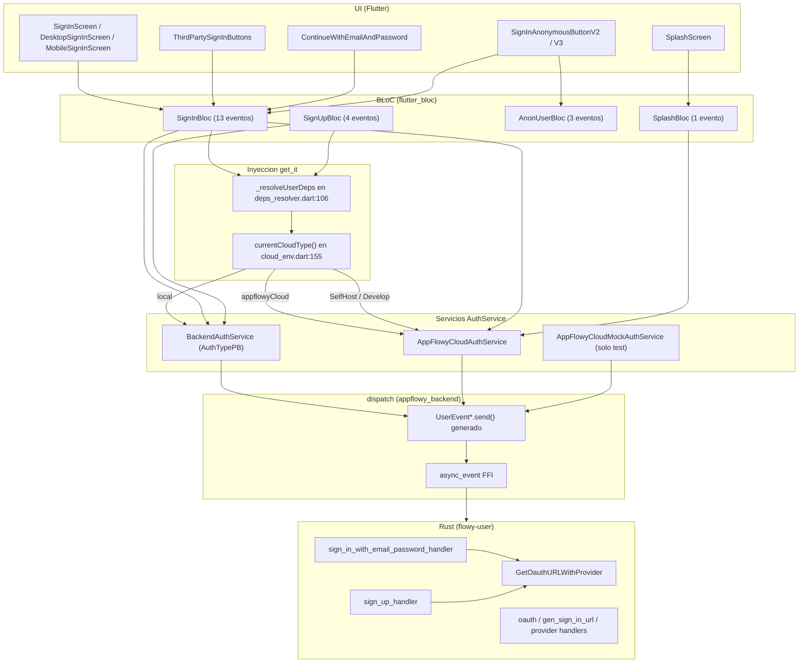
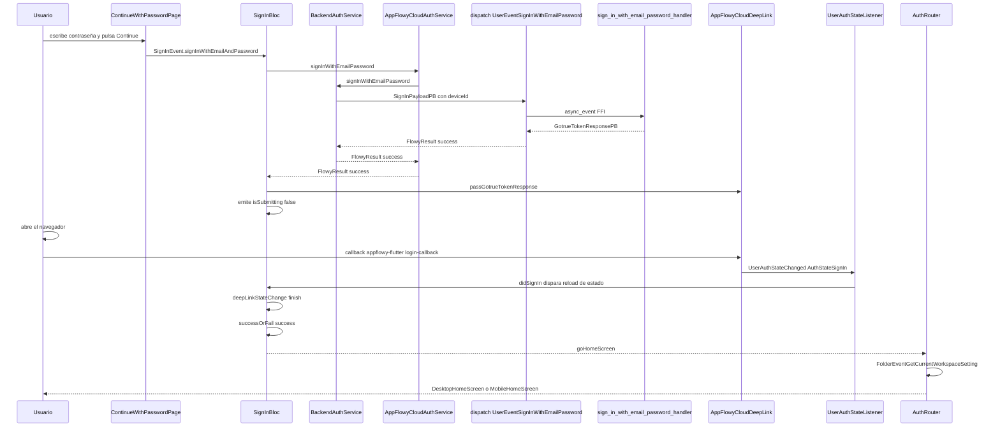
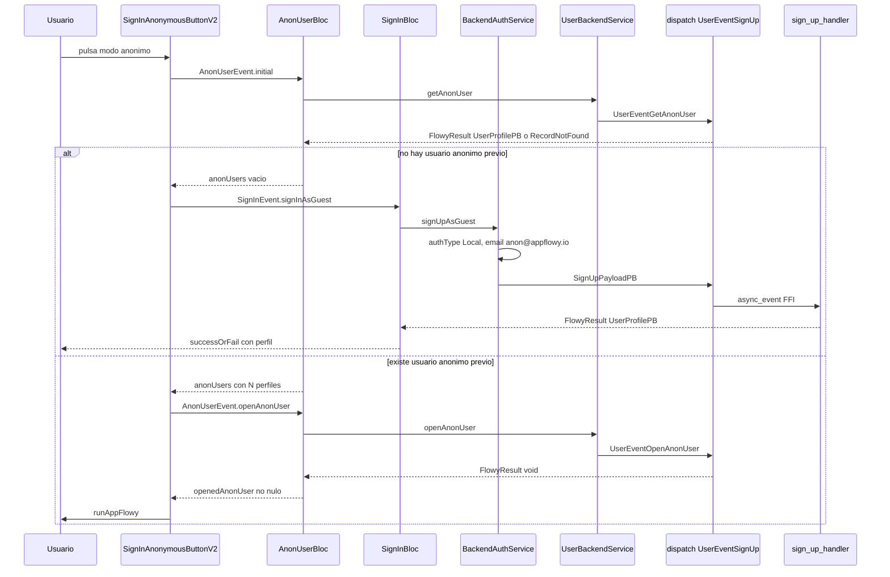
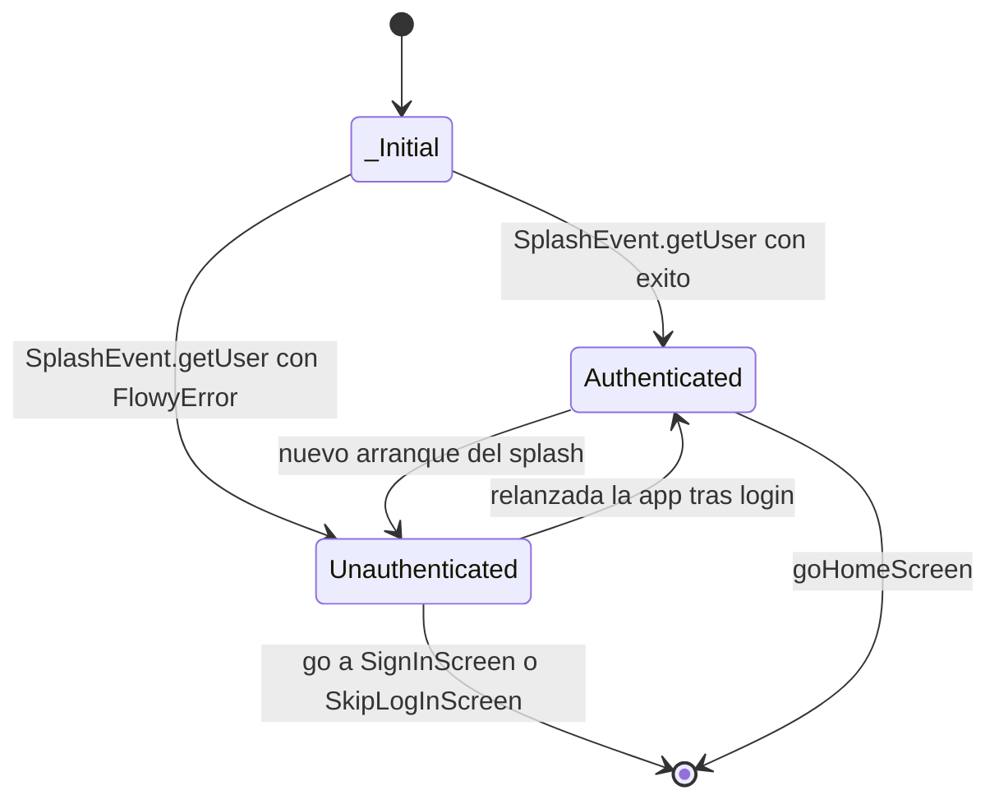

# F05.1 — Usuario (Dart): `appflowy_flutter/lib/user/` y `workspace/application/user/`

## 1. Resumen

Este documento cubre la mitad Dart de la feature F05 (usuario, autenticación y sesión) de AppFlowy: los **73 archivos** que forman `appflowy_flutter/lib/user/` más cinco archivos de `workspace/application/` que el ledger asignó a la misma unidad. Es la capa Flutter del sistema de identidad: BLoCs de `flutter_bloc` con estados generados por `freezed`, servicios que traducen intención de usuario en eventos FFI `UserEvent*` hacia el SDK Rust, listeners que consumen el flujo de notificaciones Rust→Dart, y 35 archivos de pantallas puramente presentacionales.

La pieza central es la abstracción `AuthService` (`appflowy/frontend/appflowy_flutter/lib/user/application/auth/auth_service.dart:17`) con **tres implementaciones** que cubren los tres caminos de entrada: `BackendAuthService` (local y self-hosted), `AppFlowyCloudAuthService` (AppFlowy Cloud, con OAuth vía navegador y deep link) y `AppFlowyCloudMockAuthService` (solo tests). La elección entre ellas ocurre una sola vez, en `appflowy/frontend/appflowy_flutter/lib/startup/deps_resolver.dart:106–120`, en función de `currentCloudType()`.

La contraparte Rust (handlers, esquema SQLite, `flowy-user`) está en [[F05.2]]; este documento solo traza el lado Dart y enlaza con el resto de features donde el terreno se solapa (F12 para miembros, F15 para notificaciones, B1.7 para persistencia).

## 2. Alcance

### Qué incluye este documento

Los 73 archivos del ledger `OUT/_ledger/units/F05.1.json`, a saber:

- **10** archivos en la raíz de `lib/user/application/`: `anon_user_bloc.dart`, `sign_in_bloc.dart`, `sign_up_bloc.dart`, `splash_bloc.dart`, `user_auth_listener.dart`, `user_listener.dart`, `user_service.dart`, `user_settings_service.dart`, `workspace_error_bloc.dart`, `prelude.dart`.
- **6** archivos en `lib/user/application/auth/`: `af_cloud_auth_service.dart`, `af_cloud_mock_auth_service.dart`, `auth_error.dart`, `auth_service.dart`, `backend_auth_service.dart`, `device_id.dart`.
- **2** archivos en `lib/user/application/password/`: `password_bloc.dart`, `password_http_service.dart`.
- **4** archivos en `lib/user/application/reminder/`: `reminder_bloc.dart`, `reminder_extension.dart`, `reminder_listener.dart`, `reminder_service.dart`.
- **1** archivo en `lib/user/application/notification_filter/`: `notification_filter_bloc.dart`.
- **1** archivo en `lib/user/domain/`: `auth_state.dart`.
- **35** archivos en `lib/user/presentation/`: `anon_user.dart`, `presentation.dart`, `router.dart`, `helpers/` (2), `screens/` (29, incluidos los subdirectorios `sign_in_screen/`, `workspace_start_screen/` y sus `widgets/`), `widgets/` (4).
- **5** archivos en `lib/workspace/application/`: `appearance_defaults.dart`, `subscription_success_listenable/subscription_success_listenable.dart`, `user/prelude.dart`, `user/settings_user_bloc.dart`, `user/user_workspace_bloc.dart`.

### Qué queda fuera, y dónde

La tabla de redirección de §13 recoge la separación con el resto del corpus. En resumen: la implementación Rust de `UserEvent` y la lógica de sesión están en [[F05.2]]; el esquema SQLite de usuario en [[B1.7]]; la UI de miembros y roles en [[F12]]; los colaboradores de documento en [[F01.0.1]]; los crates de composición (`flowy-core/deps_resolve`, `server_layer.rs`) en [[F00]]; y los clientes de `af_cloud/impls/user/*` en [[F06]].

Advertencia de alcance importante: el archivo `workspace/application/user/user_workspace_bloc.dart` de esta unidad **no contiene el `UserWorkspaceBloc`**; es un re-export de una línea que apunta a `appflowy/frontend/appflowy_flutter/lib/features/workspace/logic/workspace_bloc.dart` (`appflowy/frontend/appflowy_flutter/lib/workspace/application/user/user_workspace_bloc.dart:1`). Ese `features/` pertenece a la arquitectura nueva y se documenta fuera de esta unidad. Lo mismo ocurre con `presentation/screens/workspace_start_screen/workspace_start_screen.dart`, que consume el `WorkspaceBloc` **legado** de `appflowy/frontend/appflowy_flutter/lib/workspace/application/workspace/workspace_bloc.dart:12`, tampoco incluido.

## 3. Modelos de datos

El diagrama siguiente muestra los tipos Dart reales que la unidad manipula. Los tipos generados en Rust (sufijo `PB`) entran por el puente FFI; los tipos Dart propios son los freezed de `flutter_bloc` más los envelopes de `FlowyResult`.

El diagrama omite genéricos con `<>` porque Mermaid los interpreta como HTML (regla de las convenciones de la skill: los nombres de campo en `classDiagram` no admiten genéricos); los tipos exactos se dan en la prosa y en las tablas que siguen.

```mermaid
classDiagram
  class AuthState {
    +UserProfilePB userProfile
    +FlowyError error
  }
  class SignInState {
    +String email
    +String password
    +bool isSubmitting
    +String passwordError
    +String emailError
    +FlowyResult successOrFail
    +FlowyResult forgotPasswordSuccessOrFail
    +FlowyResult validateResetPasswordTokenSuccessOrFail
    +FlowyResult resetPasswordSuccessOrFail
    +LoginType loginType
  }
  class SignUpState {
    +String email
    +String password
    +String repeatedPassword
    +bool isSubmitting
    +String passwordError
    +String repeatPasswordError
    +String emailError
    +FlowyResult successOrFail
  }
  class AnonUserState {
    +UserProfilePBList anonUsers
    +UserProfilePB openedAnonUser
  }
  class SplashState {
    +AuthState auth
  }
  class PasswordState {
    +bool isSubmitting
    +bool hasPassword
    +FlowyResult changePasswordResult
    +FlowyResult setupPasswordResult
    +FlowyResult forgotPasswordResult
    +FlowyResult checkHasPasswordResult
  }
  class NotificationFilterState {
    +bool showUnreadsOnly
    +bool hasFilters
  }
  class SettingsUserState {
    +UserProfilePB userProfile
    +FlowyResult successOrFailure
  }
  class ReminderState {
    +ReminderPBList reminders
    +ReminderPBList serverReminders
    +ReminderPBList pastReminders
    +ReminderPBList upcomingReminders
  }
  class WorkspaceErrorState {
    +FlowyError initialError
    +LoadingState loadingState
    +WorkspaceState workspaceState
  }
  class UserProfilePB {
    +int64 id
    +String email
    +String name
    +String token
    +String iconUrl
    +AuthTypePB userAuthType
    +WorkspaceTypePB workspaceType
  }
  class UserWorkspacePB {
    +String workspaceId
    +String name
    +int64 createdAtTimestamp
    +String icon
    +int64 memberCount
    +AFRolePB role
    +WorkspaceTypePB workspaceType
  }
  class UserSettingPB {
    +String userFolder
  }
  class AppearanceSettingsPB {
    +String theme
    +ThemeModePB themeMode
    +String font
    +String monospaceFont
    +LocaleSettingsPB locale
    +bool resetToDefault
  }
  class ReminderPB {
    +String id
    +String objectId
    +int64 scheduledAt
    +bool isAck
    +bool isRead
    +String title
    +String message
    +StringMetaMap meta
  }
  class NotificationSettingsPB {
    +bool notificationsEnabled
  }
  class DateTimeSettingsPB {
    +UserDateFormatPB dateFormat
    +UserTimeFormatPB timeFormat
    +String timezoneId
  }
  class AuthService {
    <<interface>>
    +signInWithEmailPassword()
    +signUp()
    +signUpWithOAuth()
    +signUpAsGuest()
    +signInWithMagicLink()
    +signInWithPasscode()
    +signOut()
    +getUser()
  }
  AuthState --> UserProfilePB
  SignInState --> UserProfilePB
  SignUpState --> UserProfilePB
  AnonUserState --> UserProfilePB
  SettingsUserState --> UserProfilePB
  SplashState --> AuthState
  ReminderState --> ReminderPB
  WorkspaceErrorState --> UserWorkspacePB
```



La lectura del diagrama es directa: `UserProfilePB` es el vértice central —cuatro de los estados lo embeben como payload de éxito oFailure— y los PBs de ajustes cuelgan de `UserSettingsBackendService`, no de ningún estado de esta unidad, salvo a través de `AppearanceSettingsCubit` que es de otra unidad.

### 3.1 Campos de `AuthState`

`AuthState` es un freezed sellado de tres variantes, declarado en `appflowy/frontend/appflowy_flutter/lib/user/domain/auth_state.dart:7–13`:

```dart
@freezed
class AuthState with _$AuthState {
  const factory AuthState.authenticated(UserProfilePB userProfile) =
      Authenticated;
  const factory AuthState.unauthenticated(FlowyError error) = Unauthenticated;
  const factory AuthState.initial() = _Initial;
}
```

| Variante | Campo | Tipo | Evidencia |
|---|---|---|---|
| `Authenticated` | `userProfile` | `UserProfilePB` | `appflowy/frontend/appflowy_flutter/lib/user/domain/auth_state.dart:9` |
| `Unauthenticated` | `error` | `FlowyError` | `appflowy/frontend/appflowy_flutter/lib/user/domain/auth_state.dart:11` |
| `_Initial` | — | — | `appflowy/frontend/appflowy_flutter/lib/user/domain/auth_state.dart:12` |

Solo `SplashBloc` lo consume (`appflowy/frontend/appflowy_flutter/lib/user/application/splash_bloc.dart:14–19`) y solo `SplashScreen` lo descompone con `.map(authenticated: …, unauthenticated: …, initial: …)` (`appflowy/frontend/appflowy_flutter/lib/user/presentation/screens/splash_screen.dart:46–50`). Es importanteFatender que **este `AuthState` no es el `AuthStatePB` de Rust**: el PB remoto es un enum de cuatro discriminantes (`AuthStateUnknown = 0`, `AuthStateSignIn = 1`, `AuthStateSignOut = 2`, `InvalidAuth = 3`) declarado en `appflowy/frontend/rust-lib/flowy-user/src/entities/auth.rs:247–253`, que llega por notificación y no por retorno de evento. El mapeo entre ambos ocurre en `UserAuthStateListener._userNotificationCallback` (`appflowy/frontend/appflowy_flutter/lib/user/application/user_auth_listener.dart:51–60`).

### 3.2 Campos de `UserProfilePB`

Definido en `appflowy/frontend/rust-lib/flowy-user/src/entities/user_profile.rs:25–46`:

| # PB | Campo Dart | Tipo | Evidencia |
|---|---|---|---|
| 1 | `id` | `int64` (`Int64` en Dart) | `appflowy/frontend/rust-lib/flowy-user/src/entities/user_profile.rs:26–27` |
| 2 | `email` | `String` | `appflowy/frontend/rust-lib/flowy-user/src/entities/user_profile.rs:29–30` |
| 3 | `name` | `String` | `appflowy/frontend/rust-lib/flowy-user/src/entities/user_profile.rs:32–33` |
| 4 | `token` | `String` | `appflowy/frontend/rust-lib/flowy-user/src/entities/user_profile.rs:35–36` |
| 5 | `iconUrl` | `String` | `appflowy/frontend/rust-lib/flowy-user/src/entities/user_profile.rs:38–39` |
| 6 | `userAuthType` | `AuthTypePB` | `appflowy/frontend/rust-lib/flowy-user/src/entities/user_profile.rs:41–42` |
| 7 | `workspaceType` | `WorkspaceTypePB` | `appflowy/frontend/rust-lib/flowy-user/src/entities/user_profile.rs:44–45` |

El campo `token` merece atención porque `PasswordBloc` lo deserializa como JSON para extraer el `access_token` de GoTrue (`appflowy/frontend/appflowy_flutter/lib/user/application/password/password_bloc.dart:56`). `AuthTypePB` distingue `Local = 0` y `Server = 1` (`appflowy/frontend/rust-lib/flowy-user/src/entities/workspace.rs:288`), y esa distinción gobierna dos behaviours: `PasswordBloc._init` aborta si `userAuthType == AuthTypePB.Local` (`appflowy/frontend/appflowy_flutter/lib/user/application/password/password_bloc.dart:49–52`), y `AnonUserItem` deshabilita la fila si el usuario no es local (`appflowy/frontend/appflowy_flutter/lib/user/presentation/anon_user.dart:77`).

### 3.3 Tipos adicionales

- **`UserWorkspacePB`** — declarado en `appflowy/frontend/rust-lib/flowy-user/src/entities/user_profile.rs:168`, con `workspaceId`, `name`, `createdAtTimestamp`, `icon`, `memberCount`, `role` (`AFRolePB`, opcional) y `workspaceType`. Lo consumen `UserListener` (notificaciones) y `UserBackendService.getWorkspaces()`.
- **`UserSettingPB`** — un único campo `user_folder` en `appflowy/frontend/rust-lib/flowy-user/src/entities/user_profile.rs:19–22`. Es el payload de `UserEventGetUserSetting`, emitido por `UserSettingsBackendService.getUserSetting()` (`appflowy/frontend/appflowy_flutter/lib/user/application/user_settings_service.dart:21–23`).
- **`AppearanceSettingsPB`** — `theme`, `themeMode`, `font`, `monospaceFont`, `locale`, `resetToDefault` en `appflowy/frontend/rust-lib/flowy-user/src/entities/user_setting.rs:24–44`. Los defaults Dart equivalentes viven en `DefaultAppearanceSettings` (`appflowy/frontend/appflowy_flutter/lib/workspace/application/appearance_defaults.dart:6–18`).
- **`ReminderPB`** — `id`, `objectId`, `scheduledAt`, `isAck`, `isRead`, `title`, `message`, `meta` en `appflowy/frontend/rust-lib/flowy-user/src/entities/reminder.rs:6–27`. `meta` es el mapa que `ReminderExtension` proyecta a getters (`includeTime`, `blockId`, `rowId`, `createdAt`, `isArchived`, `date`, `type`) en `appflowy/frontend/appflowy_flutter/lib/user/application/reminder/reminder_extension.dart:18–65`.
- **`NotificationSettingsPB`** y **`DateTimeSettingsPB`** — `appflowy/frontend/rust-lib/flowy-user/src/entities/user_setting.rs:254–258` y `:232–241` respectivamente.
- **`AuthProvider` / `SignUpMethod`** `[NO DETERMINADO]` — el encargo mencionaba estos dos tipos Dart. Una búsqueda en todo `lib/` no devuelve ninguna declaración con esos nombres; lo que existe es el enum generado `ProviderTypePB` (25 variantes OAuth, `appflowy/frontend/rust-lib/flowy-user/src/entities/auth.rs:172`) y el `enum AuthenticatorType` de configuración de entorno (`appflowy/frontend/appflowy_flutter/lib/env/cloud_env.dart:112–117`). La proyección Dart de `ProviderTypePB` es el método estático `ProviderTypePBExtension.fromPlatform(String)` (`appflowy/frontend/appflowy_flutter/lib/user/application/auth/af_cloud_auth_service.dart:131–145`), que solo mapea cuatro cadenas: `github`, `google`, `discord`, `apple` y lanza `UnimplementedError` en el resto.

## 4. Eventos FFI

La tabla siguiente lista los eventos `UserEvent` que **el Dart de esta unidad despacha realmente**, verificados con un barrido de `UserEvent\w+` sobre los 73 archivos. El catálogo completo de 56 variantes `UserEvent` con sus handlers Rust está en [[F05.2]] §4; aquí solo aparecen las que tienen punto de salida en estos ficheros, más tres `FolderEvent` que la unidad usa para leer el workspace actual.

**Columnas**: evento generado en Dart → fichero:línea de la llamada → servicio o BLoC que lo dispara → payload protobuf.

| Evento Dart | Fichero:línea | Disparado por | Payload |
|---|---|---|---|
| `UserEventSignInWithEmailPassword` | `appflowy/frontend/appflowy_flutter/lib/user/application/auth/backend_auth_service.dart:33` | `BackendAuthService.signInWithEmailPassword` | `SignInPayloadPB` (email, password, name, authType, deviceId) |
| `UserEventSignInWithEmailPassword` | `appflowy/frontend/appflowy_flutter/lib/user/application/user_service.dart:96` | `UserBackendService.signInWithPassword` | `SignInPayloadPB` (solo email y password) |
| `UserEventSignUp` | `appflowy/frontend/appflowy_flutter/lib/user/application/auth/backend_auth_service.dart:49` | `BackendAuthService.signUp` ← `SignUpBloc` | `SignUpPayloadPB` (name, email, password, authType, deviceId) |
| `UserEventSignUp` | `appflowy/frontend/appflowy_flutter/lib/user/application/auth/backend_auth_service.dart:77` | `BackendAuthService.signUpAsGuest` ← `SignInBloc.signInAsGuest` | `SignUpPayloadPB` con `authType = Local`, email `anon@appflowy.io`, password `<REDACTED>` (literal fijo en el código; ver `[[B6.3]] §6.1`, SEC-1) |
| `UserEventSignOut` | `appflowy/frontend/appflowy_flutter/lib/user/application/auth/backend_auth_service.dart:59` | `BackendAuthService.signOut` ← `AppFlowyCloudAuthService.signOut` | — |
| `UserEventSignOut` | `appflowy/frontend/appflowy_flutter/lib/user/application/user_service.dart:100` | `UserBackendService.signOut` | — |
| `UserEventOauthSignIn` | `appflowy/frontend/appflowy_flutter/lib/user/application/auth/af_cloud_mock_auth_service.dart:68` | `AppFlowyCloudMockAuthService.signUpWithOAuth` (solo tests) | `OauthSignInPB` con `signInURL` y `deviceId` |
| `UserEventGenerateSignInURL` | `appflowy/frontend/appflowy_flutter/lib/user/application/auth/af_cloud_mock_auth_service.dart:56` | `AppFlowyCloudMockAuthService.signUpWithOAuth` | `SignInUrlPayloadPB` (authenticator, email) |
| `UserEventGetOauthURLWithProvider` | `appflowy/frontend/appflowy_flutter/lib/user/application/auth/af_cloud_auth_service.dart:56` | `AppFlowyCloudAuthService.signUpWithOAuth` ← `SignInBloc.signInWithOAuth` | `OauthProviderPB` con `provider` |
| `UserEventMagicLinkSignIn` | `appflowy/frontend/appflowy_flutter/lib/user/application/user_service.dart:76` | `UserBackendService.signInWithMagicLink` | `MagicLinkSignInPB` (email, redirectTo vacío) |
| `UserEventPasscodeSignIn` | `appflowy/frontend/appflowy_flutter/lib/user/application/user_service.dart:85` | `UserBackendService.signInWithPasscode` | `PasscodeSignInPB` (email, passcode) |
| `UserEventGetUserProfile` | `appflowy/frontend/appflowy_flutter/lib/user/application/user_service.dart:34` | `UserBackendService.getCurrentUserProfile` | — |
| `UserEventGetUserProfile` | `appflowy/frontend/appflowy_flutter/lib/user/presentation/screens/splash_screen.dart:86` | `SplashScreen._registerIfNeeded` (modo anónimo) | — |
| `UserEventUpdateUserProfile` | `appflowy/frontend/appflowy_flutter/lib/user/application/user_service.dart:62` | `UserBackendService.updateUserProfile` ← `SettingsUserViewBloc` | `UpdateUserProfilePayloadPB` |
| `UserEventInitUser` | `appflowy/frontend/appflowy_flutter/lib/user/application/user_service.dart:104` | `UserBackendService.initUser` | — |
| `UserEventGetAnonUser` | `appflowy/frontend/appflowy_flutter/lib/user/application/user_service.dart:108` | `UserBackendService.getAnonUser` ← `AnonUserBloc._loadHistoricalUsers` | — |
| `UserEventOpenAnonUser` | `appflowy/frontend/appflowy_flutter/lib/user/application/user_service.dart:112` | `UserBackendService.openAnonUser` ← `AnonUserBloc` | — |
| `UserEventDeleteAccount` | `appflowy/frontend/appflowy_flutter/lib/user/application/user_service.dart:308` | `UserBackendService.deleteCurrentAccount` | — |
| `UserEventGetAllWorkspace` | `appflowy/frontend/appflowy_flutter/lib/user/application/user_service.dart:116` | `UserBackendService.getWorkspaces` | — |
| `UserEventGetAllWorkspace` | `appflowy/frontend/appflowy_flutter/lib/user/application/user_service.dart:127` | `UserBackendService.getWorkspaceById` | — |
| `UserEventOpenWorkspace` | `appflowy/frontend/appflowy_flutter/lib/user/application/user_service.dart:146` | `UserBackendService.openWorkspace` | `OpenUserWorkspacePB` (workspaceId, workspaceType) |
| `UserEventCreateWorkspace` | `appflowy/frontend/appflowy_flutter/lib/user/application/user_service.dart:165` | `UserBackendService.createUserWorkspace` | `CreateWorkspacePB` |
| `UserEventDeleteWorkspace` | `appflowy/frontend/appflowy_flutter/lib/user/application/user_service.dart:172` | `UserBackendService.deleteWorkspaceById` | `UserWorkspaceIdPB` |
| `UserEventRenameWorkspace` | `appflowy/frontend/appflowy_flutter/lib/user/application/user_service.dart:182` | `UserBackendService.renameWorkspace` | `RenameWorkspacePB` |
| `UserEventChangeWorkspaceIcon` | `appflowy/frontend/appflowy_flutter/lib/user/application/user_service.dart:192` | `UserBackendService.updateWorkspaceIcon` | `ChangeWorkspaceIconPB` |
| `UserEventLeaveWorkspace` | `appflowy/frontend/appflowy_flutter/lib/user/application/user_service.dart:253` | `UserBackendService.leaveWorkspace` | `UserWorkspaceIdPB` |
| `UserEventGetWorkspaceMembers` | `appflowy/frontend/appflowy_flutter/lib/user/application/user_service.dart:200` | `UserBackendService.getWorkspaceMembers` | `QueryWorkspacePB` |
| `UserEventAddWorkspaceMember` *(deprecado)* | `appflowy/frontend/appflowy_flutter/lib/user/application/user_service.dart:210` | `UserBackendService.addWorkspaceMember` | `AddWorkspaceMemberPB` |
| `UserEventInviteWorkspaceMember` | `appflowy/frontend/appflowy_flutter/lib/user/application/user_service.dart:224` | `UserBackendService.inviteWorkspaceMember` | `WorkspaceMemberInvitationPB` (inviteeEmail, role opcional) |
| `UserEventRemoveWorkspaceMember` | `appflowy/frontend/appflowy_flutter/lib/user/application/user_service.dart:234` | `UserBackendService.removeWorkspaceMember` | `RemoveWorkspaceMemberPB` |
| `UserEventUpdateWorkspaceMember` | `appflowy/frontend/appflowy_flutter/lib/user/application/user_service.dart:246` | `UserBackendService.updateWorkspaceMember` | `UpdateWorkspaceMemberPB` |
| `UserEventSubscribeWorkspace` | `appflowy/frontend/appflowy_flutter/lib/user/application/user_service.dart:273` | `UserBackendService.createSubscription` | `SubscribeWorkspacePB` |
| `UserEventCancelWorkspaceSubscription` | `appflowy/frontend/appflowy_flutter/lib/user/application/user_service.dart:290` | `UserBackendService.cancelSubscription` | `CancelWorkspaceSubscriptionPB` |
| `UserEventUpdateWorkspaceSubscriptionPaymentPeriod` | `appflowy/frontend/appflowy_flutter/lib/user/application/user_service.dart:303` | `UserBackendService.updateSubscriptionPeriod` | `UpdateWorkspaceSubscriptionPaymentPeriodPB` |
| `UserEventGetWorkspaceSubscriptionInfo` | `appflowy/frontend/appflowy_flutter/lib/user/application/user_service.dart:259` | `UserBackendService.getWorkspaceSubscriptionInfo` | `UserWorkspaceIdPB` |
| `UserEventCreateReminder` | `appflowy/frontend/appflowy_flutter/lib/user/application/reminder/reminder_service.dart:32` | `ReminderService.addReminder` ← `ReminderBloc` | `ReminderPB` |
| `UserEventGetAllReminders` | `appflowy/frontend/appflowy_flutter/lib/user/application/reminder/reminder_service.dart:48` | `ReminderService.fetchReminders` | — |
| `UserEventUpdateReminder` | `appflowy/frontend/appflowy_flutter/lib/user/application/reminder/reminder_service.dart:41` | `ReminderService.updateReminder` | `ReminderPB` |
| `UserEventRemoveReminder` | `appflowy/frontend/appflowy_flutter/lib/user/application/reminder/reminder_service.dart:61` | `ReminderService.removeReminder` | `ReminderIdentifierPB` |
| `UserEventGetUserSetting` | `appflowy/frontend/appflowy_flutter/lib/user/application/user_settings_service.dart:22` | `UserSettingsBackendService.getUserSetting` | — |
| `UserEventSetAppearanceSetting` | `appflowy/frontend/appflowy_flutter/lib/user/application/user_settings_service.dart:28` | `UserSettingsBackendService.setAppearanceSetting` | `AppearanceSettingsPB` |
| `UserEventGetAppearanceSetting` | `appflowy/frontend/appflowy_flutter/lib/user/application/user_settings_service.dart:12` | `UserSettingsBackendService.getAppearanceSetting` | — |
| `UserEventSetDateTimeSettings` | `appflowy/frontend/appflowy_flutter/lib/user/application/user_settings_service.dart:44` | `UserSettingsBackendService.setDateTimeSettings` | `DateTimeSettingsPB` |
| `UserEventGetDateTimeSettings` | `appflowy/frontend/appflowy_flutter/lib/user/application/user_settings_service.dart:32` | `UserSettingsBackendService.getDateTimeSettings` | — |
| `UserEventSetNotificationSettings` | `appflowy/frontend/appflowy_flutter/lib/user/application/user_settings_service.dart:50` | `UserSettingsBackendService.setNotificationSettings` | `NotificationSettingsPB` |
| `UserEventGetNotificationSettings` | `appflowy/frontend/appflowy_flutter/lib/user/application/user_settings_service.dart:54` | `UserSettingsBackendService.getNotificationSettings` | — |
| `FolderEventGetCurrentWorkspaceSetting` | `appflowy/frontend/appflowy_flutter/lib/user/presentation/router.dart:41` | `AuthRouter.goHomeScreen` | — |
| `FolderEventGetCurrentWorkspaceSetting` | `appflowy/frontend/appflowy_flutter/lib/user/presentation/router.dart:89` | `SplashRouter.pushWorkspaceStartScreen` | — |
| `FolderEventGetCurrentWorkspaceSetting` | `appflowy/frontend/appflowy_flutter/lib/user/presentation/screens/splash_screen.dart:63` | `SplashScreen._handleAuthenticated` | — |
| `FolderEventReadCurrentWorkspace` | `appflowy/frontend/appflowy_flutter/lib/user/application/user_service.dart:150` | `UserBackendService.getCurrentWorkspace` | — |

Son **41 eventos `UserEvent` distintos más 2 `FolderEvent`** despachados desde los ficheros de la unidad, en **52 puntos de llamada** (cinco eventos tienen dos puntos de salida distintos: `UserEventSignInWithEmailPassword`, `UserEventSignUp`, `UserEventSignOut`, `UserEventGetUserProfile` y `UserEventGetAllWorkspace`). Existe una tercera mención de `FolderEvent` —`FolderEventGetCurrentWorkspace` en `appflowy/frontend/appflowy_flutter/lib/user/presentation/router.dart:30`— pero aparece solo dentro de un comentario de documentación y **no se despacha** `[VERIFICADO]`.

Cinco eventos del encargo **no** existen en `0.2-…md` §4 ni en el código Dart de esta unidad, y quedan como `[NO DETERMINADO]` en §18: `GetUserWorkspace`, `GetMemberInfo`, `SetCloudConfig`, `GetCloudConfig` y `UpdateNetworkState`. Los tres primeros están registrados en Rust ([[F05.2]] los documenta: `GetUserWorkspace = 22`, `GetMemberInfo = 56`) pero **ningún fichero de esta unidad los despacha** — se consumen desde otras features, por ejemplo el `UserWorkspaceBloc` de `features/workspace/logic/`. `SetCloudConfig` y `GetCloudConfig` los usa `startup/tasks/appflowy_cloud_task.dart`, fuera de la unidad. `UpdateNetworkState` lo emite `NetworkListener`, que se registra en `appflowy/frontend/appflowy_flutter/lib/startup/deps_resolver.dart:134` pero cuya implementación no está en esta unidad.

## 5. Notificaciones

El enum `UserNotification` de Rust tiene **diez** variantes (`appflowy/frontend/rust-lib/flowy-user/src/notification.rs:11–24`). Esta tabla indica, para cada una, qué listener Dart de la unidad la consume y qué efecto produce.

| Notificación | Discriminante | Emisor Rust | Listener Dart en la unidad | Efecto |
|---|---|---|---|---|
| `Unknown` | 0 | — | ninguno | Variante por defecto; ningún `case` la maneja `[VERIFICADO]` |
| `UserAuthStateChanged` | 1 | `send_auth_state_notification` (`appflowy/frontend/rust-lib/flowy-user/src/notification.rs:33–41`) | `UserAuthStateListener` (`appflowy/frontend/appflowy_flutter/lib/user/application/user_auth_listener.dart:47–64`) | Con `AuthStatePB.AuthStateSignIn` invoca `didSignIn`; con `InvalidAuth` invoca `onInvalidAuth(pb.message)`, que en `InitAppFlowyCloudTask` relanza la app (`appflowy/frontend/appflowy_flutter/lib/startup/tasks/appflowy_cloud_task.dart:245–250`) |
| `DidUpdateUserProfile` | 2 | `flowy-user` | `UserListener` (`appflowy/frontend/appflowy_flutter/lib/user/application/user_listener.dart:83–88`) | Publica un nuevo `UserProfilePB` en `_profileNotifier`; `SettingsUserViewBloc` lo recibe y emite `didReceiveUserProfile` (`appflowy/frontend/appflowy_flutter/lib/workspace/application/user/settings_user_bloc.dart:36`) |
| `DidUpdateUserWorkspaces` | 3 | `flowy-user` | `UserListener` (`appflowy/frontend/appflowy_flutter/lib/user/application/user_listener.dart:90–97`) | Invoca `onUserWorkspaceListUpdated` con un `RepeatedUserWorkspacePB` deserializado |
| `DidUpdateCloudConfig` | 4 | `flowy-user` | **ninguno** `[VERIFICADO]`: no hay `case` en ningún listener de la unidad | Sin consumidor Dart en este árbol |
| `DidUpdateUserWorkspace` | 5 | `flowy-user` | `UserListener` (`appflowy/frontend/appflowy_flutter/lib/user/application/user_listener.dart:98–101`) | Invoca `onUserWorkspaceUpdated` con un `UserWorkspacePB`. Nótese el `switch` Dart no usa `break`, así que cae también en `DidUpdateWorkspaceSetting` (`appflowy/frontend/appflowy_flutter/lib/user/application/user_listener.dart:102`) — comportamiento silencioso del lenguaje, no del código |
| `DidUpdateWorkspaceSetting` | 6 | `flowy-user` | `UserListener` (`appflowy/frontend/appflowy_flutter/lib/user/application/user_listener.dart:102–107`) y `FolderListener` vía `FolderNotification.DidUpdateWorkspaceSetting` (`appflowy/frontend/appflowy_flutter/lib/user/application/user_listener.dart:153–159`) | `UserListener` invoca `onUserWorkspaceSettingUpdated`; `FolderListener` publica en `_latestChangedNotifier` un `WorkspaceLatestPB` |
| `DidLoadUserAwareness` | 7 | `flowy-user` | `UserAwarenessListener` (`appflowy/frontend/appflowy_flutter/lib/user/application/reminder/reminder_listener.dart:55–57`) | Invoca `onLoadedUserAwareness`; el comentario del código indica que solo después se pueden pedir eventos de recordatorio |
| `DidUpdateReminder` | 8 | `flowy-user` | `UserAwarenessListener` (`appflowy/frontend/appflowy_flutter/lib/user/application/reminder/reminder_listener.dart:58–60`) | Invoca `onDidUpdateReminder` con un `ReminderPB` deserializado. El propio enum marca la variante con `// TODO: implement reminder observer` en Rust (`appflowy/frontend/rust-lib/flowy-user/src/notification.rs:21`), y en el snapshot no se encontró ningún consumidor que pase `onDidUpdateReminder` a `start()` |
| `DidOpenWorkspace` | 9 | `flowy-user` | `UserListener` (`appflowy/frontend/appflowy_flutter/lib/user/application/user_listener.dart:108–114`) | Publica el `UserProfilePB` resultante en `_profileNotifier`, disparando `onProfileUpdated` |

Dos observaciones de arquitectura. Primera: `UserAuthStateListener` usa el id de suscripción fijo `"auth_state_change_notification"` (`appflowy/frontend/appflowy_flutter/lib/user/application/user_auth_listener.dart:28`), que es el mismo id que emite `send_auth_state_notification` en Rust (`appflowy/frontend/rust-lib/flowy-user/src/notification.rs:35`); los demás listeners usan el id del usuario (`appflowy/frontend/appflowy_flutter/lib/user/application/user_listener.dart:63`) o del workspace (`appflowy/frontend/appflowy_flutter/lib/user/application/reminder/reminder_listener.dart:35`). Segunda: `appearance_defaults.dart`, aunque está en el ledger de esta unidad, **no consume ninguna notificación** — es una clase de constantes y helpers de color (`appflowy/frontend/appflowy_flutter/lib/workspace/application/appearance_defaults.dart:6–18`); su papel es ofrecer defaults Dart que se alinean con `AppearanceSettingsPB` de Rust, no reaccionar a eventos.

## 6. BLoCs / Cubits

La tabla inventaría todos los BLoCs y Cubits definidos en los 73 archivos. La columna "nº eventos" cuenta las variantes `factory` de la clase `*Event` freezed (o `sealed`) declarada en el mismo fichero. Ninguno de los BLoCs de esta unidad usa la variante `FreezedEvent` de `bloc`; todos registran `on<SignInEvent>(…)` con una única llamada y despachan con `event.when`/`event.map`.

| Clase | Tipo | Fichero:línea | Eventos (nº) | Estado | Servicios inyectados |
|---|---|---|---|---|---|
| `SignInBloc` | `Bloc<SignInEvent, SignInState>` | `appflowy/frontend/appflowy_flutter/lib/user/application/sign_in_bloc.dart:21` | 13 (`:495–541`) | `SignInState` freezed, 11 campos (`:550–575`) | `AuthService` por constructor (`:22`); `PasswordHttpService` construido asíncronamente si `isAppFlowyCloudEnabled` (`:31–37`); `AppFlowyCloudDeepLink` de `getIt` (`:25`); callback de deep link desuscrito en `close()` (`:116–125`) |
| `SignUpBloc` | `Bloc<SignUpEvent, SignUpState>` | `appflowy/frontend/appflowy_flutter/lib/user/application/sign_up_bloc.dart:14` | 4 (`:151–159`) | `SignUpState` freezed, 9 campos (`:161–181`) | `AuthService` por constructor (`:15`) |
| `AnonUserBloc` | `Bloc<AnonUserEvent, AnonUserState>` | `appflowy/frontend/appflowy_flutter/lib/user/application/anon_user_bloc.dart:10` | 3 (`:43–51`) | `AnonUserState` freezed, 2 campos (`:53–64`) | ninguno; usa los estáticos de `UserBackendService` (`:29`, `:21`) |
| `SplashBloc` | `Bloc<SplashEvent, SplashState>` | `appflowy/frontend/appflowy_flutter/lib/user/application/splash_bloc.dart:9` | 1 (`:26–29`) | `SplashState` freezed con `AuthState auth` (`:31–40`) | `getIt<AuthService>()` resuelto dentro del handler (`:14`) |
| `PasswordBloc` | `Bloc<PasswordEvent, PasswordState>` | `appflowy/frontend/appflowy_flutter/lib/user/application/password/password_bloc.dart:15` | 6 (`:195–220`) | `PasswordState` freezed, 6 campos (`:222–241`) | `UserProfilePB` por constructor (`:16`); `PasswordHttpService` interno creado en `_init` leyendo `access_token` del JSON del `token` (`:48–65`) |
| `NotificationFilterBloc` | `Bloc<NotificationFilterEvent, NotificationFilterState>` | `appflowy/frontend/appflowy_flutter/lib/user/application/notification_filter/notification_filter_bloc.dart:6` | 2 (`:20–26`) | `NotificationFilterState` freezed con getter `hasFilters` (`:28–38`) | ninguno |
| `ReminderBloc` | `Bloc<ReminderEvent, ReminderState>` | `appflowy/frontend/appflowy_flutter/lib/user/application/reminder/reminder_bloc.dart:31` | 14 (`:563–616`) | `ReminderState` **no** freezed: clase manual con `reminders`, `serverReminders`, `pastReminders`, `upcomingReminders` y `copyWith` (`:673–721`) | `ActionNavigationBloc` de `getIt` (`:35`); `ReminderService` interno (`:36`); `AppLifecycleListener` para reanudar el timer (`:38–44`); `ViewBackendService` y `DocumentService` creados en línea al filtrar |
| `WorkspaceErrorBloc` | `Bloc<WorkspaceErrorEvent, WorkspaceErrorState>` | `appflowy/frontend/appflowy_flutter/lib/user/application/workspace_error_bloc.dart:11` | 3 (`:55–62`) | `WorkspaceErrorState` freezed (`:64–76`) + `WorkspaceState` freezed con 5 variantes (`:78–85`) | `UserFolderPB` y `FlowyError` por constructor (`:13`) |
| `SettingsUserViewBloc` | `Bloc<SettingsUserEvent, SettingsUserState>` | `appflowy/frontend/appflowy_flutter/lib/workspace/application/user/settings_user_bloc.dart:12` | 7 (`:114–134`) | `SettingsUserState` freezed, 2 campos (`:136–148`) | `UserListener` (`:14`, detenido en `close()`, `:24–28`) y `UserBackendService(userId: profile.id)` (`:15`) |

**Suma de eventos freezed declarados en la unidad: 53.** Si además se cuentan las tres variantes de `AuthState` (`appflowy/frontend/appflowy_flutter/lib/user/domain/auth_state.dart:9–12`) y las cinco de `WorkspaceState` (`appflowy/frontend/appflowy_flutter/lib/user/application/workspace_error_bloc.dart:80–84`), la unidad declara 61 variantes de estado en total.

### 6.1 BLoCs referenciados pero fuera de la unidad

Dos casos exigen precisión porque el encargo los menciona:

- **`UserWorkspaceBloc`** — el fichero `appflowy/frontend/appflowy_flutter/lib/workspace/application/user/user_workspace_bloc.dart:1` solo reexporta. La clase vive en `appflowy/frontend/appflowy_flutter/lib/features/workspace/logic/workspace_bloc.dart:37` y sus 14 eventos son un `sealed class` con factories en `appflowy/frontend/appflowy_flutter/lib/features/workspace/logic/workspace_event.dart:3–82`. No es un freezed y su estado es una clase manual (`appflowy/frontend/appflowy_flutter/lib/features/workspace/logic/workspace_state.dart:34`). Fuera de alcance de esta unidad.
- **`AppearanceSettingsCubit`** — no está en la unidad; se define en `appflowy/frontend/appflowy_flutter/lib/workspace/application/settings/appearance/appearance_cubit.dart` y lo consumen `SkipLogInScreen` (`appflowy/frontend/appflowy_flutter/lib/user/presentation/screens/skip_log_in_screen.dart:191`) y `LanguageItem` (`:257`). Se documenta donde vive.

### 6.2 `SignInBloc`, el más denso

Merece una lectura aparte porque concentra los tres caminos de login. Sus 13 eventos (`:495–541`) se agrupan así: cinco de autenticación (`signInWithEmailAndPassword`, `signInWithOAuth`, `signInAsGuest`, `signInWithMagicLink`, `signInWithPasscode`), tres de UI (`emailChanged`, `passwordChanged`, `deepLinkStateChange`), dos de navegación (`cancel`, `switchLoginType`) y tres de recuperación de contraseña (`forgotPassword`, `validateResetPasswordToken`, `resetPassword`). `switchLoginType` solo alterna `LoginType.signIn` / `LoginType.signUp` (`appflowy/frontend/appflowy_flutter/lib/user/application/sign_in_bloc.dart:545–548`), un valor pensado solo para que la UI sepa qué formulario mostrar.

El mapeo de errores a mensajes localizados ocurre en `_stateFromCode` (`:451–492`): distingue `EmailFormatInvalid` (error en el campo email), `PasswordFormatInvalid` (en el campo password) y `UserUnauthorized`, donde **inspecciona el texto** del error buscando las subcadenas `rate limit`, `For security purposes`, `invalid` e `Invalid login credentials` para elegir entre cuatro mensajes localizados (`:467–483`). Es una heurística basada en el mensaje en inglés del servidor, no en el código de error; queda anotada como riesgo en §13.

`SignUpBloc` es mucho más simple y ya casi vestigial: `SignUpEvent.signUpWithUserEmailAndPassword` no lleva payload, y el nombre se pasa como el propio email (`appflowy/frontend/appflowy_flutter/lib/user/application/sign_up_bloc.dart:107–111`). La UI que lo disparaba (`SignUpScreen`) no aparece en el barrel `screens.dart` de esta unidad (`appflowy/frontend/appflowy_flutter/lib/user/presentation/screens/screens.dart:1–5`), que solo exporta `SignInScreen`, `SkipLogInScreen`, `SplashScreen`, `WorkspaceErrorScreen` y `WorkspaceStartScreen`. El widget `SwitchSignInSignUpButton` existe (`appflowy/frontend/appflowy_flutter/lib/user/presentation/screens/sign_in_screen/widgets/switch_sign_in_sign_up_button.dart:8`) pero su `export` está comentado en `appflowy/frontend/appflowy_flutter/lib/user/presentation/screens/sign_in_screen/widgets/widgets.dart:6`, señal de que el flujo sign-up ya no está cableado en la pantalla principal.

## 7. Servicios e inyección de dependencias

### 7.1 Los seis ficheros de `user/application/auth/`

| Fichero | Clase real | Tipo | Qué aporta |
|---|---|---|---|
| `appflowy/frontend/appflowy_flutter/lib/user/application/auth/auth_service.dart` | `AuthService` | `abstract class` (`appflowy/frontend/appflowy_flutter/lib/user/application/auth/auth_service.dart:17`) + `AuthServiceMapKeys` (`appflowy/frontend/appflowy_flutter/lib/user/application/auth/auth_service.dart:5`) | El contrato de 7 métodos: `signInWithEmailPassword`, `signUp`, `signUpWithOAuth`, `signUpAsGuest`, `signInWithMagicLink`, `signInWithPasscode`, `signOut`, `getUser`. `AuthServiceMapKeys` define tres claves de payload: `email`, `device_id`, `sign_in_url` (`appflowy/frontend/appflowy_flutter/lib/user/application/auth/auth_service.dart:8–10`) |
| `appflowy/frontend/appflowy_flutter/lib/user/application/auth/backend_auth_service.dart` | `BackendAuthService` | `implements AuthService` (`appflowy/frontend/appflowy_flutter/lib/user/application/auth/backend_auth_service.dart:16`) | Implementación real sobre eventos FFI. Es la única que despacha `UserEventSignInWithEmailPassword` y `UserEventSignUp`. Su `signUpAsGuest` fija `email = "anon@appflowy.io"`, una `password` constante en el código sustituida aquí por `<REDACTED>` (ver `[[B6.3]] §6.1`, SEC-1) y **`authType = AuthTypePB.Local` siempre** (`appflowy/frontend/appflowy_flutter/lib/user/application/auth/backend_auth_service.dart:64–81`), con el comentario explícito «When sign up as guest, the auth type is always local» |
| `appflowy/frontend/appflowy_flutter/lib/user/application/auth/af_cloud_auth_service.dart` | `AppFlowyCloudAuthService` | `implements AuthService` (`appflowy/frontend/appflowy_flutter/lib/user/application/auth/af_cloud_auth_service.dart:17`) | Envuelve un `BackendAuthService(AuthTypePB.Server)` (`appflowy/frontend/appflowy_flutter/lib/user/application/auth/af_cloud_auth_service.dart:20–22`) y delega casi todo. Su `signUp` **lanza `UnimplementedError`** (`appflowy/frontend/appflowy_flutter/lib/user/application/auth/af_cloud_auth_service.dart:31`). Su `signUpWithOAuth` es la pieza única: pide la URL a Rust, abre el navegador con `afLaunchUri` y registra un `Completer` en `AppFlowyCloudDeepLink` a la espera del deep link (`appflowy/frontend/appflowy_flutter/lib/user/application/auth/af_cloud_auth_service.dart:49–89`). Añade la extensión `ProviderTypePBExtension.fromPlatform` (`appflowy/frontend/appflowy_flutter/lib/user/application/auth/af_cloud_auth_service.dart:131–145`) |
| `appflowy/frontend/appflowy_flutter/lib/user/application/auth/af_cloud_mock_auth_service.dart` | `AppFlowyCloudMockAuthService` | `implements AuthService` (`appflowy/frontend/appflowy_flutter/lib/user/application/auth/af_cloud_mock_auth_service.dart:16`), «Only used for testing» | Sustituye el OAuth de navegador por `GenerateSignInURL` + `OauthSignIn` directos (`appflowy/frontend/appflowy_flutter/lib/user/application/auth/af_cloud_mock_auth_service.dart:46–84`). Inventa un email único `"${uuid()}@appflowy.io"` (`appflowy/frontend/appflowy_flutter/lib/user/application/auth/af_cloud_mock_auth_service.dart:18`). Lanza `UnimplementedError` en `signUp`, `signInWithEmailPassword`, `signInWithMagicLink` y `signInWithPasscode` |
| `appflowy/frontend/appflowy_flutter/lib/user/application/auth/auth_error.dart` | `AuthError` | clase de constantes estáticas (`appflowy/frontend/appflowy_flutter/lib/user/application/auth/auth_error.dart:4`) | Cuatro `FlowyError` prefabricados: `signInWithOauthError`, `emptyDeepLink`, `deepLinkError`, `unableToGetDeepLink`. Solo el último se consume en la unidad (`appflowy/frontend/appflowy_flutter/lib/user/application/auth/af_cloud_auth_service.dart:81`) |
| `appflowy/frontend/appflowy_flutter/lib/user/application/auth/device_id.dart` | `getDeviceId()` + `deviceInfo` | función top-level (`appflowy/frontend/appflowy_flutter/lib/user/application/auth/device_id.dart:10`) | Deriva un identificador estable por plataforma: `androidInfo.device`, `iosInfo.identifierForVendor`, `macInfo.systemGUID`, `windowsInfo.deviceId`, `linuxInfo.machineId` (`appflowy/frontend/appflowy_flutter/lib/user/application/auth/device_id.dart:17–32`). En modo test devuelve la constante `"test_device_id"` (`appflowy/frontend/appflowy_flutter/lib/user/application/auth/device_id.dart:11–13`). Su valor viaja en `SignInPayloadPB.deviceId` y `SignUpPayloadPB.deviceId` |

### 7.2 Los tres caminos de login

El diagrama muestra cómo una misma interfaz (`SignInBloc` → `AuthService`) se abre en tres implementaciones distintas según la configuración de entorno, y qué eventos FFI despacha cada una.



La lectura del diagrama: el punto de bifurcación único es `_resolveUserDeps` (`:106–120`), que hace `switch (currentCloudType())` sobre el enum de cuatro valores. Con `AuthenticatorType.local` registra `BackendAuthService(AuthTypePB.Local)`; con cualquiera de los otros tres (`appflowyCloud`, `appflowyCloudSelfHost`, `appflowyCloudDevelop`) registra `AppFlowyCloudAuthService()` (`:115–119`). `currentCloudType()` es un simple getter de `getIt<AppFlowyCloudSharedEnv>().authenticatorType` (`appflowy/frontend/appflowy_flutter/lib/env/cloud_env.dart:155–157`), y ese valor se persiste en `KVKeys.kCloudType` (`appflowy/frontend/appflowy_flutter/lib/core/config/kv_keys.dart:59`).

**Camino 1 — local / anónimo.** Es el único que puede correr sin red. `SignInAnonymousButtonV2` o `V3` comprueban si ya existe un usuario anónimo histórico; si no, emiten `SignInEvent.signInAsGuest` (`appflowy/frontend/appflowy_flutter/lib/user/presentation/screens/sign_in_screen/widgets/sign_in_anonymous_button.dart:37`, y `:35–45` en el V2). `SignInBloc._onSignInAsGuest` llama a `authService.signUpAsGuest()` (`appflowy/frontend/appflowy_flutter/lib/user/application/sign_in_bloc.dart:303`), que acaba en `BackendAuthService.signUpAsGuest` con `authType = Local` fijo. Si ya había histórico, el camino es distinto: `AnonUserBloc.openAnonUser` dispara `UserEventOpenAnonUser` (`appflowy/frontend/appflowy_flutter/lib/user/application/anon_user_bloc.dart:21`). Cuando la pantalla de bienvenida no encuentra perfil, `SkipLogInScreen` llama directamente a `getIt<AuthService>().signUpAsGuest()` (`appflowy/frontend/appflowy_flutter/lib/user/presentation/screens/skip_log_in_screen.dart:82`) y, si el usuario tocó antes el selector de carpeta, relanza con `runAppFlowy(isAnon: true)` (`:89`).

**Camino 2 — AppFlowy Cloud con email y contraseña.** `ContinueWithPasswordPage` recoge la contraseña y emite `SignInEvent.signInWithEmailAndPassword` (`appflowy/frontend/appflowy_flutter/lib/user/presentation/screens/sign_in_screen/widgets/continue_with/continue_with_email_and_password.dart:174–179`). `SignInBloc._onSignInWithEmailAndPassword` llama a `authService.signInWithEmailPassword` y, **si tiene éxito, entrega el `GotrueTokenResponsePB` al deep link** (`appflowy/frontend/appflowy_flutter/lib/user/application/sign_in_bloc.dart:174–189`); no navega directamente. La navegación ocurre cuando el listener de deep link reinyecta el resultado como `SignInEvent.deepLinkStateChange` y el estado pasa a `DeepLinkState.finish` (`:145–155`). El mismo mecanismo sirve para el passcode de magic link (`:271–288`). Este camino requiere `isAppFlowyCloudEnabled` para que exista el `PasswordHttpService` de recuperación de contraseña (`:23–38`).

**Camino 3 — OAuth de terceros.** `ThirdPartySignInButtons._signIn` convierte el botón en `SignInEvent.signInWithOAuth(platform: provider)` (`appflowy/frontend/appflowy_flutter/lib/user/presentation/screens/sign_in_screen/widgets/third_party_sign_in_button/third_party_sign_in_buttons.dart:40–44`). El provider es la cadena `'apple' | 'google' | 'github' | 'discord'` del enum `ThirdPartySignInButtonType` (`appflowy/frontend/appflowy_flutter/lib/user/presentation/screens/sign_in_screen/widgets/third_party_sign_in_button/third_party_sign_in_button.dart:14–27`). `AppFlowyCloudAuthService.signUpWithOAuth` pide la URL con `UserEventGetOauthURLWithProvider`, la abre en el navegador con `LaunchMode.externalApplication` y devuelve un `Completer.future` que solo se resuelve cuando el deep link vuelve (`appflowy/frontend/appflowy_flutter/lib/user/application/auth/af_cloud_auth_service.dart:56–85`). Si el deep link no está registrado en `getIt`, lanza `Exception('AppFlowyCloudDeepLink is not registered')` (`:77`).

### 7.3 Otros servicios de la unidad

| Servicio | Fichero:línea | Qué expone |
|---|---|---|
| `UserBackendService` | `appflowy/frontend/appflowy_flutter/lib/user/application/user_service.dart:27` | 25 métodos; implementa `IUserBackendService` (`:12`) para suscripción. Combinados estáticos: `getCurrentUserProfile`, `signInWithMagicLink`, `signInWithPasscode`, `signOut`, `getAnonUser`, `openAnonUser`, `getWorkspaceById`, `getCurrentWorkspace`, `getWorkspaceSubscriptionInfo`, `deleteCurrentAccount` |
| `UserSettingsBackendService` | `appflowy/frontend/appflowy_flutter/lib/user/application/user_settings_service.dart:8` | 6 métodos sobre ajustes. `getAppearanceSetting`, `getDateTimeSettings` y `getNotificationSettings` lanzan `FlowySDKException(ExceptionType.AppearanceSettingsIsEmpty)` en error (`:17`, `:37`, `:59`) en vez de devolver `FlowyResult` — inconsistencia real de la API |
| `ReminderService` / `IReminderService` | `appflowy/frontend/appflowy_flutter/lib/user/application/reminder/reminder_service.dart:9` y `:25` | 4 métodos: `fetchReminders`, `addReminder`, `updateReminder`, `removeReminder`. `fetchReminders` desenvuelve el `RepeatedReminderPB` a `List<ReminderPB>` (`:50–53`) |
| `PasswordHttpService` | `appflowy/frontend/appflowy_flutter/lib/user/application/password/password_http_service.dart:46` | Cliente HTTP **directo a GoTrue**, no pasa por FFI. 5 endpoints en el enum `PasswordEndpoint` (`:9–14`) con sus rutas (`:16–29`): `/gotrue/user/change-password`, `/gotrue/recover`, `/gotrue/user/auth-info`, `/gotrue/verify`. Traduce HTTP 422 a `ErrorCode.NewPasswordTooWeak` (`:216–218`) y trata el 403 de `checkHasPassword` como no-error (`:207–212`) |
| `DefaultAppearanceSettings` | `appflowy/frontend/appflowy_flutter/lib/workspace/application/appearance_defaults.dart:6` | Defaults Dart: `kDefaultFontFamily`, `kDefaultThemeMode = ThemeMode.system`, `kDefaultThemeName = "Default"`, `kDefaultTheme = BuiltInTheme.defaultTheme`, más `getDefaultCursorColor` y `getDefaultSelectionColor` |
| `SubscriptionSuccessListenable` | `appflowy/frontend/appflowy_flutter/lib/workspace/application/subscription_success_listenable/subscription_success_listenable.dart:6` | `ChangeNotifier` que traduce el string de plan recibido tras el pago a `SubscriptionPlanPB`: `free`, `pro`, `team`, `ai_max`, `ai_local` (`:11–18`) |

### 7.4 Registro en `get_it`

`appflowy/frontend/appflowy_flutter/lib/startup/deps_resolver.dart:106–140` registra, en este orden: el `AuthService` dependiente del cloud type, `AuthRouter`, `SignInBloc` (factory con `getIt<AuthService>()` inyectado, `:124–126`), `SignUpBloc` (`:127–129`), `SplashRouter`, `EditPanelBloc`, `SplashBloc`, `NetworkListener`, `CachedRecentService`, `ViewAncestorCache` y `SubscriptionSuccessListenable` como lazy singleton (`:137–139`). En `_resolveHomeDeps` (`:142–163`) se registran además `UserListener` como factory parametrizada por `UserProfilePB` (`:147–149`), `ActionNavigationBloc` (`:156`) y **`ReminderBloc` como singleton** (`:160`), lo que garantiza un único timer de 30 s para toda la app. `AppFlowyCloudDeepLink` se registra aparte, solo si `isAppFlowyCloudEnabled` (`:67–74`), y `InitAppFlowyCloudTask` arranca el `UserAuthStateListener` bajo la misma condición (`appflowy/frontend/appflowy_flutter/lib/startup/tasks/appflowy_cloud_task.dart:236–251`).

## 8. Persistencia

### Qué cachea el lado Dart

El almacén clave-valor de Dart es `KeyValueStorage`/`DartKeyValue`, respaldado por **`SharedPreferences`** — `appflowy/frontend/appflowy_flutter/lib/core/config/kv.dart:14–16` declara el campo `_sharedPreferences` y `:62–63` lo inicializa con `SharedPreferences.getInstance()`. Las claves de usuario relevantes viven en `KVKeys` (`appflowy/frontend/appflowy_flutter/lib/core/config/kv_keys.dart`): `kCloudType` (`:59`), `kAppflowyCloudBaseURL` (`:60`), `kAppflowyBaseShareDomain` (`:61`) y `kAppFlowyEnableSyncTrace` (`:62`). Estas cuatro son las que gobiernan qué `AuthService` se instancia; `AppFlowyCloudSharedEnv.fromEnv()` las lee en cascada (`appflowy/frontend/appflowy_flutter/lib/env/cloud_env.dart:204–221`).

`hive_flutter` **no** lo usa ningún fichero de esta unidad `[VERIFICADO]`: un barrido de `Hive` sobre los 73 archivos no devuelve coincidencias. El path custom de datos que ofrece `FolderWidget` en la pantalla de bienvenida se guarda vía `getIt<ApplicationDataStorage>().setCustomPath(path)` (`appflowy/frontend/appflowy_flutter/lib/user/presentation/widgets/folder_widget.dart:67` y `:183`), cuyo backend es Rust, no `SharedPreferences`. Ningún fichero de la unidad escribe ni lee tokens de sesión, profile, ajustes ni workspaces de forma directa.

### Qué vive en Rust / SQLite

Todo el estado de sesión y de usuario —perfil, token, workspaces, ajustes, recordatorios, cuota de suscripción— se persiste en el lado Rust. El esquema (tablas `user_table`, `user_workspace_table`, `workspace_members_table`, `reminder_table` y las de ajustes) **no se re-declara aquí**: está documentado en [[B1.7]], y los handlers que lo escriben, en [[F05.2]]. Lo que sí puede afirmarse desde esta unidad es qué eventos Rust terminan tocando cada tabla:

- Sesión y perfil: `SignUp`, `SignInWithEmailPassword`, `SignOut`, `GetUserProfile`, `UpdateUserProfile`, `GetAnonUser`, `OpenAnonUser`, `DeleteAccount`.
- Workspaces: `GetAllWorkspace`, `OpenWorkspace`, `CreateWorkspace`, `DeleteWorkspace`, `RenameWorkspace`, `ChangeWorkspaceIcon`, `LeaveWorkspace`.
- Miembros: `GetWorkspaceMembers`, `AddWorkspaceMember` (deprecado), `InviteWorkspaceMember`, `RemoveWorkspaceMember`, `UpdateWorkspaceMember`.
- Ajustes: `GetUserSetting`, `Get/SetAppearanceSetting`, `Get/SetDateTimeSettings`, `Get/SetNotificationSettings`.
- Recordatorios: `CreateReminder`, `GetAllReminders`, `UpdateReminder`, `RemoveReminder`.
- Suscripción: `SubscribeWorkspace`, `CancelWorkspaceSubscription`, `UpdateWorkspaceSubscriptionPaymentPeriod`, `GetWorkspaceSubscriptionInfo`.

`UserProfilePB.token` es el único campo sensible que cruza al Dart, y `PasswordBloc` lo trata como JSON para extraer el token de acceso de GoTrue (`appflowy/frontend/appflowy_flutter/lib/user/application/password/password_bloc.dart:56`) — el valor por defecto es cadena vacía si el parseo falla, porque `jsonDecode` está dentro de un `try` cuyo `catch` solo hace log (`:62–64`).

## 9. Diagramas de flujo

El `flowchart TD` de §7.2 es el diagrama de flujo principal de esta unidad: muestra los tres caminos de login con las subcapas UI, BLoC, inyección, servicio, dispatch, FFI y Rust, y es al que remite la prosa siguiente.

La lectura del diagrama, en orden: (1) la UI emite eventos a `SignInBloc`, `SignUpBloc`, `AnonUserBloc` o `SplashBloc` sin saber nada del servicio; (2) los BLoC resuelven el servicio a través de `get_it`, ya fijado en el arranque; (3) el servicio construye el payload protobuf y lo entrega al código generado de `appflowy_backend/dispatch`; (4) ese código cruza la frontera FFI (`async_event`) hacia `flowy-user`. Ninguna flecha vuelve del subgrafo Rust a la capa de servicio salvo por el retorno de `FlowyResult`, que `send()` reensambla en el mismo punto de la llamada — de ahí que los diagramas de secuencia de §10 sean necesarios para mostrar ese retorno.

## 10. Diagramas de secuencia

### 10.1 Sign-in completo en AppFlowy Cloud (email + contraseña)

Este diagrama muestra el camino más largo de la unidad, incluyendo el retorno diferido por deep link, que es lo que hace el flujo no trivial.



La lectura: la parte no obvia son los últimos siete mensajes. Tras el éxito del evento FFI, el BLoC **no** navega; entrega el token al gestor de deep link (`appflowy/frontend/appflowy_flutter/lib/user/application/sign_in_bloc.dart:181–183`) y espera. El retorno real llega por otra vía —una notificación `UserAuthStateChanged` que `UserAuthStateListener` convierte en `SignInEvent.deepLinkStateChange` (`:24–29`)— y solo entonces el estado `successOrFail` se puebla con el `UserProfilePB`, momento en que `SignInScreen._showSignInError` invoca `AuthRouter.goHomeScreen` (`appflowy/frontend/appflowy_flutter/lib/user/presentation/screens/sign_in_screen/sign_in_screen.dart:36`). `goHomeScreen` consulta `FolderEventGetCurrentWorkspaceSetting` y, si falla, degrada a la pantalla de inicio de workspace (`appflowy/frontend/appflowy_flutter/lib/user/presentation/router.dart:41–57`).

### 10.2 Sign-up local y reopen de usuario anónimo

Este diagrama muestra los dos caminos de entrada sin servidor: alta de invitado y reapertura de un histórico.



La lectura: `AnonUserBloc` se crea con `AnonUserEvent.initial` disparado en el propio `BlocProvider` (`:20–23` de `sign_in_anonymous_button.dart`), lo que dispara `_loadHistoricalUsers`. El `ErrorCode.RecordNotFound` se trata como caso normal y no se registra como error (`appflowy/frontend/appflowy_flutter/lib/user/application/anon_user_bloc.dart:35–37`). La rama de reapertura no pasa por `SignInBloc`: abre el perfil guardado y llama a `runAppFlowy()` desde el `BlocListener` (`appflowy/frontend/appflowy_flutter/lib/user/presentation/screens/sign_in_screen/widgets/sign_in_anonymous_button.dart:26–28`), lo que reinicia toda la app.

## 11. Diagramas de estado

El diagrama siguiente muestra el ciclo de vida de `AuthState` con los **tres estados reales** de `appflowy/frontend/appflowy_flutter/lib/user/domain/auth_state.dart:9–12`, tal como los transiciona `SplashBloc` y consume `SplashScreen`.



La lectura: el estado nace en `_Initial` porque `SplashState.initial()` lo fija así (`appflowy/frontend/appflowy_flutter/lib/user/application/splash_bloc.dart:37–39`), y `SplashScreen` dispara `SplashEvent.getUser()` nada más construir el provider (`appflowy/frontend/appflowy_flutter/lib/user/presentation/screens/splash_screen.dart:42`). La transición a `Authenticated` no "entra" por un login visible: la escribe el resultado de `getIt<AuthService>().getUser()`, que delega en `UserBackendService.getCurrentUserProfile()` y por tanto en `UserEventGetUserProfile` (`appflowy/frontend/appflowy_flutter/lib/user/application/auth/backend_auth_service.dart:97–99`). La transición a `Authenticated` desde `Unauthenticated` no ocurre dentro de `SplashBloc` —no hay evento para ello— sino por el reinicio completo de la app que provoca `AuthRouter.goHomeScreen` con `context.go` (`:46–54`), que destruye el árbol de widgets y vuelve a construir `SplashScreen`. Los dos `[*]` finales corresponden a las dos salidas reales del listener: `SplashRouter.goHomeScreen` si la consulta del workspace actual tiene éxito, y `context.go(SignInScreen/SkipLogInScreen)` si no (`appflowy/frontend/appflowy_flutter/lib/user/presentation/screens/splash_screen.dart:63–83`).

Nota sobre el enum remoto: `AuthStatePB` de Rust tiene cuatro discriminantes, no tres (`appflowy/frontend/rust-lib/flowy-user/src/entities/auth.rs:247–253`), e incluye `AuthStateSignOut` y `AuthStateUnknown`, que no tienen contraparte en el freezed Dart. `UserAuthStateListener` solo distingue `AuthStateSignIn` e `InvalidAuth` y descarta el resto con un `default` (`appflowy/frontend/appflowy_flutter/lib/user/application/user_auth_listener.dart:51–60`).

## 12. Archivos cubiertos (del ledger)

Las 73 rutas del ledger `OUT/_ledger/units/F05.1.json`, agrupadas por subárbol con su recuento y LOC.

| Subárbol | Ficheros | LOC | Contenido |
|---|---:|---:|---|
| `user/application/` (raíz) | 10 | 1.559 | BLoCs de auth y splash, listeners, servicios backend, `workspace_error_bloc`, `prelude` |
| `user/application/auth/` | 6 | 535 | Contrato + 3 implementaciones + errores + device id |
| `user/application/password/` | 2 | 476 | BLoC de contraseña y cliente HTTP GoTrue |
| `user/application/reminder/` | 4 | 917 | BLoC de recordatorios, servicio, extensión de metadatos, listener |
| `user/application/notification_filter/` | 1 | 38 | Filtro de bandeja de entrada |
| `user/domain/` | 1 | 13 | `AuthState` freezed |
| `user/presentation/` (raíz) | 3 | 223 | `anon_user.dart`, `presentation.dart`, `router.dart` |
| `user/presentation/helpers/` | 2 | 37 | Manejador de error de apertura de workspace + barrel |
| `user/presentation/screens/` (raíz) | 4 | 627 | `skip_log_in_screen`, `splash_screen`, `workspace_error_screen`, barrel `screens.dart` |
| `.../screens/sign_in_screen/` (raíz) | 4 | 362 | `sign_in_screen`, desktop, mobile y mobile_loading |
| `.../sign_in_screen/widgets/` (raíz) | 8 | 453 | Botón anónimo V3, acuerdo, OAuth, magic link, logo, barrel, etc. |
| `.../widgets/continue_with/` | 13 | 1.405 | Flujo de contraseña, magic link, passcode y recuperación |
| `.../widgets/third_party_sign_in_button/` | 2 | 357 | Botón simple y conjunto desktop/mobile |
| `.../widgets/anonymous_sign_in_button/` | 1 | 16 | Widget placeholder `AnonymousSignInButton` |
| `.../screens/workspace_start_screen/` | 3 | 295 | Selector de workspace desktop y mobile |
| `user/presentation/widgets/` | 4 | 382 | Contenedor de formulario, logo, selector de carpeta, barrel |
| `workspace/application/` | 1 | 19 | `appearance_defaults.dart` |
| `workspace/application/subscription_success_listenable/` | 1 | 25 | Notificador de pago exitoso |
| `workspace/application/user/` | 3 | 151 | `settings_user_bloc`, `user_workspace_bloc` (reexport), barrel |
| **Total** | **73** | **7.890** | |

## 13. Riesgos y casos límite

### 13.1 Correcciones de scope obligatorias

El ledger asignó a esta unidad ficheros que conceptualmente pertenecen a otras features, o dejó fuera piezas necesarias para entenderla. La tabla de redirección es la referencia para el orquestador.

| Ítem | Ubicación real | Unidad destino | Qué queda **aquí** | Qué queda **allá** |
|---|---|---|---|---|
| UI de miembros y roles: `share_role.dart`, `share_access_level.dart`, `people_with_access_section.dart`, `edit_access_level_widget.dart`, `turn_into_member_widget.dart` | `features/share_tab/**` | [[F12]] | Solo los 5 métodos de `UserBackendService` que despachan eventos de miembro (`appflowy/frontend/appflowy_flutter/lib/user/application/user_service.dart:195–247`) | Toda la UI de gestión de acceso y rol |
| Lógica Rust de sesión, migraciones, awareness y los 5 eventos de miembro | `rust-lib/flowy-user/**` | [[F05.2]] | Los nombres y payloads que envía Dart | Handlers, `manager.rs`, `event_map.rs` completo |
| Esquema SQLite de usuario (`user_table`, `user_workspace_table`, `workspace_members_table`, `reminder_table`) | `rust-lib/flowy-sqlite/**` | [[B1.7]] | Una frase de enlace desde §8 | Migraciones diesel, índices, `kv/` |
| Colaboradores y presencia: `document_collaborators_bloc.dart`, `document_awareness_metadata.dart`, `collaborator_avatar_stack.dart`, `document_collaborators.dart` | `plugins/document/**` | [[F01.0.1]] | `UserAwarenessListener` y su `DidLoadUserAwareness` (`appflowy/frontend/appflowy_flutter/lib/user/application/reminder/reminder_listener.dart:55–57`) | Toda la presencia colaborativa en documentos |
| Composición del SDK: `deps_resolve/user_deps*`, `server_layer.rs` | `rust-lib/flowy-core/**` | [[F00]] | Nada | Inyección de dependencias en Rust |
| Clientes cloud de usuario: `af_cloud/impls/user/*` | `rust-lib/flowy-server/**` | [[F06]] | El contrato que Dart consume vía `UserEvent*` | Implementaciones de servidor |
| Notificaciones in-app y recordatorios (bandeja, acciones, selector de recordatorio) | `workspace/presentation/notifications/**`, `mobile/presentation/notifications/**` | [[F15]] | `reminder_bloc.dart`, `reminder_service.dart`, `reminder_listener.dart`, `reminder_extension.dart` y `notification_filter_bloc.dart` | `mobile_notifications_page.dart`, `inbox_action_bar.dart`, `reminder_selector.dart` |

La fila de F15 es la única donde el reparto es de contenido y no de frontera technological. Lo que queda en F05.1 es el **ciclo de vida del recordatorio**:Timer periódico de 30 s (`appflowy/frontend/appflowy_flutter/lib/user/application/reminder/reminder_bloc.dart:457–464`), filtro de recordatorios no disponibles comprobando vistas y nodos (`:466–538`), sincronización con el servidor y la proyección `meta` a getters. Lo que queda en F15 es la **superficie de notificación**: la página de bandeja, la barra de acciones que emite `markAsRead`/`archive`/`archiveAll`, y el `reminder_selector` que crea recordatorios desde una celda de base de datos. `NotificationFilterBloc` es frontera pura: el BLoC vive aquí pero sus dos únicos consumidores están en F15 (`mobile/presentation/notifications/mobile_notifications_page.dart` y `workspace/presentation/notifications/widgets/inbox_action_bar.dart`).

### 13.2 Los 35 ficheros de `user/presentation/screens/**` por grupos

Son UI pura: no despachan eventos FFI directamente; leen de BLoCs y emiten eventos. Se agrupan por función.

| Grupo | Ficheros | LOC | Contenido y BLoC asociado |
|---|---:|---:|---|
| `.../screens/sign_in_screen/` (raíz) | 4 | 362 | `sign_in_screen.dart` (44) enruta desktop/móvil y provee `SignInBloc` desde `getIt` (`:18–20`); `desktop_sign_in_screen.dart` (162) con `WindowListener` para repintar al enfocar (`:99–103`); `mobile_sign_in_screen.dart` (119) que despliega los botones OAuth solo en Android (`:81`); `mobile_loading_screen.dart` (37), spinner de «signing in» que cancela con `SignInEvent.cancel()` |
| `.../sign_in_screen/widgets/` (raíz) | 8 | 453 | `anonymous_sign_in_button.dart` (57, el V3 real), `magic_link_sign_in_buttons.dart` (133), `sign_in_agreement.dart` (52), `sign_in_anonymous_button.dart` (107, V2 + `ChangeCloudModeButton`), `sign_in_or_logout_button.dart` (25), `switch_sign_in_sign_up_button.dart` (52, **sin `export` activo**: `appflowy/frontend/appflowy_flutter/lib/user/presentation/screens/sign_in_screen/widgets/widgets.dart:6` lo comenta), `logo/logo.dart` (20), `widgets.dart` (7, barrel) |
| `.../widgets/continue_with/` | 13 | 1.405 | `continue_with_email_and_password.dart` (188) orquesta las subpáginas; `continue_with_password_page.dart` (206) y `continue_with_magic_link_or_passcode_page.dart` (178) son las dos páginas hijas; `forgot_password_page.dart` (192) encadena con `reset_password_page.dart` (53), que conmuta entre `ResetPasswordWidget` y `SetNewPasswordWidget` según `ResetPasswordPageState` (`:36–51`); más 8 botones/plantillas: `continue_with_button` (27), `continue_with_email` (23), `continue_with_password` (23), `back_to_login_in_button` (30), `verifying_button` (42), `title_logo` (54), `reset_password.dart` (175), `set_new_password.dart` (214) |
| `.../widgets/third_party_sign_in_button/` | 2 | 357 | `third_party_sign_in_button.dart` (153) define el enum de 5 tipos con provider, icono, label y colores; `third_party_sign_in_buttons.dart` (204) compone desktop (Google+Apple visibles, GitHub/Discord bajo «More options») y móvil (Apple solo en iOS) |
| `.../widgets/anonymous_sign_in_button/` | 1 | 16 | `AnonymousSignInButton`, un `Placeholder` sin comportamiento (`:4–15`), residuo frente al V2/V3 real |
| **Splash** | 1 | 129 | `splash_screen.dart`: root de la app, `BlocProvider<SplashBloc>` desde `getIt` (`:41–42`), logo móvil o imagen de fondo con spinner en desktop (`:99–101`) |
| **Skip login** | 1 | 336 | `skip_log_in_screen.dart`: pantalla de bienvenida sin servidor, `GoButton` (266) con `AnonUserBloc`, selector de idioma sobre `AppearanceSettingsCubit`, `SubscribeButtons`, `FolderWidget` para la ruta de datos |
| **Workspace start** | 3 | 295 | `workspace_start_screen.dart` (39) provee el `WorkspaceBloc` **legado** (`:23`); desktop lista workspaces y crea (`_popToWorkspace` hace `context.pop(workspace.id)`); móvil usa `DropdownMenu` con un `// TODO` sobre `initialSelection` que «causes the bad state error» (`:73`) |
| **Workspace error** | 1 | 157 | `workspace_error_screen.dart`: muestra `initialError.msg` y el código, con `MultiBlocListener` que hace logout + `runAppFlowy()` tanto en `logout` como en `reset` (`:46–53`) |
| **Barrels** | 1 | 5 | `screens.dart`, que reexporta las 5 pantallas raíz |
| **Total** | **35** | **3.515** |

### 13.3 Riesgos técnicos

- **Heurística de errores por texto en inglés.** `_stateFromCode` decide el mensaje traducido buscando subcadenas en `error.msg` (`appflowy/frontend/appflowy_flutter/lib/user/application/sign_in_bloc.dart:470–477`). Un cambio de mensaje en el servidor GoTrue degrada silenciosamente la UX a «error general» sin romper nada.
- **`switch` Dart sin `break`.** En `UserListener._userNotificationCallback`, el `case DidUpdateUserWorkspace` no termina en `break`, por lo que la deserialización de `DidUpdateUserWorkspace` **también** dispara `onUserWorkspaceSettingUpdated` con el mismo buffer (`:98–106`). Hoy es inocuo porque los dos PB tienen formatos distintos y el segundo falla al deserializar, pero es una fragilidad latente `[INFERIDO]`.
- **`PasswordHttpService` con token vacío pre-login.** `SignInBloc` lo crea con `authToken: ''` (`:32–36`) y `ForgotPasswordPage` hace lo mismo (`appflowy/frontend/appflowy_flutter/lib/user/presentation/screens/sign_in_screen/widgets/continue_with/forgot_password_page.dart:39–43`). Cualquier endpoint que exija `Authorization` fallará en ese estado; hoy `/gotrue/recover` no lo exige.
- **Excepción en el flujo OAuth.** Si `AppFlowyCloudDeepLink` no está registrado, `AppFlowyCloudAuthService.signUpWithOAuth` lanza `Exception` en vez de devolver `FlowyResult.failure` (`appflowy/frontend/appflowy_flutter/lib/user/application/auth/af_cloud_auth_service.dart:77`). El `SignInBloc` no captura excepciones, así que el error escaparía como excepción no manejada.
- **Inconsistencia de `UserSettingsBackendService`.** Tres getters lanzan `FlowySDKException` en lugar de devolver `FlowyResult` (`appflowy/frontend/appflowy_flutter/lib/user/application/user_settings_service.dart:17`, `appflowy/frontend/appflowy_flutter/lib/user/application/user_settings_service.dart:37`, `appflowy/frontend/appflowy_flutter/lib/user/application/user_settings_service.dart:59`), lo que rompe el contrato que los demás métodos respetan.
- **Carrera en el timer de `ReminderBloc`.** `_periodicCheck` dispara `add(ReminderEvent.refresh())` cada 30 s sin mirar `isSubmitting` ni solapar llamadas (`:457–464`), y `ReminderEvent.resetTimer` se solapa con `AppLifecycleListener.onResume` (`:38–44`). Con many reminders, dos `refresh` concurrentes pueden emitir estados cruzados `[INFERIDO]`.
- **`ReminderUpdate.merge` muta `meta` del PB de entrada.** Construye `{...a.meta}` y lo pasa al `ReminderPB` nuevo (`appflowy/frontend/appflowy_flutter/lib/user/application/reminder/reminder_bloc.dart:640–669`), lo que es seguro, pero `_onMarkAsRead` y `_onArchived` sí mutan el PB **en el sitio** antes de persistir (`:388`, `:434–435`). Como los PB vienen de `fromBuffer`, mutarlos no afecta a otras copias, pero rompe la expectativa de inmutabilidad de los mensajes protobuf `[INFERIDO]`.
- **`DidUpdateReminder` sin consumidor.** El enum Rust marca la variante con `// TODO: implement reminder observer` (`appflowy/frontend/rust-lib/flowy-user/src/notification.rs:21`) y en Dart `UserAwarenessListener` acepta `onDidUpdateReminder` pero ningún `start()` del árbol pasa el callback. Además, `UserAwarenessListener` solo se referencia a sí mismo: no hay ninguna instancia en el árbol `lib/` `[VERIFICADO]`.

## 14. Evidencias y etiquetas

Todas las afirmaciones técnicas de este documento llevan referencia `ruta:línea` o `ruta:inicio–fin` y una de las tres etiquetas de `SKILL/references/evidence-rules.md`.

| Etiqueta | Cantidad | Dónde se usa |
|---|---:|---|
| `[VERIFICADO]` |implícita (por defecto) | Toda afirmación anclada a una línea leída directamente: las 45 clases y métodos de `UserBackendService`, las 6 clases de `auth/`, los 10 BLoCs, los 53 eventos freezed, las 10 notificaciones |
| `[INFERIDO]` | 3 | Comportamiento del `switch` sin `break` (§13.3), carrera del timer de recordatorios (§13.3), mutación in situ de PB en `_onMarkAsRead` (§13.3) |
| `[NO DETERMINADO]` | 2 | Tipos `AuthProvider` y `SignUpMethod` (§3.3); eventos del encargo no despachados por la unidad (§4) |

Las rutas citadas fuera de la unidad (`startup/deps_resolver.dart`, `env/cloud_env.dart`, `core/config/`, `features/workspace/logic/`, `workspace/application/settings/appearance/`, `rust-lib/flowy-user/src/`, `integration_test/`, `test/`) se comprobaron contra `OUT/_ledger/inventario.json` antes de citarlas.

## 15. Pruebas

### 15.1 Pruebas de integración

| Prueba | Fichero:línea | Qué cubre de esta unidad |
|---|---|---|
| Utilidad compartida de autenticación | `appflowy/frontend/appflowy_flutter/integration_test/shared/auth_operation.dart:15` | `signInWithGoogleButtonKey` — el `Key` exportado por `appflowy/frontend/appflowy_flutter/lib/user/presentation/screens/sign_in_screen/widgets/third_party_sign_in_button/third_party_sign_in_buttons.dart:15` |
| `tapSignInAsGuest()` | `appflowy/frontend/appflowy_flutter/integration_test/shared/auth_operation.dart:35–36` | `SignInAnonymousButtonV2`, disparando el camino local/anon de §7.2 |
| Helper de logout | `appflowy/frontend/appflowy_flutter/integration_test/shared/auth_operation.dart:24` y `:29` | `AccountSignInOutButton`, que a su vez usa `AuthService.signOut()` |
| Ajustes de la página de sign-in | `appflowy/frontend/appflowy_flutter/integration_test/desktop/settings/sign_in_page_settings_test.dart:27` | `DesktopSignInSettingsButton` y `SimpleSettingsDialog`: cambia el tipo de servidor y la URL self-hosted, es decir, el `switch` de `_resolveUserDeps` (§7.4) |
| Recordatorios en base de datos | `appflowy/frontend/appflowy_flutter/integration_test/desktop/database/database_reminder_test.dart:15` | Crear recordatorio desde una celda de fecha y navegar desde el recordatorio a la fila: ejercita `ReminderBloc.addById` y `ReminderBloc.pressReminder` desde fuera de la unidad |
| Notificaciones (ajustes) | `appflowy/frontend/appflowy_flutter/integration_test/desktop/settings/notifications_settings_test.dart:12` | `enable notification` — toca `UserEventGet/SetNotificationSettings` vía la UI de ajustes, no vía esta unidad directamente |
| Runner de ajustes | `appflowy/frontend/appflowy_flutter/integration_test/desktop/settings/settings_runner.dart:9` | Agrega los `*_test.dart` del directorio de ajustes |

### 15.2 Pruebas unitarias y de BLoC

`appflowy/frontend/appflowy_flutter/test/bloc_test/workspace_test/workspace_bloc_test.dart:15–21` construye `MockWorkspaceRepository`, `MockReminderBloc` y `FakeReminderEvent` (línea 17 declara exactamente `MockReminderBloc`) y verifica el estado inicial de `UserWorkspaceState` en `:114`. Es la única prueba que toca directamente un tipo de esta unidad por mocking: `ReminderBloc` y `ReminderEvent`. No se encontraron pruebas unitarias dedicadas a `SignInBloc`, `SignUpBloc`, `AuthService` ni `ReminderService` en `test/` `[VERIFICADO]`.

### 15.3 Huecos de cobertura

`[VERIFICADO]` No existe prueba unitaria para la rama de error de `SignInBloc._stateFromCode` (los tres `ErrorCode` y las cuatro subcadenas), ni para `AppFlowyCloudAuthService.signUpWithOAuth` con `AppFlowyCloudDeepLink` no registrado, ni para el filtro `checkReminderAvailable` de `appflowy/frontend/appflowy_flutter/lib/user/application/reminder/reminder_bloc.dart:466–538`, que es la función con más ramas de toda la unidad. `[INFERIDO]` La cobertura real depende de las pruebas de integración de escritorio y móvil, que requieren el binario Rust compilado.

## 16. Métricas

| Métrica | Valor |
|---|---:|
| Ficheros cubiertos | 73 |
| LOC totales | 7.890 |
| LOC en `lib/user/` | 7.695 |
| LOC en `lib/workspace/application/` | 195 |
| Ficheros en `lib/user/application/` | 23 |
| Ficheros en `lib/user/presentation/` | 44 |
| Ficheros en `lib/workspace/application/` | 5 |
| Clases BLoC/Cubit definidas en la unidad | 10 |
| BLoCs referenciados fuera de la unidad | 2 (`UserWorkspaceBloc`, `AppearanceSettingsCubit`) |
| Eventos freezed declarados | 53 |
| Variantes de estado adicionales (`AuthState` 3 + `WorkspaceState` 5) | 8 |
| Servicios backend con FFI (`UserBackendService`, `UserSettingsBackendService`, `ReminderService`) | 3 |
| Clases `AuthService` (1 abstracta + 3 implementaciones) | 4 |
| Servicios HTTP directos sin FFI (`PasswordHttpService`) | 1 |
| Listeners de notificación Dart | 3 clases (`UserAuthStateListener`, `UserListener` + `FolderListener`, `UserAwarenessListener`) |
| Notificaciones `UserNotification` de Rust consumidas / totales | 9 / 10 |
| Eventos FFI despachados desde la unidad (`UserEvent` + `FolderEvent`) | 41 + 2 |
| Puntos de llamada a eventos FFI en la unidad | 52 |
| Ficheros en `user/presentation/screens/**` | 35 |
| Widgets y pantallas en `user/presentation/**` (sin barrels) | 40 |
| Ficheros barrel (solo `export`) | 7 |
| Ficheros de test que referencian código de la unidad | 7 |

Desglose de LOC por capa: aplicación 3.525 (44,7 %), presentación 4.157 (52,7 %), dominio 13 (0,2 %) y `workspace/application/` 195 (2,5 %).

## 17. Pendientes

1. `AppFlowyCloudAuthService.signUp` lanza `UnimplementedError` (`appflowy/frontend/appflowy_flutter/lib/user/application/auth/af_cloud_auth_service.dart:31`) pero `AuthService` lo declara y `SignUpBloc.signUp` lo invoca. Con el `AuthService` cloud registrado, un `SignUpEvent` desde la UI lanzaría excepción. Falta confirmar si existe algún camino vivo que lo dispare.
2. `switch_sign_in_sign_up_button.dart` existe pero su `export` está comentado (`appflowy/frontend/appflowy_flutter/lib/user/presentation/screens/sign_in_screen/widgets/widgets.dart:6`). No hay `SignUpScreen` en `screens.dart`. Determinar si el flujo sign-up está planificado para reintroducirse o si es código muerto que debe eliminarse.
3. `MagicLinkSignInButtons` (`magic_link_sign_in_buttons.dart`, 133 LOC) tampoco aparece en el barrel `widgets.dart`. Verificar si está en uso.
4. `AnonymousSignInButton` (`anonymous_sign_in_button/anonymous_sign_in_button.dart`, 16 LOC) es un `Placeholder` sin comportamiento. Confirmar si es residuo.
5. `UserAwarenessListener` no tiene instancias en el árbol. Localizar dónde debería instanciarse o retirarlo.
6. `DidUpdateCloudConfig` (notificación 4) no tiene consumidor Dart en esta unidad; documentar quién la recibe.
7. `SettingsUserState.successOrFailure` (`appflowy/frontend/appflowy_flutter/lib/workspace/application/user/settings_user_bloc.dart:140`) se inicializa a `FlowyResult.success(null)` y **nunca se escribe**: los `updateUser*` ignoran el resultado con un `fold` que solo hace log (`:42–83`). El campo está muerto `[VERIFICADO]`.

## 18. Preguntas abiertas

Estas entradas van a `OUT/22-preguntas-abiertas.md`:

1. **`AuthProvider` y `SignUpMethod` `[NO DETERMINADO]`.** El encargo asumía dos tipos Dart con esos nombres. Ninguno existe en `appflowy_flutter/lib/` en el snapshot `5cf3a36`. Lo que hay es el enum generado `ProviderTypePB` (`appflowy/frontend/rust-lib/flowy-user/src/entities/auth.rs:172`), el enum de entorno `AuthenticatorType` (`appflowy/frontend/appflowy_flutter/lib/env/cloud_env.dart:112`) y la extensión `ProviderTypePBExtension` (`appflowy/frontend/appflowy_flutter/lib/user/application/auth/af_cloud_auth_service.dart:131`). ¿Se documents el enum `ProviderTypePB` completo (25 variantes) en [[F06]]?
2. **Cinco eventos del encargo no despachados por la unidad `[NO DETERMINADO]`.** `GetUserWorkspace` (discriminante 22), `GetMemberInfo` (56), `SetCloudConfig` (13), `GetCloudConfig` (14) y `UpdateNetworkState` (24) existen en `event_map.rs` pero ningún fichero de F05.1 los invoca. Se necesita la unidad que los consume: `features/workspace/logic/` para los dos primeros, `startup/tasks/appflowy_cloud_task.dart` para los de cloud, y el `NetworkListener` para el último. ¿Alguna de esas unidades está ya asignada?
3. **`SignUpBloc` sin pantalla `[NO DETERMINADO]`.** ¿Es functionality planned, migrada a `features/`, o código muerto?
4. **`UserWorkspaceBloc` fuera de alcance `[NO DETERMINADO]`.** ¿Se documenta en una unidad propia bajo F05 o bajo la feature `features/workspace/`? El ledger asignó el re-export de una línea pero no la implementación de 692 líneas, lo que deja un hueco.
5. **Reachable de `AppFlowyCloudAuthService.signUp` `[NO DETERMINADO]`.** Lanza `UnimplementedError` pero es parte del contrato; no se pudo determinar si algún flujo la invoca con el `AuthService` cloud registrado.

## 19. Relacionado con

- [[F05.0]] — índice de la feature F05.
- [[F05.2]] — `flowy-user` Rust: handlers de `UserEvent`, `event_map.rs` completo, sesión, migraciones, awareness. Contains la contraparte directa de §4 y §5 de este documento.
- [[F00]] — arquitectura global del SDK Rust: `deps_resolve/user_deps*`, `server_layer.rs`.
- [[F06]] — cliente AppFlowy Cloud: `af_cloud/impls/user/*`, el otro lado del contrato de `AuthService`.
- [[B1.7]] — esquema SQLite de usuario; origen de la §8.
- [[F12]] — compartir vista: UI de miembros y roles.
- [[F15]] — notificaciones in-app y recordatorios; recibe `NotificationFilterBloc` y la superficie de `ReminderBloc`.
- [[F01.0.1]] — colaboradores y presencia en documentos (`DidLoadUserAwareness`).
- [[F03.2]] — `flowy-folder` Rust; origen de los tres `FolderEvent` que la unidad consume en §4.
- [[F08]] — `flowy-core`: composición del SDK y ciclo de vida de la app.
- `OUT/_ledger/units/F05.1.json` — definición de la unidad (73 archivos).