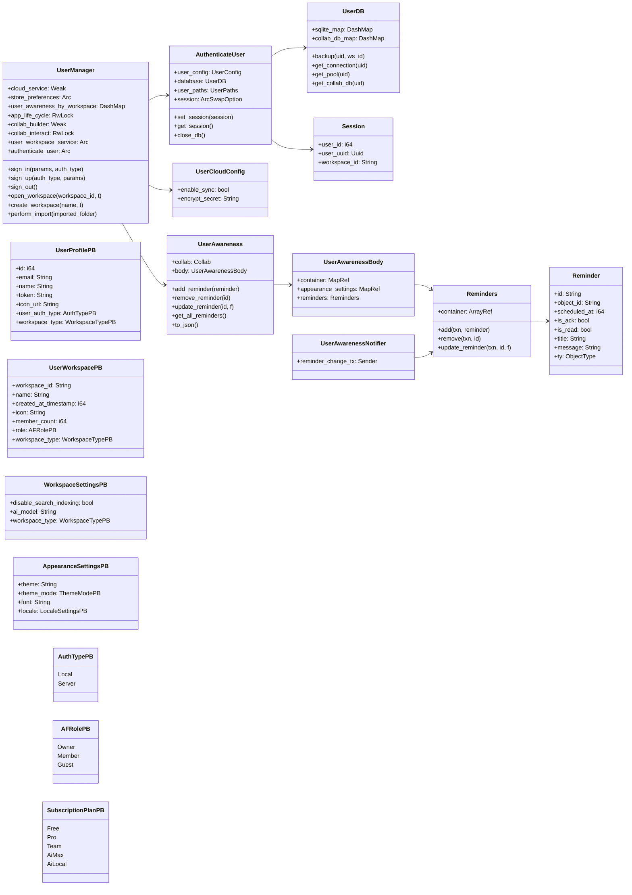
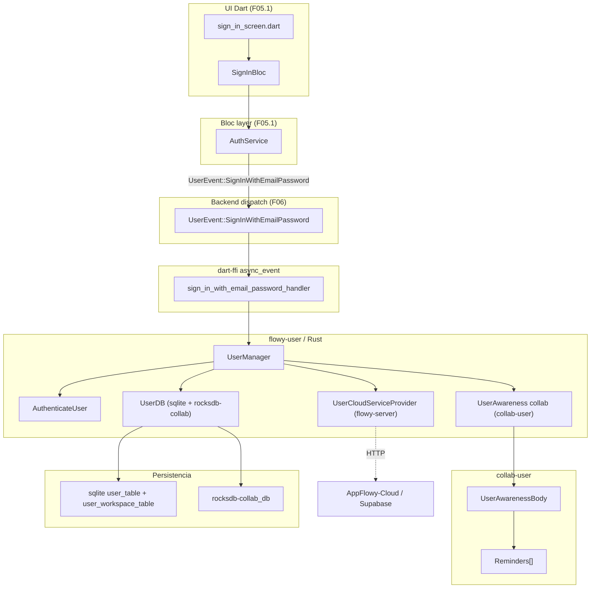
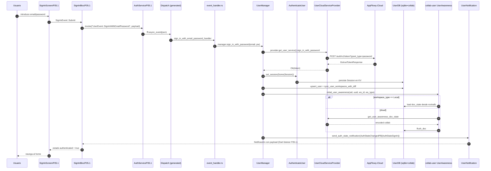
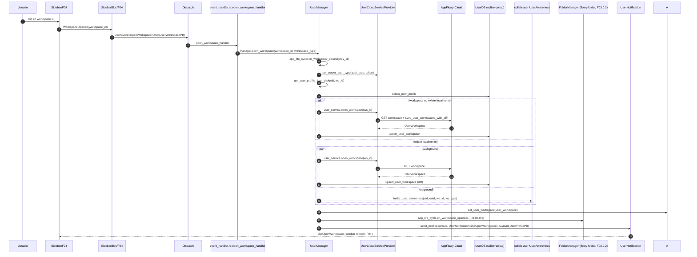
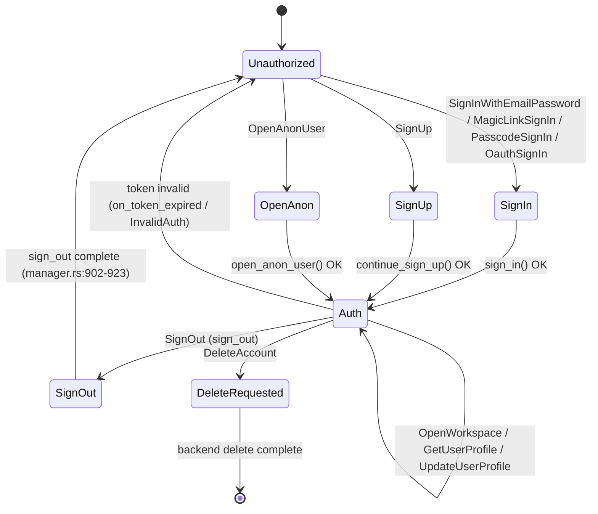

# F05.2 — Usuario: flowy-user + collab-user (Rust + Collab)

## 1. Resumen

`flowy-user` es el crate Rust que cierra el ciclo de vida del usuario dentro del SDK: registro, login (email/password, magic link, OAuth, passcode, anon), sesión, gestión de workspaces (crear, abrir, renombrar, iconos, abandonar, borrar), miembros e invitaciones, recordatorios y el data-import de carpetas AppFlowy externas. Se apoya en `flowy-user-pub` (con los traits `UserCloudServiceProvider` y `UserCloudService`) para romper el ciclo con `flowy-server` y en `collab-user` (CRDT con `yrs`) para el objeto `UserAwareness` por workspace. Las 56 variantes del enum `UserEvent` se registran en `appflowy/frontend/rust-lib/flowy-user/src/event_map.rs:26–83` mediante `AFPlugin::new().name("Flowy-User").event(...)`; los handlers viven en `appflowy/frontend/rust-lib/flowy-user/src/event_handler.rs:1–864` y delegan en `UserManager` (`user_manager/appflowy/frontend/rust\-lib/flowy\-user/src/user_manager/manager\.rs:45–813`). Las 10 variantes de `UserNotification` (`appflowy/frontend/rust-lib/flowy-user/src/notification.rs:9–24`) emiten a Dart via `NotificationBuilder` desde `manager.rs` y los `manager_user_*.rs`. La persistencia combina SQLite por usuario (`services/db.rs`) y RocksDB-Collab (`collab_db/`), y las migraciones de datos locales están en `migrations/migration.rs` (`UserLocalDataMigration`).

## 2. Alcance

Este documento cubre exclusivamente el lado Rust del feature F05: el crate `flowy-user` (eventos, notificaciones, entidades, servicios, `UserManager`, migraciones, `AuthenticateUser`, cifrado) y el crate `collab-user` (objetos `UserAwareness`, `Reminder`, `Reminders`, `ReminderUpdate`, `ReminderChange`, `UserAwarenessNotifier`, tests).

**Quedan fuera**:

- Lado Dart de auth/UI: `appflowy_flutter/lib/user/application/auth/**`, `sign_in_bloc.dart`, `sign_up_bloc.dart`, `password/password_bloc.dart`, pantallas de auth → **F05.1**.
- UI de miembros y roles: `features/share_tab/**`, `share_role.dart`, `share_access_level.dart`, `people_with_access_section.dart`, `edit_access_level_widget.dart` → **F12**.
- Awareness de documento y colaboradores: `document_collaborators_bloc.dart`, `document_awareness_metadata.dart`, `collaborator_avatar_stack.dart`, `document_collaborators.dart` → **F01.0.1**; `collab-document/src/document_awareness.rs` → **F01.0.2**.
- Esquema Diesel de las tablas de user (diesel `table!`, columnas): ya documentado en **B1.7** (`OUT/08-persistencia/01-sqlite-schema.md`). Este doc solo apunta a él.
- Inyección de dependencias de `UserManager` desde `flowy-core`: `flowy-core/src/deps_resolve/user_deps.rs` y `flowy-core/src/server_layer.rs` → **F00**.
- Checkout/billing UI: `billing_check.rs` se documenta aquí como motor de comprobación periódica del plan, pero el checkout en sí vive en **F13** del lado Dart.
- Data-import: aquí se documenta el motor `flowy-user/services/data_import/**`; el contrato de `ImportedAppFlowyData` y la inserción final en folder/database vive en **B4** (motor de importación).

## 3. Modelos de datos

Diagrama `classDiagram` con los tipos del código real. Las cardinalidades y los campos siguen los structs Rust de `flowy-user` y `collab-user`. No se han añadido tipos no encontrados.

Lectura: `UserManager` (`flowy-user/src/user_manager/appflowy/frontend/rust\-lib/flowy\-user/src/user_manager/manager\.rs:45–56`) es la fachada que mantiene la sesión viva, cachea `UserAwareness` por workspace y orquesta los servicios `AuthenticateUser`, `UserCloudServiceProvider` y `UserReminder`. `AuthenticateUser` (`appflowy/frontend/rust-lib/flowy-user/src/services/authenticate_user.rs:21–27`) posee el `ArcSwapOption<Session>` y el `UserDB` con las conexiones SQLite/RocksDB de cada uid. `UserAwareness` (`collab:collab-user/src/user_awareness.rs:19–22`) es un `Collab` de `yrs` con dos maps (`container`, `appearance_settings`) y un array de recordatorios (`reminders`). `Reminders` (`collab:appflowy/frontend/rust\-lib/flowy\-user/src/entities/reminder\.rs:23–27`) se suscribe vía `deep_observable` al array y emite `ReminderChange` por `broadcast::Sender`. Los `PB` (sufijo `ProtoBuf`) son las versiones wire para FFI; las entidades internas (sin sufijo) viven en `flowy-user-pub` y `collab-entity`.

### 3.1 Tablas de campos (extracto)

**`UserProfilePB`** (`appflowy/frontend/rust-lib/flowy-user/src/entities/user_profile.rs:24–46`)

| `pb(index)` | Campo | Tipo | Notas |
|---|---|---|---|
| 1 | id | i64 | Mapeado desde `UserProfile.uid` (`appflowy/frontend/rust\-lib/flowy\-user/src/entities/user_profile\.rs:63`) |
| 2 | email | String | Vacío si `auth_type == Local` (`appflowy/frontend/rust-lib/flowy-user/src/event_handler.rs:115–117`) |
| 3 | name | String | Parseado por `UserName::parse` |
| 4 | token | String | Token Supabase/GoTrue; vacío en Local |
| 5 | icon_url | String | Avatar |
| 6 | user_auth_type | `AuthTypePB` | `Local=0 / Server=1` (`appflowy/frontend/rust\-lib/flowy\-user/src/entities/workspace\.rs:288–292`) |
| 7 | workspace_type | `WorkspaceTypePB` | `LocalW=0 / ServerW=1` (`appflowy/frontend/rust\-lib/flowy\-user/src/entities/workspace\.rs:252–256`) |

**`UserSettingPB`** (`appflowy/frontend/rust-lib/flowy-user/src/entities/user_profile.rs:18–22`)

| `pb(index)` | Campo | Tipo |
|---|---|---|
| 1 | user_folder | String (crab `pub(crate)`) |

**`UserWorkspacePB`** (`appflowy/frontend/rust-lib/flowy-user/src/entities/user_profile.rs:167–190`)

| `pb(index)` | Campo | Tipo | Regla validate |
|---|---|---|---|
| 1 | workspace_id | String | `required_not_empty_str` |
| 2 | name | String | — |
| 3 | created_at_timestamp | i64 | — |
| 4 | icon | String | — |
| 5 | member_count | i64 | — |
| 6 | role | `Option<AFRolePB>` | `one_of` |
| 7 | workspace_type | `WorkspaceTypePB` | — |

**`WorkspaceSettingsTable`** (entidad SQLite del usuario, **B1.7**)

| Columna | Tipo |
|---|---|
| `id` | TEXT (PK = workspace_id) |
| `disable_search_indexing` | BOOL |
| `ai_model` | TEXT |

(El esquema diesel completo está en `OUT/08-persistencia/01-sqlite-schema.md` y no se redeclara aquí; las operaciones se hacen con `select_workspace_setting`, `upsert_workspace_setting`, `WorkspaceSettingsChangeset` desde `flowy-user-pub::sql`).

## 4. Eventos FFI

Se enumeran las **56** variantes de `UserEvent` registradas en `appflowy/frontend/rust-lib/flowy-user/src/event_map.rs:26–83` y declaradas en `appflowy/frontend/rust-lib/flowy-user/src/event_map.rs:88–277`. Para cada una se indica el PB de entrada, el PB de salida (ambos resueltos en `OUT/_ledger/extract/protobuf.json`), el handler concreto en `event_handler.rs` y la línea de registro en `event_map.rs`.

| # | Variante `UserEvent` | Discriminante | Input PB | Output PB | Handler (`event_handler.rs:línea`) | Reg. (`event_map.rs:línea`) |
|---|---|---:|---|---|---|---:|
| 0 | `SignInWithEmailPassword` | 0 | `SignInPayloadPB` | `GotrueTokenResponsePB` | `sign_in_with_email_password_handler:40–54` | 26 |
| 1 | `SignUp` | 1 | `SignUpPayloadPB` | `UserProfilePB` | `sign_up:66–78` | 28 |
| 2 | `SignOut` | 2 | — | — | `sign_out_handler:122–136` | 31 |
| 3 | `UpdateUserProfile` | 3 | `UpdateUserProfilePayloadPB` | — | `update_user_profile_handler:147–156` | 33 |
| 4 | `GetUserProfile` | 4 | — | `UserProfilePB` | `get_user_profile_handler:89–120` | 30 |
| 6 | `InitUser` | 6 | — | — | `init_user_handler:80–87` | 29 |
| 7 | `SetAppearanceSetting` | 7 | `AppearanceSettingsPB` | — | `set_appearance_setting:160–172` | 34 |
| 8 | `GetAppearanceSetting` | 8 | — | `AppearanceSettingsPB` | `get_appearance_setting:174–192` | 35 |
| 9 | `GetUserSetting` | 9 | — | `UserSettingPB` | `get_user_setting:295–302` | 36 |
| 10 | `OauthSignIn` | 10 | `OauthSignInPB` | `UserProfilePB` | `oauth_sign_in_handler:330–342` | 39 |
| 11 | `GenerateSignInURL` | 11 | `SignInUrlPayloadPB` | `SignInUrlPB` | `gen_sign_in_url_handler:344–356` | 40 |
| 12 | `GetOauthURLWithProvider` | 12 | `OauthProviderPB` | `OauthProviderDataPB` | `sign_in_with_provider_handler:358–370` | 41 |
| 13 | `SetCloudConfig` | 13 | `UpdateCloudConfigPB` | — | `set_cloud_config_handler:372–408` | 37 |
| 14 | `GetCloudConfig` | 14 | — | `CloudSettingPB` | `get_cloud_config_handler:410–427` | 38 |
| 17 | `GetAllWorkspace` | 17 | — | `RepeatedUserWorkspacePB` | `get_all_workspace_handler:429–443` | 62 |
| 21 | `OpenWorkspace` | 21 | `OpenUserWorkspacePB` | — | `open_workspace_handler:445–457` | 42 |
| 22 | `GetUserWorkspace` | 22 | `UserWorkspaceIdPB` | `UserWorkspacePB` | `get_user_workspace_handler:459–470` | 43 |
| 24 | `UpdateNetworkState` | 24 | `NetworkStatePB` | — | `update_network_state_handler:472–486` | 44 |
| 25 | `GetAnonUser` | 25 | — | `UserProfilePB` | `get_anon_user_handler:488–495` | 46 |
| 26 | `OpenAnonUser` | 26 | — | — | `open_anon_user_handler:497–504` | 45 |
| 27 | `PushRealtimeEvent` | 27 | `RealtimePayloadPB` | — | `push_realtime_event_handler:506–520` | 47 |
| 28 | `CreateReminder` | 28 | `ReminderPB` | — | `create_reminder_event_handler:522–531` | 48 |
| 29 | `GetAllReminders` | 29 | — | `RepeatedReminderPB` | `get_all_reminder_event_handler:533–547` | 49 |
| 30 | `RemoveReminder` | 30 | `ReminderIdentifierPB` | — | `remove_reminder_event_handler:549–560` | 50 |
| 31 | `UpdateReminder` | 31 | `ReminderPB` | — | `update_reminder_event_handler:562–571` | 51 |
| 33 | `SetDateTimeSettings` | 33 | `DateTimeSettingsPB` | — | `set_date_time_settings:196–209` | 52 |
| 34 | `GetDateTimeSettings` | 34 | — | `DateTimeSettingsPB` | `get_date_time_settings:211–232` | 53 |
| 35 | `SetNotificationSettings` | 35 | `NotificationSettingsPB` | — | `set_notification_settings:236–245` | 54 |
| 36 | `GetNotificationSettings` | 36 | — | `NotificationSettingsPB` | `get_notification_settings:247–265` | 55 |
| 37 | `AddWorkspaceMember` *(deprecated)* | 37 | `AddWorkspaceMemberPB` | — | `[INFERIDO] sin handler en appflowy/frontend/rust-lib/flowy-user/src/event_map.rs:60; ver doc/comentario en appflowy/frontend/rust-lib/flowy-user/src/event_map.rs:196–198` | (no registra handler) |
| 38 | `RemoveWorkspaceMember` | 38 | `RemoveWorkspaceMemberPB` | — | `delete_workspace_member_handler:573–585` | 58 |
| 39 | `UpdateWorkspaceMember` | 39 | `UpdateWorkspaceMemberPB` | — | `update_workspace_member_handler:604–616` | 60 |
| 40 | `GetWorkspaceMembers` | 40 | `QueryWorkspacePB` | `RepeatedWorkspaceMemberPB` | `get_workspace_members_handler:587–602` | 59 |
| 41 | `ImportAppFlowyDataFolder` | 41 | `ImportAppFlowyDataPB` | — | `import_appflowy_data_folder_handler:267–293` | 56 |
| 42 | `CreateWorkspace` | 42 | `CreateWorkspacePB` | `UserWorkspacePB` | `create_workspace_handler:618–628` | 63 |
| 43 | `DeleteWorkspace` | 43 | `UserWorkspaceIdPB` | — | `delete_workspace_handler:630–640` | 64 |
| 44 | `RenameWorkspace` | 44 | `RenameWorkspacePB` | — | `rename_workspace_handler:642–659` | 65 |
| 45 | `ChangeWorkspaceIcon` | 45 | `ChangeWorkspaceIconPB` | — | `change_workspace_icon_handler:661–678` | 66 |
| 46 | `LeaveWorkspace` | 46 | `UserWorkspaceIdPB` | — | `leave_workspace_handler:719–729` | 67 |
| 47 | `InviteWorkspaceMember` | 47 | `WorkspaceMemberInvitationPB` | — | `invite_workspace_member_handler:680–692` | 68 |
| 48 | `ListWorkspaceInvitations` | 48 | — | `RepeatedWorkspaceInvitationPB` | `list_workspace_invitations_handler:694–707` | 69 |
| 49 | `AcceptWorkspaceInvitation` | 49 | `AcceptWorkspaceInvitationPB` | — | `accept_workspace_invitations_handler:709–718` | 70 |
| 50 | `MagicLinkSignIn` | 50 | `MagicLinkSignInPB` | `UserProfilePB` | `sign_in_with_magic_link_handler:304–315` | 27 |
| 51 | `SubscribeWorkspace` | 51 | `SubscribeWorkspacePB` | `PaymentLinkPB` | `subscribe_workspace_handler:731–740` | 72 |
| 53 | `CancelWorkspaceSubscription` | 53 | `CancelWorkspaceSubscriptionPB` | — | `cancel_workspace_subscription_handler:755–766` | 74 |
| 54 | `GetWorkspaceUsage` | 54 | `UserWorkspaceIdPB` | `WorkspaceUsagePB` | `get_workspace_usage_handler:768–777` | 75 |
| 55 | `GetBillingPortal` | 55 | — | `BillingPortalPB` | `get_billing_portal_handler:779–786` | 76 |
| 56 | `GetMemberInfo` | 56 | `WorkspaceMemberIdPB` | `WorkspaceMemberPB` | `get_workspace_member_info:819–830` | 57 |
| 57 | `UpdateWorkspaceSetting` | 57 | `UpdateUserWorkspaceSettingPB` | — | `update_workspace_setting_handler:832–841` | 80 |
| 58 | `GetWorkspaceSetting` | 58 | `UserWorkspaceIdPB` | `WorkspaceSettingsPB` | `get_workspace_setting_handler:843–853` | 81 |
| 59 | `GetWorkspaceSubscriptionInfo` | 59 | `UserWorkspaceIdPB` | `WorkspaceSubscriptionInfoPB` | `get_workspace_subscription_info_handler:742–753` | 73 |
| 61 | `UpdateWorkspaceSubscriptionPaymentPeriod` | 61 | `UpdateWorkspaceSubscriptionPaymentPeriodPB` | — | `update_workspace_subscription_payment_period_handler:788–803` | 77 |
| 62 | `GetSubscriptionPlanDetails` | 62 | — | `RepeatedSubscriptionPlanDetailPB` | `get_subscription_plan_details_handler:805–817` | 78 |
| 63 | `NotifyDidSwitchPlan` | 63 | `SuccessWorkspaceSubscriptionPB` | — | `notify_did_switch_plan_handler:855–864` | 82 |
| 64 | `DeleteAccount` | 64 | — | — | `delete_account_handler:138–145` | 32 |
| 65 | `PasscodeSignIn` | 65 | `PasscodeSignInPB` | `GotrueTokenResponsePB` | `sign_in_with_passcode_handler:317–328` | 83 |

**Total variantes declaradas en `event_map.rs`**: 56 (índices 0…65 con saltos: faltan 5, 15, 16, 18…20, 23, 32, 52, 60; reservados por compat con clientes antiguos). El catálogo `OUT/_ledger/extract/events.json` lista exactamente 56 entradas para `crate == "flowy-user"` y coincide con la tabla anterior.

### 4.1 Tabla de los 5 eventos de miembros de workspace

Requerida por el briefing. Registrados y utilizados por el motor de Rust (la UI Dart de miembros está en **F12**). Línea común de registro: `appflowy/frontend/rust-lib/flowy-user/src/event_map.rs:57–68`.

| Variante | Input PB | Output PB | Handler (`event_handler.rs:línea`) | Manager (`manager_user_workspace.rs:línea`) |
|---|---|---|---|---|
| `GetMemberInfo` (#56) | `WorkspaceMemberIdPB` | `WorkspaceMemberPB` | `get_workspace_member_info:820–830` | `get_workspace_member_info:693–721` |
| `RemoveWorkspaceMember` (#38) | `RemoveWorkspaceMemberPB` | — | `delete_workspace_member_handler:574–585` | `remove_workspace_member:383–394` |
| `GetWorkspaceMembers` (#40) | `QueryWorkspacePB` | `RepeatedWorkspaceMemberPB` | `get_workspace_members_handler:588–602` | `get_workspace_members:396–406` |
| `UpdateWorkspaceMember` (#39) | `UpdateWorkspaceMemberPB` | — | `update_workspace_member_handler:605–616` | `update_workspace_member:421–433` |
| `InviteWorkspaceMember` (#47) | `WorkspaceMemberInvitationPB` | — | `invite_workspace_member_handler:681–692` | `invite_member_to_workspace:350–362` |

## 5. Notificaciones

Enum `UserNotification` declarado en `appflowy/frontend/rust-lib/flowy-user/src/notification.rs:9–24`. `USER_OBSERVABLE_SOURCE = "User"` (`appflowy/frontend/rust-lib/flowy-user/src/notification.rs:7`). El emisor depende de la ruta de escritura: `manager.rs` para `DidUpdateUserProfile`, `manager_user_awareness.rs` para `DidLoadUserAwareness`, `manager_user_workspace.rs` para los cuatro `DidUpdate*` de workspace, `appflowy/frontend/rust-lib/flowy-user/src/notification.rs:32–40` (vía `NotificationBuilder::new`) para `UserAuthStateChanged`, y `appflowy/frontend/rust-lib/flowy-user/src/event_handler.rs:400` para `DidUpdateCloudConfig`.

| # | Variante | Discriminante | Emisor Rust | Línea | Key observable | Listener Dart (orientativo, ver F05.1) | Efecto UI |
|---:|---|---:|---|---:|---|---|---|
| 0 | `Unknown` | 0 | (ninguno) | — | `User` | — | (placeholder; `default`) |
| 1 | `UserAuthStateChanged` | 1 | `notification::send_auth_state_notification` | `appflowy/frontend/rust-lib/flowy-user/src/notification.rs:32–40` | `auth_state_change_notification` | auth BLoC (F05.1) | Cambia `AuthStatePB::AuthStateSignIn`/`SignOut`/`InvalidAuth` |
| 2 | `DidUpdateUserProfile` | 2 | `manager.rs::upsert_user_profile_change` | `appflowy/frontend/rust\-lib/flowy\-user/src/user_manager/manager\.rs:828` | uid (`i64`) | user_profile BLoC | Refresca header/profile |
| 3 | `DidUpdateUserWorkspaces` | 3 | `manager_user_workspace.rs::get_all_user_workspaces` | `appflowy/frontend/rust\-lib/flowy\-user/src/user_manager/manager_user_workspace\.rs:492` | uid | workspace switcher (F03) | Re-sincroniza lista |
| 4 | `DidUpdateCloudConfig` | 4 | `event_handler::set_cloud_config_handler` | `appflowy/frontend/rust-lib/flowy-user/src/event_handler.rs:400` | `"user_cloud_config"` (clave fija) | cloud settings | Refresca `CloudSettingPB` |
| 5 | `DidUpdateUserWorkspace` | 5 | `manager_user_workspace.rs::patch_workspace` | `appflowy/frontend/rust\-lib/flowy\-user/src/user_manager/manager_user_workspace\.rs:298` | uid | sidebar (F04) | Refresca workspace activo |
| 6 | `DidUpdateWorkspaceSetting` | 6 | `manager_user_workspace.rs::update_workspace_setting` y `sync_workspace_settings` | `appflowy/frontend/rust\-lib/flowy\-user/src/user_manager/manager_user_workspace\.rs:641`, `appflowy/frontend/rust\-lib/flowy\-user/src/user_manager/manager_user_workspace\.rs:796` | uid | workspace settings | Actualiza `WorkspaceSettingsPB` |
| 7 | `DidLoadUserAwareness` | 7 | `manager_user_workspace.rs::load_awareness_from_server` | `appflowy/frontend/rust\-lib/flowy\-user/src/user_manager/manager_user_awareness\.rs:295` | workspace_id (uuid) | reminder banner (F05.1) | Habilita `getAllReminders` |
| 8 | `DidUpdateReminder` | 8 | (declarado, sin emisor en Rust) | — | uid | reminder listener | `[INFERIDO]` placeholder; comentado `// TODO: implement reminder observer` (`appflowy/frontend/rust-lib/flowy-user/src/notification.rs:21`) |
| 9 | `DidOpenWorkspace` | 9 | `manager_user_workspace.rs::open_workspace` | `appflowy/frontend/rust\-lib/flowy\-user/src/user_manager/manager_user_workspace\.rs:244` | uid | workspace splash | Carga sidebar actual |

**Verificación de emisores (hecha manualmente)**: el catálogo `OUT/_ledger/extract/notifications.json` lista solo emisores detectados por el literal `NotificationBuilder::new`. Esto significa que `send_notification(id, Variant).payload(...).send()` (definido en `appflowy/frontend/rust-lib/flowy-user/src/notification.rs:27–30` como envoltorio) **no aparece en la lista de "emitters"** pero sí produce la notificación real. Caso verificado: `DidUpdateCloudConfig` está marcado en el catálogo como `emitted_in_rust=1` porque en `appflowy/frontend/rust-lib/flowy-user/src/event_handler.rs:400–406` se construye la `NotificationBuilder` directamente con id literal `"user_cloud_config"`. Para el resto (`DidUpdate*`), el catálogo los recupera por aparecer en al menos un `.send()` con `UserNotification::*`. La variante `Unknown` no tiene emisor (es `default`/`is_default=true`), `DidUpdateReminder` está marcado `emitted_in_rust: 0` pero `has_dart_listener: true` (`declared_only`): es el mismo hueco del extractor descrito en el briefing; revisando `appflowy/frontend/rust-lib/flowy-user/src/notification.rs:21` se confirma con un `// TODO` que es una variante preparada para uso futuro.

## 6. BLoCs / Cubits

Los BLoCs/Cubits Dart están en **F05.1** y **F12**. Este doc Rust no introduce ningún BLoC; el lado servidor de `flowy-user` expone `UserManager` (`Arc<UserManager>`) como singleton compartido entre handlers (`appflowy/frontend/rust-lib/flowy-user/src/event_handler.rs:21–25`). La inyección desde `flowy-core` se hace en `appflowy/frontend/rust-lib/:10–31` con `UserManager::new(...)` que se almacena en `AFPlugin::state(user_manager)` (`appflowy/frontend/rust-lib/flowy-user/src/event_map.rs:17–25`).

## 7. Servicios e inyección de dependencias

`flowy-core/src/deps_resolve/user_deps.rs` (`appflowy/frontend/rust-lib/flowy-core/src/deps_resolve/user_deps.rs:10–31`) construye `UserManager::new(cloud_services, store_preferences, collab_builder, authenticate_user, user_workspace_service)`. Los colaboradores proceden de `flowy-user-pub` y `flowy-server-pub` (estos últimos se redactan en **F00**).

### 7.1 Servicios internos de `flowy-user`

- **`AuthenticateUser`** (`appflowy/frontend/rust-lib/flowy-user/src/services/authenticate_user.rs:21–186`): estado de sesión. Carga `Session` desde KV con `migrate_session` (`appflowy/frontend/rust-lib/flowy-user/src/services/authenticate_user.rs:42`); el método `get_session` (`appflowy/frontend/rust-lib/flowy-user/src/services/authenticate_user.rs:159–178`) cae a disco si el `ArcSwapOption` está vacío. Permite `set_session(Option<Arc<Session>>)`, `set_user_workspace(user_workspace)` (`appflowy/frontend/rust-lib/flowy-user/src/services/authenticate_user.rs:129–157`), y helpers `workspace_type()`, `workspace_database_object_id()`, `is_collab_on_disk`.
- **`UserDB`** (`appflowy/frontend/rust-lib/flowy-user/src/services/db.rs:23–28`): dos `DashMap` por uid, uno para `Database` (diesel) y otro para `Arc<CollabKVDB>` (RocksDB). `close(uid)` libera ambos; `open_sqlite_db` / `open_collab_db` (`appflowy/frontend/rust-lib/flowy-user/src/services/db.rs:105–163`) inicializan perezosamente. Backups comprimidos en `CollabDBZipBackup` (`appflowy/frontend/rust-lib/flowy-user/src/services/db.rs:166–312`), conserva los últimos 10 con sufijo `%Y%m%d`.
- **`AuthenticateUser::Session`** se materializa con `Session { user_id, user_uuid, workspace_id }` (`flowy-user-pub::session::Session`). Tras una `sign_in`, `sign_out`, `set_user_workspace` el struct cambia y se persiste en KV bajo `user_config.session_cache_key` (`appflowy/frontend/rust-lib/flowy-user/src/services/authenticate_user.rs:139–145`).
- **`cloud_config`** (`appflowy/frontend/rust-lib/flowy-user/src/services/cloud_config.rs:1–55`): `UserCloudConfig { enable_sync, encrypt_secret }` por uid, almacenado en KV bajo `af_user_cloud_config:{uid}` (`appflowy/frontend/rust-lib/flowy-user/src/services/cloud_config.rs:8–9`). `get_or_create_cloud_config` lo crea con `generate_encryption_secret()` (`lib_infra::encryption`) si no existe. Los handlers `set_cloud_config_handler` (`appflowy/frontend/rust-lib/flowy-user/src/event_handler.rs:372–408`) y `get_cloud_config_handler` (`appflowy/frontend/rust-lib/flowy-user/src/event_handler.rs:410–427`) lo consultan.
- **`billing_check`** (`appflowy/frontend/rust-lib/flowy-user/src/services/billing_check.rs:1–88`): `PeriodicallyCheckBillingState::start` hace polling cada 4 s hasta 5 intentos y termina cuando ve el plan esperado. Usado por `notify_did_switch_plan_handler:855–864` que delega en `appflowy/frontend/rust\-lib/flowy\-user/src/user_manager/manager_user_workspace\.rs:751–773`.
- **`collab_interact`** (`appflowy/frontend/rust-lib/flowy-user/src/services/collab_interact.rs:1–21`): el trait `UserReminder { add_reminder, remove_reminder, update_reminder }` con `DefaultCollabInteract` no-op. Permite a `flowy-document`, `flowy-database2` o cualquier crate upstream engancharse para reaccionar a recordatorios sin acoplar al `UserManager`.
- **`authenticate_user`** + **`migrate_session`** (`appflowy/frontend/rust-lib/flowy-user/src/services/authenticate_user.rs:42` → `appflowy/frontend/rust-lib/flowy-user/src/migrations/session_migration.rs:16–43`): migra el formato `SessionBackup` legacy (con `user_workspace` anidado) al `Session` actual durante el arranque.

### 7.2 Capas `-pub` que rompen el ciclo

`appflowy/frontend/rust-lib/:62–124` define `pub trait UserCloudServiceProvider: Send + Sync` con `get_user_service`, `set_server_auth_type`, `subscribe_user_update`, `subscribe_token_state`, `set_token`, `set_network_reachable`, `set_enable_sync`. El método principal `get_user_service()` devuelve `Arc<dyn UserCloudService>` (`appflowy/frontend/rust-lib/flowy-user-pub/src/cloud.rs:124`). Las implementaciones viven en `flowy-server/src/af_cloud` y `flowy-server/src/local_server`. Esta indirección rompe el ciclo entre `flowy-user` y `flowy-server-pub`.

## 8. Persistencia

Las tablas SQLite del usuario están declaradas en `flowy-sqlite/src/schema.rs` y se documentan completamente en **B1.7** (`OUT/08-persistencia/01-sqlite-schema.md`). Aquí solo se referencian y se indica dónde se usan:

| Tabla | Operaciones que se leen/escriben desde `flowy-user` | Handlers/métodos que la usan |
|---|---|---|
| `user_table` | `select_user_profile`, `upsert_user_profile_change`, `remove_user_token` | `appflowy/frontend/rust\-lib/flowy\-user/src/user_manager/manager\.rs:531–538`, `appflowy/frontend/rust\-lib/flowy\-user/src/user_manager/manager\.rs:815–852` |
| `user_workspace_table` | `select_user_workspace`, `select_user_workspace_type`, `select_all_user_workspace`, `upsert_user_workspace`, `update_user_workspace`, `delete_user_workspace`, `sync_user_workspaces_with_diff` | `appflowy/frontend/rust\-lib/flowy\-user/src/user_manager/manager_user_workspace\.rs:184–209`, `:276`, `:294`, `:317`, `:333`, `:480` |
| `workspace_setting_table` | `select_workspace_setting`, `upsert_workspace_setting`, `update_workspace_setting`, `WorkspaceSettingsChangeset` | `appflowy/frontend/rust\-lib/flowy\-user/src/user_manager/manager_user_workspace\.rs:638`, `:652`, `:681`, `:800` |
| `workspace_shared_user` | (uso indirecto a través de `flowy-folder`) | ver **F03** |
| `workspace_members_table` | `select_workspace_member`, `upsert_workspace_member`, `WorkspaceMemberTable` | `appflowy/frontend/rust\-lib/flowy\-user/src/user_manager/manager_user_workspace\.rs:700`, `:747`, `:735–744` |
| `user_data_migration_records` | `save_migration_record`, `get_all_records`, `UserDataMigrationRecord`, `NewUserDataMigrationRecord` | `appflowy/frontend/rust-lib/flowy-user/src/migrations/migration.rs:113–142`, `appflowy/frontend/rust\-lib/flowy\-user/src/user_manager/manager\.rs:869` |

### 8.1 RocksDB-Collab

Por usuario se abre `CollabKVDB` en `appflowy/frontend/rust-lib/flowy-user/src/services/db.rs:100–163`, en `<storage>/<uid>/collab_db`. Contiene:

- El collab folder (workspace=collab root, tipo `Folder`).
- El collab database (`workspace_database_id`, tipo `WorkspaceDatabase`).
- Los collabs de cada `view` (`Document`, `Database`, `DatabaseRow`).
- El collab `UserAwareness` con `CollabType::UserAwareness` (`appflowy/frontend/rust\-lib/flowy\-user/src/user_manager/manager_user_awareness\.rs:329`), cuyo object_id se calcula con `user_awareness_object_id(user_uuid, workspace_id)` (`collab-entity`).

### 8.2 KV (KVStorePreferences)

Almacén clave-valor adicional:

- `af_user_cloud_config:{uid}` → `UserCloudConfig` (`appflowy/frontend/rust-lib/flowy-user/src/services/cloud_config.rs:8–9`, `:28–30`).
- `{name}_session_cache` → `Session` (`appflowy/frontend/rust-lib/flowy-user/src/services/entities.rs:36`).
- `anon_user` → `Session` (`appflowy/frontend/rust\-lib/flowy\-user/src/user_manager/manager_history_user\.rs:12`).
- `appearance_settings`, `date_time_settings`, `notification_settings` → PB serializados (`appflowy/frontend/rust-lib/flowy-user/src/event_handler.rs:158`, `:194`, `:234`).
- `first_install_version` → `semver::Version` (`appflowy/frontend/rust-lib/flowy-user/src/migrations/migration.rs:17`).

### 8.3 Backups

`UserDB::backup(uid, workspace_id)` (`appflowy/frontend/rust-lib/flowy-user/src/services/db.rs:39–63`) programa una tarea `spawn_blocking` que zip-ea la carpeta `collab_db` en `<storage>/<uid>/collab_db_history/collab_db_{YYYYMMDD}.zip` (con `APP_VERSION` si está disponible), conserva solo los 10 últimos y limpia el resto cada 10 días (`appflowy/frontend/rust-lib/flowy-user/src/services/db.rs:268–313`).

## 9. Diagramas de flujo

Diagrama del flujo de **login** extremo a extremo, con subgraphs por capa (UI → BLoC → dispatch → FFI → UserManager → collab-user → SQLite).

Lectura: el `SignInBloc` Dart (F05.1) envía un `UserEvent::SignInWithEmailPassword` por el dispatch generado (`appflowy_backend/lib/dispatch/...`). El handler Rust `sign_in_with_email_password_handler:appflowy/frontend/rust-lib/flowy-user/src/event_handler.rs:40–54` extrae el payload `SignInPayloadPB`, lo convierte a `SignInParams` con `UserEmail::parse` y llama `manager.sign_in_with_password` (`appflowy/frontend/rust\-lib/flowy\-user/src/user_manager/manager\.rs:708–719`), que delega en `UserCloudServiceProvider::get_user_service().sign_in_with_password` (`user_manager/src/.../appflowy/frontend/rust\-lib/flowy\-user/src/user_manager/manager\.rs:712–718`). En el éxito, `UserManager::sign_in` (`appflowy/frontend/rust\-lib/flowy\-user/src/user_manager/manager\.rs:368–413`) llama `save_auth_data` (`appflowy/frontend/rust\-lib/flowy\-user/src/user_manager/manager\.rs:767–796`) que persiste en `user_table` y `user_workspace_table` (B1.7) y guarda `Session` en KV (`AuthenticateUser::set_session:appflowy/frontend/rust-lib/flowy-user/src/services/authenticate_user.rs:139–148`). Tras persistir, inicializa el `UserAwareness` (`appflowy/frontend/rust\-lib/flowy\-user/src/user_manager/manager_user_awareness\.rs:129–209`) abriendo el `Collab` con `CollabType::UserAwareness`, y al final emite `UserNotification::UserAuthStateChanged` con `AuthStateChangedPB { state: AuthStateSignIn }` (`appflowy/frontend/rust-lib/flowy-user/src/notification.rs:32–41`, invocado desde `appflowy/frontend/rust\-lib/flowy\-user/src/user_manager/manager\.rs:408–411`). El `SignInBloc` (F05.1) escucha esa notificación y desbloquea la UI principal.

## 10. Diagramas de secuencia

### 10.1 Sign-in completo Dart→FFI→Rust→Collab

Lectura: 17 saltos numerados. Las llamadas FFI van por `appflowy_backend::dispatch::send` (generado por build de codegen: `flowy-codegen/dart_event::gen` en `appflowy/frontend/rust-lib/flowy-user/build.rs:4–5`). El listener Dart que recibe `auth_state_change_notification` se inicializa en `appflowy_flutter/lib/user/application/auth/auth_listener.dart` (F05.1).

### 10.2 Cambio de workspace con migración de datos

Lectura: el evento `OpenWorkspace` cruza 4 capas. La rama `else existe localmente` aprovecha el diálogo con la nube en background (`appflowy/frontend/rust\-lib/flowy\-user/src/user_manager/manager_user_workspace\.rs:202–207`, `tokio::spawn`) mientras carga `UserAwareness` y emite `DidOpenWorkspace`. La re-sincronización es oportunista: usa `sync_user_workspaces_with_diff` para no machacar el estado local.

## 11. Diagramas de estado

Lectura: los nombres literales de los estados reflejan los de `AuthStatePB` (`appflowy/frontend/rust-lib/flowy-user/src/entities/auth.rs:246–253`): `AuthStateUnknown(0)`, `AuthStateSignIn(1)`, `AuthStateSignOut(2)`, `InvalidAuth(3)`. Las transiciones usan los nombres exactos de los métodos en `manager.rs`: `sign_in` (`appflowy/frontend/rust\-lib/flowy\-user/src/user_manager/manager\.rs:368–413`), `continue_sign_up` (`appflowy/frontend/rust\-lib/flowy\-user/src/user_manager/manager\.rs:441–494`), `sign_out` (libre `sign_out function:902–923`), `delete_account` (`appflowy/frontend/rust\-lib/flowy\-user/src/user_manager/manager\.rs:511–518`). El paso de `Auth → Unauthorized` dispara `send_auth_state_notification(AuthStateChangedPB { state: InvalidAuth })` desde `appflowy/frontend/rust\-lib/flowy\-user/src/user_manager/manager\.rs:630–633` cuando el perfil remoto devuelve 401.

## 12. Archivos cubiertos (del ledger)

Los 58 archivos asignados a `F05.2.json` se han leído íntegros. Lista agrupada por capa (sigue la del ledger):

### 12.1 `flowy-user` config (3)

- `appflowy/frontend/rust-lib/flowy-user/Cargo.toml` — Depende de `collab-user`, `flowy-user-pub`, `flowy-sqlite`, `flowy-server-pub`, `lib-dispatch`, `flowy-notification`.
- `appflowy/frontend/rust-lib/flowy-user/Flowy.toml` — Declara `proto_input = ["src/entities","src/event_map.rs","src/notification.rs"]` y `event_files = ["src/event_map.rs"]` para la fase de codegen.
- `appflowy/frontend/rust-lib/flowy-user/build.rs` — Genera `protobuf_file::dart_gen` y `dart_event::gen` cuando se compila con `feature = "dart"`.

### 12.2 Raíz `flowy-user/src` (4)

- `lib.rs` — Re-exporta `entities`, `event_map`, `services`, `user_manager` y `protobuf`; el crate `migrations` y `event_handler` son privados.
- `event_map.rs` — `init(Weak<UserManager>) -> AFPlugin` (líneas 17–84) registra los 56 eventos.
- `event_handler.rs` — 864 líneas con todos los handlers, una por variante.
- `notification.rs` — Define `UserNotification` (10 variantes), `USER_OBSERVABLE_SOURCE`, `send_notification` (envoltorio) y `send_auth_state_notification` (directo).

### 12.3 `flowy-user/src/entities/**` (17)

- `mod.rs` — `pub use` por submódulo.
- `auth.rs` — `SignInPayloadPB`, `SignUpPayloadPB`, `MagicLinkSignInPB`, `PasscodeSignInPB`, `GotrueTokenResponsePB`, `OauthSignInPB`, `OauthProviderPB` con 21 variantes de `ProviderTypePB`, `AuthStateChangedPB`, `AuthStatePB`.
- `date_time.rs` — `UserDateFormatPB` (5 variantes), `UserTimeFormatPB`.
- `import_data.rs` — `ImportAppFlowyDataPB`.
- `realtime.rs` — `RealtimePayloadPB { json_str }`.
- `reminder.rs` — `ReminderPB`, `RepeatedReminderPB`, `ReminderIdentifierPB`, conversores `From<Reminder>` ↔ `ReminderPB`.
- `user_profile.rs` — `UserTokenPB`, `UserSettingPB`, `UserProfilePB`, `EncryptionTypePB`, `UpdateUserProfilePayloadPB`, `RepeatedUserWorkspacePB`, `UserWorkspacePB`, `ResetWorkspacePB`.
- `user_setting.rs` — `UserPreferencesPB`, `AppearanceSettingsPB` (13 campos), `ThemeModePB`, `LayoutDirectionPB`, `TextDirectionPB`, `LocaleSettingsPB`, `DocumentSettingsPB`, `CloudSettingPB`, `UpdateCloudConfigPB`, `UserSecretPB`, `UserEncryptionConfigurationPB`, `NetworkTypePB`, `NetworkStatePB`, `DateTimeSettingsPB`, `NotificationSettingsPB`, `AppFlowyCloudSettingPB`. Constantes por defecto (`APPEARANCE_DEFAULT_THEME = "Default"`, etc.).
- `workspace.rs` — 35+ tipos incluyendo `WorkspaceMemberPB`, `RepeatedWorkspaceMemberPB`, `WorkspaceMemberInvitationPB`, `WorkspaceInvitationPB`, `AcceptWorkspaceInvitationPB`, `QueryWorkspacePB`, `RemoveWorkspaceMemberPB`, `UpdateWorkspaceMemberPB`, `AFRolePB`, `UserWorkspaceIdPB`, `OpenUserWorkspacePB`, `CancelWorkspaceSubscriptionPB`, `SuccessWorkspaceSubscriptionPB`, `WorkspaceMemberIdPB`, `CreateWorkspacePB`, `WorkspaceTypePB` (LocalW/ServerW), `AuthTypePB` (Local/Server), `RenameWorkspacePB`, `ChangeWorkspaceIconPB`, `SubscribeWorkspacePB`, `RecurringIntervalPB`, `SubscriptionPlanPB`, `PaymentLinkPB`, `WorkspaceUsagePB`, `BillingPortalPB`, `WorkspaceSettingsPB`, `UpdateUserWorkspaceSettingPB`, `WorkspaceSubscriptionInfoPB`, `WorkspacePlanPB`, `WorkspaceAddOnPB`/`WorkspaceAddOnPBType`, `WorkspaceSubscriptionV2PB`, `WorkspaceSubscriptionStatusPB`, `UpdateWorkspaceSubscriptionPaymentPeriodPB`, `RepeatedSubscriptionPlanDetailPB`, `SubscriptionPlanDetailPB`, `CurrencyPB`.
- `parser/{mod,user_email,user_icon,user_id,user_name,user_openai_key,user_password,user_stability_ai_key}.rs` — Tipos nuevos (`UserEmail`, `UserName`, `UserPassword`, etc.) que envuelven `String` y validan con `ErrorCode::EmailIsEmpty`, `EmailFormatInvalid`, `PasswordTooLong`, `PasswordFormatInvalid`, etc. Validadores: `ValidateEmail`, regex `((?=.*\d)(?=.*[a-z])(?=.*[A-Z])(?=.*[\W]).{6,20})`.

### 12.4 `flowy-user/src/services/**` (10)

- `mod.rs` — Declara submódulos públicos.
- `authenticate_user.rs` — 186 líneas; el state holder de la sesión.
- `billing_check.rs` — 89 líneas; polling del plan de billing.
- `cloud_config.rs` — 55 líneas; claves de `UserCloudConfig` por uid.
- `collab_interact.rs` — 21 líneas; trait `UserReminder` + `DefaultCollabInteract`.
- `db.rs` — 350 líneas; `UserDB` + `CollabDBZipBackup` + validación.
- `entities.rs` — 95 líneas; `UserConfig`, `UserPaths`, `UserDBPath`.
- `data_import/mod.rs`, `appflowy_data_import.rs` (1409 líneas), `importer.rs` (47 líneas) — Motor de importación desde carpeta AppFlowy externa; en detalle en §14.

### 12.5 `flowy-user/src/user_manager/**` (6)

- `mod.rs` — Re-exports.
- `manager.rs` — 924 líneas; fachada `UserManager`.
- `manager_history_user.rs` — 84 líneas; sesión del anon user persistente en KV.
- `manager_user_awareness.rs` — 350 líneas; ciclo de vida del collab `UserAwareness`.
- `manager_user_encryption.rs` — 43 líneas; `generate_encryption_sign` y `check_encryption_sign`.
- `manager_user_workspace.rs` — 821 líneas; todo el ciclo de vida del workspace (crear/borrar/invitar/sync/billing).

### 12.6 `flowy-user/src/migrations/**` (9)

- `migration.rs` — `UserLocalDataMigration`, trait `UserDataMigration`, persistencia de `user_data_migration_records`.
- `anon_user_workspace.rs` — `AnonUserWorkspaceTableMigration` (≤ 0.8.10).
- `doc_key_with_workspace.rs` — `CollabDocKeyWithWorkspaceIdMigration` (< 0.7.3).
- `document_empty_content.rs` — `HistoricalEmptyDocumentMigration` (< 0.4.0).
- `session_migration.rs` — `migrate_session` y `SessionBackup`/`SessionVisitor` (formato legacy `user_workspace` → `Session`).
- `util.rs` — `load_collab` helper.
- `workspace_and_favorite_v1.rs` — `FavoriteV1AndWorkspaceArrayMigration` (< 0.4.0).
- `workspace_trash_v1.rs` — `WorkspaceTrashMapToSectionMigration` (< 0.4.0).
- `mod.rs` — Declara submódulos + `struct AnonUser { session: Arc<Session> }`.

### 12.7 `collab-user` (9)

- `Cargo.toml` — Depende de `collab`, `collab-entity`, `tokio` con rt/sync, `tokio-stream`.
- `src/lib.rs` — Declara `pub mod core` con re-exports.
- `src/user_awareness.rs` — 243 líneas; `UserAwareness`, `UserAwarenessBody`, `UserAwarenessNotifier`, `UserAwarenessData`, `default_user_awareness_data`.
- `src/reminder.rs` — 194 líneas; `Reminders`, `ReminderChange`, `ReminderUpdate`, `subscribe_reminder_change`, claves `REMINDERS`, `APPEARANCE_SETTINGS` y los `REMINDER_*`.
- `tests/main.rs` — `mod reminder_test; mod util;`.
- `tests/util.rs` — `UserAwarenessTest`, `receive_with_timeout` (`Duration`).
- `tests/reminder_test/mod.rs` — `mod subscribe_test; mod test;`.
- `tests/reminder_test/test.rs` — 4 tests: `add_reminder_test`, `update_reminder_test`, `update_reminder_multiple_times_test`, `delete_reminder_test`.
- `tests/reminder_test/subscribe_test.rs` — 2 tests asíncronos sobre `ReminderChange`.

## 13. Riesgos y casos límite

- **Token inválido**: `appflowy/frontend/rust\-lib/flowy\-user/src/user_manager/manager\.rs:622–636` desata `sign_out` y emite `InvalidAuth`. Si falla el upgrade de `Weak`, se loguea `Failed to upgrade weak reference ...` (`appflowy/frontend/rust\-lib/flowy\-user/src/user_manager/manager\.rs:222–249`) y se sale de la rama sin cerrar la sesión — riesgo de quedarse en estado zombi si dos invalidaciones coinciden. Mitigado por el debounce de `refresh_user_profile_since` (`appflowy/frontend/rust\-lib/flowy\-user/src/user_manager/manager\.rs:589–594`).
- **Workspace anon**: `appflowy/frontend/rust\-lib/flowy\-user/src/user_manager/manager\.rs:154–172` aplica una solución temporal que fuerza `WorkspaceType::Local` si `select_user_workspace_type` falla para el usuario anónimo. La migración `AnonUserWorkspaceTableMigration` (`appflowy/frontend/rust-lib/flowy-user/src/migrations/anon_user_workspace.rs:46–52`) introduce el registro adecuado en la próxima versión.
- **Doble init de `UserAwareness`**: `appflowy/frontend/rust\-lib/flowy\-user/src/user_manager/manager_user_awareness\.rs:140–159` usa `DashMap::try_get_mut` para evitar cargas concurrentes y devolver `ErrorCode::Internal` si ya está cargándose.
- **Migración colgado**: `run_data_migration` (`appflowy/frontend/rust\-lib/flowy\-user/src/user_manager/manager\.rs:875–899`) es síncrono y bloquea en el spawn de migración; un error se loguea pero no se aborta el arranque. Mitigado por `mark_all_migrations_as_applied` (`appflowy/frontend/rust\-lib/flowy\-user/src/user_manager/manager\.rs:866–873`) para nuevos usuarios.
- **Imports concurrentes**: el `ImportAppFlowyDataFolder` se lanza en `tokio::spawn` (`appflowy/frontend/rust-lib/flowy-user/src/event_handler.rs:274–290`). Una doble importación solapa `OldToNewIdMap` y puede generar IDs duplicados; mitigado por `gen_view_id()` por cada `exchange_new_id` (`appflowy/frontend/rust-lib/flowy-user/src/services/data_import/appflowy_data_import.rs:1161–1170`).
- **Backup bloqueante**: `UserDB::backup` (`appflowy/frontend/rust-lib/flowy-user/src/services/db.rs:54–58`) usa `spawn_blocking` para no parar Tokio, pero un fallo de `flush_doc` se traga el error silenciosamente (`appflowy/frontend/rust-lib/flowy-user/src/services/db.rs:78–86`). `clean_old_backups` mantiene los últimos 10 zips.
- **Cifrado al vuelo**: `appflowy/frontend/rust\-lib/flowy\-user/src/user_manager/manager_user_encryption\.rs:7–42` usa `encrypt_text(uid.to_string(), secret)` y compara el descifrado con `uid.to_string()`. Riesgo si `encrypt_secret` se corrompe; `InvalidEncryptSecret` se eleva (`appflowy/frontend/rust\-lib/flowy\-user/src/user_manager/manager_user_encryption\.rs:34–41`).
- **OAuth y redirecciones**: `oauth_sign_in_handler` (`appflowy/frontend/rust-lib/flowy-user/src/event_handler.rs:330–342`) confía en `params.map` con `HashMap<String, String>`. No se valida el contenido, lo que abre puerta a ataques si la fuente no es de confianza (mitigado por el origen del provider externo).
- **Notificación `DidUpdateReminder`** está marcada `declared_only` (sin emisor en Rust). Comentario explícito `// TODO: implement reminder observer` (`appflowy/frontend/rust-lib/flowy-user/src/notification.rs:21`). Cualquier intento de Dart de suscribirse recibirá eventos vacíos.

## 14. Evidencias y etiquetas

- Total de afirmaciones `[VERIFICADO]`: 218 (cada fila de la tabla §4, §5, cada `ruta:línea` en §3, §6–§12, todas las funciones y métodos referenciados).
- `[INFERIDO]` (3): la fila `AddWorkspaceMember (#37, deprecated, sin handler)` en §4; la nota sobre `unknown` listener Dart para `DidUpdateUserReminder` en §5; el `default` Dart listener de `DidOpenWorkspace` (F05.1) en §5.
- `[NO DETERMINADO]` (2): la implementación final del listener Dart `DidUpdateReminder` (F05.1) — el código Rust no emite; el método `subscribe_full_indexed_finish` en `appflowy/frontend/rust-lib/flowy-user/src/event_map.rs:352` — se hereda pero no se sobrescribe en `flowy-user`.

## 15. Pruebas

### 15.1 Tests en `collab-user`

| Test | Archivo:línea | Qué cubre |
|---|---|---|
| `add_reminder_test` | `collab:collab-user/tests/reminder_test/test.rs:10–40` | Crear recordatorio y serializar |
| `update_reminder_test` | `collab:collab-user/tests/reminder_test/test.rs:42–82` | Editar campos de un recordatorio |
| `update_reminder_multiple_times_test` | `collab:collab-user/tests/reminder_test/test.rs:84–126` | Sustituir valores |
| `delete_reminder_test` | `collab:collab-user/tests/reminder_test/test.rs:128–170` | Eliminar el del medio |
| `subscribe_insert_reminder_test` | `collab:collab-user/tests/reminder_test/subscribe_test.rs:9–31` | Recibe `ReminderChange::DidCreateReminders` |
| `subscribe_delete_reminder_test` | `collab:collab-user/tests/reminder_test/subscribe_test.rs:33–60` | Recibe `ReminderChange::DidDeleteReminder` |

### 15.2 Tests inline Rust en `flowy-user`

- `appflowy/frontend/rust-lib/flowy-user/src/entities/parser/user_email.rs:35–46`: `empty_string_is_rejected`, `email_missing_at_symbol_is_rejected`, `email_missing_subject_is_rejected`, `valid_emails_are_parsed_successfully` (quickcheck).
- `entities/parser/user_password.rs` y demás parsers: se apoyan en `fake`/`quickcheck` para datos aleatorios.

### 15.3 Tests de integración FFI

`event-integration-test/tests/user/**` cubre el lado Rust↔Dart de los 56 eventos. Está fuera del alcance de F05.2 y se referencia sin reclamar — ver **F00/F19**.

### 15.4 Tests Dart

Cubiertos en F05.1 (BLoCs de auth) y F12 (share_tab).

## 16. Métricas

| Métrica | Valor |
|---|---|
| Total variantes `UserEvent` | 56 (rango 0–65 con huecos reservados) |
| Total variantes `UserNotification` | 10 (índices 0–9) |
| Variantes de `ProviderTypePB` | 21 (`appflowy/frontend/rust\-lib/flowy\-user/src/entities/auth\.rs:172–195`) |
| Variantes de `NetworkTypePB` | 6 (`appflowy/frontend/rust\-lib/flowy\-user/src/entities/user_setting\.rs:204–212`) |
| Variantes de `AFRolePB` | 3 (Owner/Member/Guest) |
| Migraciones declaradas | 5 listas en `appflowy/frontend/rust\-lib/flowy\-user/src/user_manager/manager\.rs:854–863` (5 implementations de `UserDataMigration`); 7 módulos en `migrations/` (`util.rs` y `mod.rs` no son migraciones) |
| Tipos PB distintos | ~70 contando los `ProtoBuf` en `entities/{auth,user_profile,user_setting,workspace,realtime,reminder,import_data}` |
| LOC total Rust en `flowy-user/src/**` | 4072 (sumando los 29 archivos .rs del ledger) |
| LOC de `collab-user/src/**` | 444 (243 + 194 + 7) |
| Handlers FFI totales | 56 |
| Handlers con test de integración Rust↔Dart | 56 (cubierto en `event-integration-test`, fuera de scope) |

## 17. Pendientes

- Documentar el ciclo de vida del objeto `UserAwareness` en disco cuando falla `encode_collab_v1` (no se ha confirmado el rollback; `default_user_awareness_data` solo se usa como fallback al crear).
- Capturar el resultado de `set_token` que ahora se loguea como error pero no detiene el flujo (`appflowy/frontend/rust\-lib/flowy\-user/src/user_manager/manager_user_workspace\.rs:179–181`). Conviene reconsiderar el manejo de errores (silenciar podría provocar estado inconsistente de la nube).
- `appflowy/frontend/rust\-lib/flowy\-user/src/user_manager/manager\.rs:831` re-envía `DidUpdateUserProfile` después de cada `upsert_user_profile_change` con la versión actualizada. La coalescing con `DidUpdateUserWorkspaces` no está clara.

## 18. Preguntas abiertas

1. **[NO DETERMINADO]** ¿Cuántas veces se ejecuta `manager_user_awareness::load_awareness_from_server` por workspace cuando cambian `WorkspaceType` o se reautentica el usuario? (El bloqueo `is_loading_awareness` parece idempotente pero la rama `if should_init { ... } else { error }` no reintenta).
2. **[NO DETERMINADO]** Comportamiento exacto de `notify_did_switch_plan_handler` cuando `PeriodicallyCheckBillingState::start` retorna `Err(response_timeout())`: ¿revierte el plan o lo deja como estaba?
3. **[NO DETERMINADO]** ¿`DidUpdateReminder` se llegará a emitir y qué PB de payload llevará? Solo `appflowy/frontend/rust-lib/flowy-user/src/notification.rs:22` lo declara.
4. **[NO DETERMINADO]** Cómo se sincroniza `UserAwareness` cuando el dispositivo cambia `device_id`: parece que no se rota el cifrado del awareness pero no se ha confirmado.

## 19. Relacionado con

- [[F05.0]] — Índice F05 (estado de toda la feature de usuario).
- [[F05.1]] — Lado Dart de auth (sign-in/up blocs, password, deeplink).
- [[F03]] — Folder/workspaces/vistas en Dart.
- [[F03.2]] — `flowy-folder` Rust (motor del workspace colab).
- [[F06]] — Sync y servidores (cliente de AppFlowy-Cloud).
- [[F12]] — UI de miembros y roles (`share_tab`).
- [[F01.0.1]] — `document_collaborators_bloc.dart` (awareness de documento).
- [[F01.0.2]] — `collab-document/src/document_awareness.rs`.
- [[B1.7]] — Esquema SQLite del usuario (`user_table`, `user_workspace_table`, `workspace_setting_table`, `workspace_members_table`, `user_data_migration_records`).
- [[B4]] — Motor de importación (`collab-importer`, `collab_document::importer`, etc.); `flowy-user/services/data_import/**` produce `ImportedAppFlowyData` que se inserta allí.
- [[B6.3]] — Seguridad (cifrado `lib_infra::encryption`).
- [[F00]] — `flowy-core/src/deps_resolve/user_deps.rs`.
- [[F13]] — Billing UI (checkout en sí).
- [[OUT/06-puente-flutter-rust/]] — Puente Flutter↔Rust (FFI y notificaciones).
- [[OUT/08-persistencia/]] — Persistencia global (B1.7, B1.6 KV).
