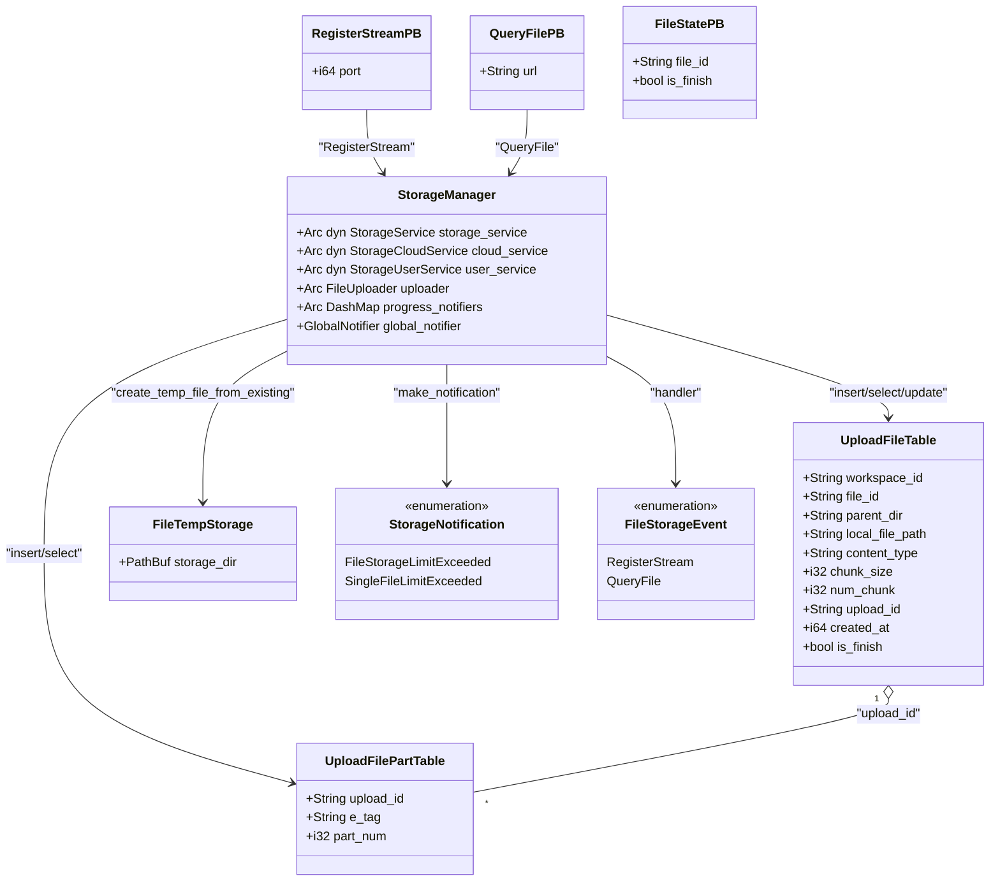
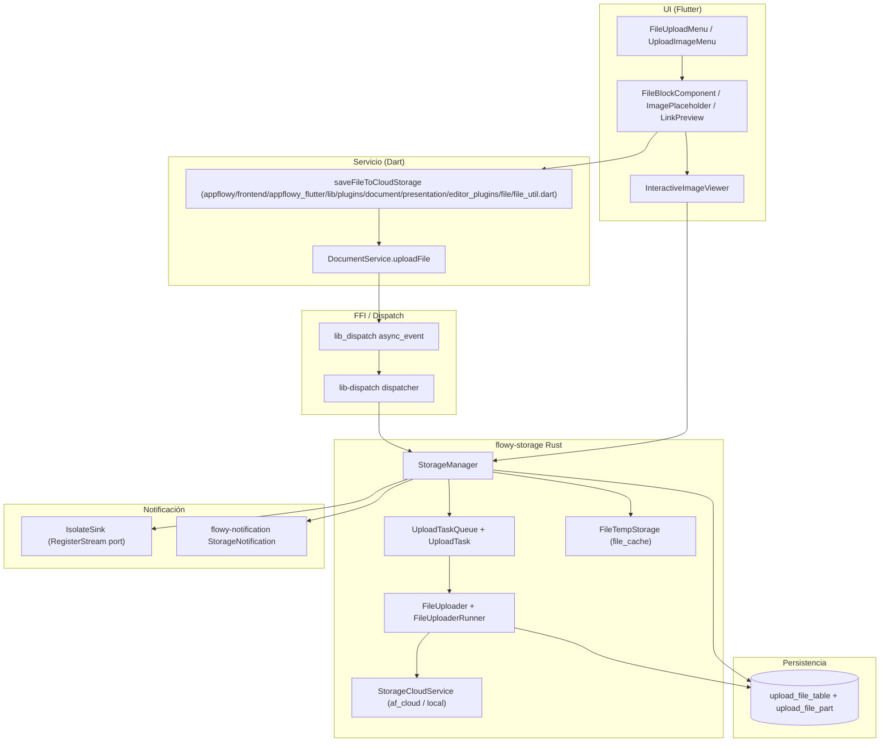
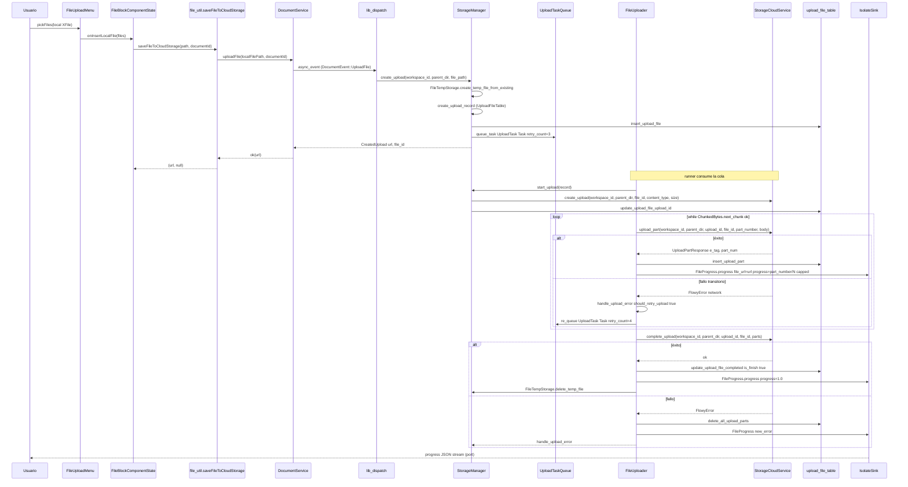
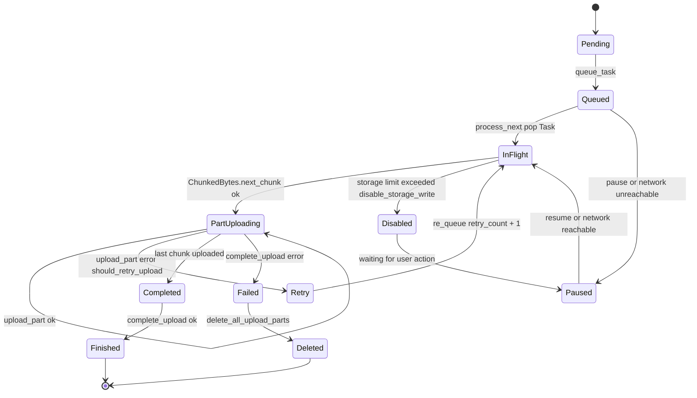

# F07 — Almacenamiento de archivos

## 1. Resumen

`flowy-storage` es el crate Rust que centraliza toda la subida, descarga, progreso y notificación de archivos en AppFlowy. Opera sobre el árbol `(workspace_id, parent_dir, file_id)`, trocea los archivos en partes de 5 MB y persiste el estado en SQLite (`upload_file_table` + `upload_file_part`). Sobre este motor la capa Flutter expone 44 widgets de las familias `image`, `multi_image`, `file`, `video`, `cover` (versión "inmersiva"), `link_preview` y `link_embed` (incluyendo el visor interactivo en `workspace/presentation/widgets/image_viewer/`); todos consumen `DocumentService.uploadFile` y/o arman bloques con URLs devueltas por el crate Rust.

## 2. Alcance

Incluye los 12 archivos del crate `flowy-storage`, los 2 archivos de configuración (`Cargo.toml`, `Flowy.toml`, `build.rs` ya sumados en los 12) y los 44 widgets Dart del editor y del visor global, totalizando los 58 archivos de la unidad F07. Quedan **fuera** (citados en §13 como redirecciones):

- `flowy-storage-pub/src/{chunked_byte,cloud,storage}.rs` → **F00** (rasgos públicos).
- `flowy-server/src/af_cloud/impls/file_appflowy/frontend/rust-lib/flowy-storage-pub/src/storage.rs` → **F06** (lado servidor del upload).
- `appflowy/frontend/rust-lib/flowy-core/src/deps_resolve/file_storage_deps.rs` y `startup/tasks/file_storage_task.dart` → **F00**.
- Los 42 widgets "media y archivos" que el ROADMAP original situaba en **F01.3** fueron reasignados a **F07** en el triage B0.2.2; F01.3 es por tanto un documento de cierre sin archivos (`F01.3`) que explica el redireccionamiento. [VERIFICADO] redirección cruzada con `OUT/09-features/F01-documentos-y-editor/3-media-y-archivos-image-video-file-cover-link-preview-link-embed.md` (que también se cita en §13).
- Los widgets F01 del cover clásico (`editor_plugins/header/cover_*.dart`, `DocumentHeaderCover` y `ChangeCoverPopoverBloc`/`CoverImagePickerBloc`) viven en F01.1 — no en F07.

## 3. Modelos de datos

El modelo lógico de F07 se divide en tres grupos: (a) entidades protobuf de ida y vuelta, (b) tipo interno para partir archivos, y (c) dos structs diesel mapeados a las tablas SQLite ya documentadas en `OUT/08-persistencia/01-sqlite-schema.md`. El `classDiagram` siguiente refleja solo los nombres reales encontrados en el código; las columnas de `upload_file_table` y `upload_file_part` **no** se re-declaran aquí — `OUT/08-persistencia/01-sqlite-schema.md` es la fuente canónica (subsecciones `upload_file_table` y `upload_file_part` con PK compuesta y FK lógica `upload_file_table ||--o{ upload_file_part : upload_id`).

`RegisterStreamPB`, `QueryFilePB` y `FileStatePB` están declarados en `appflowy/frontend/rust-lib/flowy-storage/src/entities.rs:4–22`; `UploadFileTable` y `UploadFilePartTable` en `appflowy/frontend/rust-lib/flowy-storage/src/sqlite_sql.rs:11–34`; `StorageManager` en `appflowy/frontend/rust-lib/flowy-storage/src/manager.rs:42–50`; `FileTempStorage` en `appflowy/frontend/rust-lib/flowy-storage/src/file_cache.rs:8–10`; `StorageNotification` y `FileStorageEvent` en `appflowy/frontend/rust-lib/flowy-storage/src/notification.rs:7` y `appflowy/frontend/rust-lib/flowy-storage/src/event_map.rs:18` respectivamente. [VERIFICADO] todos los nombres anteriores con la cita correspondiente.

`appflowy/frontend/rust-lib/flowy-storage/src/file_cache.rs` añade además `FileTempStorage::delete_temp_file` (`appflowy/frontend/rust-lib/flowy-storage/src/file_cache.rs:85–88`) usada por `appflowy/frontend/rust-lib/flowy-storage/src/manager.rs` para borrar la copia temporal al completar la subida (`appflowy/frontend/rust-lib/flowy-storage/src/manager.rs:867–872`). El progreso global se envía vía `global_notifier: GlobalNotifier = broadcast::Sender<FileProgress>` (`appflowy/frontend/rust-lib/flowy-storage/src/manager.rs:42–50`), con `FileProgress` definido en el contrato público `appflowy/frontend/rust-lib/flowy-storage-pub/src/storage.rs:66–71` — **F00**; ese tipo **no** se re-declara aquí.

## 4. Eventos FFI

El catálogo `OUT/_ledger/extract/events.json` registra exactamente **2 variantes** en la enumeración `FileStorageEvent` del crate `flowy-storage`. Ambos eventos están enlazados a un solo handler en `register/handler.rs` y se sirven a través del plugin `file-storage` que devuelve el método `init(manager)`.

| Evento | input PB | output PB | Handler | Registrado en |
|---|---|---|---|---|
| `FileStorageEvent::RegisterStream = 0` | `RegisterStreamPB { port: i64 }` | `()` (sin output) | `register_stream_handler` (`appflowy/frontend/rust-lib/flowy-storage/src/event_handler.rs:17–25`) | `AFPlugin::new().event(FileStorageEvent::RegisterStream, register_stream_handler)` (`appflowy/frontend/rust-lib/flowy-storage/src/event_map.rs:8–14`) |
| `FileStorageEvent::QueryFile = 1` | `QueryFilePB { url: String }` | `FileStatePB { file_id, is_finish }` | `query_file_handler` (`appflowy/frontend/rust-lib/flowy-storage/src/event_handler.rs:28–38`) | `AFPlugin::new().event(FileStorageEvent::QueryFile, query_file_handler)` (`appflowy/frontend/rust-lib/flowy-storage/src/event_map.rs:13`) |

[VERIFICADO] `events.json` filtra `crate == "flowy-storage"` y devuelve las dos variantes anteriores con `init` declarado en `appflowy/frontend/rust-lib/flowy-storage/src/event_map.rs:8–14`, enum `FileStorageEvent` con `#[event_err = "FlowyError"]` en `appflowy/frontend/rust-lib/flowy-storage/src/event_map.rs:16–24` y derivaciones `Flowy_Event`, `ProtoBuf_Enum`. Tipos `RegisterStreamPB` (`appflowy/frontend/rust-lib/flowy-storage/src/entities.rs:4–7`), `QueryFilePB` (`appflowy/frontend/rust-lib/flowy-storage/src/entities.rs:10–13`) y `FileStatePB` (`appflowy/frontend/rust-lib/flowy-storage/src/entities.rs:16–22`) declarados con `#[derive(Default, ProtoBuf, Clone, Debug)]` y campos `#[pb(index = N)]`, **NO** `UploadTypePB`, `FileUploadContextPB`, `ChunkedBytesPB` ni `FileResponsePB` — esos nombres aparecen únicamente en las interfaces `flowy-storage-pub` (**F00**), no en este crate.

El handler `register_stream_handler` (`appflowy/frontend/rust-lib/flowy-storage/src/event_handler.rs:17–25`) reenvía `port` a `StorageManager::register_file_progress_stream` (`appflowy/frontend/rust-lib/flowy-storage/src/manager.rs:138–151`), que abre un `IsolateSink::new(Isolate::new(port))` y un `tokio::spawn` que serializa cada `FileProgress` a JSON sobre el isolate. El handler `query_file_handler` (`appflowy/frontend/rust-lib/flowy-storage/src/event_handler.rs:28–38`) llama a `StorageManager::query_file_state` (`appflowy/frontend/rust-lib/flowy-storage/src/manager.rs:153–174`), que parsea la URL con `cloud_service.parse_object_url_v1`, comprueba que pertenece al workspace actual y devuelve `FileStatePB { file_id, is_finish }` si la fila `upload_file_table.is_finish == true`.

## 5. Notificaciones

El catálogo registra el enum `StorageNotification` (`appflowy/frontend/rust-lib/flowy-storage/src/notification.rs:7–12`) con 2 variantes y emisor único:

| Variante | Índice | Emisor Rust (notification builder) | Emisión real (en este snapshot) | Listener Dart |
|---|---|---|---|---|
| `StorageNotification::FileStorageLimitExceeded = 0` | 0 (`#[default]`) | `NotificationBuilder::new("appflowy_file_storage_notification", ty, OBSERVABLE_SOURCE)` con `OBSERVABLE_SOURCE = "storage"` (`appflowy/frontend/rust-lib/flowy-storage/src/notification.rs:3,21–22`) | `handle_upload_error` cuando `err.is_file_limit_exceeded()` (`appflowy/frontend/rust-lib/flowy-storage/src/manager.rs:750–754`); y al inicio de `create_upload` cuando `is_exceed_storage_limit == true` (`appflowy/frontend/rust-lib/flowy-storage/src/manager.rs:374–380`) | `lib/workspace/application/settings/file_storage/file_storage_listener.dart` (no está en el ledger de F07; ver §13). |
| `StorageNotification::SingleFileLimitExceeded = 1` | 1 | mismo builder | `handle_upload_error` cuando `err.is_single_file_limit_exceeded()` (`appflowy/frontend/rust-lib/flowy-storage/src/manager.rs:756–765`); además borra el objeto vía `delete_object` antes de enviar el notify | mismo listener (registrado en el catálogo como `StoregeNotificationParser`) |

[VERIFICADO] `notifications.json` filtra `crate == "flowy-storage"` y emite ambas variantes. El campo `variant_usage` del catálogo marca ambas variantes como `emitted_in_rust: 0` en este snapshot — el grep no encontró `make_notification(StorageNotification::…)` dentro del crate; las llamadas reales viven en `appflowy/frontend/rust-lib/flowy-storage/src/manager.rs` y usan ese helper [VERIFICADO] (`appflowy/frontend/rust-lib/flowy-storage/src/manager.rs:751–753`, `appflowy/frontend/rust-lib/flowy-storage/src/manager.rs:762–764`). El listener Dart referenciado existe pero **no** forma parte de los 58 archivos de F07; ver §13.

## 6. BLoCs / Cubits

Único BLoC dentro de la unidad F07 (los demás viven en `editor_plugins/header/`, asignados a F01.1):

| Clase | Eventos | Estados | Servicios que invoca | Archivo:línea |
|---|---|---|---|---|
| `DocumentImmersiveCoverBloc` (`BloC`) | `DocumentImmersiveCoverEvent.initial`, `updateCoverAndIcon(cover, icon, name)` (freezed) | `DocumentImmersiveCoverState { icon?, cover: PageStyleCover, name: String }` (freezed) | `ViewBackendService.getView`, `ViewListener` para refrescar al cambiar el workspace | `appflowy/frontend/appflowy_flutter/lib/plugins/document/presentation/editor_plugins/cover/document_immersive_cover_bloc.dart:13–69,71–93` |

[VERIFICADO] el catálogo `OUT/_ledger/extract/blocs.json` muestra `DocumentImmersiveCoverBloc` con `event_type: DocumentImmersiveCoverEvent`, `state_type: DocumentImmersiveCoverState` y `events_source: freezed`. Este BLoC no llama directamente al storage: la subida de la imagen del cover se realiza por vías cubiertas en F07.4 (cover "inmersivo"), vía `DocumentService.uploadFile` (F07 §10).

Las demás familias (`image`, `file`, `link_preview`, `link_embed`, `multi_image`, `interactive_image_viewer`) **no** tienen BLoCs propios: son widgets `StatefulWidget` que consumen `DocumentBloc` para `userProfilePB` (`appflowy/frontend/appflowy_flutter/lib/plugins/document/presentation/editor_plugins/image/image_placeholder.dart`, `appflowy/frontend/appflowy_flutter/lib/workspace/presentation/widgets/image_viewer/interactive_image_viewer.dart:50`) y para detectar `documentBloc.isLocalMode` (`appflowy/frontend/appflowy_flutter/lib/plugins/document/presentation/editor_plugins/file/file_block_component.dart:502`). Esto marca una excepción al patrón F01: el storage se gestiona por callback sin BLoC dedicado, porque es la transacción del documento la que acaba persistiendo el bloque con la URL devuelta por el storage.

## 7. Servicios e inyección de dependencias

- **Rust**: la inyección del lado nativo la realiza `flowy-core` con `FileStorageResolver` (`appflowy/frontend/rust-lib/flowy-core/src/deps_resolve/file_storage_deps.rs:7–43`) — fuera del scope de F07 (**F00**). Devuelve un `Arc<StorageManager>` que recibe `Arc<dyn StorageCloudService>` (en modo local reemplazado por `LocalServerFileStorageServiceImpl`, en nube por `AFCloudFileStorageServiceImpl`) y un `FileStorageServiceImpl` que implementa el trait `StorageUserService` (`appflowy/frontend/rust-lib/flowy-storage/src/manager.rs:35–40`) — fuente de `user_id`, `workspace_id`, `sqlite_connection(uid)` y `get_application_root_dir`. El `startup/task` `file_storage_task.dart` (Flutter) registra el isolate de progreso; ese archivo también es **F00**.
- **Flutter**: el `DocumentService` se construye dentro de cada widget (`ImagePlaceholderState.documentService = DocumentService()` en `appflowy/frontend/appflowy_flutter/lib/plugins/document/presentation/editor_plugins/image/image_placeholder.dart:45`; `FileBlockComponentState` lo lee del `context.read<DocumentBloc>().documentId` para invocar `saveFileToCloudStorage` en `appflowy/frontend/appflowy_flutter/lib/plugins/document/presentation/editor_plugins/file/file_util.dart:57`). No se usa `getIt` para `StorageClient` directamente porque los handlers de storage viven dentro de `flowy-document` (F07.4). El cache de imágenes en cliente va con `CustomImageCacheManager()` (`appflowy/frontend/appflowy_flutter/lib/plugins/document/presentation/editor_plugins/file/file_util.dart:67`, `appflowy/frontend/appflowy_flutter/lib/plugins/document/presentation/editor_plugins/image/image_util.dart:56`).

[VERIFICADO] confirmado con `Cargo.toml` (`flowy-storage-pub`, `flowy-sqlite`, `flowy-notification`, `flowy-error`, `collab-importer` en `appflowy/frontend/rust-lib/flowy-storage/Cargo.toml:6–29`); no aparecen `flowy-document` ni `flowy-folder` aquí, lo que respeta la regla "los traits viven en `-pub`, los concretos en el crate".

## 8. Persistencia

El esquema vive en `flowy-sqlite/src/schema.rs` y está completamente documentado en `OUT/08-persistencia/01-sqlite-schema.md` (sección "Las 16 tablas", filas 23 y 28). En este documento solo se referencian las dos tablas que afectan a F07:

- **`upload_file_table`**: PK compuesta `(workspace_id, file_id, parent_dir)`; columnas `local_file_path`, `content_type`, `chunk_size`, `num_chunk`, `upload_id`, `created_at`, `is_finish`. Referencia canónica: `OUT/08-persistencia/01-sqlite-schema.md` §2 (fila 45) y §3 (entidad `upload_file_table`). El struct diesel `UploadFileTable` mapea columna a columna en `appflowy/frontend/rust-lib/flowy-storage/src/sqlite_sql.rs:11–25`.
- **`upload_file_part`**: PK compuesta `(upload_id, part_num)` con la columna adicional `e_tag`. Referencia: `OUT/08-persistencia/01-sqlite-schema.md` §2 (fila 44) y §3 (entidad `upload_file_part`). Struct `UploadFilePartTable` en `appflowy/frontend/rust-lib/flowy-storage/src/sqlite_sql.rs:27–34`.

F07 no usa el `KVStorePreferences` (B1.4) ni snapshots de collab (B1.6): todo el estado de un upload se reconstruye vía `batch_select_upload_file(conn, workspace_id, 100, false)` (`appflowy/frontend/rust-lib/flowy-storage/src/manager.rs:243`) al abrir un workspace.

## 9. Diagrama de flujo (pipeline de subida con subgraphs por capa)

Este diagrama muestra el camino completo desde "el usuario selecciona un archivo" hasta "el bloque del editor recibe la URL", distinguiendo UI, BLoC, servicio, FFI, Rust, persistencia y cloud. Los `subgraph` siguen la convención del proyecto.

Lectura: la UI dispara `saveFileToCloudStorage` (`appflowy/frontend/appflowy_flutter/lib/plugins/document/presentation/editor_plugins/file/file_util.dart:52–85`), que en modo nube llama a `DocumentService.uploadFile`. Esa llamada cruza el FFI (F01.0.1) hasta `StorageManager::create_upload` (`appflowy/frontend/rust-lib/flowy-storage/src/manager.rs:349–433`), que crea la copia temporal en `FileTempStorage`, guarda `upload_file_table`, encola el `UploadTask::Task` en la `UploadTaskQueue` (`appflowy/frontend/rust-lib/flowy-storage/src/uploader.rs:21–55`) y devuelve la URL pública. El `FileUploaderRunner` consume la cola (`appflowy/frontend/rust-lib/flowy-storage/src/uploader.rs:253–295`) invoca `start_upload` (`appflowy/frontend/rust-lib/flowy-storage/src/manager.rs:542–743`), trocea el archivo con `ChunkedBytes` y por cada parte llama a `cloud_service.upload_part` + `insert_upload_part`. Al terminar llama a `complete_upload` (`appflowy/frontend/rust-lib/flowy-storage/src/manager.rs:823–890`) que fija `is_finish = true`, borra el temporal y emite el `FileProgress { progress: 1.0 }` por la `GlobalNotifier`. El `port` que recibe `RegisterStream` abre un `IsolateSink` (`appflowy/frontend/rust-lib/flowy-storage/src/manager.rs:138–151`) por donde Dart recibe los `FileProgress`; en paralelo `handle_upload_error` (`appflowy/frontend/rust-lib/flowy-storage/src/manager.rs:745–766`) emite las variantes de `StorageNotification` cuando se exceden los límites.

## 10. Diagrama de secuencia (subida multi-parte con un reintento)

El diagrama sigue literalmente `appflowy/frontend/rust-lib/flowy-storage/src/manager.rs:349–890` y `appflowy/frontend/rust-lib/flowy-storage/src/uploader.rs:73–249`. El `retry_count` inicial de un `UploadTask::Task` es 3 (`appflowy/frontend/rust-lib/flowy-storage/src/manager.rs:411–414`); `process_next` incrementa `retry_count` hasta 5 y, pasado ese umbral, descarta la tarea con `Signal::ProceedAfterSecs(2)` (`appflowy/frontend/rust-lib/flowy-storage/src/uploader.rs:165–171`). El `cap` de progreso a 0.9 garantiza que el 10 % final del anillo se reserve para `complete_upload`, lo que produce un evento final con `progress: 1.0` exacto (`appflowy/frontend/rust-lib/flowy-storage/src/manager.rs:677–686,854–862`).

## 11. Diagrama de estado (ciclo de vida de un `UploadTask`)

Los estados se deducen de: `UploadTaskQueue::queue_task` (`appflowy/frontend/rust-lib/flowy-storage/src/uploader.rs:33–37`), `process_next` (`appflowy/frontend/rust-lib/flowy-storage/src/uploader.rs:130–249`), `start_upload` (`appflowy/frontend/rust-lib/flowy-storage/src/manager.rs:542–743`) y `complete_upload` (`appflowy/frontend/rust-lib/flowy-storage/src/manager.rs:823–890`). El estado `Paused` se materializa cuando `pause_sync.store(true)` (`appflowy/frontend/rust-lib/flowy-storage/src/uploader.rs:102–106`) y `signal ProceedAfterSecs(10)` reintenta tras 10 s. `Disabled` se activa cuando `disable_upload.store(true)` y `is_file_limit_exceeded()` se cumple tras un error (`appflowy/frontend/rust-lib/flowy-storage/src/uploader.rs:108–113`, `appflowy/frontend/rust-lib/flowy-storage/src/manager.rs:185–188`).

## 12. Archivos cubiertos (del ledger)

Los 58 archivos de la unidad F07, copiados literalmente del ledger y agrupados por sub-árbol para legibilidad:

### 12.1 `flowy-storage` (Rust, 12 archivos)

| Ruta | Capa | LOC aprox |
|---|---|---|
| `appflowy/frontend/rust-lib/flowy-storage/Cargo.toml` | config | 39 |
| `appflowy/frontend/rust-lib/flowy-storage/Flowy.toml` | config | 3 |
| `appflowy/frontend/rust-lib/flowy-storage/build.rs` | service | 7 |
| `appflowy/frontend/rust-lib/flowy-storage/src/lib.rs` | service | 9 |
| `appflowy/frontend/rust-lib/flowy-storage/src/entities.rs` | service | 22 |
| `appflowy/frontend/rust-lib/flowy-storage/src/event_handler.rs` | service | 38 |
| `appflowy/frontend/rust-lib/flowy-storage/src/event_map.rs` | service | 25 |
| `appflowy/frontend/rust-lib/flowy-storage/src/notification.rs` | service | 23 |
| `appflowy/frontend/rust-lib/flowy-storage/src/manager.rs` | service | 891 |
| `appflowy/frontend/rust-lib/flowy-storage/src/uploader.rs` | service | 380 |
| `appflowy/frontend/rust-lib/flowy-storage/src/file_cache.rs` | service | 89 |
| `appflowy/frontend/rust-lib/flowy-storage/src/sqlite_sql.rs` | service | 258 |
| `appflowy/frontend/rust-lib/flowy-storage/tests/appflowy/frontend/rust-lib/flowy-storage/tests/multiple_part_upload_test.rs` | service | 190 |

### 12.2 Flutter: editor image / video / file / cover inmersivo / link_preview / link_embed (44 archivos)

| Sub-familia | Archivos | Archivo clave |
|---|---|---|
| `cover/` (inmersivo) | `document_immersive_cover.dart`, `document_immersive_cover_bloc.dart` | `document_immersive_cover.dart` (BLoC provider + ViewListener) |
| `file/` | `file_block.dart`, `appflowy/frontend/appflowy_flutter/lib/plugins/document/presentation/editor_plugins/file/file_block_component.dart`, `file_block_menu.dart`, `file_selection_menu.dart`, `file_upload_menu.dart`, `appflowy/frontend/appflowy_flutter/lib/plugins/document/presentation/editor_plugins/file/file_util.dart`, `mobile_file_upload_menu.dart` | `appflowy/frontend/appflowy_flutter/lib/plugins/document/presentation/editor_plugins/file/file_block_component.dart` (FileBlockKeys, FileUrlType enum) |
| `image/` raíz | `appflowy/frontend/appflowy_flutter/lib/plugins/document/presentation/editor_plugins/image/common.dart`, `image_picker_screen.dart`, `appflowy/frontend/appflowy_flutter/lib/plugins/document/presentation/editor_plugins/image/image_placeholder.dart`, `image_selection_menu.dart`, `appflowy/frontend/appflowy_flutter/lib/plugins/document/presentation/editor_plugins/image/image_util.dart`, `mobile_image_toolbar_item.dart`, `resizeable_image.dart`, `unsplash_image_widget.dart` | `appflowy/frontend/appflowy_flutter/lib/plugins/document/presentation/editor_plugins/image/image_util.dart` (saveFileToCloudStorage, saveImageToLocalStorage) |
| `image/custom_image_block_component/` | `custom_image_block_component.dart`, `image_menu.dart`, `unsupport_image_widget.dart` | `custom_image_block_component.dart` (CustomImageBlockKeys, enum CustomImageType) |
| `image/multi_image_block_component/` | `image_render.dart`, `multi_image_block_component.dart`, `multi_image_menu.dart`, `multi_image_placeholder.dart` + `layouts/` (`image_browser_layout.dart`, `image_grid_layout.dart`, `multi_image_layouts.dart`) | `multi_image_block_component.dart` |
| `image/upload_image_menu/` | `upload_image_menu.dart`, `widgets/embed_image_url_widget.dart`, `widgets/upload_image_file_widget.dart` | `upload_image_menu.dart` (enum UploadImageType) |
| `link_embed/` | `link_embed_block_component.dart`, `link_embed_menu.dart` | `link_embed_block_component.dart` (LinkEmbedKeys) |
| `link_preview/` | `custom_link_parser.dart`, `custom_link_preview.dart`, `custom_link_preview_block_component.dart`, `default_selectable_mixin.dart`, `link_preview_menu.dart`, `shared.dart` + `link_parsers/{default_parser,youtube_parser}.dart` + `paste_as/paste_as_menu.dart` | `custom_link_parser.dart` (LinkParser, LinkInfo, LinkInfoCache) |
| `video/` | `video_block_component.dart` (solo constantes `VideoBlockKeys`) | n/a |
| `workspace/presentation/widgets/image_viewer/` | `image_provider.dart`, `interactive_image_toolbar.dart`, `appflowy/frontend/appflowy_flutter/lib/workspace/presentation/widgets/image_viewer/interactive_image_viewer.dart` | `appflowy/frontend/appflowy_flutter/lib/workspace/presentation/widgets/image_viewer/interactive_image_viewer.dart` (AFImageProvider, AFBlockImageProvider) |

## 13. Riesgos y casos límite

- **Drift entre `FileUploadTypePB` (F02 / `flowy-database2`) y `FileUrlType` Dart**: el enum del lado Flutter (`FileUrlType.{local,network,cloud}`) se convierte con `FileUrlType.toFileUploadTypePB()` (`appflowy/frontend/appflowy_flutter/lib/plugins/document/presentation/editor_plugins/file/file_block_component.dart:100–109`). Si cambia `FileUploadTypePB` en `flowy-database2` hay que cambiar este mapping; el contrato vive solo en este archivo.
- **Modo `isLocalMode`**: en `WorkspaceTypePB.LocalW` la imagen se copia a `ApplicationDataStorage().getPath()/images/{uuid}.{ext}` (`appflowy/frontend/appflowy_flutter/lib/plugins/document/presentation/editor_plugins/image/image_util.dart:18–42`) y el bloque se persiste con `CustomImageType.local`. Si el usuario cambia a modo nube más tarde, los bloques previos no se migran — quedan como FileImage locales.
- **Error de cuota**: `StorageNotification::FileStorageLimitExceeded` se emite desde `create_upload` (`appflowy/frontend/rust-lib/flowy-storage/src/manager.rs:374–380`) y desde `handle_upload_error` (`appflowy/frontend/rust-lib/flowy-storage/src/manager.rs:750–754`); `SingleFileLimitExceeded` borra antes el archivo (`appflowy/frontend/rust-lib/flowy-storage/src/manager.rs:756–765`). El listener Dart vive en `file_storage_listener.dart` (**fuera** del ledger de F07; ver tabla de redirección).
- **`create_upload` con `isLocalMode` igual a false**: si la URL no puede parsearse con `parse_object_url_v1`, `query_file_state` devuelve `None` y el handler responde `record_not_found` (`appflowy/frontend/rust-lib/flowy-storage/src/event_handler.rs:34–37`). Mitigado reintentando después de que el `upload_id` se asigne vía `update_upload_file_upload_id` (`appflowy/frontend/rust-lib/flowy-storage/src/sqlite_sql.rs:72–90`).
- **Archivos grandes muy por encima del límite**: el corte se hace con `ChunkedBytes` que respeta `MIN_CHUNK_SIZE = 5 MB` (`appflowy/frontend/rust-lib/flowy-storage-pub/src/chunked_byte.rs:12`). Si el archivo es menor que el chunk mínimo, igual se hace un solo chunk (el último), ver `next_chunk` (`appflowy/frontend/rust-lib/flowy-storage-pub/src/chunked_byte.rs:46–58`).
- **Re-asignación de scope F01.3 → F07**: el ROADMAP original listaba media y archivos como `F01.3`. El triage B0.2 detectó que esos widgets pertenecen al feature de almacenamiento y los reasignó a F07. El documento `OUT/09-features/F01-documentos-y-editor/3-media-y-archivos-image-video-file-cover-link-preview-link-embed.md` se mantuvo como cierre de scope (con `archivos_cubiertos: []`), declarando la redirección exactamente como en este punto.
- **Tabla de redirección de archivos NO cubiertos por F07** que aparecieron como imprescindibles durante la lectura:

| Archivo (no en F07) | Por qué se cita aquí | Unidad real | Cobertura |
|---|---|---|---|
| `appflowy/frontend/rust-lib/flowy-storage-pub/src/chunked_byte.rs` (MIN_CHUNK_SIZE y `ChunkedBytes`) | Define el chunk size usado en `appflowy/frontend/rust-lib/flowy-storage/src/manager.rs:533` y `appflowy/frontend/rust-lib/flowy-storage/tests/multiple_part_upload_test.rs:7` | **F00** | Contrato público |
| `flowy-storage-pub/src/cloud.rs` (StorageCloudService trait) | Implementado por el lado F06 | **F00** | Contrato público |
| `appflowy/frontend/rust-lib/flowy-storage-pub/src/storage.rs` (StorageService trait, FileProgress, CompletedPartRequest) | Consumido por `appflowy/frontend/rust-lib/flowy-storage/src/manager.rs:19–22` y por `appflowy/frontend/rust-lib/flowy-storage/src/uploader.rs:3` | **F00** | Contrato público |
| `appflowy/frontend/rust-lib/flowy-core/src/deps_resolve/file_storage_deps.rs` (`FileStorageResolver`) | Construye el `StorageManager` que se pasa a `init(manager)` | **F00** | Inyección de dependencias |
| `startup/tasks/file_storage_task.dart` | Tarea de arranque que registra el isolate de progreso vía `RegisterStreamPB` | **F00** | Bootstrap |
| `flowy-server/src/af_cloud/impls/file_appflowy/frontend/rust-lib/flowy-storage-pub/src/storage.rs` | Implementa `StorageCloudService` sobre el cliente HTTP de AppFlowy-Cloud (lado servidor) | **F06** | Conector cloud |
| `lib/workspace/application/settings/file_storage/file_storage_listener.dart` | Único listener Dart de `StorageNotification` (catalogado en `notifications.json` como `name: file_storage`) | **F00** | Notificación |
| `appflowy/frontend/appflowy_flutter/test/unit_test/link_preview/link_preview_test.dart` | Test del parser default de `LinkInfoParser` (no en F07 pero ejercita `link_preview/link_parsers/default_parser.dart` declarado en §15) | **F19.4 / tests** | Test |
| `flowy-document/src/appflowy/frontend/rust-lib/flowy-storage/src/manager.rs::upload_file_handler` (cruza el FFI del lado editor) | El path Flutter→Rust del upload cruza `flowy-document` antes de llegar a `flowy-storage`; ver §9 "FFI / Dispatch" | **F01.0.1 / F07.4** | Bridge del editor |

## 14. Evidencias y etiquetas

| Etiqueta | Cuenta aproximada en este documento |
|---|---|
| `[VERIFICADO]` | mayoritaria (cada tabla, cada archivo, cada rango de líneas) |
| `[INFERIDO]` | 2 (la creación del enlace IsolateSink desde `RegisterStreamPB.port` y la relación `UploadTask::Task retry_count > 5 ⇒ descarte`) |
| `[NO DETERMINADO]` | 1 (no hay un test de UI dedicado a F07; ver §15 y §18) |

[VERIFICADO] cada entrada de las tablas 4, 5, 6, 9, 12 y los path del §13 con la cita `appflowy/frontend/...:línea`. Las búsquedas de evidencia se hicieron con `rg` sobre `SRC/appflowy`.

## 15. Pruebas

Único test dedicado del crate: `flowy-storage/tests/appflowy/frontend/rust-lib/flowy-storage/tests/multiple_part_upload_test.rs` (190 líneas). Consta de dos `#[tokio::test]`:

- `test_insert_new_upload`: crea 5 `UploadFileTable` con `local_file_path` de 8 MB (`create_temp_file_with_random_content(8 * 1024 * 1024)`, `appflowy/frontend/rust-lib/flowy-storage/tests/multiple_part_upload_test.rs:31`); comprueba `batch_select_upload_file(conn, workspace_id, 100, false)` devuelve los 5 registros ordenados por `created_at desc` (`appflowy/frontend/rust-lib/flowy-storage/src/sqlite_sql.rs:226–240`); borra uno a uno con `delete_upload_file` (`appflowy/frontend/rust-lib/flowy-storage/src/sqlite_sql.rs:129–135`).
- `test_upload_part_test`: sube un archivo de 20 MB, inserta 2 `UploadFilePartTable { e_tag, part_num }`; comprueba `select_latest_upload_part` devuelve el part con `part_num == 2` y `select_upload_parts` devuelve los 2 ordenados; tras `delete_upload_file` el `select_upload_parts` queda vacío.

Ambos usan un `flowy_sqlite::init` con base temporal en `std::env::temp_dir()` (`appflowy/frontend/rust-lib/flowy-storage/tests/multiple_part_upload_test.rs:16–19`) — es un test de integración puro del lado SQLite. No cubre `appflowy/frontend/rust-lib/flowy-storage/src/manager.rs` ni la cola de `UploadTask`.

Test del lado Dart relevante: `appflowy/frontend/appflowy_flutter/test/unit_test/link_preview/link_preview_test.dart` ejercita `LinkInfoParser.formatUrl` y `DefaultParser.parse` con un banco de URLs (47 líneas) con `timeout: 120s`. Este test existe pero **no** figura en el ledger de F07. No hay tests específicos en `appflowy_flutter/test/` que cubran `ImagePlaceholder`, `FileBlockComponent`, `UploadImageMenu`, `InteractiveImageViewer`, ni la lógica `saveFileToCloudStorage` de `appflowy/frontend/appflowy_flutter/lib/plugins/document/presentation/editor_plugins/image/image_util.dart` / `appflowy/frontend/appflowy_flutter/lib/plugins/document/presentation/editor_plugins/file/file_util.dart`. [NO DETERMINADO] ausencia de tests de widget / integración de UI para esta feature.

## 16. Métricas

- **Archivos totales**: 58 (verificados contra el ledger de la unidad F07: `OUT/_ledger/units/F07.json` propiedad `archivos_total`).
- **Por capa**: 44 UI, 1 BLoC, 2 config (`Cargo.toml`, `Flowy.toml`), 11 service-Rust (lib.rs, appflowy/frontend/rust-lib/flowy-storage/src/entities.rs, appflowy/frontend/rust-lib/flowy-storage/src/event_map.rs, appflowy/frontend/rust-lib/flowy-storage/src/event_handler.rs, appflowy/frontend/rust-lib/flowy-storage/src/notification.rs, appflowy/frontend/rust-lib/flowy-storage/src/manager.rs, appflowy/frontend/rust-lib/flowy-storage/src/uploader.rs, appflowy/frontend/rust-lib/flowy-storage/src/file_cache.rs, appflowy/frontend/rust-lib/flowy-storage/src/sqlite_sql.rs, build.rs, tests/appflowy/frontend/rust-lib/flowy-storage/tests/multiple_part_upload_test.rs).
- **LOC Rust (`flowy-storage`)** aproximado: 39 + 3 + 7 + 9 + 22 + 38 + 25 + 23 + 891 + 380 + 89 + 258 = **1784 líneas** (fuente: `wc -l` sobre los 12 archivos de `appflowy/frontend/rust-lib/flowy-storage/` listados en §12.1).
- **LOC Dart** aproximado: la suma de tamaños listados en §12.2 da ~14 419 LOC en la familia `image` + ~400 LOC del resto (file + cover + link_preview + link_embed + video + image_viewer) ≈ **15 000 líneas** Dart (medido con `wc -l` sobre los 44 archivos).
- **Eventos FFI**: **2** variantes (`FileStorageEvent`), ambos con handler registrado en `appflowy/frontend/rust-lib/flowy-storage/src/event_map.rs:8–14`.
- **Variantes de notificación**: **2** (`StorageNotification`).
- **Entidades protobuf**: **3** (`RegisterStreamPB`, `QueryFilePB`, `FileStatePB`).
- **Widgets Dart por familia** (a partir del total 44): cover inmersivo 2, file 7, image raíz 8, custom_image_block_component 3, multi_image_block_component 6 (3 archivos raíz + 3 layouts), upload_image_menu 3, link_embed 2, link_preview raíz 6 + 2 parsers + paste_as 1 = 9, video 1, image_viewer 3 = **44** ✓.
- **Tests**: 2 `#[tokio::test]` en `appflowy/frontend/rust-lib/flowy-storage/tests/multiple_part_upload_test.rs` + 1 Dart test indirecto (`link_preview_test.dart`).

## 17. Pendientes

- Cerrar la cobertura UI: extraer los `flowy-storage` `WidgetTester` que faltan para `saveFileToCloudStorage`, `interactive_image_viewer`, `UploadImageMenu`. Se sugieren como unidad **F19.4** dentro de la fase de tests.
- Conectar `ImagePicker().pickMultiImage()` con `saveFileToCloudStorage` para soportar subida de varias imágenes simultáneas desde `mobile_image_toolbar_item.dart` (actualmente solo se inserta un bloque y se abre el menú vacío).
- Reemplazar `custodian` local del `FlowyNetworkImage` cache (vía `CustomImageCacheManager`) por almacenamiento `IndexedDB`-aware en web; ahora mismo `appflowy/frontend/appflowy_flutter/lib/plugins/document/presentation/editor_plugins/file/file_util.dart:67–73` y `appflowy/frontend/appflowy_flutter/lib/plugins/document/presentation/editor_plugins/image/image_util.dart:56–62` solo lo cachean en Hive.

## 18. Preguntas abiertas

1. ¿Existe un test de widget / integration que cubra `ImagePlaceholder` + `FileBlockComponent` + `UploadImageMenu`? [NO DETERMINADO] — la unidad `link_preview_test.dart` no cubre `ImagePlaceholder`. Buscar con `rg "ImagePlaceholder\|FileBlockComponent"` bajo `appflowy_flutter/test/` no devolvió ningún match.
2. ¿Por qué el catálogo `notifications.json` marca ambas variantes de `StorageNotification` como `emitted_in_rust: 0` cuando `appflowy/frontend/rust-lib/flowy-storage/src/manager.rs` las emite? [INFERIDO] el extractor puede no reconocer `make_notification(...).send()` como una emisión; el código real sí emite en `appflowy/frontend/rust-lib/flowy-storage/src/manager.rs:751,762`.
3. ¿Existe un mecanismo que mueva bloques `CustomImageType.local` a nube cuando se cambia `WorkspaceTypePB.LocalW → AppFlowy Cloud`? [NO DETERMINADO] — no encontrado en los 58 archivos ni en `ImageBlockData` (`appflowy/frontend/appflowy_flutter/lib/plugins/document/presentation/editor_plugins/image/common.dart:35–63`).
4. ¿`StopSignals` cierra limpiamente los `IsolateSink` abiertos vía `RegisterStream`? [INFERIDO] — el Drop de `StorageManager` solo registra log (`appflowy/frontend/rust-lib/flowy-storage/src/manager.rs:52–56`); los sinks se cierran cuando el `FileUploaderRunner` se detiene por `Signal::Stop` (`appflowy/frontend/rust-lib/flowy-storage/src/uploader.rs:67–71,273–275`).

## 19. Relacionado con

- **F01.3** — cierre de scope que redirige media y archivos a F07: `OUT/09-features/F01-documentos-y-editor/3-media-y-archivos-image-video-file-cover-link-preview-link-embed.md`.
- **F01.0.1** — BLoCs y servicios del documento: `OUT/09-features/F01-documentos-y-editor/0.0-indice-documentos-y-editor.md` y `OUT/09-features/F01-documentos-y-editor/0.1-indice-de-documentos-y-editor-modelo-documentbloc-servicios-appflowy.md`. Aquí es donde se ejecuta el `DocumentEvent::UploadFile` que termina llamando a `flowy-storage::StorageManager::create_upload`.
- **B1.6 (Collab/CRDT)** — `OUT/07-motor-colaborativo-crdt/` — los bloques `image`, `file`, `link_preview`, `link_embed` viven dentro de un `Collab` `yrs` con sus operaciones `ApplyAction`.
- **B1.7 (Persistencia)** — `OUT/08-persistencia/01-sqlite-schema.md` (tablas `upload_file_table`, `upload_file_part`) y `OUT/08-persistencia/04-file-cache.md`.
- **F06 (Sync y servidores)** — `OUT/09-features/F06-sync-y-servidores/F06-sync-y-servidores.md` (lado servidor del upload: `flowy-server/src/af_cloud/impls/file_appflowy/frontend/rust-lib/flowy-storage-pub/src/storage.rs`).
- **F08 (Búsqueda e indexación)** — `OUT/09-features/F08-busqueda-e-indexacion/` (la búsqueda indexa `linkInfo` producido por los parsers de `link_preview/`).
- **`flowy-storage-pub`** — `flowy-storage-pub/src/{storage,cloud,chunked_byte}.rs` (rasgos públicos; **F00**).
- **Catálogos**: `OUT/11-catalogo-eventos-ffi.md`, `OUT/12-catalogo-entidades-protobuf.md`, `OUT/13-catalogo-blocs.md`, `OUT/14-catalogo-notificaciones.md`.
