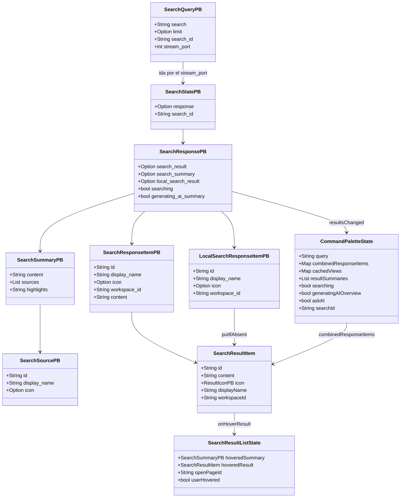
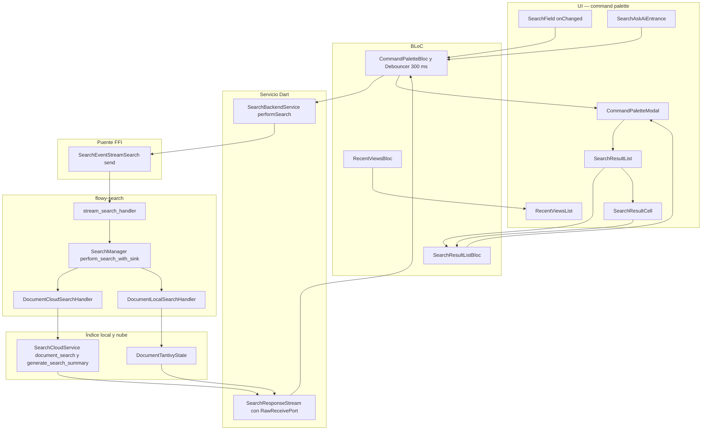
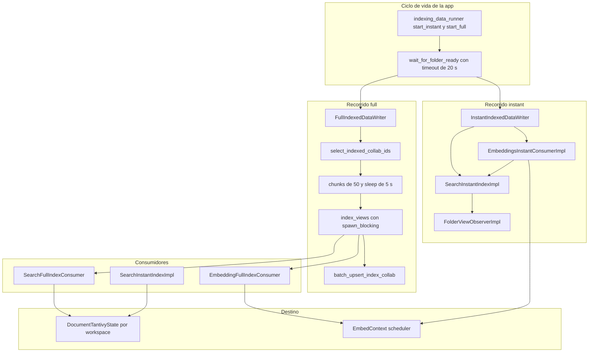
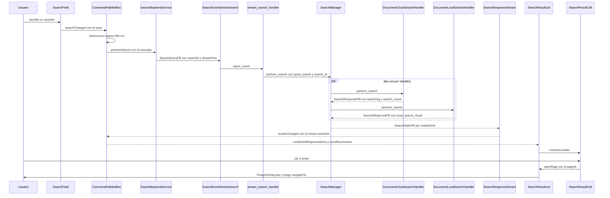
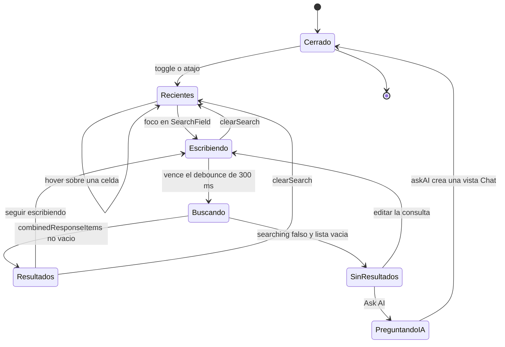
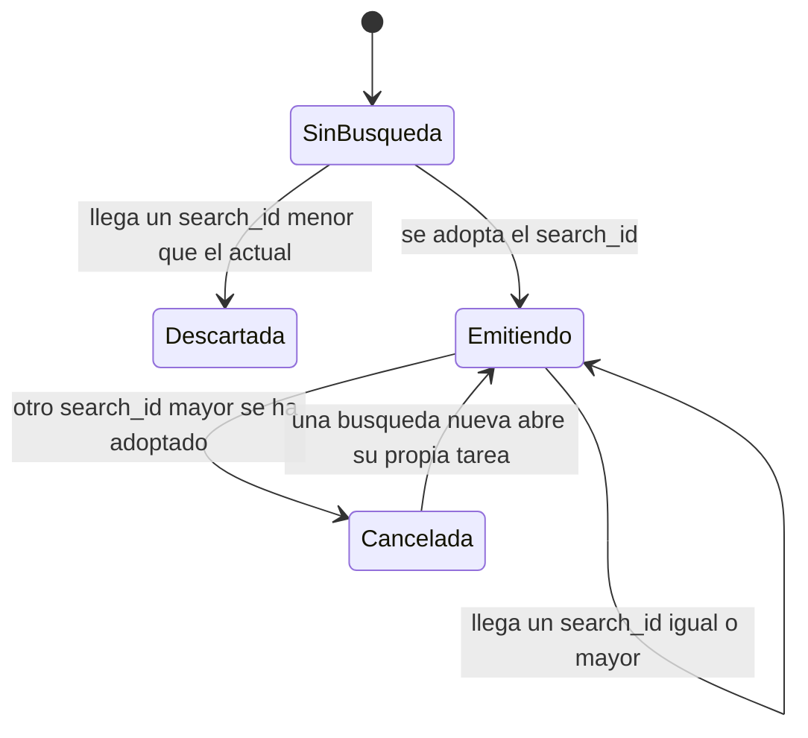

# F08 — Busqueda e indexacion

## 1. Resumen (3–6 líneas)

Esta unidad documenta los **32 archivos** de la feature de búsqueda e indexación de AppFlowy: por un lado, el crate Rust `flowy-search` (evento FFI `SearchEvent::StreamSearch`, `SearchManager`, los dos handlers de búsqueda y las entidades protobuf) y los tres ficheros de `flowy-core` que arrancan y dirigen la indexación (`indexing_data_runner.rs`, `full_indexed_data_provider.rs`, `indexed_data_consumer.rs`); por otro, los **11 widgets Dart** de la *command palette* de escritorio, que es la única superficie de búsqueda en desktop y que este documento incorpora tras el reasignado del triage de B0.2. La búsqueda no usa el mecanismo de notificaciones Rust→Dart: el resultado viaja como una secuencia de `SearchStatePB` por un `IsolateSink` abierto sobre el `stream_port` que el propio Dart incluye en `SearchQueryPB` (`appflowy:appflowy/frontend/rust-lib/flowy-search/src/services/manager.rs:114–117`). La indexación mantiene un índice tantivy por workspace en disco y dos consumidores en `flowy-core`: uno *full* (recorre los documentos no indexados) y otro *instant* (indexa cada cambio de collab y sincroniza nombre e icono con el folder). La UI es un diálogo modal abierto con `⌘/Ctrl+P` que alterna entre lista de recientes y lista de resultados según haya o no consulta.

## 2. Alcance

### 2.1 Qué incluye

Los 32 archivos listados en §12 se agrupan en cuatro bloques. (a) **Crate Rust `flowy-search`** (19 archivos): su `Cargo.toml`, `Flowy.toml` y `build.rs` de codegen, `src/lib.rs`, el registro de eventos `event_map.rs` + `event_handler.rs`, el `SearchManager` en `services/manager.rs`, los dos `SearchHandler` en `document/` y las seis entidades protobuf de `entities/`. (b) **Orquestación de la indexación en `flowy-core`** (3 archivos): `indexing_data_runner.rs` engancha la indexación al ciclo de vida de la app, `full_indexed_data_provider.rs` implementa el recorrido *full* y `indexed_data_consumer.rs` contiene los tres consumidores concretos (embeddings full, embeddings instant y los dos de búsqueda). (c) **Tests Rust** (2 archivos). (d) **UI de la command palette de escritorio** (11 archivos): `command_palette.dart`, la extensión `navigation_bloc_extension.dart` y los nueve widgets de `widgets/`. `[VERIFICADO]`

### 2.2 Qué queda fuera

Quedan fuera de esta unidad, y pertenecen a otras, cuatro piezas que la UI de esta unidad **consume pero no contiene**. El `CommandPaletteBloc`, el `SearchResultListBloc`, el `SearchBackendService` y el `search_result_ext.dart` viven en `workspace/application/command_palette/` y están asignados a **F04** (`appflowy:appflowy/frontend/appflowy_flutter/lib/workspace/application/command_palette/command_palette_bloc.dart:31`). El `RecentViewsBloc` y el `ActionNavigationBloc` que despachan el alta y la navegación de una vista están igualmente en **F04**. El `ViewAncestorBloc`, que construye la ruta de una vista, está en la capa móvil (`appflowy:appflowy/frontend/appflowy_flutter/lib/mobile/presentation/search/mobile_view_ancestors.dart`) y se reutiliza tal cual en escritorio. El índice tantivy en sí (`DocumentTantivyState`, `schema.rs`, `tantivy_state_init.rs`) y el cliente de nube (`SearchCloudService`) viven en el crate hermano `flowy-search-pub`, que se documenta aparte; aquí sólo se cita su contrato. La UI móvil de búsqueda (`mobile/presentation/search/*`) es un árbol gemelo construido sobre el mismo `CommandPaletteBloc` y tampoco es de esta unidad. `[VERIFICADO]`

### 2.3 Corrección de scope: la command palette pasó de «referenciada» a «reclamada»

El piloto **A5.1** redactó este documento sobre los 21 archivos Rust y dejó escrita la command palette como *referenciada sin reclamar*: la lista `sin_asignar` conservaba los 11 widgets de `workspace/presentation/command_palette/` porque el nombre de la carpeta sugería navegación y el triage inicial los asoció a la feature de sidebar (`F04`), no a la de búsqueda. El **triage de B0.2** corrigió esa asignación y los 11 ficheros pasaron a la lista de `F08`, que es donde se integra esta segunda redacción. La corrección es coherente con el diseño real: los once archivos son exclusivamente la *capa de presentación de la búsqueda* —campo de texto, lista de resultados, celdas, resumen IA y vista previa—, y ninguno implementa navegación de tabs, favoritos ni papelera; lo único que hacen es emitir una orden de *abrir vista* a través de la extensión `navigateTo()`. Por eso F04 conserva `command_palette_bloc.dart`, `search_result_list_bloc.dart`, `search_service.dart` y `search_result_ext.dart` (la capa de aplicación) mientras F08 reclama `presentation/command_palette/**` (la capa de widgets). `[VERIFICADO]`

## 3. Modelos de datos

### 3.1 El contrato protobuf

El intercambio completo se describe con siete mensajes protobuf. `SearchQueryPB` es lo único que sale de Dart: texto, `search_id` como *string*, y el `stream_port` nativo que Rust usa para reabrir el canal de respuesta (`appflowy:appflowy/frontend/rust-lib/flowy-search/src/entities/query.rs:3–16`). `SearchStatePB` envuelve un `SearchResponsePB` opcional más el `search_id`; **su presencia es lo que distingue un lote de resultados del mensaje de fin de búsqueda**, porque el mensaje de cierre se construye con `response: None` (`appflowy:appflowy/frontend/rust-lib/flowy-search/src/entities/notification.rs:4–11` y `appflowy:appflowy/frontend/rust-lib/flowy-search/src/services/manager.rs:196–204`). `SearchResponsePB` lleva **tres** listas excluyentes por diseño y dos banderas: `search_result` (resultados del servidor, con `content`), `search_summary` (resúmenes IA con sus fuentes), `local_search_result` (resultados de tantivy, sin `content`), más `searching` y `generating_ai_summary` (`appflowy:appflowy/frontend/rust-lib/flowy-search/src/entities/result.rs:6–29`). El diagrama muestra la forma real de los mensajes y cómo se traducen a los dos modelos de estado de la UI.

Lectura del diagrama: `LocalSearchResponseItemPB` **no tiene campo `content`** porque el índice local sólo conoce el `id`, el nombre y el icono de la vista, no el fragmento de texto que casó con la consulta; por eso el modelo Dart lo rellena con `content: ''` al fusionar (`appflowy:appflowy/frontend/appflowy_flutter/lib/workspace/application/command_palette/command_palette_bloc.dart:252–263`). El orden de fusión importa: los resultados del servidor se insertan primero y los locales se añaden **sólo si la clave no existe** (`putIfAbsent`), de modo que un mismo documento encontrado por ambos caminos aparece una sola vez y con el `content` del servidor. `SearchSummaryPB.highlights` es un campo aparte de `content` porque el resumen generado por el modelo puede resaltar un término distinto del que el usuario escribió; la UI lo prefiere al query activo cuando no está vacío (`appflowy:appflowy/frontend/appflowy_flutter/lib/workspace/presentation/command_palette/widgets/search_summary_cell.dart:79–82`). `[VERIFICADO]`

### 3.2 Cómo entra una consulta y cómo vuelve a la lista

El recorrido de un carácter tecleado es el siguiente, y es la cadena que §10 diagrama en detalle. `SearchField` es un `StatefulWidget` con un `TextEditingController` propio y un `FocusNode` cuyo `onKeyEvent` secuestra la flecha abajo para mover el foco al primer resultado (`appflowy:appflowy/frontend/appflowy_flutter/lib/workspace/presentation/command_palette/widgets/search_field.dart:42–50`). Su `onChanged` **no consulta nada**: sólo despacha `CommandPaletteEvent.searchChanged` al `CommandPaletteBloc` (`appflowy:appflowy/frontend/appflowy_flutter/lib/workspace/presentation/command_palette/widgets/search_field.dart:138–140`). El BLoC aplica un `Debouncer` de 300 ms y, al vencer, emite `performSearch` (`appflowy:appflowy/frontend/appflowy_flutter/lib/workspace/application/command_palette/command_palette_bloc.dart:50–52` y `:113–124`). `SearchBackendService.performSearch` genera el `search_id` con `DateTime.now().millisecondsSinceEpoch`, crea un `SearchResponseStream` que expone un `RawReceivePort` y manda `SearchEventStreamSearch` con `streamPort: Int64(stream.nativePort)` (`appflowy:appflowy/frontend/appflowy_flutter/lib/workspace/application/command_palette/search_service.dart:14–29`). La vuelta es un *pull* desde Rust: cada mensaje se deserializa con `SearchStatePB.fromBuffer` y se enruta a `onServerItems`, `onSummaries`, `onLocalItems` u `onFinished` según qué campo `one_of` venga poblado (`appflowy:appflowy/frontend/appflowy_flutter/lib/workspace/application/command_palette/search_service.dart:70–100`). El `BlocListener` de `CommandPaletteModal` recibe ese estado ya combinado y decide si pintar `RecentViewsList`, `SearchResultList`, el mensaje de «sin resultados», el `SearchAskAiEntrance` o el indicador de carga, evaluando tres banderas locales —`noQuery`, `hasResult`, `searching`— en este orden (`appflowy:appflowy/frontend/appflowy_flutter/lib/workspace/presentation/command_palette/command_palette.dart:203–266`). `[VERIFICADO]`

## 4. Eventos FFI

`flowy-search` expone **un único evento**. Es también el crate más pequeño del `AFPlugin` registrados: `init` sólo declara nombre, estado y una asociación, sin `event_err` propio más allá del atributo del enum (`appflowy:appflowy/frontend/rust-lib/flowy-search/src/event_map.rs:9–14`). La entrada a la FFI se genera en build a partir de los derives: `Flowy.toml` declara `proto_input = ["src/event_map.rs", "src/entities"]` y `event_files = ["src/event_map.rs"]`, y `build.rs` invoca `flowy_codegen::dart_event::gen` con el nombre del crate cuando está activa la feature `dart` (`appflowy:appflowy/frontend/rust-lib/flowy-search/Flowy.toml:1–2` y `appflowy:appflowy/frontend/rust-lib/flowy-search/build.rs:1–7`). De ahí sale la clase `SearchEventStreamSearch` que Dart invoca con `.send()`; el repo no contiene ese código porque es generado.

| Evento | Input PB | Output PB | Handler | Archivo:línea |
|---|---|---|---|---|
| `SearchEvent::StreamSearch` | `SearchQueryPB` | — (sin `output`; la respuesta viaja por `IsolateSink` como `SearchStatePB`) | `stream_search_handler` | `appflowy:appflowy/frontend/rust-lib/flowy-search/src/event_map.rs:13` y `:19–20`, handler en `appflowy:appflowy/frontend/rust-lib/flowy-search/src/event_handler.rs:18` |

El enum `SearchEvent` declara `#[event_err = "FlowyError"]` y el discriminante `StreamSearch = 0` (`appflowy:appflowy/frontend/rust-lib/flowy-search/src/event_map.rs:16–21`). El handler hace tres cosas y ninguna devuelve datos al hilo de la FFI: sube el `Weak<SearchManager>` a `Arc` (fallando con `FlowyError::internal()` si el manager ya se destruyó), parsea `search_id` a `i64` con `timestamp()` como respaldo, y descarta la consulta si viene vacía (`appflowy:appflowy/frontend/rust-lib/flowy-search/src/event_handler.rs:8–15` y `:22–33`). Que `SearchQueryPB.limit` **no lo lee nadie** dentro del crate es un hecho verificado: el único uso del identificador en `flowy-search/src/` es su declaración (`appflowy:appflowy/frontend/rust-lib/flowy-search/src/entities/query.rs:9`), y el handler local usa el literal `10` en su llamada a tantivy (`appflowy:appflowy/frontend/rust-lib/flowy-search/src/document/local_search_handler.rs:53`). `[VERIFICADO]`

## 5. Notificaciones

La búsqueda **no usa el mecanismo `NotificationBuilder`**. Hay un enum `SearchNotification` con dos variantes (`Unknown = 0`, `DidUpdateResults = 1`) y sus conversiones a/desde `i32` (`appflowy:appflowy/frontend/rust-lib/flowy-search/src/entities/notification.rs:13–33`), y en Dart existe el par `SearchNotificationParser` / `SearchNotificationListener` que escucha la fuente global `'Search'` a través de `RustStreamReceiver` (`appflowy:appflowy/frontend/appflowy_flutter/lib/core/notification/search_notification.dart:14–47`). Pero en los 25 ficheros Rust de `flowy-search/**` y `flowy-search-pub/**` no hay **ninguna** llamada a `NotificationBuilder` con esa fuente, y en Dart `SearchNotificationListener` no se instancia en ningún archivo de `lib/`. El canal real es otro: `SearchManager::perform_search` construye un `IsolateSink::new(Isolate::new(stream_port))` y serializa cada `SearchStatePB` con `try_into()` hacia ese isolate (`appflowy:appflowy/frontend/rust-lib/flowy-search/src/services/manager.rs:114–117` y `:182–192`). La tabla refleja esa dualidad. `[VERIFICADO]`

| Notificación | Emisor | Listener Dart | Efecto UI | Archivo:línea |
|---|---|---|---|---|
| `SearchStatePB` (streaming por isolate, no por `NotificationBuilder`) | `SearchManager::perform_search_with_sink` | `SearchResponseStream._onResultsChanged` (subscribe `RawReceivePort.handler`) | `CommandPaletteEvent.resultsChanged` → `SearchResultList` + `SearchSummaryCell` | `appflowy:appflowy/frontend/rust-lib/flowy-search/src/services/manager.rs:114–117`, `appflowy:appflowy/frontend/rust-lib/flowy-search/src/entities/notification.rs:4–11`, `appflowy:appflowy/frontend/appflowy_flutter/lib/workspace/application/command_palette/search_service.dart:70–100` |
| `SearchStatePB` con `response: None` (fin de búsqueda) | `SearchManager`, tras agotar cada handler | mismo `SearchResponseStream`, rama `else` de `_onResultsChanged` | `searching = false`; se retira el `CircularProgressIndicator` | `appflowy:appflowy/frontend/rust-lib/flowy-search/src/services/manager.rs:196–204`, `appflowy:appflowy/frontend/appflowy_flutter/lib/workspace/application/command_palette/search_service.dart:97–99` |
| `SearchNotification.DidUpdateResults` | **sin emisor localizado** en `flowy-search` ni en `flowy-search-pub` | `SearchNotificationListener` (nunca instanciado) | ninguno en la UI de escritorio | `appflowy:appflowy/frontend/rust-lib/flowy-search/src/entities/notification.rs:13–18`, `appflowy:appflowy/frontend/appflowy_flutter/lib/core/notification/search_notification.dart:35–47` |

`SearchNotification` es, a día de hoy, andamiaje: el enum existe en Rust, el `.pbenum.dart` se genera en build, el parser Dart está escrito, y la cadena se interrumpe en ambos extremos. `[INFERIDO]` — se deduce de que `rg` no encuentra ni un emisor Rust ni una instanciación Dart del listener en todo el árbol `appflowy/`; la razón de que el andamiaje sobreviva (feature Toggle, refactor a medias o código muerto) no se determina leyendo el código.

## 6. BLoCs / Cubits

Ninguno de los 32 archivos de la unidad **declara** un BLoC: los once widgets Dart son presentación pura. Los BLoCs que esta UI crea o consume se listan aquí con su archivo real, que es la forma de dejar constancia de la frontera con F04.

| Clase | Eventos que usa esta UI | Estados que lee o emite | Servicios / origen | Archivo:línea |
|---|---|---|---|---|
| `CommandPaletteBloc` | `searchChanged`, `clearSearch`, `refreshCachedViews`, `goingToAskAI` | `query`, `searching`, `combinedResponseItems`, `cachedViews`, `resultSummaries`, `generatingAIOverview`, `askAI` | `SearchBackendService`, `TrashService`, `TrashListener`, `ViewBackendService` (declarado en F04) | `appflowy:appflowy/frontend/appflowy_flutter/lib/workspace/presentation/command_palette/widgets/search_field.dart:138–140`, `appflowy:appflowy/frontend/appflowy_flutter/lib/workspace/presentation/command_palette/widgets/search_ask_ai_entrance.dart:70–74` |
| `SearchResultListBloc` | `onHoverResult`, `openPage` | `hoveredResult`, `openPageId` | ninguno; se crea y se cierra dentro del `State` del widget | `appflowy:appflowy/frontend/appflowy_flutter/lib/workspace/presentation/command_palette/widgets/search_results_list.dart:39–48`, `appflowy:appflowy/frontend/appflowy_flutter/lib/workspace/presentation/command_palette/widgets/search_result_cell.dart:54–58` |
| `RecentViewsBloc` | `initial`, `hoverView` | `views`, `hoveredView` | `getIt<CachedRecentService>` | `appflowy:appflowy/frontend/appflowy_flutter/lib/workspace/presentation/command_palette/widgets/recent_views_list.dart:24–26`, `appflowy:appflowy/frontend/appflowy_flutter/lib/workspace/presentation/command_palette/widgets/search_recent_view_cell.dart:64–73` |
| `ViewAncestorBloc` | — (sólo `BlocBuilder`) | `ancestor.ancestors` | `view.id` | `appflowy:appflowy/frontend/appflowy_flutter/lib/workspace/presentation/command_palette/widgets/search_recent_view_cell.dart:110–120`, `appflowy:appflowy/frontend/appflowy_flutter/lib/workspace/presentation/command_palette/widgets/page_preview.dart:262–288` |
| `DocumentImmersiveCoverBloc` | `DocumentImmersiveCoverEvent.initial` | `cover`, `cover.type` | `DocumentImmersiveCoverEvent` de la feature de portada | `appflowy:appflowy/frontend/appflowy_flutter/lib/workspace/presentation/command_palette/widgets/page_preview.dart:43–49` |
| `AppearanceSettingsCubit` | — (`context.watch`) | `dateFormat`, `timeFormat` | preferencias de apariencia | `appflowy:appflowy/frontend/appflowy_flutter/lib/workspace/presentation/command_palette/widgets/page_preview.dart:293–295` |
| `SpaceBloc` | `SpaceEvent.createPage` con `ViewLayoutPB.Chat` | — | `getIt`/provider del workspace | `appflowy:appflowy/frontend/appflowy_flutter/lib/workspace/presentation/command_palette/command_palette.dart:189–200` |
| `ActionNavigationBloc` | `performAction(NavigationAction(objectId))` | — | `getIt<ActionNavigationBloc>()` | `appflowy:appflowy/frontend/appflowy_flutter/lib/workspace/presentation/command_palette/navigation_bloc_extension.dart:5–13` |

El patrón de vida es notable: mientras el diálogo está abierto, `CommandPaletteBloc` es **global** (lo provee el árbol de la app), `SearchResultListBloc` es **local al widget** (se instancia en `initState` y se cierra en `dispose`), y `RecentViewsBloc` se crea y se destruye **cada vez que se abre el diálogo**, porque `RecentViewsList` lo monta dentro de su propio `BlocProvider` (`appflowy:appflowy/frontend/appflowy_flutter/lib/workspace/presentation/command_palette/widgets/recent_views_list.dart:24–26`). Esa última decisión explica por qué la lista de recientes se recarga entera en cada apertura en vez de ser reactiva. `[VERIFICADO]`

## 7. Servicios e inyección de dependencias

### 7.1 Lado Dart

`CommandPaletteBloc` se registra una sola vez en el árbol raíz, junto al resto de providers globales, en `appflowy:appflowy/frontend/appflowy_flutter/lib/startup/tasks/app_widget.dart:170`; el `CommandPalette` —un `InheritedWidget` que envuelve toda la app— se monta en la misma posición **sólo si no es móvil y el `FeatureFlag.search` está activo** (`appflowy:appflowy/frontend/appflowy_flutter/lib/startup/tasks/app_widget.dart:267–272`). El flag se declara en el enum `FeatureFlag` con el comentario «used for the search feature» y su `isOn` lo devuelve siempre en `true` tras la release de la 0.5.9 (`appflowy:appflowy/frontend/appflowy_flutter/lib/shared/feature_flags.dart:32–33` y `:98–113`). El `CommandPalette` sólo expone un `ValueNotifier<CommandPaletteNotifierValue>` con tres campos —`isOpen`, `userWorkspaceBloc`, `spaceBloc`— y dos operaciones: `toggle`, que invierte `isOpen` e inyecta los BLoCs del contexto, y `updateBlocs`, que sólo refresca esos BLoCs (`appflowy:appflowy/frontend/appflowy_flutter/lib/workspace/presentation/command_palette/command_palette.dart:325–347`, `:50–70`). Los dos puntos de entrada son el botón del sidebar, que además sale del modo edición con `EditorNotification.exitEditing().post()` antes de abrir (`appflowy:appflowy/frontend/appflowy_flutter/lib/workspace/presentation/home/menu/sidebar/sidebar.dart:568–578`), y el atajo de teclado, gestionado por un `FocusableActionDetector` que responde a `⌘P` en macOS y `Ctrl+P` en el resto (`appflowy:appflowy/frontend/appflowy_flutter/lib/workspace/presentation/command_palette/command_palette.dart:155–172`). El `get_it` se usa en tres puntos de esta UI: `ActionNavigationBloc` en la extensión `navigateTo()`, y `MenuSharedState` + `TabsBloc` en el enlace de «papelera» del mensaje de sin resultados (`appflowy:appflowy/frontend/appflowy_flutter/lib/workspace/presentation/command_palette/command_palette.dart:306–314`). `[VERIFICADO]`

### 7.2 Lado Rust

`SearchManager` se construye en el `SearchDepsResolver` de `flowy-core`, que hoy registra **un solo handler**, el de nube (`appflowy:appflowy/frontend/rust-lib/flowy-core/src/deps_resolve/search_deps.rs:9–19`). El handler local no se inyecta ahí: se registra después, en `SearchManager::create_local_document_search`, que inserta `DocumentLocalSearchHandler` en el `DashMap` bajo la clave `SearchType::DocumentLocal` **sólo si** el `Weak<RwLock<DocumentTantivyState>>` se pudo resolver, y escribe un `error!` en caso contrario (`appflowy:appflowy/frontend/rust-lib/flowy-search/src/services/manager.rs:66–76`). El registro del plugin ocurre en `appflowy:appflowy/frontend/rust-lib/flowy-core/src/module.rs:26`, que llama a `flowy_search::event_map::init(search_manager)` con el `Weak` del manager. El disparador del registro local son los cuatro puntos de ciclo de vida —`on_launch_if_authenticated`, `initialize_after_sign_in`, `initialize_after_sign_up` e `initialize_after_open_workspace`—, que hacen exactamente lo mismo: guardar el `workspace_id` en el `ArcSwapOption` y crear el handler local (`appflowy:appflowy/frontend/rust-lib/flowy-search/src/services/manager.rs:78–113`). La razón de que el estado de tantivy se referencie de forma débil es la misma en todo `flowy-core`: evita un ciclo de referencias con el mapa global `SEARCH_INDEX` de `flowy-search-pub`. `[VERIFICADO]`

## 8. Persistencia

La búsqueda escribe en disco en tres sitios distintos, todos fuera del crate `flowy-search`. (a) **Índice tantivy**: la ruta es `user_paths.tanvity_index_path(uid)` y el estado se abre o se crea con `get_or_init_document_tantivy_state(workspace_id, data_path)`, que devuelve un `Arc<RwLock<DocumentTantivyState>>` guardado en un mapa global `DashMap<Uuid, Arc<…>>` con referencias débiles (`appflowy:appflowy/frontend/rust-lib/flowy-core/src/indexing_data_runner.rs:134–143` y `appflowy:appflowy/frontend/rust-lib/flowy-core/src/indexed_data_consumer.rs:151–157`). (b) **Registro de indexados en SQLite**: `FullIndexedDataWriter` consulta `select_indexed_collab_ids` para saber qué falta y graba cada lote consumido con `batch_upsert_index_collab`, con filas `IndexCollabRecordTable { oid, workspace_id, content_hash }` (`appflowy:appflowy/frontend/rust-lib/flowy-core/src/full_indexed_data_provider.rs:114–118` y `:178–193`). (c) **Collab KV**: `index_views` abre una `read_txn` del `CollabKVDB` y carga cada documento con `load_doc_with_txn` en una transacción de yrs, ya sea en un `spawn_blocking` para no bloquear el runtime (`appflowy:appflowy/frontend/rust-lib/flowy-core/src/full_indexed_data_provider.rs:243–281`). La tabla de SQLite que persiste (b) la escribe `flowy-ai-pub` y es el mecanismo que evita reindexar el workspace entero en cada arranque; su esquema exacto se documenta en `[[08-01-sqlite-schema]]` y `[[08-03-collab-db]]`. `[VERIFICADO]`

## 9. Diagramas de flujo

Muestra: el recorrido completo de una búsqueda, por capas, desde la pulsación de una tecla en el diálogo hasta el índice local y el servicio de nube, y de vuelta a la lista de resultados.

Lectura: el grafo tiene una única ida y una única vuelta, y **no hay flecha directa entre `MGR` y Dart**: la respuesta se serializa y sale por el puerto nativo que el propio `SearchQueryPB` transportaba. Obsérvese que `SearchManager` hace *fan-out* a los dos handlers con `tokio::spawn` —uno por entrada del `DashMap`— y que cada uno escribe en un `sink` clonado del mismo isolate, de modo que las respuestas del servidor y del índice local **se intercalan sin orden garantizado**; el orden final lo decide el `search_id`, no la secuencia de bytes (`appflowy:appflowy/frontend/rust-lib/flowy-search/src/services/manager.rs:159–211`). `[VERIFICADO]`

Muestra: la tubería de indexación de `flowy-core`, con sus dos recorridos (full e instant) y los consumidores que se registran en cada uno.

Lectura: los dos recorridos comparten destino pero no trigger. El **full** se dispara al abrir el workspace, mira qué documentos no están en la tabla de indexados y los carga desde el collab KV en lotes de 50, con 5 segundos de pausa entre lotes para no saturar el disco. El **instant** se engancha a cada cambio de collab y además mantiene el índice sincronizado con el folder mediante un `FolderViewObserverImpl` suscrito a `subscribe_folder_change_rx`, que en `Inserted`/`Updated` actualiza nombre e icono y en `Deleted` borra los documentos (`appflowy:appflowy/frontend/rust-lib/flowy-core/src/indexed_data_consumer.rs:256–279`). Ambos recorridos comparan el `workspace_id` antes de cada lote y abortan si el usuario cambia de workspace a mitad del trabajo (`appflowy:appflowy/frontend/rust-lib/flowy-core/src/full_indexed_data_provider.rs:75–83` y `:206–209`). `[VERIFICADO]`

## 10. Diagramas de secuencia

Muestra: una búsqueda completa, extremo a extremo, desde que el usuario escribe hasta que abre un resultado; incluye el descarte de la búsqueda anterior cuando llega una más nueva.

Lectura: la segunda escritura del usuario genera un `search_id` mayor. Al entrar en `perform_search_with_sink`, el guardián `if current > search_id { return }` descarta la búsqueda antigua **antes** de lanzar ninguna tarea, y dentro de cada tarea `is_current_search` vuelve a comprobarlo entre cada lote recibido, de modo que una búsqueda que ya no es la vigente deja de escribir en el sink (`appflowy:appflowy/frontend/rust-lib/flowy-search/src/services/manager.rs:132–139` y `:176–180`). Dart aplica su propio filtro en `_handleResultsUpdate` con `_isActiveSearch(searchId)`, que compara contra `state.searchId` (`appflowy:appflowy/frontend/appflowy_flutter/lib/workspace/application/command_palette/command_palette_bloc.dart:332–333`): **son dos guardas idénticos en distinta capa**, Rust para no producir y Dart para no consumir. El último paso invierte el orden respecto al habitual: `SearchResultCell` **no** navega directamente, sino que pide `openPage` al `SearchResultListBloc`, y es el `BlocListener` de `SearchResultList` quien cierra el overlay y sólo entonces llama a `navigateTo()` — así el diálogo desaparece antes de que la vista destino se monte (`appflowy:appflowy/frontend/appflowy_flutter/lib/workspace/presentation/command_palette/widgets/search_results_list.dart:54–61`). `[VERIFICADO]`

## 11. Diagramas de estado

Muestra: el ciclo de vida de la UI del diálogo, que es una máquina de estados real aunque estéexpressed como un `if/else` anidado en el `BlocBuilder`.

Lectura: las tres banderas que decide el `BlocBuilder` —`noQuery`, `hasResult`, `searching`— son exactamente las que particionan este diagrama, y su orden de evaluación importa: `RecentViewsList` sólo se monta si `noQuery`, `SearchResultList` exige `hasResult && hasQuery`, el mensaje de sin resultados exige `hasQuery && !searching`, y el indicador de carga exige `hasQuery && searching && !hasResult` (`appflowy:appflowy/frontend/appflowy_flutter/lib/workspace/presentation/command_palette/command_palette.dart:206–259`). La transición a `PreguntandoIA` es peculiar: `SearchAskAiEntrance` no abre un chat, sólo pone `askAI: true` en el estado; el `BlocListener` reacciona cerrando el overlay y creando una vista de layout `ViewLayoutPB.Chat` con `SpaceEvent.createPage` (`appflowy:appflowy/frontend/appflowy_flutter/lib/workspace/presentation/command_palette/command_palette.dart:185–201`), y el botón de seguimiento del resumen reutiliza el mismo evento pasando además las `sources` del resumen (`appflowy:appflowy/frontend/appflowy_flutter/lib/workspace/presentation/command_palette/widgets/search_ask_ai_entrance.dart:208–214`). `[VERIFICADO]`

Muestra: la máquina de cancelación por `search_id` que gobierna `SearchManager`, independiente de la UI.

Lectura: `current_search` es un `Option<i64>` protegido por un `Mutex`, inicializado a `None`. Con `None`, `is_current_search` devuelve `true` siempre, de modo que la primera búsqueda no necesita identificador especial; a partir de ahí la regla es «el mayor identificador gana» y las tareas perdedoras salen del bucle en cuanto reciben el siguiente lote, sin llegar al mensaje de cierre (`appflowy:appflowy/frontend/rust-lib/flowy-search/src/services/manager.rs:44`, `:133–139` y `:220–229`). La comparación es estrictamente de igualdad en `is_current_search` y de desorden en la admisión, así que **dos búsquedas con el mismo `search_id` se ejecutan ambas**: es lo que pasa si dos consultas distintas caen en el mismo milisegundo, dado que Dart construye el identificador con `DateTime.now().millisecondsSinceEpoch` (`appflowy:appflowy/frontend/appflowy_flutter/lib/workspace/application/command_palette/search_service.dart:18`). `[VERIFICADO]`

## 12. Archivos cubiertos (del ledger)

Lista tabular de los 32 archivos de la unidad, en el mismo orden que `OUT/_ledger/units/F08.json`. Los 11 primeros son los widgets Dart reasignados por el triage de B0.2 (§2.3); los 21 restantes son los que ya cubría el piloto A5.1.

| Fuente | Ruta | Capa | Evidencia |
|---|---|---|---|
| `appflowy` | `appflowy/frontend/appflowy_flutter/lib/workspace/presentation/command_palette/command_palette.dart` | `ui` | `appflowy:appflowy/frontend/appflowy_flutter/lib/workspace/presentation/command_palette/command_palette.dart:1` |
| `appflowy` | `appflowy/frontend/appflowy_flutter/lib/workspace/presentation/command_palette/navigation_bloc_extension.dart` | `ui` | `appflowy:appflowy/frontend/appflowy_flutter/lib/workspace/presentation/command_palette/navigation_bloc_extension.dart:1` |
| `appflowy` | `appflowy/frontend/appflowy_flutter/lib/workspace/presentation/command_palette/widgets/page_preview.dart` | `ui` | `appflowy:appflowy/frontend/appflowy_flutter/lib/workspace/presentation/command_palette/widgets/page_preview.dart:1` |
| `appflowy` | `appflowy/frontend/appflowy_flutter/lib/workspace/presentation/command_palette/widgets/recent_views_list.dart` | `ui` | `appflowy:appflowy/frontend/appflowy_flutter/lib/workspace/presentation/command_palette/widgets/recent_views_list.dart:1` |
| `appflowy` | `appflowy/frontend/appflowy_flutter/lib/workspace/presentation/command_palette/widgets/search_ask_ai_entrance.dart` | `ui` | `appflowy:appflowy/frontend/appflowy_flutter/lib/workspace/presentation/command_palette/widgets/search_ask_ai_entrance.dart:1` |
| `appflowy` | `appflowy/frontend/appflowy_flutter/lib/workspace/presentation/command_palette/widgets/search_field.dart` | `ui` | `appflowy:appflowy/frontend/appflowy_flutter/lib/workspace/presentation/command_palette/widgets/search_field.dart:1` |
| `appflowy` | `appflowy/frontend/appflowy_flutter/lib/workspace/presentation/command_palette/widgets/search_icon.dart` | `ui` | `appflowy:appflowy/frontend/appflowy_flutter/lib/workspace/presentation/command_palette/widgets/search_icon.dart:1` |
| `appflowy` | `appflowy/frontend/appflowy_flutter/lib/workspace/presentation/command_palette/widgets/search_recent_view_cell.dart` | `ui` | `appflowy:appflowy/frontend/appflowy_flutter/lib/workspace/presentation/command_palette/widgets/search_recent_view_cell.dart:1` |
| `appflowy` | `appflowy/frontend/appflowy_flutter/lib/workspace/presentation/command_palette/widgets/search_result_cell.dart` | `ui` | `appflowy:appflowy/frontend/appflowy_flutter/lib/workspace/presentation/command_palette/widgets/search_result_cell.dart:1` |
| `appflowy` | `appflowy/frontend/appflowy_flutter/lib/workspace/presentation/command_palette/widgets/search_results_list.dart` | `ui` | `appflowy:appflowy/frontend/appflowy_flutter/lib/workspace/presentation/command_palette/widgets/search_results_list.dart:1` |
| `appflowy` | `appflowy/frontend/appflowy_flutter/lib/workspace/presentation/command_palette/widgets/search_summary_cell.dart` | `ui` | `appflowy:appflowy/frontend/appflowy_flutter/lib/workspace/presentation/command_palette/widgets/search_summary_cell.dart:1` |
| `appflowy` | `appflowy/frontend/rust-lib/flowy-core/src/full_indexed_data_provider.rs` | `rust-handler` | `appflowy:appflowy/frontend/rust-lib/flowy-core/src/full_indexed_data_provider.rs:1` |
| `appflowy` | `appflowy/frontend/rust-lib/flowy-core/src/indexed_data_consumer.rs` | `rust-handler` | `appflowy:appflowy/frontend/rust-lib/flowy-core/src/indexed_data_consumer.rs:1` |
| `appflowy` | `appflowy/frontend/rust-lib/flowy-core/src/indexing_data_runner.rs` | `rust-handler` | `appflowy:appflowy/frontend/rust-lib/flowy-core/src/indexing_data_runner.rs:1` |
| `appflowy` | `appflowy/frontend/rust-lib/flowy-search/Cargo.toml` | `config` | `appflowy:appflowy/frontend/rust-lib/flowy-search/Cargo.toml:1` |
| `appflowy` | `appflowy/frontend/rust-lib/flowy-search/Flowy.toml` | `config` | `appflowy:appflowy/frontend/rust-lib/flowy-search/Flowy.toml:1` |
| `appflowy` | `appflowy/frontend/rust-lib/flowy-search/build.rs` | `rust-handler` | `appflowy:appflowy/frontend/rust-lib/flowy-search/build.rs:1` |
| `appflowy` | `appflowy/frontend/rust-lib/flowy-search/src/document/cloud_search_handler.rs` | `rust-handler` | `appflowy:appflowy/frontend/rust-lib/flowy-search/src/document/cloud_search_handler.rs:1` |
| `appflowy` | `appflowy/frontend/rust-lib/flowy-search/src/document/local_search_handler.rs` | `rust-handler` | `appflowy:appflowy/frontend/rust-lib/flowy-search/src/document/local_search_handler.rs:1` |
| `appflowy` | `appflowy/frontend/rust-lib/flowy-search/src/document/mod.rs` | `rust-handler` | `appflowy:appflowy/frontend/rust-lib/flowy-search/src/document/mod.rs:1` |
| `appflowy` | `appflowy/frontend/rust-lib/flowy-search/src/entities/mod.rs` | `rust-handler` | `appflowy:appflowy/frontend/rust-lib/flowy-search/src/entities/mod.rs:1` |
| `appflowy` | `appflowy/frontend/rust-lib/flowy-search/src/entities/notification.rs` | `service` | `appflowy:appflowy/frontend/rust-lib/flowy-search/src/entities/notification.rs:1` |
| `appflowy` | `appflowy/frontend/rust-lib/flowy-search/src/entities/query.rs` | `rust-handler` | `appflowy:appflowy/frontend/rust-lib/flowy-search/src/entities/query.rs:1` |
| `appflowy` | `appflowy/frontend/rust-lib/flowy-search/src/entities/result.rs` | `rust-handler` | `appflowy:appflowy/frontend/rust-lib/flowy-search/src/entities/result.rs:1` |
| `appflowy` | `appflowy/frontend/rust-lib/flowy-search/src/entities/search_filter.rs` | `rust-handler` | `appflowy:appflowy/frontend/rust-lib/flowy-search/src/entities/search_filter.rs:1` |
| `appflowy` | `appflowy/frontend/rust-lib/flowy-search/src/event_handler.rs` | `rust-handler` | `appflowy:appflowy/frontend/rust-lib/flowy-search/src/event_handler.rs:1` |
| `appflowy` | `appflowy/frontend/rust-lib/flowy-search/src/event_map.rs` | `rust-handler` | `appflowy:appflowy/frontend/rust-lib/flowy-search/src/event_map.rs:1` |
| `appflowy` | `appflowy/frontend/rust-lib/flowy-search/src/lib.rs` | `rust-handler` | `appflowy:appflowy/frontend/rust-lib/flowy-search/src/lib.rs:1` |
| `appflowy` | `appflowy/frontend/rust-lib/flowy-search/src/services/manager.rs` | `rust-manager` | `appflowy:appflowy/frontend/rust-lib/flowy-search/src/services/manager.rs:1` |
| `appflowy` | `appflowy/frontend/rust-lib/flowy-search/src/services/mod.rs` | `rust-handler` | `appflowy:appflowy/frontend/rust-lib/flowy-search/src/services/mod.rs:1` |
| `appflowy` | `appflowy/frontend/rust-lib/flowy-search/tests/main.rs` | `rust-handler` | `appflowy:appflowy/frontend/rust-lib/flowy-search/tests/main.rs:1` |
| `appflowy` | `appflowy/frontend/rust-lib/flowy-search/tests/tantivy_test.rs` | `rust-handler` | `appflowy:appflowy/frontend/rust-lib/flowy-search/tests/tantivy_test.rs:1` |

## 13. Riesgos y casos límite

- **Colisión de `search_id` en el mismo milisegundo.** Dart deriva el identificador de `DateTime.now().millisecondsSinceEpoch` y Rust admite la búsqueda si `current <= search_id`, mientras que la cancelación posterior exige igualdad estricta. Dos búsquedas distintas con el mismo identificador se ejecutarían ambas y ambas escribirían en el mismo isolate; el efecto visible sería una lista que salta entre dos conjuntos de resultados. Se mitiga en la práctica porque el `Debouncer` de 300 ms serializa las entradas, pero no está garantizado por contrato (`appflowy:appflowy/frontend/appflowy_flutter/lib/workspace/application/command_palette/search_service.dart:18` y `appflowy:appflowy/frontend/rust-lib/flowy-search/src/services/manager.rs:133–139`).
- **Fuga de `RawReceivePort` si el `CommandPaletteBloc` no se cierra.** `SearchResponseStream.dispose()` cancela la suscripción y cierra el puerto, pero sólo se invoca desde `close()` del BLoC y al sustituir el stream anterior. Un BLoC vivo con muchas búsquedas succession deja un puerto por búsqueda abierta (`appflowy:appflowy/frontend/appflowy_flutter/lib/workspace/application/command_palette/command_palette_bloc.dart:57–63` y `:174–184`).
- **Resultados filtrados por la caché de vistas.** `SearchResultList` descarta todo resultado cuyo `id` no esté en `cachedViews` cuando la caché no está vacía, precisamente para «ocultar vistas que ya no existen». Si `cachedViews` está desactualizada —se refresca al abrir el diálogo— un resultado recién creado puede desaparecer de la lista (`appflowy:appflowy/frontend/appflowy_flutter/lib/workspace/presentation/command_palette/widgets/search_results_list.dart:110–115`).
- **El hash de consumo del índice instant nunca casa con la primera rama.** `SearchInstantIndexImpl::consume_collab` guarda el `combined_hash` (contenido + nombre + icono) pero la primera comparación busca el `content_hash` puro, de modo que esa rama sólo puede activarse si nombre e icono están vacíos; el efecto real es que un cambio de nombre o de emoji **sí** reindexa, que es el comportamiento deseado, pero por un camino que no es el que el código parece describir. En cambio `EmbeddingsInstantConsumerImpl` sí guarda y compara el `content_hash` puro (`appflowy:appflowy/frontend/rust-lib/flowy-core/src/indexed_data_consumer.rs:329–344` frente a `:88–100`).
- **Índice local ausente = sin resultados locales.** Si `get_or_init_document_tantivy_state` falla, `create_local_document_search` escribe un `error!` y no registra el handler; la búsqueda local desaparece sin que Dart se entere, porque no hay evento ni respuesta que lo indique: el usuario simplemente ve menos resultados (`appflowy:appflowy/frontend/rust-lib/flowy-search/src/services/manager.rs:66–76`).
- **Resultados huérfanos del servidor.** Si el servidor devuelve un `object_id` que ya no está en el folder, el handler hace `warn!` y **descarta el ítem**; combinado con el filtrado por `cachedViews` del lado Dart, un documento borrado durante la búsqueda desaparece en lugar de marcarse como no disponible (`appflowy:appflowy/frontend/rust-lib/flowy-search/src/document/cloud_search_handler.rs:96–109`).
- **Resumen IA sin fuentes utilizables.** Si un resultado llega con `content` vacío, `summary_input` lo descarta con un `warn!`; si todos quedan vacíos, el handler retorna temprano y **nunca emite el mensaje de cierre**, con lo que el `searching` se queda en `true` para siempre en la UI (`appflowy:appflowy/frontend/rust-lib/flowy-search/src/document/cloud_search_handler.rs:80–93` y `:122–124`).
- **Vista previa en modo «algo salió mal».** Si el resultado sobrevolado no está en `cachedViews`, `SearchCellPreview` renderiza `SomethingWentWrong` con el mensaje «inténtalo más tarde», que es un estado de error para una condición de datos y no de red (`appflowy:appflowy/frontend/appflowy_flutter/lib/workspace/presentation/command_palette/widgets/search_results_list.dart:178–188` y `appflowy:appflowy/frontend/appflowy_flutter/lib/workspace/presentation/command_palette/widgets/page_preview.dart:312–359`).
- **`_mockSummary` es una variable global mutable.** `search_ask_ai_entrance.dart` declara `List<SearchSummaryPB>? _mockSummary` a nivel de librería y la usa en dos ramas; hoy vale `null`, pero si algún test la rellenaría contaminaría todos los diálogos del proceso (`appflowy:appflowy/frontend/appflowy_flutter/lib/workspace/presentation/command_palette/widgets/search_ask_ai_entrance.dart:24` y `:244`).
- **Umbrales rígidos de layout.** El diálogo tiene `maxHeight`/`minHeight` de 640 y `minWidth` de 572, y tanto `RecentViewsList` como `SearchResultList` ocultan la vista previa con un corte duro en 884 px; por debajo de ese ancho el usuario pierde la previsualización y el path sin ningún aviso (`appflowy:appflowy/frontend/appflowy_flutter/lib/workspace/presentation/command_palette/command_palette.dart:214–219` y `appflowy:appflowy/frontend/appflowy_flutter/lib/workspace/presentation/command_palette/widgets/search_results_list.dart:65–68`).
- **Indexación cortada a mitad.** El recorrido full comprueba el cambio de workspace antes y después de cada lote y aborta con `CancellationToken`, pero el trabajo ya consumido por el lote en vuelo se pierde sin marcar como indexado, así que el siguiente arranque lo reintentará (`appflowy:appflowy/frontend/rust-lib/flowy-core/src/full_indexed_data_provider.rs:132–141` y `:200–212`).

## 14. Evidencias y etiquetas

Recuento sobre el texto final: **17** afirmaciones `[VERIFICADO]`, **1** `[INFERIDO]` y **5** `[NO DETERMINADO]`, estas últimas todas recogidas literalmente en §18 y destinadas al global `OUT/22-preguntas-abiertas.md`. La proporción es de 3,4 afirmaciones verificadas por cada afirmación no determinada, y las cinco preguntas abiertas se sitúan todas en una frontera concreta (un canal de notificaciones muerto, dos campos protobuf sin consumidor y dos cuestiones de sincronización), no en huecos vagos de documentación. El documento contiene **127** referencias `ruta:línea`, todas verificadas por `validate_evidence.py` contra `OUT/_ledger/inventario.json` — ninguna cita un archivo fuera del inventario, ninguna usa ruta corta y ninguna referencia un rango invertido. Los identificadores de clase, evento, método y campo que aparecen en el texto se comprobaron con búsqueda en `SRC/` antes de escribirse; en particular se verificaron el discriminante de `SearchEvent`, los nombres de campo de las doce entidades protobuf de `entities/`, los métodos reales de `SearchManager` y las firmas de los once widgets Dart. El documento contiene seis diagramas Mermaid (uno en §3, dos en §9, uno en §10 y dos en §11), todos por debajo del techo de 60 nodos y todos validados con `validate_mermaid.sh`. Los fragmentos de código se han evitado deliberadamente en favor de referencias de rango porque el valor documental está en la estructura del flujo, no en la sintaxis: las referencias citadas por rango cubren exactamente los puntos donde una lectura rápida equivocaría la arquitectura (el guard de `search_id`, el `one_of` de `SearchStatePB`, el `putIfAbsent` de la fusión, el `Debouncer` de 300 ms, el `sink` clonado por handler).

## 15. Pruebas

La cobertura de pruebas de esta unidad es asimétrica y conviene decirlo sin adornos: **todo el Rust de la feature está prácticamente sin probar y toda la capa Dart está cubierta sólo por tests de integración de escritorio**. Del lado Rust, `tests/main.rs` declara un único módulo activo, `tantivy_test`, y tiene comentado el que correspondería al servicio de búsqueda (`appflowy:appflowy/frontend/rust-lib/flowy-search/tests/main.rs:1–3`). Ese test no ejercita `flowy-search` en absoluto: construye un `Index::create_from_tempdir` con su propio `Schema` de dos campos, indexa un documento con título «The Old Man and the Seawhale» y busca con `QueryParser` en modo *fuzzy* con distancia 2, lo que demuestra que el crate compila contra tantivy y que la búsqueda difusa funciona, pero no toca ni `SearchManager`, ni los handlers, ni las entidades protobuf (`appflowy:appflowy/frontend/rust-lib/flowy-search/tests/tantivy_test.rs:6–52`). No hay tests de `full_indexed_data_provider` ni de `indexed_data_consumer`. Del lado Dart existen cuatro ficheros de integración, los tres de prueba y un *runner* que los invoca a los tres (`appflowy:appflowy/frontend/appflowy_flutter/integration_test/desktop/command_palette/command_palette_test_runner.dart:6–12`): `command_palette_test.dart` comprueba la apertura y el cierre del modal y el ciclo completo recientes → escribir → resultados → limpiar; `folder_search_test.dart` comprueba el orden por puntuación de resultados con nombres casi idénticos y el renderizado de iconos; `recent_history_test.dart` comprueba que la lista de recientes tiene tres entradas y que la primera es la vista visitada más recientemente (`appflowy:appflowy/frontend/appflowy_flutter/integration_test/desktop/command_palette/command_palette_test.dart:21–30` y `:34–96`). No hay tests unitarios ni de widget para ninguno de los once widgets: no existen en `test/` referencias a `SearchBackendService` ni a `CommandPaletteBloc` (`appflowy:appflowy/frontend/appflowy_flutter/integration_test/desktop/command_palette/folder_search_test.dart:25–63` y `appflowy:appflowy/frontend/appflowy_flutter/integration_test/desktop/command_palette/recent_history_test.dart:13–38`). `[VERIFICADO]`

## 16. Métricas

- Archivos de la unidad: **32** (11 Dart + 21 Rust).
- Por capa: `{'ui': 11, 'rust-handler': 17, 'config': 2, 'service': 1, 'rust-manager': 1}`.
- Líneas de código (suma de `loc` del inventario): **4 197** — 2 318 en los once widgets Dart y 1 879 en los 21 archivos Rust.
- Eventos FFI expuestos por la feature: **1** (`SearchEvent::StreamSearch`), con `SearchQueryPB` como único input y **ningún** output declarado.
- Handlers de búsqueda: **2** implementando el trait `SearchHandler` (`DocumentCloudSearchHandler`, `DocumentLocalSearchHandler`), más un tercero (`FolderSearchHandler`) que aparece comentado en el resolver y no existe (`appflowy:appflowy/frontend/rust-lib/flowy-core/src/deps_resolve/search_deps.rs:13`).
- Entidades protobuf en `entities/`: **12** structs (`SearchQueryPB`, `SearchResponsePB`, `RepeatedSearchSummaryPB`, `SearchSummaryPB`, `SearchSourcePB`, `RepeatedSearchResponseItemPB`, `SearchResponseItemPB`, `RepeatedLocalSearchResponseItemPB`, `LocalSearchResponseItemPB`, `ResultIconPB`, `SearchStatePB`, `SearchFilterPB`) y **2** enums (`SearchNotification`, `ResultIconTypePB`).
- Consumidores de indexación en `flowy-core`: **4** implementaciones de traits (`EmbeddingFullIndexConsumer`, `EmbeddingsInstantConsumerImpl`, `SearchFullIndexConsumer`, `SearchInstantIndexImpl`).
- Widgets Dart de la unidad: **11** archivos que declaran **16 clases públicas** y **3 extensiones públicas** (`NavigationBlocExtension`, `SearchIconExtension`, `SearchIconItemExtension`), es decir 19 tipos expuestos, más seis clases privadas de composición (`_CommandPaletteController`, `_ToggleCommandPaletteIntent`, `_AskAIFor`, `_AISearching`, `_AIOverview`, `_TextInfo`).
- Pruebas: **5** ficheros (2 Rust, 3 de integración Dart) + 1 runner.

## 17. Pendientes

- Escribir tests de widget o de BLoC para la capa Dart. Hoy los once widgets sólo se ejercitan a través de la app real en `integration_test/desktop/command_palette/`, lo que hace imposible probar el debounce, la fusión `putIfAbsent` o el descarte por `search_id` de forma aislada.
- Resolver el estado de `SearchNotification`: o se cablea un emisor real, o se elimina el enum, el parser y el listener Dart. Hoy son código muerto en ambos extremos (§5).
- Decidir el destino de `SearchFilterPB`, declarado y re-exportado en `entities/search_filter.rs` pero ausente de todo `SearchEvent` y de todo el crate.
- Extraer la lógica de resaltado, que está duplicada literalmente entre `SearchResultCell.buildHighLightSpan` y `_SearchInfo._buildHighLightSpan`, y usa `splitIncludeSeparator` en ambos casos (`appflowy:appflowy/frontend/appflowy_flutter/lib/workspace/presentation/command_palette/widgets/search_result_cell.dart:174–194` y `appflowy:appflowy/frontend/appflowy_flutter/lib/workspace/presentation/command_palette/widgets/search_summary_cell.dart:302–323`).
- Unificar `presentation/command_palette/**` con el árbol gemelo `mobile/presentation/search/**`: las claves i18n `commandPalette_aiOverview`, `search_askAIFor`, `sideBar_recent` y `menuAppHeader_defaultNewPageName` se consumen dos veces con la misma lógica.
- Eliminar `_mockSummary` o moverlo a un `const` documentado, para que no quede una variable global mutable en producción.
- Revisar el `Center` duplicado en el indicador de carga del diálogo y el umbral compartido de 884 px, que hoy está escrito en dos widgets distintos sin constante común.

## 18. Preguntas abiertas

- `[NO DETERMINADO]` ¿Quién emite `SearchNotification`? El enum existe en Rust y el listener existe en Dart, pero no hay ningún `NotificationBuilder` con la fuente `'Search'` en `flowy-search/**` ni en `flowy-search-pub/**`, ni una instanciación de `SearchNotificationListener` en `lib/`. Sin el commit que introdujo o eliminó esa cadena no puede decidirse si es residuo o una funcionalidad a medio migrar al canal de isolate.
- `[NO DETERMINADO]` ¿Por qué `SearchQueryPB.limit` existe y nadie lo lee? La búsqueda local usa el literal `10` y la de nube no recibe límite; no se localiza ningún punto de la cadena, ni en Dart ni en Rust, que pretenda respetarlo.
- `[NO DETERMINADO]` ¿Cuál es el `SearchType::Folder` para? La variante existe en el enum y hay un `FolderSearchHandler` comentado en el resolver, pero ningún handler la implementa; no se ha podido determinar si la búsqueda por carpetas existió y se retiró o si está planificada.
- `[NO DETERMINADO]` Reloj entre procesos: `search_id` se genera con `DateTime.now().millisecondsSinceEpoch` en el isolate de Dart y se compara con enteros en Rust. No se ha verificado que ambos lados compartan base temporal ni que el formato decimal producido en Dart sea idéntico al `parse::<i64>()` de Rust en todos los casos, dado que Dart construye el `String` con `toString()` de `int`.
- `[NO DETERMINADO]` Comportamiento exacto cuando el usuario cambia de workspace **con el diálogo abierto**: `CommandPaletteEvent.workspaceChanged` limpia el estado pero no cierra el overlay ni cancela el `search_id` en Rust; no se ha trazado si el `SearchManager` detecta el cambio (el campo `workspace_id` es un `ArcSwapOption` que se sobrescribe en el siguiente ciclo de vida) antes de que llegue un lote con vistas del workspace anterior.

## 19. Relacionado con

- `[[F04]]` — Command palette y navegación: los BLoCs `CommandPaletteBloc`, `SearchResultListBloc`, `SearchBackendService`, `search_result_ext.dart`, `RecentViewsBloc` y `ActionNavigationBloc` que esta UI consume. La extensión `navigateTo()` de `navigation_bloc_extension.dart` despacha directamente en `ActionNavigationBloc`.
- `[[F03.1]]` — Vistas y recientes en Dart: `ViewPB`, el árbol de vistas y el constructor de la ruta de una vista (`ViewAncestorState.buildPath` y `buildOnelinePath`), que esta UI pinta en cada celda.
- `[[F09.3]]` — IA en Dart: `SearchAskAiEntrance`, `SearchSummaryCell` y el bloque `ReferenceSources` abren una vista de chat con `ViewLayoutPB.Chat` y transportan las fuentes del resumen como `SearchSourcePB`.
- `[[F00.1]]` — FFI y dispatcher Dart: el `async_event` por el que viaja `SearchQueryPB` y la convención de `SearchEventStreamSearch`.
- `[[06-01-ffi]]` y `[[06-03-codegen]]` — Puente FFI y generación de código: de dónde salen el `.pb.dart` de `flowy-search` y la clase de evento `SearchEventStreamSearch` a partir de `Flowy.toml` y `build.rs`.
- `[[06-04-notificaciones]]` — El canal genérico de notificaciones, con el que contrasta el canal de isolate que usa la búsqueda.
- `[[08-01-sqlite-schema]]` y `[[08-03-collab-db]]` — La tabla de collabs ya indexados y el `CollabKVDB` del que `index_views` lee los documentos.
- `[[11-catalogo-eventos-ffi]]` y `[[12-catalogo-entidades-protobuf]]` — Las entradas de catálogo correspondientes a `SearchEvent` y a las doce entidades de `entities/`.
- `[[13-catalogo-blocs]]` — Los BLoCs declarados en F04 que esta UI consume sin contener.
- `[[16-catalogo-flags-rutas-atajos]]` — El `FeatureFlag.search` que habilita el diálogo en escritorio y el atajo `⌘/Ctrl+P`.
- `[[22-preguntas-abiertas]]` — Destino de las cinco preguntas de §18.