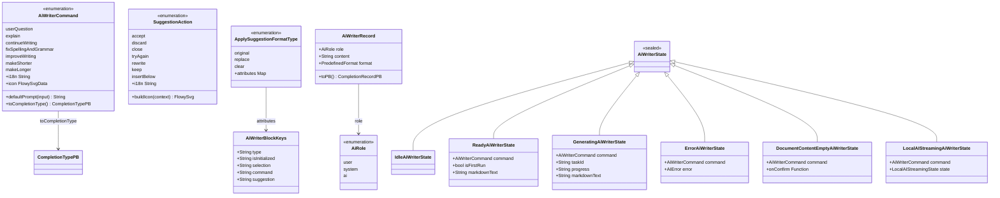
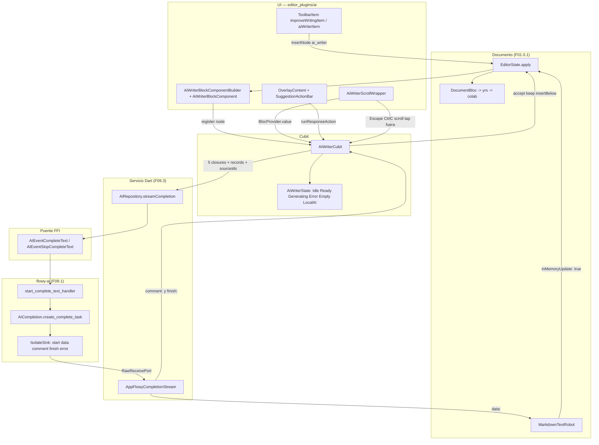
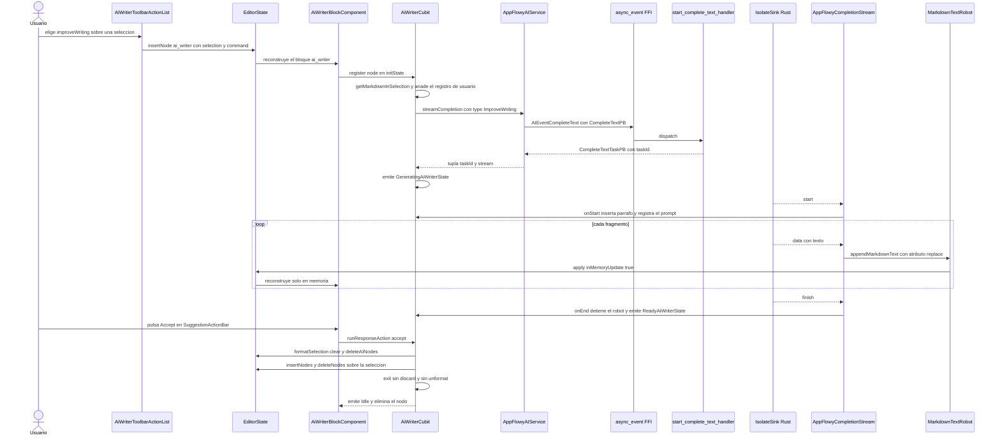
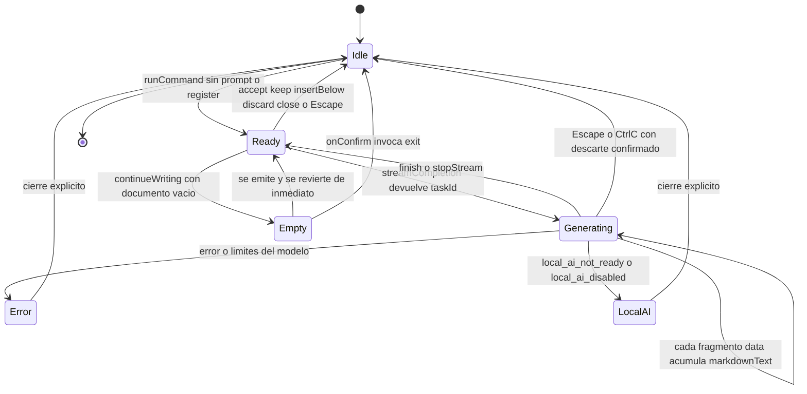

# F09.4 — IA: editor_plugins/ai (AI writer dentro del editor de documentos)

## 1. Resumen

Esta unidad documenta los 10 ficheros Dart de `plugins/document/presentation/editor_plugins/ai/`, el plugin que convierte una selección de texto del editor de AppFlowy en una petición de completion al modelo de IA y devuelve el resultado como texto seleccionable dentro del propio documento. El eje del diseño es un bloque virtual de tipo `ai_writer` que se inserta en el árbol del documento, un cubit (`AiWriterCubit`) que orquesta el ciclo de vida de la generación y un `MarkdownTextRobot` que inyecta el texto recibido token a token sin tocar el CRDT hasta que el usuario acepta. La unidad es puramente de capa `ui`: no emite eventos FFI propios más allá de `CompleteText` y `StopCompleteText`, no escucha notificaciones de Rust y no escribe en SQLite.

## 2. Alcance

**Qué cubre este documento.** Los 10 ficheros asignados a la unidad F09.4 en `OUT/_ledger/units/F09.4.json`, con 2.810 líneas según el inventario: los dos ficheros raíz del directorio `ai/` (`ai_writer_block_component.dart` con el `BlockComponentBuilder` y el overlay, y `ai_writer_toolbar_item.dart` con los dos `ToolbarItem`), los tres ficheros de `operations/` (`ai_writer_cubit.dart`, `ai_writer_entities.dart`, `ai_writer_node_extension.dart`, `ai_writer_block_operations.dart` son cuatro: el cubit, las entidades, las extensiones de `Node`/`EditorState` y las operaciones de transacción) y los cuatro de `widgets/`. En términos de comportamiento, esta unidad es la documentación completa de: el menú de acciones de IA del editor, el cubit y su máquina de estados, la extracción del texto seleccionado a Markdown, el streaming del completion con su traducción a `data:`/`comment:`/`finish:`, el formateo visual de original/reemplazo dentro del documento, las siete acciones de sugerencia (aceptar, descartar, reescribir, etc.) y los tres modos de materializar la respuesta (aceptar sustituyendo, conservar e insertar debajo).

**Qué añade esta unidad respecto a [[F01.9]].** El documento `OUT/09-features/F01-documentos-y-editor/9-ia-en-el-editor-editor-plugins-ai-ai-writer-completion-enlaza-con-f09.md` es un documento de **cierre por scope-correction** con `archivos_cubiertos: []`: no analiza ningún fichero, solo declara que los 10 ficheros de `editor_plugins/ai/` pasaron a la unidad F09.4 y redirige al lector. En concreto, este documento aporta lo que F01.9 dejó explícitamente como marcador de posición: (a) el modelo de datos real (`AiWriterCommand`, `SuggestionAction`, `AiWriterRecord` y la jerarquía `AiWriterState`) en lugar de la mención "los modelos viven en F09.4"; (b) la tabla de eventos FFI reales consumidos, que F01.9 resume como "sin eventos FFI nuevos" citando `flowy_ai::chat`, cuando el editor **no** usa el chat sino `AIEvent::CompleteText` (`appflowy/frontend/rust-lib/flowy-ai/src/event_map.rs:85–86`); (c) el inventario de ficheros con su API pública de §12, que F01.9 sustituye por la cuenta "10 ui"; (d) los diagramas de flujo, secuencia y estado reales; (e) los riesgos de §13 y las preguntas abiertas de §18, que F01.9 deja en una sola pregunta reenviada a otra unidad.

**Qué queda fuera (y dónde está).** El motor Rust `flowy-ai` completo está en [[F09.1]]; esta unidad solo cita `event_map.rs`, `event_handler.rs`, `entities.rs` y `completion.rs` para cerrar el contrato del lado servidor. La capa de servicio Dart (`AIRepository`, `AppFlowyAIService`, `AppFlowyCompletionStream`, `PredefinedFormat`, `AIPromptInputBloc`, `DesktopPromptInput`) está en [[F09.3]] y aquí se cita únicamente en los puntos de costura. `MarkdownTextRobot`, motor de inyección de Markdown en el editor, es propiedad de [[F01.0.1]] (`OUT/_ledger/units/F01.0.1.json`), no de esta unidad, aunque sea la clase de la que depende el 90 % del comportamiento observable. La infraestructura del editor (`EditorState`, `transaction`, `apply`, `BlockComponentBuilder`) pertenece a los sub-documentos F01.0.3 y a `editor:lib/src/core/document/text_delta.dart`.

## 3. Modelos de datos

Muestra: los tipos propios del plugin —el enum de comandos, el enum de acciones de sugerencia, el registro de historial y la jerarquía sellada de estados del cubit— con sus campos y sus conversiones, sin ningún tipo genérico para no romper el render de Mermaid.



Lectura: el diagrama separa tres planos. El **vocabulario** (los tres enums de la izquierda) es estático y puro: no toca el editor ni la red, solo traduce entre la nomenclatura de la UI (`AiWriterCommand.improveWriting`), la de la infraestructura de sugerencias (`ApplySuggestionFormatType.original`) y la del protocolo con Rust (`CompletionTypePB`). El **historial** (`AiWriterRecord`) es un `Equatable` de tres campos cuya conversión a protobuf es una mera proyección: `AiRole.user` se mapea a `ChatMessageTypePB.User` y tanto `system` como `ai` a `ChatMessageTypePB.System` (`appflowy/frontend/appflowy_flutter/lib/plugins/document/presentation/editor_plugins/ai/operations/ai_writer_entities.dart:152–160`). El **estado** es una jerarquía sellada de seis subclases; cinco de ellas mezclan `RegisteredAiWriter`, un `mixin` que solo declara `AiWriterCommand get command` y sirve de guarda de tipos (`appflowy/frontend/appflowy_flutter/lib/plugins/document/presentation/editor_plugins/ai/operations/ai_writer_cubit.dart:738–740`): solo `IdleAiWriterState` queda fuera, y por eso el overlay decide que pintar con `state is IdleAiWriterState → SizedBox.shrink()` (`appflowy/frontend/appflowy_flutter/lib/plugins/document/presentation/editor_plugins/ai/ai_writer_block_component.dart:209–212`). Nótese que `AiWriterRecord.format` es `PredefinedFormat?` y `role = ai` lo deja siempre en `null` por constructor (`appflowy/frontend/appflowy_flutter/lib/plugins/document/presentation/editor_plugins/ai/operations/ai_writer_entities.dart:140–143`), de modo que el historial enviado a Rust nunca distingue "respuesta de la IA" de "mensaje de sistema".

`AiWriterBlockKeys` (arriba a la derecha, aunque dibujado aparte) no es un modelo sino el **contrato de serialización del nodo**: el bloque `ai_writer` guarda `is_initialized` (bool), `selection` (mapa JSON de una `Selection`) y `command` (entero, el índice del enum) (`appflowy/frontend/appflowy_flutter/lib/plugins/document/presentation/editor_plugins/ai/ai_writer_block_component.dart:21–38`). Esos tres atributos son también el predicado de validación del componente (`appflowy/frontend/appflowy_flutter/lib/plugins/document/presentation/editor_plugins/ai/ai_writer_block_component.dart:75–80`), lo que hace que el nodo sea autosuficiente tras una recarga: otro cliente que abra el mismo documento puede reconstruir qué comando se pidió y sobre qué selección.

**Extensiones de `Node` y `EditorState`.** `ai_writer_node_extension.dart` añade tres getters a `Node` que deserializan esos atributos (`isAiWriterInitialized`, `aiWriterSelection` reconstruido con `Selection.fromJson`, `aiWriterCommand` con indexación en `AiWriterCommand.values`) y tres métodos a `EditorState`. El más complejo es `getMarkdownInSelection`: aplana los nodos de la selección, descarta los hijos de un nodo padre ya incluido, corta el `delta` del primer y del último nodo por `startIndex`/`endIndex`, borra los hijos fuera de la selección, degrada a párrafo el primer nodo si la selección no empieza en su offset 0, y finalmente convierte a Markdown con `customDocumentToDocument` y `lineBreak: '\n'` (`appflowy/frontend/appflowy_flutter/lib/plugins/document/presentation/editor_plugins/ai/operations/ai_writer_node_extension.dart:28–92`). El comentario del código explica por qué: usar `\n\n` haría que el modelo tratase el fragmento como un solo bloque (`appflowy/frontend/appflowy_flutter/lib/plugins/document/presentation/editor_plugins/ai/operations/ai_writer_node_extension.dart:83–84`). `isEmptyForContinueWriting` reutiliza la misma técnica con un conjunto reducido de parsers para decidir si "continuar escribiendo" tiene sentido (`appflowy/frontend/appflowy_flutter/lib/plugins/document/presentation/editor_plugins/ai/operations/ai_writer_node_extension.dart:120–178`).

## 4. Eventos FFI

Muestra: los dos únicos eventos `AIEvent` que esta unidad emite a Rust, con su payload y su handler, más la llamada directa que el cubit hace para parar el stream.

| Evento | Input PB | Output PB | Handler Rust | Registrado en |quién lo emite desde la unidad |
|---|---|---|---|---|---|
| `AIEvent::CompleteText` | `CompleteTextPB` (9 campos, `appflowy/frontend/rust-lib/flowy-ai/src/entities.rs:424–451`) | `CompleteTextTaskPB` (`appflowy/frontend/rust-lib/flowy-ai/src/entities.rs:454–457`) | `start_complete_text_handler` (`appflowy/frontend/rust-lib/flowy-ai/src/event_handler.rs:190–199`) | `appflowy/frontend/rust-lib/flowy-ai/src/event_map.rs:27` y `:85–86` | `AppFlowyAIService.streamCompletion` (`appflowy/frontend/appflowy_flutter/lib/ai/service/appflowy_ai_service.dart:83–104`), invocado desde los cuatro arranques de §10 (`appflowy/frontend/appflowy_flutter/lib/plugins/document/presentation/editor_plugins/ai/operations/ai_writer_cubit.dart:381`, `:477`, `:565`, `:670`) |
| `AIEvent::StopCompleteText` | `CompleteTextTaskPB` | — | `stop_complete_text_handler` (`appflowy/frontend/rust-lib/flowy-ai/src/event_handler.rs:203–209`) | `appflowy/frontend/rust-lib/flowy-ai/src/event_map.rs:28` y `:88–89` | `AiWriterCubit.stopStream` (`appflowy/frontend/appflowy_flutter/lib/plugins/document/presentation/editor_plugins/ai/operations/ai_writer_cubit.dart:203–207`) |

Lectura: la tabla confirma que esta unidad **no usa el chat de IA**. Es un cliente puro de `CompleteText`, el mismo evento que documenta [[F09.1]] como segundo gran camino de `flowy-ai`; la diferencia con el chat es que aquí no hay `chat_id`, no hay persistencia de mensajes en `chat_message_table` y no hay notificaciones: el resultado vuelve por un puerto de isolate propio descrito en §5. El `CompleteTextPB` que se serializa desde Dart se compone en `appflowy/frontend/appflowy_flutter/lib/ai/service/appflowy_ai_service.dart:83–95` con siete datos que esta unidad provee: `text` (el prompt ya construido por el cubit), `completionType` (el resultado de `AiWriterCommand.toCompletionType()`), `format` (el `PredefinedFormat` elegido por el usuario), `promptId`, `streamPort` (el puerto nativo del isolate Dart), `objectId` (el id del documento) y `rag_ids` (el `documentId` más las fuentes seleccionadas). El campo 8, `custom_prompt`, nunca se rellena desde esta unidad porque ninguno de los siete comandos mapea a `CompletionTypePB.CustomPrompt` (`appflowy/frontend/appflowy_flutter/lib/plugins/document/presentation/editor_plugins/ai/operations/ai_writer_entities.dart:105–114`). El único envío directo desde la unidad es `AIEventStopCompleteText(CompleteTextTaskPB(taskId: ...)).send()` en `stopStream`, que cancela la tarea en Rust con `AICompletion::cancel_complete_task` (`appflowy/frontend/rust-lib/flowy-ai/src/completion.rs:75–79`).

**Codificación por comando.** `toCompletionType()` es la única tabla de traducción entre la nomenclatura del plugin y la del protocolo, y es total sobre los siete valores vivos del enum:

| `AiWriterCommand` | Índice | `CompletionTypePB` | `defaultPrompt(input)` |
|---|---|---|---|
| `userQuestion` | 0 | `UserQuestion` | `input` (sin plantilla) |
| `explain` | 1 | `ExplainSelected` | `Explain this phrase in a concise manner:\n\n$input` |
| `continueWriting` | 2 | `ContinueWriting` | `Continue writing based on this existing text:\n\n$input` |
| `fixSpellingAndGrammar` | 3 | `SpellingAndGrammar` | `Correct this to standard English:\n\n$input` |
| `improveWriting` | 4 | `ImproveWriting` | `Rewrite this in your own words:\n\n$input` |
| `makeShorter` | 5 | `MakeShorter` | `Make this text shorter:\n\n$input` |
| `makeLonger` | 6 | `MakeLonger` | `Make this text longer:\n\n$input` |

Los índices 0–6 coinciden exactamente con los valores del enum Rust `CompletionTypePB` (`appflowy/frontend/rust-lib/flowy-ai/src/entities.rs:460–470`) y con el `match` que Rust hace al traducirlos a su enum de nube (`appflowy/frontend/rust-lib/flowy-ai/src/completion.rs:113–121`), lo que convierte `command.index` —el entero que se serializa en el nodo— en una clave de protocolo además de una clave de almacenamiento. El valor `CustomPrompt = 7` de Rust no tiene equivalente en Dart, y el valor `summarize` está comentado en los tres sitios donde aparecería (`appflowy/frontend/appflowy_flutter/lib/plugins/document/presentation/editor_plugins/ai/operations/ai_writer_entities.dart:60`, `:70`, `:82`, `:96`, `:108`).

## 5. Notificaciones

Muestra: por qué esta unidad no tiene tabla de notificaciones Rust→Dart y qué sustituye a ese mecanismo durante la generación.

| Mecanismo | Emisor | Consumidor en Dart | Efecto en el editor | Evidencia |
|---|---|---|---|---|
| `start:` | `CompletionTask::start`, solo en la rama de nube | `AppFlowyCompletionStream.onStart` | `_textRobot.start(position: …)`, inserta párrafo vacío y registra el mensaje del usuario en `records` | `appflowy/frontend/rust-lib/flowy-ai/src/completion.rs:122` → `appflowy/frontend/appflowy_flutter/lib/ai/service/appflowy_ai_service.dart:228–229` → `appflowy/frontend/appflowy_flutter/lib/plugins/document/presentation/editor_plugins/ai/operations/ai_writer_cubit.dart:389–401`, `:485–497`, `:573–590`, `:678–685` |
| `data:` | `CompletionStreamValue::Answer` | `processMessage` | `appendMarkdownText(text, updateSelection: false, attributes: replace)` y rearrastre del cursor | `appflowy/frontend/rust-lib/flowy-ai/src/completion.rs:159` → `appflowy/frontend/appflowy_flutter/lib/plugins/document/presentation/editor_plugins/ai/operations/ai_writer_cubit.dart:402–409`, `:498–505`, `:591–602`, `:686–696` |
| `comment:` | `CompletionStreamValue::Comment` | `processAssistMessage` | Acumula texto en el estado **sin escribirlo** en el documento | `appflowy/frontend/rust-lib/flowy-ai/src/completion.rs:162` → `appflowy/frontend/appflowy_flutter/lib/plugins/document/presentation/editor_plugins/ai/operations/ai_writer_cubit.dart:410–420`, `:506–516`, `:603–617` |
| `finish:` | fin del stream de nube, con el `task_id` | `AppFlowyCompletionStream.onEnd` | `_textRobot.stop(attributes: replace)` + emisión de `ReadyAiWriterState` | `appflowy/frontend/rust-lib/flowy-ai/src/completion.rs:174` → `appflowy/frontend/appflowy_flutter/lib/plugins/document/presentation/editor_plugins/ai/operations/ai_writer_cubit.dart:421–437`, `:517–533`, `:618–638` |
| `error:`, `ai_response_limit:`, `ai_image_response_limit:`, `ai_max_required:` | `handle_error` | `processError` | `ErrorAiWriterState(command, error: AIError)` | `appflowy/frontend/rust-lib/flowy-ai/src/completion.rs:180–205` → `appflowy/frontend/appflowy_flutter/lib/plugins/document/presentation/editor_plugins/ai/operations/ai_writer_cubit.dart:438–443`, `:534–539`, `:639–644`, `:712–719` |
| `local_ai_not_ready:`, `local_ai_disabled:` | `handle_error` | `onLocalAIStreamingStateChange` | `LocalAIStreamingAiWriterState` con mensaje de "reintentarlo más tarde" o "IA local desactivada" | `appflowy/frontend/rust-lib/flowy-ai/src/completion.rs:198–205` → `appflowy/frontend/appflowy_flutter/lib/plugins/document/presentation/editor_plugins/ai/operations/ai_writer_cubit.dart:444–446`, `:540–542`, `:645–647`, `:720–722` |

Lectura: la tabla es una tabla de notificaciones **de facto**: son mensajes de un canal de isolate, no variantes del enum `AINotification`, y por eso no aparecen en `OUT/_ledger/extract/notifications.json` ni tienen listener propio. La diferencia estructural con [[F09.3]] es que allí el listener es permanente y vive en `chat_message_listener.dart`; aquí el canal se crea y se destruye por petición, se abre con el `stream_port` que el cubit devuelve de `streamCompletion` y se decodifica en `AppFlowyCompletionStream._handleEvent` (`appflowy/frontend/appflowy_flutter/lib/ai/service/appflowy_ai_service.dart:198–258`). Consecuencia práctica: si el usuario cierra la página a mitad de la generación, el isolate muere con ella y no hay ningún mecanismo de reenganche, al contrario que en el chat. El enum de prefijos vive en `AIStreamEventPrefix` (`appflowy/frontend/appflowy_flutter/lib/ai/service/ai_entities.dart:15–28`) y el decodeo a callbacks ocurre en `appflowy/frontend/appflowy_flutter/lib/ai/service/appflowy_ai_service.dart:198–258`; ambos ficheros son de [[F09.3]] y esta unidad solo aporta el cuerpo de los cinco closures que pasan en la llamada. Obsérvese además que `AiWriterCubit` **no implementa ningún `AITaskListener`**: para parar el stream tiene que emitir `StopCompleteText` con el `taskId` que le devolvió la primera respuesta (`appflowy/frontend/appflowy_flutter/lib/plugins/document/presentation/editor_plugins/ai/operations/ai_writer_cubit.dart:203–207`), lo cual explica por qué `GeneratingAiWriterState` necesita llevar `taskId` como campo en lugar de deducirlo.

## 6. BLoCs / Cubits

Muestra: el único cubit propio de la unidad, su estado, sus colaboradores y el segundo bloc que crea en caliente.

| Clase | Tipo | Estados | Servicios y colaboradores | Fichero:línea |
|---|---|---|---|---|
| `AiWriterCubit` | `Cubit<AiWriterState>` (sin eventos: API por métodos) | 6 subclases de `AiWriterState` (§3) | `AIRepository` vía `getIt`, `MarkdownTextRobot`, `ViewBackendService`, `EditorState`, `records: List<AiWriterRecord>`, `selectedSourcesNotifier: ValueNotifier<List<String>>` | `appflowy/frontend/appflowy_flutter/lib/plugins/document/presentation/editor_plugins/ai/operations/ai_writer_cubit.dart:25–48` |
| `AIPromptInputBloc` | `Bloc` (creado por el componente, no por la unidad) | `AIPromptInputState` | `predefinedFormat`, `showPredefinedFormats`, `promptId` | `appflowy/frontend/appflowy_flutter/lib/plugins/document/presentation/editor_plugins/ai/ai_writer_block_component.dart:130–134` |

**API pública del cubit.** Se construye con `documentId`, `editorState` y tres callbacks opcionales (`onCreateNode`, `onRemoveNode`, `onAppendToDocument`), y resuelve sus dos colaboradores pesados en la lista de inicialización: `getIt<AIRepository>()` y `MarkdownTextRobot(editorState:)` (`appflowy/frontend/appflowy_flutter/lib/plugins/document/presentation/editor_plugins/ai/operations/ai_writer_cubit.dart:26–35`). Los métodos con contrato público son:

| Método | Firma | Efecto | Línea |
|---|---|---|---|
| `register` | `void register(Node node)` | Valida el nodo, extrae la selección a Markdown, y lanza el comando guardado en el propio nodo | `appflowy/frontend/appflowy_flutter/lib/plugins/document/presentation/editor_plugins/ai/operations/ai_writer_cubit.dart:92–119` |
| `runCommand` | `void runCommand(AiWriterCommand, String prompt, PredefinedFormat?, String? promptId)` | Descarta lo anterior y enruta a uno de los cuatro arranques según el comando | `appflowy/frontend/appflowy_flutter/lib/plugins/document/presentation/editor_plugins/ai/operations/ai_writer_cubit.dart:121–169` |
| `stopStream` | `Future<void> stopStream()` | Corta el streaming, persiste el parcial en `records` y avisa a Rust | `appflowy/frontend/appflowy_flutter/lib/plugins/document/presentation/editor_plugins/ai/operations/ai_writer_cubit.dart:187–217` |
| `runResponseAction` | `void runResponseAction(SuggestionAction, [PredefinedFormat?])` | Aceptar, conservar, insertar debajo, descartar, cerrar o reintentar | `appflowy/frontend/appflowy_flutter/lib/plugins/document/presentation/editor_plugins/ai/operations/ai_writer_cubit.dart:219–300` |
| `exit` | `Future<void> exit({bool withDiscard = true, bool withUnformat = true})` | Abandona la sesión: borra el texto insertado, quita el formato y elimina el nodo | `appflowy/frontend/appflowy_flutter/lib/plugins/document/presentation/editor_plugins/ai/operations/ai_writer_cubit.dart:56–90` |
| `hasUnusedResponse` | `bool hasUnusedResponse()` | Si hay respuesta sin consumir, para pedir confirmación al cerrar | `appflowy/frontend/appflowy_flutter/lib/plugins/document/presentation/editor_plugins/ai/operations/ai_writer_cubit.dart:302–312` |
| `selectedSourcesNotifier` | `ValueNotifier<List<String>>` | Fuentes RAG adicionales; se reinicia a `[documentId]` al salir | `appflowy/frontend/appflowy_flutter/lib/plugins/document/presentation/editor_plugins/ai/operations/ai_writer_cubit.dart:34`, `:48`, `:72` |

**Quién crea y quién destruye el cubit.** No hay `get_it` para él: lo crea `AiWriterScrollWrapper` como campo `late final` y lo publica con `BlocProvider.value`, de modo que la misma instancia vive durante toda la vida del wrapper, y lo cierra en `dispose` (`appflowy/frontend/appflowy_flutter/lib/plugins/document/presentation/editor_plugins/ai/widgets/ai_writer_scroll_wrapper.dart:33–46`, `:58–63`, `:67–68`). El wrapper se monta en tres sitios distintos del producto —la página de documento, la página de base de datos y la fila de base de datos en modo documento— (`appflowy/frontend/appflowy_flutter/lib/plugins/document/document_page.dart:143–147`, `appflowy/frontend/appflowy_flutter/lib/plugins/database_document/database_document_page.dart:100`, `appflowy/frontend/appflowy_flutter/lib/plugins/database/widgets/row/row_document.dart:124`), lo que significa que puede haber tres `AiWriterCubit` vivos simultáneos en el árbol, uno por instancia de editor. El wrapper es además el que instala los dos `BlocListener` que reaccionan a estados que el overlay no puede representar por sí solo: el diálogo de "documento vacío" para `continueWriting` y la liberación de la selección al pasar de generar a listo (`appflowy/frontend/appflowy_flutter/lib/plugins/document/presentation/editor_plugins/ai/widgets/ai_writer_scroll_wrapper.dart:76–99`).

**Consistencia con el catálogo.** `OUT/_ledger/extract/blocs.json` registra correctamente `AiWriterCubit` con `kind: "Cubit"`, `state_type: "AiWriterState"` y `event_type: null`, lo que confirma que es un cubit de API por métodos y no un bloc con eventos; su `decl_line` es 24, una unidad por debajo de la línea real 25 de la clase, el mismo desplazamiento sistemático que ya documenta [[F09.3]] §14.

## 7. Servicios e inyección de dependencias

**Dart (`get_it`).** La unidad tiene una única dependencia inyectada: `AIRepository`, registrada como *factory* en el resolvedor de dependencias de la nube (`appflowy/frontend/appflowy_flutter/lib/startup/deps_resolver.dart:65`) y resuelta por el cubit en su constructor (`appflowy/frontend/appflowy_flutter/lib/plugins/document/presentation/editor_plugins/ai/operations/ai_writer_cubit.dart:32`). El contrato es el de [[F09.3]]:

```dart
Future<(String, CompletionStream)?> streamCompletion({
  String? objectId,
  required String text,
  PredefinedFormat? format,
  String? promptId,
  List<String> sourceIds = const [],
  List<AiWriterRecord> history = const [],
  required CompletionTypePB completionType,
  required Future<void> Function() onStart,
  required Future<void> Function(String text) processMessage,
  required Future<void> Function(String text) processAssistMessage,
  required Future<void> Function() onEnd,
  required void Function(AIError error) onError,
  required void Function(LocalAIStreamingState state)
      onLocalAIStreamingStateChange,
});
```

(appflowy/frontend/appflowy_flutter/lib/ai/service/appflowy_ai_service.dart:28–43)

Lectura: la tupla de retorno es `(taskId, stream)` y **el cubit solo usa el `taskId`**: el `CompletionStream` devuelto se descarta en las cuatro llamadas, porque el callbacks ya están enlazados porclosure y no hay forma de inyectar eventos desde un test salvo implementando un `AIRepository` falso completo. El valor `null` del retorno significa que el evento falló antes de arrancar y en ese caso el cubit simplemente **no emite estado**: los cuatro arranques envuelven la emisión de `GeneratingAiWriterState` en `if (stream != null)` (`appflowy/frontend/appflowy_flutter/lib/plugins/document/presentation/editor_plugins/ai/operations/ai_writer_cubit.dart:449–456`, `:544–548`, `:649–653`, `:724–728`), dejando al usuario en el estado `ReadyAiWriterState` anterior sin ninguna señal de error visible, salvo el `Log.error` que el servicio escribe antes de devolver `null` (`appflowy/frontend/appflowy_flutter/lib/ai/service/appflowy_ai_service.dart:99–102`).

**Servicios usados sin `get_it`.** `MarkdownTextRobot` se instancia directamente con el `editorState` (propiedad de [[F01.0.1]]) y es el único objeto que escribe nodos de texto durante el streaming. `ViewBackendService.getView(documentId)` se usa una sola vez, en `_getDocumentContentFromTopToPosition`, para anteponer el título de la vista al contenido previo al cursor que se envía como contexto en `continueWriting` (`appflowy/frontend/appflowy_flutter/lib/plugins/document/presentation/editor_plugins/ai/operations/ai_writer_cubit.dart:355–369`; el servicio está en `appflowy/frontend/appflowy_flutter/lib/workspace/application/view/view_service.dart:268`). `DocumentBloc` se lee con `context.read<DocumentBloc?>()?.documentId` únicamente para construir el `AIPromptInputBloc` (`appflowy/frontend/appflowy_flutter/lib/plugins/document/presentation/editor_plugins/ai/ai_writer_block_component.dart:128`), y `ViewBloc` para decidir si el documento está vacío a efectos del botón "más" (`appflowy/frontend/appflowy_flutter/lib/plugins/document/presentation/editor_plugins/ai/ai_writer_block_component.dart:393–405`): ambas lecturas son `context.read`, es decir, no escuchan cambios. El servicio de teclado del editor se manipula directamente por la interfaz `service.keyboardService` para desactivar los atajos mientras hay un nodo de IA registrado y reactivarlos al retirarlo (`appflowy/frontend/appflowy_flutter/lib/plugins/document/presentation/editor_plugins/ai/widgets/ai_writer_scroll_wrapper.dart:36–44`).

**Rust.** No hay nada que resolver del lado Rust en esta unidad: `flowy-ai` ya está registrado en el dispatcher global con su `AFPlugin`, que expone `CompleteText` y `StopCompleteText` (`appflowy/frontend/rust-lib/flowy-ai/src/event_map.rs:27–28`). El modelo concreto se elige en el handler con `ai_manager.get_active_model(&data.object_id)` (`appflowy/frontend/rust-lib/flowy-ai/src/event_handler.rs:197`), es decir, por documento y no por el widget.

## 8. Persistencia

Muestra: qué se escribe en disco, cuándo, y qué se queda solo en memoria mientras la IA escribe.

| Dato | Destino | Momento | ¿Llega al CRDT? | Evidencia |
|---|---|---|---|---|
| Nodo `ai_writer` | `EditorState.apply` con `recordUndo: false`, `inMemoryUpdate: true` | Al pulsar la acción de la barra | Sí (transacción normal del editor) | `appflowy/frontend/appflowy_flutter/lib/plugins/document/presentation/editor_plugins/ai/ai_writer_toolbar_item.dart:221–238` |
| Marca `is_initialized` del nodo | Misma transacción del nodo | Al registrarse el bloque | Sí | `appflowy/frontend/appflowy_flutter/lib/plugins/document/presentation/editor_plugins/ai/operations/ai_writer_block_operations.dart:10–37` |
| Texto generado token a token | `MarkdownTextRobot` → `EditorState.apply` con `inMemoryUpdate: true` | Cada fragmento `data:` | **No**: solo en la memoria del `EditorState` | `appflowy/frontend/appflowy_flutter/lib/plugins/document/presentation/editor_plugins/ai/ai_writer_block_component.dart:263–304` → `appflowy/frontend/appflowy_flutter/lib/plugins/document/presentation/editor_plugins/base/markdown_text_robot.dart:78–99` |
| Atributo de sugerencia `original` / `replacement` | `Delta.retain` en la selección original | Al arrancar y parar el streaming | Sí (formato del texto) | `appflowy/frontend/appflowy_flutter/lib/plugins/document/presentation/editor_plugins/ai/operations/ai_writer_cubit.dart:574–578`, `:595–596`; el `retain` en `editor:lib/src/core/document/text_delta.dart:317–318` |
| Sustitución final del texto | `insertNodes` + `deleteNodes` sobre la selección | Al aceptar | Sí | `appflowy/frontend/appflowy_flutter/lib/plugins/document/presentation/editor_plugins/ai/operations/ai_writer_block_operations.dart:197–224` |
| Historial de conversación (`records`) | **Ninguno**: solo se envía en el `CompleteTextPB.history` | Por petición | No | `appflowy/frontend/appflowy_flutter/lib/plugins/document/presentation/editor_plugins/ai/operations/ai_writer_entities.dart:152–160` |

Lectura: la tabla describe el mecanismo central del diseño. Durante el streaming el documento **parece** contener la respuesta pero en realidad no: `MarkdownTextRobot.appendMarkdownText` refresca los nodos con `inMemoryUpdate: true`, que en `appflowy_editor` aplica la transacción al `EditorState` sin propagarla al `DocumentBloc`, de modo que ni llega al `yrs` del documento ni se sincroniza con otros colaboradores (`appflowy/frontend/appflowy_flutter/lib/plugins/document/presentation/editor_plugins/ai/operations/ai_writer_cubit.dart:402–409` llama al robot, y el robot decide el modo en `appflowy/frontend/appflowy_flutter/lib/plugins/document/presentation/editor_plugins/base/markdown_text_robot.dart:78–99`). La primera operación que **sí** toca el CRDT es la que el usuario elige: `accept` construye la transacción `insertNodes(...) + deleteNodes(...)` (`appflowy/frontend/appflowy_flutter/lib/plugins/document/presentation/editor_plugins/ai/operations/ai_writer_block_operations.dart:219–223`), `keep` llama a `MarkdownTextRobot.persist` y `insertBelow` a `persist(markdownText:)` cuando el comando es `explain` (`appflowy/frontend/appflowy_flutter/lib/plugins/document/presentation/editor_plugins/ai/operations/ai_writer_cubit.dart:271`, `:287–288`). En todos los caminos, `recordUndo: false` está activo, así que el usuario no puede deshacer con `Cmd+Z` lo que la IA escribió; la operación es una edición ordinaria a efectos de colaboración pero invisible al historial de deshacer del editor. No hay ninguna tabla SQLite en esta unidad: ni entradas de caché de prompts, ni embeddings (eso es `flowy-sqlite-vec`, [[F09.2]]), ni `chat_message_table` (eso es [[F09.3]]).

**El formato de sugerencia vive en el propio delta.** `formatSelection` no inserta nodos: compone un `Delta` con `retain(selection.start.offset)` seguido de `retain(selection.length, attributes: formatType.attributes)` y lo aplica (`appflowy/frontend/appflowy_flutter/lib/plugins/document/presentation/editor_plugins/ai/operations/ai_writer_block_operations.dart:51–114`). Con `ApplySuggestionFormatType.original` eso pinta el texto seleccionado como original y con `.replace` marca como reemplazo lo que va llegando; con `.clear`, cuyo valor es `null` (`appflowy/frontend/appflowy_flutter/lib/plugins/document/presentation/editor_plugins/ai/operations/ai_writer_entities.dart:117–126`), el motor de deltas interpreta `null` como eliminación de la clave (`editor:lib/src/core/document/text_delta.dart:314`), que es exactamente el mecanismo por el que se desvanecen los resaltados al aceptar o descartar.

## 9. Diagramas de flujo

Muestra: el camino completo de la IA dentro del editor, con las capas UI, cubit, servicio Dart, FFI, Rust y documento, desde que el usuario pulsa un botón de la barra hasta que el texto queda incorporado o descartado.



Lectura: el diagrama tiene dos caminos de escritura hacia el documento y solo uno llega al CRDT. El camino corto es la inserción del nodo `ai_writer` desde la barra de herramientas (`_insertAiNode` aplica la transacción directamente sobre el `EditorState`), que sí se persiste. El camino largo son las flechas `MR --> ES --> CR`: mientras la IA escribe, `MarkdownTextRobot` aplica con `inMemoryUpdate: true`, y el único tramo que alcanza `DocumentBloc` es el que pasa por las acciones de sugerencia, que reconstruyen el texto con `insertNodes`/`deleteNodes`. El canal de vuelta (`SN --> CS --> MR`) es el que evita que el plugin dependa de notificaciones: Rust escribe strings prefijados en un isolate cuyo `sendPort` viaja en el propio `CompleteTextPB`, y Dart los decodifica a los cinco callbacks. La última flecha lateral (`SW --> AW`) representa las tres vías de abandonar la sesión sin pasar por la UI: la tecla `Escape`, el atajo `Ctrl+C` durante el streaming y el toque fuera del overlay.

**Cómo se llega al nodo.** La tabla siguiente recorre las acciones de IA disponibles en el editor, que es el otro objeto de prueba literal de esta unidad.

| Punto de entrada | Widget | Comandos ofrecidos | Condición de visibilidad | Efecto |
|---|---|---|---|---|
| Barra flotante del editor, botón con desplegable (`appflowy.editor.ai_writer`) | `AiWriterToolbarActionList` | `improveWriting`, `userQuestion`, `fixSpellingAndGrammar`, `explain`, `makeLonger`, `makeShorter` (separados por un `divider` entre `explain` y `makeLonger`) | `onlyShowInTextTypeAndExcludeTable` | Inserta el nodo `ai_writer` bajo la selección y abre el overlay (`appflowy/frontend/appflowy_flutter/lib/plugins/document/presentation/editor_plugins/ai/ai_writer_toolbar_item.dart:28–37`, `:76–91`, `:245–249`) |
| Barra flotante del editor, botón suelto (`appflowy.editor.ai_improve_writing`) | `ImproveWritingButton` | Solo `improveWriting` | Misma condición | Idéntico, sin desplegable (`appflowy/frontend/appflowy_flutter/lib/plugins/document/presentation/editor_plugins/ai/ai_writer_toolbar_item.dart:17–26`, `:169–213`) |
| Menú "más" del prompt, con selección activa | `MoreAiWriterCommands` | `improveWriting`, `fixSpellingAndGrammar`, `explain`, separador, `makeLonger`, `makeShorter` | Solo en `ReadyAiWriterState` con `isFirstRun: true` | Cambia de comando sin reabrir el overlay (`appflowy/frontend/appflowy_flutter/lib/plugins/document/presentation/editor_plugins/ai/widgets/ai_writer_prompt_input_more_button.dart:115–130`, `appflowy/frontend/appflowy_flutter/lib/plugins/document/presentation/editor_plugins/ai/ai_writer_block_component.dart:305–334`) |
| Menú "más" del prompt, sin selección | `MoreAiWriterCommands` | Solo `continueWriting` | Igual, y el botón se deshabilita si el documento está vacío | Igual (`appflowy/frontend/appflowy_flutter/lib/plugins/document/presentation/editor_plugins/ai/widgets/ai_writer_prompt_input_more_button.dart:115–130`, `appflowy/frontend/appflowy_flutter/lib/plugins/document/presentation/editor_plugins/ai/ai_writer_block_component.dart:513–524`) |
| Enviar texto en el prompt | `DesktopPromptInput.onSubmitted` | Repite el comando activo | `ReadyAiWriterState` | `runCommand(state.command, message, format, promptId)` (`appflowy/frontend/appflowy_flutter/lib/plugins/document/presentation/editor_plugins/ai/ai_writer_block_component.dart:503–505`) |
| Botón de parar del streaming | `PromptInputSendButton` en estado `streaming` | — | `GeneratingAiWriterState` | `stopStream()` (`appflowy/frontend/appflowy_flutter/lib/plugins/document/presentation/editor_plugins/ai/ai_writer_block_component.dart:541–545`) |
| Teclado | `Focus.onKeyEvent` | `Escape` (parar, descartar o confirmar) y `Ctrl+C` (parar) | Con nodo registrado | `stopAndExit()` (`appflowy/frontend/appflowy_flutter/lib/plugins/document/presentation/editor_plugins/ai/widgets/ai_writer_scroll_wrapper.dart:162–203`) |

Lectura: la tabla muestra que hay **siete comandos** pero solo **cuatro** puntos de entrada reales, porque los comandos que actúan sobre el documento (`improveWriting`, `fixSpellingAndGrammar`, `makeLonger`, `makeShorter`, `explain`) se pueden lanzar desde dos sitios y `continueWriting` solo desde el menú "más", que aparece únicamente cuando el usuario escribe una pregunta o cuando el documento ya tiene contenido. El registro en la barra del editor se hace en la lista `toolbarItems` del documento (`appflowy/frontend/appflowy_flutter/lib/plugins/document/presentation/editor_page.dart:96–99`) y el registro del componente de bloque, en el mapa de builders por tipo de nodo (`appflowy/frontend/appflowy_flutter/lib/plugins/document/presentation/editor_configuration.dart:380–383`, `:895–900`).

**Tabla de acciones de sugerencia.** Las acciones que ofrece la barra tras una generación dependen a la vez del comando actual y de si hay selección, y son la parte más determinista de la UI:

| Comando | Con selección | Sin selección |
|---|---|---|
| `userQuestion`, `continueWriting` | `keep`, `discard`, `rewrite` | `keep`, `discard`, `rewrite` |
| `explain` | `insertBelow`, `tryAgain`, `close` | `insertBelow`, `tryAgain`, `close` |
| `fixSpellingAndGrammar`, `improveWriting`, `makeShorter`, `makeLonger` | `accept`, `discard`, `insertBelow`, `rewrite` | `keep`, `discard`, `rewrite` |

(appflowy/frontend/appflowy_flutter/lib/plugins/document/presentation/editor_plugins/ai/widgets/ai_writer_suggestion_actions.dart:34–77)

Lectura: la asimetría de la tercera fila es la que más sorprende y es intencionada: sin selección no hay nada que sustituir, así que `accept` —que reemplaza el rango original— se sustituye por `keep`, que deja el texto donde el robot lo insertó. `explain` es el caso especial porque **nunca escribe en el documento durante el streaming**: su `processMessage` solo acumula `markdownText` en el estado y su `processAssistMessage` es una función vacía (`appflowy/frontend/appflowy_flutter/lib/plugins/document/presentation/editor_plugins/ai/operations/ai_writer_cubit.dart:686–697`), razón por la cual su única salida razonable es `insertBelow`, que persiste el textoien un nodo nuevo bajo el nodo de IA (`appflowy/frontend/appflowy_flutter/lib/plugins/document/presentation/editor_plugins/ai/operations/ai_writer_cubit.dart:276–291`). El ícono de cada acción se deriva del enum, con `accept` y `keep` compartiendo el glifo verde de corrección y `discard`/`close` el glifo rojo de cierre (`appflowy/frontend/appflowy_flutter/lib/plugins/document/presentation/editor_plugins/ai/operations/ai_writer_entities.dart:37–54`).

## 10. Diagramas de secuencia

Muestra: una generación completa con streaming por isolate y aceptación del texto, desde el clic en "escribir con IA" hasta que el documento queda sustituido.



Lectura: la secuencia tiene un punto de no retorno en `AR-->>AW: tupla taskId y stream`, porque es el único momento en que el cubit conoce el `taskId` que le permitirá parar la tarea en Rust. Todo lo que ocurre entre `start` y `finish` es **reversible sin dejar rastro**: el texto se inyecta con `inMemoryUpdate: true` y se borra con `_textRobot.discard()` si el usuario cierra el overlay o pulsa `Escape`. La fase final es la única irreversible y la interestingly más simple de lo que sugiere el nombre de la acción: `accept` no "inserta" nada nuevo, sino que limpia el formato de sugerencia de la selección original, borra los nodos intermedios que el robot había ido creando y vuelve a insertar el markdown convertido a nodos por `customMarkdownToDocument` en el mismo rango (`appflowy/frontend/appflowy_flutter/lib/plugins/document/presentation/editor_plugins/ai/ai_writer_block_component.dart:262–267`; `appflowy/frontend/appflowy_flutter/lib/plugins/document/presentation/editor_plugins/ai/operations/ai_writer_block_operations.dart:197–224`). La pareja de flechas finales (`exit` → `Idle`) es la que devuelve el overlay a `SizedBox.shrink` y desbloquea los atajos del teclado.

**Las cuatro variantes de arranque.** El mismo esqueleto se repite en `_startAskingQuestion`, `_startContinueWriting`, `_startSuggestingEdits` y `_startInforming`, y se diferencian en tres puntos concretos:

| Arranque | Qué envía como `text` | Qué toca al arrancar | Qué toca en `data:` | Líneas |
|---|---|---|---|---|
| `_startAskingQuestion` | El prompt escrito por el usuario | Inserta párrafo vacío, arranca el robot, registra el prompt | Escribe en el documento con atributo `replace` | `appflowy/frontend/appflowy_flutter/lib/plugins/document/presentation/editor_plugins/ai/operations/ai_writer_cubit.dart:371–457` |
| `_startContinueWriting` | Título de la vista + Markdown desde el inicio hasta el cursor | Inserta párrafo vacío y arranca el robot | Escribe en el documento | `appflowy/frontend/appflowy_flutter/lib/plugins/document/presentation/editor_plugins/ai/operations/ai_writer_cubit.dart:459–549` |
| `_startSuggestingEdits` | Texto seleccionado o el prompt del reintento | **Marca la selección como `original`** y arranca el robot con `previousSelection` | Escribe en el documento | `appflowy/frontend/appflowy_flutter/lib/plugins/document/presentation/editor_plugins/ai/operations/ai_writer_cubit.dart:551–654` |
| `_startInforming` | Texto seleccionado o el prompt del reintento | Solo registra el prompt | **No escribe**: acumula en el estado | `appflowy/frontend/appflowy_flutter/lib/plugins/document/presentation/editor_plugins/ai/operations/ai_writer_cubit.dart:656–729` |

Lectura: la columna "qué toca al arrancar" explica por qué las acciones disponibles difieren por comando. Los tres primeros arrancantes usan el robot y por tanto producen un texto visible en el documento que se puede `keep` o `discard`; `_startInforming` no lo hace, y por eso necesita `insertBelow` como salida natural. La marca `original` de `_startSuggestingEdits` es lo que permite que el usuario vea de un vistazo qué texto va a ser sustituido, porque `formatSelection` lo aplica con `ApplySuggestionFormatType.original` antes de la primera respuesta (`appflowy/frontend/appflowy_flutter/lib/plugins/document/presentation/editor_plugins/ai/operations/ai_writer_cubit.dart:573–578`). Un detalle de diseño poco evidente: `processAssistMessage` —los `comment:` que Rust emite en `appflowy/frontend/rust-lib/flowy-ai/src/completion.rs:162`— **solo tiene efecto en tres de los cuatro arrancantes**, porque acumula texto en `markdownText` para el cálculo de `hasUnusedResponse`, mientras que en `_startInforming` es una función vacía (`appflowy/frontend/appflowy_flutter/lib/plugins/document/presentation/editor_plugins/ai/operations/ai_writer_cubit.dart:697`).

## 11. Diagramas de estado

Muestra: la máquina de estados de `AiWriterCubit` tal y como se deduce de todas las emisiones del fichero, con los disparadores que la mueven y las acciones del usuario que la cierran.



Lectura: la máquina tiene siete estados pero solo uno "vivo": `Idle`, que es además el único que no implementa el `mixin RegisteredAiWriter` y el único para el que el overlay no pinta nada. Las cuatro transiciones que merecen explicación son: (a) **`Empty` es un estado efímero** —`_startContinueWriting` emite `DocumentContentEmptyAiWriterState`, luego emite el estado anterior y lo deja solo para que el `BlocListener` del wrapper muestre un diálogo de confirmación (`appflowy/frontend/appflowy_flutter/lib/plugins/document/presentation/editor_plugins/ai/operations/ai_writer_cubit.dart:470–474` frente a `appflowy/frontend/appflowy_flutter/lib/plugins/document/presentation/editor_plugins/ai/widgets/ai_writer_scroll_wrapper.dart:76–90`), por eso el diagrama lo dibuja con ida y vuelta inmediato; (b) **`Generating` no se puede recuperar**: desde `Ready` solo se vuelve entrando por `runCommand`, que primero hace `_textRobot.discard()` y `clear()` (`appflowy/frontend/appflowy_flutter/lib/plugins/document/presentation/editor_plugins/ai/operations/ai_writer_cubit.dart:131–132`), de modo que un segundo comando issued sobre el mismo nodo borra la respuesta anterior sin preguntar; (c) **`Error` y `LocalAI` son terminales** porque el único `BlocBuilder` que los pinta es `MainContentArea`, cuyo único control es el botón de cerrar que llama a `cubit.exit()` (`appflowy/frontend/appflowy_flutter/lib/plugins/document/presentation/editor_plugins/ai/ai_writer_block_component.dart:550–599`), de modo que no existe reintento desde la UI para un error de modelo, aunque `_retry` siga disponible por el camino de `rewrite`; (d) **`stopStream` es la transición `Generating → Ready` con confirmación**: detiene el robot, guarda el parcial como registro de IA, avisa a Rust con `StopCompleteText` y emite `ReadyAiWriterState` con el `markdownText` acumulado (`appflowy/frontend/appflowy_flutter/lib/plugins/document/presentation/editor_plugins/ai/operations/ai_writer_cubit.dart:187–217`), de modo que un stream cortado a medias sigue siendo aceptable.

**La vista lateral de la misma máquina.** `hasUnusedResponse()` es el predicado que decide si hace falta preguntar antes de cerrar, y su definición es más estrecha de lo que sugiere el nombre (`appflowy/frontend/appflowy_flutter/lib/plugins/document/presentation/editor_plugins/ai/operations/ai_writer_cubit.dart:302–312`): devuelve `true` si el estado es `Generating`, o si es un `ReadyAiWriterState` que no es la primera ejecución **y** tiene texto no vacío, ya sea en el estado o en el robot. El caso `ReadyAiWriterState(isFirstRun: true)` es justamente el estado en el que la UI pide la primera pregunta y todavía no hay nada que perder, de ahí que no haya diálogo de confirmación en ese punto.

## 12. Archivos cubiertos (del ledger)

Los 10 ficheros de la unidad F09.4, con su capa declarada en el ledger, sus líneas según el inventario y su API pública.

| # | Ruta | Capa | LOC | API pública |
|---|---|---|---|---|
| 1 | `appflowy/frontend/appflowy_flutter/lib/plugins/document/presentation/editor_plugins/ai/ai_writer_block_component.dart` | ui | 604 | `AiWriterBlockKeys` (7 constantes), `aiWriterNode({selection, command})`, `AIWriterBlockComponentBuilder` (`build`, `validate`), `AiWriterBlockComponent`, `OverlayContent`, `SecondaryContentArea`, `MainContentArea` |
| 2 | `appflowy/frontend/appflowy_flutter/lib/plugins/document/presentation/editor_plugins/ai/ai_writer_toolbar_item.dart` | ui | 249 | `improveWritingItem: ToolbarItem`, `aiWriterItem: ToolbarItem`, `AiWriterToolbarActionList`, `ImproveWritingButton`, `onlyShowInTextTypeAndExcludeTable(EditorState) bool` |
| 3 | `appflowy/frontend/appflowy_flutter/lib/plugins/document/presentation/editor_plugins/ai/operations/ai_writer_block_operations.dart` | ui | 258 | `setAiWriterNodeIsInitialized`, `removeAiWriterNode`, `formatSelection`, `ensurePreviousNodeIsEmptyParagraph`, `SaveAIResponseExtension` con `insertBelow`, `replace`, `_replaceWithMarkdown`, `_replaceWithPlainText` |
| 4 | `appflowy/frontend/appflowy_flutter/lib/plugins/document/presentation/editor_plugins/ai/operations/ai_writer_cubit.dart` | ui | 816 | `AiWriterCubit` (7 métodos públicos), `RegisteredAiWriter`, `AiWriterState` + 6 estados, `AiWriterRecord` reexportado desde entities |
| 5 | `appflowy/frontend/appflowy_flutter/lib/plugins/document/presentation/editor_plugins/ai/operations/ai_writer_entities.dart` | ui | 161 | `kdefaultReplacementType`, `AskAIReplacementType`, `SuggestionAction`, `AiWriterCommand`, `ApplySuggestionFormatType`, `AiRole`, `AiWriterRecord` |
| 6 | `appflowy/frontend/appflowy_flutter/lib/plugins/document/presentation/editor_plugins/ai/operations/ai_writer_node_extension.dart` | ui | 179 | `AiWriterExtension on Node` (`isAiWriterInitialized`, `aiWriterSelection`, `aiWriterCommand`), `AiWriterNodeExtension on EditorState` (`getMarkdownInSelection`, `getPlainTextInSelection`, `isEmptyForContinueWriting`) |
| 7 | `appflowy/frontend/appflowy_flutter/lib/plugins/document/presentation/editor_plugins/ai/widgets/ai_writer_gesture_detector.dart` | ui | 39 | `AiWriterGestureDetector({behavior, onPointerEvent, child})`: `TapGestureRecognizer` con `onTapDown`, `onSecondaryTapDown`, `onTertiaryTapDown` y un `ImmediateMultiDragGestureRecognizer` anulado |
| 8 | `appflowy/frontend/appflowy_flutter/lib/plugins/document/presentation/editor_plugins/ai/widgets/ai_writer_prompt_input_more_button.dart` | ui | 151 | `AiWriterPromptMoreButton({isEnabled, isSelected, onTap})`, `MoreAiWriterCommands({hasSelection, editorState, onSelectCommand})` |
| 9 | `appflowy/frontend/appflowy_flutter/lib/plugins/document/presentation/editor_plugins/ai/widgets/ai_writer_scroll_wrapper.dart` | ui | 243 | `AiWriterScrollWrapper({viewId, editorState, child})`: crea y publica el `AiWriterCubit`, escucha scroll, teclado y toque fuera |
| 10 | `appflowy/frontend/appflowy_flutter/lib/plugins/document/presentation/editor_plugins/ai/widgets/ai_writer_suggestion_actions.dart` | ui | 110 | `SuggestionActionBar({currentCommand, hasSelection, onTap})`, `SuggestionActionButton({action, onTap})` |

## 13. Riesgos y casos límite

**El bloque `ai_writer` no pinta nada en móvil, pero sí se registra [VERIFICADO].** `AiWriterBlockComponent.build` devuelve `SizedBox.shrink()` cuando `UniversalPlatform.isMobile` (`appflowy/frontend/appflowy_flutter/lib/plugins/document/presentation/editor_plugins/ai/ai_writer_block_component.dart:124–126`), pero `initState` ya se ejecutó y ya llamó a `register(widget.node)` (`:105–113`), que a su vez invocó `onCreateNode` y con ello `keyboardService?.disableShortcuts()` (`appflowy/frontend/appflowy_flutter/lib/plugins/document/presentation/editor_plugins/ai/widgets/ai_writer_scroll_wrapper.dart:36–39`). En móvil, por tanto, existe un nodo registrado que desactiva los atajos del editor y del que no hay ninguna UI para cerrarlo: solo lo sacaría `Escape` o un toque fuera, y `AiWriterScrollWrapper` sí se monta en móvil porque las tres páginas que lo usan no filtran por plataforma. La salida es el `dispose` del wrapper, que llama a `aiWriterCubit.close()` (`appflowy/frontend/appflowy_flutter/lib/plugins/document/presentation/editor_plugins/ai/widgets/ai_writer_scroll_wrapper.dart:58–63`) y **no** a `exit()`: `close()` solo libera el `selectedSourcesNotifier` (`appflowy/frontend/appflowy_flutter/lib/plugins/document/presentation/editor_plugins/ai/operations/ai_writer_cubit.dart:50–54`). El resultado observable sería un editor sin atajos hasta que se recargue la vista.

**El flag de habilitación está cableado a `true`.** `_isAIWriterEnabled(EditorState)` devuelve literalmente `true` (`appflowy/frontend/appflowy_flutter/lib/plugins/document/presentation/editor_plugins/ai/ai_writer_toolbar_item.dart:241–243`), de modo que las dos ramas `else` que muestran el aviso `document_plugins_appflowyAIEditDisabled` (`appflowy/frontend/appflowy_flutter/lib/plugins/document/presentation/editor_plugins/ai/ai_writer_toolbar_item.dart:149–153` y `:195–199`) son código inalcanzable. Los tooltips, en cambio, sí tienen dos textos distintos porque evaluan el mismo predicado dos veces (`:157–165`, `:203–211`), lo que sugiere que la función estaba pensada para consultar disponibilidad de IA o de modelo y hoy es un resto de una versión anterior con feature flag. El único filtro real de disponibilidad es `ignore: !isEnabled` en `AiWriterPromptMoreButton` (`appflowy/frontend/appflowy_flutter/lib/plugins/document/presentation/editor_plugins/ai/widgets/ai_writer_prompt_input_more_button.dart:28–29`), que depende de `_isDocumentEmpty()` (`appflowy/frontend/appflowy_flutter/lib/plugins/document/presentation/editor_plugins/ai/ai_writer_block_component.dart:393–405`).

**El `DocumentContentEmptyAiWriterState` existe para un diálogo que el cubit no controla [INFERIDO].** El estado lleva un callback `onConfirm` (`appflowy/frontend/appflowy_flutter/lib/plugins/document/presentation/editor_plugins/ai/operations/ai_writer_cubit.dart:792–803`) que el wrapper invoca desde un `showConfirmDialog` (`appflowy/frontend/appflowy_flutter/lib/plugins/document/presentation/editor_plugins/ai/widgets/ai_writer_scroll_wrapper.dart:78–89`), pero el cubit lo emite y lo revierte en dos líneas consecutivas sin esperar respuesta (`appflowy/frontend/appflowy_flutter/lib/plugins/document/presentation/editor_plugins/ai/operations/ai_writer_cubit.dart:470–474`). El diálogo y el estado no están acoplados: el estado es un canal puramente unidireccional usado como "evento" y, si el diálogo se cerrara sin `onConfirm`, el nodo `ai_writer` seguiría registrado con el comando `continueWriting` y sin ninguna generación en curso.

**Cambiar de comando con el prompt vacío puede consumir un registro equivocado.** `_startSuggestingEdits` e `_startInforming` hacen `prompt = records.removeAt(0).content` cuando el prompt llega vacío (`appflowy/frontend/appflowy_flutter/lib/plugins/document/presentation/editor_plugins/ai/operations/ai_writer_cubit.dart:561–563` y `:666–668`). En el primer uso eso es correcto porque `register` ha dejado en `records[0]` un `AiWriterRecord.user` con el texto de la selección (`appflowy/frontend/appflowy_flutter/lib/plugins/document/presentation/editor_plugins/ai/operations/ai_writer_cubit.dart:344–349`). Pero `MoreAiWriterCommands` permite cambiar de comando con el campo de texto vacío (`appflowy/frontend/appflowy_flutter/lib/plugins/document/presentation/editor_plugins/ai/ai_writer_block_component.dart:322` lee `widget.textController.text` sin exigir que no esté vacío), y en ese momento `records[0]` ya no es necesariamente la selección original: tras una ronda de `userQuestion` puede ser la primera pregunta del usuario, que se usaría como prompt de "corregir ortografía" y además desaparecería del historial. `[INFERIDO]` El defecto real es que se asume que `records[0]` es siempre el contexto original, y esa invariante solo se cumple antes de la primera interacción.

**El reintento pierde el formato predefinido.** `_retry` recupera el último registro de usuario y lo reenvía a `runCommand` con `predefinedFormat: null` explícito (`appflowy/frontend/appflowy_flutter/lib/plugins/document/presentation/editor_plugins/ai/operations/ai_writer_cubit.dart:171–185`), aunque la acción se invoca con el `predefinedFormat` que se le pasó y que el propio `runResponseAction` recibe y descarta en esa rama (`appflowy/frontend/appflowy_flutter/lib/plugins/document/presentation/editor_plugins/ai/operations/ai_writer_cubit.dart:227–230`). El efecto es que pulsar "reintentar" sobre una generación hecha con, por ejemplo, tono formal, produce una respuesta sin ese tono.

**La inserción de nodos del robot es O(n) por fragmento.** `MarkdownTextRobot.appendMarkdownText` serializa el Markdown acumulado y lo vuelve a convertir a nodos en cada llegada de `data:` (`appflowy/frontend/appflowy_flutter/lib/plugins/document/presentation/editor_plugins/ai/operations/ai_writer_cubit.dart:402–409` con `appflowy/frontend/appflowy_flutter/lib/plugins/document/presentation/editor_plugins/base/markdown_text_robot.dart:78–99`), y el `MarkdownTextRobot` se serializa con un `Lock` (`appflowy/frontend/appflowy_flutter/lib/plugins/document/presentation/editor_plugins/base/markdown_text_robot.dart:19`, `:84–88`) para que dos fragmentos concurrentes no se pisen. `[INFERIDO]` Con respuestas largas el coste es cuadrático en el tamaño de la respuesta, y el único amortiguador es el `Throttler` de `onAppendToDocument`, que además solo controla el scroll (`appflowy/frontend/appflowy_flutter/lib/plugins/document/presentation/editor_plugins/ai/widgets/ai_writer_scroll_wrapper.dart:205–235`) y no la escritura.

**El `suggestion` del delta sobrevive a la aceptación si el texto no está en la selección.** `formatSelection` con `clear` solo toca los nodos que devuelve `getNodesInSelection` y solo con `retain`, es decir, los caracteres realmente seleccionados (`appflowy/frontend/appflowy_flutter/lib/plugins/document/presentation/editor_plugins/ai/operations/ai_writer_block_operations.dart:51–114`). Si la IA escribe fuera del rango original —caso normal en `continueWriting`, que escribe por debajo—, `accept` no tiene nada que limpiar y `exit(withUnformat: false)` desactiva además la segunda pasada de limpieza (`appflowy/frontend/appflowy_flutter/lib/plugins/document/presentation/editor_plugins/ai/operations/ai_writer_cubit.dart:265`). El atributo residual no es un problema mientras el texto se inserte desde cero, pero es un riesgo si en el futuro se reutiliza el rango.

**El overlay se crea por nodo y no se destruye.** Cada nodo `ai_writer` que llega al árbol crea un `_OverlayContentState` con su propio `OverlayPortalController` y su `showCommandsToggle` (`appflowy/frontend/appflowy_flutter/lib/plugins/document/presentation/editor_plugins/ai/ai_writer_block_component.dart:196–203`), y `show()` se llama sin `hide()` en ningún punto de la unidad: el overlay se desmonta solo cuando el nodo desaparece del documento. Como el componente es un placeholder de altura 1.0 (`:164–171`), el coste es bajo, pero la falta de `hide()` explícito hace que cualquier recarga del documento con un nodo `ai_writer` persistido monte un overlay sin un `AiWriterCubit` asociado en un wrapper nuevo, con lo que `context.read<AiWriterCubit>()` en `initState` lanzaría. El riesgo es acotado por `register`, que aborta si el nodo ya está inicializado (`appflowy/frontend/appflowy_flutter/lib/plugins/document/presentation/editor_plugins/ai/operations/ai_writer_cubit.dart:93–95`), y ese mismo flag es el que impide que un nodo rehidratado dispare una generación duplicada.

**Fugas de recursos menores.** El `dispose` del wrapper cierra el cubit y el throttler (`appflowy/frontend/appflowy_flutter/lib/plugins/document/presentation/editor_plugins/ai/widgets/ai_writer_scroll_wrapper.dart:58–63`) pero no cancela el `Debounce` de `userHasScrolled` (`appflowy/frontend/appflowy_flutter/lib/plugins/document/presentation/editor_plugins/ai/widgets/ai_writer_scroll_wrapper.dart:136–142`), que es un singleton por clave y por tanto sobrevive al widget. El `CompletionStream` que devuelve `streamCompletion` **nunca se dispone** en los cuatro arrancantes, porque su valor se descarta al desempaquetar la tupla; como el `RawReceivePort` y el `StreamController` quedan referenciados por el isolate de Rust, la liberación depende de que el isolate termine, no de que el widget se destruya (`appflowy/frontend/appflowy_flutter/lib/ai/service/appflowy_ai_service.dart:166–196`).

**Dos widgets con el mismo nombre conceptual.** `AiWriterPromptMoreButton` es el botón "más" del prompt (`appflowy/frontend/appflowy_flutter/lib/plugins/document/presentation/editor_plugins/ai/widgets/ai_writer_prompt_input_more_button.dart:14–67`) y `AiWriterScrollWrapper` es el wrapper que crea el cubit; ninguno de los dos nombres aparece en la ruta del fichero que los contiene, lo que obliga a abrir el fichero para saber de qué se trata. No es un defecto funcional, pero es la razón por la que la tabla de §12 incluye el API de cada fichero y no solo su nombre.

**El `records` no distingue el formato al reenviar.** `AiWriterRecord.toPB()` proyecta a `CompletionRecordPB` con solo `role` y `content`, y descarta el campo `format` (`appflowy/frontend/appflowy_flutter/lib/plugins/document/presentation/editor_plugins/ai/operations/ai_writer_entities.dart:152–160` frente a `appflowy/frontend/rust-lib/flowy-ai/src/entities.rs:473–479`), mientras que el `format` se envía aparte en el nivel superior del `CompleteTextPB`. El efecto es que en un diálogo de varios turnos solo el formato del turno en curso se aplica; las instrucciones de formato de turnos anteriores se pierden para Rust, aunque permanezcan en el modelo Dart.

## 14. Evidencias y etiquetas

Recuento por etiqueta. Conforme a `AGENTS.md §6`, `[VERIFICADO]` es la etiqueta **por defecto**: toda afirmación con referencia `ruta:línea` contrastada contra `OUT/_ledger/inventario.json` queda verificada y por eso no se escribe de forma literal en cada frase.

| Etiqueta | Cantidad | Naturaleza |
|---|---|---|
| `[VERIFICADO]` | 159 referencias `ruta:línea` validadas por `validate_evidence.py` | Respaldan §3–§13 y §16; una lleva además la etiqueta literal en el texto (el bloque `ai_writer` en móvil) |
| `[INFERIDO]` | 3 | Razonamiento explícito sobre comportamiento, listados y justificados en la prosa |
| `[NO DETERMINADO]` | 4 | Re-listados íntegramente en §18 |

Las tres afirmaciones `[INFERIDO]` son, en orden de aparición: (a) que el coste de `appendMarkdownText` es cuadrático con respuestas largas porque reconstruye los nodos en cada fragmento y el único `Throttler` controla el scroll, no la escritura (§13); (b) que `records[0]` solo es el contexto original antes de la primera interacción y por eso el cambio de comando con prompt vacío puede consumir un registro equivocado (§13); (c) que el diálogo de documento vacío está desacoplado del estado que lo dispara porque el cubit emite y revierte sin esperar (§13). Las cuatro `[NO DETERMINADO]` están en §18.

**Sobre los catálogos.** `OUT/_ledger/extract/blocs.json` aporta la fila de `AiWriterCubit` de §6 con `decl_line: 24` desplazado una unidad respecto a la línea real 25, el mismo desfase sistemático que documenta [[F09.3]] §14. `OUT/_ledger/extract/events.json` aporta las dos filas de §4 con su `handler_line` y su `source_line`. `OUT/_ledger/extract/protobuf.json` aporta los cuatro mensajes citados, incluidos los nueve campos de `CompleteTextPB` y las ocho variantes de `CompletionTypePB`; se ha contrastado cada `decl_line` con el fichero real y coinciden. `OUT/_ledger/extract/notifications.json` **no aporta nada** a esta unidad y esa ausencia es correcta: el plugin no declara ningún listener de `AINotification`, como se explica en §5.

## 15. Pruebas

La cobertura de la unidad es un único fichero de test de bloc, `appflowy/frontend/appflowy_flutter/test/bloc_test/ai_writer_test/ai_writer_bloc_test.dart` (436 líneas), que sustituye el servicio real por dos dobles con `mocktail` y **no toca el isolate**: `_MockAIRepository` invoca los callbacks a mano en un `Future` y devuelve `('mock_id', stream)` (`appflowy/frontend/appflowy_flutter/test/bloc_test/ai_writer_test/ai_writer_bloc_test.dart:22–51`), mientras que `_MockAIRepositoryLess` solo emite una línea para poder provocar respuestas más cortas que el original (`:54–79`).

| Test | Tipo | Qué cubre | Línea |
|---|---|---|---|
| `blocTest` de `improveWriting` | `bloc_test` | La secuencia completa de estados con respuesta multi-línea y el texto final del documento | `appflowy/frontend/appflowy_flutter/test/bloc_test/ai_writer_test/ai_writer_bloc_test.dart:171` |
| `blocTest` de respuesta corta | `bloc_test` | El caso en que la respuesta tiene menos párrafos que el texto original, que es el que ejercita el borrado de nodos sobrantes | `appflowy/frontend/appflowy_flutter/test/bloc_test/ai_writer_test/ai_writer_bloc_test.dart:223` |
| `improve writing - the result contains the same number of paragraphs` | unitario | Igualdad del número de párrafos tras aplicar | `:272` |
| `improve writing - discard` | unitario | Que `SuggestionAction.discard` revierte el texto insertado en memoria | `:321` |
| `improve writing - the result less than the original text` | unitario | Reemplazo con menos contenido que el rango original | `:360` |
| `improve writing - the result more than the original text` | unitario | Reemplazo con más contenido que el rango original | `:397` |

Lectura: los seis tests cubren exclusivamente el comando `improveWriting`, y de las siete acciones de sugerencia solo `discard` tiene test; `accept`, `keep`, `insertBelow`, `rewrite`, `tryAgain` y `close` no tienen ninguno, pese a que `accept` e `insertBelow` son las dos rutas que de verdad escriben en el documento. Tampoco hay ningún test para `stopStream` (que emite un evento FFI real), ni para el estado `DocumentContentEmptyAiWriterState`, ni para `LocalAIStreamingAiWriterState`, ni para los comandos `userQuestion`, `explain`, `continueWriting`, `fixSpellingAndGrammar`, `makeShorter` y `makeLonger`. La consecuencia práctica es que la tabla de §9 y la máquina de estados de §11 están verificadas por lectura del código, no por ejecución.

## 16. Métricas

| Métrica | Valor |
|---|---|
| Ficheros en la unidad | 10 |
| Líneas totales (inventario) | 2.810 |
| Distribución por subárbol | raíz `ai/` 2 ficheros (853 líneas), `operations/` 4 (1.414), `widgets/` 4 (543) |
| Capa declarada | `ui` en los 10 |
| Fichero más grande | `ai_writer_cubit.dart` (816) |
| Fichero más pequeño | `ai_writer_gesture_detector.dart` (39) |
| Tipos y funciones públicos | 22 (`AiWriterBlockKeys`, `AiWriterNode`, `AIWriterBlockComponentBuilder`, `AiWriterBlockComponent`, `OverlayContent`, `SecondaryContentArea`, `MainContentArea`, `AiWriterToolbarActionList`, `ImproveWritingButton`, `setAiWriterNodeIsInitialized`, `removeAiWriterNode`, `formatSelection`, `ensurePreviousNodeIsEmptyParagraph`, `SaveAIResponseExtension`, `AiWriterCubit`, `AiWriterRecord`, `AiWriterPromptMoreButton`, `MoreAiWriterCommands`, `SuggestionActionBar`, `SuggestionActionButton`, `AiWriterScrollWrapper`, `AiWriterGestureDetector`) |
| Enums | 6 (`AiWriterCommand`, `SuggestionAction`, `ApplySuggestionFormatType`, `AiRole`, `AskAIReplacementType`, `LocalAIStreamingState` importado) |
| Valores de `AiWriterCommand` | 7 (uno comentado: `summarize`) |
| Valores de `SuggestionAction` | 7 |
| Estados de `AiWriterState` | 6 (5 con `mixin RegisteredAiWriter`) |
| Combinaciones de acciones de sugerencia | 6 (3 comandos con selección × …) |
| Comandos con arranque propio en el cubit | 4 |
| Métodos públicos del cubit | 7 |
| Extensiones sobre `Node` | 3 getters |
| Extensiones sobre `EditorState` | 3 métodos |
| Eventos FFI emitidos | 2 (`CompleteText`, `StopCompleteText`) |
| Campos de `CompleteTextPB` que rellena la unidad | 7 de 9 |
| Prefijos de isolate decodificados | 10 de 12 (`AIStreamEventPrefix`) |
| Puntos de entrada a la funcionalidad | 4 (desplegable, botón suelto, menú "más", envío del prompt) |
| Puntos de montaje del `AiWriterCubit` en el producto | 3 |
| Tests de la unidad | 6 (2 `blocTest`, 4 `test`) |
| Comandos con test | 1 de 7 |
| Acciones de sugerencia con test | 1 de 7 |
| Diagramas Mermaid | 4 |

## 17. Pendientes

1. **Añadir tests de las seis acciones de sugerencia que no tienen ninguno.** `accept`, `keep` y `insertBelow` son las tres que escriben en el documento y ninguna está cubierta; el doble `_MockAIRepository` ya existente permite hacerlo sin tocar el isolate.
2. **Cubrir `stopStream`.** Es la única ruta que emite un evento FFI desde la unidad y la única que produce un `ReadyAiWriterState` con contenido parcial; hoy ningún test verifica que el `taskId` propagado sea el correcto.
3. **Cerrar el `_isAIWriterEnabled` o justificarlo.** La función devuelve `true` constante (`appflowy/frontend/appflowy_flutter/lib/plugins/document/presentation/editor_plugins/ai/ai_writer_toolbar_item.dart:241–243`) mientras dos ramas de UI y dos tooltips asumen que puede ser `false`; hay que decidir si se restaura la consulta de disponibilidad de IA o se simplifica la UI.
4. **Llamar a `exit()` en el `dispose` del wrapper**, o al menos a `stopStream()`, para no dejar los atajos del editor desactivados ni una tarea viva en Rust cuando el widget se destruye con un nodo registrado (`appflowy/frontend/appflowy_flutter/lib/plugins/document/presentation/editor_plugins/ai/widgets/ai_writer_scroll_wrapper.dart:58–63`).
5. **Devolver una UI utilizable en móvil o impedir la inserción del nodo.** Hoy `AiWriterBlockComponent.build` devuelve `SizedBox.shrink()` en móvil (`appflowy/frontend/appflowy_flutter/lib/plugins/document/presentation/editor_plugins/ai/ai_writer_block_component.dart:124–126`) pero el registro ya se ha hecho.
6. **Propagar `predefinedFormat` en `_retry`.** El parámetro se recibe y se descarta (`appflowy/frontend/appflowy_flutter/lib/plugins/document/presentation/editor_plugins/ai/operations/ai_writer_cubit.dart:171–185` frente a `:227–230`), de modo que "reintentar" pierde el formato del turno anterior.
7. **Hacer explícita la invariante de `records[0]`.** O bien `runCommand` exige prompt no vacío cuando no hay selección, o bien se busca el registro de contexto por rol y posición en lugar de asumir el índice 0 (`appflowy/frontend/appflowy_flutter/lib/plugins/document/presentation/editor_plugins/ai/operations/ai_writer_cubit.dart:561–563`, `:666–668`).
8. **Liberar el `CompletionStream`.** Los cuatro arrancantes descartan el segundo elemento de la tupla de `streamCompletion`; debería conservarse para poder llamar a `dispose()` al cerrar la sesión y no depender de que el isolate termine por su cuenta.
9. **Guardar `format` en `CompletionRecordPB`.** `AiWriterRecord.toPB()` lo pierde (`appflowy/frontend/appflowy_flutter/lib/plugins/document/presentation/editor_plugins/ai/operations/ai_writer_entities.dart:152–160`) y las instrucciones de formato de turnos anteriores no llegan a Rust; requiere un cambio de contrato en `flowy-ai` que excede esta unidad.
10. **Extraer `taskId` del estado a un servicio de tareas.** Que `GeneratingAiWriterState` lo lleve es lo que permite parar el stream, pero también obliga a que `ErrorAiWriterState` no lo lleve, de modo que una generación fallida deja un `taskId` huérfano en Rust hasta que expire el canal.

## 18. Preguntas abiertas

Las cuatro preguntas marcadas `[NO DETERMINADO]` en este documento, destinadas a `OUT/22-preguntas-abiertas.md`:

1. `[NO DETERMINADO]` Efecto de un `CompleteText` fallido sobre la UI. Cuando `AppFlowyAIService.streamCompletion` devuelve `null` por un `FlowyError` en el evento FFI, los cuatro arrancantes omiten la emisión de `GeneratingAiWriterState` (`appflowy/frontend/appflowy_flutter/lib/plugins/document/presentation/editor_plugins/ai/operations/ai_writer_cubit.dart:449–456`, `:544–548`, `:649–653`, `:724–728`) y solo queda un `Log.error` en el servicio (`appflowy/frontend/appflowy_flutter/lib/ai/service/appflowy_ai_service.dart:99–102`). No se ha determinado si el usuario permanece indefinidamente en el overlay con el prompt escrito, si algún listener global muestra un toast, o si el nodo `ai_writer` queda registrado de forma que el siguiente clic en cualquier parte del documento lo cierra. Determinarlo requiere revisar los `showToastNotification` y los handlers de `FlowyError` del arranque de la aplicación, fuera de los 10 ficheros de esta unidad.

2. `[NO DETERMINADO]` Destino de los nodos `ai_writer` que quedan persistidos. La unidad solo cubre el ciclo completo —insertar el nodo, generar, aceptar o descartar, eliminar el nodo en `exit`—, pero `exit` no es la única forma de disappearance del nodo: si otro cliente edita el documento y borra el bloque, o si el documento se revierte a un snapshot anterior, el nodo reaparece sin cubit asociado. `register` aborta ante un nodo ya inicializado (`appflowy/frontend/appflowy_flutter/lib/plugins/document/presentation/editor_plugins/ai/operations/ai_writer_cubit.dart:93–95`) pero no ante un nodo con `is_initialized: false`, y no se ha encontrado en `lib/` ningún barrido de nodos `ai_writer` huérfanos. No puede determinarse con el código de esta unidad si Rust los filtra al reconstruir el documento o si la UI queda con un placeholder de altura 1.0 sin overlay.

3. `[NO DETERMINADO]` Sentido de `progress` en `GeneratingAiWriterState`. El campo existe (`appflowy/frontend/appflowy_flutter/lib/plugins/document/presentation/editor_plugins/ai/operations/ai_writer_cubit.dart:764–778`) pero ningún constructor de los cuatro arrancantes lo rellena: todos pasan `taskId` y `markdownText`. No se ha encontrado ningún emisor de un estado de progreso en Rust para `CompleteText` —el canal de `completion.rs` solo emite `start:`, `data:`, `comment:`, `finish:` y las variantes de error—, ni ningún consumidor del campo en `lib/`. No puede determinarse si quedó preparado para un progreso por porcentaje que el backend nunca envió, o si el modelo de progreso previsto era distinto (por ejemplo, número de tokens) y se implementará más adelante.

4. `[NO DETERMINADO]` Comportamiento de `AskAIReplacementType.plainText`. La constante `kdefaultReplacementType` vale `markdown` (`appflowy/frontend/appflowy_flutter/lib/plugins/document/presentation/editor_plugins/ai/operations/ai_writer_entities.dart:11`), y `SaveAIResponseExtension.replace` hace un `switch` sobre ella que solo ejecuta `_replaceWithPlainText` en el valor alternativo (`appflowy/frontend/appflowy_flutter/lib/plugins/document/presentation/editor_plugins/ai/operations/ai_writer_block_operations.dart:189–195`). El código de `_replaceWithPlainText` (`:226–257`) existe y está completo, y en su rama `replaceTexts` incluye la selección original —a diferencia de `_replaceWithMarkdown`, que inserta y borra— pero no se ha encontrado ningún punto del producto que cambie `kdefaultReplacementType`, ni ningún test que lo haga. No puede determinarse si es una opción pendiente de exponer al usuario, una variante que se active con una preferencia, o código muerto de una versión anterior en la que el reemplazo con saltos de línea simples era el comportamiento por defecto.

## 19. Relacionado con

- `[[F09.0]]` — Índice de la feature F09: mapa completo de los cinco sub-documentos y orden de lectura.
- `[[F09.1]]` — `flowy-ai` (Rust): los handlers `start_complete_text_handler` y `stop_complete_text_handler`, el `CompletionTask`, los prefijos `start:`/`data:`/`comment:`/`finish:`, `AICompletion::create_complete_task` y los enums `CompletionTypePB` y `CompleteTextPB` que esta unidad serializa.
- `[[F09.3]]` — `lib/ai` + `plugins/ai_chat` (Dart): `AIRepository`, `AppFlowyAIService`, `AppFlowyCompletionStream`, `AIStreamEventPrefix`, `PredefinedFormat`, `AIPromptInputBloc` y `DesktopPromptInput`, que son la contraparte Dart de las tablas de §4 y §5.
- `[[F01.9]]` — Documento de cierre por *scope-correction* que declara el paso de estos 10 ficheros a F09.4 y cuyos §2 y §13 quedan sustituidos por los de este documento.
- `[[F01.0.1]]` — `MarkdownTextRobot` y el resto de `editor_plugins/base/`, motor de inyección de Markdown en el `EditorState` del que depende toda la fase de streaming.
- `[[F01.0.3.1]]` — Infraestructura del editor: `EditorState`, `transaction`, `apply`, `BlockComponentBuilder` y el registro de componentes por tipo de nodo.
- `[[F02]]` — Las dos páginas adicionales que montan `AiWriterScrollWrapper` (base de datos en modo documento y fila de base de datos), con las implicaciones de tener tres cubits vivos simultáneos.
- `editor:lib/src/core/document/text_delta.dart` — Semántica de `retain(..., attributes:)` con valor `null` como eliminación de clave, que es el mecanismo de `ApplySuggestionFormatType.clear`.
- `R-003 evidence-rules.md` y `R-004 diagram-conventions.md` — Reglas de evidencia y convenciones de Mermaid aplicadas en todo el documento.