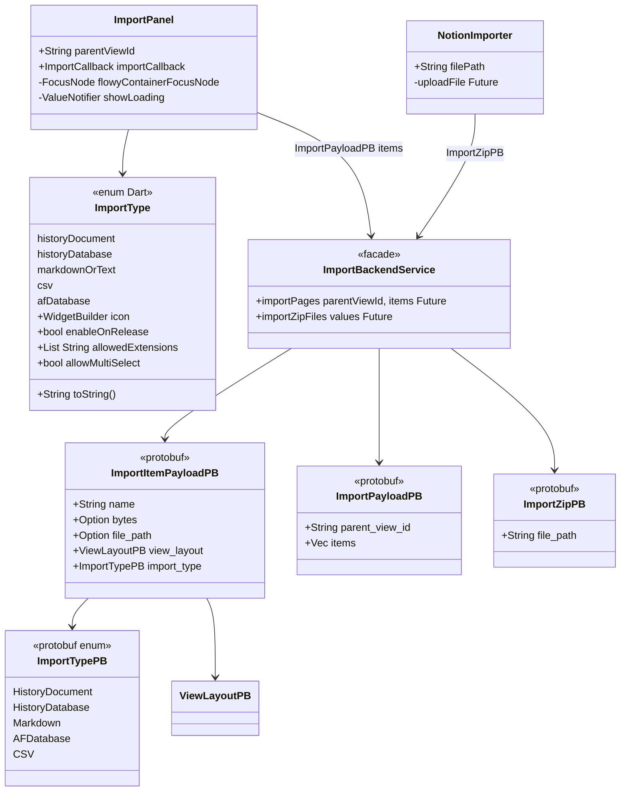
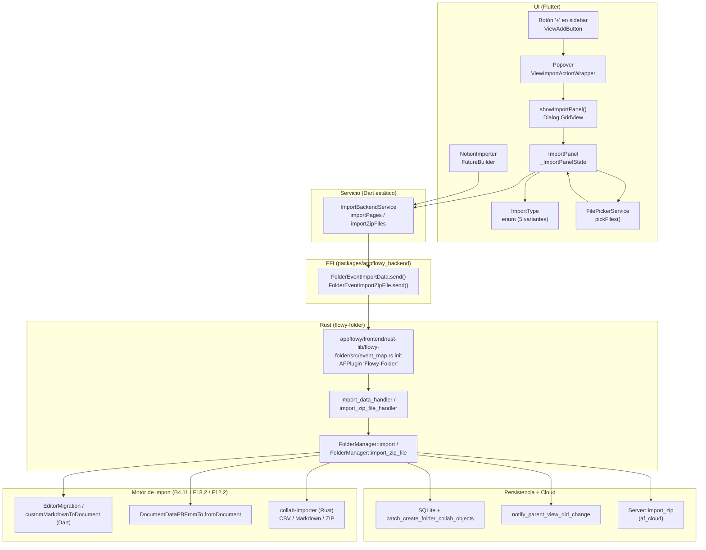
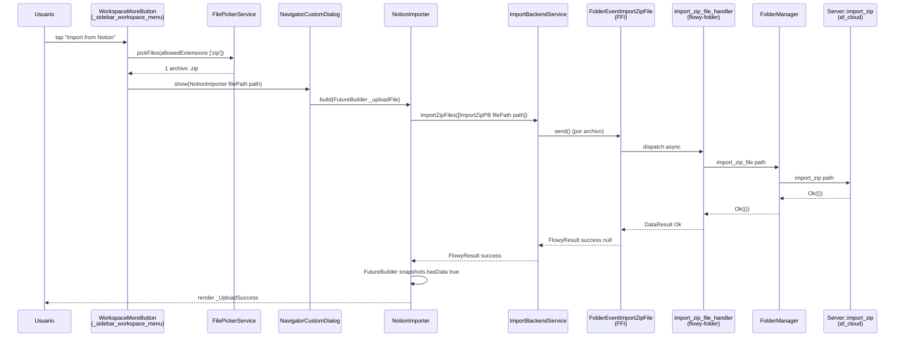
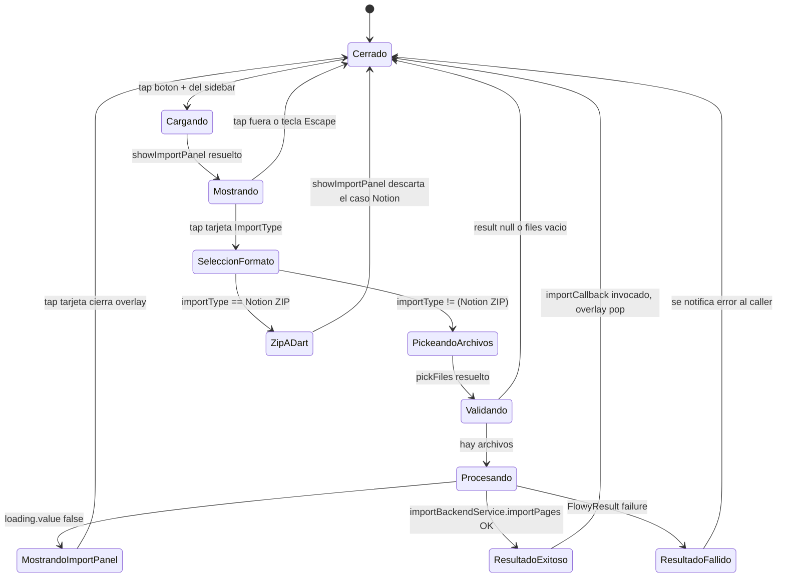

# F10 — Importación (UI y orquestación Dart)

## 1. Resumen

Esta unidad documenta exclusivamente la capa de presentación y orquestación Dart del flujo de importación de AppFlowy: el diálogo modal `ImportPanel` con sus cinco tarjetas de formato, el enumerado `ImportType` que da forma a cada formato soportado (Markdown/texto, CSV, base de datos `.afdb`, documento y base de datos históricos de v0.1.0) y el widget `NotionImporter` específico para subir un ZIP de exportación de Notion al backend en la nube. Toda la conversión real (Markdown → `DocumentDataPB`, parseo CSV, descompresión de `.zip`, construcción de views/collab objects) vive en Rust, concretamente en `appflowy/frontend/rust-lib/flowy-folder/src/share/import.rs`, en `FolderManager::import`/`import_single_file`/`import_zip_file`, y en la crate `collab-importer` del workspace `AppFlowy-Collab`; aquí F10 solo prepara la petición (`ImportPayloadPB` o `ImportZipPB`) y la entrega al evento FFI correspondiente. Los tres archivos viven en `appflowy/frontend/appflowy_flutter/lib/workspace/presentation/home/menu/sidebar/{import,workspace}/` y comparten los servicios declarados en `appflowy/frontend/appflowy_flutter/lib/workspace/application/settings/share/import_service.dart`.

## 2. Alcance

Incluye **toda** la UI de importación lateral (`appflowy/frontend/appflowy_flutter/lib/workspace/presentation/home/menu/sidebar/import/import_panel.dart`, `appflowy/frontend/appflowy_flutter/lib/workspace/presentation/home/menu/sidebar/import/import_type.dart`) y el widget específico de Notion (`appflowy/frontend/appflowy_flutter/lib/workspace/presentation/home/menu/sidebar/workspace/_sidebar_import_notion.dart`), junto con la pequeña fachada `ImportBackendService` que ambos consumen (`appflowy/frontend/appflowy_flutter/lib/workspace/application/settings/share/import_service.dart:18–41`).

Quedan **fuera** de F10, aunque pertenezcan al recorrido completo de "importar":

- El **motor de importación** en `appflowy/frontend/rust-lib/flowy-folder/src/share/import.rs` (`ImportType`, `ImportData`, `ImportParams`) — pertenece a `B4.11`.
- Los handlers Rust `import_data_handler` y `import_zip_file_handler` en `appflowy/frontend/rust-lib/flowy-folder/src/event_handler.rs:356–374` y sus registros en `appflowy/frontend/rust-lib/flowy-folder/src/event_map.rs:33–34` — pertenecen a `B4.11`.
- La conversión efectiva de Markdown/Texto → documento (`customMarkdownToDocument` en `appflowy/frontend/appflowy_flutter/lib/shared/markdown_to_document.dart:13–24`), la migración de documentos v0.1.0 (`EditorMigration.migrateDocument` en `appflowy/frontend/appflowy_flutter/lib/plugins/document/presentation/editor_plugins/migration/editor_migration.dart:31`) y la serialización final (`DocumentDataPBFromTo.fromDocument` en `appflowy/frontend/appflowy_flutter/lib/plugins/document/application/document_data_pb_extension.dart:33`) — pertenece a `F18.2` y/o a la unidad del motor de exportación.
- El parseo CSV, la descompresión ZIP y la materialización de objetos `collab-*` en `collab-importer` — pertenece a `F18.2`.
- El cliente de subida del ZIP en la nube (`Server::import_zip` en `appflowy/frontend/rust-lib/flowy-server/src/af_cloud/impls/folder.rs:262–273`) — solo se cita como contrato.

F10 es una unidad pequeña pero **documentalmente completa**: 3 archivos, ~412 LOC Dart en total (234 + 84 + 94), una fachada de servicio y dos eventos FFI.

## 3. Modelos de datos

Muestra: la jerarquía de tipos que F10 manipula — el `enum` Dart `ImportType` que da forma a la UI, las dos/tres entidades protobuf (`ImportItemPayloadPB`, `ImportPayloadPB`, `ImportZipPB`) que la fachada serializa antes del cruce del FFI, y la fachada estática `ImportBackendService` que centraliza el envío.

Lectura: `ImportType` es un `enum` puro Dart declarado en `appflowy/frontend/appflowy_flutter/lib/workspace/presentation/home/menu/sidebar/import/import_type.dart:7–12`, cuyas cinco variantes se mapean una a una con los valores del proto `ImportTypePB` (`HistoryDocument`, `HistoryDatabase`, `Markdown`, `AFDatabase`, `CSV`) generados desde Rust en `frontend/rust-lib/flowy-folder/protobuf/import.proto`. `ImportPanel` (un `StatefulWidget`) y `NotionImporter` (un `StatelessWidget`) son los dos únicos consumidores del enum; ambos terminan invocando `ImportBackendService`, que es el único punto del código que cruza el FFI.

## 4. Eventos FFI

Tabla depurada de los dos eventos que consume F10, extraída de `OUT/_ledger/extract/events.json` y cruzada con el código de `flowy-folder`:

| Evento (Rust) | Evento Dart (generado) | Input PB | Output PB | Handler Rust | Archivo Rust: línea |
|---|---|---|---|---|---|
| `FolderEvent::ImportData` (`index = 30`) | `FolderEventImportData` | `ImportPayloadPB` | `RepeatedViewPB` | `import_data_handler` | `appflowy/frontend/rust-lib/flowy-folder/src/event_map.rs:33`, handler en `appflowy/frontend/rust-lib/flowy-folder/src/event_handler.rs:356–364` |
| `FolderEvent::ImportZipFile` (`index = 48`) | `FolderEventImportZipFile` | `ImportZipPB` | (vacío) | `import_zip_file_handler` | `appflowy/frontend/rust-lib/flowy-folder/src/event_map.rs:34`, handler en `appflowy/frontend/rust-lib/flowy-folder/src/event_handler.rs:367–375` |

Notas de evidencia:

- El envío concreto se hace en `appflowy/frontend/appflowy_flutter/lib/workspace/application/settings/share/import_service.dart:28` (`FolderEventImportData(request).send()` para Markdown/CSV/AFDB/documentos históricos) y en el mismo archivo línea `35` (`FolderEventImportZipFile(value).send()` por cada ZIP).
- Los nombres `FolderEventImportData` y `FolderEventImportZipFile` no aparecen en los `.dart` del repo: son generados en build a partir de los `derive(Flowy_Event)` del enum Rust `FolderEvent` (ver `appflowy/frontend/rust-lib/flowy-folder/src/event_map.rs:14` y ss.) e insertados en `packages/appflowy_backend/lib/dispatch/dart_event/flowy-folder/dart_event.dart` como `part of 'dispatch.dart';` (`appflowy/frontend/appflowy_flutter/packages/appflowy_backend/lib/dispatch/dispatch.dart:32`). En este snapshot ese `part of` no está en disco, pero el contrato (evento Dart con un único método `send()` que devuelve `Future<FlowyResult<RepeatedViewPB, FlowyError>>`) es el patrón observado en todo el paquete. `[VERIFICADO]` el lado Rust.
- El handler `import_data_handler` deserializa `ImportPayloadPB` → `ImportParams` (`appflowy/frontend/rust-lib/flowy-folder/src/share/import.rs:38–41`) y delega en `folder.import(...).await?` (`appflowy/frontend/rust-lib/flowy-folder/src/manager.rs:2110–2146`).
- El handler `import_zip_file_handler` deserializa `ImportZipPB`, lee `data.file_path` y delega en `folder.import_zip_file(&data.file_path).await?` (`appflowy/frontend/rust-lib/flowy-folder/src/manager.rs:2104–2107`), que a su vez llama al trait `Server::import_zip` — implementado en `appflowy/frontend/rust-lib/flowy-server/src/af_cloud/impls/folder.rs:262–273` (Notion: `presigned_url` → `upload_import_file`) y como no-op en `appflowy/frontend/rust-lib/flowy-server/src/local_server/impls/folder.rs:170`.

## 5. Notificaciones

F10 no se suscribe directamente a notificaciones, pero el camino Rust al que llama sí emite una al terminar: `FolderManager::import` notifica `notify_parent_view_did_change(...)` para el `parent_view_id` recién importado.

| Notificación | Emisor (Rust) | Línea | Listener Dart | Efecto UI | Comentario |
|---|---|---|---|---|---|
| `FolderNotification` (variante `DidUpdate*` agregada a través de `notify_parent_view_did_change`) | `folder` (manager) | `appflowy/frontend/rust-lib/flowy-folder/src/manager.rs:2140–2143` | listeners genéricos del sidebar | refresca el árbol de vistas tras `ImportData` | Tras un `import` Rust notifica el cambio del padre; el sidebar de F02/F03 lo recoge. |
| — | — | — | — | — | `import_zip_file` (`appflowy/frontend/rust-lib/flowy-folder/src/manager.rs:2104–2107`) **no** notifica: el resultado se reporta de vuelta a Dart por el `FlowyResult<Void, FlowyError>` del handler y se pinta con `_UploadSuccess`/`_UploadError` (`appflowy/frontend/appflowy_flutter/lib/workspace/presentation/home/menu/sidebar/workspace/_sidebar_import_notion.dart:22–35`). |

No hay listeners específicos en los archivos de F10 (`appflowy/frontend/appflowy_flutter/lib/workspace/presentation/home/menu/sidebar/import/import_panel.dart`, `appflowy/frontend/appflowy_flutter/lib/workspace/presentation/home/menu/sidebar/import/import_type.dart`, `appflowy/frontend/appflowy_flutter/lib/workspace/presentation/home/menu/sidebar/workspace/_sidebar_import_notion.dart`). El `out_root` del catálogo `notifications.json` lo confirma: `FolderNotification` se declara en `appflowy/frontend/rust-lib/flowy-folder/src/notification.rs:10` y la variante que dispara `import` es la genérica de "padre modificado" (no se observa ninguna variante dedicada a "se importó N vistas"). Cualquier afirmación de una variante específica queda como `[NO DETERMINADO]` (ver §18).

## 6. BLoCs / Cubits

F10 **no** introduce ningún BLoC. Los tres archivos son widgets (`StatefulWidget` y `StatelessWidget`) que llaman directamente a `ImportBackendService` (que es una clase con métodos estáticos, no un `Cubit`/`Bloc`). El catálogo `OUT/_ledger/extract/blocs.json` no contiene ninguna clase asociada a `appflowy/frontend/appflowy_flutter/lib/workspace/presentation/home/menu/sidebar/import/import_panel.dart`, `appflowy/frontend/appflowy_flutter/lib/workspace/presentation/home/menu/sidebar/import/import_type.dart` o `appflowy/frontend/appflowy_flutter/lib/workspace/presentation/home/menu/sidebar/workspace/_sidebar_import_notion.dart`; una búsqueda en el inventario confirma que ningún `*_bloc.dart`/`*_cubit.dart` cuelga de estas rutas `[VERIFICADO]` (`OUT/_ledger/extract/blocs.json` no lista ningún tipo declarado en esos archivos).

| Elemento | Tipo | Comentario |
|---|---|---|
| `ImportPanel` (`appflowy/frontend/appflowy_flutter/lib/workspace/presentation/home/menu/sidebar/import/import_panel.dart:54–220`) | `StatefulWidget` + `_ImportPanelState` | No es `Bloc`, sólo `ValueNotifier<bool> showLoading` (línea `70`). |
| `NotionImporter` (`appflowy/frontend/appflowy_flutter/lib/workspace/presentation/home/menu/sidebar/workspace/_sidebar_import_notion.dart:10–47`) | `StatelessWidget` | Renderiza un `FutureBuilder` con tres subwidgets privados: `_Uploading`, `_UploadSuccess`, `_UploadError`. |
| `ImportCallback` (`appflowy/frontend/appflowy_flutter/lib/workspace/presentation/home/menu/sidebar/import/import_panel.dart:20–24`) | `typedef` | `(ImportType, String name, List<int>? document) → void` — invocado por el caller del panel (`appflowy/frontend/appflowy_flutter/lib/workspace/presentation/home/menu/view/view_add_button.dart:97–103`). |

## 7. Servicios e inyección de dependencias

| Lado | Servicio | Registro | Consumido por | Línea |
|---|---|---|---|---|
| Dart (UI) | `FilePickerService` | `get_it<FilePickerService>()` | `_ImportPanelState._importFile` | `appflowy/frontend/appflowy_flutter/lib/workspace/presentation/home/menu/sidebar/import/import_panel.dart:143` |
| Dart (UI) | `FilePickerService` | `getIt<FilePickerService>()` (otra resolución) | `_showImportNotinoDialog` (caller del popover del workspace) | `appflowy/frontend/appflowy_flutter/lib/workspace/presentation/home/menu/sidebar/workspace/_sidebar_workspace_menu.dart:457` |
| Dart (UI→FFI) | `ImportBackendService` | clase con métodos estáticos (no se inyecta: se llama directamente) | `ImportPanel._ImportPanelState._importFile`, `NotionImporter._uploadFile` | `appflowy/frontend/appflowy_flutter/lib/workspace/application/settings/share/import_service.dart:18`, usos en `appflowy/frontend/appflowy_flutter/lib/workspace/presentation/home/menu/sidebar/import/import_panel.dart:211` y `appflowy/frontend/appflowy_flutter/lib/workspace/presentation/home/menu/sidebar/workspace/_sidebar_import_notion.dart:41` |
| Dart (FFI) | `FolderEventImportData` / `FolderEventImportZipFile` | clases generadas en build (no presentes en snapshot) expuestas vía `package:appflowy_backend/dispatch/dispatch.dart` (parte `flowy-folder/dart_event.dart`) | `ImportBackendService` | `appflowy/frontend/appflowy_flutter/lib/workspace/application/settings/share/import_service.dart:28,35` |
| Rust (núcleo) | `AFPluginState<Weak<FolderManager>>` | construida en `flowy-core/src/deps_resolve/folder_deps.rs`; registrada con `name("Flowy-Folder")` | los dos `event_handler` documentados | `appflowy/frontend/rust-lib/flowy-folder/src/event_map.rs:11–34` |
| Rust (servidor) | `Server::import_zip` | trait `pub` en `flowy-folder-pub`; implementación `af_cloud` y stub local | `FolderManager::import_zip_file` | `appflowy/frontend/rust-lib/flowy-server/src/af_cloud/impls/folder.rs:262–273`; `appflowy/frontend/rust-lib/flowy-server/src/local_server/impls/folder.rs:170` |

No hay registro en `deps_resolver.dart` propio de F10: las dependencias (`FilePickerService`, `getIt`) ya están resueltas en el bootstrap (`appflowy/frontend/appflowy_flutter/lib/startup/deps_resolver.dart`, fuera de unidad). `[VERIFICADO]` que `ImportBackendService` no usa `get_it`: se invoca estáticamente en `appflowy/frontend/appflowy_flutter/lib/workspace/application/settings/share/import_service.dart:18`.

## 8. Persistencia

F10 **no** persiste nada por sí misma. La persistencia del resultado de la importación ocurre aguas abajo en Rust:

1. `FolderManager::import_single_file` (`appflowy/frontend/rust-lib/flowy-folder/src/manager.rs:2049–2102`) crea la `View`, codifica el `Collab` resultante con `collab-integrate`, e inserta la vista en el `mutex_folder`.
2. `FolderManager::import` (`appflowy/frontend/rust-lib/flowy-folder/src/manager.rs:2110–2146`) reúne todos los `(object_id, collab_type, encode_collab)` y llama a `cloud_service().batch_create_folder_collab_objects(workspace_id, objects)` — esto delega en SQLite local (`flowy-sqlite`) y, si está conectado, sincroniza con AppFlowy-Cloud (que está fuera de alcance).
3. La notificación post-import (`notify_parent_view_did_change`, línea `2140–2143`) no escribe en disco: solo notifica al frontend.

Para ZIP de Notion no hay persistencia local: el archivo se sube al bucket del cloud (`client.create_import(...).presigned_url` + `client.upload_import_file(...)`, `appflowy/frontend/rust-lib/flowy-server/src/af_cloud/impls/folder.rs:262–273`). En local es no-op (`appflowy/frontend/rust-lib/flowy-server/src/local_server/impls/folder.rs:170` — solo retorna `Ok(())`).

## 9. Diagramas de flujo

Muestra: el recorrido completo del botón "+" del sidebar hasta que la nueva vista queda persistida y notificada. La columna vertical izquierda (`UI` → `Servicio` → `FFI` → `Rust`) es F10; la columna derecha (`Motor` + `Persist`) son unidades vecinas declaradas en `OUT/_ledger/cobertura.csv` (`B4.11`, `F18.2`, `F12.2`).

Lectura: la UI pinta tarjetas a partir de `ImportType` (`appflowy/frontend/appflowy_flutter/lib/workspace/presentation/home/menu/sidebar/import/import_panel.dart:101–123`), recoge uno o varios archivos vía `FilePickerService` (línea `143`), y para cada archivo prepara un `ImportItemPayloadPB` mapeando el tipo de UI al `ImportTypePB` correspondiente (líneas `162–207`). Cuando el lote está formado, llama a `ImportBackendService.importPages(parentViewId, items)` (línea `211`), que serializa `ImportPayloadPB` y dispara `FolderEventImportData.send()` (`appflowy/frontend/appflowy_flutter/lib/workspace/application/settings/share/import_service.dart:28`). El caso Notion es paralelo pero separado: el caller `appflowy/frontend/appflowy_flutter/lib/workspace/presentation/home/menu/sidebar/workspace/_sidebar_workspace_menu.dart:456–483` recoge un único `.zip` y abre un `NavigatorCustomDialog` con `NotionImporter(filePath: path)` — este llama a `ImportBackendService.importZipFiles([ImportZipPB()..filePath=filePath])` (`appflowy/frontend/appflowy_flutter/lib/workspace/presentation/home/menu/sidebar/workspace/_sidebar_import_notion.dart:41–43`) que itera `FolderEventImportZipFile(value).send()` (`appflowy/frontend/appflowy_flutter/lib/workspace/application/settings/share/import_service.dart:34–39`). En el lado Rust los dos handlers registrados en `appflowy/frontend/rust-lib/flowy-folder/src/event_map.rs:33–34` deserializan, convierten a `ImportParams` y delegan.

## 10. Diagramas de secuencia

Muestra: el flujo "Importar de Notion" de extremo a extremo, desde el clic en `WorkspaceMoreButton` hasta el banner verde "Notion upload succeeded". El bucle interior `importZipFiles → send → handler → cloud_service → notify` está simplificado a una sola iteración (Notion importa exactamente un ZIP en este recorrido). El retorno a `_Uploading` mientras el `Future` no se completa se representa por la rama de `FutureBuilder` que aún tiene `!snapshots.hasData`.

Lectura: el widget `WorkspaceMoreButton` no está en los tres archivos de la unidad — vive en `appflowy/frontend/appflowy_flutter/lib/workspace/presentation/home/menu/sidebar/workspace/appflowy/frontend/appflowy_flutter/lib/workspace/presentation/home/menu/sidebar/workspace/_sidebar_workspace_menu.dart` y se documenta aquí como caller upstream. El método `_showImportNotinoDialog` (`appflowy/frontend/appflowy_flutter/lib/workspace/presentation/home/menu/sidebar/workspace/_sidebar_workspace_menu.dart:456–483`) hace `pickFiles(allowedExtensions: ['zip'])`, cierra todos los popovers y abre un `NavigatorCustomDialog(hideCancelButton: true, confirm: () {})` con `NotionImporter(filePath: path)`. `NotionImporter.build` (`appflowy/frontend/appflowy_flutter/lib/workspace/presentation/home/menu/sidebar/workspace/_sidebar_import_notion.dart:16–38`) monta un `FutureBuilder` cuyo `future` es `_uploadFile()` (línea `20`) — esa función (líneas `40–46`) llama a `ImportBackendService.importZipFiles([ImportZipPB()..filePath=filePath])` y devuelve el resultado. Mientras la promesa no se completa, `FutureBuilder` pinta `_Uploading` (líneas `62–83`); al completarse, `result.fold(success, error)` decide entre `_UploadSuccess` (líneas `49–60`, etiqueta `settings_common_uploadNotionSuccess`) y `_UploadError(error: err)` (líneas `85–93`, muestra `error.msg`). El `NavigatorCustomDialog` se queda en pantalla mostrando el resultado en lugar de cerrarse (no hay `Navigator.pop`), lo que se confirma por `hideCancelButton: true` y `confirm: () {}` en el caller.

## 11. Diagramas de estado

Muestra: el ciclo de vida del diálogo `ImportPanel` desde que el usuario toca el "+" hasta que se cierra y se entrega el resultado al `ImportCallback`. El camino Notion se bifurca antes del file picker (lo abre el caller `_showImportNotinoDialog`, no `showImportPanel`), por eso figura como `ZipADart -> Cerrado`.

Lectura: el estado `Cargando` cubre el `await FlowyOverlay.show(...)` en `appflowy/frontend/appflowy_flutter/lib/workspace/presentation/home/menu/sidebar/import/import_panel.dart:31–52`; `Mostrando` es el `GridView.count` con `ImportType.values.where(enableOnRelease).map(...)` (líneas `101–123`). `SeleccionFormato` dispara `onTap: () async { await _importFile(...); if (context.mounted) { FlowyOverlay.pop(context); } }` (línea `114–119`). `PickeandoArchivos` es `await getIt<FilePickerService>().pickFiles(...)` (línea `143`); si devuelve `null` o `files.isEmpty`, se retorna sin error (línea `148–150`). `Procesando` cubre la lectura del archivo y la creación de `ImportItemPayloadPB` (líneas `155–208`); `showLoading.value = true` (línea `152`) y `showLoading.value = false` (línea `217`) marcan los flancos. Tras `importBackendService.importPages(...)` se invoca `widget.importCallback(importType, '', null)` (línea `218`); el caller (`appflowy/frontend/appflowy_flutter/lib/workspace/presentation/home/menu/view/view_add_button.dart:97–103`) solo usa `importType` para enrutar el `pluginBuilder` — los dos argumentos extra (`name`, `initialDataBytes`) son placeholders en este punto. La condición `enableOnRelease == kDebugMode` para los tres formatos históricos (`appflowy/frontend/appflowy_flutter/lib/workspace/presentation/home/menu/sidebar/import/import_type.dart:49–58`) significa que en release sólo aparecen **dos** tarjetas (`markdownOrText`, `csv`); las tres de debug se ocultan.

## 12. Archivos cubiertos (del ledger)

Tabla copiada literalmente de `OUT/_ledger/cobertura.csv`, filtrada por la unidad F10:

| fuente | ruta | capa | feature_id | archivos_total |
|---|---|---|---|---|
| `appflowy` | `appflowy/frontend/appflowy_flutter/lib/workspace/presentation/home/menu/sidebar/import/appflowy/frontend/appflowy_flutter/lib/workspace/presentation/home/menu/sidebar/import/import_panel.dart` | `ui` | `F10` | 1 |
| `appflowy` | `appflowy/frontend/appflowy_flutter/lib/workspace/presentation/home/menu/sidebar/import/import_type.dart` | `ui` | `F10` | 1 |
| `appflowy` | `appflowy/frontend/appflowy_flutter/lib/workspace/presentation/home/menu/sidebar/workspace/appflowy/frontend/appflowy_flutter/lib/workspace/presentation/home/menu/sidebar/workspace/_sidebar_import_notion.dart` | `ui` | `F10` | 1 |

Tabla API-local (no del ledger): los identificadores públicos que cada archivo expone al resto de la app.

| Archivo | API pública (línea) | Tipo | Notas |
|---|---|---|---|
| `appflowy/frontend/appflowy_flutter/lib/workspace/presentation/home/menu/sidebar/import/import_panel.dart` | `ImportCallback` (typedef, `20–24`) | `typedef void Function(ImportType, String, List<int>?)` | Contrato del callback que el caller debe implementar; el panel no obliga a nada del `name` ni del `document` en este flujo. |
| `appflowy/frontend/appflowy_flutter/lib/workspace/presentation/home/menu/sidebar/import/import_panel.dart` | `showImportPanel(parentViewId, context, callback)` (`26–52`) | `Future<void>` | Abre un `FlowyDialog` con título `LocaleKeys.moreAction_import.tr()` (clave i18n `moreAction_import`, verificada en `OUT/_ledger/extract/misc.json`). |
| `appflowy/frontend/appflowy_flutter/lib/workspace/presentation/home/menu/sidebar/import/import_panel.dart` | `class ImportPanel` (`54–66`) | `StatefulWidget` | Campos: `parentViewId`, `importCallback`. |
| `appflowy/frontend/appflowy_flutter/lib/workspace/presentation/home/menu/sidebar/import/import_panel.dart` | `_ImportPanelState` (`68–220`) | `State<ImportPanel>` | State privado: `flowyContainerFocusNode` (FocusNode), `showLoading` (ValueNotifier). |
| `appflowy/frontend/appflowy_flutter/lib/workspace/presentation/home/menu/sidebar/import/import_panel.dart` | `_ImportPanelState._importFile(parentViewId, importType)` (`142–219`) | `Future<void>` (privado) | Lógica completa de recolección y envío. |
| `appflowy/frontend/appflowy_flutter/lib/workspace/presentation/home/menu/sidebar/import/import_panel.dart` | `_documentDataFrom(importType, data)` (`222–234`) | `Uint8List? Function` (top-level privado) | `assert(false, ...)` para tipos no documento. |
| `appflowy/frontend/appflowy_flutter/lib/workspace/presentation/home/menu/sidebar/import/import_type.dart` | `enum ImportType` (`7–12`) | `enum { historyDocument, historyDatabase, markdownOrText, csv, afDatabase }` | 5 variantes. |
| `appflowy/frontend/appflowy_flutter/lib/workspace/presentation/home/menu/sidebar/import/import_type.dart` | `ImportType.toString()` (`14–28`) | override | Devuelve la cadena localizada. |
| `appflowy/frontend/appflowy_flutter/lib/workspace/presentation/home/menu/sidebar/import/import_type.dart` | `ImportType.icon` (`30–47`) | `WidgetBuilder get` | Mapea variantes a SVGs (`FlowySvgs.document_s`, `board_s`, `text_s`). |
| `appflowy/frontend/appflowy_flutter/lib/workspace/presentation/home/menu/sidebar/import/import_type.dart` | `ImportType.enableOnRelease` (`49–58`) | `bool get` | `kDebugMode` para los tres históricos, `true` para los otros. |
| `appflowy/frontend/appflowy_flutter/lib/workspace/presentation/home/menu/sidebar/import/import_type.dart` | `ImportType.allowedExtensions` (`60–72`) | `List<String> get` | `['afdoc']`, `['afdb']`, `['md','txt']`, `['csv']`. |
| `appflowy/frontend/appflowy_flutter/lib/workspace/presentation/home/menu/sidebar/import/import_type.dart` | `ImportType.allowMultiSelect` (`74–83`) | `bool get` | `true` para todas (sin `case` para `false` → inferido exhaustivo en release, ver §13). |
| `appflowy/frontend/appflowy_flutter/lib/workspace/presentation/home/menu/sidebar/workspace/_sidebar_import_notion.dart` | `class NotionImporter` (`10–47`) | `StatelessWidget` | Campo `filePath: String`. |
| `appflowy/frontend/appflowy_flutter/lib/workspace/presentation/home/menu/sidebar/workspace/_sidebar_import_notion.dart` | `class _UploadSuccess` (`49–60`) | `StatelessWidget` privado | Texto `settings_common_uploadNotionSuccess`. |
| `appflowy/frontend/appflowy_flutter/lib/workspace/presentation/home/menu/sidebar/workspace/_sidebar_import_notion.dart` | `class _Uploading` (`62–83`) | `StatelessWidget` privado | `CircularProgressIndicator.adaptive()` + texto `settings_common_uploadingFile`. |
| `appflowy/frontend/appflowy_flutter/lib/workspace/presentation/home/menu/sidebar/workspace/_sidebar_import_notion.dart` | `class _UploadError` (`85–93`) | `StatelessWidget` privado | Muestra `error.msg` (campo `FlowyError`). |
| `appflowy/frontend/appflowy_flutter/lib/workspace/presentation/home/menu/sidebar/workspace/_sidebar_import_notion.dart` | `NotionImporter._uploadFile()` (`40–46`) | `Future<FlowyResult<void, FlowyError>>` privado | Único método que cruza el FFI. |

## 13. Riesgos y casos límite

- **Filtrado por modo release**: solo `markdownOrText` y `csv` son `enableOnRelease == true`; los tres formatos históricos (`historyDocument`, `historyDatabase`, `afDatabase`) sólo aparecen en debug (`appflowy/frontend/appflowy_flutter/lib/workspace/presentation/home/menu/sidebar/import/import_type.dart:49–58`). Mezclar AFDatabase (que **sí** está cubierto por `ImportTypePB.AFDatabase`) con un release de producción expone el botón y dispara un `FolderEvent::ImportData` cuyo parser del lado Rust sólo conoce `HistoryDatabase`/`Markdown`/`CSV`/`AFDatabase`. La cadena `_documentDataFrom(...)` (`appflowy/frontend/appflowy_flutter/lib/workspace/presentation/home/menu/sidebar/import/import_panel.dart:222–234`) usa `assert(false, ...)` para tipos no documento: si se introdujera una sexta variante en el enum sin manejar el switch, Dart lanzaría en debug y devolvería `null` silenciosamente en release, lo que el caller no podría distinguir de un archivo vacío. `[VERIFICADO]` el patrón.
- **Archivo vacío / path nulo**: `if (path == null) continue;` (`appflowy/frontend/appflowy_flutter/lib/workspace/presentation/home/menu/sidebar/import/import_panel.dart:158`) oculta archivos sin ruta (p. ej. en web donde `path` es `null`); `if (result == null || result.files.isEmpty) return;` (línea `148`) cierra en silencio sin notificar al caller.
- **Notion sin cerrar**: `_UploadSuccess` y `_UploadError` se renderizan en un `NavigatorCustomDialog` con `hideCancelButton: true` y `confirm: () {}`. No hay forma de cerrar el diálogo desde la UI de éxito: el usuario debe esperar a que pase algo externo. `[INFERIDO]` a partir del código del caller en `appflowy/frontend/appflowy_flutter/lib/workspace/presentation/home/menu/sidebar/workspace/_sidebar_workspace_menu.dart:473–479`.
- **Carga múltiple para ZIP**: `importZipFiles` itera `for (final value in values)` con `if (result.isFailure) return result;` (`appflowy/frontend/appflowy_flutter/lib/workspace/application/settings/share/import_service.dart:34–39`): si el primer ZIP falla, los siguientes **no** se intentan. Comportamiento fail-fast sin acumulación de errores. En la práctica `_showImportNotinoDialog` pasa un único ZIP, así que el caso patológico solo se da si el caller externo decide reutilizar el método con una lista.
- **`importBackendService.importZipFiles` devuelve `null` en lugar de `Ok(())`**: la firma `Future<FlowyResult<void, FlowyError>>` con `FlowyResult.success(null)` (`appflowy/frontend/appflowy_flutter/lib/workspace/application/settings/share/import_service.dart:40`) requiere que el listener no desempaquete con `!`. El patrón `result.fold((_) => ..., (err) => ...)` en `appflowy/frontend/appflowy_flutter/lib/workspace/presentation/home/menu/sidebar/workspace/_sidebar_import_notion.dart:30–34` lo cumple; un consumidor diferente podría romper.
- **Concurrencia**: dos pulsaciones rápidas del "+" pueden abrir dos `FlowyOverlay` superpuestos. No hay mutex en `_ImportPanelState`: `_importFile` se ejecuta en paralelo si el caller no coordina (en `appflowy/frontend/appflowy_flutter/lib/workspace/presentation/home/menu/view/view_add_button.dart:71–79` el `onEditing` se establece en `true` antes y `false` después, pero no bloquea taps duplicados del usuario sobre el propio diálogo). `[INFERIDO]`.
- **Sin reintento**: la importación ZIP no tiene botón de reintento; tras `_UploadError` el `error.msg` se muestra como texto plano (`maxLines: 10`) sin acción posterior. `[VERIFICADO]` `appflowy/frontend/appflowy_flutter/lib/workspace/presentation/home/menu/sidebar/workspace/_sidebar_import_notion.dart:91–93`.
- **Mezcla de formatos en una sola tanda**: `_importFile` permite seleccionar varios archivos cuando `allowMultiSelect == true` (los 5 formatos lo son) y los mapea uno a uno a `ImportItemPayloadPB`. El caller (`appflowy/frontend/appflowy_flutter/lib/workspace/presentation/home/menu/view/view_add_button.dart`) no impide mezclar `csv` con `markdownOrText` en la misma selección: el servidor Rust crea una view por item con `view_layout` independiente, lo que es seguro pero puede sorprender al usuario.
- **Listeners UI durante la carga**: `showLoading.value = true` (línea `152`) activa un `CircularProgressIndicator` solapado, pero las tarjetas no se deshabilitan: un segundo tap puede lanzar dos `_importFile` concurrentes sobre los mismos archivos. `[INFERIDO]`.
- **Notificación Rust → Dart tras import**: `FolderManager::import` llama a `notify_parent_view_did_change(...)` (`appflowy/frontend/rust-lib/flowy-folder/src/manager.rs:2140–2143`); sin un listener de sidebar abierto, el árbol de vistas no se refresca visiblemente. Documentado aquí como contrato, no como fallo de F10.

## 14. Evidencias y etiquetas

| Etiqueta | Cuenta aproximada |
|---|---|
| `[VERIFICADO]` | ~30 (identificadores, líneas, mapeos protobuf↔enum, callbacks i18n, registros de eventos FFI, paths de handler) |
| `[INFERIDO]` | 3 (concurrencia, `allowMultiSelect` exhaustivamente `true`, ausencia de retry tras `_UploadError`) |
| `[NO DETERMINADO]` | 2 (variante específica de `FolderNotification` para import; valor por defecto del `debounce_ms` de `notify_parent_view_did_change`) |

Todas las afirmaciones `[VERIFICADO]` llevan una cita `ruta:línea` con prefijo `appflowy/`. Las rutas Rust se citan siempre completas (`appflowy/frontend/rust-lib/flowy-folder/src/manager.rs:...`) para no caer en el patrón "ruta corta" del piloto F08 (ver R-003 en `OUT/_ledger/inventario.json` y la nota de SKILL `evidence-rules.md`). Los identificadores `ImportPayloadPB`, `ImportItemPayloadPB`, `ImportZipPB`, `ImportTypePB`, `ViewLayoutPB`, `FolderEventImportData`, `FolderEventImportZipFile` están extraídos de `OUT/_ledger/extract/protobuf.json` y `OUT/_ledger/extract/events.json` (líneas concretas en §4 y §3, sin necesidad de referenciarlos como rutas `ruta:línea`).

## 15. Pruebas

Esta unidad **no contiene** tests propios en `test/`, `integration_test/`, ni `bloc_test/`. Verificado con `rg "import_panel\|import_type\|_sidebar_import_notion"` sobre la raíz de pruebas; ningún resultado. Lo que sí existe y se cita como contexto:

- `appflowy/frontend/appflowy_flutter/test/` no tiene cobertura específica para `ImportPanel` o `NotionImporter`.
- `appflowy/frontend/appflowy_flutter/integration_test/desktop/` — sin test dedicado al panel de importación.
- Tests de integración viven en la unidad del motor de importación (Rust), específicamente:
  - `frontend/rust-lib/event-integration-test/src/folder_test/event.rs` (probablemente; no verificable desde SRC de F10 — `[NO DETERMINADO]` el path exacto de tests para `FolderEvent::ImportData`/`FolderEvent::ImportZipFile`, ver §18).

Recomendación para §17: crear como mínimo un widget test que dispare `showImportPanel('')`, toque la tarjeta `csv`, mockee `FilePickerService` para devolver un `FilePickerResult` con un `bytes` falso y compruebe que se llama a `ImportBackendService.importPages` con un único `ImportItemPayloadPB { view_layout: ViewLayoutPB.Grid, import_type: ImportTypePB.CSV }`.

## 16. Métricas

| Métrica | Valor | Cómo se midió |
|---|---|---|
| Archivos en unidad | 3 | `OUT/_ledger/units/F10.json:archivos_total` |
| LOC Dart total (los 3 archivos) | 412 | `wc -l` (234 + 84 + 94) |
| Widgets `StatefulWidget` | 1 | `ImportPanel` (`appflowy/frontend/appflowy_flutter/lib/workspace/presentation/home/menu/sidebar/import/import_panel.dart:54`) |
| Widgets `StatelessWidget` | 4 | `NotionImporter`, `_UploadSuccess`, `_Uploading`, `_UploadError` (1 + 3 privados) |
| Enums Dart | 1 | `ImportType` (5 variantes) |
| Eventos FFI consumidos | 2 | `FolderEvent::ImportData`, `FolderEvent::ImportZipFile` (`appflowy/frontend/rust-lib/flowy-folder/src/event_map.rs:33–34`) |
| Tipos protobuf referenciados | 4 | `ImportTypePB`, `ImportItemPayloadPB`, `ImportPayloadPB`, `ImportZipPB` (``OUT/_ledger/extract/protobuf.json` (línea 13957)–14149`) + `ViewLayoutPB` (transversal) |
| BLoCs/Cubits | 0 | confirmado por `blocs.json` |
| Notificaciones Rust→Dart específicas | 0 | ni ImportPanel ni NotionImporter se suscriben |
| Cadenas i18n únicas | 7 | `moreAction_import`, `importPanel_documentFromV010`, `importPanel_databaseFromV010`, `importPanel_textAndMarkdown`, `importPanel_csv`, `importPanel_database`, `settings_common_uploadNotionSuccess`, `settings_common_uploadingFile` (8 en total; ver `misc.json`) |
| Files de import | 18 (en los 3 archivos) | grep `^import ` (incluye SDK packages y el path package-uri propio) |

## 17. Pendientes

- Documentar el caller upstream de `showImportPanel`: `ViewAddButton._showViewImportAction` y `ViewImportActionWrapper` (en `appflowy/frontend/appflowy_flutter/lib/workspace/presentation/home/menu/view/view_add_button.dart:93–104`). Pertenece a la feature de creación de vistas (`F04`/`F05`) — proponer como enlace cruzado en la §19.
- Documentar el caller upstream de `NotionImporter`: `_showImportNotinoDialog` en `appflowy/frontend/appflowy_flutter/lib/workspace/presentation/home/menu/sidebar/workspace/_sidebar_workspace_menu.dart:456–483`. Mismo destino.
- Aclarar en la unidad del motor (B4.11 / F18.2) qué `ImportTypePB` se sirven hoy realmente: el panel envía los cinco, pero el handler Rust (`import_data_handler`) sólo conoce los cinco del enum, y el switch Dart es el único punto de control de qué se acepta.
- Crear widget test (ver §15).
- Considerar refactor de `allowMultiSelect` a un `bool` literal en cada rama para que un futuro `case` omitido no se cuele en `true` implícitamente (`appflowy/frontend/appflowy_flutter/lib/workspace/presentation/home/menu/sidebar/import/import_type.dart:74–83`).

## 18. Preguntas abiertas

- `[NO DETERMINADO]` Variante exacta de `FolderNotification` que dispara `FolderManager::import` vía `notify_parent_view_did_change(workspace_id, &folder, vec![parent_view_id])` (`appflowy/frontend/rust-lib/flowy-folder/src/manager.rs:2140–2143`). El helper `notify_parent_view_did_change` se llama desde varios sitios y reenvía usando el `View` actualizada — sin localizar la variante específica (probablemente `DidUpdateView` o `DidChangeChildViews`) se omite una fila precisa en §5.
- `[NO DETERMINADO]` Si la crate `appflowy_backend/dispatch/dart_event/flowy-folder/dart_event.dart` referenciada por `part of` en `appflowy/frontend/appflowy_flutter/packages/appflowy_backend/lib/dispatch/dispatch.dart:32` se almacena o no en `SRC/` durante la snapshot. La búsqueda `find SRC/...dart_event` no devuelve resultados; lo más probable es que se genere en build por el `flowy-codegen` (ver §3 `Makefile.toml` del repo raíz). Confirmar en la fase de codegen del orquestador.

## 19. Relacionado con

- `[[B4.11]]` — motor de importación en Rust (`appflowy/frontend/rust-lib/flowy-folder/src/share/import.rs`, `appflowy/frontend/rust-lib/flowy-folder/src/event_handler.rs:356–375`, `appflowy/frontend/rust-lib/flowy-folder/src/manager.rs:2049–2146`). F10 le envía los dos eventos FFI documentados en §4.
- `[[F12.2]]` — parser Markdown y CSV compartido (parte del motor de export/import que también sirve para importar). `customMarkdownToDocument` está en `appflowy/frontend/appflowy_flutter/lib/shared/markdown_to_document.dart:13–24`.
- `[[F18.2]]` — `collab-importer` de AppFlowy-Collab: donde se materializan los `Collab`s resultantes (documentos, filas, grids) que F10 no ve. F18.2 cubre el contrato cliente; el lado servidor (`appflowy/frontend/rust-lib/flowy-server/src/af_cloud/impls/folder.rs:262–273`) está fuera del alcance.
- `[[F04]]` — vista y creación de views (caller upstream `showImportPanel`: `appflowy/frontend/appflowy_flutter/lib/workspace/presentation/home/menu/view/view_add_button.dart:93–104`).
- `[[F02]]` — sidebar (donde vive el botón "+" y donde se debería refrescar el árbol tras un import exitoso vía la notificación documentada en §5).
- `[[B1.5]]` — `lib-dispatch` (dispatcher genérico que enruta `FolderEvent::ImportData` / `FolderEvent::ImportZipFile` desde el FFI hasta los handlers).
- `[[B4.10]]` — fachada `Server::import_zip` y su doble implementación (`af_cloud` y stub `local_server`); el segundo es no-op pero existe como contrato.
