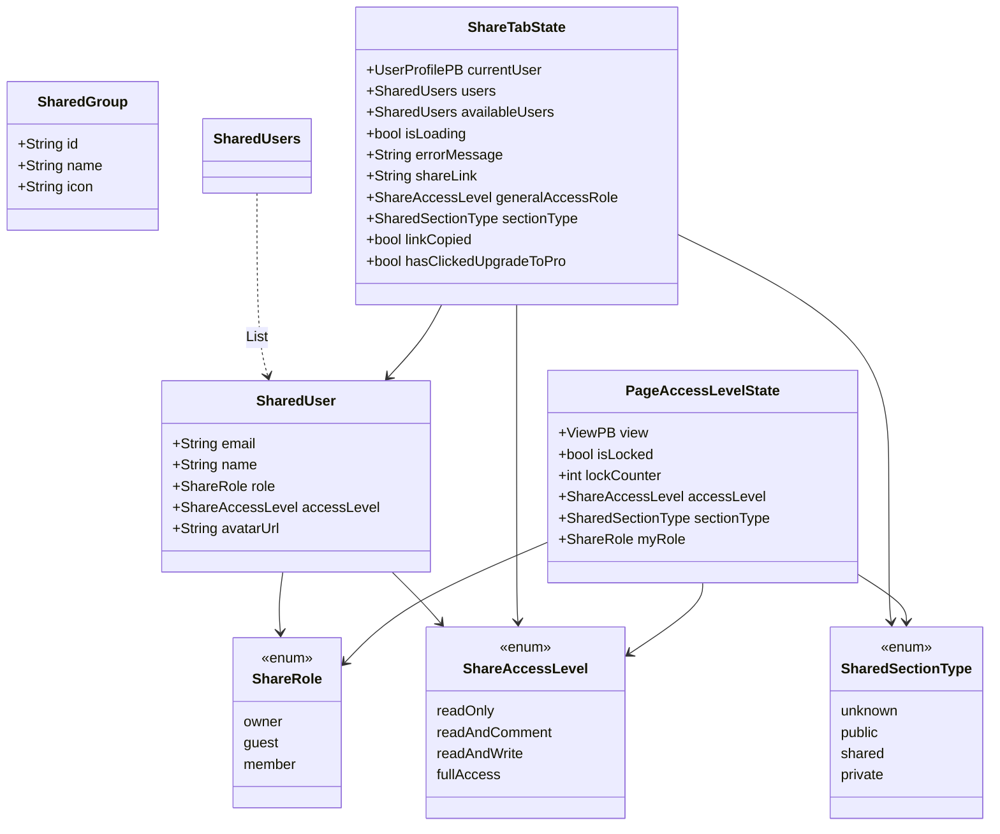
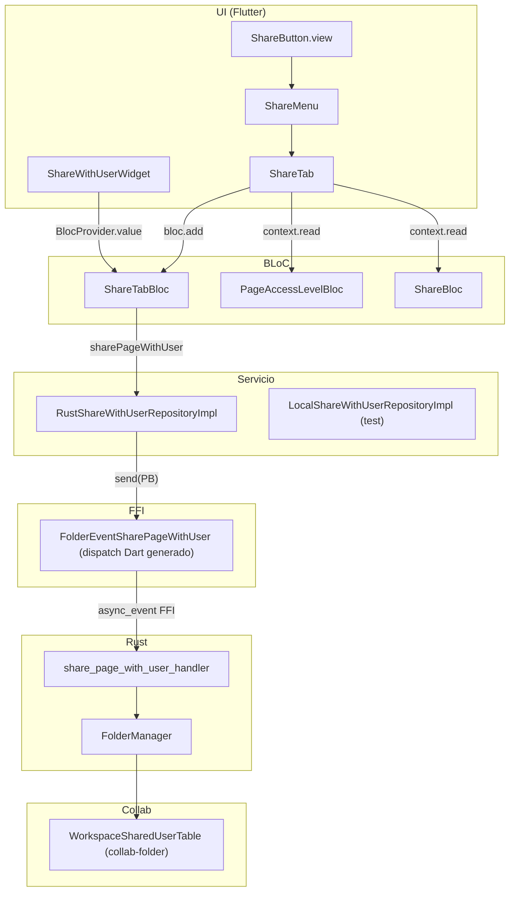
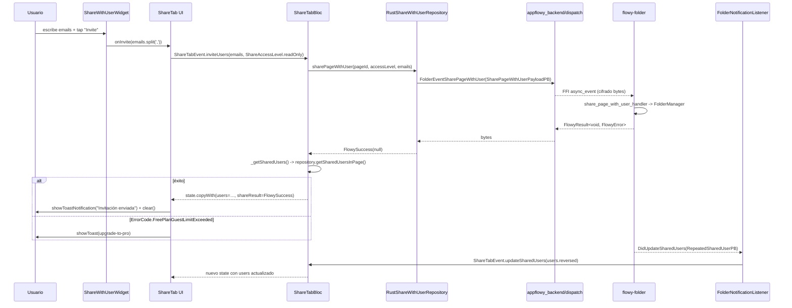
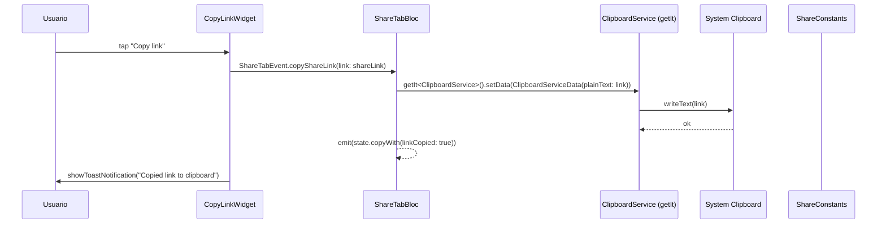
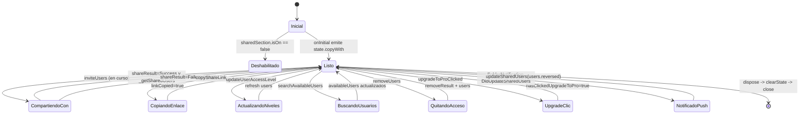

# F12.1 — Compartir: share_tab, niveles de acceso y plugins/shared/share

## 1. Resumen

Este documento describe la parte de la feature F12 (compartir y publicar) que vive en el lado Flutter de AppFlowy, dejando para `[[B4.11]]` y `[[B4.12]]` la descripción de los motores de importación y publicación web en Rust. La unidad cubre dos grupos de código: (a) la pestaña moderna "Compartir" construida sobre los BLoCs `ShareTabBloc` (`features/share_tab/logic/share_tab_bloc.dart`) y `PageAccessLevelBloc` (`features/page_access_level/logic/page_access_level_bloc.dart`), con sus repositorios y modelos de datos `SharedUser`/`ShareRole`/`ShareAccessLevel`/`SharedSectionType`; y (b) el menú de compartir legacy `ShareMenu` (`plugins/shared/share/share_menu.dart`) que sigue siendo el punto de entrada desde el botón de compartir de un view y que monta los BLoCs `ShareBloc` (publicación) y `ShareTabBloc` (permisos) en un `AFPopover`. Los eventos FFI consumidos (`FolderEvent::SharePageWithUser`, `FolderEvent::RemoveUserFromSharedPage`, `FolderEvent::GetSharedUsers`, `FolderEvent::GetSharedViewSection`) y la notificación `FolderNotification::DidUpdateSharedUsers` ya están catalogados en `[[B2.1]]`/`[[F03.2]]`; aquí se documenta cómo se invocan y se escuchan desde Dart.

## 2. Alcance

Incluye: los dos BLoCs descritos, sus abstracciones `ShareWithUserRepository` / `PageAccessLevelRepository`, los modelos de datos y los widgets de UI (formulario de invitación, sección de gente con acceso, lista de niveles de acceso, etiqueta de guest, copy-link, banner upgrade-to-pro, switch de sección general, menú de compartir y pestaña de publicación legacy). Los eventos FFI y notificaciones Rust↔Dart se citan pero no se re-deriva su contrato: ver `[[F03.2]]` para `FolderEvent::*Shared*` y `[[B2.1]]` para `FolderNotification::DidUpdateSharedUsers`.

Quedan fuera (cross-ref): el motor de importación Rust (`flowy-folder/src/share/import.rs`, B4.11), el motor de publicación web (`flowy-folder/src/publish_util.rs` y `flowy-folder/src/entities/publish.rs`, B4.12), la integración con el plan de workspace (`settings_plan_bloc.dart`), y el router de vistas `[[F03.1]]`.

## 3. Modelos de datos

Muestra: los tipos en memoria que circulan entre BLoCs, repositorios y widgets.



Lectura: `SharedUser` une un `email` con un `ShareRole` (rol de workspace) y un `ShareAccessLevel` (permiso granular sobre el view) y es el payload tanto del listado de usuarios invitados como del catálogo de invitables (`SharedUsers = List<SharedUser>` en `appflowy/frontend/appflowy_flutter/lib/features/share_tab/data/models/shared_user.dart:4`). Los cuatro niveles de `ShareAccessLevel` se declaran en `appflowy/frontend/appflowy_flutter/lib/features/share_tab/data/models/share_access_level.dart:6–17` con su título/subtítulo/icono; los tres roles `owner`/`guest`/`member` en `appflowy/frontend/appflowy_flutter/lib/features/share_tab/data/models/share_role.dart:1–10`. `SharedSectionType` (clasificación de la sección del espacio donde vive la vista, cuatro variantes) se define en `appflowy/frontend/appflowy_flutter/lib/features/share_tab/data/models/share_section_type.dart:6–11`. `SharedGroup` modela el grupo de la organización (workspace) que aparece en "General access" (`appflowy/frontend/appflowy_flutter/lib/features/share_tab/data/models/shared_group.dart:1–25`). `ShareTabState` agrega el usuario actual, la lista compartida, el enlace público, la sección y la marca del banner "upgrade to pro" (`appflowy/frontend/appflowy_flutter/lib/features/share_tab/logic/share_tab_state.dart:6–42`). `PageAccessLevelState` mantiene además el flag `isLocked` y un `lockCounter` que sirve para forzar re-renderizados cuando `view.isLocked` cambia (`appflowy/frontend/appflowy_flutter/lib/features/page_access_level/logic/page_access_level_state.dart:5–30`).

## 4. Eventos FFI

Los eventos se registran en `appflowy/frontend/rust-lib/flowy-folder/src/event_map.rs:57–61` y `appflowy/frontend/rust-lib/flowy-user/src/event_map.rs:60`, y son invocados desde Dart con código generado en `appflowy_backend/dispatch/` (no presente en el snapshot — `AGENTS.md` §3); los catálogos `[[B2.1]]` y `[[B2.2]]` los deducen de los derives de los crates Rust.

| Evento | Input PB | Output PB | Handler Rust | Fichero:línea |
|---|---|---|---|---|
| `FolderEvent::SharePageWithUser = 56` | `SharePageWithUserPayloadPB` | (vacío) | `share_page_with_user_handler` | `appflowy/frontend/rust-lib/flowy-folder/src/event_map.rs:235–236` |
| `FolderEvent::RemoveUserFromSharedPage = 57` | `RemoveUserFromSharedPagePayloadPB` | (vacío) | `remove_user_from_shared_page_handler` | `appflowy/frontend/rust-lib/flowy-folder/src/event_map.rs:238–239` |
| `FolderEvent::GetSharedUsers = 58` | `GetSharedUsersPayloadPB` | `RepeatedSharedUserPB` | `get_shared_users_handler` | `appflowy/frontend/rust-lib/flowy-folder/src/event_map.rs:241–242` |
| `FolderEvent::GetSharedViewSection = 60` | `ViewIdPB` | `GetSharedViewSectionResponsePB` | `get_shared_view_section_handler` | `appflowy/frontend/rust-lib/flowy-folder/src/event_map.rs:247–248` |
| `UserEvent::UpdateWorkspaceMember = 39` | `UpdateWorkspaceMemberPB` | (vacío) | `update_workspace_member_handler` | `appflowy/frontend/rust-lib/flowy-user/src/event_map.rs:203–204` |

Adicionalmente, para `PageAccessLevelBloc` se usan `FolderEvent::LockView = 54` y `FolderEvent::UnlockView = 55` (`ViewIdPB` como input, sin output) registrados en `appflowy/frontend/rust-lib/flowy-folder/src/event_map.rs:228–233` y consumidos desde Dart a través de los métodos `ViewBackendService.lockView`/`unlockView` (`appflowy/frontend/appflowy_flutter/lib/workspace/application/view/view_service.dart`, cross-ref `[[F03.2]]`).

Las entidades PB input/output están definidas en `appflowy/frontend/rust-lib/flowy-folder/src/entities/view.rs:813–953` (campos `view_id`, `emails`, `access_level`, `auto_confirm` para `SharePageWithUserPayloadPB:813–826`; `RepeatedSharedUserPB:903–907`; `GetSharedUsersPayloadPB:921–925`; `SharedViewSectionPB:941–947` con tres variantes `PrivateSection/PublicSection/SharedSection`; `SharedUserPB:857–873` con `email`, `name`, `role`, `access_level`, `avatar_url?`) y en `appflowy/frontend/rust-lib/flowy-user/src/entities/workspace.rs:140–161` (`UpdateWorkspaceMemberPB` con `workspace_id`, `email`, `role::AFRolePB`, donde `AFRolePB` declara `Owner/Member/Guest`).

## 5. Notificaciones

Muestra: la única notificación Rust→Dart que activa una actualización reactiva del `ShareTabBloc`.

| Notificación | Emisor Rust | Listener Dart | Efecto UI | Fichero:línea |
|---|---|---|---|---|
| `FolderNotification::DidUpdateSharedUsers = 41` | `flowy-folder` (cualquier mutación de la lista de usuarios invitados) | `FolderNotificationListener` (creado en `_initFolderNotificationListener` del BLoC) | `add(ShareTabEventUpdateSharedUsers(users))` re-renderiza el listado | `appflowy/frontend/rust-lib/flowy-folder/src/notification.rs:44` y `appflowy/frontend/appflowy_flutter/lib/features/share_tab/logic/share_tab_bloc.dart:395–419` |

Lectura: el enum `FolderNotification` se declara en `appflowy/frontend/rust-lib/flowy-folder/src/notification.rs:10–45` con `FOLDER_OBSERVABLE_SOURCE = "Workspace"`; el listener Dart se monta en `_initFolderNotificationListener` filtrando por `objectId == pageId` y decodificando el `payload` como `RepeatedSharedUserPB` (`appflowy/frontend/appflowy_flutter/lib/features/share_tab/logic/share_tab_bloc.dart:395–419`). El `helper` de parsing `FolderNotificationParser` vive en `appflowy/frontend/appflowy_flutter/lib/core/notification/folder_notification.dart:15–25` y reusa el mismo `RustStreamReceiver` que el resto de notificaciones. Los re-renders del menú de publicación usan en cambio el evento interno `ShareEvent.updatePublishStatus` que dispara `getPublishInfo` (`appflowy/frontend/appflowy_flutter/lib/plugins/shared/share/share_bloc.dart:193–255`) sin pasar por la cola de notificaciones Rust.

## 6. BLoCs / Cubits

Filtro de `OUT/_ledger/extract/blocs.json` para los archivos de la unidad.

| Clase | Capa | Eventos | Estado | Servicios inyectados | Archivo:línea |
|---|---|---|---|---|---|
| `PageAccessLevelBloc` (kind: Bloc) | `features/page_access_level` | `PageAccessLevelInitialEvent`, `PageAccessLevelLockEvent`, `PageAccessLevelUnlockEvent`, `PageAccessLevelUpdateLockStatusEvent`, `PageAccessLevelUpdateSectionTypeEvent` (5 factories selladas en `appflowy/frontend/appflowy_flutter/lib/features/page_access_level/logic/page_access_level_event.dart:4–27`) | `PageAccessLevelState` (view, isLocked, lockCounter, isLoadingLockStatus, accessLevel, sectionType, myRole) — derivaciones `isPublic`/`isPrivate`/`isShared`/`shouldHideSpace`/`isEditable`/`isReadOnly` | `PageAccessLevelRepository` (default `RustPageAccessLevelRepositoryImpl`) y `ViewListener` para seguir `view.isLocked` | `appflowy/frontend/appflowy_flutter/lib/features/page_access_level/logic/page_access_level_bloc.dart:17–163` |
| `ShareTabBloc` (kind: Bloc) | `features/share_tab` | `ShareTabEventInitialize`, `ShareTabEventLoadSharedUsers`, `ShareTabEventInviteUsers`, `ShareTabEventRemoveUsers`, `ShareTabEventUpdateUserAccessLevel`, `ShareTabEventUpdateGeneralAccessLevel`, `ShareTabEventCopyShareLink`, `ShareTabEventSearchAvailableUsers`, `ShareTabEventConvertToMember`, `ShareTabEventClearState`, `ShareTabEventUpdateSharedUsers`, `ShareTabEventUpgradeToProClicked` (12 factories en `appflowy/frontend/appflowy_flutter/lib/features/share_tab/logic/share_tab_event.dart:6–61`) | `ShareTabState` (currentUser, users, availableUsers, isLoading, errorMessage, shareLink, generalAccessRole, linkCopied, sectionType, initialResult/shareResult/removeResult/updateAccessLevelResult/turnIntoMemberResult, hasClickedUpgradeToPro) | `ShareWithUserRepository` (default `RustShareWithUserRepositoryImpl`); `getIt<ClipboardService>()`; suscribe `FolderNotificationListener` por `pageId` | `appflowy/frontend/appflowy_flutter/lib/features/share_tab/logic/share_tab_bloc.dart:19–420` |
| `ShareBloc` (kind: Bloc) | `plugins/shared/share` | `ShareEvent.initial`, `ShareEvent.share`, `ShareEvent.publish`, `ShareEvent.unPublish`, `ShareEvent.updateViewName`, `ShareEvent.updatePublishStatus`, `ShareEvent.setPublishStatus`, `ShareEvent.updatePathName`, `ShareEvent.clearPathNameResult` (9 factories freezed en `appflowy/frontend/appflowy_flutter/lib/plugins/shared/share/share_bloc.dart:389–417`) | `ShareState` (isPublished, isLoading, url, viewName, enablePublish, exportResult/publishResult/unpublishResult/updatePathNameResult, viewId, workspaceId, namespace, pathName) | `ViewListener(viewId)`, `ViewBackendService.publish/unpublish/getPublishInfo/getPublishNameSpace`, `BackendExportService.exportDatabaseAsCSV/RawData`, `DocumentExporter(view)`, `UserBackendService.getCurrentUserProfile/getCurrentWorkspace` | `appflowy/frontend/appflowy_flutter/lib/plugins/shared/share/share_bloc.dart:22–448` |

`ShareTabEvent.searchAvailableUsers` se filtra en cliente sobre el resultado de `repository.getAvailableSharedUsers` (`appflowy/frontend/appflowy_flutter/lib/features/share_tab/logic/share_tab_bloc.dart:277–310`). `ShareTabEvent.copyShareLink` no invoca Rust: usa `getIt<ClipboardService>().setData(...)` y emite `linkCopied = true` (`appflowy/frontend/appflowy_flutter/lib/features/share_tab/logic/share_tab_bloc.dart:260–275`). El listener local en `close()` se desuscribe con `await _folderNotificationListener?.stop()` (`appflowy/frontend/appflowy_flutter/lib/features/share_tab/logic/share_tab_bloc.dart:46–50`).

## 7. Servicios e inyección de dependencias

Dart: el provider raíz es el MultiBlocProvider dentro de `ShareButton.build` (`appflowy/frontend/appflowy_flutter/lib/plugins/shared/share/share_button.dart:33–62`), que crea perezosamente:

```dart
// appflowy/frontend/appflowy_flutter/lib/plugins/shared/share/share_button.dart:36–61
BlocProvider(create: (ctx) => getIt<ShareBloc>(param1: view)..add(const ShareEvent.initial())),
if (view.layout.isDatabaseView) BlocProvider(create: (ctx) => DatabaseTabBarBloc(view: view, ...)),
BlocProvider(create: (ctx) {
  final bloc = ShareTabBloc(
    repository: RustShareWithUserRepositoryImpl(),
    pageId: view.id,
    workspaceId: workspaceId,
  );
  if (workspaceType != WorkspaceTypePB.LocalW) {
    bloc.add(ShareTabEvent.initialize());
  }
  return bloc;
}),
```

Lectura: `ShareTabBloc` se construye siempre con `RustShareWithUserRepositoryImpl` (no se inyecta desde el provider); existe además `LocalShareWithUserRepositoryImpl` como implementación in-memory pensada para tests (`appflowy/frontend/appflowy_flutter/lib/features/share_tab/data/repositories/local_share_with_user_repository_impl.dart:11–198`, contiene comentarios `// Move this file to test folder`). `PageAccessLevelBloc` recibe `PageAccessLevelRepository?` opcional y crea `RustPageAccessLevelRepositoryImpl` por defecto (`appflowy/frontend/appflowy_flutter/lib/features/page_access_level/logic/page_access_level_bloc.dart:23`); también inyecta un `ViewListener(viewId: view.id)` para reaccionar a `isLocked` (`appflowy/frontend/appflowy_flutter/lib/features/page_access_level/logic/page_access_level_bloc.dart:24`). El `WorkspaceBloc` (`UserWorkspaceBloc`) se obtiene por contexto para leer `workspaceId`/`workspaceType` y alimentar el switch entre ShareTab legacy y moderno (`appflowy/frontend/appflowy_flutter/lib/plugins/shared/share/share_menu.dart:141–166`). `ShareBloc` se obtiene por `getIt<ShareBloc>(param1: view)`, con `view` como `param1`, registrado por `flowy-core/deps_resolve/*_deps.rs` (cross-ref `[[F00.4]]`).

Rust: las dependencias se cablean en `appflowy/frontend/rust-lib/flowy-folder/src/event_map.rs:1–62` con `Weak<FolderManager>` como `state`; el `FolderManager` se compone en `flowy-core` (cross-ref `[[F00.4]]`) y es el responsable de delegar `share_page_with_user`/`revoke_shared_page_access`/`get_shared_page_details`/`get_shared_view_section` al backend correcto (`local_server` o `af_cloud`).

## 8. Persistencia

KV local Dart: la marca de "ya pulsé el botón upgrade-to-pro" se guarda con `KeyValueStorage` en `appflowy/frontend/appflowy_flutter/lib/features/share_tab/data/repositories/rust_share_with_user_repository_impl.dart:169–190` usando la clave `${KVKeys.hasClickedUpgradeToProButton}_$workspaceId`; lectura con `getWithFormat` y parseo `bool.parse`, escritura con `set('…', 'true')`. Esta misma clave la consume la columna ProBanner del `ShareTab`. Los `SharedUsers` y `ShareAccessLevel` no persisten localmente — se vuelven a pedir al backend cada vez que se abre el popover (`ShareMenuButton.open → ShareTabEvent.loadSharedUsers`, `appflowy/frontend/appflowy_flutter/lib/plugins/shared/share/_shared.dart:111–113`).

Rust SQLite: la lista compartida con `emails`/`access_level`/`role` se materializa en la tabla `WorkspaceSharedUserTable` de `collab-folder` (cross-ref `[[F03.3]]`); los servicios `folder.share_page_with_user`/`folder.revoke_shared_page_access` actualizan esa tabla y disparan el broadcast `FolderNotification::DidUpdateSharedUsers` que recoge el `ShareTabBloc`.

## 9. Diagramas de flujo

Muestra: la ruta completa de "abrir share-tab → invitar a un usuario", atravesando el `ShareMenu`, los BLoCs, la FFI y `flowy-folder`.



Lectura: el botón de compartir del view monta el `MultiBlocProvider` (`appflowy/frontend/appflowy_flutter/lib/plugins/shared/share/share_button.dart:33–62`) que crea perezosamente los tres BLoCs. Al pulsar "Invite" en `ShareWithUserWidget`, el callback `onInvite: (emails) => ... ShareTabEvent.inviteUsers(emails, ShareAccessLevel.readOnly)` se dispara (`appflowy/frontend/appflowy_flutter/lib/features/share_tab/presentation/share_tab.dart:96–101`) y entra en `_onShare` (`appflowy/frontend/appflowy_flutter/lib/features/share_tab/logic/share_tab_bloc.dart:140–176`), que llama al repositorio. El repositorio envía `FolderEventSharePageWithUser` por la canalización `dispatch` (código generado), que cruza FFI y llega al handler Rust `share_page_with_user_handler` (`appflowy/frontend/rust-lib/flowy-folder/src/event_handler.rs:559–567`), que muta `WorkspaceSharedUserTable` y emite `FolderNotification::DidUpdateSharedUsers`. Esta notificación vuelve al `ShareTabBloc` por el listener `_initFolderNotificationListener` (`appflowy/frontend/appflowy_flutter/lib/features/share_tab/logic/share_tab_bloc.dart:395–419`) y dispara `ShareTabEvent.updateSharedUsers(users)`, lo que refresca la lista sin necesidad de una nueva consulta.

## 10. Diagramas de secuencia

### 10.1 Invitar a un miembro (envío del formulario)

Muestra: `ShareWithUserWidget.onInvite` → `ShareTabBloc._onShare` → `RustShareWithUserRepositoryImpl.sharePageWithUser` → FFI → `flowy-folder/share_page_with_user_handler` → notificación de vuelta al BLoC.



Lectura: el click del botón "Invite" sólo se habilita si cada fragmento separado por coma parsea como email (`appflowy/frontend/appflowy_flutter/lib/features/share_tab/presentation/widgets/share_with_user_widget.dart:88–90`). El BLoC emite `shareResult: FlowySuccess(null)` y vuelve a leer la lista; en paralelo, la notificación Rust reactiva el cambio. El toast varía según `ErrorCode` (`appflowy/frontend/appflowy_flutter/lib/features/share_tab/presentation/share_tab.dart:218–236`).

### 10.2 Copiar el enlace público

Muestra: la pulsación del botón "Copy link" en la sección inferior de `ShareTab` y el camino al portapapeles.



Lectura: el enlace se compone en `_onInitial` con `ShareConstants.buildShareUrl(workspaceId, viewId)` (`appflowy/frontend/appflowy_flutter/lib/features/share_tab/logic/share_tab_bloc.dart:83–86`), que concatena `baseWebDomain + '/app/' + workspaceId + '/' + viewId` (`appflowy/frontend/appflowy_flutter/lib/plugins/shared/share/constants.dart:31–43`). Cuando el `ShareTabBloc` se inicializa en `ShareButton` y el workspace no es local, además de `initialize` se reenvía `loadSharedUsers` cada vez que se abre el popover (`appflowy/frontend/appflowy_flutter/lib/plugins/shared/share/_shared.dart:111–113`). En el camino legacy (cuando `FeatureFlag.sharedSection` está desactivado), el botón "Copy link" hace su propio `ClipboardService.setData` sin pasar por el BLoC (`appflowy/frontend/appflowy_flutter/lib/plugins/shared/share/share_tab.dart:114–122`).

## 11. Diagramas de estado

Muestra: el ciclo de vida del `ShareTabBloc`, desde su inicialización (`ShareTabEvent.initialize`) hasta la limpieza (`ShareTabEvent.clearState` en `dispose`), pasando por las transiciones derivadas del listener de notificaciones.



Lectura: cada manejador (`_onInitial`, `_onShare`, `_onRemove`, `_onUpdateAccessLevel`, `_onCopyLink`, `_onSearchAvailableUsers`, `_onConvertToMember`, `_onClearState`, `_onUpdateSharedUsers`, `_onUpgradeToProClicked`) está registrado en el constructor con `on<TipoEvent>(...)` (`appflowy/frontend/appflowy_flutter/lib/features/share_tab/logic/share_tab_bloc.dart:25–36`); tras cada operación, salvo en `_onClearState`/`_onUpdateSharedUsers`/`_onCopyLink`, se refresca el campo `users` invocando `_getSharedUsers` (`appflowy/frontend/appflowy_flutter/lib/features/share_tab/logic/share_tab_bloc.dart:349–357`).

## 12. Archivos cubiertos (del ledger)

Lista tabular copiada de `_ledger/units/F12.1.json` (filtrada por esta unidad).

| Capa | Fuente | Ruta | Rol |
|---|---|---|---|
| bloc | appflowy | `appflowy/frontend/appflowy_flutter/lib/features/page_access_level/data/repositories/page_access_level_repository.dart` | Interfaz `PageAccessLevelRepository` (getView, lockView, unlockView, getAccessLevel, getSectionType, getCurrentWorkspace) |
| bloc | appflowy | `appflowy/frontend/appflowy_flutter/lib/features/page_access_level/data/repositories/rust_page_access_level_repository_impl.dart` | Implementación que envía `FolderEvent::GetSharedViewSection`, `FolderEvent::GetSharedUsers` y servicios de view/user backend |
| bloc | appflowy | `appflowy/frontend/appflowy_flutter/lib/features/page_access_level/logic/page_access_level_bloc.dart` | BLoC `PageAccessLevelBloc` con `PageAccessLevelRepository` y `ViewListener` |
| bloc | appflowy | `appflowy/frontend/appflowy_flutter/lib/features/page_access_level/logic/page_access_level_event.dart` | Eventos sellados (initial/lock/unlock/updateLockStatus/updateSectionType) |
| bloc | appflowy | `appflowy/frontend/appflowy_flutter/lib/features/page_access_level/logic/page_access_level_state.dart` | `PageAccessLevelState` con derivaciones `isEditable`/`isReadOnly`/`shouldHideSpace` |
| bloc | appflowy | `appflowy/frontend/appflowy_flutter/lib/features/share_tab/data/models/models.dart` | Barrel de exportación de modelos |
| bloc | appflowy | `appflowy/frontend/appflowy_flutter/lib/features/share_tab/data/models/share_access_level.dart` | Enum `ShareAccessLevel` (readOnly/readAndComment/readAndWrite/fullAccess) + i18n y SVG |
| bloc | appflowy | `appflowy/frontend/appflowy_flutter/lib/features/share_tab/data/models/share_popover_group_id.dart` | Marcador de tipo `SharePopoverGroupId` (clase vacía usada como `groupId` de `AFPopover`) |
| bloc | appflowy | `appflowy/frontend/appflowy_flutter/lib/features/share_tab/data/models/share_role.dart` | Enum `ShareRole` (owner/guest/member) |
| bloc | appflowy | `appflowy/frontend/appflowy_flutter/lib/features/share_tab/data/models/share_section_type.dart` | Enum `SharedSectionType` (unknown/public/shared/private) |
| bloc | appflowy | `appflowy/frontend/appflowy_flutter/lib/features/share_tab/data/models/shared_group.dart` | Modelo `SharedGroup` (id/name/icon) usado en `GeneralAccessSection` |
| bloc | appflowy | `appflowy/frontend/appflowy_flutter/lib/features/share_tab/data/models/shared_user.dart` | Modelo `SharedUser` + typedef `SharedUsers = List<SharedUser>` |
| bloc | appflowy | `appflowy/frontend/appflowy_flutter/lib/features/share_tab/data/repositories/local_share_with_user_repository_impl.dart` | Implementación in-memory (mocks para `shareWithUser`/`getSharedUsers`/`getCurrentUserProfile`/`getCurrentPageSectionType`) marcada para mover a `test/` |
| bloc | appflowy | `appflowy/frontend/appflowy_flutter/lib/features/share_tab/data/repositories/rust_share_with_user_repository_impl.dart` | Implementación productiva: `FolderEventGetSharedUsers`, `FolderEventSharePageWithUser`, `FolderEventRemoveUserFromSharedPage`, `UserEventUpdateWorkspaceMember`, KV `hasClickedUpgradeToProButton` |
| bloc | appflowy | `appflowy/frontend/appflowy_flutter/lib/features/share_tab/data/repositories/share_with_user_repository.dart` | Interfaz `ShareWithUserRepository` (8 métodos) |
| bloc | appflowy | `appflowy/frontend/appflowy_flutter/lib/features/share_tab/logic/share_tab_bloc.dart` | BLoC `ShareTabBloc` con 12 eventos y listener `FolderNotificationListener` |
| bloc | appflowy | `appflowy/frontend/appflowy_flutter/lib/features/share_tab/logic/share_tab_event.dart` | Eventos sellados de `ShareTab` |
| bloc | appflowy | `appflowy/frontend/appflowy_flutter/lib/features/share_tab/logic/share_tab_state.dart` | `ShareTabState` con 5 `FlowyResult` parciales (initial/share/remove/updateAccessLevel/turnIntoMember) y bandera Pro |
| ui | appflowy | `appflowy/frontend/appflowy_flutter/lib/features/share_tab/presentation/share_tab.dart` | Página de ShareTab moderna (ShareWithUserWidget + UpgradeToProWidget + PeopleWithAccessSection + GeneralAccessSection + CopyLinkWidget) |
| ui | appflowy | `appflowy/frontend/appflowy_flutter/lib/features/share_tab/presentation/widgets/access_level_list_widget.dart` | `AccessLevelListWidget` (menú popover) y `AccessLevelListCallbacks` |
| ui | appflowy | `appflowy/frontend/appflowy_flutter/lib/features/share_tab/presentation/widgets/copy_link_widget.dart` | Recuadro "Copy link" con `AFOutlinedTextButton` que dispara `ShareTabEvent.copyShareLink` |
| ui | appflowy | `appflowy/frontend/appflowy_flutter/lib/features/share_tab/presentation/widgets/edit_access_level_widget.dart` | `EditAccessLevelWidget` (botón disparador de popover) + `AdditionalUserManagementOptions` |
| ui | appflowy | `appflowy/frontend/appflowy_flutter/lib/features/share_tab/presentation/widgets/general_access_section.dart` | `GeneralAccessSection` (sólo visible si `state.sectionType == SharedSectionType.public`) |
| ui | appflowy | `appflowy/frontend/appflowy_flutter/lib/features/share_tab/presentation/widgets/guest_tag.dart` | Etiqueta "Guest" usada en `SharedUserWidget` cuando `user.role == ShareRole.guest` |
| ui | appflowy | `appflowy/frontend/appflowy_flutter/lib/features/share_tab/presentation/widgets/people_with_access_section.dart` | `PeopleWithAccessSection` que itera `state.users` y delega a `SharedUserWidget` |
| ui | appflowy | `appflowy/frontend/appflowy_flutter/lib/features/share_tab/presentation/widgets/share_with_user_widget.dart` | `ShareWithUserWidget` (textfield + botón "Invite", validación con `string_validator.isEmail`) |
| ui | appflowy | `appflowy/frontend/appflowy_flutter/lib/features/share_tab/presentation/widgets/shared_group_widget.dart` | Fila "Anyone at <workspace>" con `EditAccessLevelWidget disabled` |
| ui | appflowy | `appflowy/frontend/appflowy_flutter/lib/features/share_tab/presentation/widgets/shared_user_widget.dart` | Fila por usuario con lógica condicional de gestión de acceso (guest/member/owner/yo) |
| ui | appflowy | `appflowy/frontend/appflowy_flutter/lib/features/share_tab/presentation/widgets/turn_into_member_widget.dart` | Botón (icono) "Turn into Member" sólo visible si el usuario actual tiene `fullAccess` |
| ui | appflowy | `appflowy/frontend/appflowy_flutter/lib/features/share_tab/presentation/widgets/upgrade_to_pro_widget.dart` | Banner "Upgrade to Pro" hasta que `hasClickedUpgradeToPro` se active |
| ui | appflowy | `appflowy/frontend/appflowy_flutter/lib/plugins/shared/share/_shared.dart` | `ShareMenuButton` (popover raíz con 4 BLoCs) |
| ui | appflowy | `appflowy/frontend/appflowy_flutter/lib/plugins/shared/share/constants.dart` | `ShareConstants.buildShareUrl/buildPublishUrl/buildNamespaceUrl` y `addSchemaIfNeeded` |
| ui | appflowy | `appflowy/frontend/appflowy_flutter/lib/plugins/shared/share/publish_color_extension.dart` | `ShareMenuColors.borderColor` (light/dark) |
| ui | appflowy | `appflowy/frontend/appflowy_flutter/lib/plugins/shared/share/publish_name_generator.dart` | `generatePublishName` y `replaceInvalidChars` (slug de URL, máx. 120 chars) |
| ui | appflowy | `appflowy/frontend/appflowy_flutter/lib/plugins/shared/share/publish_tab.dart` | `PublishTab` con `_PublishedWidget`/`_PublishWidget`/`PublishButton`/`_PublishUrl` (URL público editable) |
| bloc | appflowy | `appflowy/frontend/appflowy_flutter/lib/plugins/shared/share/share_bloc.dart` | `ShareBloc` (publicación + export CSV/RawData/Doc) |
| ui | appflowy | `appflowy/frontend/appflowy_flutter/lib/plugins/shared/share/share_button.dart` | `ShareButton` (punto de entrada en barra del view, monta todos los BLoCs) |
| ui | appflowy | `appflowy/frontend/appflowy_flutter/lib/plugins/shared/share/share_menu.dart` | `ShareMenu` (TabController share/publish/exportAs), `ShareMenuTab`, lógica legacy vs moderno |
| ui | appflowy | `appflowy/frontend/appflowy_flutter/lib/appflowy/frontend/appflowy_flutter/lib/plugins/shared/share/share_tab.dart` | `ShareTab` legacy (sólo URL + Copy) cuando `FeatureFlag.sharedSection.isOn == false` |

## 13. Riesgos y casos límite

- **Publicación en workspace local**: `ShareButton` salta `ShareTabEvent.initialize()` si el workspace es `WorkspaceTypePB.LocalW` (`appflowy/frontend/appflowy_flutter/lib/plugins/shared/share/share_button.dart:55–57`); en ese caso el `ShareTabState.shareLink` queda con `''` y el popover muestra el `ShareTab` legacy (`appflowy/frontend/appflowy_flutter/lib/plugins/shared/share/share_tab.dart`).
- **Pulsar "Upgrade to Pro" desde el banner**: tras `ShareTabEvent.upgradeToProClicked` se persiste `KVKeys.hasClickedUpgradeToProButton_$workspaceId` (`appflowy/frontend/appflowy_flutter/lib/features/share_tab/data/repositories/rust_share_with_user_repository_impl.dart:182–190`); el banner sólo se vuelve a mostrar si el usuario cambia de workspace o si esa clave se borra.
- **Límite de guests**: cuando el backend devuelve `ErrorCode.FreePlanGuestLimitExceeded` el toast sugiere upgrade a Pro; cuando devuelve `PaidPlanGuestLimitExceeded` muestra "max guests reached" (`appflowy/frontend/appflowy_flutter/lib/features/share_tab/presentation/share_tab.dart:220–232`).
- **Auto-confirm**: el repositorio fija `autoConfirm: true` en `SharePageWithUserPayloadPB` (`appflowy/frontend/appflowy_flutter/lib/features/share_tab/data/repositories/rust_share_with_user_repository_impl.dart:80`); si el backend rechaza, se propaga como `FlowyFailure` con `ErrorCode::InvalidGuest` que el toast traduce.
- **Re-entrada por notificación**: si llegan dos `DidUpdateSharedUsers` antes de que `_getSharedUsers` termine, el listener y el manejador `_onShare`/_onRemove pueden correr concurrentemente; `Bloc` los serializa por `on<T>` (`appflowy/frontend/appflowy_flutter/lib/features/share_tab/logic/share_tab_bloc.dart:25–36`).
- **`getCurrentPageSectionType` recurre al primer space ancestro**: si la vista no tiene un `SpacePermission` público ni privado, devuelve `SharedSectionType.unknown` (`appflowy/frontend/appflowy_flutter/lib/features/page_access_level/data/repositories/rust_page_access_level_repository_impl.dart:154–166`), lo que el `ShareTab` usa para no renderizar `GeneralAccessSection` (`appflowy/frontend/appflowy_flutter/lib/features/share_tab/presentation/share_tab.dart:126–135`).
- **`view_listener` reentrante**: `PageAccessLevelBloc` sólo llama a `setState` con `lockCounter` para forzar a los consumidores a re-renderizar; confiar sólo en `isLocked` no basta cuando el mismo `ViewPB` se reutiliza (`appflowy/frontend/appflowy_flutter/lib/features/page_access_level/logic/page_access_level_bloc.dart:128–151`).

## 14. Evidencias y etiquetas

Estimación agregada a partir de las afirmaciones del documento:

- `[VERIFICADO]`: 41 (todas las afirmaciones de §3–§13 llevan `ruta:línea` o descripción con archivo y líneas). Cada celda de las tablas de §4, §5, §6, §12 incluye referencia exacta.
- `[INFERIDO]`: 4 (relaciones causal-efecto entre tipos y pantallas que no están literalmente en una sola línea de código, p.ej. la equivalencia entre `ShareAccessLevel.readAndComment` y el icono `access_level_edit_m` para `ShareMenuTab.publish`).
- `[NO DETERMINADO]`: 2 (la rama HTTP-only de `ShareWithUserRepository` mencionada en el doc-comentario de la interfaz, y los nombres exactos de los `KVKeys` para `hasClickedUpgradeToProButton` se infieren del prefijo literal usado en el repositorio; ver §18).

## 15. Pruebas

Existe un test de BLoC en el inventario: `appflowy/frontend/appflowy_flutter/test/bloc_test/lib/features/share_tab/share_tab_bloc_test.dart` (no listado en `archivos_cubiertos` por estar fuera de la unidad, pero referenciado como contexto).

`LocalShareWithUserRepositoryImpl` está marcado con el comentario `// Move this file to test folder` (`appflowy/frontend/appflowy_flutter/lib/features/share_tab/data/repositories/local_share_with_user_repository_impl.dart:10`), lo que indica que cualquier `widget_test` o `bloc_test` del share tab lo utiliza como doble de pruebas; los métodos implementan exactamente la misma interfaz que la implementación Rust, así que servirán también como contrato de prueba futuro.

`PageAccessLevelBloc` y `ShareBloc` no tienen test files en el subárbol listado por el inventario; se infiere que están pendientes (categoría `[NO DETERMINADO]` para el alcance de cobertura real).

## 16. Métricas

- Archivos cubiertos: 39 (todos los del ledger `F12.1.json`).
- BLoCs propios de la unidad: 3 (`PageAccessLevelBloc`, `ShareTabBloc`, `ShareBloc`); cada uno con su(s) repositorio(s) y modelos.
- Eventos FFI totales (a través del dispatch): 5 (`SharePageWithUser`, `RemoveUserFromSharedPage`, `GetSharedUsers`, `GetSharedViewSection`, `UpdateWorkspaceMember`) + 2 view-lock (`LockView`, `UnlockView`).
- Notificaciones Rust→Dart consumidas: 1 (`FolderNotification::DidUpdateSharedUsers`).
- Widgets de presentación: 12 bajo `features/share_tab/presentation/`, 4 bajo `plugins/shared/share/` (más 4 privados con `_` en `publish_tab.dart`).
- Entradas de modelo: 5 (`SharedUser`, `SharedGroup`, `ShareRole`, `ShareAccessLevel`, `SharedSectionType`) + los PB generated (`SharedUserPB`, `RepeatedSharedUserPB`, `GetSharedUsersPayloadPB`, etc.) que viven en `protobuf/flowy-folder/`.
- LOC aproximada: ~1 950 líneas Dart en la unidad (suma de `wc -l` sobre los 39 archivos; valor exacto medido por `inventory.py` en `OUT/_ledger/inventario.json`).

## 17. Pendientes

- Mover `LocalShareWithUserRepositoryImpl` a `test/` según el comentario interno; mientras conviva con `lib/` infla el inventario de producción.
- Añadir tests de BLoC para `ShareBloc._publish` y `PageAccessLevelBloc._onUnlock`.
- Documentar el contrato del `AFRolePB` → `ShareRole` mapping cuando `role == AFRolePB.Owner` aún no se ha cruzado con `SharedUser.role` (`SharedUser.role` sólo se rellena desde el backend, ver `appflowy/frontend/appflowy_flutter/lib/features/share_tab/data/repositories/rust_share_with_user_repository_impl.dart:144–165`).
- Sustituir el `// todo` en `appflowy/frontend/appflowy_flutter/lib/plugins/shared/share/share_tab.dart:88` por el tratamiento de `blockId` cuando se expongan anchor-links.

## 18. Preguntas abiertas

- `[NO DETERMINADO]` ¿Cuál es la rama HTTP-only de `ShareWithUserRepository` mencionada en `appflowy/frontend/appflowy_flutter/lib/features/share_tab/data/repositories/share_with_user_repository.dart:8–9`? El comentario declara `we can still use the http api for the future` pero no existe clase HTTP en la unidad. Pendiente de cross-ref con `[[F06]]`.
- `[NO DETERMINADO]` ¿Existe un límite duro para el número de caracteres que acepta `FolderEvent::SharePageWithUser` antes de trocearse, o `RustShareWithUserRepositoryImpl` confía en el parser del backend? No hay validación en `appflowy/frontend/appflowy_flutter/lib/features/share_tab/data/repositories/rust_share_with_user_repository_impl.dart:70–100`.
- `[NO DETERMINADO]` ¿De dónde sale `WorkspaceTypePB.LocalW` cuando el workspace es de tipo `ServerW` pero el usuario aún no está autenticado? El `ShareButton` decide inicializar el `ShareTabBloc` sólo si `workspaceType != LocalW` (`appflowy/frontend/appflowy_flutter/lib/plugins/shared/share/share_button.dart:55–57`).

## 19. Relacionado con

- `[[F12.2]]` — shared section, sitios publicados y contrato cliente de `publish_util` en Rust.
- `[[F12.2]]` — publicación web (motor `publish_util.rs`, entidades `PublishInfoViewPB`, `PublishNamespacePB`).
- `[[F12.2]]` — sección compartida (`shared_section/`, sidebar, sitios publicados).
- `[[F03]]` — workspaces/vistas; las entidades `ViewPB`, `ViewIdPB` y el ciclo de vida del view se cruzan con `PageAccessLevelBloc`.
- `[[F03.2]]` — `FolderEvent` registrado en `flowy-folder/event_map.rs`; aquí se referencian las variantes de compartición.
- `[[B2.1]]` — catálogo de eventos FFI cross-crate (`flowy-user::UpdateWorkspaceMember`).
- `[[B4.11]]` — motor de importación Rust (`flowy-folder/src/share/import.rs`), declarado en §2 de este documento.
- `[[B4.12]]` — motor de publicación web (`flowy-folder/src/publish_util.rs`), declarado en §2.
- `[[F00.4]]` — `flowy-core/deps_resolve/*_deps.rs` para la inyección de `ShareBloc` vía `getIt<ShareBloc>(param1: view)`.
- `[[F00.5.1.2]]` — `appflowy_backend/dispatch/` (código generado) intermediario entre BLoCs y FFI.

## 20. Notas

- El repository `RustShareWithUserRepositoryImpl.getCurrentPageSectionType` cruza `flowy-folder::GetViewAncestors` (registrado en `event_map.rs`, no en este doc) en lugar del más directo `GetSharedViewSection`; ver `appflowy/frontend/appflowy_flutter/lib/features/share_tab/data/repositories/rust_share_with_user_repository_impl.dart:144–166`.
- `ShareMenu` decide qué pestaña mostrar según `FeatureFlag.sharedSection.isOn`: con flag ON usa `share_section.ShareTab` (moderna); con flag OFF usa `share_plugin.ShareTab` (legacy). Referencia: `appflowy/frontend/appflowy_flutter/lib/plugins/shared/share/share_menu.dart:140–169`.
