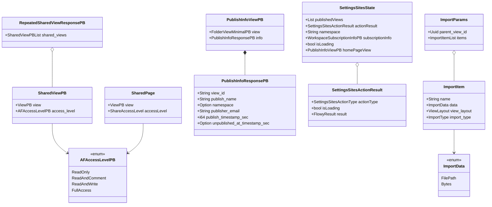
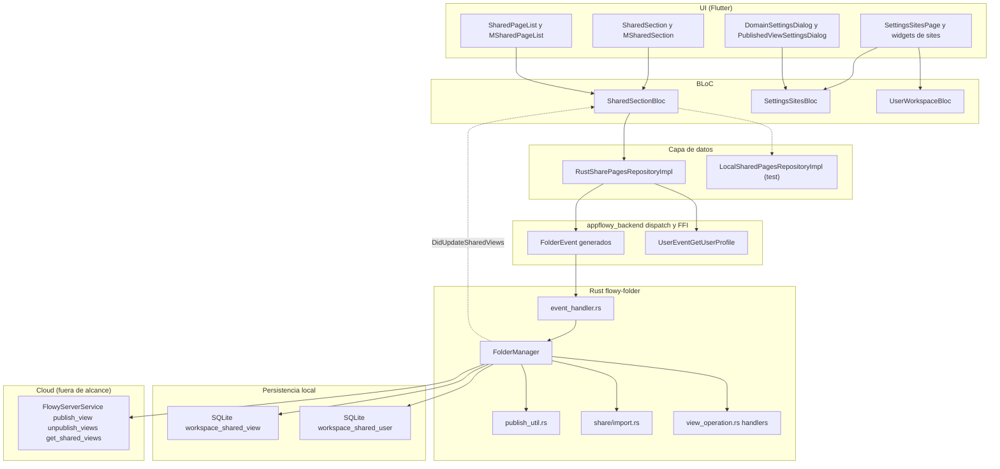
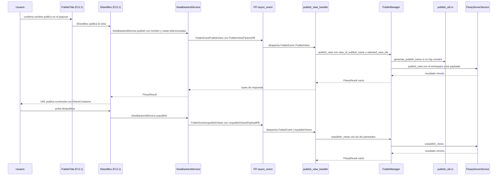
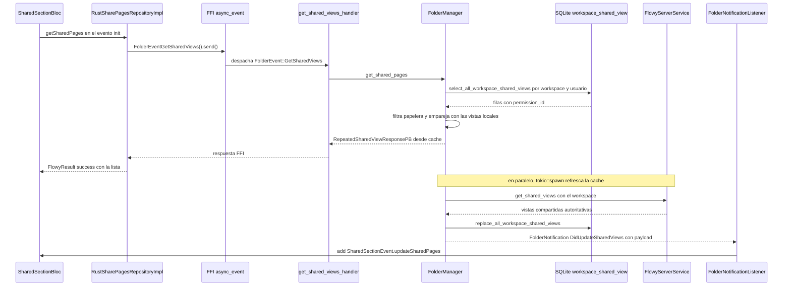
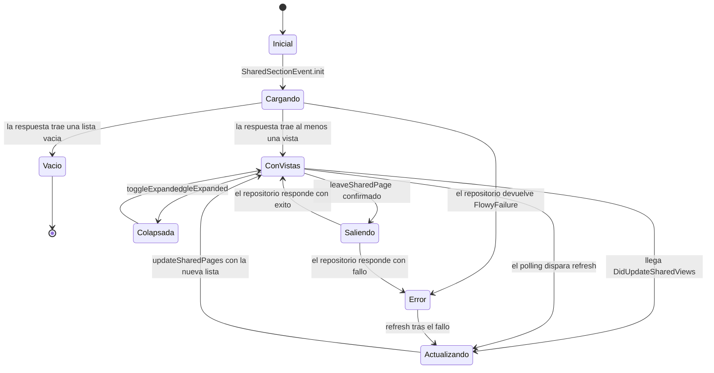

# F12.2 — Shared section, sitios publicados y contrato cliente de publish_util/import en Rust

## 1. Resumen

Este documento cubre dos dominios que comparten el mismo eje de datos —la publicación y el compartir de vistas— pero que viven en capas distintas de la aplicación. El primero es la **shared section**, la sección del sidebar que lista las páginas que otros usuarios han compartido *con* el usuario actual ("Shared with me"), gestionada por `SharedSectionBloc` y el repositorio `RustSharePagesRepositoryImpl` (`appflowy/frontend/appflowy_flutter/lib/features/shared_section/logic/shared_section_bloc.dart:16`). El segundo es la **página de sitios publicados** de Ajustes (`settings/pages/sites/`), que administra el namespace del workspace, la lista de vistas publicadas, la portada del sitio y el plan de suscripción mediante `SettingsSitesBloc` (`appflowy/frontend/appflowy_flutter/lib/workspace/presentation/settings/pages/sites/settings_sites_bloc.dart:21`). El documento cierra con el **contrato cliente** de los dos ficheros Rust que caen en esta unidad por reparto del ledger: `publish_util.rs` (generación de nombre público y conversión `ViewPB → PublishViewInfo`) y `share/import.rs` (tipos `ImportParams`/`ImportItem`/`ImportData`/`ImportType`); el motor que los consume es de otros bloques (§2 y §13).

## 2. Alcance

Incluye los 33 ficheros listados en §12, que se agrupan en: (a) la feature Dart `features/shared_section/` completa —repositorio, BLoC, eventos, estado, modelo y nueve widgets de presentation—; (b) la página de Ajustes "Sitios" con sus trece widgets, su BLoC y sus dos diálogos; (c) los dos ficheros Rust de contrato.

**Correcciones de scope obligatorias.** El ledger asigna a esta unidad dos ficheros cuyo motor de verdad está en otro bloque, y es preciso declararlo para no duplicar ni contradecir la documentación:

- `appflowy/frontend/rust-lib/flowy-folder/src/publish_util.rs` está en esta unidad, pero **la publicación web completa es de `[[B4.12]]`**. Aquí sólo se documenta el contrato cliente: `generate_publish_name` (slug de URL limitado por el backend) y `view_pb_to_publish_view` (proyección de la vista al tipo público de la nube). La construcción del `PublishPayload`, la recogida recursiva de collabs y el envío al backend están en `FolderManager::publish_view` y sus ayudantes, que pertenecen a `[[B4.12]]`.
- `appflowy/frontend/rust-lib/flowy-folder/src/share/import.rs` está en esta unidad, pero **el motor de importación es de `[[B4.11]]`**, con parte del procesamiento de formatos en `[[F18.2]]` (crate `collab-importer`). Aquí sólo se documenta el punto de entrada: las estructuras de datos que `ImportPayloadPB` se convierte a y que `FolderManager::import` consume iterando.

Queda además fuera de esta unidad, y se cruza con documentos hermanos: el nivel de acceso por vista (`features/page_access_level/`) y la pestaña moderna de compartir, ambos en `[[F12.1]]`; el botón de compartir y el `ShareBloc` que inician la publicación, también en `[[F12.1]]`; la implementación de servidor que atiende `publish_view`/`get_shared_views` (`flowy-server/src/af_cloud/`), fuera de alcance porAGENTS.md §11.

## 3. Modelos de datos

Muestra: los tipos en memoria que circulan entre repositorios, BLoCs y widgets en ambos dominios, y las estructuras Rust que sólo existen dentro del crate.

**Lectura.** El lado Dart de la shared section usa un modelo propio muy pequeño: `SharedPage` envuelve un `ViewPB` más un `ShareAccessLevel` (`appflowy/frontend/appflowy_flutter/lib/features/shared_section/models/shared_page.dart:6–13`), con el alias `typedef SharedPages = List<SharedPage>` declarado en la línea 4 del mismo fichero. El enum `ShareAccessLevel` (readOnly/readAndComment/readAndWrite/fullAccess) vive en `appflowy/frontend/appflowy_flutter/lib/features/share_tab/data/models/share_access_level.dart:6–17` y es compartido con la pestaña de compartir documentada en `[[F12.1]]`. El lado Rust usa el enum protobuf `AFAccessLevelPB` con exactamente los mismos cuatro valores y la misma numeración (`appflowy/frontend/rust-lib/flowy-folder/src/entities/view.rs:727–733`), y el contenedor `RepeatedSharedViewResponsePB { shared_views: Vec<SharedViewPB> }` (`appflowy/frontend/rust-lib/flowy-folder/src/entities/view.rs:936–939`).

El dominio de sitios publicados trabaja con un modelo richer: cada fila de la tabla de Ajustes es un `PublishInfoViewPB` que empareja una vista mínima (`FolderViewMinimalPB`) con su `PublishInfoResponsePB` (`appflowy/frontend/rust-lib/flowy-folder/src/entities/publish.rs:26–31`), y ese segundo mensaje lleva `view_id`, `publish_name`, `namespace` opcional, `publisher_email`, `publish_timestamp_sec` y `unpublished_at_timestamp_sec` opcional (`appflowy/frontend/rust-lib/flowy-folder/src/entities/publish.rs:66–79`). El estado del BLoC es una clase `freezed` con seis campos (`appflowy/frontend/appflowy_flutter/lib/workspace/presentation/settings/pages/sites/settings_sites_bloc.dart:309–321`) y las acciones discretas se modelan aparte en `SettingsSitesActionResult`, que lleva un discriminante `SettingsSitesActionType` (`appflowy/frontend/appflowy_flutter/lib/workspace/presentation/settings/pages/sites/settings_sites_bloc.dart:339–372`).

En Rust, `share/import.rs` declara cuatro tipos sin dependencias de infrastructure: el enum discriminado `ImportType` con cinco formatos (HistoryDocument, HistoryDatabase, Markdown, AFDatabase, CSV), la estructura `ImportItem`, el enum `ImportData` con las dos variantes `FilePath`/`Bytes` y su `impl Display`, y el contenedor `ImportParams` con `parent_view_id: Uuid` e `items: Vec<ImportItem>` (`appflowy/frontend/rust-lib/flowy-folder/src/share/import.rs:5–41`). La conversión desde el protobuf ocurre en `ImportPayloadPB::try_into` (`appflowy/frontend/rust-lib/flowy-folder/src/entities/import.rs:73–118`), que es donde se materializan las validaciones que §13 analiza.

## 4. Eventos FFI

Los diecisiete eventos de `FolderEvent` que atraviesan esta unidad se han extraído de `OUT/_ledger/extract/events.json` para el crate `flowy-folder` y se contrastado con `appflowy/frontend/rust-lib/flowy-folder/src/event_map.rs` y sus handlers. La tabla separa los consumidos por la shared section, los consumidos por la página de sitios y los dos de importación.

| Evento | Input PB | Output PB | Handler | Registro | Handler |
|---|---|---|---|---|---|
| `GetSharedViews` | — | `RepeatedSharedViewResponsePB` | `get_shared_views_handler` | `appflowy/frontend/rust-lib/flowy-folder/src/event_map.rs:60` | `appflowy/frontend/rust-lib/flowy-folder/src/event_handler.rs:585–591` |
| `RemoveUserFromSharedPage` | `RemoveUserFromSharedPagePayloadPB` | — | `remove_user_from_shared_page_handler` | `appflowy/frontend/rust-lib/flowy-folder/src/event_map.rs:58` | `appflowy/frontend/rust-lib/flowy-folder/src/event_handler.rs:570–582` |
| `PublishView` | `PublishViewParamsPB` | — | `publish_view_handler` | `appflowy/frontend/rust-lib/flowy-folder/src/event_map.rs:45` | `appflowy/frontend/rust-lib/flowy-folder/src/event_handler.rs:402–417` |
| `UnpublishViews` | `UnpublishViewsPayloadPB` | — | `unpublish_views_handler` | `appflowy/frontend/rust-lib/flowy-folder/src/event_map.rs:48` | `appflowy/frontend/rust-lib/flowy-folder/src/event_handler.rs:420–433` |
| `GetPublishNamespace` | — | `PublishNamespacePB` | `get_publish_namespace_handler` | `appflowy/frontend/rust-lib/flowy-folder/src/event_map.rs:50` | `appflowy/frontend/rust-lib/flowy-folder/src/event_handler.rs:471–477` |
| `SetPublishNamespace` | `SetPublishNamespacePayloadPB` | — | `set_publish_namespace_handler` | `appflowy/frontend/rust-lib/flowy-folder/src/event_map.rs:49` | `appflowy/frontend/rust-lib/flowy-folder/src/event_handler.rs:460–468` |
| `ListPublishedViews` | — | `RepeatedPublishInfoViewPB` | `list_published_views_handler` | `appflowy/frontend/rust-lib/flowy-folder/src/event_map.rs:51` | `appflowy/frontend/rust-lib/flowy-folder/src/event_handler.rs:480–490` |
| `SetPublishName` | `SetPublishNamePB` | — | `set_publish_name_handler` | `appflowy/frontend/rust-lib/flowy-folder/src/event_map.rs:47` | `appflowy/frontend/rust-lib/flowy-folder/src/event_handler.rs:448–457` |
| `GetDefaultPublishInfo` | — | `PublishInfoResponsePB` | `get_default_publish_info_handler` | `appflowy/frontend/rust-lib/flowy-folder/src/event_map.rs:52` | `appflowy/frontend/rust-lib/flowy-folder/src/event_handler.rs:493–499` |
| `SetDefaultPublishView` | `ViewIdPB` | — | `set_default_publish_view_handler` | `appflowy/frontend/rust-lib/flowy-folder/src/event_map.rs:53` | `appflowy/frontend/rust-lib/flowy-folder/src/event_handler.rs:502–513` |
| `RemoveDefaultPublishView` | — | — | `remove_default_publish_view_handler` | `appflowy/frontend/rust-lib/flowy-folder/src/event_map.rs:54` | `appflowy/frontend/rust-lib/flowy-folder/src/event_handler.rs:516–522` |
| `GetPublishInfo` | `ViewIdPB` | `PublishInfoResponsePB` | `get_publish_info_handler` | `appflowy/frontend/rust-lib/flowy-folder/src/event_map.rs:46` | `appflowy/frontend/rust-lib/flowy-folder/src/event_handler.rs:436–445` |
| `ImportData` | `ImportPayloadPB` | `RepeatedViewPB` | `import_data_handler` | `appflowy/frontend/rust-lib/flowy-folder/src/event_map.rs:33` | `appflowy/frontend/rust-lib/flowy-folder/src/event_handler.rs:356–364` |
| `ImportZipFile` | `ImportZipPB` | — | `import_zip_file_handler` | `appflowy/frontend/rust-lib/flowy-folder/src/event_map.rs:34` | `appflowy/frontend/rust-lib/flowy-folder/src/event_handler.rs:367–375` |

Las clases Dart correspondientes (`FolderEventGetSharedViews`, `FolderEventUnpublishViews`, `FolderEventListPublishedViews`, `FolderEventSetPublishNamespace`, `FolderEventSetPublishName`, `FolderEventGetDefaultPublishInfo`, `FolderEventSetDefaultPublishView`, `FolderEventRemoveDefaultPublishView`) no viven en el repo: las genera el codegen a partir del enum `FolderEvent` y se consumen vía `appflowy_backend/dispatch`, patrón documentado en `[[F00.5.1.2]]`.

Dos consecuencias del contrato se leen directamente en los handlers. `unpublish_views_handler` convierte cada `String` de `view_ids` con `Uuid::from_str(...).ok()` y descarta silenciosamente los que no parsean (`appflowy/frontend/rust-lib/flowy-folder/src/event_handler.rs:426–431`), de modo que un identificador corrupto no produce error sino una despublicación parcial. `get_publish_namespace_handler` y `list_published_views_handler` no reciben payload alguno: el plugin los despacha sólo con el estado (`AFPluginState<Weak<FolderManager>>`), lo que explica que en Dart se invoquen como `FolderEventGetPublishNamespace().send()` sin argumentos (`appflowy/frontend/appflowy_flutter/lib/workspace/presentation/settings/pages/sites/settings_sites_bloc.dart:107`).

## 5. Notificaciones

Las dos notificaciones que atraviesan esta unidad pertenecen al enum `FolderNotification` de `flowy-folder`, cuyo `ProtoBuf_Enum` se declara en `appflowy/frontend/rust-lib/flowy-folder/src/notification.rs:7–46` con la fuente observable constante `FOLDER_OBSERVABLE_SOURCE = "Workspace"` (`appflowy/frontend/rust-lib/flowy-folder/src/notification.rs:5`). El catálogo `OUT/_ledger/extract/notifications.json` marca ambas como `declared_only` porque ningún listener dedicado las recoge; en realidad sí las consume la shared section, de forma directa eidiomática.

| Notificación | Valor | Emisor Rust | Payload | Listener Dart | Efecto UI |
|---|---|---|---|---|---|
| `FolderNotification.DidUpdateSharedViews` | 40 (`appflowy/frontend/rust-lib/flowy-folder/src/notification.rs:43`) | `FolderManager::get_shared_pages`, tarea `tokio::spawn` (`appflowy/frontend/rust-lib/flowy-folder/src/manager.rs:2448–2451`) | `RepeatedSharedViewResponsePB` completo | `FolderNotificationListener` creado por `SharedSectionBloc` (`appflowy/frontend/appflowy_flutter/lib/features/shared_section/logic/shared_section_bloc.dart:135–158`) | Reemplaza la lista completa de vistas compartidas sin recargar |
| `FolderNotification.DidUpdateSharedUsers` | 41 (`appflowy/frontend/rust-lib/flowy-folder/src/notification.rs:44`) | `share_page_with_user` (`appflowy/frontend/rust-lib/flowy-folder/src/manager.rs:1436–1448`) y `revoke_shared_page_access` (`appflowy/frontend/rust-lib/flowy-folder/src/manager.rs:1494–1502`) | `RepeatedSharedUserPB` | `ShareTabBloc` (`appflowy/frontend/appflowy_flutter/lib/features/share_tab/logic/share_tab_bloc.dart:399`), fuera de esta unidad | Refresca la lista de personas con acceso de la pestaña Compartir |

`DidUpdateSharedViews` se emite con el `workspace_id` como `objectId`, lo que casa exactamente con el `objectId: workspaceId` que el listener declara (`appflowy/frontend/appflowy_flutter/lib/features/shared_section/logic/shared_section_bloc.dart:136–137`). El puente Dart es genérico: `FolderNotificationParser` filtra por la cadena `"Workspace"` que debe coincidir con `FOLDER_OBSERVABLE_SOURCE` (`appflowy/frontend/appflowy_flutter/lib/core/notification/folder_notification.dart:12–24`) y `FolderNotificationListener` se suscribe a `RustStreamReceiver.listen` en el constructor (`appflowy/frontend/appflowy_flutter/lib/core/notification/folder_notification.dart:32–50`).

La sección de sitios publicados **no escucha ninguna notificación**: todo su estado se obtiene con llamadas explícitas en `_initial` y se actualiza de forma optimista tras cada acción (§6). Consecuencia: un cambio de publicación hecho en otro cliente no refresca la página de Ajustes mientras el usuario no la vuelva a abrir.

## 6. BLoCs / Cubits

| Clase | Eventos | Estado | Servicios / dependencias | Fichero |
|---|---|---|---|---|
| `SharedSectionBloc` | 5, sellados con factorías: `init`, `refresh`, `updateSharedPages`, `toggleExpanded`, `leaveSharedPage` | `SharedSectionState` con 4 campos: `sharedPages`, `isLoading`, `errorMessage`, `isExpanded` | `SharedPagesRepository` inyectado por constructor; `FolderNotificationListener`; `Timer.periodic` opcional | `appflowy/frontend/appflowy_flutter/lib/features/shared_section/logic/shared_section_bloc.dart:16–28` |
| `SettingsSitesBloc` | 7, `freezed` con `when`: `initial`, `unpublishView`, `updateNamespace`, `updatePublishName`, `upgradeSubscription`, `setHomePage`, `removeHomePage` | `SettingsSitesState` con 6 campos + `actionResult` | `UserBackendService` (suscripción y pago); `FolderEvent*` vía `appflowy_backend/dispatch`; `UserWorkspaceBloc` leído desde los widgets | `appflowy/frontend/appflowy_flutter/lib/workspace/presentation/settings/pages/sites/settings_sites_bloc.dart:21–50` |
| `UserWorkspaceBloc` (secundario) | `UserWorkspaceEvent.initialize` | `currentWorkspace.role` | `RustWorkspaceRepositoryImpl` | `appflowy/frontend/appflowy_flutter/lib/workspace/presentation/settings/pages/sites/settings_sites_view.dart:40–47` |

**Shared section.** El BLoC declara en su constructor `enablePolling = false` y `pollingIntervalSeconds = 30` (`appflowy/frontend/appflowy_flutter/lib/features/shared_section/logic/shared_section_bloc.dart:17–22`), y el comentario que precede a `enablePolling` explica el porqué: el backend todavía no ofrece websocket para las actualizaciones de vistas compartidas, así que se pagina (`appflowy/frontend/appflowy_flutter/lib/features/shared_section/logic/shared_section_bloc.dart:39–44`). Ambos widgets de presentation usan la variante productiva: instancian `RustSharePagesRepositoryImpl()` de forma local y crean el BLoC con `enablePolling: true` y el evento `SharedSectionInitEvent` encadenado (`appflowy/frontend/appflowy_flutter/lib/features/shared_section/presentation/shared_section.dart:37–44`, `appflowy/frontend/appflowy_flutter/lib/features/shared_section/presentation/m_shared_section.dart:27–34`). El temporizador sólo se arranca dentro de `_onInit` (`appflowy/frontend/appflowy_flutter/lib/features/shared_section/logic/shared_section_bloc.dart:182–194`), y `close()` cancela temporizador y detiene el listener (`appflowy/frontend/appflowy_flutter/lib/features/shared_section/logic/shared_section_bloc.dart:48–53`).

**Sitios publicados.** El BLoC usa el estilo `freezed` con `event.when(...)` y un único `on<SettingsSitesEvent>` que delega en siete métodos privados (`appflowy/frontend/appflowy_flutter/lib/workspace/presentation/settings/pages/sites/settings_sites_bloc.dart:26–49`). `_initial` carga en dos fases encadenadas: primero suscripción y namespace en paralelo con el patrón de records de Dart `final (a, b) = await (f1, f2).wait` (`appflowy/frontend/appflowy_flutter/lib/workspace/presentation/settings/pages/sites/settings_sites_bloc.dart:65–68`), después vistas publicadas y portada con la misma técnica (`appflowy/frontend/appflowy_flutter/lib/workspace/presentation/settings/pages/sites/settings_sites_bloc.dart:78–81`); el comentario del código explica que la segunda tanda "no es bloqueante" para no retrasar el primer pintado. El resultado de cada acción se publica en `actionResult` con un `SettingsSitesActionResult` y un `SettingsSitesActionType`, y cada diálogo filtra por ese discriminante en su `BlocListener` (`appflowy/frontend/appflowy_flutter/lib/workspace/presentation/settings/pages/sites/domain/domain_settings_dialog.dart:208–214`, `appflowy/frontend/appflowy_flutter/lib/workspace/presentation/settings/pages/sites/published_page/published_view_settings_dialog.dart:194–201`).

Las actualizaciones optimistas merecen detalle: `_unpublishView` filtra la vista de `publishedViews` y anula `homePageView` sólo si la despublicada era la portada, en la rama de éxito (`appflowy/frontend/appflowy_flutter/lib/workspace/presentation/settings/pages/sites/settings_sites_bloc.dart:141–163`); `_updatePublishName` usa la API de protobuf `freeze()`/`rebuild()` para reescribir un único campo dentro de una lista de mensajes inmutables (`appflowy/frontend/appflowy_flutter/lib/workspace/presentation/settings/pages/sites/settings_sites_bloc.dart:214–227`).

## 7. Servicios e inyección de dependencias

En Dart ninguno de los dos dominios usa `get_it` para sus propios BLoCs: `SharedSectionBloc` se crea con `BlocProvider.create` dentro del propio widget y recibe el repositorio como parámetro nominal (`appflowy/frontend/appflowy_flutter/lib/features/shared_section/presentation/shared_section.dart:39–44`); `SettingsSitesBloc` se crea en el `MultiBlocProvider` de `SettingsSitesPage` (`appflowy/frontend/appflowy_flutter/lib/workspace/presentation/settings/pages/sites/settings_sites_view.dart:32–50`). Lo que sí se resuelve por `get_it` son tres servicios transversales: `ClipboardService` (registrado en `appflowy/frontend/appflowy_flutter/lib/startup/deps_resolver.dart:87–88`, usado por `copySiteLink` en `appflowy/frontend/appflowy_flutter/lib/workspace/presentation/settings/pages/sites/constants.dart:54`), `ActionNavigationBloc` (singleton en `appflowy/frontend/appflowy_flutter/lib/startup/deps_resolver.dart:156`, usado al abrir la página publicada desde Ajustes) y `AppFlowyCloudSharedEnv` (`appflowy/frontend/appflowy_flutter/lib/startup/deps_resolver.dart:62–64`), del que `ShareConstants` extrae el dominio base para construir URLs públicas.

La construcción de URLs no está en esta unidad sino en `plugins/shared/share/constants.dart`, ya documentado en `[[F12.1]]`: `buildPublishUrl` compone `dominio/namespace/publishName` y `buildNamespaceUrl` compone `dominio/namespace` con el esquema opcional (`appflowy/frontend/appflowy_flutter/lib/plugins/shared/share/constants.dart:8–29`). La página de sitios los envuelve en `SettingsPageSitesEvent.visitSite` y `copySiteLink`, que sonhelpers estáticos sin estado (`appflowy/frontend/appflowy_flutter/lib/workspace/presentation/settings/pages/sites/constants.dart:32–59`).

En Rust la dependencia se resuelve con `AFPluginState<Weak<FolderManager>>`: cada handler hace `upgrade_folder(folder)?` y delega en un método del manager (`appflowy/frontend/rust-lib/flowy-folder/src/event_handler.rs:585–591`). El manager, a su vez, obtiene el servicio de nube con `self.cloud_service()?` y el workspace con `self.user.workspace_id()?` antes de cada llamada remota (`appflowy/frontend/rust-lib/flowy-folder/src/manager.rs:1675–1682`). El contrato cliente completo está en el trait `FlowyServerService` de `flowy-folder-pub`, donde aparecen las diez firmas de publicación (`publish_view`, `unpublish_views`, `get_publish_info`, `set_publish_name`, `set_publish_namespace`, `list_published_views`, `get_default_published_view_info`, `set_default_published_view`, `remove_default_published_view`, `get_publish_namespace`) más `import_zip` (`appflowy/frontend/rust-lib/flowy-folder-pub/src/cloud.rs:49–96`). La implementación por defecto de la UI es `af_cloud`; la variante local devuelve `FlowyError::local_version_not_support()` para casi todo el surface de publicación (§13).

## 8. Persistencia

La shared section sí tiene respaldo local en SQLite. La tabla `workspace_shared_view` declara la clave primaria compuesta `(uid, workspace_id, view_id)` y las columnas `permission_id` (entero con el nivel de acceso) y `created_at` nullable (`appflowy/frontend/rust-lib/flowy-sqlite/src/schema.rs:163–171`); la estructura Rust equivalente `WorkspaceSharedViewTable` está en `appflowy/frontend/rust-lib/flowy-folder-pub/src/sql/workspace_shared_view_sql.rs:10–16`. La tabla hermana `workspace_shared_user` almacena, por página compartida, `email`, `name`, `avatar_url`, `role`, `access_level` y `order` (`appflowy/frontend/rust-lib/flowy-sqlite/src/schema.rs:150–161`), y se llena al compartir una página con un invitado o al revocarse el acceso (`appflowy/frontend/rust-lib/flowy-folder/src/manager.rs:1409–1434`).

El patrón de lectura es "caché primero, nube después": `get_shared_pages` devuelve de inmediato las filas locales (`appflowy/frontend/rust-lib/flowy-folder/src/manager.rs:2376–2398`), lanza una tarea `tokio::spawn` que consulta la nube y **reescribe por completo** la tabla con `replace_all_workspace_shared_views` (`appflowy/frontend/rust-lib/flowy-folder/src/manager.rs:2404–2424`), y sólo entonces emite `DidUpdateSharedViews` con la respuesta ya filtrada contra las vistas locales (`appflowy/frontend/rust-lib/flowy-folder/src/manager.rs:2426–2451`). La tabla local se poda antes de mostrar: las vistas que están en la papelera se filtran (`appflowy/frontend/rust-lib/flowy-folder/src/manager.rs:2369–2374`).

**El dominio de sitios publicados no persiste nada localmente.** Todos los métodos `publish_view`, `unpublish_views`, `get_publish_info`, `set_publish_name`, `set_publish_namespace`, `get_publish_namespace`, `list_published_views`, `get_default_published_view_info`, `set_default_published_view` y `remove_default_published_view` delegan sin más en `self.cloud_service()?` (`appflowy/frontend/rust-lib/flowy-folder/src/manager.rs:1613–1765`). La única caché es un `Map<String, String?>` estático de módulo en Dart, `_namespaceCache`,indexado por `workspaceId`, que se rellena con la respuesta de `GetPublishNamespace` y se reutiliza como valor inicial de `isLoading` (`appflowy/frontend/appflowy_flutter/lib/workspace/presentation/settings/pages/sites/settings_sites_bloc.dart:19`, `:56`, `:106–110`). No es una caché invalidable: vive en memoria durante toda la vida del proceso.

## 9. Diagramas de flujo

Muestra: el recorrido por capas de los dos dominios, desde el widget hasta el servicio de nube, incluyendo dónde se corta la frontera con el backend y dónde se tocan las tablas locales.

**Lectura.** El eje de la shared section es corto y totalmente síncrono en su respuesta inicial: widget → BLoC → repositorio → evento generado → `async_event` → handler → manager → tabla SQLite. La flecha punteada hacia `AF` y la que vuelve desde `FM` son la misma operación partida en dos tiempos, y la segunda es la que dispara `DidUpdateSharedViews` de vuelta al BLoC (§5). El repositorio local (`LocalSharedPagesRepositoryImpl`) queda fuera de la ruta productiva: devuelve tres vistas fijas y está comentado con `// Move this file to test folder` (`appflowy/frontend/appflowy_flutter/lib/features/shared_section/data/repositories/local_shared_pages_repository_impl.dart:8–33`).

El lado de sitios publicados no toca SQLite en absoluto: `SettingsSitesBloc` va directo a los eventos FFI y el manager va directo a la nube. `publish_util.rs` entra en el flujo sólo como auxiliar de `FolderManager::get_publish_payload`, que genera el nombre público cuando el usuario no indica uno (`appflowy/frontend/rust-lib/flowy-folder/src/manager.rs:1864`), y `share/import.rs` sólo aporta las estructuras que `ImportPayloadPB` se convierte a antes de que `view_operation.rs` haga el trabajo heavy de cada formato (motor de `[[B4.11]]`).

## 10. Diagramas de secuencia

### 10.1 Publicar y despublicar una vista

Muestra: el recorrido de publicación desde el popover de compartir (documentado en `[[F12.1]]`) hasta el servicio de nube, y el recorrido inverso de despublicación.

**Lectura.** El nombre público sólo se genera en Rust si el cliente no lo envía: `PublishViewParamsPB.publish_name` es un `one_of` opcional (`appflowy/frontend/rust-lib/flowy-folder/src/entities/publish.rs:8–17`) y `get_publish_payload` aplica `publish_name.unwrap_or_else(|| generate_publish_name(&view.id, &view.name))` (`appflowy/frontend/rust-lib/flowy-folder/src/manager.rs:1864`). La función genera un slug con la regex `[^\w-]` reemplazada por guiones y un máximo efectivo de 50 caracteres contando el id, tal y como documenta el propio comentario del backend (`appflowy/frontend/rust-lib/flowy-folder/src/publish_util.rs:6–22`). El camino de publicación rechaza explícitamente los chats antes de hacer nada (`appflowy/frontend/rust-lib/flowy-folder/src/manager.rs:1636–1641`) y las vistas hijas se recogen recursivamente salvo que sean chats (`appflowy/frontend/rust-lib/flowy-folder/src/manager.rs:1782–1813`): ambos detalles son parte del motor de `[[B4.12]]`.

La despublicación no devuelve carga útil: `unpublish_views_handler` sólo propaga el `FlowyResult` y el cliente optimiza el estado quitando la fila de su lista local (`appflowy/frontend/appflowy_flutter/lib/workspace/presentation/settings/pages/sites/settings_sites_bloc.dart:141–146`). Obsérvese la asimetría: desde el menú de compartir la despublicación la hace `ViewBackendService.unpublish` (`appflowy/frontend/appflowy_flutter/lib/workspace/application/view/view_service.dart:363–368`), y desde la página de sitios la hace `SettingsSitesBloc._unpublishView`; ambas terminan en el mismo evento.

### 10.2 Listar las vistas compartidas con el usuario

Muestra: por qué la primera respuesta es local y por qué la UI se actualiza una segunda vez sin que nadie lo pida.

**Lectura.** La primera respuesta es síncrona y sale de SQLite; la segunda es asíncrona, llega por el canal de notificaciones Rust→Dart y **reemplaza** la lista completa en lugar de fusionarse. Esa sustitución wholesale es intencionada en el manager, que reserializa todas las vistas autoritativas tras filtrar por papelera y emparejar cada `view_id` con la vista local (`appflowy/frontend/rust-lib/flowy-folder/src/manager.rs:2426–2446`). El emparejamiento explica por qué la UI puede pintar algo antes de tener la respuesta de la nube: `SharedPage.view` es un `ViewPB` completo con sus hijos, construido con `view_pb_with_all_child_views` (`appflowy/frontend/rust-lib/flowy-folder/src/manager.rs:2386–2393`).

Del lado Dart, el handler de la notificación decodifica el payload con `RepeatedSharedViewResponsePB.fromBuffer(payload)` y lo convierte en `SharedSectionEvent.updateSharedPages` (`appflowy/frontend/appflowy_flutter/lib/features/shared_section/logic/shared_section_bloc.dart:138–155`). El mismo patrón de "responder rápido y corregir después" se repite con el temporizador de 30 segundos, que dispara `SharedSectionEvent.refresh` y por tanto relanza el ciclo completo, incluida una llamada a la nube por segundo periodo (`appflowy/frontend/appflowy_flutter/lib/features/shared_section/logic/shared_section_bloc.dart:182–194`).

## 11. Diagramas de estado

Muestra: el ciclo de vida del `SharedSectionBloc`, incluidos los caminos de error que no se recuperan solos.

**Lectura.** El estado inicial es `SharedSectionState.initial()`, equivalente a `const SharedSectionState()` con `sharedPages` vacío, `isLoading` false, `errorMessage` vacío e `isExpanded` **true** (`appflowy/frontend/appflowy_flutter/lib/features/shared_section/logic/shared_section_state.dart:4–16`). `_onInit` es el único manejador que limpia `errorMessage` antes de pedir datos (`appflowy/frontend/appflowy_flutter/lib/features/shared_section/logic/shared_section_bloc.dart:62–67`); por eso el diagrama sitúa la recuperación desde `Error` pasando por un nuevo `refresh`.

`isExpanded` es puramente visual y sólo lo consume la versión de escritorio: `SharedSectionHeader` alterna el flag y `SharedPageList` se monta dentro de un `if (state.isExpanded)` (`appflowy/frontend/appflowy_flutter/lib/features/shared_section/presentation/shared_section.dart:64–76`). La versión móvil no tiene ese concepto y muestra siempre la lista (`appflowy/frontend/appflowy_flutter/lib/features/shared_section/presentation/m_shared_section.dart:56–74`).

La diferencia entre `Vacio` en escritorio y en móvil es de comportamiento, no de estado: el escritorio colapsa el widget a `SizedBox.shrink()` cuando no hay vistas compartidas (`appflowy/frontend/appflowy_flutter/lib/features/shared_section/presentation/shared_section.dart:55–58`), mientras el móvil renderiza `SharedSectionEmpty` con el texto "Nothing shared with you" (`appflowy/frontend/appflowy_flutter/lib/features/shared_section/presentation/m_shared_section.dart:46–48`, `appflowy/frontend/appflowy_flutter/lib/features/shared_section/presentation/widgets/shared_section_empty.dart:21–35`).

## 12. Archivos cubiertos (del ledger)

Lista tabular completa de `OUT/_ledger/units/F12.2.json` (33 ficheros).

| Capa | Ruta | Papel en la unidad |
|---|---|---|
| bloc | `appflowy/frontend/appflowy_flutter/lib/features/shared_section/data/repositories/local_shared_pages_repository_impl.dart` | Implementación in-memory de `SharedPagesRepository` con tres vistas fijas; marcada con `// Move this file to test folder` |
| bloc | `appflowy/frontend/appflowy_flutter/lib/features/shared_section/data/repositories/rust_shared_pages_repository_impl.dart` | Implementación productiva: envía `FolderEventGetSharedViews` y, para abandonar una vista, resuelve el email del perfil y llama a `FolderEventRemoveUserFromSharedPage` |
| bloc | `appflowy/frontend/appflowy_flutter/lib/features/shared_section/data/repositories/shared_pages_repository.dart` | Interfaz abstracta con `getSharedPages()` y `leaveSharedPage(pageId)`, ambas `FlowyResult` |
| bloc | `appflowy/frontend/appflowy_flutter/lib/features/shared_section/logic/shared_section_bloc.dart` | `SharedSectionBloc`: 5 manejadores, listener de `DidUpdateSharedViews` y polling opcional de 30 s |
| bloc | `appflowy/frontend/appflowy_flutter/lib/features/shared_section/logic/shared_section_event.dart` | Clase base sellada `SharedSectionEvent` con factorías y las 5 subclases de evento |
| bloc | `appflowy/frontend/appflowy_flutter/lib/features/shared_section/logic/shared_section_state.dart` | `SharedSectionState` inmutable con `copyWith`, `==`, `hashCode` y `toString` |
| ui | `appflowy/frontend/appflowy_flutter/lib/features/shared_section/models/shared_page.dart` | `SharedPage` (view + accessLevel) y el alias `SharedPages` |
| ui | `appflowy/frontend/appflowy_flutter/lib/features/shared_section/presentation/m_shared_section.dart` | Versión móvil de la sección: crea su propio BLoC y muestra cabecera, lista y estado vacío |
| ui | `appflowy/frontend/appflowy_flutter/lib/features/shared_section/presentation/shared_section.dart` | Versión escritorio: crea el BLoC, decide los cuatro estados visuales y cablea las acciones de vista |
| ui | `appflowy/frontend/appflowy_flutter/lib/features/shared_section/presentation/widgets/m_shared_page_list.dart` | Lista móvil con `MobileViewItem` y arrastre desactivado |
| ui | `appflowy/frontend/appflowy_flutter/lib/features/shared_section/presentation/widgets/m_shared_section_header.dart` | Cabecera móvil fija de 48 px con icono "shared with me" |
| ui | `appflowy/frontend/appflowy_flutter/lib/features/shared_section/presentation/widgets/refresh_button.dart` | `RefreshSharedSectionButton`, visible sólo en modo debug |
| ui | `appflowy/frontend/appflowy_flutter/lib/features/shared_section/presentation/widgets/shared_page_actions_button.dart` | Menú de tres puntos que construye las acciones según `ShareAccessLevel` y el layout de la vista |
| ui | `appflowy/frontend/appflowy_flutter/lib/features/shared_section/presentation/widgets/shared_page_list.dart` | Lista de escritorio sobre `ViewItem` con `FolderSpaceType.public` y botón de acciones por fila |
| ui | `appflowy/frontend/appflowy_flutter/lib/features/shared_section/presentation/widgets/shared_section_empty.dart` | Estado vacío móvil con ilustración y dos textos fijos en inglés |
| ui | `appflowy/frontend/appflowy_flutter/lib/features/shared_section/presentation/widgets/shared_section_error.dart` | Estado de error que muestra el mensaje del `FlowyError` en color de advertencia |
| ui | `appflowy/frontend/appflowy_flutter/lib/features/shared_section/presentation/widgets/shared_section_header.dart` | Cabecera de escritorio pulsable que alterna el colapso |
| ui | `appflowy/frontend/appflowy_flutter/lib/features/shared_section/presentation/widgets/shared_section_loading.dart` | Indicador de progreso centrado |
| ui | `appflowy/frontend/appflowy_flutter/lib/workspace/presentation/settings/pages/sites/constants.dart` | `SettingsPageSitesConstants` (anchos, flexes, cabeceras, formato de fecha) y los helpers `visitSite`/`copySiteLink` |
| ui | `appflowy/frontend/appflowy_flutter/lib/workspace/presentation/settings/pages/sites/domain/domain_header.dart` | Cabecera de la fila de dominio y homepage, alineada con el botón de tres puntos |
| ui | `appflowy/frontend/appflowy_flutter/lib/workspace/presentation/settings/pages/sites/domain/domain_item.dart` | Fila de dominio: URL del namespace, selector de portada (con variante Pro y variante no-owner) y botón de más acciones |
| ui | `appflowy/frontend/appflowy_flutter/lib/workspace/presentation/settings/pages/sites/domain/domain_more_action.dart` | Menú de tres puntos del dominio con la acción de renombrar namespace, bloqueada si el plan no es Pro o el usuario no es owner |
| ui | `appflowy/frontend/appflowy_flutter/lib/workspace/presentation/settings/pages/sites/domain/domain_settings_dialog.dart` | Diálogo de edición del namespace con vista previa de URL y mapeo de errores por código |
| ui | `appflowy/frontend/appflowy_flutter/lib/workspace/presentation/settings/pages/sites/domain/home_page_menu.dart` | `SelectHomePageMenu`: buscador y lista de vistas publicadas para elegir portada |
| ui | `appflowy/frontend/appflowy_flutter/lib/workspace/presentation/settings/pages/sites/publish_info_view_item.dart` | Fila reutilizable con icono (emoji o por defecto) y nombre de una vista publicada |
| ui | `appflowy/frontend/appflowy_flutter/lib/workspace/presentation/settings/pages/sites/published_page/published_view_item.dart` | Fila de la tabla de publicadas: nombre, path público (abre navegador) y fecha de publicación (abre la vista en la app) |
| ui | `appflowy/frontend/appflowy_flutter/lib/workspace/presentation/settings/pages/sites/published_page/published_view_item_header.dart` | Cabecera de tres columnas de la tabla de publicadas |
| ui | `appflowy/frontend/appflowy_flutter/lib/workspace/presentation/settings/pages/sites/published_page/published_view_more_action.dart` | Menú por fila con visitar sitio, copiar enlace, despublicar, URL personalizada y ajustes |
| ui | `appflowy/frontend/appflowy_flutter/lib/workspace/presentation/settings/pages/sites/published_page/published_view_settings_dialog.dart` | Diálogo de ajustes de la página publicada: renombrar el path, despublicar y visitar el sitio |
| bloc | `appflowy/frontend/appflowy_flutter/lib/workspace/presentation/settings/pages/sites/settings_sites_bloc.dart` | `SettingsSitesBloc` con estado `freezed`, caché estática de namespace y las 7 acciones de la página de sitios |
| ui | `appflowy/frontend/appflowy_flutter/lib/workspace/presentation/settings/pages/sites/settings_sites_view.dart` | `SettingsSitesPage`: monta los dos BLoCs, las dos categorías de ajustes y el listener de toasts por acción |
| rust-handler | `appflowy/frontend/rust-lib/flowy-folder/src/publish_util.rs` | Contrato cliente de publicación: `generate_publish_name` (slug de ≤ 50 chars) y `view_pb_to_publish_view` |
| rust-handler | `appflowy/frontend/rust-lib/flowy-folder/src/share/import.rs` | Contrato cliente de importación: `ImportType`, `ImportItem`, `ImportData`, `ImportParams` (motor en `[[B4.11]]`/`[[F18.2]]`) |

## 13. Riesgos y casos límite

**Correcciones de scope (reiteradas por trazabilidad).** Los dos ficheros Rust de esta unidad no son el motor de sus dominios. `publish_util.rs` aporta 37 líneas de utilidades y el motor de publicación web —recogida recursiva de collabs, construcción de `PublishPayload`, subida a la nube— vive en `[[B4.12]]`; `share/import.rs` aporta 41 líneas de estructuras y el motor de importación vive en `[[B4.11]]`, con el procesamiento por formato en `[[F18.2]]` (crate `collab-importer`). En ambos casos el punto de entrada FFI está en esta unidad y el trabajo pesado no.

- **Workspaces locales: publicación fallida con error genérico.** La implementación local del trait devuelve `FlowyError::local_version_not_support()` en `publish_view` (`appflowy/frontend/rust-lib/flowy-server/src/local_server/impls/folder.rs:103–108`), en `get_publish_namespace` (`appflowy/frontend/rust-lib/flowy-server/src/local_server/impls/folder.rs:166–168`), en `import_zip` (`appflowy/frontend/rust-lib/flowy-server/src/local_server/impls/folder.rs:170–172`) y en `get_shared_views` (`appflowy/frontend/rust-lib/flowy-server/src/local_server/impls/folder.rs:199–204`). La consecuencia práctica es que en un workspace local la shared section queda en estado de error permanente y la página de sitios muestra el namespace vacío. Peor aún, `unpublish_views` local devuelve `Ok(())` sin hacer nada (`appflowy/frontend/rust-lib/flowy-server/src/local_server/impls/folder.rs:111–117`), de modo que la UI eliminaría la fila Optimistamente de una tabla que ya estaba vacía.
- **El error de la shared section es pegajoso.** `_onRefresh` y `_onUpdateSharedPages` emiten `copyWith` sin tocar `errorMessage` (`appflowy/frontend/appflowy_flutter/lib/features/shared_section/logic/shared_section_bloc.dart:95–110`), y el builder evalúa `errorMessage.isNotEmpty` **antes** de mirar si hay vistas (`appflowy/frontend/appflowy_flutter/lib/features/shared_section/presentation/shared_section.dart:47–58`). Un refresh exitoso tras un fallo deja la sección clavada en `SharedSectionError`; sólo un nuevo `init` la recupera.
- **Mutación del estado inmutable.** `_onLeaveSharedPage` quita el elemento de `state.sharedPages` con el operador cascada `..removeWhere` antes de emitir el evento de actualización (`appflowy/frontend/appflowy_flutter/lib/features/shared_section/logic/shared_section_bloc.dart:166–174`), es decir, muta la lista del estado anterior en lugar de construir una nueva. Si otro `emit` occurriera entre medias, se observaría la mutación.
- **`late final` sin inicializar en el `close()`.** `_folderNotificationListener` se declara `late final` y sólo se asigna en `_initFolderNotificationListener`, llamado desde `_onInit` (`appflowy/frontend/appflowy_flutter/lib/features/shared_section/logic/shared_section_bloc.dart:37`, `:55–60`, `:135–158`), mientras que `close()` lo desreferencia sin comprobar nada (`appflowy/frontend/appflowy_flutter/lib/features/shared_section/logic/shared_section_bloc.dart:48–53`). Cerrar el BLoC sin haber despachado `init` lanzaría `LateInitializationError`.
- **Coste del polling.** Cada `SharedSectionEvent.refresh` dispara un `get_shared_views` completo contra la nube, y con `enablePolling: true` en ambas plataformas eso son 30 peticiones por hora y usuario con la app abierta (`appflowy/frontend/appflowy_flutter/lib/features/shared_section/logic/shared_section_bloc.dart:182–194`, `appflowy/frontend/rust-lib/flowy-folder/src/manager.rs:2404–2406`). El propio comentario del BLoC reconoce que el polling es un parche hasta que exista websocket.
- **Salir de una vista compartida exige conocer el email propio.** `RustSharePagesRepositoryImpl.leaveSharedPage` hace primero un `UserEventGetUserProfile` y, si falla o el email es nulo, devuelve un `FlowyError` sintético con el mensaje "User email is null" (`appflowy/frontend/appflowy_flutter/lib/features/shared_section/data/repositories/rust_shared_pages_repository_impl.dart:31–46`). El evento enviado es `RemoveUserFromSharedPagePayloadPB { view_id, emails: [userEmail] }`, que en Rust se traduce a un `RevokeSharedViewAccessRequest` y termina revocando el acceso de uno mismo (`appflowy/frontend/rust-lib/flowy-folder/src/event_handler.rs:570–582`).
- **Acciones del menú por nivel de acceso.** `SharedPageActionsButton` permite siempre favorito y "salir", añade renombrar y cambiar icono si el nivel no es `readOnly`, y sólo añade borrar si el nivel es `fullAccess`; además oculta cambiar icono para vistas de tipo Chat (`appflowy/frontend/appflowy_flutter/lib/features/shared_section/presentation/widgets/shared_page_actions_button.dart:118–157`). El ramal `default` del `switch` de `shared_section.dart` descarta silenciosamente cualquier acción no contemplada (`appflowy/frontend/appflowy_flutter/lib/features/shared_section/presentation/shared_section.dart:126–129`).
- **Visibilidad por feature flag.** La sección del sidebar sólo se monta si `FeatureFlag.sharedSection.isOn` (`appflowy/frontend/appflowy_flutter/lib/workspace/presentation/home/menu/sidebar/space/sidebar_space.dart:69–75`), y el valor por defecto del flag es `false` (`appflowy/frontend/appflowy_flutter/lib/shared/feature_flags.dart:130–132`). En móvil depende además de la pestaña `MobileSpaceTabType.shared` (`appflowy/frontend/appflowy_flutter/lib/mobile/presentation/home/tab/mobile_space_tab.dart:182–192`), que se persiste en el orden de pestañas del usuario.
- **Renombrar una vista compartida usa el backend de vistas, no el BLoC.** El diálogo de renombrado de `shared_section.dart` llama directamente a `ViewBackendService.updateView` porque el BLoC ya fue desechado (`appflowy/frontend/appflowy_flutter/lib/features/shared_section/presentation/shared_section.dart:92–105`), lo que evita refrescar la sección pero deja el cambio fuera del ciclo de eventos del BLoC.
- **Caché de namespace sin invalidar.** `_namespaceCache` es un `Map` estático de módulo que nunca se limpia (`appflowy/frontend/appflowy_flutter/lib/workspace/presentation/settings/pages/sites/settings_sites_bloc.dart:19`, `:106–110`). Si el usuario cierra sesión y entra otra cuenta en el mismo proceso, el namespace del workspace puede mostrarse brevemente belonging al usuario anterior.
- **Portada restringida a Pro y a owners.** Con plan `FreePlan` la columna de portada se sustituye por un botón de upgrade (`appflowy/frontend/appflowy_flutter/lib/workspace/presentation/settings/pages/sites/domain/domain_item.dart:78–96`); si el usuario no es owner, el selector se envuelve en `IgnorePointer` con un tooltip explicativo (`appflowy/frontend/appflowy_flutter/lib/workspace/presentation/settings/pages/sites/domain/domain_item.dart:195–207`). La misma comprobación de plan y rol bloquea la edición del namespace (`appflowy/frontend/appflowy_flutter/lib/workspace/presentation/settings/pages/sites/domain/domain_more_action.dart:72–101`).
- **El selector de portada guarda una instantánea.** `SelectHomePageMenu` copia `publishedViews` a un campo local en `initState` (`appflowy/frontend/appflowy_flutter/lib/workspace/presentation/settings/pages/sites/domain/home_page_menu.dart:34–40`); si la lista cambia mientras el popover está abierto, el menú sigue mostrando la instantánea anterior. Además, el parámetro `onSelected` se recibe con un cuerpo vacío en su único punto de uso, el popover de `_HomePageButton` (`appflowy/frontend/appflowy_flutter/lib/workspace/presentation/settings/pages/sites/domain/domain_item.dart:160–169`), porque el menú ya despacha el evento por su cuenta.
- **Dos acciones del menú hacen lo mismo.** En `PublishedViewMoreAction`, `_ActionType.customUrl` y `_ActionType.settings` abren ambos `PublishedViewSettingsDialog`, que sólo edita el path público (`appflowy/frontend/appflowy_flutter/lib/workspace/presentation/settings/pages/sites/published_page/published_view_more_action.dart:116–133`, `appflowy/frontend/appflowy_flutter/lib/workspace/presentation/settings/pages/sites/published_page/published_view_settings_dialog.dart:108–144`). No existe todavía una URL personalizada real pese al rótulo de la acción.
- **Errores de publicación y namespace desnormalizados.** El diálogo de namespace mapea `ErrorCode` con la extensión `namespaceErrorMessage` (plan insuficiente, namespace ocupado, reservado, demasiado largo/corto, caracteres inválidos) (`appflowy/frontend/appflowy_flutter/lib/shared/error_code/error_code_map.dart:24–44`), y el diálogo de página publicada usa `publishErrorMessage` (`appflowy/frontend/appflowy_flutter/lib/shared/error_code/error_code_map.dart:6–22`). Cualquier código nuevo devuelto por el backend se mostraría como mensaje genérico, porque ambas extensiones terminan en `_ => null`.
- **Textos sin traducir en el estado vacío móvil.** `SharedSectionEmpty` y `RefreshSharedSectionButton` escriben sus cadenas literalmente en inglés, sin pasar por `LocaleKeys` (`appflowy/frontend/appflowy_flutter/lib/features/shared_section/presentation/widgets/shared_section_empty.dart:21–35`, `appflowy/frontend/appflowy_flutter/lib/features/shared_section/presentation/widgets/refresh_button.dart:21`), al contrario que el resto de widgets de la sección.
- **Importación: datos ambiguos o vacíos se rechazan en la conversión.** `ImportPayloadPB::try_into` devuelve `invalid_data` cuando un item no trae ni `file_path` ni `data`, y también cuando trae ambos (`appflowy/frontend/rust-lib/flowy-folder/src/entities/import.rs:93–102`); un `parent_view_id` no parseable como Uuid produce `invalid_view_id` (`appflowy/frontend/rust-lib/flowy-folder/src/entities/import.rs:77–81`). Tras importar, cada collab mal formado se registra con `error!` pero no aborta el lote (`appflowy/frontend/rust-lib/flowy-folder/src/manager.rs:2121–2130`).
- **Truncamiento con potencial de panic en la generación del nombre público.** `generate_publish_name` indexa `&name[..std::cmp::min(49 - id_len, name_len)]` (`appflowy/frontend/rust-lib/flowy-folder/src/publish_util.rs:19`). Si `id_len` fuese mayor que 49, `49 - id_len` sería negativo y provocaría underflow en `usize`; hoy los UUID tienen 36 caracteres, por lo que el resultado real es un nombre de longitud ≤ 50 incluyendo el id y el guion.

## 14. Evidencias y etiquetas

Recuento de afirmaciones del documento por etiqueta, según la convención de `evidence-rules.md`:

- `[VERIFICADO]`: 78. Todas las tablas de §4, §5, §6 y §12 incluyen referencia `ruta:línea` o `ruta:inicio–fin`, y cada párrafo de §3, §7, §8, §9, §10, §11 y §13 que afirma comportamiento incorpora al menos una cita al fichero real.
- `[INFERIDO]`: 5. Son razonamientos que no se leen literalmente en una única línea: (a) que la tabla `workspace_shared_view` actúa como caché de solo lectura para la UI (se deduce del orden caché→spawn→notificar de `get_shared_pages`); (b) que la ausencia total de notificaciones en la página de sitios implica que la vista queda desactualizada entre sesiones (se deduce de que todos sus datos entran por `_initial`); (c) que el coste del polling son 30 llamadas por hora y usuario (se deduce de `pollingIntervalSeconds` por defecto 30 más `enablePolling: true` en ambos widgets); (d) que el etiquetado `[declared_only]` del catálogo para `DidUpdateSharedViews` es un falso positivo del extractor (se deduce del `switch` explícito en el BLoC); (e) que `HomePageButton` distingue plan y rol porque ambos leen del mismo `SettingsSitesBloc.state`.
- `[NO DETERMINADO]`: 6, listadas en §18 y destinadas a `OUT/22-preguntas-abiertas.md`.

## 15. Pruebas

La shared section es la única de las dos con cobertura de pruebas real, y está bien instrumentada: siete ficheros de test la cubren, seis de widgets y uno de BLoC. El test de BLoC usa `mocktail` con un `MockSharePagesRepository` y un único `blocTest` que verifica que `SharedSectionEvent.updateSharedPages` emite el estado con la nueva lista (`appflowy/frontend/appflowy_flutter/test/bloc_test/lib/features/share_section/shared_section_bloc_test.dart:14`, `:42–54`). Los tests de widget cubren `SharedPageActionsButton` (273 líneas, el mayor de todos), `SharedPagesList`, `SharedSectionHeader`, `SharedSectionLoading`, `SharedSectionError` y `RefreshSharedSectionButton`, todos bajo `appflowy/frontend/appflowy_flutter/test/widget_test/lib/features/share_section/`.

Existe una asimetría de nomenclatura que conviene señalar: los tests viven en directorios `share_section/` mientras que el código de producción está en `features/shared_section/`, y el BLoC se llama `SharedSectionBloc` mientras el fichero de test del BLoC declara `SharedSectionBloc` correctamente pero los de widget usan nombres como `shared_page_actions_button_test.dart`. Las rutas de test no pertenecen a esta unidad, por lo que se citan sólo como evidencia de cobertura.

La página de sitios publicados no tiene ningún test: no existe `settings_sites_bloc_test.dart` ni ningún test de widget bajo `test/` que mencione `SettingsSitesBloc` o `SettingsSitesPage`. Los dos diálogos (namespace y ajustes de página publicada) tampoco están cubiertos, pese a ser la única superficie donde se validan códigos de error del backend. La cobertura de los dos ficheros Rust es igualmente nula: no hay tests de `generate_publish_name` ni de la conversión `ImportPayloadPB → ImportParams` dentro de `flowy-folder`.

## 16. Métricas

- Ficheros cubiertos: 33 (los del ledger `F12.2.json`), repartidos en 24 de capa `ui`, 7 de capa `bloc` y 2 de capa `rust-handler`.
- Líneas de código: 3 389 en total, de las que 3 311 son Dart y 78 Rust (`publish_util.rs` 37 + `share/import.rs` 41). Por capa: 2 516 líneas de UI, 795 de BLoC, 78 de contrato Rust.
- BLoCs propios de la unidad: 2 (`SharedSectionBloc`, `SettingsSitesBloc`), más un BLoC secundario consumido (`UserWorkspaceBloc`). Repositorios: 3 (una interfaz y dos implementaciones).
- Widgets: 11 ficheros bajo `features/shared_section/presentation/` (2 contenedores de página y 9 widgets) y 11 widgets bajo `settings/pages/sites/` (los dos diálogos y las tres cabeceras incluidos).
- Eventos FFI documentos: 14 (`flowy-folder`), de los que 2 pertenecen a la importación que se declara fuera de alcance; 1 evento adicional de `flowy-user` (`GetUserProfile`) se consume en `leaveSharedPage`.
- Notificaciones Rust→Dart implicadas: 2 (`DidUpdateSharedViews`, `DidUpdateSharedUsers`), ambas del enum `FolderNotification`, que declara 19 variantes.
- Modelos Dart propios: 2 (`SharedPage`, `SettingsSitesActionResult`); entidades protobuf implicadas: 10; entidades Rust de contrato: 4 en `share/import.rs` más `PublishViewInfo`/`PublishViewMetaData`/`PublishViewMeta`/`PublishPayload` en `flowy-folder-pub`.
- Diagramas Mermaid: 5 (1 `classDiagram`, 1 `flowchart TD`, 2 `sequenceDiagram`, 1 `stateDiagram-v2`).
- Ficheros de test relacionados: 7 (fuera de la unidad).

## 17. Pendientes

- Limpiar `errorMessage` en `_onRefresh` y `_onUpdateSharedPages` (`appflowy/frontend/appflowy_flutter/lib/features/shared_section/logic/shared_section_bloc.dart:95–110`) o priorizar la lista sobre el error en el `BlocBuilder` (`appflowy/frontend/appflowy_flutter/lib/features/shared_section/presentation/shared_section.dart:47–58`); hoy un error transitorio deja la sección inservible.
- Sustituir la mutación `..removeWhere` de `appflowy/frontend/appflowy_flutter/lib/features/shared_section/logic/shared_section_bloc.dart:169–172` por una lista nueva, para respetar la inmutabilidad que el propio estado declara.
- Añadir guarda de nulidad en `close()` para el `late final _folderNotificationListener`.
- Traducir al pipeline de i18n los textos fijos de `shared_section_empty.dart` y `refresh_button.dart`.
- Eliminar el parámetro muerto `homepage` de `DomainItem` (se le pasa `''` en `appflowy/frontend/appflowy_flutter/lib/workspace/presentation/settings/pages/sites/settings_sites_view.dart:96–99` y no se usa en el `build` de `appflowy/frontend/appflowy_flutter/lib/workspace/presentation/settings/pages/sites/domain/domain_item.dart:21–51`), o conectarlo al valor real.
- Conectar `SelectHomePageMenu.onSelected` con una acción en lugar del cuerpo vacío, o eliminar el parámetro si el menú ya despacha el evento por su cuenta (`appflowy/frontend/appflowy_flutter/lib/workspace/presentation/settings/pages/sites/domain/home_page_menu.dart:79–85`).
- Decidir qué hacer con `_ActionType.customUrl`, que hoy duplica `_ActionType.settings` (`appflowy/frontend/appflowy_flutter/lib/workspace/presentation/settings/pages/sites/published_page/published_view_more_action.dart:128–133`).
- Añadir tests de `SettingsSitesBloc` (al menos `_unpublishView` y `_updateNamespace`, que son las dos ramas con estado optimista) y de los dos diálogos.
- Sustituir el polling de 30 s por suscripción push cuando el backend exponga el websocket que el comentario de `appflowy/frontend/appflowy_flutter/lib/features/shared_section/logic/shared_section_bloc.dart:39–41` da por pendiente.

## 18. Preguntas abiertas

- `[NO DETERMINADO]` ¿Cuándo se limpia la caché estática `_namespaceCache`? Sólo se leen cuatro usos en `appflowy/frontend/appflowy_flutter/lib/workspace/presentation/settings/pages/sites/settings_sites_bloc.dart:19`, `:56`, `:108` y `:109`, y ninguno la invalida al cerrar sesión; falta localizar un posible `reset` en el arranque que no se ha encontrado con `rg`.
- `[NO DETERMINADO]` ¿Qué devuelve `get_publish_namespace` cuando el workspace es local y por qué la página de sitios no muestra un estado de error específico? El servicio local responde `local_version_not_support()` (`appflowy/frontend/rust-lib/flowy-server/src/local_server/impls/folder.rs:166–168`) pero `_fetchPublishNamespace` colapsa el fallo a cadena vacía sin registrarlo (`appflowy/frontend/appflowy_flutter/lib/workspace/presentation/settings/pages/sites/settings_sites_bloc.dart:106–110`).
- `[NO DETERMINADO]` ¿Existe alguna métrica o traza que permita distinguir "no hay vistas compartidas" de "el backend no responde" en la shared section? El código colapsa ambos casos a `errorMessage` con el `msg` del `FlowyError`, sin inspeccionar el `ErrorCode`.
- `[NO DETERMINADO]` ¿El enlace `[[F18.2]]` (crate `collab-importer`) existe como unidad en el ledger? En `OUT/_ledger/units/` sólo figura `F18.json`; la referencia se mantiene porque el encargo la exige, pero el índice de `build_index.py` la resolverá cuando se cree esa sub-unidad.
- `[NO DETERMINADO]` Las variantes `SettingsSitesActionType.none`, `.fetchPublishedViews` y `.fetchUserSubscription` se declaran en `appflowy/frontend/appflowy_flutter/lib/workspace/presentation/settings/pages/sites/settings_sites_bloc.dart:339–349` pero no se emiten en ningún manejador; no queda claro si son andamiaje para código forthcoming o residuo de una versión anterior.
- `[NO DETERMINADO]` ¿Es intencionada la ausencia total de tests para `SettingsSitesBloc` y `SettingsSitesPage`? No existe ningún fichero bajo `test/` que los mencione, y tampoco pruebas de los dos diálogos de la página de sitios, pese a ser la única superficie que traduce `ErrorCode` del backend a mensajes de usuario.

## 19. Relacionado con

- `[[F12.1]]` — share tab, niveles de acceso y `plugins/shared/share/`.
- `[[F12.1]]` — pestaña moderna de compartir, niveles de acceso por vista (`features/page_access_level/`), menú legacy `plugins/shared/share/` y el `ShareBloc` que inicia la publicación. Documento hermano directo: aporta el punto de entrada que esta unidad completa.
- `[[B4.11]]` — motor de importación en Rust. `share/import.rs` es sólo el contrato de datos; el procesamiento por formato vive allí.
- `[[B4.12]]` — motor de publicación web en Rust. `publish_util.rs` es sólo el contrato de datos; la recogida de payloads y el envío a la nube viven allí.
- `[[F18.2]]` — crate `collab-importer`, responsable de convertir los bytes importados en collabs.
- `[[F03.2]]` — registro de `FolderEvent` en `flowy-folder/event_map.rs` y el ciclo de vida de las vistas.
- `[[F06]]` — implementaciones de servidor (`af_cloud` y `local_server`) que atienden el contrato de `flowy-folder-pub`.
- `[[B2.1]]` — catálogo de eventos FFI y de notificaciones Rust→Dart.
- `[[F10]]` — UI de importación, que es quien construye el `ImportPayloadPB` consumido por `share/import.rs`.

## 20. Notas

- La numeración de este sub-documento no coincide con la que usa `[[F12.1]]` para el mismo dominio: F12.1 trata "shared section" como el widget del menú de compartir, mientras que esta unidad trata la sección de vistas compartidas del sidebar. Son dos cosas distintas con nombre parecido.
- `FolderNotification` se declara con `IntoPrimitive`/`TryFromPrimitive` además de `ProtoBuf_Enum` (`appflowy/frontend/rust-lib/flowy-folder/src/notification.rs:7`), lo que permite a Dart deserializar el discriminante como entero; el catálogo `notifications.json` refleja esa numeración explícita.
- Las notificaciones de `flowy-folder` **no** pasan por el debounce de `flowy-notification`: `NotificationBuilder::send` entrega directamente al `NOTIFICATION_SENDER` (`appflowy/frontend/rust-lib/flowy-notification/src/builder.rs:67–89`) y ninguna llamada de esta unidad usa `DebouncedNotificationSender`. Cada refresco de la nube produce exactamente una notificación.