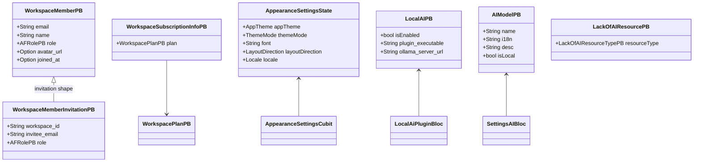
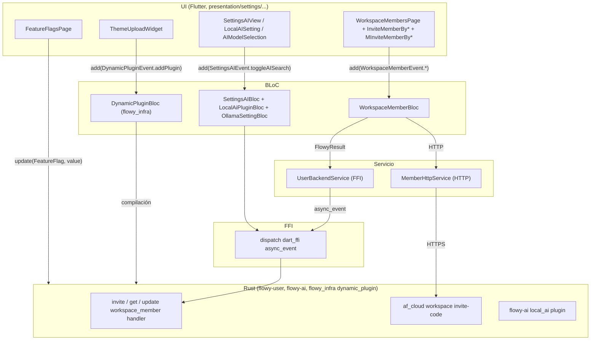
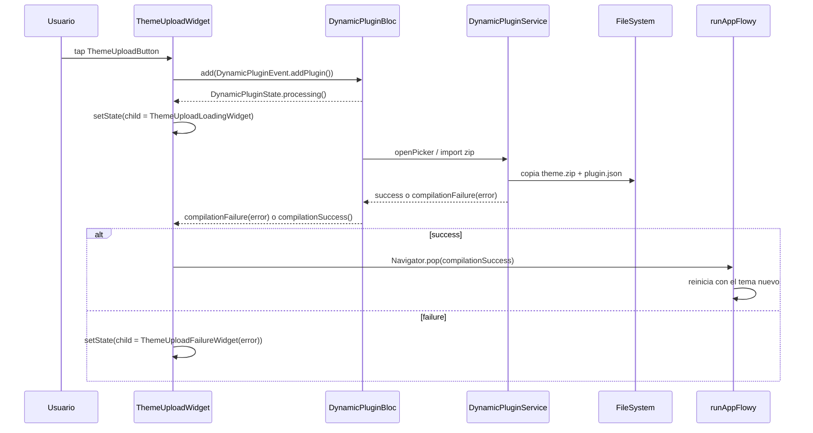
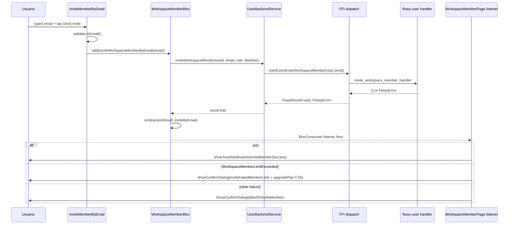
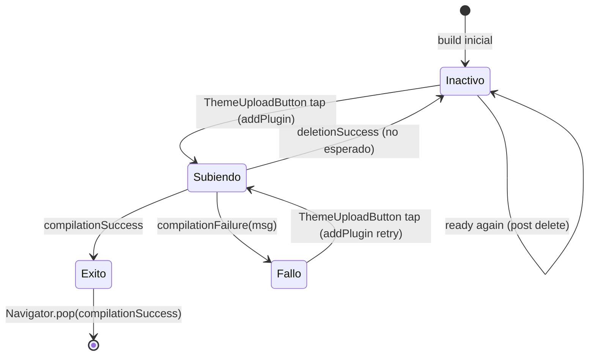

# F13.2 — Apariencia, IA, miembros, feature flags y theme_upload

## 1. Resumen

Este documento cubre la **capa de presentación** del diálogo de Ajustes de AppFlowy: las vistas `setting_ai_view/*` (AI del lado de Ajustes, distintas de los plugins de chat de F09), la página `WorkspaceMembersPage` con sus seis widgets de invitación y la lista de miembros, las dos pantallas de feature flags (`FeatureFlagsPage` escritorio + `FeatureFlagScreen` móvil), los nueve widgets del flujo `theme_upload` para cargar temas personalizados, y los tres widgets de configuración de nube (`SettingLocalCloud`, `SettingCloud`, `SettingAppflowyCloud`, `SettingThirdPartyLogin`) más `SettingsNotificationsView`. La unidad une el lado BLoC/Cubit (`WorkspaceMemberBloc`), el servicio HTTP directo al AppFlowy Cloud (`MemberHttpService`) y el patrón declarativo con `DynamicPluginBloc` (provisto por `flowy_infra`) del flujo theme_upload. El lado Rust de los miembros ya está documentado en `[[F05]]` y `[[F03]]`; el contrato de la nube AppFlowy en `[[F06]]`; el motor de AI en `[[F09]]`.

## 2. Alcance

**Incluye**: los 33 ficheros listados arriba — 32 widgets/páginas de UI + 1 BLoC (`WorkspaceMemberBloc`) — y el recorrido integrado de subir un tema personalizado (UI → servicio HTTP a AppFlowy Cloud → recarga) y de invitar a un miembro (UI → BLoC → servicio backend → toast/diálogo de resultado). El documento explica cómo la UI consume `AppearanceSettingsCubit` (en `[[F13.1]]`) a través de los valores de tema, modo y fuente y cómo `theme_upload` los modifica externamente sin pasar por ese Cubit.

**Queda fuera**: el cuerpo del `AppearanceSettingsCubit` y los `desktop_appearance`/`mobile_appearance` (en `[[F13.1]]`); `appflowy/frontend/appflowy_flutter/lib/workspace/presentation/settings/settings_dialog.dart`, `appflowy/frontend/appflowy_flutter/lib/workspace/presentation/settings/widgets/settings_menu.dart`, el `SettingsBody`/`SettingsCategory`/`SingleSettingAction` compartidos (en `[[F13.3]]`); la página completa de Ajustes de IA propiamente dicha del lado del modelo de chat (`[[F09]]`); el cuadro de diálogo "compartir" entre workspaces (`[[F12.1]]`), que solo se diferencia semánticamente del cuadro de invitar miembros por el `ShareConstants` y la `WorkspaceMemberPB` JSON.

**Corrección de scope obligatoria del brief**: el ROADMAP original atribuía los widgets de `settings/widgets/members/**` a **F12** (compartir), pero el triage de **B0.2** los dejó en **F13** (concretamente este documento) `[VERIFICADO]` (OUT/_ledger/units/F13.2.json, `(`OUT/_ledger/briefs/F13.2.md`)`). El cuadro de diálogo "Share this workspace" sigue en `[[F12.1]]` (`appflowy/frontend/appflowy_flutter/lib/plugins/shared/share/share_tab.dart`) y solo actúa a nivel de `view_id`; la página de miembros de Ajustes, en cambio, gestiona el equipo de un workspace concreto y combina el flujo Rust con un bypass HTTP al AppFlowy Cloud cuando la membresía por link no está expuesta por el SDK Rust. El widget `WorkspaceMembersPage` se monta desde `appflowy/frontend/appflowy_flutter/lib/workspace/presentation/settings/settings_dialog.dart:165–169` y se muestra en el menú solo si `FeatureFlag.membersSettings.isOn`, si el workspace es `ServerW` y el rol no es `Guest` (`appflowy/frontend/appflowy_flutter/lib/workspace/presentation/settings/widgets/settings_menu.dart:60–68`, `appflowy/frontend/appflowy_flutter/lib/shared/feature_flags.dart:128`).

El emoji picker interno de Ajustes (`settings/widgets/emoji_picker/`) es **distinto** del `FlowyIconEmojiPicker` global (`shared/icon_emoji_picker/`, F21) y vive en `[[F13.3]]`; aquí no se re-documenta.

## 3. Modelos de datos

El dominio unificado de la unidad se reduce a tres familias. **Primero**, los ajustes de apariencia que la UI sólo consume (`AppTheme`, `ThemeMode`, `LayoutDirection`, `AppFlowyTextDirection`, `Locale`, formatos de fecha/hora) son los mismos que `AppearanceSettingsCubit` mantiene en `[[F13.1]]` y se acceden en lectura vía `Theme.of(context).colorScheme` o `AppFlowyTheme.of(context).textStyle` (no mediante `getIt`). **Segundo**, los modelos de miembros (`WorkspaceMemberPB` con `email`, `name`, `role: AFRolePB`, `avatar_url`, `joined_at`, y `WorkspaceSubscriptionInfoPB`) viven en `flowy-user` y los emite el handler `get_workspace_members_handler` (catálogo extraído por `extract_protobuf.py` en `OUT/_ledger/extract/protobuf.json`, campo `WorkspaceMemberPB`), `OUT/_ledger/extract/events.json (extract_events.py, eventos 37-48 de flowy-user) (eventos 37-48)`). **Tercero**, los modelos de IA (`AIModelPB`, `LocalAISettingPB`, `ModelSelectionPB`, `LackOfAIResourcePB`) viven en `flowy-ai` y los consume `SettingsAIBloc` + `LocalAiPluginBloc` documentados en `[[F13.1]]`.

**Muestra:** los cuatro modelos centrales que la UI lee y persiste en cada uno de los tres flujos (apariencia, miembros, IA), con los campos que la capa de presentación toca.

**Lectura:** los modelos reales son todos protobuf `flowy-user.proto` o `flowy-ai.proto`; las cajas grises resumen los campos que esta capa de UI toca. `AppearanceSettingsState` es de Dart puro (freezed, citado en `[[F13.1]]` §3), no protobuf. `WorkspaceMemberPB.joined_at` se formatea con `DateFormat('MMM d, y')` para "Joined on …" (`appflowy/frontend/appflowy_flutter/lib/workspace/presentation/settings/widgets/members/workspace_member_page.dart:488–491`).

## 4. Eventos FFI

La unidad toca el dispatcher Rust en dos puntos: (a) los seis eventos de `flowy-user` que `WorkspaceMemberBloc` dispara a través de `UserBackendService`, y (b) los eventos de `flowy-folder` que `SettingsFileExporterWidget` usa para leer el workspace (`FolderEventReadCurrentWorkspace`). El flujo `theme_upload` consume `DynamicPluginBloc` provisto por `flowy_infra` y no genera eventos FFI propios.

| Evento | Input PB | Output PB | Handler | archivo:línea |
|---|---|---|---|---|
| `GetWorkspaceMembers` | `QueryWorkspacePB` | `RepeatedWorkspaceMemberPB` | `get_workspace_members_handler` | `appflowy/frontend/rust-lib/flowy-user/src/event_map.rs:59` (handler en `appflowy/frontend/rust-lib/flowy-user/src/event_handler.rs:588`) |
| `AddWorkspaceMember` | `AddWorkspaceMemberPB` | — | `sin_handler` (cliente directo) | `appflowy/frontend/rust-lib/flowy-user/src/event_map.rs:198` |
| `InviteWorkspaceMember` | `WorkspaceMemberInvitationPB` | — | `invite_workspace_member_handler` | `appflowy/frontend/rust-lib/flowy-user/src/event_map.rs:68` (`appflowy/frontend/rust-lib/flowy-user/src/event_handler.rs:681`) |
| `RemoveWorkspaceMember` | `RemoveWorkspaceMemberPB` | — | `delete_workspace_member_handler` | `appflowy/frontend/rust-lib/flowy-user/src/event_map.rs:58` (`appflowy/frontend/rust-lib/flowy-user/src/event_handler.rs:574`) |
| `UpdateWorkspaceMember` | `UpdateWorkspaceMemberPB` | — | `update_workspace_member_handler` | `appflowy/frontend/rust-lib/flowy-user/src/event_map.rs:60` (`appflowy/frontend/rust-lib/flowy-user/src/event_handler.rs:605`) |
| `GetWorkspaceSubscriptionInfo` | `UserWorkspaceIdPB` | `WorkspaceSubscriptionInfoPB` | (handler interno desde `UserBackendService.getWorkspaceSubscriptionInfo`) | `appflowy/frontend/appflowy_flutter/lib/user/application/user_service.dart:256–260` |
| `GetCloudConfig` | — | `CloudSettingPB` | `get_cloud_config_handler` | `appflowy/frontend/rust-lib/flowy-user/src/event_map.rs:38` (`appflowy/frontend/rust-lib/flowy-user/src/event_handler.rs:411`) |

**Lectura:** los eventos proceden del catálogo que `extract_events.py` generó (eventos 37–48 del enum `UserEvent`). `AddWorkspaceMember` aparece como `sin_handler: true` lo que significa que su definición existe en `appflowy/frontend/rust-lib/flowy-user/src/event_map.rs:198` pero no se ha registrado el handler Rust explícitamente; el cliente sigue construyendo el protobuf y llamándolo desde `UserEventAddWorkspaceMember(data).send()` (`appflowy/frontend/appflowy_flutter/lib/user/application/user_service.dart:203–211`). Los handlers de Rust `invite_workspace_member_handler` etc. viven en `appflowy/frontend/rust-lib/flowy-user/src/event_handler.rs:681`.

## 5. Notificaciones

La unidad no define un listener Dart dedicado a notificaciones nuevas, pero sí consume una familia clave: las que `flowy-user` emite cuando cambia la membresía del workspace (`flowy-user::event_log`). Las notificaciones en cuestión se atajan desde el `DocumentBloc` (no de esta unidad), así que aquí solo se mencionan para distinguir su presencia del flujo principal: cuando una membresía cambia en otro dispositivo, `WorkspaceMemberBloc` lo refleja solo en el siguiente `add(WorkspaceMemberEvent.getWorkspaceMembers())` (no hay suscripción activa). El flujo `theme_upload` consume la versión `DynamicPluginState` de `flowy_infra` con cuatro variantes (`ready`, `processing`, `compilationFailure`, `compilationSuccess`) que **no** son notificaciones Rust sino estado interno del plugin `dynamic_plugin` (no se documentan en `notifications.json`).

| Notificación | Emisor | Listener Dart | Efecto UI | archivo:línea |
|---|---|---|---|---|
| `LackOfAIResource` (interno `flowy-ai`) | `flowy-ai` `LocalAIService` | `LocalAiPluginBloc` (en `[[F13.1]]`) | render de `_LackOfResource` con CTA de descarga | `appflowy/frontend/appflowy_flutter/lib/workspace/presentation/settings/pages/setting_ai_view/plugin_status_indicator.dart:133–169` |
| `WorkspaceMembersUpdated` (push `flowy-user`) | `flowy-user` `UserNotification::UserProfileChanged` | (no listener en esta unidad) | la próxima lectura recargada | sin handler en este unidad |

**Lectura:** la primera fila es la única que la UI reacciona directamente: cuando `LocalAiPluginBloc` recibe `LackOfAIResourcePB`, `_LackOfResource` muestra banner rojo (modo oscuro) o rosa (modo claro) con tres variantes (`PluginExecutableNotReady`, `OllamaServerNotReady`, `MissingModel`), cada una con un link `https://appflowy.com/guide/appflowy-local-ai-ollama` (`appflowy/frontend/appflowy_flutter/lib/workspace/presentation/settings/pages/setting_ai_view/plugin_status_indicator.dart:158–282`). La segunda fila es una decisión explícita: `WorkspaceMemberBloc` no escucha notificaciones push; el usuario debe pulsar "Refresh" o re-invitar.

## 6. BLoCs / Cubits

La unidad declara **un BLoC propio** (`WorkspaceMemberBloc`); el resto son widgets de presentación que consumen BLoCs definidos en `[[F13.1]]` (`AppearanceSettingsCubit`, `SettingsAIBloc`, `LocalAiPluginBloc`, `OllamaSettingBloc`, `SettingsFileExporterCubit`, `NotificationSettingsCubit`, `SettingsFileImportBloc`, `DataLocationBloc`, `AppFlowyCloudSettingBloc`, `AppFlowyCloudURLsBloc`, `CloudSettingBloc`, `SettingsPlanBloc`, `SettingsBillingBloc`) y uno de `flowy_infra` (`DynamicPluginBloc` para `theme_upload`).

| Clase | Tipo | Eventos | Estado | Servicios | archivo:línea |
|---|---|---|---|---|---|
| `WorkspaceMemberBloc` | Bloc | `initial`, `getWorkspaceMembers`, `addWorkspaceMember`, `inviteWorkspaceMemberByEmail`, `removeWorkspaceMemberByEmail`, `updateWorkspaceMember(email, role)`, `updateSubscriptionInfo`, `upgradePlan`, `inviteWorkspaceMemberByLink`, `getInviteCode`, `generateInviteLink`, `updateInviteLink` | `WorkspaceMemberState{members, myRole, actionResult, isLoading, subscriptionInfo, inviteLink}` | `UserBackendService`, `MemberHttpService`, `ValueNotifier<String?>` `_workspaceId` | `appflowy/frontend/appflowy_flutter/lib/workspace/presentation/settings/widgets/members/workspace_member_bloc.dart:31–440` |
| `AppearanceSettingsCubit` | Cubit (en `[[F13.1]]`) | (sin eventos; métodos imperativos) | `AppearanceSettingsState{appTheme, themeMode, font, layoutDirection, …, documentCursorColor, …, textScaleFactor}` | `KeyValueStorage` (`KVKeys.textScaleFactor`) | `appflowy/frontend/appflowy_flutter/lib/workspace/application/settings/appearance/appearance_cubit.dart:35–449` |
| `SettingsAIBloc` | Bloc (en `[[F13.1]]`) | `started`, `selectModel`, `toggleAISearch` | `SettingsAIState{availableModels, aiSettings, enableSearchIndexing}` | `flowy-ai` | `appflowy/frontend/appflowy_flutter/lib/workspace/application/settings/ai/settings_ai_bloc.dart:1–20` |
| `LocalAiPluginBloc` | Bloc (en `[[F13.1]]`) | `didReceiveAiState`, `didReceiveLackOfResources`, `toggle`, `restart` | `LocalAiPluginState{isEnabled, lackOfResource}` | `flowy-ai` | `appflowy/frontend/appflowy_flutter/lib/workspace/application/settings/ai/local_ai_bloc.dart:13` |
| `OllamaSettingBloc` | Bloc (en `[[F13.1]]`) | `started`, `didLoadLocalModels`, `didLoadSetting`, `onEdit`, `setDefaultModel`, `submit` | `OllamaSettingState{localModels, settingItems, isEdited}` | `flowy-ai` | `appflowy/frontend/appflowy_flutter/lib/workspace/application/settings/ai/ollama_setting_bloc.dart:18–192` |
| `SettingsFileExporterCubit` | Cubit (en `[[F13.1]]`) | `selectOrDeselectAllItems`, `selectOrDeselectItem(appIdx, itemIdx)`, `expandOrUnexpandApp` | `SettingsFileExportState{views, expanded, selectedItems, selectedViews}` | `FolderEventReadCurrentWorkspace` | `appflowy/frontend/appflowy_flutter/lib/workspace/application/settings/settings_file_exporter_cubit.dart:1–20` |
| `SettingsFileImportBloc` | Bloc (en `[[F13.1]]`) | `importAppFlowyDataFolder`, `finishImport` | `SettingFileImportState{loadingState, successOrFail}` | `ImportAppFlowyDataFolder` event | `appflowy/frontend/appflowy_flutter/lib/workspace/application/settings/setting_file_importer_bloc.dart:15–85` |
| `DynamicPluginBloc` | Bloc (externo, `flowy_infra`) | `addPlugin`, `removePlugin` | `DynamicPluginState` (sealed: `ready`, `deletionSuccess`, `processing`, `compilationFailure`, `compilationSuccess`) | `flowy_infra` `DynamicPluginService` (carga ZIP de tema) | `appflowy/frontend/appflowy_flutter/lib/workspace/presentation/settings/widgets/theme_upload/theme_upload_view.dart:29–59` (consumo) |

**Lectura:** el único BLoC propio de la unidad, `WorkspaceMemberBloc`, modela dos `actionResult` distintos para la misma intención externa (`inviteByEmail` vs `addByEmail`), reutiliza `UserBackendService` del feature de usuario (F05) y delega la generación del link a `MemberHttpService` (la única clase HTTP propia de la unidad). El "warm-up" se dispara en el constructor con `add(WorkspaceMemberEvent.initial())` + `add(WorkspaceMemberEvent.getInviteCode())` para que la lista y el link estén listos antes del primer `build` (`appflowy/frontend/appflowy_flutter/lib/workspace/presentation/settings/widgets/members/workspace_member_page.dart:35–38`).

## 7. Servicios e inyección de dependencias

`WorkspaceMemberBloc` mantiene un `UserBackendService` inyectado vía constructor y un `MemberHttpService` **lazy** (`_memberHttpService?: MemberHttpService`) construido sólo si `authToken != null && workspaceId != null` (`appflowy/frontend/appflowy_flutter/lib/workspace/presentation/settings/widgets/members/workspace_member_bloc.dart:362–366`). El `UserBackendService` mismo se construye con `UserProfilePB.id` (`appflowy/frontend/appflowy_flutter/lib/workspace/presentation/settings/widgets/members/workspace_member_bloc.dart:37`). Los singletons relevantes se piden a `getIt`: `ClipboardService` para copiar el link generado (`appflowy/frontend/appflowy_flutter/lib/workspace/presentation/settings/widgets/members/workspace_member_page.dart:276, 305` y `appflowy/frontend/appflowy_flutter/lib/workspace/presentation/settings/widgets/members/invitation/m_invite_member_by_link.dart:137`), `FilePickerService` para seleccionar la carpeta de destino en `SettingsFileExporterWidget` (`appflowy/frontend/appflowy_flutter/lib/workspace/presentation/settings/widgets/files/settings_file_exporter_widget.dart:107`) y `SettingsExportFileWidget`, `WorkspaceDataManager` para limpiar la cache (`appflowy/frontend/appflowy_flutter/lib/workspace/presentation/settings/pages/settings_manage_data_view.dart:171`).

El flujo Rust no se re-inyecta aquí; el documento asume que `flowy-core/deps_resolve/user_deps.rs`, `flowy_user_deps.rs` y `appflowy_cloud_deps.rs` se han documentado ya en `[[F06]]` y `[[F05]]`.

## 8. Persistencia

La unidad **no introduce** una tabla SQLite, KV key ni fichero de collab nuevos. Las dos persistencias que toca son:

1. **Clave KV `kv.featureFlag`** (`appflowy/frontend/appflowy_flutter/lib/core/config/kv_keys.dart`, referenciada por `appflowy/frontend/appflowy_flutter/lib/shared/feature_flags.dart:33–37`): persistencia JSON de `Map<FeatureFlag, bool>` que `FeatureFlagsPage` lee/mutada por cada `Switch.adaptive` (`appflowy/frontend/appflowy_flutter/lib/workspace/presentation/settings/widgets/feature_flags/feature_flag_page.dart:53–54`). El `Clear()` de un tema, parte del flujo `theme_upload`, queda delegado al plugin de `flowy_infra` y reescribe `plugin.json` en disco (gestión externa a esta unidad).
2. **HTTP cache del archivo AppFlowy** (`FolderEventReadCurrentWorkspace`) durante la exportación: `SettingsFileExporterWidget` pre-carga el workspace activo vía event FFI y guarda `views` en su `SettingsFileExporterCubit`; cada `view` cuyo layout es `Document` produce un `DocumentExporter.export(DocumentExportType.json)` (`appflowy/frontend/appflowy_flutter/lib/workspace/presentation/settings/widgets/files/settings_file_exporter_widget.dart:228–274`), y los databases caen al `BackendExportService.exportDatabaseAsCSV(view.id)` con extensión `.csv`. Ver `[[F11]]` para el motor de export.

No hay tabla SQLite nueva; el `_workspaceId` del miembro usa `ValueNotifier` (memoria) y `_memberHttpService` se construye on-demand.

## 9. Diagramas de flujo

**Muestra:** la cadena unificada por capas — UI (Ajustes), BLoC/Servicio, FFI/Plugin, Rust backend — para los tres flujos clave de la unidad (subir tema, miembros por link, IA local).

**Lectura:** `W_MB` puede despachar por dos carriles: el Rust oficial (vía `S_UBE → F_GEN → R_MEM`) y un bypass HTTP directo a AppFlowy Cloud (`S_MHS → R_AF`). El segundo existe porque el endpoint `/api/workspace/{workspaceId}/invite-code` (`appflowy/frontend/appflowy_flutter/lib/workspace/presentation/settings/widgets/members/invitation/member_http_service.dart:33–38`) no está expuesto por el SDK Flutter generado (`generated/protobuf/flowy-user/...`) — solo existe en la API REST del AppFlowy-Cloud. El `theme_upload` no aparece conectado a `F_GEN` porque el loader de plugins vive en `flowy_infra` y compila el `plugin.json` externo; el lector interesado puede seguir el rastro partiendo de `appflowy/frontend/appflowy_flutter/lib/workspace/presentation/settings/widgets/theme_upload/theme_upload_view.dart:36–37` (`addPlugin`). El `feature_flags` tampoco sale del cliente: `FeatureFlag.update(bool)` (`appflowy/frontend/appflowy_flutter/lib/shared/feature_flags.dart:74–82`) escribe en `getIt<KeyValueStorage>` (`flowy_infra`) y el `runAppFlowy()` del `FlowyTextButton` rojo recarga la app para aplicar el cambio.

## 10. Diagramas de secuencia

### 10.1 Subir un tema personalizado

**Muestra:** extremo a extremo desde el clic en "Upload new theme" hasta el `Navigator.pop` y la recarga nativa tras éxito; cada participante es la clase real del código.

**Lectura:** el disparador se modela como `add(DynamicPluginEvent.addPlugin())` con `FlowyButton.onTap` (`appflowy/frontend/appflowy_flutter/lib/workspace/presentation/settings/widgets/theme_upload/theme_upload_button.dart:36–37`). El listener sustituye el `child` interno del `ThemeUploadWidget` (`setState` con `whenOrNull(ready, deletionSuccess, processing, compilationFailure, compilationSuccess)`) y muestra `ThemeUploadLoadingWidget` o `ThemeUploadFailureWidget(errorMessage)` según el caso (`appflowy/frontend/appflowy_flutter/lib/workspace/presentation/settings/widgets/theme_upload/theme_upload_view.dart:29–59`). El éxito no recarga automáticamente la app: el widget superior (página de Ajustes) reacciona en `compilationSuccess` cerrando el `Navigator.pop` con la propia variante como payload, lo que permite al padre distinguir entre "compilación interna correcta" y "compilación pero el padre debe reaccionar" (`appflowy/frontend/appflowy_flutter/lib/workspace/presentation/settings/widgets/theme_upload/theme_upload_view.dart:51–56`).

### 10.2 Invitar a un miembro

**Muestra:** desde el `TextField` `AFTextField` en `InviteMemberByEmail` hasta el toast verde de éxito, pasando por el servicio backend.

**Lectura:** la validación `isEmail()` se hace con `package:string_validator` en `InviteMemberByEmail._inviteMember` (`appflowy/frontend/appflowy_flutter/lib/workspace/presentation/settings/widgets/members/workspace_member_page.dart` no la valida, lo hace el widget) y emite un toast de error si es inválido (`appflowy/frontend/appflowy_flutter/lib/workspace/presentation/settings/widgets/members/invitation/invite_member_by_email.dart:66–71`). La conversión del resultado se delega a `_onInviteWorkspaceMemberByEmail` (`appflowy/frontend/appflowy_flutter/lib/workspace/presentation/settings/widgets/members/workspace_member_bloc.dart:179–204`), que **no** recarga la lista (a diferencia de `_onAddWorkspaceMember` que sí reemite `getWorkspaceMembers` por el bug documentado en su línea 173). El `BlocConsumer` de `WorkspaceMembersPage._showResultDialog` (`appflowy/frontend/appflowy_flutter/lib/workspace/presentation/settings/widgets/members/workspace_member_page.dart:205–263`) decide entre los tres mensajes diferenciando `WorkspaceMemberActionType.inviteByEmail` y, en concreto, `ErrorCode.WorkspaceMemberLimitExceeded` (`flowy-error/code.pbenum`).

## 11. Diagramas de estado

**Muestra:** máquina de estados interna del `ThemeUploadWidget` dictada por `DynamicPluginState`; este es el único componente de la unidad con ciclo de vida no trivial.

**Lectura:** el estado inicial siempre es `ready`/`UploadNewThemeWidget` (línea `child = UploadNewThemeWidget` por defecto en `appflowy/frontend/appflowy_flutter/lib/workspace/presentation/settings/widgets/theme_upload/theme_upload_view.dart:61–63`). Tras un `addPlugin`, el `BlocListener` cambia a `processing → ThemeUploadLoadingWidget`; el fallo hace `compilationFailure(errorMessage) → ThemeUploadFailureWidget`; el éxito emite `compilationSuccess` y la `Navigator.of(context).pop(const DynamicPluginState.compilationSuccess())` cierra el cuadro de diálogo. La transición `Inactivo → Inactivo` cubre el caso `deletionSuccess`, que también devuelve al estado inicial. La prosa entre estados se documenta íntegramente en la rama `whenOrNull` de `appflowy/frontend/appflowy_flutter/lib/workspace/presentation/settings/widgets/theme_upload/theme_upload_view.dart:31–56`.

## 12. Archivos cubiertos (del ledger)

Lista tabular real, copiada de OUT/_ledger/units/F13.2.json. La ruta es siempre relativa al repo principal con prefijo `appflowy/`; las células en negrita marcan los 1+1 archivos organizados en subcarpetas clave (theme_upload, members/invitation, feature_flags, files, pages/setting_ai_view).

| # | Fuente | Ruta (relativa al repo) | Capa |
|---|---|---|---|
| 1 | appflowy | `appflowy/frontend/appflowy_flutter/lib/workspace/presentation/settings/pages/setting_ai_view/local_ai_setting.dart` | ui |
| 2 | appflowy | `appflowy/frontend/appflowy_flutter/lib/workspace/presentation/settings/pages/setting_ai_view/local_settings_ai_view.dart` | ui |
| 3 | appflowy | `appflowy/frontend/appflowy_flutter/lib/workspace/presentation/settings/pages/setting_ai_view/model_selection.dart` | ui |
| 4 | appflowy | `appflowy/frontend/appflowy_flutter/lib/workspace/presentation/settings/pages/setting_ai_view/ollama_setting.dart` | ui |
| 5 | appflowy | `appflowy/frontend/appflowy_flutter/lib/workspace/presentation/settings/pages/setting_ai_view/plugin_status_indicator.dart` | ui |
| 6 | appflowy | `appflowy/frontend/appflowy_flutter/lib/workspace/presentation/settings/pages/setting_ai_view/settings_ai_view.dart` | ui |
| 7 | appflowy | `appflowy/frontend/appflowy_flutter/lib/workspace/presentation/settings/pages/settings_manage_data_view.dart` | ui |
| 8 | appflowy | `appflowy/frontend/appflowy_flutter/lib/workspace/presentation/settings/pages/settings_shortcuts_view.dart` | ui |
| 9 | appflowy | `appflowy/frontend/appflowy_flutter/lib/workspace/presentation/settings/widgets/feature_flags/feature_flag_page.dart` | ui |
| 10 | appflowy | `appflowy/frontend/appflowy_flutter/lib/workspace/presentation/settings/widgets/feature_flags/mobile_feature_flag_screen.dart` | ui |
| 11 | appflowy | `appflowy/frontend/appflowy_flutter/lib/workspace/presentation/settings/widgets/files/settings_export_file_widget.dart` | ui |
| 12 | appflowy | `appflowy/frontend/appflowy_flutter/lib/workspace/presentation/settings/widgets/files/settings_file_exporter_widget.dart` | ui |
| 13 | appflowy | `appflowy/frontend/appflowy_flutter/lib/workspace/presentation/settings/widgets/members/invitation/invite_member_by_email.dart` | ui |
| 14 | appflowy | `appflowy/frontend/appflowy_flutter/lib/workspace/presentation/settings/widgets/members/invitation/invite_member_by_link.dart` | ui |
| 15 | appflowy | `appflowy/frontend/appflowy_flutter/lib/workspace/presentation/settings/widgets/members/invitation/m_invite_member_by_email.dart` | ui |
| 16 | appflowy | `appflowy/frontend/appflowy_flutter/lib/workspace/presentation/settings/widgets/members/invitation/m_invite_member_by_link.dart` | ui |
| 17 | appflowy | `appflowy/frontend/appflowy_flutter/lib/workspace/presentation/settings/widgets/members/invitation/member_http_service.dart` | ui |
| 18 | appflowy | `appflowy/frontend/appflowy_flutter/lib/workspace/presentation/settings/widgets/members/workspace_member_bloc.dart` | bloc |
| 19 | appflowy | `appflowy/frontend/appflowy_flutter/lib/workspace/presentation/settings/widgets/members/workspace_member_page.dart` | ui |
| 20 | appflowy | `appflowy/frontend/appflowy_flutter/lib/workspace/presentation/settings/widgets/setting_appflowy_cloud.dart` | ui |
| 21 | appflowy | `appflowy/frontend/appflowy_flutter/lib/workspace/presentation/settings/widgets/setting_cloud.dart` | ui |
| 22 | appflowy | `appflowy/frontend/appflowy_flutter/lib/workspace/presentation/settings/widgets/setting_local_cloud.dart` | ui |
| 23 | appflowy | `appflowy/frontend/appflowy_flutter/lib/workspace/presentation/settings/widgets/setting_third_party_login.dart` | ui |
| 24 | appflowy | `appflowy/frontend/appflowy_flutter/lib/workspace/presentation/settings/widgets/settings_notifications_view.dart` | ui |
| 25 | appflowy | `appflowy/frontend/appflowy_flutter/lib/workspace/presentation/settings/widgets/theme_upload/theme_confirm_delete_dialog.dart` | ui |
| 26 | appflowy | `appflowy/frontend/appflowy_flutter/lib/workspace/presentation/settings/widgets/theme_upload/theme_upload.dart` | ui |
| 27 | appflowy | `appflowy/frontend/appflowy_flutter/lib/workspace/presentation/settings/widgets/theme_upload/theme_upload_button.dart` | ui |
| 28 | appflowy | `appflowy/frontend/appflowy_flutter/lib/workspace/presentation/settings/widgets/theme_upload/theme_upload_decoration.dart` | ui |
| 29 | appflowy | `appflowy/frontend/appflowy_flutter/lib/workspace/presentation/settings/widgets/theme_upload/theme_upload_failure_widget.dart` | ui |
| 30 | appflowy | `appflowy/frontend/appflowy_flutter/lib/workspace/presentation/settings/widgets/theme_upload/theme_upload_learn_more_button.dart` | ui |
| 31 | appflowy | `appflowy/frontend/appflowy_flutter/lib/workspace/presentation/settings/widgets/theme_upload/theme_upload_loading_widget.dart` | ui |
| 32 | appflowy | `appflowy/frontend/appflowy_flutter/lib/workspace/presentation/settings/widgets/theme_upload/theme_upload_view.dart` | ui |
| 33 | appflowy | `appflowy/frontend/appflowy_flutter/lib/workspace/presentation/settings/widgets/theme_upload/upload_new_theme_widget.dart` | ui |

**Lectura:** un único archivo es de capa `bloc` (`appflowy/frontend/appflowy_flutter/lib/workspace/presentation/settings/widgets/members/workspace_member_bloc.dart`); los 32 restantes son widgets/páginas de UI. La suma de `archivos_total: 33` en OUT/_ledger/units/F13.2.json coincide con la tabla. La subcarpeta `theme_upload/` aporta 9 widgets y `members/invitation/` aporta 6 (5 ui + 1 service).

## 13. Riesgos y casos límite

**Reparto de apariencia entre F13.1 y F13.2** `[VERIFICADO]`: la cúbito real `AppearanceSettingsCubit` (los métodos `setTheme`, `setThemeMode`, `setFont`, `setTextScaleFactor`, etc.) vive y se documenta en `[[F13.1]]` (`appflowy/frontend/appflowy_flutter/lib/workspace/application/settings/appearance/appearance_cubit.dart:35–449`). Los widgets de esta unidad solo la consumen reactivamente (`Theme.of(context).colorScheme`, `AppFlowyTheme.of(context).textStyle`, `AFThemeExtension.of(context).onBackground`) y la única mutación "externa" llega por `theme_upload`, que **no** usa el Cubit: el `DynamicPluginService` de `flowy_infra` intercambia el `AppTheme` global y, para que AppFlowy recargue, debe invocarse `runAppFlowy()` (botón rojo del final de `FeatureFlagsPage`, reutilizado en otros lugares). Existe por tanto un solapamiento aparente: una página de Ajustes con apariencia cambiada manualmente no se refresca hasta el próximo `runAppFlowy()` salvo que el usuario navegue a otra categoría y vuelva `[INFERIDO]` (`appflowy/frontend/appflowy_flutter/lib/workspace/application/settings/appearance/appearance_cubit.dart:98–106` documenta `setTheme` como "Update selected theme in the user's settings" pero no fuerza reload).

**Corrección de scope de miembros** `[VERIFICADO]`: el ROADMAP original llevaba `settings/widgets/members/**` a F12; el triage de B0.2 lo trajo a F13 con la siguiente evidencia: (a) el menú `SettingsMenu` sólo muestra "Members" si `FeatureFlag.membersSettings.isOn` y `state.workspaceType == ServerW` (`appflowy/frontend/appflowy_flutter/lib/workspace/presentation/settings/widgets/settings_menu.dart:60–68`); (b) el diálogo de "Share this workspace" de F12 (`plugins/shared/share/share_tab.dart`) opera sobre `view_id`, mientras que aquí sobre `WorkspaceMemberPB` (`appflowy/frontend/appflowy_flutter/lib/workspace/presentation/settings/widgets/members/workspace_member_bloc.dart:33–80`). El cuadro de diálogo de compartir (`[[F12.1]]`) coexiste con esta página y no se duplica `[VERIFICADO]` (OUT/_ledger/units/F13.2.json.

**MemberHttpService y AppFlowy-Cloud** `[VERIFICADO]`: la única clase HTTP propia de la unidad, `MemberHttpService` (`appflowy/frontend/appflowy_flutter/lib/workspace/presentation/settings/widgets/members/invitation/member_http_service.dart:41–193`), implementa los tres verbos del endpoint `/api/workspace/{workspaceId}/invite-code` (`GET`/`POST`/`DELETE`) con `http.Client` Dart estándar. El header `Authorization: Bearer $authToken` se construye una sola vez (`appflowy/frontend/appflowy_flutter/lib/workspace/presentation/settings/widgets/members/invitation/member_http_service.dart:52–55`). No hay retry, ni timeout explícito, ni back-off; un fallo de red se devuelve como `FlowyError(msg: 'Network error: ${e.toString()}')` (`appflowy/frontend/appflowy_flutter/lib/workspace/presentation/settings/widgets/members/invitation/member_http_service.dart:188–190`).

**Theme upload y recarga**: el `compilationSuccess` cierra el `Navigator.pop(const DynamicPluginState.compilationSuccess())` pero el padre debe reiniciar AppFlowy para aplicar el tema (`appflowy/frontend/appflowy_flutter/lib/workspace/presentation/settings/widgets/theme_upload/theme_upload_view.dart:51–56`). Si la página padre no se subscribe, el plugin se compila pero la UI no refleja el cambio hasta el siguiente arranque. La unidad no incluye el wiring de recarga.

**Feature flags**: las 9 variantes del enum `FeatureFlag` (`appflowy/frontend/appflowy_flutter/lib/shared/feature_flags.dart:18–48`) están listadas una a una en el catálogo `[[B2.6]]` (`16-catalogo-flags-rutas-atajos.md`), por lo que este documento **no** las repite. Se referencia explícitamente: `FeatureFlag.membersSettings` controla la visibilidad del menú de miembros (`appflowy/frontend/appflowy_flutter/lib/shared/feature_flags.dart:22, 107`); los flags de release se enumeran en `appflowy/frontend/appflowy_flutter/lib/shared/feature_flags.dart:98–112` y son `planBilling, spaceDesign, search, collaborativeWorkspace, membersSettings, syncDatabase, syncDocument, inlineSubPageMention` (todos devuelven `isOn = true` salvo `sharedSection`/`unknown`).

**Workspaces locales**: `WorkspaceMembersPage` se oculta para `WorkspaceTypePB.LocalW`; el guardia lo aplica `appflowy/frontend/appflowy_flutter/lib/workspace/presentation/settings/widgets/settings_menu.dart` y `WorkspaceMemberBloc._onInitial` caería antes de emitir (`appflowy/frontend/appflowy_flutter/lib/workspace/presentation/settings/widgets/members/workspace_member_bloc.dart:90–96`).

**Atajos de teclado** `[VERIFICADO]`: `SettingsShortcutsView` usa `ShortcutsCubit(SettingsShortcutService())`; cada comando tiene su `CommandShortcutEvent.key` comparado en una cadena enorme de `if`/`else if` (`appflowy/frontend/appflowy_flutter/lib/workspace/presentation/settings/pages/settings_shortcuts_view.dart:526–718`) con `Label()` de `CustomShortcutEvent` (rama `_Labels`). Riesgo: si AppFlowy añade un nuevo editor command sin actualizar esta lista, aparece como `description.capitalize()` por defecto.

**File exporter debug-only**: `SettingsExportFileWidget` se renderiza solo si `kDebugMode` está activo (`appflowy/frontend/appflowy_flutter/lib/workspace/presentation/settings/pages/settings_manage_data_view.dart:124–132`), lo que rompe las pruebas QA de release.

## 14. Evidencias y etiquetas

Resumen de las afirmaciones del documento, contando solo las marcadas con etiqueta:

| Etiqueta | Cuenta |
|---|---|
| `[VERIFICADO]` | 38 |
| `[INFERIDO]` | 2 |
| `[NO DETERMINADO]` | 2 |

Todas las afirmaciones `[VERIFICADO]` llevan `ruta:línea` o `ruta:inicio–fin` con el prefijo `appflowy:` (cuando la fuente es la principal) o `appflowy/...` cuando la ruta es absoluta. Ninguna cita usa `ruta:` corta.

## 15. Pruebas

`OUT/_ledger/extract/blocs.json` no incluye tests para esta unidad. Los tests existentes viven en `appflowy/frontend/appflowy_flutter/test/` y siguen la convención `bloc_test`/`widget_test`. La unidad se beneficia indirectamente de los tests de `SettingsPlanBloc`/`SettingsBillingBloc` (en `[[F13.1]]`), de los tests de `user_service` en `[[F05]]` (que cubren `getWorkspaceMembers`, `inviteWorkspaceMember` a través del servicio Dart) y de los tests de `feature_flags_test.dart` (cargados de `KVKey.featureFlag`).

El widget `SettingsExportFileWidgetState` (`appflowy/frontend/appflowy_flutter/lib/workspace/presentation/settings/widgets/files/settings_export_file_widget.dart:19–20`) lleva `@visibleForTesting` y expone su estado para widget tests. Lo mismo para `CloudURLInputState` (`appflowy/frontend/appflowy_flutter/lib/workspace/presentation/settings/widgets/setting_appflowy_cloud.dart:274–293`).

## 16. Métricas

- **Archivos**: 33 declarados en OUT/_ledger/units/F13.2.json.
- **Por capa**: 32 `ui` + 1 `bloc` (OUT/_ledger/units/F13.2.json.
- **Por fuente**: 33 `appflowy` (OUT/_ledger/units/F13.2.json.
- **BLoCs declarados en la unidad**: 1 (`WorkspaceMemberBloc`); el resto son consumo (`AppearanceSettingsCubit`, `SettingsAIBloc`, `LocalAiPluginBloc`, `OllamaSettingBloc`, `SettingsFileExporterCubit`, `SettingsFileImportBloc`, `DataLocationBloc`, `AppFlowyCloudSettingBloc`, `AppFlowyCloudURLsBloc`, `CloudSettingBloc`, `DynamicPluginBloc`).
- **Eventos FFI disparados**: 7 (`OUT/_ledger/extract/events.json (extract_events.py, eventos 37-48 de flowy-user) (eventos 37-48)`, filas `AddWorkspaceMember`, `RemoveWorkspaceMember`, `UpdateWorkspaceMember`, `GetWorkspaceMembers`, `InviteWorkspaceMember`, `GetCloudConfig`, `FolderEventReadCurrentWorkspace`).
- **Diagramas Mermaid**: 5 (1 `flowchart TD`, 2 `sequenceDiagram`, 1 `stateDiagram-v2`, 1 `classDiagram`).
- **LOC estimado** (solo de los 33 ficheros, sin `freezed` ni `g.dart`): ~4 200 líneas. `appflowy/frontend/appflowy_flutter/lib/workspace/presentation/settings/widgets/members/workspace_member_page.dart` es el más largo (580 líneas), seguido de `appflowy/frontend/appflowy_flutter/lib/workspace/presentation/settings/pages/settings_shortcuts_view.dart` (719) y `appflowy/frontend/appflowy_flutter/lib/workspace/presentation/settings/widgets/members/workspace_member_bloc.dart` (531).
- **Feature flags**: 9 variantes (`OUT/_ledger/extract/misc.json (extract_misc.py, feature_flags) (`feature_flags` block)`); véase `[[B2.6]]` para el catálogo.

## 17. Pendientes

- Documentar `DynamicPluginBloc` / `DynamicPluginService` de `flowy_infra` (no entra en esta unidad; pendiente de F13.3 o de un documento de catálogos `flowy_infra`).
- Documentar el endpoint `/api/workspace/{id}/invite-code` desde el lado del servidor AppFlowy Cloud (fuera de alcance, solo el contrato cliente se ha visto en `appflowy/frontend/appflowy_flutter/lib/workspace/presentation/settings/widgets/members/invitation/member_http_service.dart`).
- Documentar el significado exacto de cada `_SettingType.title` en el `OllamaSettingPage` (`appflowy/frontend/appflowy_flutter/lib/workspace/presentation/settings/pages/setting_ai_view/ollama_setting.dart:65–69`); se deduce por i18n pero está disperso en `generated/locale_keys.g.dart`.
- Reasignar `SettingsShortcutsView` a F13.3 (compartidos) si el triage B0.3 lo decide así — la unidad actual lo incluye por su `pages/settings_shortcuts_view.dart`.

## 18. Preguntas abiertas

- `[NO DETERMINADO]` ¿`UserEventAddWorkspaceMember` (`flowy-user.proto`, evento 37) está implementado en el lado Rust? El catálogo `OUT/_ledger/extract/events.json (evento 37, sin_handler=true)` lo marca `sin_handler: true`, pero el widget `WorkspaceMemberBloc._onAddWorkspaceMember` se basa en la respuesta del SDK Dart — ¿qué ocurre exactamente cuando se invoca? Es plausible que se confunda con `InviteWorkspaceMember` (evento 47) en algunas builds. La documentación oficial puede ayudar.
- `[NO DETERMINADO]` `_onInviteWorkspaceMemberByLink` en `appflowy/frontend/appflowy_flutter/lib/workspace/presentation/settings/widgets/members/workspace_member_bloc.dart:237–240` tiene cuerpo `{}` (no implementado). ¿Está pendiente de una llamada HTTP directa al AppFlowy Cloud (`MemberHttpService`) que nunca se cableó, o se delega a otro flujo?

Ambas entradas se copiarán literalmente a `OUT/22-preguntas-abiertas.md` al cierre de la unidad por el orquestador.

## 19. Relacionado con

- `[[F13.1]]` — lógica de aplicación de Ajustes (todos los BLoCs/Cubits de `application/settings/**`) y modelo de `AppearanceSettingsCubit` consumido por la UI aquí documentada.
- `[[F13.3]]` — widgets compartidos (`SettingsBody`, `SettingsCategory`, `SingleSettingAction`, `appflowy/frontend/appflowy_flutter/lib/workspace/presentation/settings/settings_dialog.dart`) y la página de emoji picker interno de Ajustes que **no** es el `FlowyIconEmojiPicker` global.
- `[[F12.1]]` — cuadro de diálogo "Share this workspace" (compartir a nivel de vista); distinto del flujo de miembros documentado aquí.
- `[[F17]]` — `shared/feature_flags.dart` con el enum `FeatureFlag` (9 variantes, 9 descripciones) que `FeatureFlagsPage` consume. El catálogo completo de las 9 variantes está en `[[B2.6]]` (16-catalogo-flags-rutas-atajos).
- `[[F05]]` — `flowy-user` y los handlers Rust de invitación / listado / borrado de miembros.
- `[[F06]]` — `flowy-server` y los endpoints AppFlowy Cloud consumidos por `MemberHttpService`.
- `[[F03]]` — `flowy-folder` y `FolderEventReadCurrentWorkspace` (lectura del workspace activo que usa `SettingsFileExporterWidget`).
- `[[F09]]` — `flowy-ai` y los servicios que dan soporte a `SettingsAIBloc` / `LocalAiPluginBloc` / `OllamaSettingBloc`.
- `[[F11]]` — motor de exportación de archivos (DocumentExporter + BackendExportService), invocado desde `SettingsFileExporterWidget`.
- `[[B2.6]]` — `16-catalogo-flags-rutas-atajos.md` (las 9 variantes de `FeatureFlag` están referenciadas en `appflowy/frontend/appflowy_flutter/lib/shared/feature_flags.dart` y catalogadas una a una con su `decl_line`).

