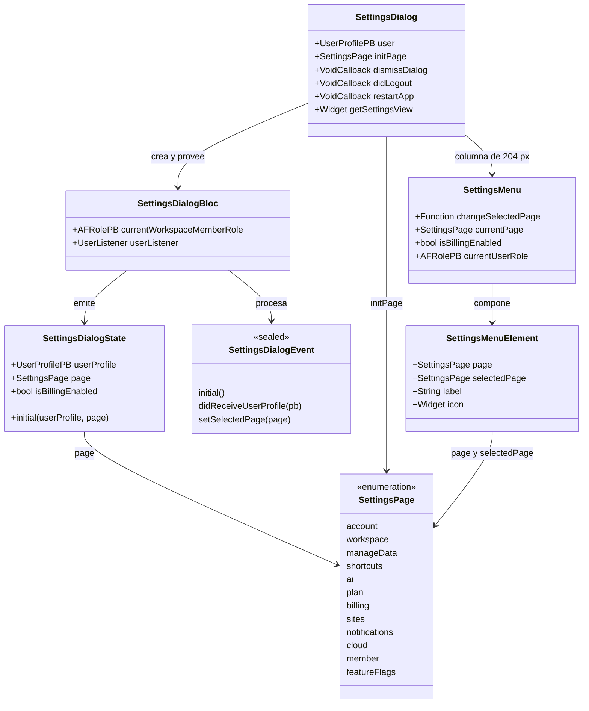
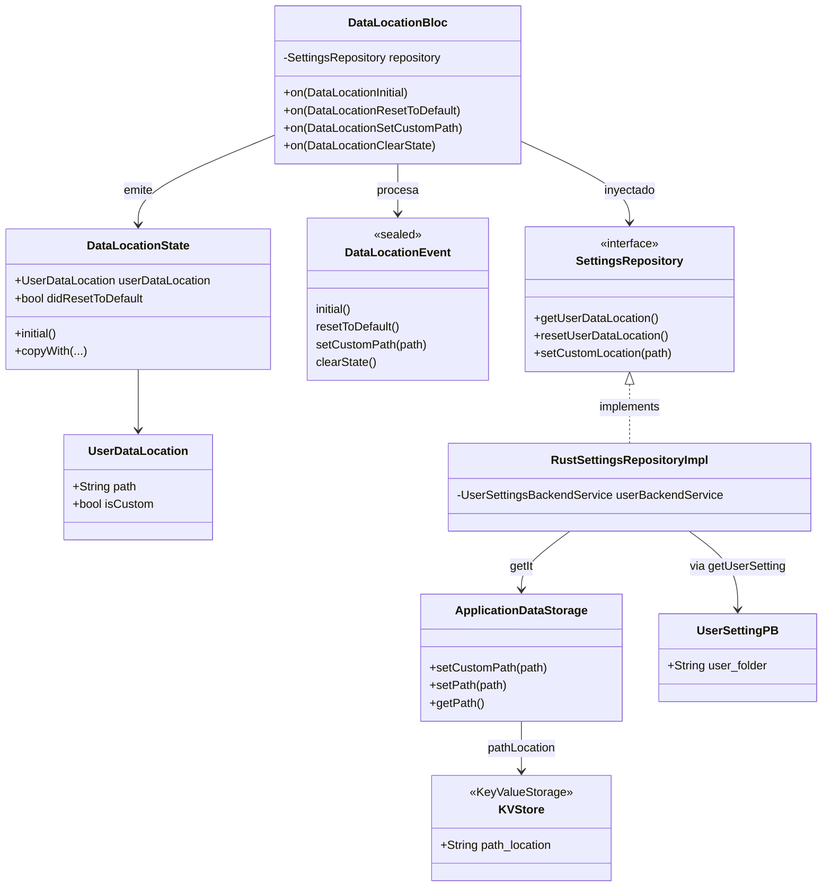
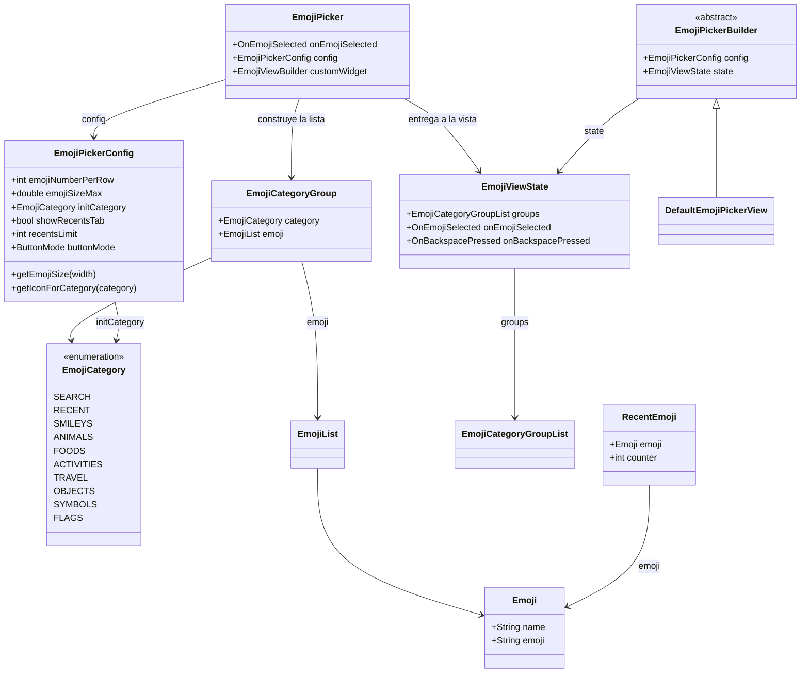
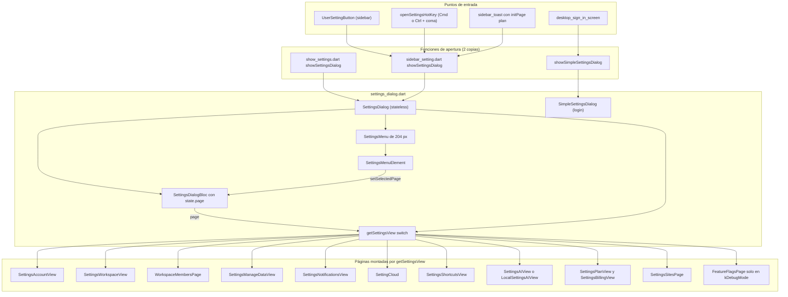
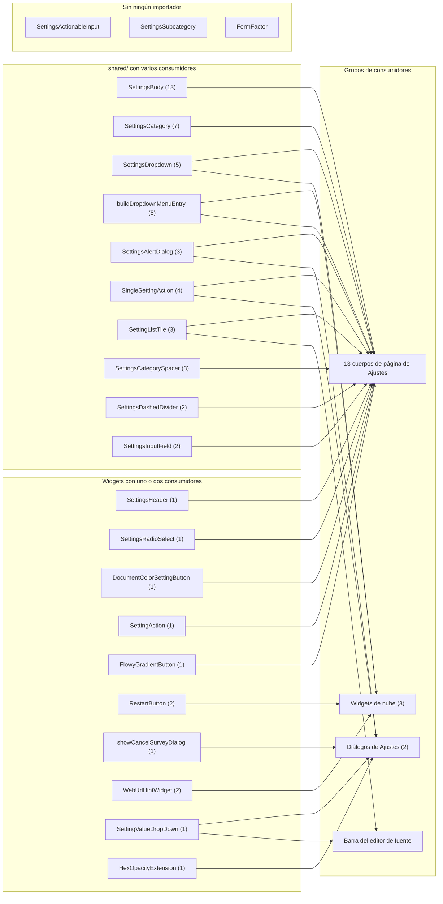
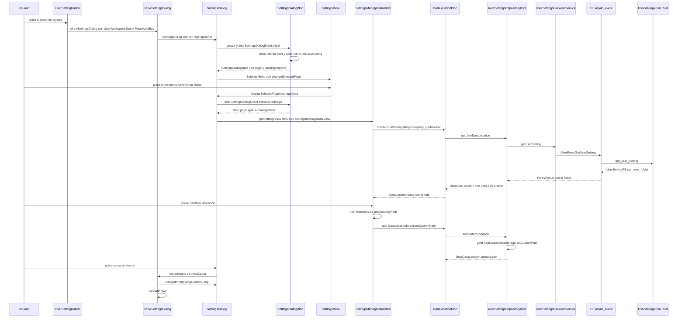
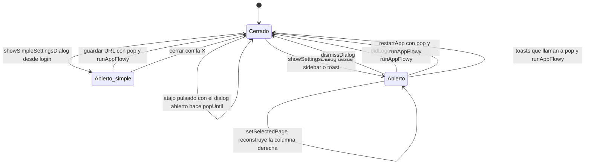

# F13.3 — Widgets compartidos de Ajustes, emoji picker y data layer de settings

## 1. Resumen

Este documento cubre la **capa compartida** del diálogo de Ajustes de AppFlowy: los 18 widgets reutilizables de `workspace/presentation/settings/shared/**`, el diálogo contenedor `settings_dialog.dart` con su navegación sidebar→página→cierre, el menú lateral `settings_menu.dart`, los diálogos auxiliares (reinicio de app, encuesta de cancelación), las dos utilidades de `widgets/utils/**` y el **emoji picker propio de Ajustes**, un paquete de 12 ficheros que es un *port* autocontenido del paquete externo `emoji_picker` y que **no** es el selector global de icono/emoji de `[[F21]]`. Incluye además la isla de arquitectura nueva `features/settings/**` (7 ficheros, patrón `{data,logic}` sin `presentation/`) que sólo aporta el `DataLocationBloc` y su repositorio. La conclusión sobre canonicidad, sostenida con imports reales, es que **`workspace/presentation/settings/` es la capa canónica de presentación** y `features/settings/` es una migración parcial: sólo contiene `data/` y `logic/`, no está registrada en `get_it`, y su único consumidor en producción es la página legada `settings_manage_data_view.dart`.

## 2. Alcance

**Incluye**. Los 45 ficheros listados en el frontmatter, agrupados en seis bloques con responsabilidades distintas: (a) la isla `features/settings/**` con `DataLocationBloc`, `SettingsRepository` y `RustSettingsRepositoryImpl`; (b) el diálogo `settings_dialog.dart`, que incluye también el segundo diálogo reducido `SimpleSettingsDialog` para la pantalla de login; (c) los 18 widgets de `shared/**`, desde los contenedores de página (`SettingsBody`, `SettingsHeader`, `SettingsCategory`, `SettingsSubcategory`, `SettingsCategorySpacer`) hasta los controles (`SettingsDropdown`, `SettingsRadioSelect`, `SettingsInputField`, `SettingListTile`, `SettingValueDropDown`, `SingleSettingAction`, `SettingAction`) y los diálogos (`SettingsAlertDialog`, `DocumentColorSettingButton`); (d) el menú lateral y sus elementos; (e) las dos utilidades de `widgets/utils/**`; (f) el emoji picker de 12 ficheros. El documento responde a tres preguntas literales: qué hace cada fichero, cómo se navega el diálogo y qué widgets se comparten con qué consumidores.

**Queda fuera**. El cuerpo de las 12 páginas que `getSettingsView` monta (`settings_account_view.dart`, `settings_workspace_view.dart`, `settings_billing_view.dart`, `settings_plan_view.dart`, `sites/settings_sites_view.dart`, `setting_ai_view/*`, `setting_cloud.dart`, `settings_notifications_view.dart`, `workspace_member_page.dart`, `feature_flag_page.dart`), que pertenecen a `[[F13.2]]` y `[[F13.1]]`; el `SettingsDialogBloc` y toda la lógica de apariencia/fechas/notificaciones, en `[[F13.1]]`; el `FlowyIconEmojiPicker` y todo `shared/icon_emoji_picker/**`, en `[[F21]]`.

**Corrección de scope obligatoria (1) `[VERIFICADO]` — el emoji picker de Ajustes NO es el de `[[F21]]`.** El ROADMAP y el nombre del fichero invitan a fusionarlos; son widgets independientes que sólo comparten el nombre de archivo. La comparación con evidencia:

| Criterio | `settings/widgets/emoji_picker/**` (esta unidad) | `shared/icon_emoji_picker/**` (`[[F21]]`) |
|---|---|---|
| Clase raíz | `EmojiPicker` (`appflowy/frontend/appflowy_flutter/lib/workspace/presentation/settings/widgets/emoji_picker/src/emoji_picker.dart:82–106`) | `FlowyIconEmojiPicker` (`appflowy/frontend/appflowy_flutter/lib/shared/icon_emoji_picker/flowy_icon_emoji_picker.dart:109–130`) |
| Origen del catálogo de emojis | Listas Dart estáticas `Map<String, String>` copiadas de un paquete externo (`appflowy/frontend/appflowy_flutter/lib/workspace/presentation/settings/widgets/emoji_picker/src/emoji_lists.dart:1–2`, ocho mapas declarados en `:16`, `:741`, `:1108`, `:1323`, `:1578`, `:1767`, `:2168`, `:2691`) | `flutter_emoji_mart` con `EmojiData.builtIn()` (`appflowy/frontend/appflowy_flutter/lib/plugins/base/emoji/emoji_picker.dart:10`, `:56`) |
| Motor nativo de plataforma | `MethodChannel('emoji_picker_flutter')` con el método `checkAvailability` **solo en Android** (`appflowy/frontend/appflowy_flutter/lib/workspace/presentation/settings/widgets/emoji_picker/src/emoji_picker.dart:109`, `:259–283`) | Ninguno; el filtrado de emojis no soportados no se hace |
| Abstracción de vista | `abstract class EmojiPickerBuilder` + `DefaultEmojiPickerView` (`appflowy/frontend/appflowy_flutter/lib/workspace/presentation/settings/widgets/emoji_picker/src/emoji_picker_builder.dart:8–17`, `appflowy/frontend/appflowy_flutter/lib/workspace/presentation/settings/widgets/emoji_picker/src/default_emoji_picker_view.dart:11–20`) | Ninguna: `flutter_emoji_mart` impone `headerBuilder`/`itemBuilder` (`appflowy/frontend/appflowy_flutter/lib/plugins/base/emoji/emoji_picker.dart:91`, `:92`) |
| Recientes | `RecentEmoji` con contador de frecuencia, ordenado descendente, en `SharedPreferences` bajo la clave `recent` (`appflowy/frontend/appflowy_flutter/lib/workspace/presentation/settings/widgets/emoji_picker/src/emoji_picker.dart:319–339`, `appflowy/frontend/appflowy_flutter/lib/workspace/presentation/settings/widgets/emoji_picker/src/models/recent_emoji_model.dart:7–30`) | `RecentIcons`, orden FIFO estricto con tope 20 (`appflowy/frontend/appflowy_flutter/lib/shared/icon_emoji_picker/recent_icons.dart:13–15`) |
| Salida | Callback `OnEmojiSelected(category, emoji)` que inserta texto en el editor (`appflowy/frontend/appflowy_flutter/lib/workspace/presentation/settings/widgets/emoji_picker/src/emoji_picker.dart:64`, `:96`) | `EmojiIconData` convertible a `ViewIconPB` y persistido en el folder (`appflowy/frontend/appflowy_flutter/lib/shared/icon_emoji_picker/flowy_icon_emoji_picker.dart:58–91`) |

No hay imports cruzados en ninguna dirección: `rg` sobre `lib/` sólo devuelve el barrel de Ajustes, su propio fichero de configuración y los dos consumidores citados en §15. `[[F21]]` da la tabla inversa en su §2.2.

**Corrección de scope obligatoria (2) `[VERIFICADO]` — el ROADMAP atribuía `settings/widgets/members/**` a F12; el triage de B0.2 los dejó en F13.** Esos ficheros son `workspace_member_page.dart`, `workspace_member_bloc.dart` e `invitation/*`, que pertenecen a `[[F13.2]]`; esta unidad sólo los cita como consumidores de `SettingsBody` y `SettingsCategorySpacer`. La declaración completa está en `[[F13.2]]` §2.

## 3. Modelos de datos

La unidad tiene tres dominios de modelos que no se mezclan. El primero es el **modelo de navegación del diálogo**, que es un enum plano más un estado `freezed`: `SettingsPage` enumera las 12 páginas con un comentario que separa explícitamente las "NEW" (`account`, `workspace`, `manageData`, `shortcuts`, `ai`, `plan`, `billing`, `sites`) de las "OLD" (`notifications`, `cloud`, `member`, `featureFlags`) (`appflowy/frontend/appflowy_flutter/lib/workspace/application/settings/settings_dialog_bloc.dart:14–29`). `SettingsDialogState` transporta `userProfile`, `page` e `isBillingEnabled` (`appflowy/frontend/appflowy_flutter/lib/workspace/application/settings/settings_dialog_bloc.dart:137–154`), y el widget `SettingsDialog` recibe además tres callbacks de salida (`dismissDialog`, `didLogout`, `restartApp`) que el contenedor decide implementar (`appflowy/frontend/appflowy_flutter/lib/workspace/presentation/settings/settings_dialog.dart:46–59`). No existe modelo de ruta tipo `go_router`: la navegación es un `switch` exhaustivo sobre el enum (`:127–188`).

**Muestra:** los modelos que gobiernan qué página se ve dentro del diálogo y quién decide cerrarlo.

Lectura: el único estado que sobrevive entre lecturas del menú es el entero/`enum` `page` del `SettingsDialogBloc`; el widget es *stateless* y no guarda la página actual. El contenedor (`showSettingsDialog`) decide qué hacer al cerrar, de modo que el diálogo es reutilizable tanto desde la app autenticada como desde el login.

El segundo dominio es la **capa de datos de `features/settings`**, con el modelo `UserDataLocation` (dos campos, `Equatable`), el contrato `SettingsRepository` de tres métodos que devuelven `FlowyResult<UserDataLocation, FlowyError>` y el BLoC `DataLocationBloc` con cuatro eventos y un estado de dos campos (`appflowy/frontend/appflowy_flutter/lib/features/settings/data/models/user_data_location.dart:3–14`, `appflowy/frontend/appflowy_flutter/lib/features/settings/data/repositories/settings_repository.dart:6–14`, `appflowy/frontend/appflowy_flutter/lib/features/settings/logic/data_location_state.dart:5–28`).

**Muestra:** la cadena dato→repositorio→almacén y el evento FFI que la alimenta.

Lectura: `UserDataLocation` no se persiste; es una proyección en memoria calculada a partir de `UserSettingPB.user_folder` (que devuelve el SDK Rust) y del directorio de datos por defecto de la app. El único estado durable es la clave KV `path_location`, y el BLoC lo escribe a través de `getIt<ApplicationDataStorage>()`.

El tercer dominio es el de los **modelos del emoji picker de Ajustes**, que es autocontenido y no comparte tipos con `[[F21]]`: `Emoji` (nombre + glifo Unicode), `EmojiCategoryGroup` (categoría + lista mutable), `RecentEmoji` (emoji + contador), `EmojiCategoryIcons` (un `IconData` por categoría) y el estado de vista `EmojiViewState` que transporta la lista de grupos y los dos callbacks (`appflowy/frontend/appflowy_flutter/lib/workspace/presentation/settings/widgets/emoji_picker/src/models/emoji_model.dart:2–32`, `appflowy/frontend/appflowy_flutter/lib/workspace/presentation/settings/widgets/emoji_picker/src/models/emoji_category_models.dart:7–19` y `:45–89`, `appflowy/frontend/appflowy_flutter/lib/workspace/presentation/settings/widgets/emoji_picker/src/emoji_view_state.dart:5–21`). `EmojiPickerConfig` es un `freezed` con 21 campos de estilo y dos métodos derivados (`appflowy/frontend/appflowy_flutter/lib/workspace/presentation/settings/widgets/emoji_picker/src/emji_picker_config.dart:11–59`, `:62–65`, `:68–91`).

**Muestra:** el grafo de tipos del picker de Ajustes, desde la configuración hasta el emoji individual.

Lectura: `EmojiViewState` funciona como un snapshot inmutable que la vista consume, de forma que cambiar `customWidget` es sustituir la subclase de `EmojiPickerBuilder`. Las listas se expresan en el diagrama como `EmojiList`/`EmojiCategoryGroupList` porque Mermaid no admite genéricos en los nombres de campo (`SKILL/references/diagram-conventions.md`, sección `classDiagram`); en el código son `List<Emoji>` y `List<EmojiCategoryGroup>` respectivamente (`appflowy/frontend/appflowy_flutter/lib/workspace/presentation/settings/widgets/emoji_picker/src/emoji_view_state.dart:14`, `appflowy/frontend/appflowy_flutter/lib/workspace/presentation/settings/widgets/emoji_picker/src/emoji_picker.dart:111`).

## 4. Eventos FFI

Ninguno de los 39 widgets de esta unidad habla con Rust directamente; todos llegan a `flowy-user` a través de los servicios Dart. Hay exactamente **dos** eventos alcanzables desde esta unidad, y ambos los dispara lógica que la unidad consume pero no contiene. El primero es `GetUserSetting`, disparado por `RustSettingsRepositoryImpl.getUserDataLocation()` al composed `UserSettingPB` (`appflowy/frontend/appflowy_flutter/lib/features/settings/data/repositories/rust_settings_repository_impl.dart:16–31`, `appflowy/frontend/appflowy_flutter/lib/user/application/user_settings_service.dart:21–23`). El segundo es `GetCloudConfig`, disparado por `SettingsDialogBloc._isBillingEnabled` para decidir si el menú muestra las páginas de plan y facturación (`appflowy/frontend/appflowy_flutter/lib/workspace/application/settings/settings_dialog_bloc.dart:109`, `:90–124`).

| Evento | Input PB | Output PB | Handler Rust | Archivo Dart que lo dispara | Registro Rust |
|---|---|---|---|---|---|
| `UserEventGetUserSetting` | — | `UserSettingPB` | `get_user_setting` (`appflowy/frontend/rust-lib/flowy-user/src/event_handler.rs:295–302`) | `appflowy/frontend/appflowy_flutter/lib/features/settings/data/repositories/rust_settings_repository_impl.dart:20` | `appflowy/frontend/rust-lib/flowy-user/src/event_map.rs:126` |
| `UserEventGetCloudConfig` | — | `CloudSettingPB` | `get_cloud_config_handler` (`appflowy/frontend/rust-lib/flowy-user/src/event_handler.rs:411`) | `appflowy/frontend/appflowy_flutter/lib/workspace/application/settings/settings_dialog_bloc.dart:109` | `appflowy/frontend/rust-lib/flowy-user/src/event_map.rs:143` |
| `UserEventGetAppearanceSetting` | — | `AppearanceSettingsPB` | `get_appearance_setting` (`appflowy/frontend/rust-lib/flowy-user/src/event_handler.rs:175`) | Indirecto: `SettingsDropdown` lee `AppearanceSettingsCubit` (`appflowy/frontend/appflowy_flutter/lib/workspace/presentation/settings/shared/settings_dropdown.dart:47–49`) | `appflowy/frontend/rust-lib/flowy-user/src/event_map.rs:122` |

El shape del retorno de `GetUserSetting` es mínimo: `UserSettingPB` tiene un único campo, `user_folder` (`appflowy/frontend/rust-lib/flowy-user/src/entities/user_profile.rs:19–22`), que el `UserManager` calcula a partir del id de sesión (`appflowy/frontend/rust-lib/flowy-user/src/user_manager/manager.rs:655–661`). Los datos de la tabla salen de `OUT/_ledger/extract/events.json` y `OUT/_ledger/extract/protobuf.json`; el registro Dart→FFI se resuelve en runtime por nombre de evento a través de `EventDispatcher` (`appflowy/frontend/appflowy_flutter/lib/user/application/user_settings_service.dart:2`).

## 5. Notificaciones

La unidad no registra ningún listener propio: los 45 ficheros no contienen ninguna llamada a `rust_stream.dart`. La única notificación que atraviesa el diálogo es **indirecta**, a través del `UserListener` que crea el `SettingsDialogBloc` en su constructor (`appflowy/frontend/appflowy_flutter/lib/workspace/application/settings/settings_dialog_bloc.dart:37`, `:56`). Cuando llega `UserNotification.DidUpdateUserProfile`, el listener publica en `UserProfileNotifyValue` y el bloc lo convierte en `SettingsDialogEvent.didReceiveUserProfile` (`appflowy/frontend/appflowy_flutter/lib/workspace/application/settings/settings_dialog_bloc.dart:66–68`, `:77–88`), lo que actualiza `state.userProfile` y redibuja el diálogo con el perfil nuevo.

| Notificación | Emisor Rust | Parser Dart | Efecto en el diálogo | Archivo:línea |
|---|---|---|---|---|
| `DidUpdateUserProfile` (índice 2) | `appflowy/frontend/rust-lib/flowy-user/src/notification.rs:15` | `UserNotificationParser` (`appflowy/frontend/appflowy_flutter/lib/core/notification/user_notification.dart`) | Actualiza `SettingsDialogState.userProfile`; el menú y las páginas leen el perfil a través de `UserWorkspaceBloc` | `appflowy/frontend/appflowy_flutter/lib/user/application/user_listener.dart:83` |
| `DidUpdateUserWorkspace` | `appflowy/frontend/rust-lib/flowy-user/src/notification.rs:16` | `UserNotificationParser` | No la consume esta unidad: llega por `UserWorkspaceBloc`, que el diálogo **sólo lee** para obtener `currentWorkspace` y `userProfile` | `appflowy/frontend/appflowy_flutter/lib/workspace/presentation/settings/settings_dialog.dart:100–108` |

Es un diseño relevante para el ciclo de vida: el diálogo se suscribe al perfil y al workspace, pero **no escribe** en ninguna notificación. Los dos únicos efectos laterales que sí reinician la app son `didLogout` y `restartApp`, que se ejecutan en el contenedor y llaman a `runAppFlowy()` tras cerrar el diálogo (`appflowy/frontend/appflowy_flutter/lib/workspace/presentation/home/menu/sidebar/shared/sidebar_setting.dart:146–161`).

## 6. BLoCs / Cubits

Dos BLoCs aparecen en el perímetro de esta unidad: uno **contenido** (`DataLocationBloc`, definido en `features/settings/logic/`) y otro **consumido como modelo de navegación** (`SettingsDialogBloc`, definido en `workspace/application/settings/` y propiedad de `[[F13.1]]`). Ninguno de los dos se registra en `get_it`; ambos se crean con `BlocProvider` en el árbol.

| Clase | Eventos | Estado | Servicios | Archivo:línea |
|---|---|---|---|---|
| `DataLocationBloc` | `DataLocationInitial`, `DataLocationResetToDefault`, `DataLocationSetCustomPath(path)`, `DataLocationClearState` | `DataLocationState(userDataLocation, didResetToDefault)` | `SettingsRepository` inyectado por constructor | `appflowy/frontend/appflowy_flutter/lib/features/settings/logic/data_location_bloc.dart:8–17`, eventos en `appflowy/frontend/appflowy_flutter/lib/features/settings/logic/data_location_event.dart:1–24` |
| `SettingsDialogBloc` | `initial()`, `didReceiveUserProfile(pb)`, `setSelectedPage(page)` | `SettingsDialogState(userProfile, page, isBillingEnabled)` | `UserListener` interno; `UserEventGetCloudConfig` para `isBillingEnabled` | `appflowy/frontend/appflowy_flutter/lib/workspace/application/settings/settings_dialog_bloc.dart:31–40`, `:127–135` |

Dos detalles de diseño del `DataLocationBloc` merecen registro. El primero es que los cuatro handlers usan `.toNullable()` sobre el `FlowyResult` y emiten el estado aunque la operación haya fallado, con lo que un error de disco se manifiesta como `userDataLocation == null` y la UI lo muestra como un `CircularProgressIndicator` infinito en lugar de un error (`appflowy/frontend/appflowy_flutter/lib/features/settings/logic/data_location_bloc.dart:25–33`, `appflowy/frontend/appflowy_flutter/lib/workspace/presentation/settings/pages/settings_manage_data_view.dart:109–112`). El segundo es que `didResetToDefault` es un flag de un solo uso que la vista consume para cerrar el diálogo y relanzar la app, y que el propio bloc ofrece `DataLocationClearState` para limpiarlo (`appflowy/frontend/appflowy_flutter/lib/features/settings/logic/data_location_bloc.dart:51–60`, `appflowy/frontend/appflowy_flutter/lib/workspace/presentation/settings/pages/settings_manage_data_view.dart:50–57`).

## 7. Servicios e inyección de dependencias

La capa `features/settings/**` **no usa `get_it` para sí misma**. `SettingsRepository` es una interfaz pura y `RustSettingsRepositoryImpl` se instancia literalmente en el `BlocProvider` de la vista (`appflowy/frontend/appflowy_flutter/lib/workspace/presentation/settings/pages/settings_manage_data_view.dart:45–49`); `rg SettingsRepository startup/deps_resolver.dart` no devuelve ninguna coincidencia. Esto contrasta con el resto de la app, donde `ApplicationDataStorage` sí está registrado como `registerFactory` y se resuelve por interfaz (`appflowy/frontend/appflowy_flutter/lib/startup/deps_resolver.dart:83–84`). La consecuencia práctica es que `DataLocationBloc` no es sustituible en producción: la única forma de inyectar un doble es construirlo a mano, como hace el test de BLoC (§15).

| Dependencia | Tipo | Cómo se obtiene | Archivo:línea |
|---|---|---|---|
| `SettingsRepository` | Interfaz Dart | Parámetro de `DataLocationBloc` | `appflowy/frontend/appflowy_flutter/lib/features/settings/data/repositories/settings_repository.dart:6–14` |
| `RustSettingsRepositoryImpl` | Implementación | `const` literal en el `BlocProvider` | `appflowy/frontend/appflowy_flutter/lib/features/settings/data/repositories/rust_settings_repository_impl.dart:11–12` |
| `UserSettingsBackendService` | Servicio FFI | `const` como campo final del repositorio | `appflowy/frontend/appflowy_flutter/lib/features/settings/data/repositories/rust_settings_repository_impl.dart:14` |
| `ApplicationDataStorage` | Servicio de disco | `getIt<ApplicationDataStorage>()` | `appflowy/frontend/appflowy_flutter/lib/features/settings/data/repositories/rust_settings_repository_impl.dart:37`, `:52` |
| `FilePickerService` | Selector de carpeta | `getIt<FilePickerService>()` en la vista | `appflowy/frontend/appflowy_flutter/lib/workspace/presentation/settings/pages/settings_manage_data_view.dart:466` |
| `AppearanceSettingsCubit` | Cubit de apariencia | `context.read` desde `SettingsDropdown`; provisto en la raíz de la app | `appflowy/frontend/appflowy_flutter/lib/workspace/presentation/settings/shared/settings_dropdown.dart:47`, `appflowy/frontend/appflowy_flutter/lib/startup/tasks/app_widget.dart:171` |
| `UserWorkspaceBloc` | BLoC de workspace | `context.read` desde el diálogo; provisto por el contenedor | `appflowy/frontend/appflowy_flutter/lib/workspace/presentation/settings/settings_dialog.dart:65–66`, `:100` |
| `DocumentAppearanceCubit`, `PasswordBloc` | Cubit y BLoC de apoyo | `MultiBlocProvider` en `showSettingsDialog` | `appflowy/frontend/appflowy_flutter/lib/workspace/presentation/home/menu/sidebar/shared/sidebar_setting.dart:124–142` |

El lado Rust no aporta nada nuevo a esta unidad: `flowy-user` resuelve `GetUserSetting` leyendo la sesión y componiendo un único campo, sin acceso a disco (`appflowy/frontend/rust-lib/flowy-user/src/user_manager/manager.rs:655–661`).

## 8. Persistencia

Hay tres mecanismos distintos, todos locales, ninguno en SQLite. El primero es la **clave KV `path_location`**, gestionada por `ApplicationDataStorage.setPath` (`appflowy/frontend/appflowy_flutter/lib/workspace/application/settings/application_data_storage.dart:52–61`). El valor es la ruta absoluta de la carpeta `AppFlowyDataDoNotRename` (`appflowy/frontend/appflowy_flutter/lib/workspace/application/settings/application_data_storage.dart:14`); `setCustomPath` normaliza separadores por plataforma, añade el sufijo si falta, crea el directorio recursivamente y delega en `setPath` (`appflowy/frontend/appflowy_flutter/lib/workspace/application/settings/application_data_storage.dart:23–50`). `getPath` es defensivo: si la ruta guardada ya no existe, **borra todo el KV store** y vuelve al directorio por defecto (`:79–84`). El segundo mecanismo es la proyección derivada de `UserSettingPB.user_folder` en Rust, que es de sólo lectura desde Dart (`:20` del repositorio). El tercero es `SharedPreferences`, usado sólo por el emoji picker de Ajustes con las claves `recent` (lista de recientes con contador) y el nombre de cada categoría (`smileys`, `animals`, `foods`, `travel`, `activities`, `objects`, `symbols`, `flags`) como caché del filtrado por plataforma (`appflowy/frontend/appflowy_flutter/lib/workspace/presentation/settings/widgets/emoji_picker/src/emoji_picker.dart:286–305`, `:308–316`, `:337–338`).

| Almacén | Clave / tabla | Escritor | Lector | Observación |
|---|---|---|---|---|
| KV store (`getIt<KeyValueStorage>`) | `path_location` | `ApplicationDataStorage.setPath` (`appflowy/frontend/appflowy_flutter/lib/workspace/application/settings/application_data_storage.dart:58`) | `ApplicationDataStorage.getPath` (`appflowy/frontend/appflowy_flutter/lib/workspace/application/settings/application_data_storage.dart:68`) | Se limpia entera si la ruta no existe |
| `SharedPreferences` | `recent` | `_addEmojiToRecentlyUsed` (`appflowy/frontend/appflowy_flutter/lib/workspace/presentation/settings/widgets/emoji_picker/src/emoji_picker.dart:338`) | `_getRecentEmojis` (`appflowy/frontend/appflowy_flutter/lib/workspace/presentation/settings/widgets/emoji_picker/src/emoji_picker.dart:309`) | Serializado con `jsonEncode` de `RecentEmoji.toJson` |
| `SharedPreferences` | `smileys`, `animals`, … | `_cacheFilteredEmojis` (`appflowy/frontend/appflowy_flutter/lib/workspace/presentation/settings/widgets/emoji_picker/src/emoji_picker.dart:298–305`) | `_restoreFilteredEmojis` (`appflowy/frontend/appflowy_flutter/lib/workspace/presentation/settings/widgets/emoji_picker/src/emoji_picker.dart:286–295`) | Caché **sin versionar**: cambiar la lista de emojis deja obsoleta la caché |
| `MethodChannel('emoji_picker_flutter')` | método `checkAvailability` | — | `_getPlatformAvailableEmoji` (`appflowy/frontend/appflowy_flutter/lib/workspace/presentation/settings/widgets/emoji_picker/src/emoji_picker.dart:262–279`) | Sólo se invoca en Android; el resto de plataformas devuelve el mapa completo |

## 9. Diagramas de flujo

**Muestra:** la estructura del diálogo de Ajustes, desde los cuatro puntos de entrada hasta las 12 páginas que produce el `switch` de `getSettingsView`.

Lectura: hay **dos** funciones `showSettingsDialog` distintas con el mismo nombre y casi el mismo cuerpo, y la copia de `sidebar_setting.dart` es la que se usa en la app autenticada porque además provee `PasswordBloc` y registra el atajo de teclado (`appflowy/frontend/appflowy_flutter/lib/workspace/presentation/home/menu/sidebar/shared/sidebar_setting.dart:114–165`, `appflowy/frontend/appflowy_flutter/lib/shared/settings/show_settings.dart:16–55`). El camino del login es separado y usa `SimpleSettingsDialog`, que no tiene BLoC ni menú: apila tres `SettingsCategory` (idioma, self-host, soporte) y, al guardar la URL, cierra el diálogo y relanza la app (`appflowy/frontend/appflowy_flutter/lib/workspace/presentation/settings/settings_dialog.dart:205–238`, `:372–406`). El `switch` de `getSettingsView` es exhaustivo sobre el enum sin rama `default`, de modo que añadir una página a `SettingsPage` obliga a compilarla en dos sitios (menú y `switch`).

**Muestra:** quién consume cada widget compartido, agrupando los 13 cuerpos de página y los diálogos de Ajustes en cubos para no superar el límite de nodos. El número entre paréntesis es el de ficheros que importan el widget.

Lectura: la capa compartida es **realmente compartida** y sale del círculo de Ajustes en dos direcciones: 13 de sus widgets son importados por `settings_dialog.dart` o por alguna de las páginas, y dos de ellos (`SettingListTile` y `SettingValueDropDown`) se usan además desde la barra de customization de fuente del editor (`appflowy/frontend/appflowy_flutter/lib/plugins/document/presentation/editor_plugins/font/customize_font_toolbar_item.dart:10–11`). Ese es el argumento para no moverlos a `features/settings/`. En el extremo opuesto, tres widgets de la lista de esta unidad (`SettingsActionableInput`, `SettingsSubcategory` y el enum `FormFactor`) no los importa ningún fichero de `lib/`, `test/` ni `integration_test/`: son 114 líneas de código muerto.

## 10. Diagramas de secuencia

**Muestra:** un ciclo completo de Ajustes: abrir desde el sidebar, navegar a "Administrar datos", que la página cargue la ruta actual mediante el BLoC de la capa nueva, cambiar de ruta, y cerrar con reinicio de la app.

Lectura: el diálogo es **puramente declarativo respecto a la navegación**: el clic en el menú no empuja una ruta, sólo muta `state.page`, y el `BlocBuilder` de la columna derecha reconstruye la página desde cero en cada cambio (`appflowy/frontend/appflowy_flutter/lib/workspace/presentation/settings/settings_dialog.dart:73–118`). Eso significa que cambiar de página **descarta el estado** de la página anterior: `SettingsManageDataView` vuelve a crear su `DataLocationBloc` y a preguntar al backend, igual que harían `SettingsAccountView` o `SettingsAIView`. La segunda mitad de la secuencia muestra el único camino de esta unidad que cruza la frontera FFI, y el orden importa: la ruta mostrada proviene de `UserSettingPB.user_folder` (Rust), mientras que la ruta nueva se guarda sólo en el KV store de Dart, sin evento de vuelta al backend.

## 11. Diagramas de estado

**Muestra:** el ciclo de vida del diálogo como entidad, incluyendo el comportamiento de alternancia del atajo de teclado y el reinicio de la app.

Lectura: `Abierto_simple` y `Abierto` son dos máquinas distintas con la misma salida. El atajo de Cmd/Ctrl+coma implementa una alternancia, no una navegación: si el diálogo ya está abierto, ejecuta `popUntil` hasta la primera ruta en lugar de emitir ningún evento (`appflowy/frontend/appflowy_flutter/lib/workspace/presentation/home/menu/sidebar/shared/sidebar_setting.dart:32–42`). El estado `Abierto --> Abierto` es una transición real y costosa: cada cambio de página reconstruye la página entera desde el enum, sin caché ni `AutomaticKeepAlive`, por lo que las páginas con estado de carga (como `DataLocationBloc`) reinician su consulta.

## 12. Archivos cubiertos (del ledger)

Los 45 ficheros de `OUT/_ledger/units/F13.3.json`, agrupados por responsabilidad. La ruta es siempre relativa al repo principal con prefijo `appflowy/`; el campo LOC es el recuento real de líneas.

| # | Bloque | Ruta (relativa al repo) | LOC | Capa |
|---|---|---|---|---|
| 1 | Capa nueva | `appflowy/frontend/appflowy_flutter/lib/features/settings/data/models/user_data_location.dart` | 14 | bloc |
| 2 | Capa nueva | `appflowy/frontend/appflowy_flutter/lib/features/settings/data/repositories/rust_settings_repository_impl.dart` | 61 | bloc |
| 3 | Capa nueva | `appflowy/frontend/appflowy_flutter/lib/features/settings/data/repositories/settings_repository.dart` | 14 | bloc |
| 4 | Capa nueva | `appflowy/frontend/appflowy_flutter/lib/features/settings/logic/data_location_bloc.dart` | 76 | bloc |
| 5 | Capa nueva | `appflowy/frontend/appflowy_flutter/lib/features/settings/logic/data_location_event.dart` | 24 | bloc |
| 6 | Capa nueva | `appflowy/frontend/appflowy_flutter/lib/features/settings/logic/data_location_state.dart` | 29 | bloc |
| 7 | Capa nueva | `appflowy/frontend/appflowy_flutter/lib/features/settings/settings.dart` | 6 | ui |
| 8 | Diálogo | `appflowy/frontend/appflowy_flutter/lib/workspace/presentation/settings/settings_dialog.dart` | 604 | ui |
| 9 | Compartidos | `appflowy/frontend/appflowy_flutter/lib/workspace/presentation/settings/shared/af_dropdown_menu_entry.dart` | 73 | ui |
| 10 | Compartidos | `appflowy/frontend/appflowy_flutter/lib/workspace/presentation/settings/shared/document_color_setting_button.dart` | 429 | ui |
| 11 | Compartidos | `appflowy/frontend/appflowy_flutter/lib/workspace/presentation/settings/shared/flowy_gradient_button.dart` | 87 | ui |
| 12 | Compartidos | `appflowy/frontend/appflowy_flutter/lib/workspace/presentation/settings/shared/setting_action.dart` | 56 | ui |
| 13 | Compartidos | `appflowy/frontend/appflowy_flutter/lib/workspace/presentation/settings/shared/setting_list_tile.dart` | 91 | ui |
| 14 | Compartidos | `appflowy/frontend/appflowy_flutter/lib/workspace/presentation/settings/shared/setting_value_dropdown.dart` | 59 | ui |
| 15 | Compartidos | `appflowy/frontend/appflowy_flutter/lib/workspace/presentation/settings/shared/settings_actionable_input.dart` | 54 | ui |
| 16 | Compartidos | `appflowy/frontend/appflowy_flutter/lib/workspace/presentation/settings/shared/settings_alert_dialog.dart` | 250 | ui |
| 17 | Compartidos | `appflowy/frontend/appflowy_flutter/lib/workspace/presentation/settings/shared/settings_body.dart` | 51 | ui |
| 18 | Compartidos | `appflowy/frontend/appflowy_flutter/lib/workspace/presentation/settings/shared/settings_category.dart` | 75 | ui |
| 19 | Compartidos | `appflowy/frontend/appflowy_flutter/lib/workspace/presentation/settings/shared/settings_category_spacer.dart` | 30 | ui |
| 20 | Compartidos | `appflowy/frontend/appflowy_flutter/lib/workspace/presentation/settings/shared/settings_dashed_divider.dart` | 75 | ui |
| 21 | Compartidos | `appflowy/frontend/appflowy_flutter/lib/workspace/presentation/settings/shared/settings_dropdown.dart` | 124 | ui |
| 22 | Compartidos | `appflowy/frontend/appflowy_flutter/lib/workspace/presentation/settings/shared/settings_header.dart` | 47 | ui |
| 23 | Compartidos | `appflowy/frontend/appflowy_flutter/lib/workspace/presentation/settings/shared/settings_input_field.dart` | 168 | ui |
| 24 | Compartidos | `appflowy/frontend/appflowy_flutter/lib/workspace/presentation/settings/shared/settings_radio_select.dart` | 74 | ui |
| 25 | Compartidos | `appflowy/frontend/appflowy_flutter/lib/workspace/presentation/settings/shared/settings_subcategory.dart` | 41 | ui |
| 26 | Compartidos | `appflowy/frontend/appflowy_flutter/lib/workspace/presentation/settings/shared/single_setting_action.dart` | 167 | ui |
| 27 | Diálogos | `appflowy/frontend/appflowy_flutter/lib/workspace/presentation/settings/widgets/_restart_app_button.dart` | 76 | ui |
| 28 | Diálogos | `appflowy/frontend/appflowy_flutter/lib/workspace/presentation/settings/widgets/cancel_plan_survey_dialog.dart` | 431 | ui |
| 29 | Emoji picker | `appflowy/frontend/appflowy_flutter/lib/workspace/presentation/settings/widgets/emoji_picker/emoji_picker.dart` | 6 | ui |
| 30 | Emoji picker | `appflowy/frontend/appflowy_flutter/lib/workspace/presentation/settings/widgets/emoji_picker/emoji_shortcut_event.dart` | 32 | ui |
| 31 | Emoji picker | `appflowy/frontend/appflowy_flutter/lib/workspace/presentation/settings/widgets/emoji_picker/src/default_emoji_picker_view.dart` | 283 | ui |
| 32 | Emoji picker | `appflowy/frontend/appflowy_flutter/lib/workspace/presentation/settings/widgets/emoji_picker/src/emji_picker_config.dart` | 92 | ui |
| 33 | Emoji picker | `appflowy/frontend/appflowy_flutter/lib/workspace/presentation/settings/widgets/emoji_picker/src/emoji_lists.dart` | 3223 | ui |
| 34 | Emoji picker | `appflowy/frontend/appflowy_flutter/lib/workspace/presentation/settings/widgets/emoji_picker/src/emoji_picker.dart` | 340 | ui |
| 35 | Emoji picker | `appflowy/frontend/appflowy_flutter/lib/workspace/presentation/settings/widgets/emoji_picker/src/emoji_picker_builder.dart` | 17 | ui |
| 36 | Emoji picker | `appflowy/frontend/appflowy_flutter/lib/workspace/presentation/settings/widgets/emoji_picker/src/emoji_view_state.dart` | 21 | ui |
| 37 | Emoji picker | `appflowy/frontend/appflowy_flutter/lib/workspace/presentation/settings/widgets/emoji_picker/src/flowy_emoji_picker_config.dart` | 34 | ui |
| 38 | Emoji picker | `appflowy/frontend/appflowy_flutter/lib/workspace/presentation/settings/widgets/emoji_picker/src/models/emoji_category_models.dart` | 89 | ui |
| 39 | Emoji picker | `appflowy/frontend/appflowy_flutter/lib/workspace/presentation/settings/widgets/emoji_picker/src/models/emoji_model.dart` | 32 | ui |
| 40 | Emoji picker | `appflowy/frontend/appflowy_flutter/lib/workspace/presentation/settings/widgets/emoji_picker/src/models/recent_emoji_model.dart` | 30 | ui |
| 41 | Menú | `appflowy/frontend/appflowy_flutter/lib/workspace/presentation/settings/widgets/settings_menu.dart` | 208 | ui |
| 42 | Menú | `appflowy/frontend/appflowy_flutter/lib/workspace/presentation/settings/widgets/settings_menu_element.dart` | 87 | ui |
| 43 | Utilidades | `appflowy/frontend/appflowy_flutter/lib/workspace/presentation/settings/widgets/utils/form_factor.dart` | 19 | ui |
| 44 | Utilidades | `appflowy/frontend/appflowy_flutter/lib/workspace/presentation/settings/widgets/utils/hex_opacity_string_extension.dart` | 19 | ui |
| 45 | Utilidades | `appflowy/frontend/appflowy_flutter/lib/workspace/presentation/settings/widgets/web_url_hint_widget.dart` | 34 | ui |

## 13. Riesgos y casos límite

**Sobre la canonicidad de la capa.** El riesgo principal de este documento es que la dualidad `workspace/presentation/settings/` frente a `features/settings/` se interprete como dos implementaciones paralelas cuando en realidad hay **una isla de lógica nueva sobre una presentación legada**. La evidencia es taxativa: `features/settings/` contiene sólo `data/` y `logic/`, no tiene carpeta `presentation/` (a diferencia de `features/share_tab/` y `features/shared_section/`, que sí la tienen), y el único `import 'package:appflowy/features/settings/settings.dart'` en `lib/` es el de `appflowy/frontend/appflowy_flutter/lib/workspace/presentation/settings/pages/settings_manage_data_view.dart:4`. `[INFERIDO]` Por tanto la carpeta legada **es la canónica de presentación**, y `features/settings/` sólo puede ser considerada canónica para el subdominio "ubicación de datos": ninguna de las dos carpetas se declara canónica en el código, así que la conclusión se apoya sólo en la forma del árbol y en el conjunto de imports, no en una declaración explícita del proyecto. Migrar `shared/**` a `features/settings/presentation/` sería un error: esos widgets se consumen desde la barra del editor (`appflowy/frontend/appflowy_flutter/lib/plugins/document/presentation/editor_plugins/font/customize_font_toolbar_item.dart:10–11`) y desde 13 páginas, y hacerlo introduciría una dependencia inversa `features/settings → plugins/document`.

**Sobre el emoji picker.** El riesgo es de duplicación: existen dos widgets con el mismo nombre de archivo, dos catálogos de emojis, dos políticas de recientes y dos mecanismos de persistencia. El de Ajustes además es un *port* de un paquete externo cuyo origen está anotado en la cabecera del fichero de listas (`appflowy/frontend/appflowy_flutter/lib/workspace/presentation/settings/widgets/emoji_picker/src/emoji_lists.dart:1–2`), sin registro de versión ni aviso de licencia. Dado que el único fichero realmente alcanzable del paquete es `emoji_shortcut_event.dart`, que abre el `EmojiMenu` del editor — un camino que no pasa por esta vista —, el resto del paquete (938 líneas más 3223 de datos) está en la práctica huérfano y es candidato natural a borrado o a sustitución por `[[F21]]`/`plugins/base/emoji/emoji_picker.dart`. Documentar ambas piezas como un único "emoji picker de Ajustes" sería un error de lectura del árbol de ficheros.

**Sobre `isCustom`, inversión probable en el repositorio.** `RustSettingsRepositoryImpl` calcula el flag con `contains` en lugar de `!contains`: una ruta personalizada devuelve `isCustom == true` sólo si **contiene** el directorio por defecto, y el directorio por defecto devuelve `true` porque se contiene a sí mismo (`appflowy/frontend/appflowy_flutter/lib/features/settings/data/repositories/rust_settings_repository_impl.dart:27` y `:57`). Además el valor se recalcula con la variable `defaultDirectory`, pero `getUserDataLocation` compara contra la ruta por defecto de la app y no contra el valor realmente configurado. `[INFERIDO]` El test de BLoC pasa `isCustom: true` como valor esperado, así que la suite no detecta la semántica invertida. El impacto real está acotado porque la vista ya no lee el flag (`appflowy/frontend/appflowy_flutter/lib/workspace/presentation/settings/pages/settings_manage_data_view.dart:59` lo tiene comentado), lo que convierte el campo en residuo de una versión anterior de la UI.

**Sobre pérdida de estado al cambiar de página.** El `switch` de `getSettingsView` se evalúa en cada `build` del `BlocBuilder` y devuelve una instancia nueva de la página (`appflowy/frontend/appflowy_flutter/lib/workspace/presentation/settings/settings_dialog.dart:103–108`). Cambiar de "Administrar datos" a "Apariencia" y volver destruye el `DataLocationBloc` y obliga a una nueva llamada FFI. Páginas con entradas de texto a medias pierden lo escrito, salvo que el `TextEditingController` se pase desde fuera (patrón que usa `SettingsInputField`, `appflowy/frontend/appflowy_flutter/lib/workspace/presentation/settings/shared/settings_input_field.dart:67–69`).

**Sobre el diálogo de cambio de color.** `[INFERIDO]` `DocumentColorSettingButton` mantiene `newColor` como campo de estado del *botón*, fuera del diálogo, y lo actualiza con un closure (`appflowy/frontend/appflowy_flutter/lib/workspace/presentation/settings/shared/document_color_setting_button.dart:42`, `:62`). Si el usuario confirma sin haber escrito nada, se aplica el color inicial; no hay estado de "sin cambios". Además la conversión hex↔opacidad usa factores `2.55` aproximados, con lo que un valor de opacidad no representable redondea al byte anterior (`appflowy/frontend/appflowy_flutter/lib/workspace/presentation/settings/widgets/utils/hex_opacity_string_extension.dart:10`, `:16`).

**Sobre widgets muertos y duplicación de función.** `[INFERIDO]` Tres widgets de la lista (`SettingsActionableInput`, `SettingsSubcategory`, `FormFactor`) no tienen consumidores: son 114 líneas que compilan y se arrastran. Además hay dos funciones `showSettingsDialog` con el mismo nombre y cuerpos casi idénticos, y `SimpleSettingsMenu` renderiza dos entradas con `changeSelectedPage: () {}` y `selectedPage` fijo en `cloud`, de modo que no navega (`appflowy/frontend/appflowy_flutter/lib/workspace/presentation/settings/widgets/settings_menu.dart:157–208`). Un tercer punto muerto es el campo `SettingsPage page = SettingsPage.cloud` declarado en el estado de `SimpleSettingsDialog` y nunca leído (`appflowy/frontend/appflowy_flutter/lib/workspace/presentation/settings/settings_dialog.dart:199`).

**Sobre la caché de emojis sin versión.** `_cacheFilteredEmojis` escribe el mapa filtrado por plataforma bajo el nombre de la categoría, sin hash de versión ni marca temporal (`appflowy/frontend/appflowy_flutter/lib/workspace/presentation/settings/widgets/emoji_picker/src/emoji_picker.dart:298–305`). Cualquier cambio futuro en `emoji_lists.dart` exige invalidar manualmente esas claves o el usuario seguirá viendo el catálogo antiguo.

**Sobre el filtrado por plataforma.** La invocación del `MethodChannel('emoji_picker_flutter')` sólo se hace en Android y devuelve `null` ante `PlatformException`, momento en el que el valor se propaga a `_getAvailableEmojis`, que fuerza un `newMap!` no nulo (`appflowy/frontend/appflowy_flutter/lib/workspace/presentation/settings/widgets/emoji_picker/src/emoji_picker.dart:259–283`). El riesgo real es de arranque en Android sin el canal nativo registrado; `[NO DETERMINADO]`, ver §18.

**Sobre el BLoC que traga errores.** `DataLocationBloc` convierte cualquier fallo en `null` con `.toNullable()` (`appflowy/frontend/appflowy_flutter/lib/features/settings/logic/data_location_bloc.dart:26`, `:41`, `:67`). La UI interpreta `null` como "cargando" y muestra un `CircularProgressIndicator` indefinido (`appflowy/frontend/appflowy_flutter/lib/workspace/presentation/settings/pages/settings_manage_data_view.dart:109–112`), sin mensaje de error ni reintento.

## 14. Evidencias y etiquetas

El documento ancla **105 citas `ruta:línea`** a 43 ficheros distintos: los 45 de la unidad (21 de ellos citados con línea, el resto enumerados en §12) y 22 dependencias externas que documenta para poder seguir la navegación, el DI y la frontera FFI; todas validadas por `SKILL/scripts/validate_evidence.py` contra `OUT/_ledger/inventario.json`. Conforme a `SKILL/references/evidence-rules.md`, `[VERIFICADO]` es la etiqueta por defecto y sólo se marca de forma explícita en los dos puntos donde el lector podría dudar del alcance (las dos correcciones de scope de §2), mientras que el resto de afirmaciones verificables se distinguen por llevar cita. Hay **4 etiquetas `[INFERIDO]`** explícitas, todas en §13: la inversión de `isCustom`, el riesgo de arranque del `MethodChannel`, la condición "sin cambios" del diálogo de color y la conclusión de canonicidad de la capa. Hay **4 etiquetas `[NO DETERMINADO]`** en §18 —una por pregunta abierta— y la primera se cita además en §13; ninguna se ha cerrado por inferencia. Ninguna cita se apoya en el nombre del fichero por sí solo y ningún fragmento de código supera las 25 líneas.

## 15. Pruebas

La cobertura de tests de esta unidad es **asimétrica**. Del lado de la capa nueva hay un test de BLoC dedicado que usa `mocktail` para sustituir el repositorio y cubre los tres caminos con datos: `initial()` (ruta por defecto), `resetToDefault()` y `setCustomPath(path)` más `clearState()` (`appflowy/frontend/appflowy_flutter/test/bloc_test/lib/features/settings/data_location_bloc_test.dart:7`, `:31`, `:51`, `:71`). Es la única prueba que instancia `DataLocationBloc` en todo el repo. Del lado de la UI compartida **no hay ningún test unitario ni de widget**: ni `SettingsBody`, ni `SettingsCategory`, ni `SettingsDropdown`, ni `SettingsAlertDialog` aparecen en `test/widget_test/` ni en `test/unit_test/`. La verificación es end-to-end, mediante las extensiones de `integration_test/shared/settings.dart` y los runners de escritorio, entre ellos `integration_test/desktop/cloud/workspace/workspace_settings_test.dart` y `integration_test/desktop/settings/sign_in_page_settings_test.dart`, que ejercitan el diálogo abierto desde el sidebar. El emoji picker de Ajustes no tiene pruebas propias: las de `appflowy/frontend/appflowy_flutter/integration_test/shared/emoji.dart:5–9` importan exclusivamente `shared/icon_emoji_picker/`, es decir, la pila de `[[F21]]`.

El atajo de teclado `ctrl+alt+e` / `cmd+alt+e` que este paquete registra sí tiene verificación indirecta: se compara contra su clave en la tabla de atajos para obtener la etiqueta traducida (`appflowy/frontend/appflowy_flutter/lib/workspace/presentation/settings/pages/settings_shortcuts_view.dart:690–692`), y el propio evento se registra en la lista de comandos del editor (`appflowy/frontend/appflowy_flutter/lib/plugins/document/presentation/editor_plugins/shortcuts/command_shortcuts.dart:62`), lo que al menos garantiza que no colisiona con otro atajo.

## 16. Métricas

| Métrica | Valor |
|---|---|
| Ficheros de la unidad | 45 |
| LOC totales de la unidad | 7.852 |
| LOC del bloque `emoji_picker/**` | 4.199 (53,5 % del total), de los que 3.223 son sólo datos en `emoji_lists.dart` |
| LOC de `features/settings/**` | 224 en 7 ficheros |
| LOC de `settings_dialog.dart` | 604, con dos widgets de diálogo (`SettingsDialog`, `SimpleSettingsDialog`) y tres privados |
| LOC de `shared/**` | 1.951 en 18 widgets |
| LOC de los diálogos auxiliares y el menú | 836 en 5 ficheros |
| LOC de `widgets/utils/**` | 38 en 2 ficheros |
| Widgets compartidos con más de un consumidor | 12 de 21 |
| Widgets de la lista sin ningún importador | 3 (`SettingsActionableInput`, `SettingsSubcategory`, `FormFactor`), 114 LOC |
| Clases del emoji picker nunca instanciadas en `lib/` | 11 (`EmojiPicker`, `DefaultEmojiPickerView`, `EmojiPickerBuilder`, `EmojiPickerConfig`, `EmojiViewState`, `Emoji`, `EmojiCategoryGroup`, `EmojiCategoryIcon`, `EmojiCategoryIcons`, `RecentEmoji`, `FlowyEmojiPickerConfig`) |
| Mapas de emojis estáticos | 8 categorías más la de recientes, unas 1.500 entradas |
| BLoCs definidos en la unidad | 1 (`DataLocationBloc`), con 4 eventos y 2 campos de estado |
| BLoCs alcanzados desde la unidad | 2 (`DataLocationBloc`, `SettingsDialogBloc`) |
| Registros en `get_it` | 0 (ni `SettingsRepository` ni `RustSettingsRepositoryImpl`) |
| Eventos FFI alcanzados | 2 (`GetUserSetting`, `GetCloudConfig`), más 1 indirecto (`GetAppearanceSetting`) |
| Notificaciones alcanzadas | 1 (`DidUpdateUserProfile`), más `DidUpdateUserWorkspace` de forma indirecta |
| Páginas de Ajustes en el enum `SettingsPage` | 12 (8 marcadas NEW, 4 marcadas OLD) |
| Puntos de entrada al diálogo | 4 (botón del sidebar, atajo de teclado, toast de suscripción, pantalla de login) |
| Funciones `showSettingsDialog` duplicadas | 2, con cuerpos casi idénticos pero con conjuntos de BLoCs provistos distintos |
| Almacenes distintos usados | 3 (KV store, `SharedPreferences`, `MethodChannel` nativo de Android) |

## 17. Pendientes

Cuatro tareas concretas se descubrieron al documentar. **Primera**, decidir el destino de las 4.199 líneas del emoji picker de Ajustes: borrado, o integración con `[[F21]]`. La evidencia sugiere el borrado, ya que el único fichero alcanzable es el evento de atajo. **Segunda**, eliminar o usar los tres widgets huérfanos (`SettingsActionableInput`, `SettingsSubcategory`, `FormFactor`) y el campo `page` no leído de `SimpleSettingsDialog`. **Tercera**, unificar las dos funciones `showSettingsDialog`, conservando la de `sidebar_setting.dart` por ser la que registra el atajo y provee `PasswordBloc`, y unificar `SimpleSettingsMenu`, que hoy es puramente decorativo. **Cuarta**, completar `features/settings/` con una carpeta `presentation/` y mover `SettingsManageDataView` más la mueve a `data_location_view.dart`, o abandonar la ruta de migración si no hay más subdominios previstos; hoy la carpeta nueva sólo aporta siete ficheros frente a los cientos de la legada.

## 18. Preguntas abiertas

Cuatro cuestiones quedan marcadas como `[NO DETERMINADO]` y deben acabar en `OUT/22-preguntas-abiertas.md`. **Primera**: `[NO DETERMINADO]` ¿Quién implementa el `MethodChannel('emoji_picker_flutter')` en el lado nativo Android? El invocador está en `appflowy/frontend/appflowy_flutter/lib/workspace/presentation/settings/widgets/emoji_picker/src/emoji_picker.dart:109` y `:262–279`, pero el código Kotlin/Java correspondiente no se ha localizado en el inventario. **Segunda**: `[NO DETERMINADO]` ¿Existe una implementación en iOS, macOS o Windows del mismo canal, o la rama `else` de `_getPlatformAvailableEmoji` que devuelve el mapa completo es intencionada? **Tercera**: `[NO DETERMINADO]` ¿Cuál es el valor por defecto de `FeatureFlag.membersSettings` y `FeatureFlag.planBilling` en producción? Ambos gobiernan la visibilidad de páginas del menú (`appflowy/frontend/appflowy_flutter/lib/workspace/presentation/settings/widgets/settings_menu.dart:64` y `:122`) y el catálogo `misc.json` los declara con `default: null`. **Cuarta**: `[NO DETERMINADO]` ¿Hay soporte de i18n para las cadenas internas del emoji picker? `EmojiPickerConfig` fija `'Search emoji'`, `'No recent emoji'` y `'No emoji found'` como literales en inglés (`:43`, `:48`, `:51`), mientras que `flowy_emoji_picker_config.dart` las sobrescribe con `LocaleKeys`; al no existir consumidores de esa función de fábrica, no puede determinarse si el picker se vería en otro idioma si se activase.

## 19. Relacionado con

- `[[F13.1]]` — Cuerpo de `SettingsDialogBloc`, `AppearanceSettingsCubit`, `UserSettingsBackendService` y `ApplicationDataStorage`, que son las dependencias de esta capa compartida aunque sus ficheros no estén aquí.
- `[[F13.2]]` — Las 12 páginas que `getSettingsView` monta: apariencia, IA de Ajustes, miembros, feature flags, `theme_upload` y los widgets de configuración de nube. También contiene la primera de las dos correcciones de scope (miembros: F12 → F13).
- `[[F21]]` — Icon/Emoji picker. Documenta `shared/icon_emoji_picker/**`, el widget **distinto** del que vive en `settings/widgets/emoji_picker/`; su §2.2 contiene la tabla comparativa inversa a la de §2 de este documento.
- `[[F05]]` — Sesión y perfil de usuario: origen de `UserProfilePB` y `AFRolePB`, con los que se calculan los filtros de rol del menú.
- `[[F06]]` — Contrato cliente de AppFlowy-Cloud, del que `CloudSettingPB.serverUrl` decide la visibilidad de las páginas de facturación (`appflowy/frontend/appflowy_flutter/lib/workspace/application/settings/settings_dialog_bloc.dart:112–117`).
- `[[F12.1]]` — El diálogo de compartir, que es el otro gran consumidor de widgets de diálogo con el patrón `StyledDialog`.