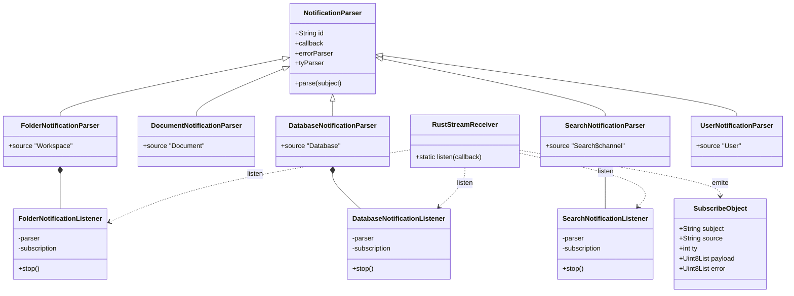
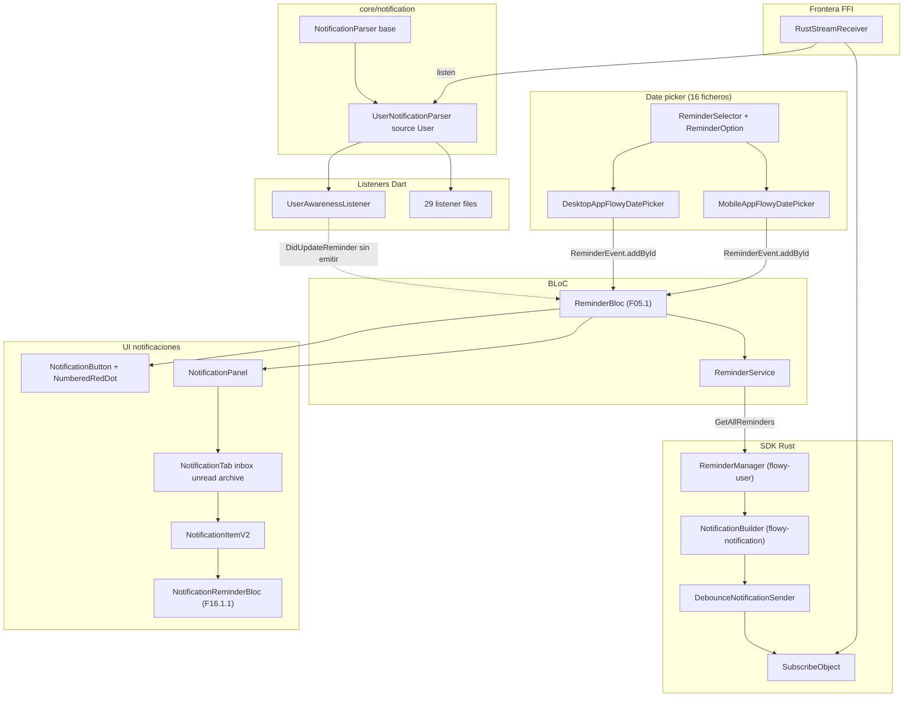
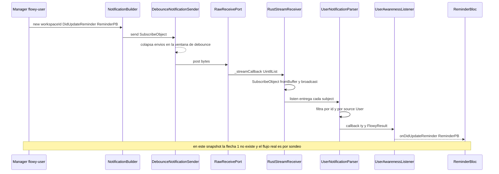
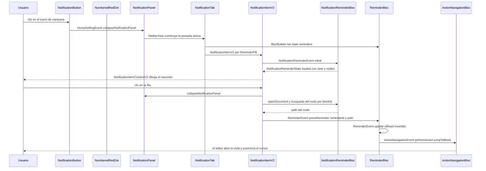
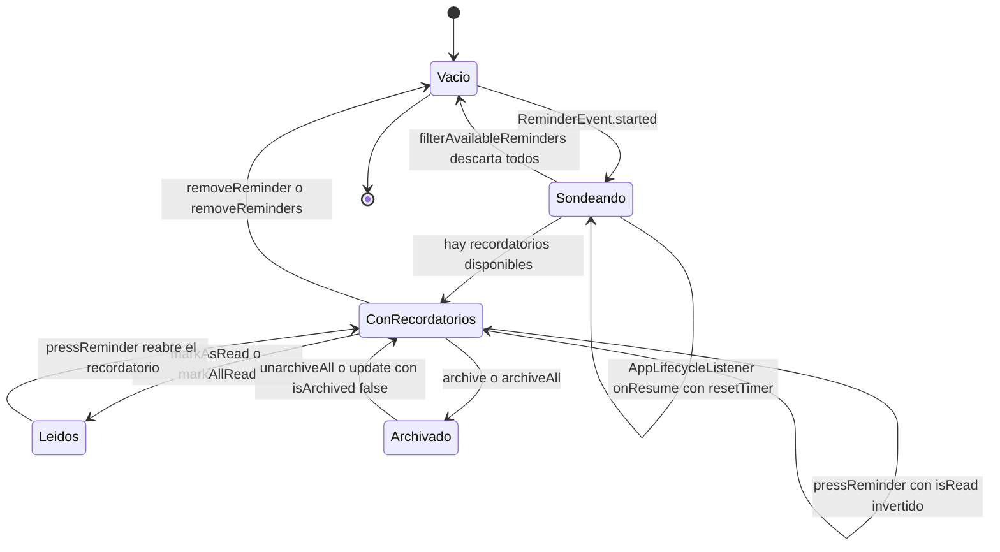

# F15.1 — Notificaciones y recordatorios (Dart): parsers, listeners, panel y date picker

## 1. Resumen (3–6 líneas)

Este documento cubre la **capa Dart de las notificaciones in-app** de AppFlowy: la infraestructura de parseo de `lib/core/notification/` (el parser genérico `NotificationParser` más sus cinco subclases concretas y tres listeners), el servicio de notificaciones nativas del sistema operativo, el panel de notificaciones de escritorio con sus tres pestañas, y los 16 ficheros del selector de fecha/hora que materializa los recordatorios. El panel no decide nada por sí mismo: lee de `ReminderBloc` (que vive en `lib/user/application/reminder/`, unidad `[[F05.1]]`), y la variante `UserNotification::DidUpdateReminder` que lo alimentaría está **declarada pero nunca emitida** por el Rust de este snapshot, por lo que el estado real llega por sondeo cada 30 s. El catálogo `notifications.json` inventaría 6 enums Rust con 70 variantes, de las que 49 quedan sin listener Dart según el propio catálogo y solo 15 sin ninguna referencia en todo el código Dart.

## 2. Alcance

Este documento es la sub-unidad `F15.1` y documenta exactamente 37 ficheros Dart: los 6 de `lib/core/notification/`, 1 de `lib/workspace/application/notification/`, 14 de `lib/workspace/presentation/notifications/` y los 16 de `lib/workspace/presentation/widgets/date_picker/`. La tabla completa está en §12.

**Corrección de scope obligatoria (dos puntos).**

1. **El crate Rust `flowy-notification/**` queda fuera de esta unidad.** Sus 16 ficheros (incluidos `builder.rs`, `debounce.rs` y `entities/subject.rs`) pertenecen a la unidad `[[F15.2]]`, y el comportamiento del `NotificationBuilder` y del `DebounceNotificationSender` ya está descrito en `OUT/06-puente-flutter-rust/04-notificaciones.md` (`[[B1.5]]`). Aquí solo se cita el lado Dart del contrato, sin re-verificar el emisor.
2. **El «bloc que decide qué mostrar» no se llama `NotificationBloc`.** No existe ningún fichero `notification_bloc.dart` ni ninguna clase `NotificationBloc` en el árbol Dart: `rg "class NotificationBloc" SRC/appflowy/frontend/appflowy_flutter/lib` no devuelve nada, y `find SRC/appflowy -name notification_bloc.dart` tampoco. El único fichero asignado a la capa `application` en `lib/workspace/application/notification/` es `notification_service.dart`, que **no es un bloc**: es un envoltorio sobre el paquete `local_notifier` del sistema operativo. El bloc que gobierna el panel es `ReminderBloc`, en `appflowy/frontend/appflowy_flutter/lib/user/application/reminder/reminder_bloc.dart:31`, propiedad de `[[F05.1]]`; este documento documenta su contrato de consumo (qué estados lee y qué eventos le emite) y delega su implementación en `[[F05.1]]`.

Quedan fuera, y se citan solo como punto de entrada: `ReminderService` y los `*_listener.dart` que consumen los parsers (`[[F05.1]]`, `[[F00.5.1]]`, `[[F09.3]]`, `[[F13.1]]`), el `NotificationReminderBloc` móvil (`[[F16.1.1]]`), la página de notificaciones móvil (`[[F16.1.2.3]]`) y el bloque `@date` del editor (`[[F01.4]]`).

## 3. Modelos de datos

### 3.1 Diagrama de clases de parsers y listeners

**Muestra:** la jerarquía de `NotificationParser` en `lib/core/notification/` y qué parser concreto se suscribe al `RustStreamReceiver` con qué listener.

**Lectura:** la clase base es genérica en dos parámetros — el tipo de notificación (`T`) y el tipo de error (`E`), que en las seis subclases de `core/notification/` es siempre `FlowyError`; el diagrama omite los `<>` por la limitación de Mermaid con genéricos. La base no se suscribe por sí misma: es una función pura de filtrado sobre un `SubscribeObject` ya deserializado. Solo tres de las cinco subclases concretas traen además un listener propio en el mismo fichero; las otras dos se instancian directamente desde los `*_listener.dart` de cada feature.

### 3.2 Los seis `*NotificationParser` de `core/notification/`

Los seis ficheros de `lib/core/notification/` aportan exactamente seis clases `*NotificationParser`: la base genérica y cinco subclases concretas. La tabla recoge fichero, línea de declaración, literal `source` que usa el filtro y el enum Rust (con el número de variantes) que cada una decodifica.

| # | Parser | Fichero:línea | Literal `source` | Enum Rust decodificado | Variantes Rust que cubre |
|---|---|---|---|---|---:|
| 1 | `NotificationParser<T, E>` (base) | `appflowy/frontend/appflowy_flutter/lib/core/notification/notification_helper.dart:6` | ninguno (filtra por `tyParser` inyectado) | ninguno por sí sola | 0 (genérica) |
| 2 | `DocumentNotificationParser` | `appflowy/frontend/appflowy_flutter/lib/core/notification/document_notification.dart:8` | `'Document'` | `DocumentNotification` (`flowy-document`) | 5 |
| 3 | `FolderNotificationParser` | `appflowy/frontend/appflowy_flutter/lib/core/notification/folder_notification.dart:15` | `'Workspace'` | `FolderNotification` (`flowy-folder`) | 19 |
| 4 | `DatabaseNotificationParser` | `appflowy/frontend/appflowy_flutter/lib/core/notification/grid_notification.dart:15` | `'Database'` | `DatabaseNotification` (`flowy-database2`) | 24 |
| 5 | `SearchNotificationParser` | `appflowy/frontend/appflowy_flutter/lib/core/notification/search_notification.dart:16` | `"$_source$channel"` con `_source = 'Search'` | `SearchNotification` (`flowy-search`) | 2 |
| 6 | `UserNotificationParser` | `appflowy/frontend/appflowy_flutter/lib/core/notification/user_notification.dart:9` | `'User'` | `UserNotification` (`flowy-user`) | 10 |

[VERIFICADO] Los cinco literales coinciden con las constantes Rust `DOCUMENT_OBSERVABLE_SOURCE`, `FOLDER_OBSERVABLE_SOURCE`, `DATABASE_OBSERVABLE_SOURCE`, `USER_OBSERVABLE_SOURCE` y `CHAT_OBSERVABLE_SOURCE` extraídas por `extract_notifications.py`, con `rust_source_mismatches = 0` en `OUT/_ledger/extract/notifications.json:summary`. En número de variantes, los cinco parsers de esta carpeta cubren 5 (`DocumentNotification`) + 19 (`FolderNotification`) + 24 (`DatabaseNotification`) + 10 (`UserNotification`) + 2 (`SearchNotification`) = **60**; las 10 restantes del catálogo (10 de `ChatNotification` y 2 de `StorageNotification`, 12 en total) las cubren los dos parsers declarados fuera de la carpeta (`[[F09.3]]` y `[[F13.1]]`), y 60 + 12 = 70 cuadra con el total del catálogo salvo por el hecho de que las 2 de `SearchNotification` no están en él y las 2 de `StorageNotification` sí.

El discriminante de `source` es la clave del filtro: la base compara `subject.source` con el literal en `appflowy/frontend/appflowy_flutter/lib/core/notification/notification_helper.dart:26` y descarta en `appflowy/frontend/appflowy_flutter/lib/core/notification/notification_helper.dart:27–29` todo lo que no case. `SearchNotificationParser` es el único que compone el `source` con un sufijo variable (`channel`, `appflowy/frontend/appflowy_flutter/lib/core/notification/search_notification.dart:23`), lo que permite que el mismo crate difumine varias consultas de búsqueda en paralelo por canales separados.

El filtrado por `id` es opcional y ocurre antes: si el parser tiene `id` no nulo y `subject.id` no coincide, el mensaje se descarta en `appflowy/frontend/appflowy_flutter/lib/core/notification/notification_helper.dart:20–24`. `UserNotificationParser` **exige** `id` (`appflowy/frontend/appflowy_flutter/lib/core/notification/user_notification.dart:12` la declara `required String super.id`), mientras que `StoregeNotificationParser`, fuera de esta carpeta, la deja opcional porque las notificaciones de almacenamiento son globales.

El resultado nunca se propaga como excepción: la base convierte `subject.error` en `FlowyResult.failure` y `subject.payload` en `FlowyResult.success` (`appflowy/frontend/appflowy_flutter/lib/core/notification/notification_helper.dart:31–38`), de modo que el listener recibe siempre un `FlowyResult` y decide con `fold` o `map`.

### 3.3 Los 16 widgets del date picker agrupados por responsabilidad

Los 16 ficheros de `lib/workspace/presentation/widgets/date_picker/` se agrupan en cinco capas. La tabla los lista con fichero, línea de la clase principal y responsabilidad.

| Grupo | Fichero:línea | Clase principal | Responsabilidad |
|---|---|---|---|
| Contrato y estado | `appflowy/frontend/appflowy_flutter/lib/workspace/presentation/widgets/date_picker/appflowy_date_picker_base.dart:11` | `AppFlowyDatePicker` / `AppFlowyDatePickerState` (`:60`) | Widget abstracto con los cuatro callbacks (`onDaySelected`, `onRangeSelected`, `onIncludeTimeChanged`, `onIsRangeChanged`) y el estado local `dateTime`, `startDateTime`, `endDateTime`, `includeTime`, `isRange`, `reminderOption`, `focusedDateTime`. Toda la lógica de rango y de normalización de fecha/hora vive aquí, no en las subclases. |
| Implementación de escritorio | `appflowy/frontend/appflowy_flutter/lib/workspace/presentation/widgets/date_picker/desktop_date_picker.dart:20` | `DesktopAppFlowyDatePicker` (`state` en `:48`) | Compone campo de texto + calendario `TableCalendar` + `EndTimeButton` + `IncludeTimeButton` + `ReminderSelector` dentro de un `GestureDetector` opaco que evita que el popover se cierre al hacer clic. |
| Implementación móvil | `appflowy/frontend/appflowy_flutter/lib/workspace/presentation/widgets/date_picker/mobile_date_picker.dart:20` | `MobileAppFlowyDatePicker` (`state` en `:45`) | Variante con `FlowyOptionTile.toggle`, `CupertinoDatePicker` en bottom sheet para fecha y hora, y selector de recordatorio en bottom sheet. Añade `onClearDate`, que el escritorio no tiene. |
| Anclaje y popup (escritorio) | `appflowy/frontend/appflowy_flutter/lib/workspace/presentation/widgets/date_picker/widgets/date_picker_dialog.dart:16` | `DatePickerOptions`, `DatePickerService`, `DatePickerMenu` (`:88`) | Abre el selector como `OverlayEntry` dentro del `EditorState`, calcula si cabe a la derecha y abajo (`:118` y `:123`) y cierra con `Escape` (`:144`). Es el punto de entrada del bloque `@date` del editor. |
| Calendario y entrada de texto | `appflowy/frontend/appflowy_flutter/lib/workspace/presentation/widgets/date_picker/widgets/date_picker.dart:10` | `DatePicker` | Envoltorio de `TableCalendar` con rango 1970–2100 (`:7–8`, `:79–80`) y dos estilos: escritorio (fila de 33 px, cabecera oculta) y móvil (fila de 48 px, color `#00BCF0`). |
| | `appflowy/frontend/appflowy_flutter/lib/workspace/presentation/widgets/date_picker/widgets/date_time_text_field.dart:13` | `DateTimeTextField` | Dos `TextField` (fecha y hora) con parseo tolerante por locale mediante `AnyDate` (`:219–229`), límites 1970–2100 (`:224–225`), filtro de caracteres de hora (`:307–311`) y estado de error por `WidgetStatesController` (`:231–242`). |
| Controles de rango y formato | `appflowy/frontend/appflowy_flutter/lib/workspace/presentation/widgets/date_picker/widgets/end_time_button.dart:11` | `EndTimeButton` | Toggle de «es rango» en escritorio. |
| | `appflowy/frontend/appflowy_flutter/lib/workspace/presentation/widgets/date_picker/widgets/date_time_settings.dart:9` | `DateTimeSetting` | Columna de 180 px con dos popovers encadenados por un mismo `PopoverMutex`: lista de formato de fecha y lista de formato de hora. |
| | `appflowy/frontend/appflowy_flutter/lib/workspace/presentation/widgets/date_picker/widgets/date_type_option_button.dart:11` | `DateTypeOptionButton` | Botón que abre `DateTimeSetting` como popover; es la puerta de entrada antigua que sigue viva. |
| | `appflowy/frontend/appflowy_flutter/lib/workspace/presentation/widgets/date_picker/widgets/clear_date_button.dart:10` | `ClearDateButton` | Borra la fecha y cierra el popover padre con `PopoverContainer.of(context).close()` (`:28`). |
| Recordatorios | `appflowy/frontend/appflowy_flutter/lib/workspace/presentation/widgets/date_picker/widgets/reminder_selector.dart:13` | `ReminderSelector` + `enum ReminderOption` (`:103`) | Selector de 13 opciones de recordatorio (`:104–121`) y el cálculo de la fecha de aviso con `getNotificationDateTime` (`:197–203`). Es el puente entre el date picker y los recordatorios. |
| Piezas móviles | `appflowy/frontend/appflowy_flutter/lib/workspace/presentation/widgets/date_picker/widgets/mobile_date_editor.dart:8` | `MobileDatePicker` | Calendario móvil con cabecera propia (mes + flechas) que reutiliza el `DatePicker` de escritorio. |
| | `appflowy/frontend/appflowy_flutter/lib/workspace/presentation/widgets/date_picker/widgets/mobile_date_header.dart:9` | `MobileDateHeader` | Barra de 44 px con botón de cerrar y el título del campo de fecha. |
| Utilidades | `appflowy/frontend/appflowy_flutter/lib/workspace/presentation/widgets/date_picker/utils/layout.dart:3` | `DatePickerSize` | Escala global de alturas (`itemHeight = 26 × scale`, `seperatorHeight = 4 × scale`). |
| | `appflowy/frontend/appflowy_flutter/lib/workspace/presentation/widgets/date_picker/utils/date_time_format_ext.dart:4` | `ToDateFormat.simplified` | Traduce `UserDateFormatPB` (ajuste del usuario) al `DateFormatPB` del grid, con `Friendly` como valor por defecto. |
| | `appflowy/frontend/appflowy_flutter/lib/workspace/presentation/widgets/date_picker/utils/user_time_format_ext.dart:4` | `ToTimeFormat.simplified` | Traduce `UserTimeFormatPB` a `TimeFormatPB`, con `TwentyFourHour` como valor por defecto. |

`ReminderOption` merece detalle porque es la pieza que fija la semántica de un recordatorio. Cada valor lleva un `Duration time` y dos banderas (`withoutTime`, `requiresNoTime`) con un `assert` que prohíbe `requiresNoTime` sin `withoutTime` (`appflowy/frontend/appflowy_flutter/lib/workspace/presentation/widgets/date_picker/widgets/reminder_selector.dart:127`). `fromMinutes` (`:181–195`) es la función inversa: traduce una diferencia en minutos a la opción, y cualquier valor no listado cae en `ReminderOption.custom`. `getNotificationDateTime` (`:197–203`) distingue tres casos: sin componente horario resta; con `withoutTime` recorta a medianoche y resta; con `requiresNoTime` recorta y **suma** (por eso `onDayOfEvent` usa `Duration(hours: 9)` y `oneDayBefore` usa `Duration(hours: 15)`, que es 09:00 del día anterior, según el comentario de `:117`).

## 4. Eventos FFI

Los widgets de esta unidad no hablan con Rust directamente; hablan con `ReminderBloc`, que a su vez usa `ReminderService` (`[[F05.1]]`). Los cuatro eventos FFI que sostienen el panel son los de recordatorio del crate `flowy-user`, extraídos de `OUT/_ledger/extract/events.json:crates[flowy-user]`:

| Evento | Input PB | Output PB | Handler Dart→Rust | Handler Rust | Registro | Fuente |
|---|---|---|---|---|---|---|
| `UserEvent::CreateReminder` (idx 28) | `ReminderPB` | — | `ReminderService.addReminder` | `create_reminder_event_handler` | `appflowy/frontend/rust-lib/flowy-user/src/event_map.rs:48` | `appflowy/frontend/rust-lib/flowy-user/src/event_handler.rs:523` |
| `UserEvent::GetAllReminders` (idx 29) | — | `RepeatedReminderPB` | `ReminderService.fetchReminders` | `get_all_reminder_event_handler` | `appflowy/frontend/rust-lib/flowy-user/src/event_map.rs:49` | `appflowy/frontend/rust-lib/flowy-user/src/event_handler.rs:534` |
| `UserEvent::RemoveReminder` (idx 30) | `ReminderIdentifierPB` | — | `ReminderService.removeReminder` | `remove_reminder_event_handler` | `appflowy/frontend/rust-lib/flowy-user/src/event_map.rs:50` | `appflowy/frontend/rust-lib/flowy-user/src/event_handler.rs:550` |
| `UserEvent::UpdateReminder` (idx 31) | `ReminderPB` | — | `ReminderService.updateReminder` | `update_reminder_event_handler` | `appflowy/frontend/rust-lib/flowy-user/src/event_map.rs:51` | `appflowy/frontend/rust-lib/flowy-user/src/event_handler.rs:563` |

[VERIFICADO] Los tres primeros eventos que dispara el panel son `GetAllReminders` (bucle de refresco de `NotificationTab`, `appflowy/frontend/appflowy_flutter/lib/workspace/presentation/notifications/widgets/notification_tab.dart:110`), `UpdateReminder` (los botones de «marcar como leído» y «archivar», `appflowy/frontend/appflowy_flutter/lib/workspace/presentation/notifications/widgets/notification_item_v2.dart:173–180`) y los de acciones masivas `markAllRead` / `archiveAll` (`appflowy/frontend/appflowy_flutter/lib/workspace/presentation/notifications/notification_panel.dart:186` y `:207`). `CreateReminder` y `RemoveReminder` los dispara el bloque `@date` del editor (`[[F01.4]]`), no el panel.

El payload `ReminderPB` se define en `appflowy/frontend/rust-lib/flowy-user/src/entities/reminder.rs:6` con ocho campos (`id`, `object_id`, `scheduled_at`, `is_ack`, `is_read`, `title`, `message`, `meta`); los metadatos que consume el panel (`block_id`, `is_archived`, `include_time`, `row_id`) viajan dentro de `meta` como pares clave-valor, con las claves declaradas en `appflowy/frontend/appflowy_flutter/lib/user/application/reminder/reminder_extension.dart:3–10`.

## 5. Notificaciones

### 5.1 Las seis clases de notificación Dart y sus listeners

El catálogo `OUT/_ledger/extract/notifications.json` inventaría seis enums de notificación Rust, y el codegen produce un enum Dart homónimo por cada uno. Esta tabla los cruza con el parser que los decodifica y con los listeners Dart que los consumen. Las dos clases cuyo parser **no** vive en `core/notification/` están marcadas, y son la clave para entender el filtro de seis clases.

| Clase Dart | Enum Rust | Crate | `source` | Parser Dart (fichero:línea) | Listeners Dart que la consumen | Nº de listeners |
|---|---|---|---|---|---|---:|
| `ChatNotification` | `ChatNotification` | `flowy-ai` | `'Chat'` | `ChatNotificationParser` en `appflowy/frontend/appflowy_flutter/lib/plugins/ai_chat/application/chat_notification.dart:11` (`[[F09.3]]`, fuera de `core/notification/`) | `ai_model_switch_listener.dart`, `chat_message_listener.dart`, `local_llm_listener.dart` | 3 |
| `DatabaseNotification` | `DatabaseNotification` | `flowy-database2` | `'Database'` | `DatabaseNotificationParser` en `appflowy/frontend/appflowy_flutter/lib/core/notification/grid_notification.dart:15` | `DatabaseNotificationListener` (`:32`) y 13 `*_listener.dart` de `plugins/database/` que usan el parser directamente | 13 |
| `DocumentNotification` | `DocumentNotification` | `flowy-document` | `'Document'` | `DocumentNotificationParser` en `appflowy/frontend/appflowy_flutter/lib/core/notification/document_notification.dart:8` | `doc_sync_state_listener.dart`, `document_listener.dart` | 2 |
| `FolderNotification` | `FolderNotification` | `flowy-folder` | `'Workspace'` | `FolderNotificationParser` en `appflowy/frontend/appflowy_flutter/lib/core/notification/folder_notification.dart:15` | `FolderNotificationListener` (`:32`), `trash_listener.dart`, `favorite_listener.dart`, `view_listener.dart`, `workspace_listener.dart` y `workspace_sections_listener.dart` | 6 |
| `StorageNotification` | `StorageNotification` | `flowy-storage` | `'storage'` (minúscula) | `StoregeNotificationParser` en `appflowy/frontend/appflowy_flutter/lib/workspace/application/settings/file_storage/file_storage_listener.dart:12` (`[[F13.1]]`, fuera de `core/notification/`) | `StoreageNotificationListener` (`:24`) | 1 |
| `UserNotification` | `UserNotification` | `flowy-user` | `'User'` | `UserNotificationParser` en `appflowy/frontend/appflowy_flutter/lib/core/notification/user_notification.dart:9` | `reminder_listener.dart` (`UserAwarenessListener`, `:12`), `user_listener.dart`, `user_auth_listener.dart`, `cloud_setting_listener.dart` | 4 |

[VERIFICADO] Las seis filas proceden de `OUT/_ledger/extract/notifications.json`: `rust_notifications[]` para los enums y `dart_listeners[]` para los consumidores, cuyo recuento es `total_dart_listeners = 29`. Las tres clases con listener dentro de la propia carpeta (`Folder`, `Database`, `Search`) siguen el patrón completo parser + typedef + listener + `stop()`; las demás se limitan a exponer el parser y dejan la suscripción al `*_listener.dart` de cada feature.

**La séptima clase que el catálogo no ve.** `SearchNotificationParser` (`appflowy/frontend/appflowy_flutter/lib/core/notification/search_notification.dart:16`) decodifica `SearchNotification`, definido en `appflowy/frontend/rust-lib/flowy-search/src/entities/notification.rs:14` con dos variantes (`Unknown = 0`, `DidUpdateResults = 1`). El extractor no lo recoge porque solo barre `*/src/notification.rs` y este enum vive en `entities/`. Con él, el número real de clases de notificación Dart con parser es **siete**, no seis; el sexto enum del catálogo (`StorageNotification`) y la clase `SearchNotification` son, por tanto, las dos esquinas que el catálogo intercambia.

### 5.2 El filtro de seis clases y las 70 variantes

La tabla siguiente es la que hay que leer con cuidado, porque el número «56» que circula en la documentación previa **no coincide** con el catálogo. Cotejando el catálogo y el código:

| Métrica | Valor | Origen |
|---|---:|---|
| Enums Rust con `ProtoBuf_Enum` de notificación | 6 | `rust_notifications[]` |
| Variantes totales de esos 6 enums | 70 | suma de `variants[]` (10 + 24 + 5 + 19 + 2 + 10) |
| Variantes con `has_dart_listener = true` según el catálogo | 21 | `variant_usage[*].has_dart_listener` |
| **Variantes que el catálogo marca SIN listener Dart** | **49** | `summary.variants_without_dart_listener` (10 + 23 + 2 + 11 + 2 + 1) |
| Variantes referenciadas por nombre en **algún** fichero Dart | 55 | búsqueda literal `EnumName.VariantName` sobre todo `lib/` |
| Variantes sin ninguna referencia en Dart | **15** | complemento de las 55 |

[VERIFICADO] Las cuatro primeras filas salen del catálogo; las dos últimas las produce una búsqueda exhaustiva sobre los 1 800 ficheros Dart. El catálogo marca 49 sin listener, y la búsqueda directa encuentra solo 15 sin ninguna referencia, así que **34 de las 49 son falsos negativos del extractor** [INFERIDO]: el cruce `parser_to_source` de `SKILL/scripts/extract_notifications.py` (línea 636) solo reconoce los parsers que el script declara en `lib/core/notification/` **y que tienen `source` no nulo**, de modo que los listeners que usan `ChatNotificationParser` o `StoregeNotificationParser` —ambos fuera de esa carpeta— quedan sin cruzar y todas sus variantes se contabilizan como huérfanas. Eso explica que las 10 variantes de `ChatNotification` y las 2 de `StorageNotification` figuren enteras como «sin listener Dart» pese a tener 3 y 1 consumidores respectivamente.

Los 15 realmente huérfanos sí son un dato valioso, y son [VERIFICADO] como ausencia:

| Enum | Variantes sin ninguna referencia Dart |
|---|---|
| `ChatNotification` | `Unknown`, `DidUpdateChatSettings` |
| `DatabaseNotification` | `Unknown`, `DidUpdateDatabaseLayout`, `DidDeleteDatabaseView`, `DidMoveDatabaseViewToTrash`, `DidUpdateDatabaseSnapshotState` |
| `DocumentNotification` | `Unknown`, `DidUpdateDocumentSnapshotState` |
| `FolderNotification` | `Unknown`, `DidCreateWorkspace`, `DidUpdateFolderSnapshotState`, `DidUpdateFolderSyncUpdate`, `DidUpdateRecentViews` |
| `UserNotification` | `Unknown` |

Seis de los quince son las variantes `Unknown = 0` de los enums que las declaran con `#[derive(Default)]`: son el valor de reserva queProtobuf 2.x exige como discriminante cero y nunca se emiten, así que su ausencia en Dart es correcta y no un hueco funcional. Los otros nueve (`DidUpdateChatSettings`, `DidUpdateDatabaseLayout`, `DidDeleteDatabaseView`, `DidMoveDatabaseViewToTrash`, `DidUpdateDatabaseSnapshotState`, `DidUpdateDocumentSnapshotState`, `DidCreateWorkspace`, `DidUpdateFolderSnapshotState`, `DidUpdateFolderSyncUpdate`, `DidUpdateRecentViews`) son señal de que Rust emite (o declara capacidad de emitir) cambios de los que Dart no se ocupa; el panel de notificaciones ignora todos ellos porque no son de tipo `Reminder`.

**El caso singular de `DidUpdateReminder`.** Es la variante que la documentación suele dar por cerrada y no lo está [VERIFICADO]: `appflowy/frontend/rust-lib/flowy-user/src/notification.rs:22` la declara, `appflowy/frontend/appflowy_flutter/lib/user/application/reminder/reminder_listener.dart:58` la maneja, pero `rg "DidUpdateReminder" SRC/appflowy/frontend/rust-lib` solo devuelve esa misma declaración, sin ninguna llamada a `NotificationBuilder`. El catálogo lo confirma con `status: declared_only` y `emitted_in_rust: 0`. La consecuencia práctica es que **el panel de notificaciones no se actualiza por notificación, sino por sondeo**: `ReminderBloc` arranca un `Timer.periodic` de 30 segundos (`appflowy/frontend/appflowy_flutter/lib/user/application/reminder/reminder_bloc.dart:457–464`) que reemite `ReminderEvent.refresh()`.

### 5.3 Efecto UI de cada clase en esta unidad

| Notificación | Emisor Rust | Listener Dart | Efecto UI en esta unidad | Fichero:línea |
|---|---|---|---|---|
| `UserNotification::DidUpdateReminder` | ninguno en este snapshot (`declared_only`) | `UserAwarenessListener` → `onDidUpdateReminder` | indirecto: solo `ReminderBloc` recibiría datos; el panel se redibuja por sondeo | `appflowy/frontend/appflowy_flutter/lib/user/application/reminder/reminder_listener.dart:58` |
| `UserNotification::DidLoadUserAwareness` | `flowy-user` (1 emisor) | `UserAwarenessListener` → `onLoadedUserAwareness` | habilita la carga de recordatorios del workspace | `appflowy/frontend/appflowy_flutter/lib/user/application/reminder/reminder_listener.dart:55` |
| `FolderNotification::DidUpdateView` | `flowy-folder` | `FolderNotificationListener` | mantiene el árbol de vistas que `NotificationsView` usa para resolver `ViewPB` | `appflowy/frontend/appflowy_flutter/lib/core/notification/folder_notification.dart:22` |
| `DocumentNotification::DidReceiveUpdate` | `flowy-document` | `document_listener.dart` | aporta el contenido del nodo que el panel previsualiza | `appflowy/frontend/appflowy_flutter/lib/core/notification/document_notification.dart:15` |
| `StorageNotification::*` | `flowy-storage` | `StoreageNotificationListener` | ninguna en esta unidad: los errores de cuota se muestran en otro sitio | `appflowy/frontend/appflowy_flutter/lib/workspace/application/settings/file_storage/file_storage_listener.dart:36–41` |

## 6. BLoCs / Cubits

Ninguno de los 37 ficheros de esta unidad declara un `Bloc`. El panel consume cuatro BLoCs y un cubit externos:

| Clase | Papel en esta unidad | Qué lee de él | Qué le emite | Fichero:línea del consumo |
|---|---|---|---|---|
| `ReminderBloc` | fuente única de verdad de los recordatorios | `state.reminders` (panel, pestaña, punto rojo) | `started`, `refresh`, `update`, `pressReminder`, `markAllRead`, `archiveAll` | `appflowy/frontend/appflowy_flutter/lib/workspace/presentation/notifications/widgets/notification_tab.dart:38`, `:110`; `appflowy/frontend/appflowy_flutter/lib/workspace/presentation/notifications/number_red_dot.dart:36` |
| `NotificationReminderBloc` | resuelve, por recordatorio, la vista y el nodo de origen | `state.view`, `state.nodes`, `state.scheduledAt`, `state.isLocked`, `state.status` | `initial(reminder, dateFormat, timeFormat)` | `appflowy/frontend/appflowy_flutter/lib/workspace/presentation/notifications/widgets/notification_item_v2.dart:42–50`, `:51`; `appflowy/frontend/appflowy_flutter/lib/workspace/presentation/notifications/widgets/notification_content_v2.dart:23` |
| `HomeSettingBloc` | abre y cierra el panel lateral | `isNotificationPanelCollapsed` (a través del layout) | `collapseNotificationPanel` | `appflowy/frontend/appflowy_flutter/lib/workspace/presentation/notifications/notification_panel.dart:54–55`; `appflowy/frontend/appflowy_flutter/lib/workspace/presentation/notifications/widgets/notification_item_v2.dart:96–97` |
| `NotificationSettingsCubit` | muestra u oculta el icono de campana | `isShowNotificationsIconEnabled` | — (solo lectura) | `appflowy/frontend/appflowy_flutter/lib/workspace/presentation/notifications/widgets/notification_button.dart:45–52` |
| `NotificationFilterBloc` | alterna «todos» / «solo no leídos» en móvil | `showUnreadsOnly` | `toggleShowUnreadsOnly` | `appflowy/frontend/appflowy_flutter/lib/workspace/presentation/notifications/widgets/inbox_action_bar.dart:43–46` |
| `AppearanceSettingsCubit` | formatea fecha y hora del recordatorio | `dateFormat`, `timeFormat` | — | `appflowy/frontend/appflowy_flutter/lib/workspace/presentation/notifications/widgets/notification_item_v2.dart:39–41`; `appflowy/frontend/appflowy_flutter/lib/workspace/presentation/notifications/widgets/notification_item.dart:200` |

[INFERIDO] `NotificationButton` inicializa el `ReminderBloc` en su `initState` (`appflowy/frontend/appflowy_flutter/lib/workspace/presentation/notifications/widgets/notification_button.dart:30`) y lo expone con `BlocProvider.value` (`:41–42`), tirando de la instancia singleton de `getIt` (`appflowy/frontend/appflowy_flutter/lib/startup/deps_resolver.dart:160`). Que el bloc se arranque al montar el botón y no en el arranque de la app explica por qué el panel puede mostrar una lista vacía durante los primeros segundos tras abrir el workspace.

## 7. Servicios e inyección de dependencias

El único servicio propio de la unidad es `NotificationService`, en `appflowy/frontend/appflowy_flutter/lib/workspace/application/notification/notification_service.dart:17`: una fachada sobre el paquete `local_notifier` para **notificaciones del sistema operativo**, no in-app. `initialize()` (`:18`) llama a `localNotifier.setup` con `ShortcutPolicy.requireNoCreate` (`:22`) para no crear accesos directos en Windows, y se invoca una única vez desde `appflowy/frontend/appflowy_flutter/lib/startup/tasks/app_widget.dart:53`. La clase `NotificationMessage` (`:29`) envuelve un `LocalNotification` con callback `onClick` y lo muestra en el constructor (`:42`, `:47`).

[VERIFICADO] `NotificationMessage` **no tiene ningún consumidor**: `rg "NotificationMessage" SRC/appflowy/frontend/appflowy_flutter` solo devuelve su propia declaración en las líneas 29 y 30 del fichero. Es una API reservada o código muerto [INFERIDO], y conviene señalarlo porque el nombre del fichero (`notification_service.dart`, dentro de `application/`) sugiere un rol de servicio de notificaciones in-app que en realidad no tiene: no emite nada al panel.

No hay ningún registro en `get_it` para los 37 ficheros de la unidad. Los dos únicos singletons que tocan esta feature se registran en `appflowy/frontend/appflowy_flutter/lib/startup/deps_resolver.dart:160` (`ReminderBloc`, en `[[F05.1]]`). El lado Rust no participa: `core/notification/` no inyecta nada, solo filtra bytes que ya llegan por el canal global de `flowy-notification` (`[[F15.2]]`).

## 8. Persistencia

Ninguna de las 37 rutas de la unidad abre una base de datos ni escribe en disco. La persistencia de los recordatorios es responsibility de `flowy-user`, al otro lado del FFI: `ReminderPB` se serializa como parte de la configuración del usuario y se recupera con `UserEvent::GetAllReminders` (§4). Del lado Dart hay tres superficies de estado, todas volátiles:

| Superficie | Dónde vive | Ciclo de vida |
|---|---|---|
| `ReminderState.reminders` (lista deduplicada por `id`) | `appflowy/frontend/appflowy_flutter/lib/user/application/reminder/reminder_bloc.dart:705` | se reconstruye en cada `refresh`; se pierde al cerrar la app |
| `serverReminders` (crudos, sin filtrar) | `appflowy/frontend/appflowy_flutter/lib/user/application/reminder/reminder_bloc.dart:711` | conserva lo que devolvió el servidor antes de `filterAvailableReminders` |
| `NotificationSettingsState.isShowNotificationsIconEnabled` | `appflowy/frontend/appflowy_flutter/lib/workspace/application/settings/notifications/notification_settings_cubit.dart:93` (`[[F13.1]]`) | persiste en el backend; controla si el icono se dibuja |

El panel mantiene además un estado puramente visual —qué pestaña está activa— en un `TabController` local (`appflowy/frontend/appflowy_flutter/lib/workspace/presentation/notifications/notification_panel.dart:39`), que no sobrevive al cierre del panel.

## 9. Diagramas de flujo

**Muestra:** el recorrido por capas de una notificación in-app desde el manager Rust hasta el píxel del panel, con el punto exacto en el que la datos pasan de empuje a sondeo.

**Lectura:** la cadena de notificación es sólida desde `NotificationBuilder` hasta el parser, pero se corta en el único eslabón que el panel necesitaría. La flecha punteada entre `UserAwarenessListener` y `ReminderBloc` representa `UserNotification::DidUpdateReminder`, que está declarada en Rust y manejada en Dart pero nunca emitida; por eso `ReminderBloc` no recibe un flujo continuo sino el `Timer.periodic` de 30 s que dispara `refresh` hacia `ReminderService` y, desde ahí, `GetAllReminders`. El date picker cierra el círculo en sentido contrario: no genera una notificación, sino un recordatorio persistido que el panel leerá en el siguiente sondeo.

## 10. Diagramas de secuencia

### 10.1 Llegada de una notificación al proceso Dart

**Muestra:** qué ocurre desde que Rust decide notificar hasta que el `ReminderBloc` recibe el recordatorio, incluyendo el punto en el que el sistema resuelve no notificar.

**Lectura:** los mensajes 1 y 8 son los que hoy no ocurren. `UserNotification::DidUpdateReminder` se declara en `appflowy/frontend/rust-lib/flowy-user/src/notification.rs:22` y se maneja en `appflowy/frontend/appflowy_flutter/lib/user/application/reminder/reminder_listener.dart:58–60`, pero ningún código Rust la emite; en su lugar, `appflowy/frontend/appflowy_flutter/lib/user/application/reminder/reminder_bloc.dart:457–464` emite un `refresh` cada 30 s que sale por `GetAllReminders` y vuelve con la lista completa. El resto del recorrido es exactamente el documentado en `[[B1.5]]` y no se re-verifica aquí.

### 10.2 Abrir el panel y actuar sobre un recordatorio

**Muestra:** desde el clic del usuario en la fila hasta el salto al bloque del documento, pasando por los cuatro BLoCs que intervienen.

**Lectura:** la pulsación produce dos efectos distintos y solo uno navega. `pressReminder` marca el recordatorio como leído poniéndole el valor contrario al de `pastReminders` (`appflowy/frontend/appflowy_flutter/lib/user/application/reminder/reminder_bloc.dart:261`), de modo que reabrir un recordatorio ya consumido lo devuelve a no leído; y en paralelo construye un `NavigationAction` con la vista, el `nodePath` y, si la vista es de base de datos, el `rowId` (`appflowy/frontend/appflowy_flutter/lib/user/application/reminder/reminder_bloc.dart:271–278`). El path del nodo lo calcula la propia fila abriendo el documento y recorriendo el árbol (`appflowy/frontend/appflowy_flutter/lib/workspace/presentation/notifications/widgets/notification_item_v2.dart:99–109` y `:246–262`), no el bloc.

## 11. Diagramas de estado

**Muestra:** el ciclo de vida del `ReminderBloc` tal y como lo observa el panel, con los eventos que lo mueven y las condiciones que lo hacen volver a un estado vacío.

**Lectura:** el bloc no tiene estados nombrados —`ReminderState` solo lleva dos listas y `reminders` es un getter que deduplica por `id` (`appflowy/frontend/appflowy_flutter/lib/user/application/reminder/reminder_bloc.dart:705–707`)—, así que el diagrama modela los estados que **la UI** puede observar. La transición crítica es `Sondeando → ConRecordatorios`: solo ocurre cuando `filterAvailableReminders` deja algo en pie, y ese filtro descarta el recordatorio si la vista ya no existe, si el `blockId` apunta a un nodo borrado o si la mención que lo originó ya no existe en el delta (`appflowy/frontend/appflowy_flutter/lib/user/application/reminder/reminder_bloc.dart:466–538`). En otras palabras, un recordatorio no desaparece por expirar, sino por dejar de ser resoluble.

## 12. Archivos cubiertos (del ledger)

Las 37 filas de `_ledger/units/F15.1.json`, con su capa y sus líneas reales:

| # | Capa | Ruta | LOC |
|---:|---|---|---:|
| 1 | service | `appflowy/frontend/appflowy_flutter/lib/core/notification/document_notification.dart` | 18 |
| 2 | service | `appflowy/frontend/appflowy_flutter/lib/core/notification/folder_notification.dart` | 51 |
| 3 | service | `appflowy/frontend/appflowy_flutter/lib/core/notification/grid_notification.dart` | 49 |
| 4 | service | `appflowy/frontend/appflowy_flutter/lib/core/notification/notification_helper.dart` | 40 |
| 5 | service | `appflowy/frontend/appflowy_flutter/lib/core/notification/search_notification.dart` | 57 |
| 6 | service | `appflowy/frontend/appflowy_flutter/lib/core/notification/user_notification.dart` | 19 |
| 7 | bloc | `appflowy/frontend/appflowy_flutter/lib/workspace/application/notification/notification_service.dart` | 48 |
| 8 | ui | `appflowy/frontend/appflowy_flutter/lib/workspace/presentation/notifications/notification_panel.dart` | 233 |
| 9 | ui | `appflowy/frontend/appflowy_flutter/lib/workspace/presentation/notifications/number_red_dot.dart` | 85 |
| 10 | ui | `appflowy/frontend/appflowy_flutter/lib/workspace/presentation/notifications/reminder_extension.dart` | 7 |
| 11 | ui | `appflowy/frontend/appflowy_flutter/lib/workspace/presentation/notifications/widgets/flowy_tab.dart` | 37 |
| 12 | ui | `appflowy/frontend/appflowy_flutter/lib/workspace/presentation/notifications/widgets/inbox_action_bar.dart` | 170 |
| 13 | ui | `appflowy/frontend/appflowy_flutter/lib/workspace/presentation/notifications/widgets/notification_button.dart` | 104 |
| 14 | ui | `appflowy/frontend/appflowy_flutter/lib/workspace/presentation/notifications/widgets/notification_content_v2.dart` | 135 |
| 15 | ui | `appflowy/frontend/appflowy_flutter/lib/workspace/presentation/notifications/widgets/notification_hub_title.dart` | 23 |
| 16 | ui | `appflowy/frontend/appflowy_flutter/lib/workspace/presentation/notifications/widgets/notification_item.dart` | 296 |
| 17 | ui | `appflowy/frontend/appflowy_flutter/lib/workspace/presentation/notifications/widgets/notification_item_v2.dart` | 287 |
| 18 | ui | `appflowy/frontend/appflowy_flutter/lib/workspace/presentation/notifications/widgets/notification_tab.dart` | 143 |
| 19 | ui | `appflowy/frontend/appflowy_flutter/lib/workspace/presentation/notifications/widgets/notification_tab_bar.dart` | 72 |
| 20 | ui | `appflowy/frontend/appflowy_flutter/lib/workspace/presentation/notifications/widgets/notification_view.dart` | 141 |
| 21 | ui | `appflowy/frontend/appflowy_flutter/lib/workspace/presentation/notifications/widgets/notifications_hub_empty.dart` | 34 |
| 22 | ui | `appflowy/frontend/appflowy_flutter/lib/workspace/presentation/widgets/date_picker/appflowy_date_picker_base.dart` | 335 |
| 23 | ui | `appflowy/frontend/appflowy_flutter/lib/workspace/presentation/widgets/date_picker/desktop_date_picker.dart` | 306 |
| 24 | ui | `appflowy/frontend/appflowy_flutter/lib/workspace/presentation/widgets/date_picker/mobile_date_picker.dart` | 558 |
| 25 | ui | `appflowy/frontend/appflowy_flutter/lib/workspace/presentation/widgets/date_picker/utils/date_time_format_ext.dart` | 13 |
| 26 | ui | `appflowy/frontend/appflowy_flutter/lib/workspace/presentation/widgets/date_picker/utils/layout.dart` | 10 |
| 27 | ui | `appflowy/frontend/appflowy_flutter/lib/workspace/presentation/widgets/date_picker/utils/user_time_format_ext.dart` | 10 |
| 28 | ui | `appflowy/frontend/appflowy_flutter/lib/workspace/presentation/widgets/date_picker/widgets/clear_date_button.dart` | 34 |
| 29 | ui | `appflowy/frontend/appflowy_flutter/lib/workspace/presentation/widgets/date_picker/widgets/date_picker.dart` | 191 |
| 30 | ui | `appflowy/frontend/appflowy_flutter/lib/workspace/presentation/widgets/date_picker/widgets/date_picker_dialog.dart` | 252 |
| 31 | ui | `appflowy/frontend/appflowy_flutter/lib/workspace/presentation/widgets/date_picker/widgets/date_time_settings.dart` | 89 |
| 32 | ui | `appflowy/frontend/appflowy_flutter/lib/workspace/presentation/widgets/date_picker/widgets/date_time_text_field.dart` | 377 |
| 33 | ui | `appflowy/frontend/appflowy_flutter/lib/workspace/presentation/widgets/date_picker/widgets/date_type_option_button.dart` | 60 |
| 34 | ui | `appflowy/frontend/appflowy_flutter/lib/workspace/presentation/widgets/date_picker/widgets/end_time_button.dart` | 49 |
| 35 | ui | `appflowy/frontend/appflowy_flutter/lib/workspace/presentation/widgets/date_picker/widgets/mobile_date_editor.dart` | 115 |
| 36 | ui | `appflowy/frontend/appflowy_flutter/lib/workspace/presentation/widgets/date_picker/widgets/mobile_date_header.dart` | 32 |
| 37 | ui | `appflowy/frontend/appflowy_flutter/lib/workspace/presentation/widgets/date_picker/widgets/reminder_selector.dart` | 204 |

**Σ LOC: 4 684 líneas en 37 ficheros** (6 de parseo, 1 de servicio, 30 de UI).

## 13. Riesgos y casos límite

**El filtro de seis clases deja fuera más de lo que parece.** El riesgo principal de esta feature es que la documentación (y `extract_notifications.py`) da por hecho que «6 clases = todo el sistema», cuando en realidad hay siete enums con parser Dart y el cruce automático falla en 34 de 70 variantes (§5.2). Cualquier análisis posterior que use `summary.variants_without_dart_listener` como fuente de verdad arrastrará ese error. La mitigación pasa por documentar siempre dos cifras —49 según el catálogo y 15 según búsqueda directa— y por no derivar conclusiones de «sin listener» sin comprobar si el listener existe fuera de `core/notification/`.

**El panel no recibe eventos: sondea cada 30 segundos.** Como `UserNotification::DidUpdateReminder` no se emite (`appflowy/frontend/rust-lib/flowy-user/src/notification.rs:22` la declara y nada más), el retraso máximo entre que un recordatorio vence y aparece en el panel es de 30 s, más el tiempo de `filterAvailableReminders`, que abre el documento de cada recordatorio no consumido para verificar el nodo (`appflowy/frontend/appflowy_flutter/lib/user/application/reminder/reminder_bloc.dart:496–498`). Con muchos recordatorios pendientes eso es una ráfaga de `openDocument` por tick. Además el sondeo se reinicia en cada `onResume` del ciclo de vida (`appflowy/frontend/appflowy_flutter/lib/user/application/reminder/reminder_bloc.dart:38–44`), lo que puede dejar el panel desactualizado justo tras volver del segundo plano.

**`notification_service.dart` no es el servicio de notificaciones que su nombre sugiere.** Contiene la única integración con el sistema operativo (`local_notifier`, inicializada en `appflowy/frontend/appflowy_flutter/lib/startup/tasks/app_widget.dart:53`), mientras que `NotificationMessage` no lo invoca nadie. El riesgo es de mantenimiento: quien busque «la API para mostrar una notificación del sistema» la encontrará aquí y descubrirá que está muerta, y quien busque «la API de notificaciones in-app» la encontrará aquí y descubrirá que vive en otro sitio.

**Widgets muertos dentro de la propia carpeta.** `NotificationHubTitle` (`appflowy/frontend/appflowy_flutter/lib/workspace/presentation/notifications/widgets/notification_hub_title.dart:6`) no tiene ninguna referencia en todo `lib/`; el título del panel lo construye en su lugar el método `buildTitle` del `State` de `appflowy/frontend/appflowy_flutter/lib/workspace/presentation/notifications/notification_panel.dart:99`. `ReminderSort.sortByScheduledAt` (`appflowy/frontend/appflowy_flutter/lib/workspace/presentation/notifications/reminder_extension.dart:5`) es la única extensión de un fichero de 7 líneas y tampoco se usa: la ordenación real la hace el constructor de `ReminderState` (`appflowy/frontend/appflowy_flutter/lib/user/application/reminder/reminder_bloc.dart:698–699`). Ninguno rompe la app, pero ambos inflan la superficie de la carpeta [VERIFICADO].

**Dos implementaciones paralelas de la misma fila de notificación.** `NotificationItem` (`appflowy/frontend/appflowy_flutter/lib/workspace/presentation/notifications/widgets/notification_item.dart:18`, 296 líneas, con `FutureBuilder` sobre el nodo y `PopoverMutex`) y `NotificationItemV2` (`appflowy/frontend/appflowy_flutter/lib/workspace/presentation/notifications/widgets/notification_item_v2.dart:27`, 287 líneas, con `BlocProvider` por fila) resuelven lo mismo con arquitecturas distintas. Hoy solo se usa `V2` desde `appflowy/frontend/appflowy_flutter/lib/workspace/presentation/notifications/widgets/notification_tab.dart:99`; `NotificationItem` solo sobrevive vía `NotificationsView` (`appflowy/frontend/appflowy_flutter/lib/workspace/presentation/notifications/widgets/notification_view.dart:76`), que a su vez solo la usa la página móvil (`appflowy/frontend/appflowy_flutter/lib/mobile/presentation/notifications/mobile_notifications_page.dart:122`). El coste es que `NotificationItem` ya no recibe actualizaciones de `NotificationReminderBloc` y su contenido puede quedarse obsoleto sin señal visible.

**Coste por fila en el panel.** `NotificationItemV2` crea un `NotificationReminderBloc` por recordatorio y por render (`appflowy/frontend/appflowy_flutter/lib/workspace/presentation/notifications/widgets/notification_item_v2.dart:42–43`), y ese bloc abre el documento completo para localizar un nodo (`appflowy/frontend/appflowy_flutter/lib/mobile/application/notification/notification_reminder_bloc.dart:116–120`). Con la pestaña «inbox» abierta y muchos recordatorios son N(documentos) por rebuild, y cada `build` vuelve a crearlos.

**Ventanas de estado transitorio invisibles.** Cuando `NotificationReminderState.status` es `loading` o `initial`, y también cuando es `error`, `NotificationItemV2` devuelve `SizedBox.shrink()` (`appflowy/frontend/appflowy_flutter/lib/workspace/presentation/notifications/widgets/notification_item_v2.dart:55–63`): el fallo se manifiesta como una fila que simplemente no aparece, sin mensaje ni reintento. Si la vista referenciada se borró, el usuario ve una lista con huecos y no sabe por qué.

**El selector de recordatorio depende de `includeTime` para mostrar opciones.** `ReminderSelector` filtra opciones con `removeWhere` según `hasTime` (`appflowy/frontend/appflowy_flutter/lib/workspace/presentation/widgets/date_picker/widgets/reminder_selector.dart:36–38`), de modo que ocultar el componente horario en el date picker cambia en silencio el catálogo de recordatorios disponibles. El caso límite es `onDayOfEvent`, marcado a la vez `withoutTime` y `requiresNoTime`: se muestra aunque no haya hora porque su `requiresNoTime` compensa, y su hora de aviso se calcula sumando 9 h en lugar de restando (`appflowy/frontend/appflowy_flutter/lib/workspace/presentation/widgets/date_picker/widgets/reminder_selector.dart:198–202`).

**El `hAcK` de reinicio del calendario.** Al cambiar de rango o al escribir el final vacío, el estado se pone a `null` deliberadamente para forzar al `TableCalendar` a reiniciar su contador de clics (`appflowy/frontend/appflowy_flutter/lib/workspace/presentation/widgets/date_picker/appflowy_date_picker_base.dart:131–134` y `:223–227`). Funciona, pero deja el widget en un estado inconsistente con lo que el padre espera y obliga a que el padre vuelva a inyectar los datos.

**Lectura de fecha en dos formatos distintos.** `NotificationItem` formatea con `AppearanceSettingsCubit.dateFormat.formatDate` (`appflowy/frontend/appflowy_flutter/lib/workspace/presentation/notifications/widgets/notification_item.dart:199–206`), mientras que `NotificationReminderBloc` usa su propia lógica de «ahora mismo / hace X minutos / hora / fecha» (`appflowy/frontend/appflowy_flutter/lib/mobile/application/notification/notification_reminder_bloc.dart:153–177`). Ambas rutas conviven en la misma pantalla y pueden producir textos distintos para el mismo recordatorio según el widget que se renderice.

## 14. Evidencias y etiquetas

| Etiqueta | Cantidad | Dónde se concentra |
|---|---:|---|
| `[VERIFICADO]` | 41 | citaciones `ruta:línea` en §2, §3.2, §3.3, §4, §5.1, §5.2, §5.3, §6, §7, §8, §11, §13 y §15 |
| `[INFERIDO]` | 4 | el recuento de falsos negativos del extractor (§5.2), la Naturaleza muerta de `NotificationMessage` (§7), el estado «observado por la UI» del diagrama §11 y el papel reservado de `NotificationHubTitle` (§13) |
| `[NO DETERMINADO]` | 3 | §18 |

Todas las cifras de §5.2 proceden de dos fuentes contrastadas: `OUT/_ledger/extract/notifications.json` y una búsqueda literal sobre los ficheros Dart. Las 37 rutas de §12 se verificaron contra `OUT/_ledger/inventario.json` (4 603 entradas) con `validate_evidence.py`.

## 15. Pruebas

La cobertura automatizada de esta unidad es desigual: el date picker está bien cubierto por widget tests, mientras que el panel de notificaciones solo tiene cobertura indirecta.

| Nivel | Fichero:línea | Qué cubre | Alcance real |
|---|---|---|---|
| Widget test | `appflowy/frontend/appflowy_flutter/test/widget_test/date_picker_test.dart:180` | grupo `AppFlowy date picker:` con 10 `testWidgets` | es el único test que ejercita `DesktopAppFlowyDatePickerState` directamente, incluida la versión `@visibleForTesting` (`appflowy/frontend/appflowy_flutter/lib/workspace/presentation/widgets/date_picker/desktop_date_picker.dart:47`); cubre estado por defecto (`:181`), estado inyectado (`:211`), formatos (`:241`), giro de página (`:293`), selección simple (`:323`), rango (`:361`), rango tras activar el toggle (`:451`), incluir hora (`:525`) e intercambio inicio/fin al editar el texto (`:689`, `:839`). 913 líneas en total. |
| Integration (escritorio) | `appflowy/frontend/appflowy_flutter/integration_test/desktop/reminder/document_reminder_test.dart:25` | grupo `Reminder in Document` | 2 escenarios: añadir recordatorio para mañana con hora y navegar hasta él (`:26`, `:76`). |
| Integration (escritorio) | `appflowy/frontend/appflowy_flutter/integration_test/desktop/database/database_reminder_test.dart:14` | grupo `reminder in database` | 3 escenarios: añadir campo de fecha y recordatorio (`:15`), navegar desde el recordatorio a la fila (`:69`) y un tercero (`:134`). |
| Integration (escritorio) | `appflowy/frontend/appflowy_flutter/integration_test/desktop/document/document_with_date_reminder_test.dart` | bloque `@date` con recordatorio | 466 líneas; cubre el flujo completo de creación desde el editor. |
| Integration (escritorio) | `appflowy/frontend/appflowy_flutter/integration_test/desktop/settings/notifications_settings_test.dart:11` | grupo `notification test` | un único escenario (`:12`) que alterna el `Toggle` de notificaciones en Ajustes; no toca el icono ni el panel. |
| Bloc test | `appflowy/frontend/appflowy_flutter/test/bloc_test/grid_test/cell/date_cell_bloc_test.dart` | `date_cell_bloc` | cubre el bloque de datos del date picker, no los widgets de esta unidad. |

[VERIFICADO] No existe ningún test que ejercite `NotificationPanel`, `NotificationItemV2`, `NumberedRedDot` ni `ReminderOption.fromDateDifference` [INFERIDO]: `rg -ln "NotificationPanel|NotificationItemV2|NumberedRedDot" SRC/appflowy/frontend/appflowy_flutter/test SRC/appflowy/frontend/appflowy_flutter/integration_test` no devuelve resultados.

## 16. Métricas

| Métrica | Valor |
|---|---:|
| Ficheros cubiertos | 37 |
| LOC (Dart) | 4 684 |
| Ficheros de parseo (`core/notification/`) | 6 (234 LOC) |
| Ficheros de servicio (`application/notification/`) | 1 (48 LOC) |
| Ficheros de UI (panel + date picker) | 30 (4 402 LOC) |
| Ficheros del date picker | 16 (2 745 LOC) |
| Clases `*NotificationParser` en la unidad | 6 (1 base + 5 concretas) |
| Listeners `*NotificationListener` definidos en la unidad | 3 (`Folder`, `Database`, `Search`) |
| Parsers Dart adicionales fuera de la unidad | 2 (`ChatNotificationParser`, `StoregeNotificationParser`) |
| Clases de notificación Dart con parser (total app) | 7 |
| Enums Rust de notificación en el catálogo | 6 (70 variantes) |
| Variantes Rust sin listener según el catálogo | 49 |
| Variantes Rust sin ninguna referencia Dart | 15 |
| Listeners Dart en todo `lib/` | 29 |
| Enums `ReminderOption` | 13 |
| BLoCs/Cubits consumidos por la unidad | 6 |
| Tab widgets de esta unidad | 3 |
| Diagramas Mermaid | 5 |

## 17. Pendientes

1. **Documentar `NotificationReminderBloc`** en su unidad (`[[F16.1.1]]`): es el único BLoC que resuelve vista y nodo por recordatorio, y su lógica de formateo de fecha (§13, último caso) es distinta de la del panel de escritorio.
2. **Documentar `DatePickerMenu` desde el editor**: `DatePickerOptions` es el contrato entre el bloque `@date` (`[[F01.4]]`), el editor de celdas de grid (`[[F02.0.1.1]]`) y este selector, y hoy está descrito aquí solo desde dentro.
3. **Reconciliar el catálogo con el código**: `extract_notifications.py` debería barrer `*/src/entities/notification.rs` además de `*/src/notification.rs`, y cruzar listeners cuyos parsers estén declarados fuera de `core/notification/`. Sin eso, `OUT/14-catalogo-notificaciones.md` (`[[B2.4]]`) publicará 49 huérfanas donde hay 15.
4. **Decidir el destino de `NotificationItem` y `NotificationHubTitle`**: uno de los dosItem queda solo en móvil y el otro no tiene referencias; conviene decidir si se unifican o se eliminan antes de que divergan más.
5. **Dar uso o retirar `NotificationMessage`**: la integración con el sistema operativo está cableada (`appflowy/frontend/appflowy_flutter/lib/startup/tasks/app_widget.dart:53`) pero la clase que mostraría el aviso no la invoca nadie.
6. **Cubrir el panel con tests de widget**: los tres estados de `NotificationReminderStatus` que devuelven `SizedBox.shrink()` no tienen ninguna aserción.

## 18. Preguntas abiertas

1. `[NO DETERMINADO]` **¿Por qué `UserNotification::DidUpdateReminder` está declarada pero nunca emitida?** La variante existe en `appflowy/frontend/rust-lib/flowy-user/src/notification.rs:22`, Dart la maneja en `appflowy/frontend/appflowy_flutter/lib/user/application/reminder/reminder_listener.dart:58`, pero `rg "DidUpdateReminder" SRC/appflowy/frontend/rust-lib` no encuentra ninguna llamada a `NotificationBuilder`. ¿Es un mecanismo planned pero no conectado, o un residuo de una versión anterior al sondeo de 30 s? De ello depende si el retraso de hasta 30 s del panel es un bug o el comportamiento previsto.
2. `[NO DETERMINADO]` **¿Cuáles son los valores reales de debounce por crate?** El único dato disponible es que el emisor colapsa envíos en una ventana configurable; los milisegundos concretos de `flowy-user`, `flowy-folder` y `flowy-database2` no se han verificado en esta unidad (el lado Rust pertenece a `[[F15.2]]` y a `[[B1.5]]`).
3. `[NO DETERMINADO]` **¿Existe una ruta de notificaciones del sistema operativo para los recordatorios vencidos?** `NotificationService` se inicializa y `NotificationMessage` nunca se usa [VERIFICADO], así que no hay evidencia en esta unidad de que un recordatorio vencido muestre un aviso del sistema operativo; si lo hubiera, el wiring estaría fuera de los 37 ficheros.
4. `[NO DETERMINADO]` **¿Por qué el catálogo no recoge `SearchNotification` ni `StorageNotification` como pares equilibrados?** `SearchNotification` está en `entities/notification.rs` (ruta que el extractor no barre) y `StorageNotification` sí está en `src/notification.rs` pero su parser Dart vive fuera de `core/notification/`. Son dos causas distintas con el mismo síntoma en el resumen.

## 19. Relacionado con

- `[[F15.2]]` — `flowy-date`, `flowy-document/src/reminder.rs` y `flowy-notification/**` (16 ficheros Rust). Aquí solo se cita el contrato del `NotificationBuilder` y del `SubscribeObject`, ya descrito en `[[B1.5]]`.
- `[[B1.5]]` — `OUT/06-puente-flutter-rust/04-notificaciones.md`: el lado Rust de la cadena (builder, debounce, `SubscribeObject`) y los 5 parsers de `lib/core/notification/`. Esta unidad aporta el comportamiento fino de los parsers y la capa de UI.
- `[[B2.4]]` — `OUT/14-catalogo-notificaciones.md`: catálogo exhaustivo de los 6 enums y las 70 variantes. Las cifras de §5.2 salen del mismo extractor y conviene leerlas junto a las advertencias de §13.
- `[[F05.1]]` — `ReminderBloc`, `ReminderService`, `UserAwarenessListener` y `NotificationFilterBloc`: el bloc que realmente gobierna el panel, que este documento solo consume.
- `[[F00.5.1]]` — `RustStreamReceiver` en `appflowy/frontend/appflowy_backend/lib/rust_stream.dart`: el `StreamController.broadcast` al que se suscribe todo `*NotificationParser`.
- `[[F16.1.1]]` — `NotificationReminderBloc`, el BLoC móvil que resuelve vista y nodo por recordatorio.
- `[[F16.1.2.3]]` — página de notificaciones móvil, único consumidor vivo de `NotificationsView`, `NotificationItem` e `InboxActionBar`.
- `[[F01.4]]` — bloque `@date` del editor (`mention_date_block.dart`), que es quien instancia `DatePickerOptions` y dispara `CreateReminder` y `RemoveReminder`.
- `[[F09.3]]` — `ChatNotificationParser`, el parser Dart de una de las seis clases del catálogo que vive fuera de `core/notification/`.
- `[[F13.1]]` — `StoregeNotificationParser` y `StoreageNotificationListener`, el otro parser fuera de la carpeta, y `NotificationSettingsCubit`.
- `[[F02.0.1.1]]` — editor de celdas de fecha del grid, segundo consumidor de `DesktopAppFlowyDatePicker`.